以前站里的 Mermaid 图直接贴在正文里：浅紫色节点、粗边框、没有边界，图一多，页面就显得杂乱；遇到宽图只能眯着眼看。这次把它重做成一个完整的“图表卡片”，写法不变，所有已有文章自动换上新样式。

## 一张图由什么组成

<Mermaid
  title="新版图表卡片的结构"
  caption="顶栏左侧自动识别图表类型，右侧是工具按钮；画布使用淡淡的点阵底纹，说明文字放在底部。"
  chart={`flowchart LR
  H["顶栏<br/>类型 · 工具"] --> C["画布<br/>点阵 · 图表"] --> F(["说明文字"])`}
/>

- **类型识别**：顶栏会根据源码第一行显示“流程图”“时序图”等名称和对应图标，也可以用 `title` 自定义。
- **查看源码**：点击 `</>` 按钮，在图和源码之间切换，适合边看边学语法。
- **复制源码**、**下载 SVG**：一键复制 Mermaid 文本，或把当前配色的矢量图保存到本地（会带上画布底色）。
- **放大查看**：打开全屏画布，滚轮或双指缩放、拖动平移、双击放大，按 `0` 适应窗口，按 `Esc` 关闭。

## 写法完全不变

普通的 `mermaid` 代码围栏仍然有效，会自动套用新外观：

````md
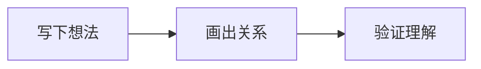
````

需要标题或说明文字时，改用全局注册的 `Mermaid` 组件：

```tsx
<Mermaid
  title="新版图表卡片的结构"
  caption="说明文字显示在图的下方。"
  chart={`flowchart LR
  A --> B`}
/>
```

<TypeTable
  type={{
    chart: { type: 'string', description: 'Mermaid 源码。字符串中的 \\n 会被当作换行。', required: true },
    title: { type: 'string', description: '顶栏标题，默认是自动识别的图表类型。' },
    caption: { type: 'ReactNode', description: '图下方的说明文字。' },
    preset: {
      type: "'modern' | 'classic' | 'neo' | 'redux' | 'redux-color' | 'hand-drawn' | 'teal' | 'indigo'",
      description: '配色方案，全部跟随网站深浅模式。',
      default: "'modern'",
    },
  }}
/>

## 新的默认配色

默认的 `modern` 主题和站点界面使用同一套中性色：白色节点、浅灰细边框、灰色连线，只在需要区分的地方使用一抹蓝色。连线上的文字底色与画布一致，不再出现突兀的色块。切换右上角的深浅模式，图会在后台重新绘制完毕后再替换，不会闪烁。

## 效果展示

下面每张图都是实时渲染的。可以打开“查看源码”，或点击放大按钮试试全屏查看。

### 流程图

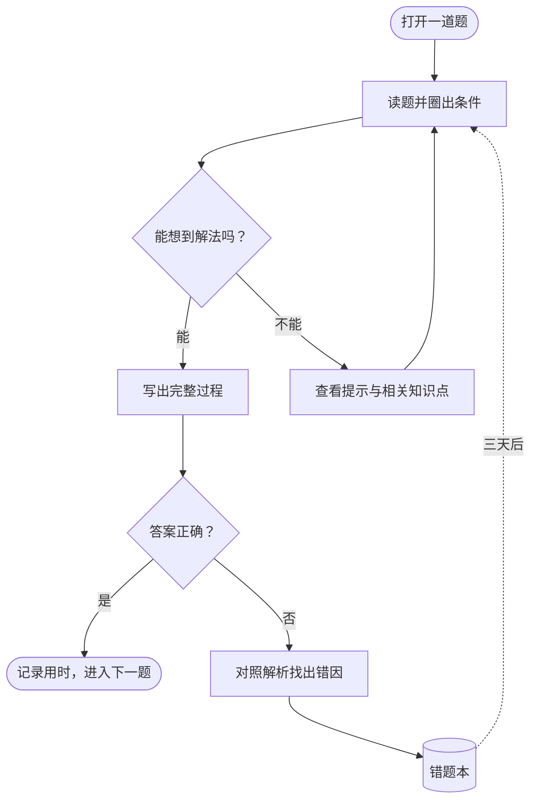

### 时序图

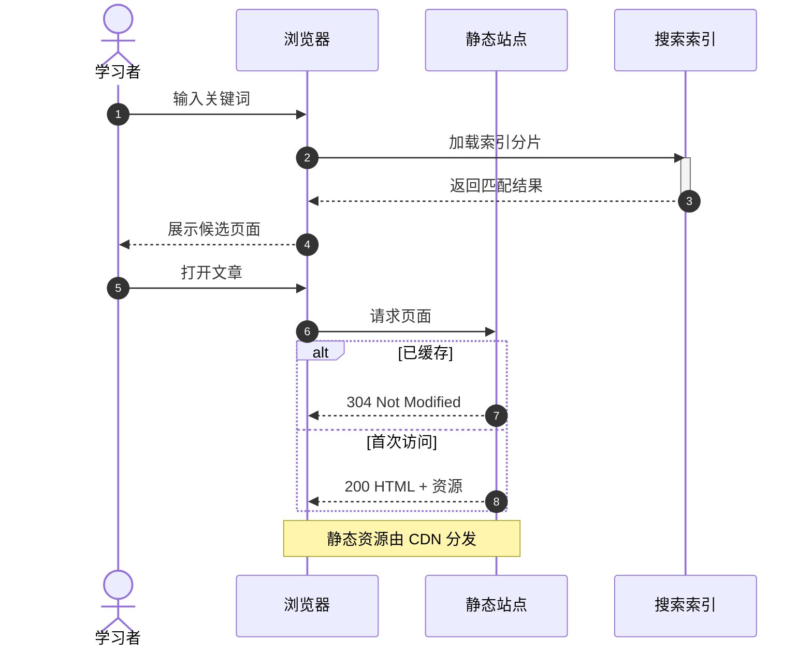

### 状态图

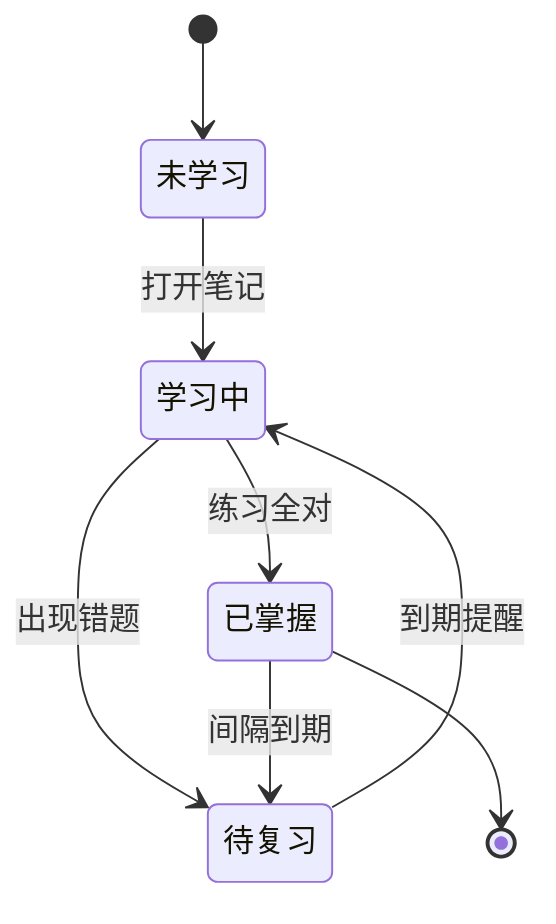

### 类图

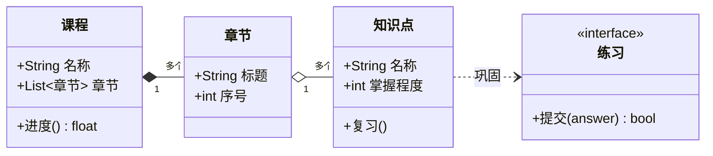

### 实体关系图

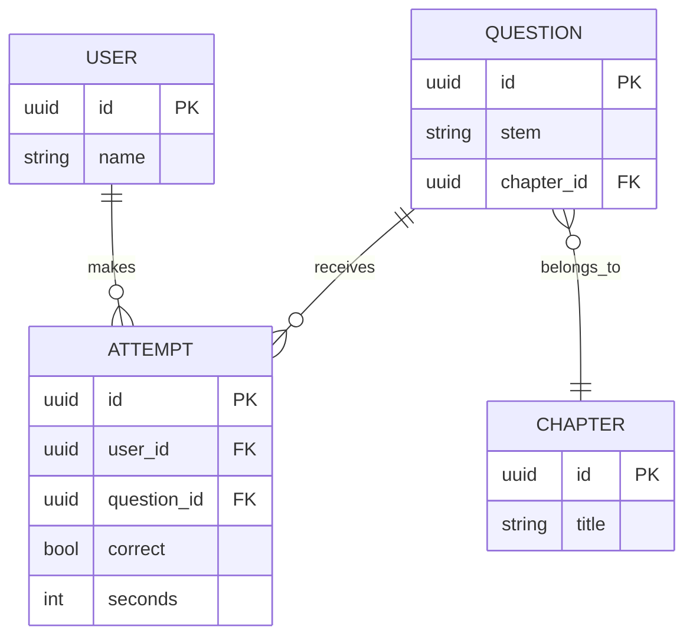

### 甘特图

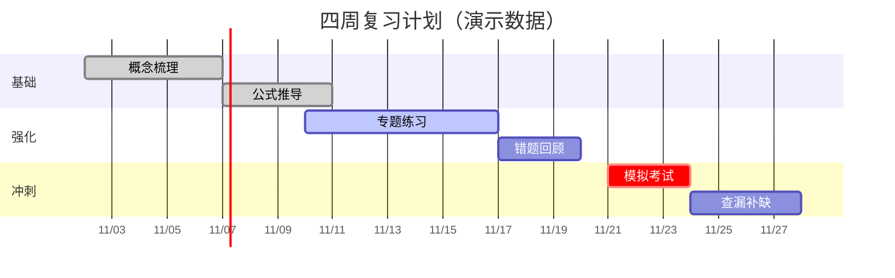

### 饼图

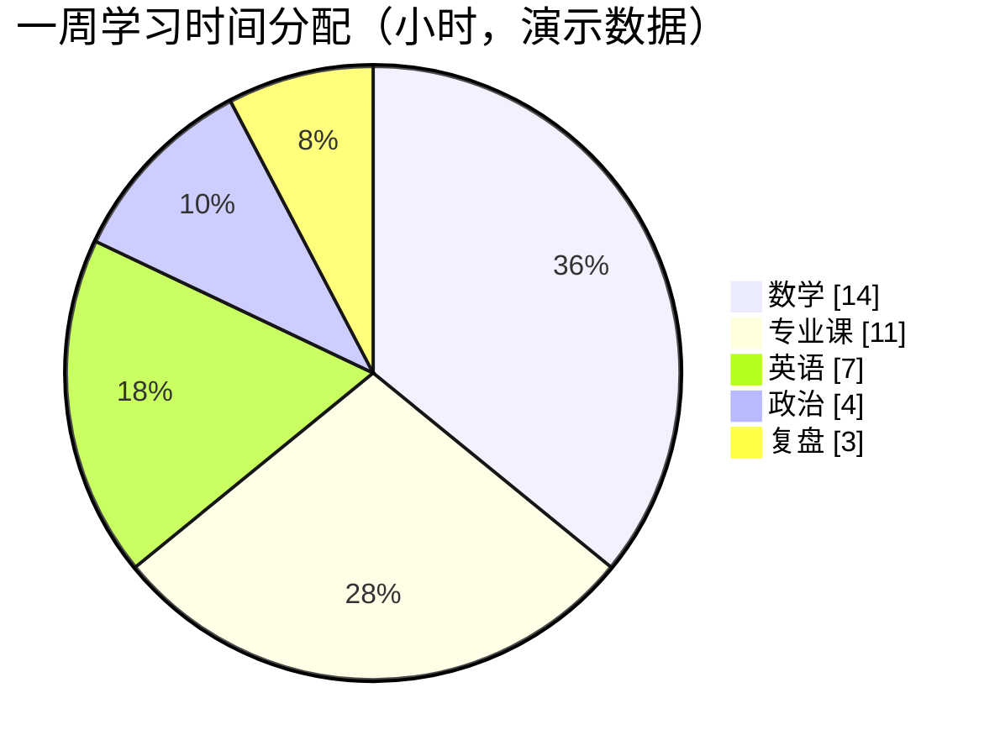

### 思维导图

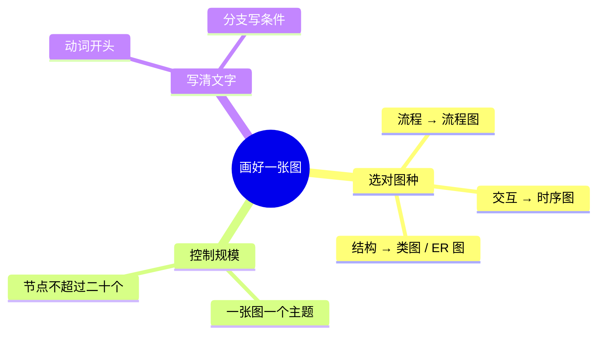

### 时间线

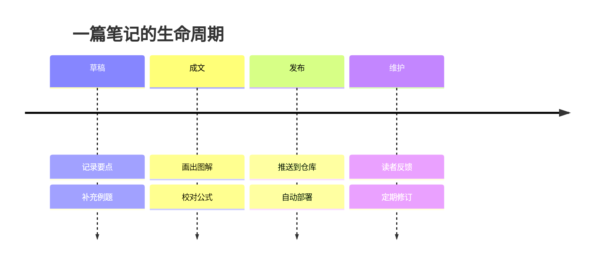

### Git 分支图

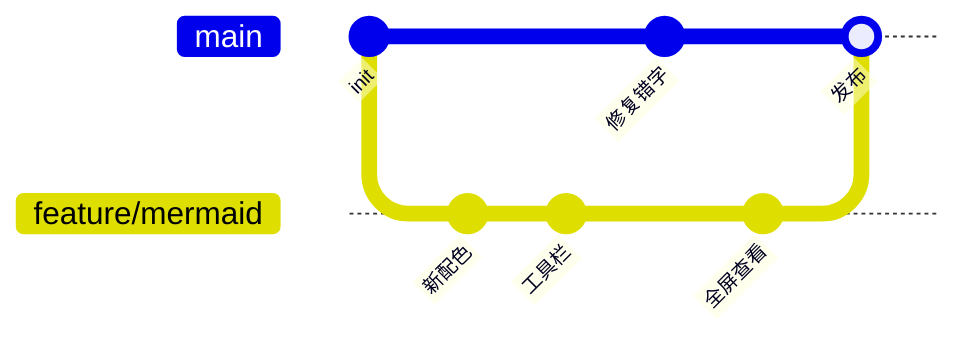

### 象限图

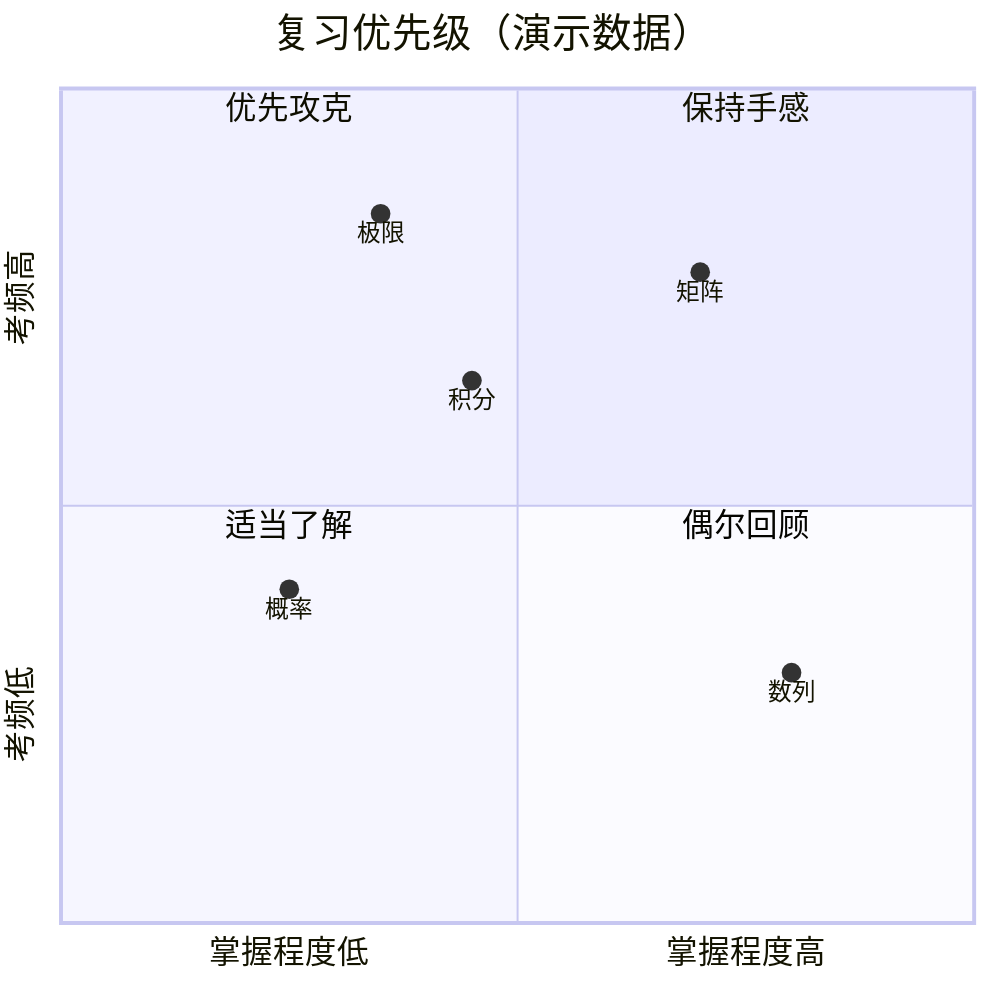

### XY 图

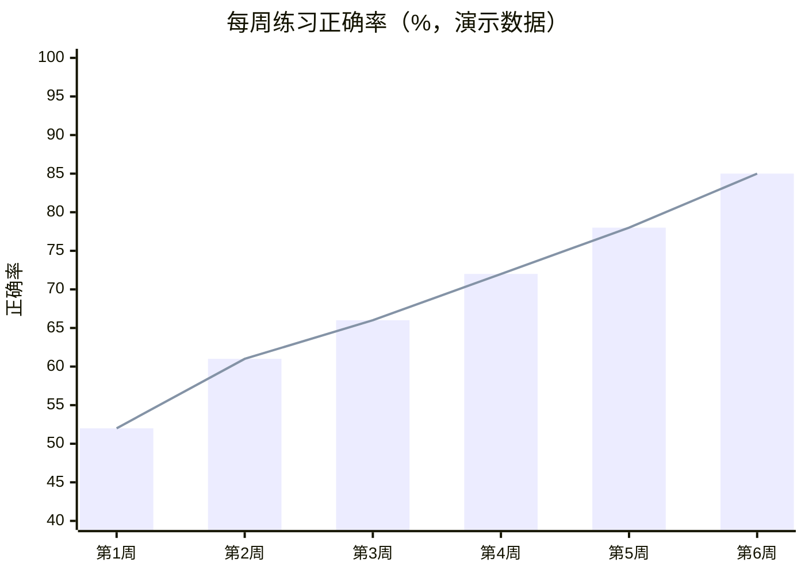

## 出错时也友好

源码写错时，卡片会保留外观，直接显示 Mermaid 给出的错误位置，方便排查，而不会让整页崩溃：

<Mermaid
  title="一张写错的图"
  chart={`flowchart LR
  A[开始] --> B{判断
  B -->|是| C`}
/>

## 其他配色

旧版的浅紫主题和其他内置风格仍然可以通过 `preset` 使用，比如手绘风格：

<Mermaid
  preset="hand-drawn"
  title="手绘风格 · preset=&quot;hand-drawn&quot;"
  chart={`flowchart LR
  A[读题] --> B[画图] --> C{想通了吗}
  C -->|是| D[写答案]
  C -->|否| B`}
/>

八种配色的完整对比见[Mermaid 主题对比](/blog/mermaid-theme-gallery)。实现集中在 `components/mdx/mermaid.tsx`、`components/mdx/mermaid-viewer.tsx`、`lib/mermaid-presets.ts` 与 `styles/mermaid.css`，调整配色只需修改 `modern` 预设的调色板。
