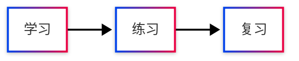

import { MermaidThemeGallery } from '@/components/blog/mermaid-theme-gallery';

这一页把同一份图表源码画成八种风格。先看配色和线条，再切换到时序图、类图，看看你喜欢的主题是否也适合其他图种。

使用页面右上角的浅色 / 深色按钮，可以查看每套主题的两种配色。下方都是真实渲染的 Mermaid 图表。

## 八种风格，现场对比

Modern 是站点默认主题，配色与界面的中性色保持一致；Neo、Redux 和 Redux Color 使用 Mermaid 内置主题；Hand Drawn 使用内置手绘外观。青绿与靛蓝由 `base + themeVariables` 定义，并分别配置浅色与深色颜色。

<MermaidThemeGallery />

## 如何选择

| 风格 | 适合的内容 |
| --- | --- |
| Modern | 站点默认，适合绝大多数文档 |
| Classic | 对照旧版的默认效果 |
| Neo | 日常技术文档与学习笔记 |
| Redux | 希望读者集中关注结构的说明 |
| Redux Color | 需要区分角色、对象和分类的图解 |
| Hand Drawn | 课堂笔记、草稿和头脑风暴 |
| 青绿 | 柔和、清晰的学习流程 |
| 靛蓝 | 系统关系、接口和技术概念 |

Redux Color 的自动分类配色在时序图和类图中更明显；普通流程图节点可能与单色 Redux 接近。

这八种风格使用相同的 Dagre 布局。流程图、时序图、类图各自的排版规则不同，主题和手绘外观在不同图种上的表现也会有所区别。

## 在文章中使用

站内全局注册的 `Mermaid` 组件现在支持 `preset`，例如：

```tsx
<Mermaid
  preset="neo"
  chart={`flowchart LR
    A[学习] --> B[练习] --> C[复习]`}
/>
```

`preset` 可选 `modern`、`classic`、`neo`、`redux`、`redux-color`、`hand-drawn`、`teal`、`indigo`，都会跟随网站深浅模式。不指定时使用站点默认的 `modern`。新版图表卡片的功能介绍见[重新设计的 Mermaid 图表](/blog/mermaid-figure-redesign)。

普通 Mermaid 代码块也可以通过内部 frontmatter 指定主题：

````md

````

这种写法会固定使用指定主题；需要自动切换浅色与深色时，使用上面的 `preset`。自定义配色集中在 `lib/mermaid-presets.ts`，可以继续调整节点颜色、边框、文字、连线与间距。

参考：[Mermaid 官方主题文档](https://mermaid.js.org/config/theming.html)、[Fumadocs Mermaid 接入说明](https://www.fumadocs.dev/docs/markdown/mermaid)。
