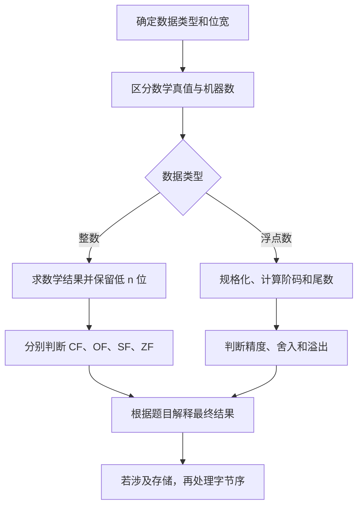

本章归纳3道历年真题与2道模拟题，共5道综合应用题。

## 一、本章大题的考查规律

| 题目来源                 | 核心考点                      | 学习价值  |
| -------------------- | ------------------------- | ----- |
| 2011 年 408 真题        | 补码、类型转换、加减法、溢出判断          | ★★★★★ |
| 2017 年 408 真题        | 无符号下溢、浮点数、精度与舍入           | ★★★★★ |
| 2020 年 408 真题        | 乘法实现、乘积截断、溢出判断            | ★★★★  |
| 2027 王道模拟第 2 套第 43 题 | 无符号加减法、CF、ZF、进位与借位        | ★★★★  |
| 2027 王道模拟第 4 套第 43 题 | CF、OF、SF、ZF、大小比较、浮点数、小端存储 | ★★★★★ |

复习优先级依据题库覆盖情况与知识迁移价值，并非未来考试频率预测。

| 知识模块              | 重要程度 | 必须达到的水平         |
| ----------------- | ---- | --------------- |
| 机器数与真值、类型转换       | S    | 看到十六进制立即能够解释真值  |
| 整数加减法与模运算         | S    | 不依赖逐位二进制计算也能求结果 |
| CF、OF、SF、ZF 与大小比较 | S    | 能独立判断所有标志位      |
| IEEE 754 浮点数      | S    | 熟练编码、解码、判断舍入与溢出 |
| 整数乘法与截断           | A    | 理解高低位乘积与溢出      |
| 大端、小端存储           | A    | 准确写出各地址中的字节内容   |

其中，**2011 年真题、2017 年真题和模拟第 4 套第 43 题**最值得作为主讲题。其余两道题用于补充进位借位和乘法的关键知识，不需要重复讲解相同套路。

## 二、最重要的底层思想：区分数学真值、机器数和解释方式

计算机寄存器里存储的是二进制位串，而不是带有数学意义的正数或负数。

例如，寄存器中存储：

$$
10000110_2=\mathrm{86H}
$$

如果它是 8 位无符号整数：

$$
x=134
$$

如果它是 8 位有符号补码整数：

$$
x=134-256=-122
$$

位串完全没有改变，只是解释方式发生了改变。

### 2.1 统一解码方法

假设一个 $n$ 位机器数，按照无符号方式读取的值为 $U$，那么：

$$
\text{unsigned}=U
$$

$$
\text{signed}= \begin{cases} U,&U<2^{n-1}\\ U-2^n,&U\geq 2^{n-1} \end{cases}
$$

这比每次使用原码、反码、补码之间的转换更方便。

常见边界机器数如下：

| 8 位机器数 | 无符号真值 | 有符号补码真值 |
| ------ | ----- | ------- |
| 00H    | 0     | 0       |
| 01H    | 1     | 1       |
| 7FH    | 127   | 127     |
| 80H    | 128   | -128    |
| 81H    | 129   | -127    |
| FEH    | 254   | -2      |
| FFH    | 255   | -1      |

机器数的边界规律：

- 最高位为 0：两种整数解释方式得到相同真值。
- 最高位为 1：无符号真值减去 $2^n$，就是有符号补码真值。
- 全 1：无符号最大值，有符号的 $-1$。
- 最高位为 1、其余全 0：有符号最小值。

### 2.2 整数加减法的本质是模运算

一个 $n$ 位寄存器只能保留低 $n$ 位。

所以硬件加减法的位模式满足：

$$
R=(A+B)\bmod 2^n
$$

$$
R=(A-B)\bmod 2^n
$$

在 8 位计算机中：

$$
2^8=256
$$

如果数学结果为 380，则硬件保留：

$$
380\bmod256=124
$$

如果数学结果为 $-112$，则硬件保留：

$$
-112+256=144
$$

<Callout type="idea" title="整数运算三步法">

**先求数学结果，再取模得到机器数，最后根据类型解释机器数。**

</Callout>

这是本章绝大多数整数计算大题的最快解题方法。

## 三、精讲代表题一：2011 年 408 真题

### 3.1 题目核心

假设计算机字长为 8 位：

```c
unsigned int x = 134;
unsigned int y = 246;
int m = x;
int n = y;
unsigned int z1 = x - y;
unsigned int z2 = x + y;
int k1 = m - n;
int k2 = m + n;
```

题目要求计算寄存器内容、变量真值，并说明有符号和无符号数能否共用加法器，以及如何判断溢出。

### 3.2 第一步：建立机器数与真值对照

$$
134=\mathrm{86H}
$$

$$
246=\mathrm{F6H}
$$

同位宽的有符号、无符号整数转换，在本题采用的机器模型中保持位模式不变。

因此：

$$
m=134-256=-122
$$

$$
n=246-256=-10
$$

| 变量 | 机器数 | 真值   |
| -- | --- | ---- |
| x  | 86H | 134  |
| y  | F6H | 246  |
| m  | 86H | -122 |
| n  | F6H | -10  |

### 3.3 第二步：直接使用模运算

无符号减法：

$$
z_1=(134-246)\bmod256
$$

$$
=144=\mathrm{90H}
$$

无符号加法：

$$
z_2=(134+246)\bmod256
$$

$$
=124=\mathrm{7CH}
$$

有符号减法：

$$
k_1=-122-(-10)=-112
$$

机器数为：

$$
-112+256=144=\mathrm{90H}
$$

有符号加法：

$$
-122+(-10)=-132
$$

但 8 位补码表示范围为：

$$
[-128,127]
$$

因此发生有符号溢出。按照题目的硬件截断模型：

$$
-132\bmod256=124=\mathrm{7CH}
$$

最终结果汇总：

| 变量 | 数学运算结果 | 最终机器数 | 机器数对应真值 | 是否越界  |
| -- | ------ | ----- | ------- | ----- |
| z1 | -112   | 90H   | 144     | 无符号下溢 |
| z2 | 380    | 7CH   | 124     | 无符号上溢 |
| k1 | -112   | 90H   | -112    | 否     |
| k2 | -132   | 7CH   | 124     | 有符号溢出 |

这里可以发现一个非常重要的现象：

$$
[z_1]_{\text{机器数}}=[k_1]_{\text{机器数}}
$$

$$
[z_2]_{\text{机器数}}=[k_2]_{\text{机器数}}
$$

尽管参与运算的数学真值不同，最终的机器数却相同。

这不是巧合，而是模运算的必然结果。

### 3.4 为什么四种加减法可以共用一个加法器？

无论有符号还是无符号，加法器都只需要进行二进制加法。

加法：

$$
A+B
$$

减法：

$$
A-B=A+\overline B+1\pmod{2^n}
$$

其中 $\overline B$ 表示对操作数的所有位按位取反。

硬件只需使用加减控制信号，决定是否对 $B$ 取反，以及最低位进位输入是否为 1。

设控制信号为 $Sub$，则：

$$
R=A+(B\oplus M)+Sub
$$

其中 $M$ 是将 $Sub$ 复制到全部 $n$ 位得到的掩码。

| 运算 | Sub | B 的处理方式 | 最低位进位 |
| -- | --- | ------- | ----- |
| 加法 | 0   | 不变      | 0     |
| 减法 | 1   | 按位取反    | 1     |

**标准大题答题语言：**

有符号整数和无符号整数的加减法在机器数层面均可归结为模 $2^n$ 的二进制加法。减法通过对减数按位取反、最低位进位输入置 1 实现。因此四种运算可以共用同一个加法器及辅助控制电路，只是溢出判断方式不同。

需要注意，408 此类题通常按照题设的固定字长硬件模型讨论截断结果；严格的标准 C 语言中，有符号整数算术溢出属于未定义行为，不能无条件认为必然回绕。

## 四、标志位：CF、OF、SF、ZF 的彻底理解

结合 2011 年真题、模拟第 2 套和第 4 套，可以发现，很多题目本质上都在考查这四个标志位之间的区别。

### 4.1 四个标志位究竟在判断什么？

| 标志位 | 名称   | 本质             |
| --- | ---- | -------------- |
| CF  | 进位标志 | 无符号运算是否发生进位或借位 |
| OF  | 溢出标志 | 有符号运算是否超出表示范围  |
| SF  | 符号标志 | 运算结果的最高位是否为 1  |
| ZF  | 零标志  | 运算结果的所有位是否为 0  |

需要将它们分成两组理解：

<Callout type="info" title="标志位的两类含义">

**CF、OF 判断运算有没有越界；SF、ZF 描述截断后的机器数具有什么特征。**

</Callout>

因此，SF 为 1 不代表发生溢出，CF 为 1 也不代表 OF 必然为 1。

### 4.2 CF：无符号进位和借位

对于无符号加法：

$$
CF= \begin{cases} 1,&A+B\geq 2^n\\ 0,&A+B<2^n \end{cases}
$$

对于无符号减法，按照 408 常见的 CF 表示借位的约定：

$$
CF= \begin{cases} 1,&A<B\\ 0,&A\geq B \end{cases}
$$

这两个公式足够解决绝大多数 CF 计算题，不需要真的进行逐位进位运算。

但是，题目有时还会要求计算加法器最高位的进位 $C_{\text{out}}$。

必须区分：

| 运算 | CF 与最高位进位的关系                        |
| -- | ----------------------------------- |
| 加法 | $CF=C_{\text{out}}$            |
| 减法 | $CF=\overline{C_{\text{out}}}$ |

为什么减法反而要取反？

因为减法实际执行的是：

$$
A+\overline B+1
$$

又因为：

$$
\overline B=2^n-1-B
$$

所以加法器执行的数学运算是：

$$
A+\overline B+1=2^n+A-B
$$

如果 $A\geq B$，那么结果至少为 $2^n$，最高位产生进位，说明减法没有借位。

如果 $A<B$，那么结果小于 $2^n$，最高位没有进位，反而说明减法发生借位。

**所以减法的最高位进位为 1，恰好表示没有借位。**

统一公式为：

$$
\boxed{CF=C_{\text{out}}\oplus Sub}
$$

这里采用题库中 CF=1 表示减法借位的约定。实际做题时如果题目另外规定 CF 的语义，应以题设为准。

### 4.3 OF：有符号溢出

设两个操作数的符号位为 $S_A,S_B$，结果符号位为 $S_R$。

对于加法：

$$
\boxed{ OF=\overline{S_A\oplus S_B} \cdot(S_A\oplus S_R) }
$$

对于减法：

$$
\boxed{ OF=(S_A\oplus S_B) \cdot(S_A\oplus S_R) }
$$

不用死记公式，可以记住下面的规律。

| 运算情况    | 是否可能发生溢出 |
| ------- | -------- |
| 正数 + 正数 | 可能上溢     |
| 负数 + 负数 | 可能下溢     |
| 正数 + 负数 | 不会       |
| 正数 - 负数 | 可能上溢     |
| 负数 - 正数 | 可能下溢     |
| 同号数相减   | 不会       |

判断口诀：

**加法同号才可能溢出，减法异号才可能溢出；发生溢出时，结果符号与第一个操作数不同。**

硬件层面还有一个统一公式：

$$
\boxed{OF=C_{\text{in}}\oplus C_{\text{out}}}
$$

其中：

- $C_{\text{in}}$：进入符号位的进位。
- $C_{\text{out}}$：符号位向外产生的进位。

这个公式对加法、由加法器实现的减法都成立。

### 4.4 四种标志位的快速计算训练

以下均为 8 位运算，并采用 CF 表示减法借位的约定。

| 运算        | 结果机器数 | CF | OF | SF | ZF |
| --------- | ----- | -- | -- | -- | -- |
| 7FH + 01H | 80H   | 0  | 1  | 1  | 0  |
| FFH + 01H | 00H   | 1  | 0  | 0  | 1  |
| 80H + 80H | 00H   | 1  | 1  | 0  | 1  |
| 44H + 50H | 94H   | 0  | 1  | 1  | 0  |
| 44H - 50H | F4H   | 1  | 0  | 1  | 0  |
| 80H - 01H | 7FH   | 0  | 1  | 0  | 0  |
| 00H - 01H | FFH   | 1  | 0  | 1  | 0  |

其中第四、第五行就是题库中**王道模拟第 2 套第 43 题**的运算。

原题：

$$
x=68,\qquad y=80
$$

无符号加法：

$$
68+80=148
$$

148 没有超过 255，所以 CF=0；但超过有符号数最大值 127，所以 OF=1。

无符号减法：

$$
68-80=-12
$$

因此发生借位，CF=1；而 $-12$ 可以用 8 位补码表示，所以 OF=0。

核心结论：

**同一次运算，完全可能发生有符号溢出却没有无符号越界，也可能发生无符号越界却没有有符号溢出。**

CF 和 OF 是两个相互独立的判断维度。

## 五、精讲代表题二：王道模拟第 4 套第 43 题

本题结合补码减法、标志位、大小比较、IEEE 754 和小端存储。

### 5.1 通过减法实现大小比较

题目给定：

```c
int a[10], b[10];
float x = -15.25f;
```

其中：

```c
a[5] = 0x7FFFFFFF;
b[5] = 0xFFFFFFFF;
```

判断：

```c
if (b[5] < a[5])
    b[5] = 1;
else
    b[5] = 0;
```

计算机通过执行 $b[5]-a[5]$，然后检查标志位来进行比较。

<Steps>

<Step>

### 确定真值

$$
a=2^{31}-1
$$

$$
b=-1
$$

所以：

$$
b-a=-1-(2^{31}-1)=-2^{31}
$$

恰好是 32 位补码最小值。

运算结果为：

$$
R=\mathrm{80000000H}
$$

</Step>

<Step>

### 计算标志位

| 标志位 | 结果 | 理由                   |
| --- | -- | -------------------- |
| CF  | 0  | 无符号解释下，被减数大于减数，没有借位  |
| OF  | 0  | $-2^{31}$ 可以精确表示 |
| SF  | 1  | 结果最高位为 1             |
| ZF  | 0  | 结果非零                 |

</Step>

<Step>

### 判断大小

由于：

$$
SF\oplus OF=1\oplus0=1
$$

所以：

$$
b<a
$$

条件成立，最终 `b[5] = 1`。

</Step>

</Steps>

### 5.2 为什么不能只通过 SF 判断大小？

假设使用 8 位补码比较：

$$
A=127,\qquad B=-1
$$

显然：

$$
A>B
$$

但是：

$$
A-B=128
$$

机器数为：

$$
\mathrm{80H}=10000000_2
$$

此时 SF=1。

如果只看 SF，就会错误地认为减法结果为负，从而判断 $A<B$。

实际上，这是因为发生了有符号溢出：

$$
OF=1
$$

所以：

$$
SF\oplus OF=1\oplus1=0
$$

正确判断出 $A$ 不小于 $B$。

**SF 表示截断后结果的符号，OF 指示符号是否因为溢出而失真。两者异或，就能够修正这种错误。**

### 5.3 大小比较的统一公式

设计算机执行：

$$
R=A-B
$$

并采用 CF=1 表示借位的约定。

| 比较关系          | 无符号数              | 有符号数                         |
| ------------- | ----------------- | ---------------------------- |
| $A<B$    | $CF=1$        | $SF\oplus OF=1$          |
| $A\leq B$ | $CF\lor ZF=1$ | $(SF\oplus OF)\lor ZF=1$ |
| $A=B$     | $ZF=1$        | $ZF=1$                   |
| $A\ne B$  | $ZF=0$        | $ZF=0$                   |
| $A\geq B$ | $CF=0$        | $SF\oplus OF=0$          |
| $A>B$     | $CF=0,\ ZF=0$ | $SF\oplus OF=0,\ ZF=0$   |

其实只需要记住三个基础结论：

$$
\boxed{\text{无符号小于：}CF=1}
$$

$$
\boxed{\text{有符号小于：}SF\oplus OF=1}
$$

$$
\boxed{\text{相等：}ZF=1}
$$

其他大小关系全部可以由这三个结论推导出来。

## 六、IEEE 754 浮点数：掌握真正的编码逻辑

浮点数大题同时考查编码、精度与舍入。

### 6.1 IEEE 754 的基本结构

| 字段        | 单精度 float         | 双精度 double          |
| --------- | ----------------- | ------------------- |
| 符号位 S     | 1 位               | 1 位                 |
| 阶码 E      | 8 位               | 11 位                |
| 尾数字段 F    | 23 位              | 52 位                |
| 阶码偏置值     | 127               | 1023                |
| 规格化有效位数   | 24 位              | 53 位                |
| 规格化实际指数范围 | $-126\sim127$ | $-1022\sim1023$ |

单精度浮点数的规格化真值公式：

$$
\boxed{V=(-1)^S(1.F)_2\times2^{E-127}}
$$

必须注意，尾数字段虽然只有 23 位，但是规格化浮点数隐含一个最高位 1。

因此，实际有效位数是：

$$
23+1=24
$$

### 6.2 浮点数编码的五步法

继续使用刚才模拟第 4 套第 43 题中的：

$$
x=-15.25
$$

<Steps>

<Step>

### 确定符号位

负数，因此：

$$
S=1
$$

</Step>

<Step>

### 二进制转换

$$
15.25=1111.01_2
$$

</Step>

<Step>

### 规格化

$$
1111.01_2=1.11101_2\times2^3
$$

</Step>

<Step>

### 阶码与尾数

$$
E=3+127=130=10000010_2
$$

尾数字段去掉隐藏的最高位 1：

$$
F=11101000000000000000000
$$

</Step>

<Step>

### 拼接机器数

```text
1 | 10000010 | 11101000000000000000000

1100 0001 0111 0100 0000 0000 0000 0000

 C    1    7    4    0    0    0    0
```

因此：

$$
\boxed{x_{\text{机器数}}=\mathrm{C1740000H}}
$$

</Step>

</Steps>

注意：IEEE 754 负浮点数并不是将对应正数的整个机器数求补码，只需要设置相应符号位。

### 6.3 大端和小端存储

题目给定变量 $x$ 的首地址为 `12345670H`，采用小端方式存储。

已求得机器数：

```text
C1 74 00 00
```

| 内存地址      | 小端存储 | 大端存储（对照） |
| --------- | ---- | -------- |
| 12345670H | 00H  | C1H      |
| 12345671H | 00H  | 74H      |
| 12345672H | 74H  | 00H      |
| 12345673H | C1H  | 00H      |

<Callout type="idea" title="字节序">

**小端：低有效字节存放在低地址。大端：高有效字节存放在低地址。**

</Callout>

大小端只改变各字节的存放顺序，不改变字节内部的位顺序，也不改变数据的数学真值。

建议做题时先完成机器数编码，再单独进行字节排列。不要把编码和字节序混在一起计算。

### 6.4 IEEE 754 特殊值

| 阶码字段 E     | 尾数字段 F | 表示意义    |
| ---------- | ------ | ------- |
| 全 0        | 全 0    | 正零或负零   |
| 全 0        | 非全 0   | 非规格化数   |
| 非全 0 且非全 1 | 任意     | 规格化数    |
| 全 1        | 全 0    | 正无穷或负无穷 |
| 全 1        | 非全 0   | NaN     |

单精度浮点数中几个特别重要的机器数：

| 机器数       | 真值       |
| --------- | -------- |
| 00000000H | 正零       |
| 80000000H | 负零       |
| 3F800000H | 1.0      |
| BF800000H | -1.0     |
| 7F800000H | 正无穷      |
| FF800000H | 负无穷      |
| 7F7FFFFFH | 最大正有限值   |
| 00800000H | 最小正规格化数  |
| 00000001H | 最小正非规格化数 |

最大正有限值：

$$
(2-2^{-23})\times2^{127}
$$

最小正规格化数：

$$
2^{-126}
$$

最小正非规格化数：

$$
2^{-149}
$$

对于非规格化数，没有隐藏的最高位 1，其计算公式为：

$$
V=(-1)^S(0.F)_2\times2^{-126}
$$

## 七、精讲代表题三：2017 年 408 真题

它考查的不是简单地将十进制转换为 IEEE 754，而是整数和浮点数在表示范围、表示精度、计算结果上的本质区别。

### 7.1 题目核心

计算函数：

$$
f(n)=\sum_{i=0}^{n}2^i=2^{n+1}-1
$$

对应的 C 语言程序：

```c
int f1(unsigned n) {
    int sum = 1, power = 1;
    for (unsigned i = 0; i <= n - 1; i++) {
        power *= 2;
        sum += power;
    }
    return sum;
}
```

将程序中的 `int` 改为 `float`，得到函数 `f2`，其中 `unsigned` 仍然是无符号整数类型。

本题综合考查无符号数、整数溢出、浮点舍入和浮点溢出。

### 7.2 第一层考点：为什么 n=0 会导致死循环？

由于 `n` 是 32 位无符号整数：

$$
n-1=(0-1)\bmod2^{32}
$$

$$
=2^{32}-1
$$

循环条件变成：

$$
i\leq 2^{32}-1
$$

而 $2^{32}-1$ 已经是 `unsigned` 的最大值。

当 $i$ 达到最大值后，再加 1 又会回到 0，所以循环条件始终成立。

如果将 `i` 和 `n` 都改为 `int`：

$$
n-1=-1
$$

第一次判断就是：

$$
0\leq-1
$$

不成立，循环正常结束。

这里按真题给定的整数机器运算模型解释循环控制；原程序中的有符号算术溢出在严格标准 C 语义下仍属于未定义行为。

#### 提炼出的重要规律

看到以下代码时一定要警惕：

```c
unsigned i;
```

特别是无符号变量与减法、负数比较、递减循环结合的情况。

例如：

```c
for (unsigned i = 10; i >= 0; i--)
```

循环无法通过 `i >= 0` 这个条件正常退出，因为无符号数永远非负。

### 7.3 第二层考点：为什么 n=23 时整数与浮点数相等？

$$
f(23)=2^{24}-1
$$

其二进制是连续 24 个 1。

```text
111111111111111111111111
```

32 位 `int` 可以精确表示它：

$$
\boxed{\mathrm{00FFFFFFH}}
$$

单精度 float 同样具有 24 位有效精度，因此也能精确表示。

规格化：

$$
2^{24}-1=1.\underbrace{11\cdots1}_{23\text{位}}\times2^{23}
$$

阶码：

$$
E=23+127=150
$$

拼接得到：

$$
\boxed{\mathrm{4B7FFFFFH}}
$$

所以：

$$
f_1(23)=f_2(23)=16777215
$$

但是，虽然两者真值相同，机器数却完全不同，因为编码规则不同。

### 7.4 第三层考点：为什么 n=24 时浮点数会多出 1？

当 $n=24$ 时：

$$
f(24)=2^{25}-1=33554431
$$

它的二进制由连续 25 个 1 组成。

而 float 只能保留 24 位有效数字，所以无法精确表示。

但为什么不是简单丢弃最后一位，而是变成：

$$
33554432=2^{25}
$$

这就涉及 IEEE 754 默认的舍入方式：**舍入到最近值，距离相同时选择偶数。**

下面分析它附近实际能够表示的浮点数。

在区间：

$$
[2^{24},2^{25})
$$

相邻单精度浮点数的间距为：

$$
2^{24-23}=2
$$

因此 $33554431$ 左右两个相邻的可表示值分别是：

| 浮点数                  | 与真实值的距离 |
| -------------------- | ------- |
| 33554430             | 1       |
| **33554431（真实数学结果）** | 无法精确表示  |
| 33554432             | 1       |

真实值恰好位于两个可表示浮点数的中间。

按照就近舍入、平局取偶的规则，选择有效数最低位为 0 的候选值：

$$
\boxed{33554432}
$$

于是：

$$
f_1(24)=33554431
$$

$$
f_2(24)=33554432.0
$$

两者不同。

### 7.5 浮点数精度的真正本质

单精度浮点数并不是在所有数值范围内，都能以相同精度表示数字。

对于实际指数为 $e$ 的规格化单精度浮点数，其所在指数区间内的相邻数间距为：

$$
\boxed{\operatorname{ULP}=2^{e-23}}
$$

| 数值区间                  | 相邻单精度浮点数间距    |
| --------------------- | ------------- |
| $[2^0,2^1)$       | $2^{-23}$ |
| $[2^{20},2^{21})$ | $2^{-3}$  |
| $[2^{23},2^{24})$ | 1             |
| $[2^{24},2^{25})$ | 2             |
| $[2^{25},2^{26})$ | 4             |
| $[2^{26},2^{27})$ | 8             |
| $[2^{30},2^{31})$ | 128           |

这说明：

**浮点数越大，相邻可表示数值之间的绝对间距通常越大。**

从 $2^{24}$ 开始，float 无法连续、精确地表示每一个整数。

但是不能说超过 $2^{24}$ 的整数一定无法精确表示。

例如：

$$
2^{30}
$$

仍然可以精确表示，因为其规格化形式为：

$$
1.0\times2^{30}
$$

只需要一位有效数字。

因此，判断某个整数能否精确表示，不能只看数值有多大，还要看它需要多少位有效二进制数字。

### 7.6 第四层考点：不溢出与精确表示是两回事

回到原题：

$$
f(n)=2^{n+1}-1
$$

#### 对于 32 位 int

最大值为：

$$
2^{31}-1
$$

令：

$$
2^{n+1}-1\leq2^{31}-1
$$

得到：

$$
\boxed{n_{\max}=30}
$$

当 $n=31$ 时，数学结果为：

$$
2^{32}-1
$$

题目指定的机器运算结果为全 1：

$$
\mathrm{FFFFFFFFH}
$$

作为有符号补码解释，其真值是 $-1$。

#### 对于 float，要求精确表示

由于 $f(n)$ 由 $n+1$ 个连续的二进制 1 组成，需要 $n+1$ 位有效数字。

因此：

$$
n+1\leq24
$$

$$
\boxed{n_{\max}=23}
$$

#### 对于 float，只要求不溢出

最大实际指数为 127。

在题目采用的默认舍入方式下：

$$
f(126)=2^{127}-1
$$

舍入后为：

$$
2^{127}
$$

仍然是有限值。

而：

$$
f(127)=2^{128}-1
$$

按该程序的浮点运算和舍入规则会溢出为：

$$
+\infty
$$

机器数为：

$$
\mathrm{7F800000H}
$$

因此：

$$
\boxed{n_{\max}=126}
$$

最终汇总：

| 要求                | 最大 n |
| ----------------- | ---- |
| int 返回正确数学结果      | 30   |
| float 返回精确数学结果    | 23   |
| float 返回有限值，不发生溢出 | 126  |

这张表体现了整数和浮点数的根本差异：

**同样是 32 位，float 具有更大的数值表示范围，但不保证具有更高的整数表示精度。**

#### 题库解析中的一处错误

原资料将 $2^{127}$ 描述为单精度浮点数最大有限值，这个表述是不准确的。

真正的最大有限值为：

$$
\boxed{(2-2^{-23})\times2^{127}}
$$

不过，原资料得出的最大 $n=126$ 是正确的。学习时应当区分这两件事，避免把错误的中间结论记下来。

## 八、整数乘法：不必陷入复杂的手工乘法

对应题库中的 **2020 年 408 真题**。

这道题主要考查乘法如何实现，以及截断乘积为什么会导致溢出。

### 8.1 乘法硬件的本质

二进制乘法可以分解为移位与加法。

例如：

$$
13\times11
$$

由于：

$$
11=2^3+2^1+2^0
$$

所以：

$$
13\times11=13\times(2^3+2^1+1)
$$

$$
=(13\ll3)+(13\ll1)+13
$$

$$
=104+26+13=143
$$

因此，即使计算机没有乘法指令，也可以通过加法指令、移位指令等实现乘法。

原题比较了三种乘法实现方式：

| 实现方式              | 实现原理           | 题设下的速度 |
| ----------------- | -------------- | ------ |
| 没有乘法指令            | 软件循环执行加法、移位等指令 | 最慢     |
| 有乘法指令，复用 ALU 和移位器 | 硬件控制多次加法、移位    | 居中     |
| 有专门阵列乘法器          | 硬件并行产生并累加部分积   | 最快     |

重点理解软件循环和硬件循环的区别。

软件实现需要多次执行指令，产生反复取指、译码等开销；硬件实现可以在一条乘法指令内部完成多个运算步骤。

### 8.2 乘法溢出判断

两个 $n$ 位整数相乘，完整乘积可以使用 $2n$ 位保存。

如果最终只保留低 $n$ 位，则可能丢失信息。

设：

$$
P=H\times2^n+L
$$

其中 $H$ 为乘积高 $n$ 位，$L$ 为低 $n$ 位，按位模式讨论。

<Tabs items={['无符号乘法', '有符号乘法']}>

<Tab value="无符号乘法">

如果高 $n$ 位全为 0，则截断后真值没有变化。

$$
\boxed{\text{无符号乘法不溢出}\iff H=0}
$$

</Tab>

<Tab value="有符号乘法">

如果高 $n$ 位恰好是低 $n$ 位符号位的扩展，则截断后仍然能够正确表示原来的有符号真值。

| 低 n 位符号位 | 不溢出的条件    |
| -------- | --------- |
| 0        | 高 n 位全为 0 |
| 1        | 高 n 位全为 1 |

<Callout type="warn" title="乘法溢出判断">

**有符号乘法不能简单地通过高位是否全 0 判断溢出。**

</Callout>

这是最重要的易错点。

</Tab>

</Tabs>

### 8.3 2020 年真题的关键计算

题目给定：

$$
x=2^{31}-1,\qquad y=2
$$

数学乘积：

$$
x\times y=2^{32}-2
$$

64 位完整乘积：

```text
00000000 FFFFFFFE
```

只保留低 32 位：

```text
FFFFFFFE
```

作为无符号整数：

$$
2^{32}-2=4294967294
$$

没有溢出。

作为有符号整数：

$$
-2
$$

显然与真实数学乘积不同，发生溢出。

| 项目        | 无符号乘法             | 有符号乘法             |
| --------- | ----------------- | ----------------- |
| 64 位完整乘积  | 00000000FFFFFFFEH | 00000000FFFFFFFEH |
| 32 位截断机器数 | FFFFFFFEH         | FFFFFFFEH         |
| 截断后的解释    | 4294967294        | -2                |
| 是否溢出      | 否                 | 是                 |

这里再次验证了本章的统一思想：

**相同机器数、相同运算结果位模式，并不意味着相同真值，也不意味着相同的溢出情况。**

进一步理解，两个相同的 $n$ 位操作数，无论进行有符号还是无符号乘法，完整 $2n$ 位乘积可能不同，但低 $n$ 位一定相同，因为两种解释方式之间的差异是 $2^n$ 的整数倍。

## 九、补充掌握：位移、扩展和截断

虽然提供的五道大题没有专门集中考查这部分，但这些知识与整数运算、类型转换直接相关，值得一并掌握。

### 9.1 算术移位与逻辑移位

| 操作           | 空缺位置的填充 |
| ------------ | ------- |
| 逻辑左移         | 低位补 0   |
| 算术左移（常见硬件实现） | 低位补 0   |
| 逻辑右移         | 高位补 0   |
| 补码算术右移       | 高位补符号位  |

例如 8 位补码：

$$
-5=\mathrm{FBH}=11111011_2
$$

算术右移一位：

```text
11111011 → 11111101
```

结果为：

$$
-3
$$

但是 C 语言中整数除法：

$$
-5/2=-2
$$

这是因为对于负数，补码算术右移通常相当于向负无穷方向取整，而 C 语言整数除法向零截断。

所以不能不加条件地认为算术右移等价于有符号整数除以 2。

### 9.2 位数扩展

假设一个 8 位机器数：

$$
\mathrm{86H}
$$

将其扩展为 16 位。

| 原始类型      | 扩展方式   | 扩展结果  |
| --------- | ------ | ----- |
| unsigned  | 高位补 0  | 0086H |
| signed 补码 | 高位补符号位 | FF86H |

零扩展保持无符号真值不变，符号扩展保持有符号补码真值不变。

特别注意，同位宽的类型重新解释、位数扩展、整数与浮点数之间的数值转换是三种不同操作，不能都理解为机器数不变。

## 十、本章大题的统一解题模板

考试时不管题目给出的是 C 语言代码、寄存器内容，还是加法器电路，都可以先按照下面的流程分析。



### 10.1 整数运算题

统一从四个角度入手：

| 步骤    | 要解决的问题             |
| ----- | ------------------ |
| 确定位宽  | 模数是多少？表示范围是多少？     |
| 求真实结果 | 不受寄存器位数限制的数学结果是多少？ |
| 求机器数  | 截断之后保留下来的二进制位串是什么？ |
| 判断越界  | 无符号越界、有符号溢出分别是否发生？ |

### 10.2 浮点数题

统一按照：

$$
\text{二进制转换} \longrightarrow \text{规格化} \longrightarrow \text{阶码偏置}
$$

$$
\longrightarrow \text{尾数舍入} \longrightarrow \text{字段拼接}
$$

涉及内存地址时，最后再处理大小端。

涉及浮点精度时，重点考虑有效位数和相邻浮点数间距。

涉及溢出时，重点考虑实际指数范围以及舍入结果。

### 10.3 C 语言程序综合题

先推导程序计算的数学表达式，再检查数据类型能否表示结果。

2017 年真题就是最好的例子。

只要识别出：

$$
f(n)=2^{n+1}-1
$$

接下来的整数溢出、浮点精度、浮点溢出都变成了表示范围与有效位数的问题。

## 十一、本章最容易丢分的 12 个陷阱

| 错误认识                               | 正确理解            |
| ---------------------------------- | --------------- |
| 机器数最高位为 1 就一定是负数                   | 取决于数据类型         |
| 同一个机器数一定对应同一个真值                    | 取决于解释方式         |
| 无符号数不会溢出                           | 可能发生进位越界或借位下溢   |
| CF 和 OF 意义相同                       | 分别判断无符号越界与有符号溢出 |
| 减法的 CF 就是最高位进位                     | 常见借位定义下恰好相反     |
| SF=1 就能判断有符号数小于                    | 必须结合 OF         |
| float 具有 23 位有效精度                  | 规格化数具有 24 位有效精度 |
| float 表示范围大，精度就一定高                 | 表示范围与表示精度不同     |
| 大于 $2^{24}$ 的整数都无法用 float 精确表示 | 取决于有效二进制位数      |
| 小端存储需要将所有二进制位反转                    | 只调整字节排列顺序       |
| 有符号乘法高位不为 0 就溢出                    | 应判断高位是否为低位符号扩展  |
| 算术右移一定等价于整数除以 2                    | 负数的取整方向可能不同     |

## 十二、自测练习

以下为基于题库考点设计的迁移练习，非历年真题。

建议先独立思考，再查看答案。

### 自测 1：整数减法和标志位

8 位计算机执行：

$$
\mathrm{80H}-\mathrm{01H}
$$

求机器数和四个标志位。

<Accordions>

<Accordion title="参考答案与解析">

**答案：**

$$
R=\mathrm{7FH}
$$

$$
CF=0,\quad OF=1,\quad SF=0,\quad ZF=0
$$

无符号解释：

$$
128-1=127
$$

有符号解释：

$$
-128-1=-129
$$

发生有符号溢出，因此：

$$
SF\oplus OF=1
$$

正确反映有符号被减数小于减数。

</Accordion>

</Accordions>

### 自测 2：浮点数精度

判断以下四个整数能否使用单精度 float 精确表示。

<Accordions>

<Accordion title="参考答案与解析">

| 数值             | 能否精确表示 |
| -------------- | ------ |
| $2^{24}-1$ | 能      |
| $2^{24}$   | 能      |
| $2^{24}+1$ | 不能     |
| $2^{24}+2$ | 能      |

原因是从 $2^{24}$ 开始，在当前指数区间中，相邻 float 的间距变为 2。

</Accordion>

</Accordions>

### 自测 3：乘法溢出

8 位有符号补码整数执行：

$$
-2\times3
$$

<Accordions>

<Accordion title="参考答案与解析">

16 位完整乘积：

$$
\mathrm{FFFAH}
$$

截断为 8 位：

$$
\mathrm{FAH}
$$

真值仍然是：

$$
-6
$$

高 8 位全为 1，是低 8 位符号位的正确扩展，因此没有发生有符号溢出。

</Accordion>

</Accordions>

## 十三、复习重点

代表题复习顺序如下。

| 学习顺序 | 代表题           | 掌握目标              |
| ---- | ------------- | ----------------- |
| 第一次  | 2011 年真题      | 建立机器数、真值、模运算的统一思维 |
| 第二次  | 模拟第 2 套第 43 题 | 彻底区分 CF、进位、借位     |
| 第三次  | 模拟第 4 套第 43 题 | 掌握标志位比较、浮点编码和字节序  |
| 第四次  | 2017 年真题      | 深入理解浮点数精度、舍入、范围   |
| 第五次  | 2020 年真题第 4 问 | 掌握乘积截断与溢出         |

核心思想总结：

**① 寄存器只保存位模式，数据类型决定如何解释位模式。**

**② 固定位宽的整数硬件加减法，本质是模 $2^n$ 的运算。**

**③ CF 判断无符号越界，OF 判断有符号溢出，SF 和 ZF 描述结果位模式。**

**④ 浮点数的阶码决定表示范围，有效尾数决定表示精度。**

**⑤ 判断截断是否导致溢出的本质，是检查截断前后的数学真值是否发生变化。**
