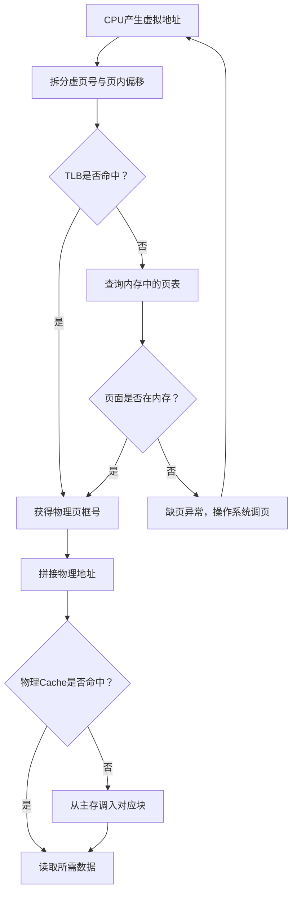
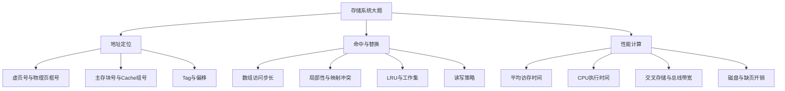

本章归纳12道历年真题与5道模拟题，共17道综合应用题。

## 一、本章大题的核心考点与复习优先级

| 核心考点               | 代表性真题          | 代表性模拟题  | 复习优先级 |
| ------------------ | -------------- | ------- | ----- |
| Cache地址划分与容量计算     | 2010、2016、2020 | 第3、5套   | S     |
| 数组访问与Cache命中率      | 2010、2020、2023 | 第1、3、7套 | S     |
| 虚拟地址、TLB、Cache联合访问 | 2011、2016、2018 | 第6套     | S     |
| 组相联映射与LRU替换        | 2021           | 第1、3套   | S     |
| 分页与Cache综合计算       | 2019、2023      | 第6套     | S     |
| 低位交叉存储与突发传输        | 2012、2013      | 第5套     | A     |
| CPU执行时间与访存性能       | 2012、2013      | 第3套     | A     |
| 磁盘访问时间与DMA         | 2022           | —       | B     |

这里的优先级是根据这17道题的覆盖情况、知识迁移价值和综合程度划分的，不代表对未来考试的预测。

### 本章真正的解题本质

存储系统的大题看似涉及很多硬件、公式和地址，实际上主要围绕三个问题：

**第一个问题：数据在哪里？**

根据地址找到虚拟页、物理页框、主存块和Cache组。

**第二个问题：数据还在不在？**

根据访问顺序、映射方式、有效位、Tag和替换策略判断是否命中。

**第三个问题：取得数据需要付出多少代价？**

计算Cache缺失、缺页、主存访问、总线传输所产生的时间与带宽开销。

## 二、第一核心模型：Cache地址划分与容量计算

**重要程度：★★★★★**

这是整个存储系统大题的基础，也是最应该稳定拿分的部分。

### 1. 从本质上理解Cache的地址结构

CPU给出一个物理地址，Cache需要解决三个问题：

| 地址字段         | 解决的问题             |
| ------------ | ----------------- |
| Tag（标记）      | 这一行存放的究竟是哪个主存块？   |
| Index（组索引）   | 应该去Cache的哪一组寻找？   |
| Offset（块内偏移） | 找到主存块后，应该取其中哪个字节？ |

因此，物理地址通常划分为：

```text
高位                                      低位
┌──────────────┬─────────────┬─────────────┐
│   Tag 标记   │  Index 组号 │ Offset 偏移 │
└──────────────┴─────────────┴─────────────┘
   判断是谁         去哪里找       具体取哪里

```

为什么需要Tag？

因为主存的容量远大于Cache，多个主存块可能映射到同一个Cache组。仅凭组号无法确定组内存放的是不是自己需要的数据。

<Callout type="info" title="Cache命中判定">

**组号负责定位，Tag负责辨认，有效位负责确认数据是否有效。**

</Callout>

### 2. 万能计算公式

设物理地址为 $m$ 位，Cache数据区容量为 $C$，块长为 $B$，采用 $k$ 路组相联映射。

Cache总行数：

$$
L=\frac{C}{B}
$$

Cache组数：

$$
S=\frac{C}{B\times k}
$$

块内偏移位数：

$$
b=\log_2 B
$$

组号位数：

$$
s=\log_2 S
$$

Tag位数：

$$
\boxed{t=m-s-b}
$$

以上按照字节编址、块长以字节为单位的常规题设计算。

三种映射方式其实完全可以统一：

| 映射方式         | 路数      | 组数        |
| ------------ | ------- | --------- |
| 直接映射         | 1       | $L$   |
| $k$ 路组相联 | $k$ | $L/k$ |
| 全相联          | $L$ | 1         |

全相联不需要组号，因为所有Cache行都属于同一组。

#### 更实用的地址计算方法

给定字节地址 $A$，不必每次都把十六进制地址完整转换成二进制。

直接计算：

$$
\boxed{\text{主存块号}=\left\lfloor\frac{A}{B}\right\rfloor}
$$

$$
\boxed{\text{Cache组号}=\text{主存块号}\bmod S}
$$

$$
\boxed{\text{Tag}=\left\lfloor\frac{\text{主存块号}}{S}\right\rfloor}
$$

$$
\boxed{\text{块内偏移}=A\bmod B}
$$

这四个公式能够解决绝大多数映射计算问题。

### 3. 代表题：2027王道第3套第43题

本题同时考查地址划分、Cache容量、LRU替换和平均访存时间。

题目给出：

| 参数       | 数值     |
| -------- | ------ |
| 主存地址空间   | 64 KiB |
| Cache数据区 | 4 KiB  |
| 块长       | 64 B   |
| 映射方式     | 4路组相联  |
| 替换策略     | LRU    |
| 写策略      | 写回     |

#### 第一问：求地址各字段位数

主存按字节编址：

$$
m=\log_2 2^{16}=16
$$

Cache行数：

$$
L=\frac{4096}{64}=64
$$

Cache组数：

$$
S=\frac{64}{4}=16
$$

所以：

$$
b=6,\quad s=4
$$

$$
t=16-6-4=6
$$

最终地址结构为：

```text
15              10 9          6 5              0
┌─────────────────┬────────────┬─────────────────┐
│     Tag 6位     │  组号4位   │   块内偏移6位   │
└─────────────────┴────────────┴─────────────────┘

```

#### 第二问：Cache总容量是多少？

首先必须区分两个概念：

**Cache数据区容量**只计算实际数据。

**Cache总存储容量**还要计算用于管理数据的附加信息。

| 存储内容  | 每行位数  | 作用       |
| ----- | ----- | -------- |
| Data  | 512   | 存放主存块    |
| Tag   | 6     | 辨认主存块    |
| 有效位   | 1     | 判断该行是否有效 |
| 脏位    | 1     | 判断是否需要写回 |
| LRU信息 | 取决于实现 | 决定替换对象   |

不计LRU信息时：

$$
C_{\text{基本}}=64\times(512+6+1+1)
$$

$$
\boxed{C_{\text{基本}}=33280\text{ bit}}
$$

若采用每路2位年龄码记录LRU状态：

$$
C_{\text{LRU}}=64\times2=128\text{ bit}
$$

则总容量为：

$$
\boxed{C_{\text{total}}=33408\text{ bit}}
$$

#### 深度理解：LRU位到底应该怎么算？

2020年真题考过8路组相联的每行LRU位数。按照常见教材的年龄计数方式：

$$
\text{每行LRU位数}=\log_2 k
$$

但这不是唯一实现方式。

对于4路组相联，一组中的4个块一共有：

$$
4!=24
$$

种最近使用次序。

因此编码完整顺序理论上至少需要：

$$
\left\lceil\log_2 24\right\rceil=5
$$

位/组。

所以本题若采用理论最小顺序编码，总容量可以是：

$$
33280+16\times5=\boxed{33360\text{ bit}}
$$

**考场策略：明确题目问的是每行LRU位、每组LRU位，还是整个Cache容量。有具体实现约定时，严格按照约定计算。**

题库中2018年真题解析也存在类似问题：前面提到2路LRU每组1位足够，后面的容量却按每行1位计算。这两种实现的总容量不同，不能混为一谈。

### 4. 地址和容量计算最容易犯的错误

| 错误做法                | 正确理解           |
| ------------------- | -------------- |
| 直接用Cache行数求组号位数     | 应该使用组数         |
| 用虚拟地址位数求物理Cache的Tag | 应该使用物理地址位数     |
| 将64B当作64bit         | 64B等于512bit    |
| 总容量只计算数据区           | 还需考虑Tag和附加位    |
| 写回策略不计算脏位           | 写回通常需要脏位       |
| 全相联仍然划分组号           | 全相联只有一组        |
| 把组号和块内偏移也计入每行附加存储   | 通常由位置隐含，不必重复存储 |

## 三、第二核心模型：数组访问与Cache命中率

**重要程度：★★★★★，本章最值得投入时间的计算题。**

2010、2020、2023年真题以及模拟题第1、3、7套，都涉及这个模型。

### 1. 不要直接数数组元素，要数主存块

Cache与主存交换信息的基本单位是**块**，而不是数组元素。

假设一个主存块为32B，一个int占4B，那么一个块可以容纳：

$$
\frac{32}{4}=8
$$

个int元素。

连续访问这8个元素时，若Cache初始为空且没有冲突：

| 访问 | a[0] | a[1] | a[2] | a[3] | a[4] | a[5] | a[6] | a[7] |
| -- | ---- | ---- | ---- | ---- | ---- | ---- | ---- | ---- |
| 结果 | M    | H    | H    | H    | H    | H    | H    | H    |

其中M表示不命中，H表示命中。

命中率为：

$$
H=\frac78=87.5\%
$$

但请注意，后面7次命中的前提是**这个块没有被其他块替换出去**。

所以，命中率大题的真正逻辑是：

**元素访问顺序 → 字节地址序列 → 主存块序列 → Cache映射 → 替换情况 → 命中率。**

而不是看到顺序访问就直接套公式。

### 2. 数组地址计算必须彻底掌握

对于按行优先存储的二维数组：

```c
int a[M][N];
```

设首地址为 $A_0$，每个元素占 $d$ 字节，则：

$$
\boxed{\operatorname{Addr}(a[i][j])=A_0+(iN+j)d}
$$

按行访问时，相邻元素地址差：

$$
\Delta A=d
$$

按列访问时，相邻元素地址差：

$$
\Delta A=Nd
$$

**访问步长是判断空间局部性和Cache冲突的关键。**

### 3. 代表真题：2010年408

题目给出一个二维数组：

```c
int a[256][256];
```

每个int占4B，数组首地址为320，Cache共有8行，每行64B，采用直接映射。

两种程序分别按行、按列遍历数组。

<Tabs items={['按行访问', '按列访问']}>

<Tab value="按行访问">

```c
for (i = 0; i < 256; i++)
    for (j = 0; j < 256; j++)
        sum += a[i][j];
```

一个Cache块能容纳：

$$
64/4=16
$$

个元素。

访问一个块中的第一个元素不命中，其余15个命中。

因此：

$$
\boxed{H_A=\frac{15}{16}=93.75\%}
$$

数组首地址320恰好是64B的整数倍，满足块对齐条件。

</Tab>

<Tab value="按列访问">

```c
for (j = 0; j < 256; j++)
    for (i = 0; i < 256; i++)
        sum += a[i][j];
```

相邻两次访问相隔：

$$
256\times4=1024\text{ B}
$$

换算为主存块号的差：

$$
\Delta Q=\frac{1024}{64}=16
$$

Cache共有8行。

$$
16\bmod8=0
$$

因此，固定一列时，每个元素所在的块都映射到相同的Cache行，形成持续冲突。

```text
a[0][0] → 主存块5  ──┐
a[1][0] → 主存块21 ──┤
a[2][0] → 主存块37 ──┼──→ Cache第5行
a[3][0] → 主存块53 ──┤
a[4][0] → 主存块69 ──┘

新块不断覆盖旧块。

```

等到下一列再次访问之前的主存块时，该块早已被替换。

所以：

$$
\boxed{H_B=0\%}
$$

</Tab>

</Tabs>

#### 同组冲突判断

判断两个不同地址是否映射到同一个Cache组，应该计算：

$$
\left\lfloor\frac{A_1}{B}\right\rfloor\bmod S
$$

与

$$
\left\lfloor\frac{A_2}{B}\right\rfloor\bmod S
$$

是否相等。

对于地址步长是块长整数倍的情况，可以进一步简化：

$$
\boxed{\Delta A\bmod(BS)=0}
$$

则相邻访问映射到同一个组。

原题库对2010年真题的解析使用了 $1024\bmod64=0$ 来解释同一行冲突，虽然最终答案正确，但这个判断条件不充分。应该进一步考虑Cache的组数。

### 4. 代表模拟题：2027王道第1套第43题

本题考查改变映射方式和数据布局以减少冲突。

```c
float Dotproduct(float x[8], float y[8]) {
    float sum = 0;
    for (int i = 0; i < 8; i++)
        sum += x[i] * y[i];
    return sum;
}
```

每个float占4B，Cache数据区32B，初始为空，只统计数组读取。

<Tabs items={['直接映射', '2路组相联', '数组填充']}>

<Tab value="直接映射">

数组x首地址为 `0x40`，y紧随其后，首地址为 `0x60`。

Cache有：

$$
32/16=2
$$

行。

| 主存块       | 包含元素      | 主存块号（十进制） | Cache行 |
| --------- | --------- | --------- | ------ |
| $X_0$ | x[0]～x[3] | 4         | 0      |
| $X_1$ | x[4]～x[7] | 5         | 1      |
| $Y_0$ | y[0]～y[3] | 6         | 0      |
| $Y_1$ | y[4]～y[7] | 7         | 1      |

前四次循环的访问顺序是：

$$
X_0,Y_0,X_0,Y_0,X_0,Y_0,X_0,Y_0
$$

观察第0行的状态变化：

| 访问对象 | Cache第0行内容 | 结果 |
| ---- | ---------- | -- |
| x[0] | $X_0$  | M  |
| y[0] | $Y_0$  | M  |
| x[1] | $X_0$  | M  |
| y[1] | $Y_0$  | M  |
| x[2] | $X_0$  | M  |
| y[2] | $Y_0$  | M  |

它们不断互相替换。

因此16次读取全部不命中：

$$
\boxed{H=0\%}
$$

**虽然两个数组都具有很好的空间局部性，但Cache冲突使这种局部性无法转化为命中。**

</Tab>

<Tab value="2路组相联">

此时：

$$
L=32/8=4
$$

$$
S=4/2=2
$$

每个块存放两个float。

虽然x和y当前访问的块映射到同一组，但是该组能够同时容纳两个主存块。

| 循环下标 | x访问 | y访问 |
| ---- | --- | --- |
| 0    | M   | M   |
| 1    | H   | H   |
| 2    | M   | M   |
| 3    | H   | H   |
| 4    | M   | M   |
| 5    | H   | H   |
| 6    | M   | M   |
| 7    | H   | H   |

因此：

$$
\boxed{H=\frac8{16}=50\%}
$$

增加相联度可以减少映射冲突。

</Tab>

<Tab value="数组填充">

循环仍然只访问前8个元素。

此时y的首地址变为：

$$
\texttt{0x40}+12\times4=\texttt{0x70}
$$

映射关系发生变化：

| 主存块       | 原Cache行 | 修改后Cache行 |
| --------- | ------- | --------- |
| $X_0$ | 0       | 0         |
| $Y_0$ | 0       | 1         |
| $X_1$ | 1       | 1         |
| $Y_1$ | 1       | 0         |

现在同时访问的两个块位于不同Cache行，不再持续冲突。

4个主存块各发生一次不命中：

$$
\boxed{H=\frac{16-4}{16}=75\%}
$$

</Tab>

</Tabs>

#### 本题的核心思想

| 改进方法     | 原理                 |
| -------- | ------------------ |
| 增加相联度    | 同一组可以容纳更多主存块       |
| 改变数组起始地址 | 改变主存块映射位置          |
| 添加填充空间   | 避免多个数组发生规律性冲突      |
| 改变访问顺序   | 在主存块被替换之前充分使用其中的数据 |

这就是为什么计算机中数据的布局、数组大小、循环顺序都会影响程序性能。

## 四、第三核心模型：组相联与LRU替换

**重要程度：★★★★★**

一旦题目出现重复遍历、访问序列或LRU，就不能仅仅通过数组大小计算命中率。

### 1. LRU的本质是什么？

LRU（Least Recently Used）替换的是：

**距离上一次被访问的时间最久的块。**

不是最早装入Cache的块，也不是访问次数最少的块。

做题时，可以将每组看作一个独立的小容器，并将最近访问的块移动到最右侧。

例如2路组相联的某一组，依次访问A、B、A、C。

| 访问 | 组内状态（旧→新） | 结果    |
| -- | --------- | ----- |
| A  | A         | M     |
| B  | A，B       | M     |
| A  | B，A       | H     |
| C  | A，C       | M，淘汰B |

关键是第三次访问A命中后，也必须更新LRU次序。

2021年真题考查的正是类似的TLB替换过程。虚页号12、4、12、20映射到同一个2路组，最终被淘汰的是虚页号4。

**Cache和TLB中的组相联LRU，解题方法完全相同。**

### 2. 综合例题：模拟题第3套的重复扫描

继续前面的4路组相联Cache题。

已知Cache有64行、16组，每组4路，块长64B。

CPU依次访问字节地址0～4344，重复16遍。

<Steps>

<Step>

### 统计访问次数

每遍访问：

$$
4344-0+1=4345
$$

次。

因此：

$$
N_{\text{access}}=4345\times16=69520
$$

</Step>

<Step>

### 计算块数

最后一个字节所在的块号：

$$
\left\lfloor\frac{4344}{64}\right\rfloor=67
$$

因此涉及主存块0～67，共68块。

</Step>

<Step>

### 按组统计工作集

$$
\text{组号}=\text{块号}\bmod16
$$

| Cache组 | 映射到该组的主存块     | 块数 | 是否超过4路 |
| ------ | ------------- | -- | ------ |
| 0      | 0、16、32、48、64 | 5  | 是      |
| 1      | 1、17、33、49、65 | 5  | 是      |
| 2      | 2、18、34、50、66 | 5  | 是      |
| 3      | 3、19、35、51、67 | 5  | 是      |
| 4～15   | 每组4个块         | 4  | 否      |

第0～3组发生组容量不足。

</Step>

<Step>

### 计算缺失率与AMAT

以第0组为例，4路Cache循环访问5个块：

$$
A,B,C,D,E,A,B,C,D,E,\ldots
$$

| 当前访问 | Cache状态（旧→新） | 结果 |
| ---- | ------------ | -- |
| A    | A            | M  |
| B    | A B          | M  |
| C    | A B C        | M  |
| D    | A B C D      | M  |
| E    | B C D E      | M  |
| A    | C D E A      | M  |
| B    | D E A B      | M  |
| C    | E A B C      | M  |

结果是这5个块在每遍中的首次访问都不命中。

因此：

第一遍不命中次数：

$$
M_1=68
$$

后续每遍不命中次数：

$$
M_2=4\times5=20
$$

总不命中次数：

$$
\boxed{M=68+15\times20=368}
$$

缺失率为：

$$
R_{\text{miss}}=\frac{368}{69520}
$$

$$
\boxed{R_{\text{miss}}\approx0.5293\%}
$$

题目给出命中检测时间20ns，不命中时额外开销200ns。

因此平均访存时间：

$$
T=20+\frac{368}{69520}\times200
$$

$$
\boxed{T\approx21.06\text{ ns}}
$$

</Step>

</Steps>

### 3. LRU判断命中的最高效方法：重用距离

对于采用严格LRU的 $k$ 路组相联Cache：

某个主存块从上一次访问到本次访问之间，如果出现了至少 $k$ 个映射到同一组的其他不同主存块，那么该块已被替换。

注意，是其他**不同的块**。

例如4路组相联：

$$
A,B,C,B,C,D,A
$$

在两次A之间只有B、C、D三个不同的块，因此A仍然命中。

而：

$$
A,B,C,D,E,A
$$

出现了4个不同的其他块，所以A不命中。

这比每次都画完整的Cache表更加高效。

### 4. 对命中率题建立三个层次的判断

| 判断层次   | 应该关注的问题          |
| ------ | ---------------- |
| 第一层：块内 | 一个块可以提供多少个元素？    |
| 第二层：组内 | 正在使用的块能否同时留在同一组？ |
| 第三层：时间 | 下次访问时该块是否已经被替换？  |

不要仅凭整个Cache的容量与数组容量大小关系判断命中率。

一个数组即使小于Cache，也可能因为局部映射冲突而频繁失效。

## 五、第四核心模型：虚拟地址、TLB、Cache联合访问

**重要程度：★★★★★**

2011、2016、2018、2019、2021、2023年真题和模拟题第6套都涉及这一体系。

### 1. 理解完整的访存过程



这里采用408大题常见的先完成地址转换、再根据物理地址查Cache的逻辑模型。部分实际处理器会并行完成部分查询，不影响这套基础计算方法。

必须理解三个不同的“不命中”。

| 事件       | 含义            | 处理方式       |
| -------- | ------------- | ---------- |
| TLB不命中   | 没有缓存需要的地址映射关系 | 查询页表       |
| Cache不命中 | 所需数据不在Cache   | 从下一级存储器获取  |
| 缺页异常     | 所需虚拟页面不在主存    | 操作系统进行缺页处理 |

<Callout type="warn" title="三种事件的区别">

**TLB不命中不等于缺页，缺页也不等于Cache不命中。**

</Callout>

### 2. 三种地址结构统一理解

设页长为 $P=2^p$ 字节。

虚拟地址：

$$
\underbrace{\text{VPN}}_{\text{虚页号}} \quad|\quad \underbrace{\text{Offset}}_{\text{页内偏移}}
$$

物理地址：

$$
\underbrace{\text{PFN}}_{\text{物理页框号}} \quad|\quad \underbrace{\text{Offset}}_{\text{页内偏移}}
$$

通过TLB或者页表实现：

$$
\text{VPN}\longrightarrow\text{PFN}
$$

而页内偏移保持不变。

因此：

$$
\boxed{PA=PFN\times P+\text{页内偏移}}
$$

如果TLB采用组相联映射，虚拟地址还可以进一步划分：

```text
虚拟地址：
┌──────────────┬─────────────┬───────────────┐
│   TLB Tag    │ TLB组索引   │   页内偏移    │
└──────────────┴─────────────┴───────────────┘
└───────── 虚页号 VPN ───────┘

物理地址：
┌────────────────────────────┬───────────────┐
│       物理页框号 PFN       │   页内偏移    │
└────────────────────────────┴───────────────┘

查Cache时重新划分物理地址：
┌──────────────┬─────────────┬───────────────┐
│  Cache Tag   │ Cache组索引 │   块内偏移    │
└──────────────┴─────────────┴───────────────┘

```

记住：

- TLB索引的对象是虚页号。
- 物理Cache索引的对象是物理地址对应的主存块号。
- 页内偏移和块内偏移是两个不同概念。

### 3. 代表模拟题：2027王道第6套第43题

这道题是2011、2016、2018年真题知识点的综合变式，还加入了小端存储。

题目参数：

| 参数      | 数值        |
| ------- | --------- |
| 虚拟地址    | 16位       |
| 物理地址    | 13位       |
| 页长      | 256B      |
| TLB     | 16项，4路组相联 |
| Cache   | 直接映射，16行  |
| Cache块长 | 4B        |

要求从虚拟地址 `0x067A` 读取16位short。

<Steps>

<Step>

### 虚拟地址划分

页长：

$$
256=2^8
$$

因此页内偏移8位，VPN为8位。

TLB组数：

$$
16/4=4
$$

组号2位，TLB Tag为：

$$
16-8-2=6
$$

| TLB Tag | TLB组号 | 页内偏移 |
| ------- | ----- | ---- |
| 6位      | 2位    | 8位   |

</Step>

<Step>

### TLB查找

虚拟地址：

$$
VA=\texttt{0x067A}
$$

拆分后：

$$
VPN=\texttt{0x06}
$$

$$
Offset=\texttt{0x7A}
$$

TLB组号：

$$
6\bmod4=2
$$

TLB Tag：

$$
\left\lfloor6/4\right\rfloor=1
$$

查原题TLB第2组的表项：

| Tag    | PFN    | 有效位   |
| ------ | ------ | ----- |
| 02     | —      | 0     |
| **01** | **19** | **1** |
| 06     | —      | 0     |
| 03     | —      | 0     |

Tag匹配且有效位为1，因此TLB命中。

得到：

$$
PFN=\texttt{0x19}
$$

</Step>

<Step>

### 物理地址拼接

保留原页内偏移：

$$
PA=\texttt{0x19}\times256+\texttt{0x7A}
$$

$$
\boxed{PA=\texttt{0x197A}}
$$

</Step>

<Step>

### Cache查找

Cache块长4B，块内偏移2位。

16行直接映射，行索引4位。

Tag位数：

$$
13-4-2=7
$$

计算得到：

$$
\text{Cache Tag}=\texttt{0x65}
$$

$$
\text{Cache行号}=\texttt{0xE}
$$

$$
\text{块内偏移}=2
$$

题目中Cache第E行的内容：

| Tag | 有效位 | 字节3 | 字节2 | 字节1 | 字节0 |
| --- | --- | --- | --- | --- | --- |
| 65  | 1   | 2D  | 4A  | 45  | 55  |

Tag匹配且有效位为1，Cache命中。

</Step>

<Step>

### 字节序

从块内偏移2开始读取两个字节。

| 物理地址     | 存储内容 | 有效位权 |
| -------- | ---- | ---- |
| `0x197A` | `4A` | 低8位  |
| `0x197B` | `2D` | 高8位  |

小端方式是低有效字节存放于低地址。

所以最终结果：

$$
\boxed{\text{short}=\texttt{0x2D4A}}
$$

</Step>

</Steps>

#### 统一查询流程

$$
VA\longrightarrow VPN \longrightarrow TLB \longrightarrow PFN \longrightarrow PA \longrightarrow Cache \longrightarrow Data
$$

只要不把虚拟地址直接拿去查物理Cache，不混淆不同偏移字段，这类题通常可以稳定得分。

原题部分未被访问的TLB表项，其PFN超过13位物理地址允许的范围，存在数据不一致。不过本问实际使用的PFN为 `0x19`，合法，不影响答案。

## 六、第五核心模型：分页与Cache联合计算

**重要程度：★★★★★**

这一部分存在一个非常重要、但很多同学没有真正理解的结论。

### 1. 为什么有时候可以直接用虚拟地址求Cache组号？

虚实地址转换时，页内偏移保持不变。

假设：

- 页大小为4KiB，页内偏移12位。
- Cache块内偏移5位。
- Cache组号6位。

那么：

```text
虚拟地址低12位 = 物理地址低12位

位号：    11   10               5 4           0
         ┌────┬──────────────────┬─────────────┐
         │ 1位│  Cache组号 6位   │ 块内偏移5位 │
         └────┴──────────────────┴─────────────┘
         └────────── 页内偏移 12位 ─────────────┘

```

Cache组号和块内偏移都位于页内偏移中。

因此不需要知道物理页框号，就可以计算Cache组号。

一般条件为：

$$
\boxed{b+s\leq p}
$$

又由于：

$$
B\times S=\frac{C}{k}
$$

所以也可以写成：

$$
\boxed{\frac{C}{k}\leq P}
$$

这个结论在2018、2019、2023年真题中都非常有用。

但注意，它只说明可以确定组号及块内偏移，**不代表可以直接使用完整虚拟地址求物理Cache的Tag**。

### 2. 代表真题：2023年408

以下结论并不普遍成立：

*按行访问命中率一定比按列访问高。*

题目给出：

```c
int a[24][64];

for (i = 0; i < 24; i++)
    for (j = 0; j < 64; j++)
        a[i][j] = 10;
```

数组首虚拟地址为 `0x00422000`，每个int占4B。

| 参数       | 数值    |
| -------- | ----- |
| 虚拟地址     | 32位   |
| 页大小      | 4KiB  |
| Cache数据区 | 8KiB  |
| Cache块长  | 32B   |
| 映射方式     | 4路组相联 |

数组初始不在内存，访问过程中不发生页面置换，不与其他数据产生Cache冲突。按原题预期的写失效调块模型计算。

#### 第一问：缺页次数

数组大小：

$$
24\times64\times4=6144\text{ B}
$$

即6KiB。

因为首地址按页对齐，所以数组占用2页。

$$
\boxed{N_{\text{page fault}}=2}
$$

第一页的首次访问地址：

$$
\texttt{0x00422000}
$$

第二页的首次访问地址：

$$
\texttt{0x00423000}
$$

#### 更通用的页数公式

如果数组首地址不一定对齐，则不能简单地用数组长度除以页面大小向上取整。

设首地址为 $A$，数据长度为 $D$，页面大小为 $P$。

实际覆盖页数为：

$$
\boxed{ N= \left\lfloor\frac{A+D-1}{P}\right\rfloor -\left\lfloor\frac{A}{P}\right\rfloor+1 }
$$

把 $P$ 换成Cache块长 $B$，就是计算实际覆盖主存块数的通用公式。

#### 第二问：Cache组号

Cache行数：

$$
L=\frac{8192}{32}=256
$$

组数：

$$
S=256/4=64
$$

因此：

$$
b=5,\quad s=6
$$

页内偏移12位，而：

$$
5+6=11\leq12
$$

所以可以直接利用虚拟地址计算Cache组号。

对于a[1][0]：

$$
A=\texttt{0x00422000}+64\times4
$$

$$
\boxed{A=\texttt{0x00422100}}
$$

对应Cache组号为8。

#### 第三问：按行访问命中率

数组总访问次数：

$$
24\times64=1536
$$

占用主存块数：

$$
6144/32=192
$$

每个主存块首次访问不命中，其余7个元素命中。

所以：

$$
\boxed{H=1-\frac{192}{1536}=87.5\%}
$$

#### 第四问：改成按列访问

```c
for (j = 0; j < 64; j++)
    for (i = 0; i < 24; i++)
        a[i][j] = 10;
```

按列访问的步长为：

$$
64\times4=256\text{ B}
$$

也就是8个主存块。

虽然这种访问方式空间局部性相对较差，但整个数组的192个块在本题给定映射条件下能够全部驻留。

为什么？

题库原解析仅用Cache总行数256大于数组块数192进行判断，这不够严谨。还需要检查每组的占用情况。

一个完整的4KiB页面包含：

$$
4096/32=128
$$

个主存块。

Cache共有64组，所以第一页的每组映射2块。

第二页实际使用2KiB，包含：

$$
2048/32=64
$$

个主存块，每组再映射1块。

因此每组共需要容纳：

$$
2+1=3\text{ 块}
$$

每组有4路，足以容纳。

不存在组容量不足造成的替换。

于是每个主存块仍然只需首次装入一次：

$$
\boxed{H=87.5\%}
$$

#### 对比2010和2023两道真题

| 对比项目  | 2010年真题 | 2023年真题 |
| ----- | ------- | ------- |
| 映射方式  | 直接映射    | 4路组相联   |
| 按列访问  | 大量持续冲突  | 块可以驻留   |
| 按行命中率 | 93.75%  | 87.5%   |
| 按列命中率 | 0%      | 87.5%   |

<Callout type="idea" title="命中率核心判断">

**真正决定命中率的不是循环写法本身，而是主存块在被再次访问之前是否仍然保留在Cache中。**

</Callout>

## 七、第六核心模型：写策略与读写访问次数

**重要程度：★★★★☆**

这部分虽然经常作为其他大题的小问出现，但特别容易因为计数错误失分。

### 1. 四种写策略的区别

| 写策略                     | 含义                      |
| ----------------------- | ----------------------- |
| 直写（Write Through）       | 写命中时更新Cache与主存          |
| 写回（Write Back）          | 写命中时先更新Cache，置脏位，必要时再写回 |
| 写分配（Write Allocate）     | 写不命中时先把主存块调入Cache       |
| 非写分配（No Write Allocate） | 写不命中时直接写下一级存储器，不调块      |

前两种讨论**写命中后如何更新数据**。

后两种讨论**写不命中后是否分配Cache行**。

这是两个不同维度，不能互相替代。

通常写回搭配写分配，直写搭配非写分配，但并非绝对绑定。

### 2. 2020年真题的关键计数

```c
for (k = 0; k < 1024; k++)
    s[k] = 2 * s[k];
```

每个int占4B，Cache块长64B，数组首地址块对齐。

这条语句对每个元素执行：

一次读操作 + 一次写操作。

因此总数据访问次数为：

$$
N=1024\times2=2048
$$

主存块数：

$$
1024\times4/64=64
$$

每块的第一次读取不命中，随后同块的读写均命中。

所以：

$$
\boxed{N_{\text{miss}}=64}
$$

若进一步询问所有读写访问的命中率，则为：

$$
H=1-\frac{64}{2048}
$$

$$
\boxed{H=96.875\%}
$$

不能将访问总数写成1024。

### 3. 模拟题第7套的变式

原题使用一个 $8\times8$ 的结构体数组，每个结构体含4个int，占16B。Cache块长32B，数据区512B，直接映射，采用写分配。

因此每块可以存放两个结构体。

题目比较三个程序：

| 程序 | 写入方式           | 总写次数 | 不命中次数 | 不命中率  |
| -- | -------------- | ---- | ----- | ----- |
| A  | 按行写4个字段        | 256  | 32    | 12.5% |
| B  | 按列写4个字段        | 256  | 64    | 25%   |
| C  | 先遍历写1个字段，再完整遍历 | 320  | 64    | 20%   |

其中程序C需要特别注意：第一次遍历只写一个字段，发生32次缺失；第二次遍历时，前半部分的块又会覆盖Cache中留下的后半部分，所以仍发生32次缺失。

这道题没有引入全新的知识点，而是将前面的访问次数、主存块、映射冲突和重复遍历综合到了一起。

### 4. 常见C语言语句的访存计数

假设变量i、x、sum等均在寄存器中，只统计数组访问。

| 语句                 | 读次数 | 写次数 |
| ------------------ | --- | --- |
| `x = a[i]`         | 1   | 0   |
| `a[i] = 10`        | 0   | 1   |
| `a[i]++`           | 1   | 1   |
| `a[i] = 2*a[i]`    | 1   | 1   |
| `a[i] = b[i]`      | 1   | 1   |
| `sum += a[i]*b[i]` | 2   | 0   |

遇到实际机器指令或明确的编译优化条件时，以题目给出的实际访存行为为准。

## 八、第七核心模型：低位交叉存储器与突发传输

**重要程度：★★★★☆**

2012、2013年真题和模拟题第5套主要考查这一部分。

### 1. 低位交叉存储的本质：流水线式并行

普通单体存储器完成一次访问，需要等一个存储周期才能再次启动。

低位交叉存储器将相邻存储字分布在不同存储体中。

对于4体低位交叉：

| 存储体0 | 存储体1 | 存储体2 | 存储体3 |
| ---- | ---- | ---- | ---- |
| 0    | 1    | 2    | 3    |
| 4    | 5    | 6    | 7    |
| 8    | 9    | 10   | 11   |

这里是按存储字编号；如果按字节编址，则先根据字长确定存储字编号。

不同存储体能够交错启动。

假设单体存储周期为 $T$，共有 $m$ 个存储体，在理想均匀交错启动的条件下：

$$
\tau=\frac{T}{m}
$$

首个存储字仍然需要 $T$ 的准备时间，但后续相邻字可以每隔 $\tau$ 完成一个。

连续读取 $n$ 个字的准备时间为：

$$
\boxed{t=T+(n-1)\tau}
$$

理想最大带宽：

$$
\boxed{BW=\frac{mW}{T}}
$$

其中 $W$ 为每个存储体一次提供的数据量，计算字节带宽时用B表示。

#### 关键理解

低位交叉主要提高的是**连续访问吞吐率**，不是将每个存储体自身的访问延迟降低为原来的几分之一。

### 2. 代表真题：2013年408

已知：

| 参数          | 数值     |
| ----------- | ------ |
| CPU主频       | 800MHz |
| Cache命中时CPI | 4      |
| Cache块长     | 32B    |
| 主存          | 8体交叉存储 |
| 单体存储周期      | 40ns   |
| 单体存储字长      | 32bit  |
| 总线频率        | 200MHz |
| 总线宽度        | 32bit  |

<Steps>

<Step>

### 总线带宽

CPU时钟周期：

$$
T_{\text{CPU}}=\frac1{800\text{ MHz}}=1.25\text{ ns}
$$

总线时钟周期：

$$
T_{\text{bus}}=\frac1{200\text{ MHz}}=5\text{ ns}
$$

总线一拍传输32bit，即4B。

理论总线带宽：

$$
BW=4\times200\times10^6
$$

$$
\boxed{BW=800\text{ MB/s}}
$$

</Step>

<Step>

### 突发传输时延

Cache块为32B，每个存储字为4B，所以需要读取8个存储字。

8体交叉启动间隔为：

$$
\tau=40/8=5\text{ ns}
$$

读取过程与总线数据传输可以重叠。

```text
时间/ns  0    5              45   50   55        80   85
         │    │               │    │    │         │    │
地址命令 ├────┤
存储体0       ├───────────────┤
存储体1            ├───────────────┤
存储体2                 ├───────────────┤
   …
存储体7                              ├── 40ns ───┤

总线数据                      ├ D0 ┼ D1 ┼ … ┼ D7 ┤

```

总耗时由三部分组成：

$$
\begin{aligned} t_{\text{命令}}&=5\text{ ns}\\ t_{\text{首字准备}}&=40\text{ ns}\\ t_{\text{连续传送}}&=8\times5\text{ ns} \end{aligned}
$$

因此：

$$
\boxed{t=5+40+40=85\text{ ns}}
$$

这里最重要的是不要把全部8个存储字的准备时间与全部总线传输时间直接相加，因为它们可以并行。

</Step>

<Step>

### CPU执行时间

程序执行100条指令，平均每条访存1.2次，Cache缺失率5%。

基础执行时间：

$$
T_{\text{base}}=100\times4\times1.25
$$

$$
T_{\text{base}}=500\text{ ns}
$$

Cache缺失次数：

$$
N_{\text{miss}}=100\times1.2\times5\%=6
$$

额外开销：

$$
T_{\text{extra}}=6\times85=510\text{ ns}
$$

最终：

$$
\boxed{T_{\text{CPU}}=1010\text{ ns}}
$$

</Step>

</Steps>

### 3. 模拟题第5套：总线速率与供数速率

该题给出4个8位存储体、单体存储周期20ns以及32位总线。

不能直接认为：

$$
20/4=5\text{ ns}
$$

就是32位总线的时钟周期。

因为每个存储体一次只能提供8bit，而总线一次可以传输32bit。

<Callout type="warn" title="统一速率单位">

**存储器供数速率与总线传输速率必须先统一单位。**

</Callout>

此外，总线时钟频率是独立参数，并不必然由存储器周期决定。

题库修订后补充了“四体并行提供32位字、每20ns提供一个字、总线恰好匹配”等条件，因此才得到：

$$
f=50\text{ MHz}
$$

以及32B数据的理想总线占用时间：

$$
(1+8)\times20=\boxed{180\text{ ns}}
$$

这不是所有4体交叉存储系统的通用结论。

遇到这类题，优先判断题目给出的数据准备时间、总线周期以及是否支持重叠传输，不要机械套公式。

## 九、第八核心模型：存储系统性能计算

**重要程度：★★★★☆**

这一部分计算本身不难，难点是弄清每个概率所对应的统计对象。

### 1. 平均访存时间

设Cache命中率为 $H$，命中检测时间为 $T_C$，不命中额外代价为 $T_M$。

则：

$$
\boxed{AMAT=T_C+(1-H)T_M}
$$

原因是所有访问都需要进行Cache查询，只有不命中的访问才需要额外付出代价。

如果题目给出的 $T_{\text{miss}}$ 已经包含完整的不命中访问时间，则应使用：

$$
\boxed{ AMAT=HT_{\text{hit}}+(1-H)T_{\text{miss}} }
$$

两式并不矛盾，只是时间参数的定义不同。

### 2. CPU执行时间

若题目给出Cache全部命中时的基础CPI：

$$
T_{\text{base}}=IC\times CPI_{\text{base}}\times T_{\text{clk}}
$$

设平均每条指令访存 $a$ 次，缺失率为 $r$。

那么：

$$
N_{\text{miss}}=IC\times a\times r
$$

总执行时间：

$$
\boxed{ T_{\text{CPU}} =T_{\text{base}}+N_{\text{miss}}\times T_{\text{penalty}} }
$$

不能将基础执行时间再乘以Cache命中率。

如果给出的CPI已经包含Cache缺失开销，则不能再重复添加。

### 3. 每秒事件次数：2012年真题的计算思想

原题给出CPU主频80MHz，CPI为4，每条指令平均访存1.5次，Cache命中率99%，块长16B。

整个计算过程是逐层筛选：

```text
每秒时钟周期：80 × 10^6
          │ ÷ CPI = 4
          ▼
每秒指令数：20 × 10^6
          │ × 平均访存1.5次
          ▼
每秒访存次数：30 × 10^6
          │ × 缺失率1%
          ▼
每秒Cache缺失：300000次
          │ × 每块16B
          ▼
最低主存供数带宽：4.8 MB/s

```

因此这类题不需要背很多独立公式，只要理解：

$$
\boxed{\text{事件频率}\times\text{每次开销}=\text{单位时间总开销}}
$$

题目还给出了以Cache缺失为条件的缺页率。这种描述并不符合通常先进行地址转换再查物理Cache的逻辑，但考试计算应按照题设明确给出的条件概率处理，不能把它当作普遍的硬件访存规律。

## 十、次重点：磁盘访问时间与DMA

**重要程度：★★★☆☆**

这一部分在题库中主要对应2022年真题，题型比较固定，不需要花太多时间研究复杂变式。

### 1. 磁盘容量

$$
\boxed{ C=\text{盘面数}\times\text{每面磁道数} \times\text{每道扇区数}\times\text{扇区大小} }
$$

磁盘物理地址的三个字段为：

| 字段  | 意义       |
| --- | -------- |
| 柱面号 | 确定磁道所在柱面 |
| 磁头号 | 确定盘面     |
| 扇区号 | 确定磁道上的扇区 |

若某字段有 $n$ 种编号，至少需要：

$$
\left\lceil\log_2 n\right\rceil
$$

位。

### 2. 磁盘平均访问时间

$$
\boxed{ T_{\text{访问}}=T_{\text{寻道}}+ T_{\text{旋转等待}}+T_{\text{传输}} }
$$

2022年真题中，磁盘转速7200r/min，平均寻道时间5ms，每磁道500个扇区。

旋转一周：

$$
T_{\text{rev}}=\frac{60}{7200}\text{ s}
$$

$$
T_{\text{rev}}\approx8.333\text{ ms}
$$

平均旋转等待时间是半周：

$$
T_{\text{wait}}\approx4.167\text{ ms}
$$

读取一个扇区的数据传输时间：

$$
T_{\text{transfer}}=8.333/500
$$

$$
T_{\text{transfer}}\approx0.0167\text{ ms}
$$

总访问时间：

$$
\boxed{T_{\text{访问}}\approx9.18\text{ ms}}
$$

### 3. DMA请求次数

如果扇区为512B，DMA缓冲区大小64bit，即8B，按题设每传送一个缓冲区数据发出一次请求。

$$
N_{\text{DMA}}=512/8
$$

$$
\boxed{N_{\text{DMA}}=64}
$$

周期挪用方式下，DMA通常具有比CPU访存更高的总线使用优先级，因为外设数据传输需要及时完成，而CPU访存通常可以等待。

## 十一、容易丢分的概念与陷阱汇总

这些结论都可以直接用于综合题中的简答问。

| 容易混淆的知识点     | 必须掌握的正确结论         |
| ------------ | ----------------- |
| Cache命中条件    | Tag相等且有效位为1       |
| TLB命中条件      | VPN对应Tag相等且表项有效   |
| TLB不命中       | 不一定发生缺页           |
| 有效位为0        | 即使Tag相同也不命中       |
| Cache缺失处理    | 通常由硬件自动完成         |
| 缺页异常处理       | 需要操作系统参与          |
| 缺页处理完成       | 通常重新执行触发异常的指令     |
| Cache缺失完成    | 不额外算一次CPU的Cache访问 |
| 局部性好         | 不保证命中率一定高         |
| 数组小于Cache    | 不保证没有映射冲突         |
| 数组大于Cache    | 不代表每次访问都不命中       |
| 行优先访问        | 命中率不一定高于列优先访问     |
| LRU替换        | 最近最久未访问，而不是最早进入   |
| LRU命中        | 也需要更新替换状态         |
| 写回           | 通常需要脏位            |
| 直写           | 通常不需要脏位           |
| 地址转换         | 页内偏移保持不变          |
| 页大小与Cache块大小 | 两者不必相同            |
| 低位交叉         | 提高吞吐率，不直接缩短单体访问周期 |
| Cache总容量     | 数据位与附加位都要考虑       |
| 缺页率与Cache缺失率 | 必须注意各自的统计对象       |

2014年真题还考查了指令Cache的访问统计。6条指令处在同一个32B主存块中，循环执行1000次，总共取指6000次，只发生一次指令Cache缺失，因此命中率为 $5999/6000$。

其本质与数组顺序访问没有区别，只不过访问对象从数组元素变成了机器指令。

## 十二、考场万能解题流程

### 题型一：Cache结构与容量

```text
确定编址单位
    ↓
计算Cache行数、组数
    ↓
计算块内偏移、组索引、Tag
    ↓
判断写策略、替换策略
    ↓
计算数据位和附加位总数

```

### 题型二：Cache命中率

```text
确定实际读写次数
    ↓
计算元素地址及访问步长
    ↓
转换成主存块访问序列
    ↓
计算每块映射到哪一组
    ↓
判断是否发生替换
    ↓
统计不命中次数
    ↓
求命中率

```

### 题型三：TLB与Cache综合

```text
根据页大小拆分虚拟地址
    ↓
根据VPN查找TLB
    ↓
TLB缺失则查询页表
    ↓
判断是否缺页
    ↓
获得PFN，拼接物理地址
    ↓
按照Cache结构划分物理地址
    ↓
检查有效位及Tag
    ↓
取得数据，处理字节序

```

### 题型四：访存性能与总线

```text
统一bit、B、ns、MHz等单位
    ↓
计算每次访问或传输的开销
    ↓
确定是否存在流水线并行
    ↓
计算实际缺失次数或传输次数
    ↓
计算额外开销
    ↓
与基础执行时间相加

```

## 十三、最值得反复研究的题目

优先复习以下7道代表题。

| 学习顺序 | 题目        | 必须掌握的能力               |
| ---- | --------- | --------------------- |
| 1    | 2010年真题   | 数组地址、Cache映射、按行按列访问   |
| 2    | 模拟第1套第43题 | 冲突失效、数据布局、相联度         |
| 3    | 模拟第3套第43题 | Cache容量、LRU、重复遍历、AMAT |
| 4    | 2018年真题   | 从硬件结构中提取信息、有效位、地址转换   |
| 5    | 模拟第6套第43题 | 完整TLB和Cache查询、小端存储    |
| 6    | 2023年真题   | 分页、Cache综合、工作集判断      |
| 7    | 2013年真题   | 交叉存储、突发传送、CPU执行时间     |

其中最有必要放在一起比较的是2010年真题、2023年真题和模拟第1套。

## 十四、学完后的自测

独立完成自测后核对答案。

#### 第1题

Cache数据区32KiB，块长64B，8路组相联，物理地址32位。求Tag、组号、块内偏移的位数。

<Accordions>

<Accordion title="参考答案与解析">

**答案：** Tag 20位，组号6位，块内偏移6位。

</Accordion>

</Accordions>

#### 第2题

4路组相联Cache的同一组中循环访问5个不同主存块，采用LRU，每个块每轮只访问一次。稳定后命中率是多少？

<Accordions>

<Accordion title="参考答案与解析">

**答案：** 0%，每个块再次访问前都被替换。

</Accordion>

</Accordions>

#### 第3题

一个数组大小为6KiB，Cache大小为8KiB，是否一定不会发生冲突失效？

<Accordions>

<Accordion title="参考答案与解析">

**答案：** 不一定，还要检查映射关系以及每组容纳的块数。

</Accordion>

</Accordions>

#### 第4题

页大小4KiB，Cache块长64B，共64组，能否通过虚拟地址直接计算物理Cache组号？

<Accordions>

<Accordion title="参考答案与解析">

**答案：** 可以。

$$
6+6=12
$$

组号与块内偏移全部位于页内偏移中。

</Accordion>

</Accordions>

#### 第5题

TLB未命中后，是否必须访问磁盘？

<Accordions>

<Accordion title="参考答案与解析">

**答案：** 不一定。查询页表后发现页面仍在内存中，只需获得页框号并更新TLB。

</Accordion>

</Accordions>

#### 第6题

4体低位交叉存储器，每体存储周期40ns，每体字长32bit，理想均匀交错启动时，连续读取8个字的准备时间是多少？

<Accordions>

<Accordion title="参考答案与解析">

**答案：**

$$
40+7\times10=\boxed{110\text{ ns}}
$$

理想主存最大带宽：

$$
\frac{4\times4\text{ B}}{40\text{ ns}} =\boxed{400\text{ MB/s}}
$$

</Accordion>

</Accordions>

#### 第7题

Cache命中检测需要2ns，缺失率5%，缺失后的额外开销为100ns，平均访存时间是多少？

<Accordions>

<Accordion title="参考答案与解析">

**答案：**

$$
2+0.05\times100=\boxed{7\text{ ns}}
$$

</Accordion>

</Accordions>

## 十五、最终需要建立的知识体系



**本章最重要的五条思想：**

1. Cache以块为单位交换数据，数组命中率题必须从元素访问转换为块访问。
2. 组号决定去哪里找，Tag决定找到的是不是所需的块，有效位决定它能不能用。
3. 命中率取决于映射关系和数据重用，而不单纯取决于访问顺序或Cache总容量。
4. 虚实地址转换只改变页号，页内偏移保持不变；TLB和Cache可以共享相似的组相联解题方法。
5. 性能计算的本质是基础开销加额外开销，并充分考虑并行与重叠。

复习这一章时，应尽量避免直接背某道题的命中率、缺失次数或固定数字。真正值得记住的是**如何从地址计算映射关系，如何从访问序列判断数据是否仍然存在，以及如何将缺失转化为时间开销**。
