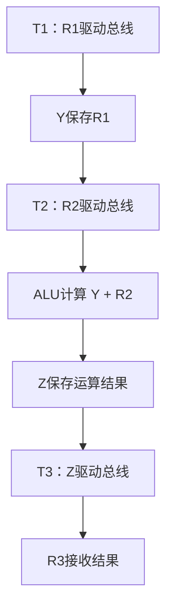
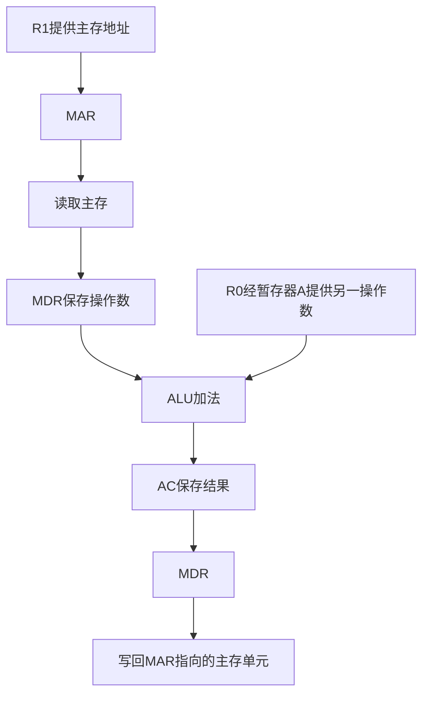
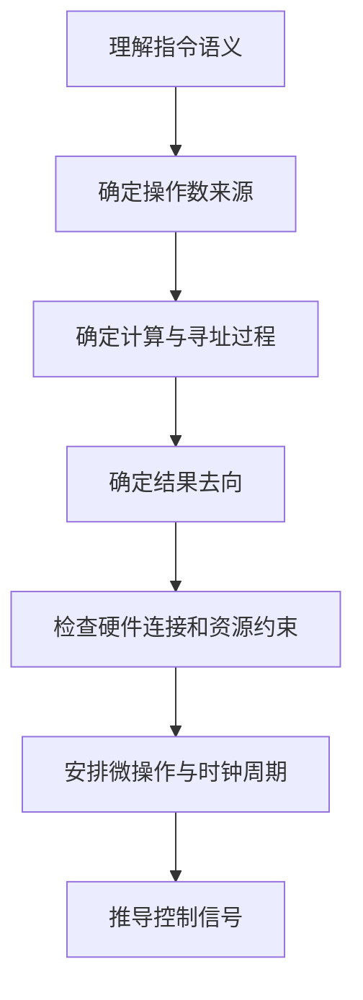
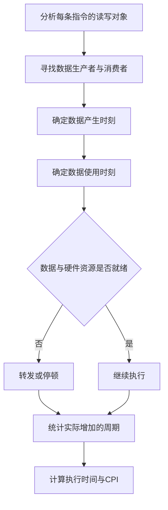

本章归纳7道历年真题与3道模拟题。核心能力包括空间上的数据流动（数据来源、处理部件与写回位置）和时间上的数据流动（数据可用时刻、资源占用与流水线时序）。

## 一、全章大题考点分布与学习优先级

以下统计仅针对原题库，不代表历年全部408试卷。

| 题目来源       | 主要考点               | 学习价值  |
| ---------- | ------------------ | ----- |
| 2009年真题    | 单总线、微操作序列、主存读写     | ★★★★★ |
| 2015年真题第1题 | 数据通路结构、MUX、三态门、暂存器 | ★★★★  |
| 2015年真题第2题 | 机器码、控制信号、执行周期      | ★★★★★ |
| 2022年真题    | Y/Z暂存器、取指、CU、运算标志  | ★★★★★ |
| 2024年真题    | ALU控制、立即数扩展、机器码译码  | ★★★★★ |
| 2012年真题    | 无转发流水线、时空图、阻塞周期    | ★★★★★ |
| 2014年真题    | 循环程序、数据相关、分支冒险     | ★★★★★ |
| 模拟第1套第44题  | 单周期数据通路、控制信号、新增指令  | ★★★★★ |
| 模拟第6套第44题  | 单总线微操作、访存与操作重叠     | ★★★★★ |
| 模拟第8套第43题  | 数据转发、多周期EX、NOP、CPI | ★★★★★ |

按照题目的主要考查内容划分，10道大题中，7道属于数据通路类，3道属于流水线类。

### 最值得掌握的六项能力

| 优先级 | 核心能力        | 必须达到的水平          |
| --- | ----------- | ---------------- |
| S   | 单总线微操作序列    | 能独立安排每个时钟周期      |
| S   | 单周期数据通路     | 根据指令功能反推全部控制信号   |
| S   | 流水线时序分析     | 能独立画出有阻塞的时空图     |
| S   | 转发与流水线性能    | 能判断停顿原因并准确计算周期   |
| A   | 指令编码与地址计算   | 能从机器码提取字段并解释数据通路 |
| A   | CPU硬件结构与标志位 | 能解释硬件为什么这样设计     |

## 二、单总线数据通路：掌握微操作的本质

**对应题目：2009年真题、2015年真题、2022年真题、模拟第6套第44题。**

### 2.1 首先理解每个寄存器存在的意义

各寄存器的功能与硬件作用如下。

| 部件      | 保存的内容       | 本质作用                |
| ------- | ----------- | ------------------- |
| PC      | 指令地址        | 告诉CPU从哪里取下一条指令      |
| IR      | 当前指令        | 为译码提供操作码和地址字段       |
| MAR     | 主存访问地址      | 告诉主存访问哪个单元          |
| MDR     | 主存交换的数据     | 在CPU和主存之间传递数据       |
| GPRs    | 通用寄存器数据     | 保存程序的操作数和结果         |
| Y（或T、A） | ALU的一个输入操作数 | 解决单总线不能同时提供两个操作数的问题 |
| Z（或AC）  | ALU运算结果     | 保存结果，等待之后写回         |
| FR      | 运算标志        | 保存溢出、进位、符号等状态       |
| CU      | 不属于数据寄存器    | 产生并组织各类控制信号         |

其中最容易被考查的是 Y 和 Z。

#### 为什么单总线结构需要 Y？

ALU 做加法时，需要同时获得两个操作数。

但是单条内部总线同一时刻只能传输一个数据值。

因此，如果要执行：

$$
R_3\leftarrow R_1+R_2
$$

就必须先把 $R_1$ 暂存在 Y 中，然后再让 $R_2$ 驱动总线。

此时 ALU 的两个输入分别来自：

$$
A=Y,\qquad B=\text{Bus}
$$

这样才能完成双操作数运算。

#### 为什么还需要 Z？

当 $R_2$ 正在驱动总线时，ALU 不能再同时把运算结果驱动到同一条总线上。

因此，需要先把结果保存在 Z 中，等下一个周期再将 Z 中的值送到总线。



对应控制信号：

| 周期 | 微操作                     | 控制信号          |
| -- | ----------------------- | ------------- |
| T1 | $Y\leftarrow R_1$   | R1out、Yin     |
| T2 | $Z\leftarrow Y+R_2$ | R2out、ADD、Zin |
| T3 | $R_3\leftarrow Z$   | Zout、R3in     |

当然，如果题目提供了不同的旁路或直接连接，就应按题图重新安排，而不是机械套用三周期。

### 2.2 单总线的四条核心约束

#### 约束一：一个周期最多一个内部总线驱动源

例如：

```text
R1out, R2out
```

如果 R1 和 R2 都向同一条内部总线输出，这就是错误的安排。

但是：

```text
R1out, Yin, MARin
```

可以成立，因为总线上只有 R1 提供数据，Y 和 MAR 同时接收同一个数据。

所以单总线的准确理解是：

<Callout type="warn" title="单总线约束">

**可以一对多传输，但不能多个部件同时驱动同一条总线。**

</Callout>

#### 约束二：先准备数据，再使用数据

例如：

$$
MAR\leftarrow R_1
$$

完成后才能根据 MAR 的新地址访问主存。

同样，在通常的边沿触发寄存器时序下：

$$
Z\leftarrow Y+R_2
$$

必须等 Z 保存结果后，才能在之后的周期通过 Zout 使用该结果。

#### 约束三：访存必须区分地址和数据

读主存：

$$
MAR\leftarrow \text{有效地址}
$$

$$
MDR\leftarrow M[MAR]
$$

写主存：

$$
MAR\leftarrow \text{有效地址}
$$

$$
MDR\leftarrow \text{待写数据}
$$

$$
M[MAR]\leftarrow MDR
$$

MAR 保存的是地址，MDR 保存的是数据。

#### 约束四：不同资源可以并行工作

CPU 内部总线和主存侧的数据通路不一定是同一条通路。

如果题图允许 MDR 从主存侧接收数据，那么主存读操作可以与 CPU 内部总线上的某些操作并行。

这是计算最少执行周期的关键。

### 2.3 代表题一：2009年真题——内存操作数加法

题目要求完成指令：

```asm
ADD (R1), R0
```

按照题目的功能描述，其实际语义是：

$$
M[R_1]\leftarrow R_0+M[R_1]
$$

注意：结果写入主存，不是写入 R1。

#### 第一步：完全忽略控制信号，分析指令功能

这条指令需要完成：

取出 R1 指向的主存操作数，与 R0 相加，然后将结果写回原主存单元。

整个过程可以概括为：



#### 第二步：按照硬件连接安排周期

| 时钟 | 微操作                                              | 有效控制信号                |
| -- | ------------------------------------------------ | --------------------- |
| C5 | $MAR\leftarrow R_1$                          | R1out、MARin           |
| C6 | $MDR\leftarrow M[MAR]$，$A\leftarrow R_0$ | MemR、MDRinE、R0out、Ain |
| C7 | $AC\leftarrow A+MDR$                         | MDRout、ADD、ACin       |
| C8 | $MDR\leftarrow AC$                           | ACout、MDRin           |
| C9 | $M[MAR]\leftarrow MDR$                       | MDRoutE、MemW          |

执行阶段共5个周期。

题库还给出了6周期的另一种可行方案，但5周期方案更能体现硬件资源的并行使用。

#### 本题最重要的地方：为什么 C6 可以并行？

因为以下两项操作使用的是不同的数据通路：

- 主存通过外部数据通路将数据送入 MDR。
- R0 通过 CPU 内部总线将数据送入 A。

两项操作没有争抢同一条内部总线，而且彼此之间不存在数据依赖。

因此可以合并。

#### 微操作安排原则

**先保证数据流正确，再检查硬件资源，最后寻找可以并行执行的操作。**

改变运算、寻址方式或写回位置时，应依据相同原则重新安排微操作。

### 2.4 代表题二：模拟第6套第44题——立即、直接、间接寻址

本题结合单总线微操作和寻址方式。

题设规定：取指已经完成，Imm16 已经保存在 MDR 中；一次主存读取需要两个周期。

要求分析三条指令：

$$
R_1\leftarrow R_1+Imm16
$$

$$
R_1\leftarrow R_1+M[Imm16]
$$

$$
R_1\leftarrow R_1+M[M[Imm16]]
$$

三者唯一的根本区别，是**真正的操作数在哪里**。

| 寻址方式 | MDR初始内容的含义     | 执行阶段额外读主存次数 |
| ---- | -------------- | ----------- |
| 立即寻址 | 操作数            | 0           |
| 直接寻址 | 操作数地址          | 1           |
| 间接寻址 | 保存操作数地址的主存单元地址 | 2           |

<Tabs items={['立即寻址', '直接寻址', '间接寻址']}>

<Tab value="立即寻址">

操作数已经在 MDR 中。

| 周期 | 微操作                     |
| -- | ----------------------- |
| T1 | $Y\leftarrow R_1$   |
| T2 | $Z\leftarrow Y+MDR$ |
| T3 | $R_1\leftarrow Z$   |

共3周期。

</Tab>

<Tab value="直接寻址">

| 周期 | 微操作                              |
| -- | -------------------------------- |
| T1 | $MAR\leftarrow MDR$          |
| T2 | Read1，同时 $Y\leftarrow R_1$   |
| T3 | Read2，$MDR\leftarrow M[MAR]$ |
| T4 | $Z\leftarrow Y+MDR$          |
| T5 | $R_1\leftarrow Z$            |

共5周期。

</Tab>

<Tab value="间接寻址">

| 周期 | 微操作                            |
| -- | ------------------------------ |
| T1 | $MAR\leftarrow MDR$        |
| T2 | Read1，同时 $Y\leftarrow R_1$ |
| T3 | Read2，取得真正的操作数地址               |
| T4 | $MAR\leftarrow MDR$        |
| T5 | Read1                          |
| T6 | Read2，取得真正的操作数                 |
| T7 | $Z\leftarrow Y+MDR$        |
| T8 | $R_1\leftarrow Z$          |

共8周期。

</Tab>

</Tabs>

最终：

| 寻址方式 | 最少执行周期 |
| ---- | ------ |
| 立即寻址 | 3      |
| 直接寻址 | 5      |
| 间接寻址 | 8      |

为什么第一次额外访存只增加2周期，而第二次额外访存增加3周期？

因为第一次访存时，可以把原本需要单独执行的 $Y\leftarrow R_1$ 合并进去。第二次访存必须等待第一次读出的地址，并且没有同样的准备操作可以合并。

这说明：

**执行周期不是简单地把访存次数乘以访存时间，而是要根据数据依赖和硬件资源确定真正的执行顺序。**

### 2.5 单总线微操作大题的万能解题流程

遇到陌生数据通路图，按照以下顺序做：

1. 写出指令完整的功能表达式。
2. 确定操作数在哪里、结果写到哪里。
3. 画出数据必须经过的寄存器和硬件。
4. 确定哪些操作存在先后依赖。
5. 检查哪些操作争用同一条总线。
6. 合并没有数据依赖、没有资源冲突的操作。
7. 最后将微操作翻译成控制信号。

特别注意：**先写微操作，再写控制信号。**

直接面对大量 Xin、Xout 信号，很容易陷入无意义的试错；而微操作写对之后，控制信号通常可以自然推导出来。

## 三、单周期数据通路：控制信号题的本质

**对应题目：2024年真题、模拟第1套第44题，以及2015年真题的部分考点。**

这类题与单总线微操作题不同。

单总线题主要研究数据需要分几个周期传输；单周期数据通路题主要研究在一个周期内，应当接通哪些路径、启用哪些硬件。

### 3.1 控制信号本质上只有三种作用

| 类型   | 典型信号                   | 作用           |
| ---- | ---------------------- | ------------ |
| 路径选择 | ALUSrc、RegDst、MemToReg | 决定数据从哪一路流过   |
| 状态写入 | RegWrite、MemWrite      | 决定是否真正修改硬件状态 |
| 功能选择 | ALUop、ALUctr、Ext       | 决定硬件如何处理数据   |

理解这个分类之后，控制信号的名称即使发生变化，也不会影响解题。

尤其要分清：

<Callout type="info" title="控制信号的区别">

**选择信号决定送什么数据，写使能信号决定是否真正写入。**

</Callout>

### 3.2 代表题三：模拟第1套第44题——填写控制信号表

题目涉及 R 型运算、lw、sw，并要求新增 addi 指令。

简化的数据流如下：

```mermaid
flowchart TD
    A["指令字段"] --> B["寄存器堆"]
    A --> C["立即数扩展"]
    B -->|R[rs]| E["ALU"]
    B -->|R[rt]| D["MUX：ALUSrc"]
    C --> D
    D --> E
    E -->|有效地址| F["数据存储器"]
    B -->|sw待写数据| F
    E -->|运算结果| G["MUX：MemToReg"]
    F -->|读取的数据| G
    G --> H["寄存器写回"]
```

每条指令的控制信号由以下五项条件确定：

是否写寄存器？是否写主存？ALU第二个输入来自哪里？目的寄存器是谁？写回的数据来自哪里？

<Tabs items={['R 型', 'lw', 'sw', 'addi']}>

<Tab value="R 型">

例如：

```asm
add rd, rs, rt
```

$$
R[rd]\leftarrow R[rs]+R[rt]
$$

ALU的两个输入都来自寄存器，结果直接写回 rd，不需要写主存。

</Tab>

<Tab value="lw">

$$
R[rt]\leftarrow M[R[rs]+\operatorname{SignExt}(imm)]
$$

ALU 的作用不是计算最终写回结果，而是计算主存有效地址。

最终写回寄存器的数据来自主存。

</Tab>

<Tab value="sw">

$$
M[R[rs]+\operatorname{SignExt}(imm)]\leftarrow R[rt]
$$

ALU 仍然计算有效地址，但 R[rt] 应送往主存的数据输入端。

**R[rt] 是待写入主存的数据，不是 ALU 的第二个输入。**

</Tab>

<Tab value="addi">

$$
R[rt]\leftarrow R[rs]+\operatorname{SignExt}(imm)
$$

它与 lw 都使用立即数参与加法，也都写入 rt，但 addi 写回的是 ALU 结果，而不是主存数据。

</Tab>

</Tabs>

#### 最终控制信号表

以下0、1的含义遵循这道模拟题给出的定义。

| 指令   | RegDst | RegWrite | ALUSrc | MemWrite | MemToReg |
| ---- | ------ | -------- | ------ | -------- | -------- |
| R 型  | 1      | 1        | 0      | 0        | 0        |
| lw   | 0      | 1        | 1      | 0        | 1        |
| sw   | ×      | 0        | 1      | 1        | ×        |
| addi | 0      | 1        | 1      | 0        | 0        |

#### 为什么 sw 的某些控制信号是无关项？

因为 sw 不写寄存器：

$$
RegWrite=0
$$

既然寄存器堆不会写入，那么：

- 选择 rd 还是 rt 不影响最终结果。
- 选择 ALU 结果还是主存数据也不影响最终结果。

所以 RegDst、MemToReg 可以是0，也可以是1。

这就是数字电路中的无关项。

**判断无关项的方法：改变这个控制信号，看看是否会影响指令最终产生的可见结果。**

### 3.3 为什么单周期CPU不能直接增加边沿触发IR？

这也是模拟第1套的考点。

原单周期数据通路中，取出的指令可以直接进入组合逻辑进行译码和执行，在一个周期结束时完成相应的状态更新。

如果在取指与译码之间直接插入边沿触发的 IR，那么指令必须等到时钟边沿才能写入 IR，后续部件才能获得新的指令。

这会改变原来的周期划分。

因此，在不重新设计时序的情况下，不能简单增加一个边沿触发IR，同时还保持原有的单周期执行方式。

这里真正考查的是：

**组合逻辑可以在一个周期内逐级传递信号，而边沿触发的寄存器会形成新的时序边界。**

这个知识点对于理解流水线寄存器也非常重要。

## 四、数据通路与指令编码的综合考查

**对应题目：2015年真题、2022年真题、2024年真题。**

这类题特别符合近年计组综合题的特点：把第2章数据运算、第4章指令系统和第5章CPU结合起来。

### 4.1 代表题四：2024年真题

题目给出了32位指令格式，以及 add、slli、lw 对应的数据通路。

#### 知识点一：寄存器编号和移位位数

寄存器编号字段占5位，因此最多可以表示：

$$
2^5=32
$$

个通用寄存器。

32位数据的常规移位量需要表示0～31，因此 shamt 字段需要：

$$
\lceil\log_2 32\rceil=5
$$

位。

推广公式：

$$
\text{编号位数}=\lceil\log_2 N\rceil
$$

这里的 $N$ 可以表示寄存器数量、ALU功能种类、多路选择器的输入路数等。

2015年真题中，ALU 有7种功能、移位器有3种功能，使用同一方法即可求出控制字段分别需要3位和2位。

#### 知识点二：立即数到底需要零扩展还是符号扩展？

2024年真题的 Ext 信号定义为：

- Ext=0：零扩展。
- Ext=1：符号扩展。

对于 lw：

$$
EA=R[rs1]+\operatorname{SignExt}(imm)
$$

由于偏移量是补码表示的有符号数，可能为负，因此必须符号扩展。

而 slli 的立即数字段真正使用的只有低5位，高位固定为0，扩展方式不会影响移位量。

所以 slli 的 Ext 可以取0，也可以取1。

| 指令   | ALUBsrc | Ext | ALUctr |
| ---- | ------- | --- | ------ |
| add  | 0       | ×   | 000    |
| slli | 1       | ×   | 010    |
| lw   | 1       | 1   | 000    |

这里再次体现了无关项的思想。

**不要根据指令名字死记 Ext，而要判断扩展后的高位是否会影响最终运算。**

#### 知识点三：运算结果与标志位

题目给定：

$$
A=\mathrm{87654321H}
$$

$$
B=\mathrm{98765432H}
$$

完整相加：

$$
A+B=\mathrm{11FDB9753H}
$$

由于 ALU 字长为32位，只保留低32位，因此：

$$
F=\mathrm{1FDB9753H}
$$

两个操作数最高位都是1，结果最高位为0。

如果将其解释为有符号补码整数，相当于两个负数相加得到正数，所以：

$$
OF=1
$$

完整计算产生了第33位进位，所以：

$$
CF=1
$$

最终：

$$
\boxed{F=\mathrm{1FDB9753H},\quad OF=1,\quad CF=1}
$$

这道题原参考解析中把结果最高位误写为1，正确值应当是0，最终 OF=1 的结论是正确的。

#### OF 与 CF 的本质区别

| 标志 | 判断依据                         |
| -- | ---------------------------- |
| OF | 有符号运算是否超出表示范围                |
| CF | 无符号加法是否产生进位，或减法是否发生借位（按题设定义） |
| SF | 运算结果的最高位                     |
| ZF | 运算结果是否为0                     |

同一组二进制加法，硬件计算结果是一样的。

究竟应该根据 OF 还是 CF 判断溢出，取决于程序将这组数据解释为有符号整数还是无符号整数。

#### 知识点四：从机器码反推指令与有效地址

题目给定机器码：

$$
\mathrm{A040A103H}
$$

按照题目所给 lw 格式拆分：

| 字段     | 二进制          | 含义     |
| ------ | ------------ | ------ |
| imm    | 101000000100 | 12位偏移量 |
| rs1    | 00001        | R1     |
| funct3 | 010          | 功能字段   |
| rd     | 00010        | R2     |
| opcode | 0000011      | 操作码    |

通过 opcode 和 funct3 判断是 lw。

立即数为：

$$
imm=\mathrm{A04H}
$$

它是12位补码，最高位为1，因此必须符号扩展：

$$
\operatorname{SignExt}(\mathrm{A04H}) =\mathrm{FFFFFA04H}
$$

题目给定：

$$
R[1]=\mathrm{FFFFA2D0H}
$$

有效地址：

$$
\begin{aligned} EA&=\mathrm{FFFFA2D0H}+\mathrm{FFFFFA04H}\\ &=\mathrm{FFFF9CD4H} \end{aligned}
$$

只保留低32位。

#### 本题的通用解题模板

$$
\boxed{ \text{机器码} \rightarrow \text{字段拆分} \rightarrow \text{指令识别} \rightarrow \text{操作数获取} \rightarrow \text{ALU运算} \rightarrow \text{结果写回} }
$$

机器码、寻址方式和CPU数据通路并不是三个孤立的知识点，而是同一条指令执行链上的不同环节。

### 4.2 2022年真题：标志位逻辑表达式

设输入操作数的符号位分别为 $a,b$，结果符号位为 $f$。

符号标志：

$$
SF=f
$$

<Tabs items={['加法', '减法']}>

<Tab value="加法">

两个操作数同号，结果与操作数异号。

$$
OF_{\mathrm{add}} =\overline{a\oplus b}\cdot(a\oplus f)
$$

展开：

$$
OF_{\mathrm{add}} =ab\overline f+\overline a\,\overline b f
$$

</Tab>

<Tab value="减法">

两个操作数异号，结果与被减数异号。

$$
OF_{\mathrm{sub}} =(a\oplus b)\cdot(a\oplus f)
$$

展开：

$$
OF_{\mathrm{sub}} =a\overline b\,\overline f+\overline a bf
$$

</Tab>

</Tabs>

溢出逻辑可由以下规则推导：

| 运算 | 可能发生溢出的条件     |
| -- | ------------- |
| 加法 | 同号相加，结果变号     |
| 减法 | 异号相减，结果与被减数异号 |

### 4.3 2015年、2022年真题中的硬件结构高价值知识

这些知识虽然不像流水线计算那样复杂，但非常适合出大题中的简答小问。

| 常见问题            | 本质答案                  |
| --------------- | --------------------- |
| 为什么设置三态门？       | 控制部件是否驱动总线，防止多个输出发生冲突 |
| 为什么设置Y或T？       | 保存ALU的一个输入操作数         |
| 为什么设置Z？         | 暂存ALU输出，等待写回          |
| 读寄存器为什么使用MUX？   | 从多个寄存器的输出中选择一路        |
| 写寄存器为什么使用地址译码器？ | 根据编号选中需要写入的寄存器        |
| 寄存器编号来自哪里？      | 来自IR中的指令字段            |
| 控制信号由谁产生？       | CU控制单元                |
| CU为什么接收FR？      | 根据状态标志决定条件转移等操作       |
| CU为什么接收IR？      | 根据操作码和相关字段产生指令控制信号    |

#### PC的自增量

不能看到16位计算机就直接认为 PC+2，也不能认为所有计算机都是 PC+1。

正确公式为：

$$
\Delta PC= \frac{\text{指令长度}}{\text{一个编址单位的长度}}
$$

| 指令长度 | 编址方式     | PC自增量 |
| ---- | -------- | ----- |
| 16位  | 按16位字编址  | 1     |
| 16位  | 按字节编址    | 2     |
| 32位  | 按字节编址    | 4     |
| 32位  | 按16位半字编址 | 2     |

2015年真题中 MUX 的一个固定输入端为2，就是为了实现按字节编址的16位定长指令的 PC+2 操作。

#### 2022年真题：取指需要几个周期？

不考虑 PC 增量，题目给出主存读操作需要5个周期。

那么：

| 操作         | 周期数 |
| ---------- | --- |
| PC送MAR     | 1   |
| 主存读取并送入MDR | 5   |
| MDR送IR     | 1   |
| 合计         | 7   |

$$
T_{\mathrm{IF}}=1+5+1=7
$$

核心仍然是依赖关系：先有地址，才能读取指令；先读到指令，才能写入IR。

## 五、指令流水线：用生产者与消费者模型解决所有数据相关问题

**对应题目：2012年真题、2014年真题、模拟第8套第43题。**

这是本章另一大核心，也是特别容易因为时序细节丢分的地方。

### 5.1 流水线的本质

经典五级流水线：

| 阶段  | 主要工作      |
| --- | --------- |
| IF  | 取指令       |
| ID  | 译码、读取寄存器  |
| EX  | 运算、计算有效地址 |
| MEM | 访问数据存储器   |
| WB  | 写回寄存器     |

理想情况下，连续执行4条指令：

| 指令\周期 | 1  | 2  | 3  | 4   | 5   | 6   | 7   | 8  |
| ----- | -- | -- | -- | --- | --- | --- | --- | -- |
| I1    | IF | ID | EX | MEM | WB  |     |     |    |
| I2    |    | IF | ID | EX  | MEM | WB  |     |    |
| I3    |    |    | IF | ID  | EX  | MEM | WB  |    |
| I4    |    |    |    | IF  | ID  | EX  | MEM | WB |

首条指令需要5个周期才能完成，但是流水线充满之后，可以每周期完成一条指令。

因此，理想的 $k$ 级等周期流水线连续执行 $n$ 条指令：

$$
C=n+k-1
$$

执行时间：

$$
T=(n+k-1)t_{\mathrm{clk}}
$$

这里必须区分两个概念：

**指令延迟**是单条指令从开始到完成的时间；**吞吐率**是单位时间内完成的指令数量。

流水线的主要作用是提高吞吐率，而不是必然缩短单条指令的执行时间。

### 5.2 数据相关的本质：谁产生数据，谁需要数据？

考虑：

```asm
I1: add R1, R2, R3
I2: sub R4, R1, R5
```

I1 写入 R1，I2 读取 R1。

I1 是生产者，I2 是消费者。

能否顺利执行取决于：

$$
\boxed{\text{数据可用时刻}\leq \text{数据使用时刻}}
$$

如果生产者还没有产生正确的数据，而消费者已经需要该数据，就会产生数据冒险，需要转发或停顿。

#### 三种数据相关

| 类型  | 前一条指令 | 后一条指令 | 含义     |
| --- | ----- | ----- | ------ |
| RAW | 写     | 读     | 真实数据依赖 |
| WAR | 读     | 写     | 反相关    |
| WAW | 写     | 写     | 输出相关   |

对于经典五级、按序发射、按序完成、统一读写寄存器阶段的流水线，主要处理 RAW 冒险。

WAR、WAW 一般不会形成实际冒险，因为读写的相对顺序不会颠倒。

#### 数据相关不等于流水线阻塞

两条指令之间即使存在 RAW，只要消费者开始使用时数据已经可用，就不需要停顿。

这是2014年真题中特别重要的考点。

## 六、无转发流水线：2012年真题的核心方法

### 6.1 最关键的时序条件

无转发时，消费者通常必须通过寄存器堆读取正确数据。

因此要比较：

**生产者的 WB 阶段，与消费者的 ID 阶段。**

但是有两种不同的题目约定。

#### 情况一：同周期可以先写后读

如果 WB 在周期前半完成，ID 在周期后半读取，那么：

$$
ID_{\mathrm{consumer}}\geq WB_{\mathrm{producer}}
$$

紧邻的两条普通指令发生 RAW 时，通常需要等待2个周期。

#### 情况二：同周期不能读写同一寄存器

那么：

$$
ID_{\mathrm{consumer}}>WB_{\mathrm{producer}}
$$

紧邻的两条普通指令发生 RAW 时，通常需要等待3个周期。

以生产者的 IF 位于第1周期为例：

| 事件              | 周期 |
| --------------- | -- |
| 生产者IF           | 1  |
| 生产者ID           | 2  |
| 生产者EX           | 3  |
| 生产者MEM          | 4  |
| 生产者WB           | 5  |
| 消费者原计划ID        | 3  |
| 允许同周期先写后读时，最早ID | 5  |
| 不允许同周期读写时，最早ID  | 6  |

<Callout type="warn" title="寄存器堆时序">

**不要死记无转发一定停顿2周期或者3周期，必须先看寄存器堆的读写时序条件。**

</Callout>

2012年真题不允许同周期读写，而模拟第8套允许同周期先写后读。

这两道题必须放在一起理解。

### 6.2 代表题五：2012年真题——计算复杂流水线周期

题目要求执行：

```c
x = x * 2 + a;
```

按照题目提供的指令系统，可以写成：

```asm
I1: LOAD R1, [x]
I2: LOAD R2, [a]
I3: SHL R1
I4: ADD R1, R2
I5: STORE R2, [x]
```

其中 ADD 采用题目规定的第二个寄存器作为目的操作数。

<Steps>

<Step>

### 列出数据依赖

| 生产者 | 消费者 | 相关寄存器 |
| --- | --- | ----- |
| I1  | I3  | R1    |
| I2  | I4  | R2    |
| I3  | I4  | R1    |
| I4  | I5  | R2    |

不要仅仅检查相邻指令，必须检查消费者读取的每一个寄存器来自哪个生产者。

</Step>

<Step>

### 确定ID及各阶段周期

I1 的 WB 在第5周期。

所以 I3 最早只能在第6周期读取 R1。

I3 的 WB 因此位于第9周期。

I4 必须等 I3 写回 R1，同时满足 I2 已经写回 R2，所以最早在第10周期进入ID。

I4 的 WB 位于第13周期，因此 I5 的 ID 最早在第14周期。

最终时序为：

| 指令       | IF | ID | EX | MEM | WB |
| -------- | -- | -- | -- | --- | -- |
| I1：LOAD  | 1  | 2  | 3  | 4   | 5  |
| I2：LOAD  | 2  | 3  | 4  | 5   | 6  |
| I3：SHL   | 3  | 6  | 7  | 8   | 9  |
| I4：ADD   | 6  | 10 | 11 | 12  | 13 |
| I5：STORE | 10 | 14 | 15 | 16  | 17 |

空余的周期就是等待数据或前级资源释放的时间。

因此，按照题目采用的五级流水线完整阶段计时：

$$
\boxed{C=17\text{个时钟周期}}
$$

</Step>

<Step>

### 分析阻塞传播

例如 I3 无法进入 ID 时，它仍然占据 IF/ID 段间寄存器。

I4 即使取出了指令，也没有空闲的 IF/ID 寄存器可以保存它，因此 IF 必须等待。


这就是流水线阻塞向前级传播的机制。

**判断流水线阻塞时，不仅要考虑数据什么时候可用，还要考虑流水段及段间寄存器是否空闲。**

</Step>

</Steps>

### 6.3 无转发时的数学化解题方法

在经典单发射、顺序流水线中，设一条指令的 IF 时刻为 $F_i$，ID 时刻为 $D_i$。

若题目规定不能同周期读写寄存器，则可按下式确定最早的ID：

$$
D_i= \max\left( F_i+1,\; D_{i-1}+1,\; \max_{j\in P_i}(W_j+1) \right)
$$

其中：

$P_i$ 是当前指令所需操作数的相关生产者集合，$W_j$ 是生产者的 WB 周期。

如果允许同周期先写后读，则最后一项改成：

$$
\max_{j\in P_i}W_j
$$

公式体现的时序约束是：

当前指令能进入ID，必须同时满足自己已经取指、前一条指令已经释放ID、所有需要的数据已经可用。

只要任意一个条件不满足，就必须等待。

## 七、转发技术：为什么有转发仍然可能阻塞？

这是模拟第8套的重要考点，也是从传统流水线真题向复杂流水线题过渡的关键。

### 7.1 转发到底解决了什么问题？

考虑：

```asm
add R1, R2, R3
sub R4, R1, R5
```

add 的运算结果在 EX 阶段末尾就已经产生了。

但正常写回寄存器要等到 WB。

如果后面的 sub 可以直接通过转发通路获得前一条 add 的 EX 结果，就不需要等到 WB。

| 阶段  | 1  | 2  | 3  | 4   | 5   | 6  |
| --- | -- | -- | -- | --- | --- | -- |
| ADD | IF | ID | EX | MEM | WB  |    |
| SUB |    | IF | ID | EX  | MEM | WB |

ADD 在第3周期末产生结果，SUB 在第4周期的 EX 阶段使用结果。

所以可以无停顿执行。

<Callout type="idea" title="转发本质">

**转发的本质是缩短数据从产生到使用的路径，而不是让数据提前产生。**

</Callout>

### 7.2 为什么 load-use 冒险通常仍需停顿一个周期？

考虑：

```asm
lw  R1, 0(R2)
add R3, R1, R4
```

lw 的真正加载结果不是在 EX 阶段产生的，而是在 MEM 阶段末尾产生的。

如果不发生停顿：

| 指令\周期 | 1  | 2  | 3  | 4   | 5   | 6  |
| ----- | -- | -- | -- | --- | --- | -- |
| LW    | IF | ID | EX | MEM | WB  |    |
| ADD   |    | IF | ID | EX  | MEM | WB |

ADD 在第4周期的EX需要数据，但 LW 要等到第4周期末才能获得数据。

数据还没有产生，就不可能通过转发获得。

所以必须插入一个气泡：

| 指令\周期 | 1  | 2  | 3  | 4   | 5  | 6   | 7  |
| ----- | -- | -- | -- | --- | -- | --- | -- |
| LW    | IF | ID | EX | MEM | WB |     |    |
| ADD   |    | IF | ID | 等待  | EX | MEM | WB |

LW 在第4周期末产生数据，ADD 在第5周期EX使用数据。

满足数据可用时间约束。

#### 不同类型指令产生和使用数据的时刻

| 指令类型    | 主要数据产生时刻  | 主要数据使用时刻       |
| ------- | --------- | -------------- |
| 普通ALU运算 | EX末       | EX             |
| load    | MEM末      | EX计算地址         |
| store   | 不产生寄存器结果  | EX计算地址，MEM写入数据 |
| 分支指令    | 取决于分支判断阶段 | 取决于比较所在阶段      |

特别注意 store。

例如：

```asm
lw R1, 0(R2)
sw R1, 0(R3)
```

如果 R1 仅作为 store 的待写数据，并且存在直接转发到 MEM 的通路，就可能不需要标准 load-use 的1周期停顿。

但是如果 R1 是 store 计算地址所需的基址寄存器，则 EX 阶段就需要它，仍可能发生停顿。

因此，**不能看到 lw 后面使用同一寄存器，就无条件认定停顿一个周期。必须检查数据的实际使用阶段和转发路径。**

## 八、代表题六：模拟第8套——转发、多周期EX与循环CPI

题目给出如下循环程序：

```asm
1  loop: sll  R7,R2,2
2        add  R7,R7,R3
3        lw   R5,0(R7)
4        mul  R5,R5,R5
5        add  R1,R1,R5
6        addi R2,R2,1
7        beq  R2,R6,exit
8        beq  R0,R0,loop
9  exit: sw   R1,0(R3)
```

程序本质上执行：

```c
for (i = 0; i < N; ++i)
    sum += A[i] * A[i];

A[0] = sum;
```

规定 mul 必须连续占用 EX 两个周期，分支成立增加2周期，具备题设给出的转发通路。

<Steps>

<Step>

### 分析数据流

| 指令之间    | 相关寄存器 | 依赖关系     |
| ------- | ----- | -------- |
| 1→2     | R7    | 下标偏移量    |
| 2→3     | R7    | 数组元素地址   |
| 3→4     | R5    | 加载的数组元素  |
| 4→5     | R5    | 乘法结果     |
| 6→7     | R2    | 更新后的循环变量 |
| 本轮6→下轮1 | R2    | 跨循环下标依赖  |
| 本轮5→下轮5 | R1    | 跨循环累加依赖  |
| 最后一轮5→9 | R1    | 最终求和结果   |

这一步只是找相关关系，还没有判断是否真正发生流水线阻塞。

</Step>

<Step>

### 判断冒险

| 相关或资源冲突     | 原因           | 额外周期   |
| ----------- | ------------ | ------ |
| 1→2         | ALU结果可以转发    | 0      |
| 2→3         | 地址计算结果可以转发   | 0      |
| 3→4         | load-use冒险   | 1      |
| mul占用两个EX周期 | 后续指令不能进入EX   | 1      |
| 4→5         | 乘法完成后可以转发    | 不再额外增加 |
| 6→7         | 更新后的循环变量可以转发 | 0      |
| 第8条跳回       | 控制冒险         | 2      |

这里有三种性质完全不同的开销：

- load-use 是数据冒险。
- mul 多占用 EX 是结构冒险。
- 分支跳转是控制冒险。

尤其要注意，mul 造成的 EX 等待与其结果转发可能已经由同一个等待周期解决，不能重复计算。

</Step>

<Step>

### 计算周期与CPI

每次普通循环执行8条指令。

理想情况下需要8个周期，再加上：

$$
\begin{aligned} C_{\mathrm{iter}} &=8+1+1+2\\ &=\boxed{12\text{个周期}} \end{aligned}
$$

平均 CPI：

$$
CPI=\frac{12}{8}=\boxed{1.5}
$$

为什么这里不加流水线建立的4个周期？

因为题目问的是稳定状态下每轮循环的平均周期，而不是从完全空闲的流水线开始执行一轮程序的总周期。

如果题目问的是有限条指令从空流水线开始执行，则需要根据首尾阶段考虑建立、排空等开销。

</Step>

</Steps>

### 8.4 同一道题：没有转发时插入多少条NOP？

题设规定 WB 在周期前半完成，ID 在后半读取。

对于普通 lw：

| 阶段 | IF | ID | EX | MEM | WB |
| -- | -- | -- | -- | --- | -- |
| lw | 1  | 2  | 3  | 4   | 5  |

紧邻的 mul 原本在第3周期进入ID，必须推迟到第5周期。

因此需要插入：

$$
5-3=2
$$

条 NOP。

对于双周期 EX 的 mul：

| 阶段  | IF | ID | EX1 | EX2 | MEM | WB |
| --- | -- | -- | --- | --- | --- | -- |
| mul | 1  | 2  | 3   | 4   | 5   | 6  |

紧邻的 add 原本在第3周期进入ID，必须推迟到第6周期。

纯静态调度下：

$$
6-3=3
$$

因此题目给出的结论为：

| 相关指令    | 最少NOP数量 |
| ------- | ------- |
| lw→mul  | 2       |
| mul→add | 3       |

这里有一个重要的实现条件：题库明确规定编译器负责为双周期EX预留时间。

如果硬件能够在 mul 第二个 EX 周期自动冻结前级流水线一次，那么该结构停顿已经提供了一个周期的等待，额外静态NOP的数量可能减少为2条。

两种答案不矛盾，区别在于硬件是否已经自动处理了结构冲突。

## 九、循环程序、PC相对寻址与控制冒险

**对应题目：2014年真题、模拟第8套第43题。**

模拟第8套实际上继承了2014年真题的核心结构，并增加了乘法和转发等考点。

### 9.1 如何从汇编代码反推高级语言语义？

2014年真题的循环主体：

```asm
sll  R4,R2,2
add  R4,R4,R3
load R5,0(R4)
add  R1,R1,R5
addi R2,R2,1
bne  R2,R6,loop
```

其中 R2 保存 i，R3 保存数组首地址。

逐步分析：

$$
R_4=i\times 2^2=4i
$$

$$
R_4=\operatorname{Base}(A)+4i
$$

$$
R_5=M[\operatorname{Base}(A)+4i]
$$

因此 R5 保存 $A[i]$，每个数组元素占4个编址单位。

题目中32位定长指令的地址相邻差为4，所以存储器按字节编址。

故每个数组元素为：

$$
4B=32bit
$$

通用数组地址公式：

$$
EA=\operatorname{Base}+ i\times\text{元素所占编址单位数}
$$

以后看到左移指令和数组基址相加，首先想到的是计算数组元素地址，而不是孤立地研究移位指令。

### 9.2 PC相对寻址的两个关键问题

相对寻址计算中，一定要明确：

基准地址是当前 PC 还是下一条指令地址？偏移量是字节数还是指令字数？

2014年真题中：

$$
PC=\mathrm{08048114H}
$$

$$
Target=\mathrm{08048100H}
$$

机器码低16位：

$$
OFFSET=\mathrm{FFFAH}=-6
$$

取下一条指令地址作为基准：

$$
PC+4=\mathrm{08048118H}
$$

目标地址与基准的距离：

$$
Target-(PC+4)=-24
$$

而：

$$
-24=(-6)\times4
$$

由此得到该机的寻址公式：

$$
\boxed{Target=PC+4+4\times OFFSET}
$$

反过来，如果已知目标地址，求偏移量：

$$
\boxed{ OFFSET=\frac{Target-(PC+4)}{4} }
$$

模拟第8套的两条分支就是直接应用这一公式：

| 分支指令           | OFFSET十进制 | 16位补码 |
| -------------- | --------- | ----- |
| beq R2,R6,exit | 1         | 0001H |
| beq R0,R0,loop | -8        | FFF8H |

最常见错误是忘记 PC+4，或者把字节距离直接当成指令偏移量。

但是，PC+4 及乘4都不是所有机器的统一规则，要根据题目给出的指令长度和寻址定义决定。

### 9.3 为什么跨循环存在数据相关却可能不阻塞？

2014年真题中，第5条指令更新循环变量 R2。

下一轮第1条指令需要使用 R2 计算数组下标。

因此确实存在跨循环 RAW：

$$
I_5^{(j)}\rightarrow I_1^{(j+1)}
$$

但是题目中的分支指令会引起3个周期的阻塞。

再考虑分支指令自身因为需要 R2 而等待数据，等下一轮第1条指令读取 R2 时，上一轮第5条指令已经完成写回。

所以跨循环依赖不会再产生额外的数据停顿。

这道题的重要启示是：

**存在相关关系，不一定产生额外的阻塞；已经发生的等待可能同时解决其他冒险。**

## 十、流水线性能计算：真正需要掌握的公式

### 10.1 有限条指令的执行周期

对于普通等周期 $k$ 级流水线，如果所有指令正常经过完整流水级：

$$
C=n+k-1+S
$$

其中 $S$ 是所有实际增加的停顿周期，已经重叠的停顿只计一次。

对于多周期执行、不同指令终止阶段不同等复杂题目，应当优先画时序图，而不是强行套公式。

### 10.2 平均CPI

$$
CPI=\frac{\text{总时钟周期数}} {\text{实际完成的指令数}}
$$

对于理想 CPI 为1的稳定单发射流水线：

$$
CPI=1+\frac{S}{n}
$$

如果题目给出分支比例、误预测率等参数，在相关开销可以独立累加的条件下：

$$
CPI=CPI_{\mathrm{ideal}}+\sum_i f_i p_i
$$

其中 $f_i$ 是某类额外开销的发生频率，$p_i$ 是每次发生时的额外周期数。

### 10.3 流水线时钟周期

设各流水段组合逻辑延迟为：

$$
t_1,t_2,\ldots,t_k
$$

若段间寄存器的附加时序开销为 $t_r$，则：

$$
t_{\mathrm{clk}}=\max(t_1,t_2,\ldots,t_k)+t_r
$$

流水线时钟周期取决于最慢的流水段，而不是各流水段的平均时间。

### 10.4 吞吐率

$$
TP=\frac{n}{T}
$$

理想单发射流水线稳定状态下：

$$
TP_{\max}=\frac{1}{t_{\mathrm{clk}}}
$$

### 10.5 加速比

$$
S_p=\frac{T_{\mathrm{nonpipe}}} {T_{\mathrm{pipe}}}
$$

如果理想情况下各级延迟相同且忽略寄存器开销：

$$
S_p=\frac{nk}{n+k-1}
$$

当指令数趋向无穷时：

$$
\lim_{n\to\infty}S_p=k
$$

这是理想加速比，不代表实际 $k$ 级流水线一定能够加速 $k$ 倍。

## 十一、本章大题最容易犯的15个错误

这部分适合考前快速复习。

| 错误认识             | 正确理解                 |
| ---------------- | -------------------- |
| 单总线只能一个寄存器工作     | 可以一个输出、多个输入          |
| ALU可以长期保存结果      | ALU通常是组合逻辑，需要寄存器保存结果 |
| MAR保存主存操作数       | MAR保存地址              |
| MDR只能保存数据操作数     | MDR也可以暂存从主存读取的指令     |
| 访存时CPU内部总线一定不能工作 | 取决于内外数据通路是否独立        |
| PC总是加1           | 取决于指令长度和编址单位         |
| sw的ALU第二输入是待写数据  | 通常是地址偏移量             |
| 控制信号只能明确写0或1     | 有些信号属于无关项            |
| 立即数一定符号扩展        | 由指令语义和实际使用位决定        |
| OF和CF意义相同        | 分别服务于不同的数据解释方式       |
| 存在RAW一定阻塞        | 要看数据产生和使用的时刻         |
| 无转发一定停顿3周期       | 取决于是否允许同周期先写后读等条件    |
| 有转发就不会停顿         | load-use等冒险仍可能需要等待   |
| 多个冒险的停顿直接相加      | 重叠的停顿不能重复计算          |
| 流水线周期永远是指令数加4    | 要考虑是否从空流水线开始及实际停顿    |

## 十二、最值得反复做的六组题目

代表题复习顺序如下。

| 顺序 | 题目        | 训练目的               |
| -- | --------- | ------------------ |
| 1  | 2009年真题   | 学会从指令语义推导微操作       |
| 2  | 模拟第6套第44题 | 学会处理访存依赖与最少执行周期    |
| 3  | 模拟第1套第44题 | 学会根据数据流推导控制信号      |
| 4  | 2024年真题   | 打通机器码、寻址、ALU与标志位   |
| 5  | 2012年真题   | 彻底掌握无转发流水线时序       |
| 6  | 模拟第8套第43题 | 综合掌握转发、结构冒险、分支和CPI |

2015年、2022年真题适合补充硬件结构和控制信号知识；2014年真题适合与模拟第8套对照，理解跨循环依赖和PC相对寻址。

变式训练可主动修改题目条件。例如把直接寻址改为间接寻址、把写回寄存器改为写回主存、把无转发改为有转发，或者修改 WB 与 ID 的读写时序。能够在这些条件变化后重新推导答案，才说明真正掌握了解题方法。

## 十三、自测练习

建议不看前面的内容，尝试回答以下问题。

**自测1：** 单总线CPU为什么既需要Y，又需要Z？两者解决的问题有什么不同？

**自测2：** 为什么主存读操作有时可以和寄存器向内部总线输出同时进行？

**自测3：** 为什么 sw 的 MemToReg 是无关项，而 ALUSrc 不是？

**自测4：** 为什么有数据转发时，普通 add→add 可以不停顿，而 lw→add 通常需要停顿？

**自测5：** 两条指令存在RAW相关，是否一定会导致流水线停顿？

**自测6：** 为什么2012年真题的无转发紧邻相关需要等待3周期，而模拟第8套的普通无转发紧邻相关只需要等待2周期？

**自测7：** 多周期乘法引起的结构冒险和数据冒险为什么不能简单重复计数？

**自测8：** 为什么稳定状态下计算一轮循环的周期数，通常不需要额外增加流水线建立时间？

## 十四、最终总结：把整章压缩成两个解题模型

### 模型一：数据通路题



核心问题：

**数据从哪里来，经过哪里，到哪里去？**

### 模型二：流水线题



核心问题：

**数据什么时候能够使用，硬件资源什么时候能够使用？**

这两个模型的共同本质是：

$$
\boxed{\text{指令执行}=\text{数据传输}+\text{数据运算}+\text{时序控制}}
$$
