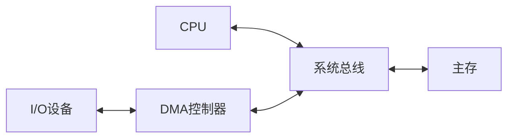
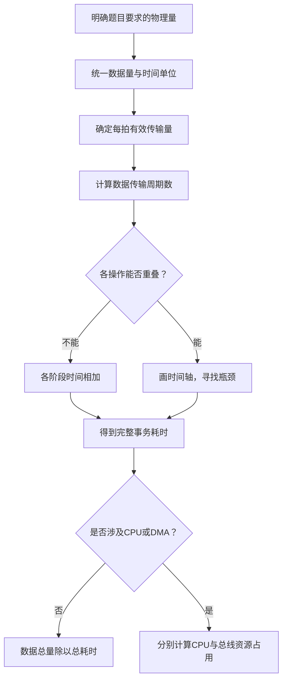

本章以总线为核心，结合存储系统和DMA综合题。原题库的模拟题将总线单列为第6章，真题则与输入输出系统合并，部分总线综合题归入存储系统。

## 一、核心考点与复习优先级

| 核心考点            | 代表性题目            | 学习优先级 |
| --------------- | ---------------- | ----- |
| 总线理论带宽与有效传输率    | 王道第4套第44题        | ★★★★★ |
| 同步总线、突发传送与读写时序  | 王道第4套第44题        | ★★★★★ |
| 交叉存储器与总线并行传输    | 2013年408真题       | ★★★★★ |
| Cache缺失与总线传输时间  | 2013年408真题       | ★★★★★ |
| DMA周期挪用与CPU性能   | 王道第5套第44题        | ★★★★★ |
| DMA总线请求次数与仲裁    | 2022年、2012年408真题 | ★★★★  |
| 存储器与总线带宽匹配      | 王道第5套第43题        | ★★★★  |
| 查询、中断、DMA的CPU开销 | 2009年、2018年408真题 | ★★★★  |

这里的优先级是根据题目的综合性、知识迁移价值和解题难度划分的，并非历年考频的统计结果。

**总线大题的本质不是背带宽公式，而是建立正确的时间模型和资源占用模型。**

总线大题的四项基本分析任务：

- 一共需要传输多少有效数据？
- 总线每个周期能够传输多少数据？
- 哪些操作必须串行，哪些操作可以重叠？
- CPU、DMA、存储器分别占用了什么资源、占用了多长时间？

## 二、核心考点1：总线带宽与有效数据传输率

### 1. 必须彻底理解的三个量

| 概念   | 本质              |
| ---- | --------------- |
| 总线宽度 | 一次数据传送能够传输多少位   |
| 总线频率 | 每秒钟有多少个总线时钟周期   |
| 总线带宽 | 单位时间内能够传输的最大数据量 |

假设总线数据宽度为 $W$ 位，总线时钟频率为 $f$，每个时钟周期传送 $k$ 次数据，则理论峰值带宽为：

$$
\boxed{B_{\max}=\frac{W}{8}\times f\times k}
$$

通常题目未涉及双倍速率等机制，并且明确每周期传送一次数据时，取 $k=1$。

但是，理论峰值带宽不等于实际有效传输率。

实际总线事务还可能包含地址发送、控制命令、存储器准备、等待、应答等过程。

$$
\boxed{B_{\text{有效}}=\frac{\text{有效数据量}}{\text{实际总耗时}}}
$$

这两个公式分别对应两个不同的问题：

<Callout type="info" title="理论与有效带宽">

**理论带宽研究总线的数据传输能力，有效带宽研究完整传输过程的效率。**

</Callout>

### 2. 建立通用的总线事务模型

假设一次事务传输 $D$ 字节，总线每拍传输 $w$ 字节，地址和等待共占 $a$ 个周期，且各阶段不重叠。

那么实际需要的数据周期数为：

$$
n=\left\lceil\frac{D}{w}\right\rceil
$$

总事务时间为：

$$
T_{\text{事务}}=(a+n)T_{\text{bus}}
$$

有效传输率为：

$$
\boxed{ B_{\text{有效}} =\frac{D}{(a+\lceil D/w\rceil)T_{\text{bus}}} }
$$

之所以向上取整，是因为即使最后一个周期只传输一部分数据，仍然需要占用一个完整的传输周期。

## 三、精讲代表题1：王道第4套第44题

**来源：题库27分类模拟题，第6章总线，唯一一道独立综合应用题，12分。**

本题综合考查总线宽度、地址数据复用、读写并行、突发传送和平均有效速率。

### 1. 题目条件

计算机字长32位，总线时钟频率100 MHz。

| 条件     | 总线A            | 总线B                      |
| ------ | -------------- | ------------------------ |
| 数据总线宽度 | 64位            | 32位                      |
| 地址与数据  | 分时复用           | 分离                       |
| 每次最多传送 | 8个字            | 8个字                      |
| 读事务    | 地址1拍、等待2拍、每拍2字 | 地址1拍、等待2拍、每拍1字           |
| 写事务    | 与读相同           | 首拍同时发送地址和第一个字，等待2拍，再传剩余字 |

不同事务之间不重叠。

基本数据：

$$
T=\frac{1}{100\times10^6}=10\text{ ns}
$$

$$
1\text{ 字}=32\text{ bit}=4\text{ B}
$$

<Tabs items={['理论峰值', '单字读', '单字写', '混合读写']}>

<Tab value="理论峰值">

总线A：

$$
B_A=8\times100\times10^6 =\boxed{800\text{ MB/s}}
$$

总线B：

$$
B_B=4\times100\times10^6 =\boxed{400\text{ MB/s}}
$$

这里不考虑地址和等待时间。

注意：总线B的32位地址线和32位数据线不能相加为64位数据总线。地址不是有效载荷数据。

</Tab>

<Tab value="单字读">

直接画周期表，比套公式更可靠。

| 总线 | 第1拍 | 第2拍 | 第3拍 | 第4拍 |
| -- | --- | --- | --- | --- |
| A  | 地址  | 等待  | 等待  | 数据  |
| B  | 地址  | 等待  | 等待  | 数据  |

虽然A一次最多能传输64位，但是现在只需要传输32位，仍占用一个周期。

因此两者都是：

$$
B=\frac{4}{4\times10\text{ ns}} =\boxed{100\text{ MB/s}}
$$

**知识本质：总线更宽，不代表所有情况下传输速度都更快。**

当数据量较小、固定开销占主导地位时，更宽的总线可能没有任何优势。

</Tab>

<Tab value="单字写">

| 总线 | 第1拍   | 第2拍 | 第3拍 | 第4拍 |
| -- | ----- | --- | --- | --- |
| A  | 地址    | 等待  | 等待  | 数据  |
| B  | 地址+数据 | 等待  | 等待  | 已完成 |

总线A：

$$
B_A=\frac{4}{40\text{ ns}} =\boxed{100\text{ MB/s}}
$$

总线B：

$$
B_B=\frac{4}{30\text{ ns}} \approx\boxed{133.33\text{ MB/s}}
$$

为什么理论带宽更低的B反而更快？

因为地址总线和数据总线相互分离，且本题允许它们同时传送地址与数据，从而节省了一个周期。

这就是计算机组成原理中一个非常重要的思想：

**提高性能不仅可以增加资源的处理能力，还可以让原本串行的操作并行执行。**

</Tab>

<Tab value="混合读写">

一次完整数据块大小为：

$$
D=8\times4=32\text{ B}
$$

两种总线的周期构成：

| 总线 | 地址周期   | 等待周期 | 额外数据周期 | 总周期 |
| -- | ------ | ---- | ------ | --- |
| A读 | 1      | 2    | 4      | 7   |
| A写 | 1      | 2    | 4      | 7   |
| B读 | 1      | 2    | 8      | 11  |
| B写 | 1（含首字） | 2    | 7      | 10  |

总线A不区分读写，实际传输率：

$$
B_A=\frac{32}{7\times10\text{ ns}} \approx\boxed{457.14\text{ MB/s}}
$$

总线B的平均事务周期数：

$$
\overline C_B=0.6\times11+0.4\times10 =10.6
$$

因此：

$$
B_B=\frac{32}{10.6\times10\text{ ns}} \approx\boxed{301.89\text{ MB/s}}
$$

#### 最容易犯的错误：直接对速率加权

不要使用：

$$
0.6B_{\text{读}}+0.4B_{\text{写}}
$$

因为题目给出的是事务数量比例，而不是时间比例。

不妨假设一共进行了100次事务，其中60次读、40次写。

那么总数据量为：

$$
D_{\text{总}}=100\times32=3200\text{ B}
$$

总线B总耗时为：

$$
T_{\text{总}}=(60\times11+40\times10) \times10\text{ ns}
$$

最后用总数据量除以总时间。

#### 从这道题提炼出的通用公式

对于不同种类的事务，如果第 $i$ 类事务占事务总数的比例为 $p_i$，数据量为 $D_i$，耗时为 $T_i$，那么：

$$
\boxed{ B_{\text{平均}}= \frac{\sum_i p_iD_i}{\sum_i p_iT_i} }
$$

这个公式不仅适用于总线，也适用于网络吞吐量、磁盘传输率等问题。

</Tab>

</Tabs>

### 6. 计算结果对比

| 场景     | A           | B           |
| ------ | ----------- | ----------- |
| 理论峰值带宽 | 800 MB/s    | 400 MB/s    |
| 单字读    | 100 MB/s    | 100 MB/s    |
| 单字写    | 100 MB/s    | 133.33 MB/s |
| 8字混合读写 | 457.14 MB/s | 301.89 MB/s |

计算结果表明：理论峰值更高的总线，在单字写入时可能反而更慢；但在大数据块传送时，宽总线的优势又会体现出来。

**因此，评价总线性能一定要结合实际工作负载，而不能只比较总线宽度或理论峰值带宽。**

## 四、核心考点2：突发传送与低位交叉存储器

这是总线与第3章存储系统结合后，最值得掌握的综合考点。

### 1. 为什么需要突发传送？

假设需要连续读取8个字。

普通单字传送，每读取一个字都要发送地址、等待数据、传输数据。

```text
地址 → 等待 → 数据1
地址 → 等待 → 数据2
地址 → 等待 → 数据3
……
```

而突发传送只需要发送一次首地址，随后连续传输多个数据。

```text
首地址 → 等待 → 数据1 → 数据2 → … → 数据8
```

假设地址占1拍，等待占2拍，每个数据占1拍。

| 传输方式   | 传送8个字所需周期 |
| ------ | --------- |
| 普通单字传送 | 32        |
| 突发传送   | 11        |

突发传送的性能提升并不是因为总线频率提高，而是因为**减少了重复的固定开销**。

当连续传输的数据量增加时，地址和等待开销会被更多的数据分摊，有效带宽就更接近理论峰值带宽。

### 2. 低位交叉存储器的本质

假设有4个存储体，连续字地址分布如下：

| 存储体0 | 存储体1 | 存储体2 | 存储体3 |
| ---- | ---- | ---- | ---- |
| 0    | 1    | 2    | 3    |
| 4    | 5    | 6    | 7    |
| 8    | 9    | 10   | 11   |

连续的字分布在不同的存储体中，因此不必等第一个存储体完成访问，就可以启动第二个存储体。

假设每个存储体的存储周期为 $T_m$，相邻存储体的启动间隔为 $\tau$。

在理想的均匀交叉访问模型下：

$$
\tau=\frac{T_m}{m}
$$

其中 $m$ 是存储体数量。

连续读取 $n$ 个字，直到最后一个字准备完成，需要：

$$
\boxed{T_{\text{准备}}=T_m+(n-1)\tau}
$$

这里假设每个存储体的首次数据准备时间等于其存储周期，且不存在存储体冲突。

**低位交叉存储提高的是连续数据访问的吞吐率，而不是缩短单个存储体自身的访问时间。**

## 五、精讲代表题2：2013年408真题——交叉存储器、突发总线与Cache

本题归入第3章存储系统，但核心计算涉及总线。

### 1. 题目条件

| 参数          | 数值      |
| ----------- | ------- |
| CPU主频       | 800 MHz |
| Cache命中时CPI | 4       |
| Cache块大小    | 32 B    |
| 主存存储体数量     | 8       |
| 单体存储字长      | 32 bit  |
| 单体存储周期      | 40 ns   |
| 总线宽度        | 32 bit  |
| 总线频率        | 200 MHz |
| 一次突发传送量     | 32 B    |

每次突发事务需要发送首地址和命令、准备数据、传输数据。

传送地址或一个32位数据均需要一个总线周期。

### 2. 第一问：CPU周期、总线周期和理论带宽

CPU时钟周期：

$$
T_{\text{CPU}}=\frac{1}{800\text{ MHz}} =\boxed{1.25\text{ ns}}
$$

总线时钟周期：

$$
T_{\text{bus}}=\frac{1}{200\text{ MHz}} =\boxed{5\text{ ns}}
$$

总线带宽：

$$
B=\frac{32/8}{5\text{ ns}} =\boxed{800\text{ MB/s}}
$$

**特别注意：CPU时钟周期、总线时钟周期、主存存储周期是三个不同的时间单位。**

这道题中分别是1.25 ns、5 ns、40 ns，绝不能混用。

### 3. 第二问：一次Cache缺失需要几个突发事务？

Cache块大小32 B，一次突发事务能够传送32 B。

$$
N=\frac{32}{32}=\boxed{1}
$$

一般情况下，如果每次事务最多传输 $D$ 字节，而读取的数据量为 $L$ 字节，且不存在额外的边界限制：

$$
N=\left\lceil\frac{L}{D}\right\rceil
$$

每一个新事务通常都要重新承担地址、等待等固定开销。

### 4. 第三问：一次突发传送需要多长时间？

<Steps>

<Step>

### 确定数据个数

$$
n=\frac{32\text{ B}}{4\text{ B}}=8
$$

即需要连续传送8个32位数据。

</Step>

<Step>

### 确定启动间隔

主存采用8体交叉存储。

$$
\tau=\frac{40}{8}=5\text{ ns}
$$

恰好与总线时钟周期相等。

这意味着，当第一个字准备完成后，主存可以每隔5 ns提供一个新字，而总线也能够每隔5 ns传送一个字。

两者的吞吐能力刚好匹配。

</Step>

<Step>

### 分析时间轴

| 操作       | 时间区间     |
| -------- | -------- |
| 发送首地址和命令 | 0～5 ns   |
| 第1个字准备   | 5～45 ns  |
| 第2个字准备   | 10～50 ns |
| 第3个字准备   | 15～55 ns |
| …        | …        |
| 第8个字准备   | 40～80 ns |
| 第1个字传输   | 45～50 ns |
| 第2个字传输   | 50～55 ns |
| …        | …        |
| 第8个字传输   | 80～85 ns |

因此，总时间是：

$$
\boxed{T=5+40+8\times5=85\text{ ns}}
$$

</Step>

</Steps>

#### 为什么不能直接把所有时间相加？

存储器准备8个字的时间为：

$$
T_{\text{准备}}=40+7\times5=75\text{ ns}
$$

传输8个字的时间为：

$$
T_{\text{传输}}=8\times5=40\text{ ns}
$$

但如果直接计算：

$$
5+75+40=120\text{ ns}
$$

就会得到错误答案。

原因是存储器准备后续数据和总线传输前面数据可以并行执行。

两者重叠时间为：

$$
7\times5=35\text{ ns}
$$

因此：

$$
T=5+75+40-35 =\boxed{85\text{ ns}}
$$

#### 掌握比参考答案更通用的计算模型

假设：

- $A$：地址和命令开销；
- $L$：首个数据准备时间；
- $s$：存储器持续提供一个数据的间隔；
- $b$：总线传送一个数据的时间；
- $n$：连续传输的数据个数。

在数据按固定间隔准备、存储与传输可以流水重叠、具有必要缓冲且没有额外冲突的模型下：

$$
\boxed{ T=A+L+(n-1)\max(s,b)+b }
$$

本题代入：

$$
T=5+40+7\times\max(5,5)+5 =85\text{ ns}
$$

这个公式揭示了流水传输的真正本质：

<Callout type="idea" title="流水传输瓶颈">

**第一个数据需要等待完整的启动延迟，后续数据的输出速度由最慢的阶段决定。**

</Callout>

如果不能确定题目是否允许重叠，就画时间轴，不要机械套用公式。

### 5. 第四问：Cache缺失对CPU执行时间的影响

题目又给出：程序执行100条指令，平均每条指令访存1.2次，Cache缺失率5%，不考虑替换等开销。

假设所有访存均命中时的基础执行时间：

$$
T_{\text{base}}=100\times4\times1.25 =500\text{ ns}
$$

Cache缺失次数：

$$
N_{\text{miss}}=100\times1.2\times5\% =6
$$

缺失额外开销：

$$
T_{\text{miss}}=6\times85=510\text{ ns}
$$

总执行时间：

$$
\boxed{ T_{\text{CPU}}=500+510=1010\text{ ns} }
$$

这里不能将基础执行时间乘以95%的命中率。

因为基础CPI已经表示理想Cache命中情况下执行全部指令的基本成本，缺失时是在这个基础上增加等待时间。

#### 通用综合题公式

设指令数为 $I$，基础CPI为 $\mathrm{CPI}_{0}$，平均每条指令访存次数为 $a$，Cache缺失率为 $r$，缺失额外代价为 $P$。

$$
\boxed{ T_{\text{CPU}} =I\cdot\mathrm{CPI}_{0}\cdot T_{\text{CPU周期}} +IarP }
$$

这道题连接了四章中的重要知识：

| 知识来源    | 在题目中的作用     |
| ------- | ----------- |
| 计算机系统概述 | CPI、CPU执行时间 |
| 存储系统    | Cache、交叉存储器 |
| 中央处理器   | CPU性能与等待    |
| 总线      | 突发事务、传输时序   |

## 六、核心考点3：总线带宽与存储器带宽的匹配

这一考点在2012年408真题和王道第5套第43题中都有体现。

### 1. 存储器和总线是两个不同的瓶颈

假设存储器能够提供800 MB/s的数据，但总线只能传输400 MB/s，那么实际持续吞吐率不会超过400 MB/s。

反过来，如果总线能够传输800 MB/s，但存储器只能提供200 MB/s的数据，那么总线也不可能一直满载。

$$
\boxed{ B_{\text{持续}}\leq \min(B_{\text{主存}},B_{\text{总线}}) }
$$

存在额外地址、等待等开销时，有效速率还可能进一步降低。

### 2. 低位交叉存储器最大带宽

假设有 $m$ 个存储体，每体存储字长为 $w$ 字节，存储周期为 $T_m$。

在理想交叉访问情况下：

$$
\boxed{ B_{\text{主存}}=\frac{mw}{T_m} }
$$

例如2012年408真题，采用4体低位交叉存储，每体存储周期50 ns，每次传输32位。

$$
B_{\text{主存}} =\frac{4\times4}{50\text{ ns}} =\boxed{320\text{ MB/s}}
$$

这里计算的是稳态最大吞吐率，不是读取第一个字的速度。

### 3. 王道第5套第43题中的重要陷阱

题库中这道题给出4个8位存储体，每体存储周期20 ns，数据总线宽32位。

很多人会直接计算：

$$
\tau=\frac{20}{4}=5\text{ ns}
$$

然后认为总线频率一定是200 MHz。

这是不正确的。

因为每个存储体一次提供的是8位数据，而不是32位数据。

4个存储体合计的理想最大供给带宽为：

$$
B_{\text{主存}}=\frac{4\times1}{20\text{ ns}} =200\text{ MB/s}
$$

如果总线每拍传送32位，并且按照题库补充的理想带宽匹配模型工作，则：

$$
f=\frac{200\text{ MB/s}}{4\text{ B}} =\boxed{50\text{ MHz}}
$$

此时，32 B数据需要8拍，再加1拍地址开销，在无额外等待的条件下：

$$
T=(1+8)\times20=\boxed{180\text{ ns}}
$$

但这只是补充假设下的答案。

题库已经对这道模拟题进行了修订，因为原始转写条件不足以唯一确定总线频率和完整突发传输时间。

**区分单体数据宽度、存储器总供给带宽、总线传输宽度这三个量。** 总线频率也并不是必然由存储周期决定的。

## 七、核心考点4：DMA、总线仲裁与周期挪用

这部分严格来说与第7章输入输出系统交叉，但对于总线大题非常重要。

### 1. DMA究竟减少了什么？

DMA允许外设与主存直接进行数据传输，不需要CPU执行大量数据搬运指令。

但是，DMA与CPU仍然可能需要使用同一条系统总线。

因此：

<Callout type="info" title="DMA资源占用">

**DMA减少的是CPU直接参与数据搬运的工作，并没有消除数据传输对总线资源的占用。**

</Callout>



### 2. DMA为什么具有更高的总线优先级？

这是2012年和2022年408真题共同考查的知识点。

在题目采用的周期挪用仲裁模型中，当CPU和DMA同时请求使用存储器总线时，DMA优先。

原因是外设具有实时性要求。如果DMA不能及时获得总线使用权，外设缓冲区可能发生溢出，导致数据丢失；CPU暂时无法访存通常只会使程序执行延迟。

考试中写出这两方面原因即可。

### 3. 区分三种不同的DMA计算量

| 题目所问        | 计算依据         |
| ----------- | ------------ |
| DMA总线请求次数   | 每次请求实际搬运的数据量 |
| DMA传送块数     | 每次DMA块大小     |
| DMA的CPU处理开销 | 初始化及结束处理等成本  |

这三个量不能混为一谈。

例如一次DMA块传输4096 B，而每次总线请求传输4 B，则该块需要1024次总线数据传送，但CPU通常不需要执行1024次DMA初始化与结束处理。

## 八、精讲代表题3：王道第5套第44题——DMA周期挪用与CPU性能下降

**来源：题库第7章输入输出系统，13分。**

本题考查总线资源对CPU吞吐率的限制。

### 1. 题目条件

| 参数         | 数值       |
| ---------- | -------- |
| 每条指令占用总线周期 | 2个       |
| 总线周期       | 250 ns   |
| 初始总线宽度     | 8位       |
| 每磁道扇区数     | 16       |
| 每扇区数据量     | 512 B    |
| 磁盘旋转一周     | 8.192 ms |

每条指令第一个周期取指，第二个周期进行数据访存。

DMA每次挪用一个总线周期，传送的数据量等于数据总线宽度。

### 2. 首先计算磁盘数据传输率

$$
R_{\text{disk}} =\frac{16\times512}{8.192\times10^{-3}} =\boxed{10^6\text{ B/s}}
$$

即每秒传输100万字节。

注意，这里计算的是磁盘连续数据传输率，而不是包含随机寻道、旋转等待的平均访问速率。

### 3. 无DMA时，总线空闲率是多少？

每条指令的两个周期都需要访问主存。

因此：

$$
\boxed{\text{总线空闲率}=0\%}
$$

没有DMA时的指令吞吐率为：

$$
V_0=\frac{1}{2\times250\text{ ns}} =2\times10^6\text{ 条/s}
$$

如果另一个题目规定第一个周期取指、第二个周期只是CPU内部运算且不访存，答案才可能是50%。

不要背固定结论，要看CPU在各周期是否实际占用总线。

<Tabs items={['8位总线', '16位总线']}>

<Tab value="8位总线">

每次DMA可以传送：

$$
\frac{8}{8}=1\text{ B}
$$

所以每秒需要挪用：

$$
N_{\text{DMA}}=\frac{10^6}{1} =10^6\text{ 次}
$$

每秒DMA占用总线时间：

$$
T_{\text{DMA}} =10^6\times250\times10^{-9} =0.25\text{ s}
$$

即DMA占用了25%的总线周期。

CPU只剩75%的总线周期可用。

因此CPU指令吞吐率：

$$
V=2\times10^6\times75\% =1.5\times10^6\text{ 条/s}
$$

CPU执行速度下降：

$$
\boxed{25\%}
$$

</Tab>

<Tab value="16位总线">

每次DMA传输2 B。

每秒DMA请求次数变为：

$$
N_{\text{DMA}}=\frac{10^6}{2} =5\times10^5
$$

DMA占用总线时间：

$$
T_{\text{DMA}} =5\times10^5\times250\times10^{-9} =0.125\text{ s}
$$

所以CPU执行速度下降：

$$
\boxed{12.5\%}
$$

</Tab>

</Tabs>

### 6. 提炼通用模型

外设传输率为 $R$，每次DMA传输 $d$ 字节，每次占用总线时间为 $t$。

每秒DMA请求次数：

$$
\boxed{N=\frac{R}{d}}
$$

DMA总线占用比例：

$$
\boxed{u=\frac{R}{d}t}
$$

在本题这种CPU原本持续占满总线、DMA周期直接挪用CPU周期且无其他开销的模型下：

$$
\boxed{V=V_0(1-u)}
$$

但是，如果CPU本来就有空闲总线周期，DMA能够利用这些空闲周期，那么CPU执行速度下降比例就不一定等于DMA总线占用比例，必须分析实际冲突情况。

### 7. 一个特别容易考查的陷阱

<Callout type="warn" title="性能下降与耗时增长">

**CPU速度下降25%，不等于执行时间增加25%。**

</Callout>

假设原本程序执行时间为 $T_0$，速度下降25%后：

$$
T'=\frac{T_0}{1-25\%} =\frac{4}{3}T_0
$$

执行时间实际上增加：

$$
\boxed{33.33\%}
$$

一般而言，性能下降比例为 $p$，完成相同工作所需时间的增长比例为：

$$
\boxed{\frac{p}{1-p}}
$$

这是一个可以迁移到所有CPU性能计算题中的知识点。

## 九、历年真题补充：DMA请求次数与CPU开销

### 1. 2022年408真题：DMA请求次数

题目给出一个扇区大小512 B，磁盘控制器的数据缓冲区大小64位，采用周期挪用DMA方式。

每次传输：

$$
64\text{ bit}=8\text{ B}
$$

在题设每次请求搬运一个缓冲区数据量的模型下，传输一个扇区的总线请求次数：

$$
N=\frac{512}{8}=\boxed{64\text{ 次}}
$$

如果CPU同时需要访问主存，DMA按照题设仲裁规则优先获得总线使用权。

2012年408真题也是同一个模型，只不过将一次扇区传输换成了缺页时的一整页数据传输，并要求进一步计算每秒DMA请求次数。

### 2. 2009年、2018年408真题：CPU用于I/O的时间比例

假设外设传输率为 $R$，每次I/O处理的数据量为 $D$，每次处理需要CPU执行 $C$ 个时钟周期，CPU主频为 $f$。

每秒处理次数：

$$
N=\frac{R}{D}
$$

每秒消耗的CPU周期数：

$$
C_{\text{总}}=\frac{R}{D}C
$$

CPU时间占比：

$$
\boxed{ u_{\text{CPU}}=\frac{RC}{Df} }
$$

如果题目给出的是指令条数，那么先通过CPI换算为时钟周期数。

#### 以2018年408真题为例

CPU主频500 MHz，设备B的数据传输率为40 MB/s。

采用中断方式，每次传送4 B，每次中断至少消耗400个时钟周期。

计算：

$$
u_{\text{CPU}} =\frac{40\times10^6\times400} {4\times500\times10^6} =800\%
$$

也就是说，即使CPU将全部时间用于处理中断，也跟不上设备的数据传输速度。

所以不能采用题设的中断I/O方式。

如果改用DMA，每次传输1000 B，CPU预处理和后处理共消耗500个周期：

$$
u_{\text{CPU}} =\frac{40\times10^6\times500} {1000\times500\times10^6} =\boxed{4\%}
$$

为什么DMA的CPU开销大幅下降？

因为CPU参与处理的粒度从4 B扩大到了1000 B，减少了频繁的控制开销。

#### 必须分清两种占用率

| 占用率          | 描述                   |
| ------------ | -------------------- |
| DMA总线占用率     | DMA消耗了多少总线传输时间       |
| DMA的CPU时间占用率 | CPU为DMA执行控制工作消耗了多少时间 |

这两种占用率不是同一个概念。

2009年408真题明确规定DMA与CPU之间没有访存冲突，因此只计算CPU的DMA预处理、后处理开销。

而王道第5套第44题采用周期挪用，重点计算DMA抢占总线对CPU执行速度的影响。

理解这个区别，就不会把这两类题的公式混用。

## 十、所有总线大题的统一解题流程

遇到陌生题目，按照下面的思路分析。



最关键的是判断是否允许操作重叠。

不同操作之间的关系，可以用下面这张表帮助理解。

| 操作                  | 是否可能并行      |
| ------------------- | ----------- |
| 同一组复用线上的地址与数据传送     | 不可以         |
| 独立地址线与数据线上的传送       | 取决于协议是否允许   |
| 不同存储体的数据准备          | 可以交叉并行      |
| 存储器准备后续数据与总线传送已有数据  | 可以流水重叠      |
| CPU与DMA同时使用同一共享总线   | 不能同时独占该总线   |
| DMA传输与CPU不需要总线的内部运算 | 可以          |
| 不同总线事务              | 取决于题目是否允许重叠 |

**不要看到两个操作就默认时间相加，也不要看到独立硬件就默认一定能够并行。**

题目规定的硬件结构、控制协议和时序条件才是最终依据。

## 十一、考前必须掌握的公式汇总

| 考点          | 核心公式                                    |
| ----------- | --------------------------------------- |
| 时钟周期        | $T=1/f$                             |
| 理论峰值带宽      | $B_{\max}=Wfk/8$                   |
| 实际传输率       | $B=D/T_{\text{总}}$                 |
| 数据传输周期数     | $n=\lceil D/w\rceil$                |
| 总线利用率       | $\eta=B_{\text{有效}}/B_{\max}$     |
| 混合事务有效带宽    | $B=\frac{\sum p_iD_i}{\sum p_iT_i}$ |
| 交叉存储器最大带宽   | $B=mw/T_m$                          |
| 交叉存储准备时间    | $T=T_m+(n-1)\tau$                   |
| 理想流水重叠传输    | $T=A+L+(n-1)\max(s,b)+b$            |
| Cache缺失次数   | $N=Iar$                             |
| DMA每秒请求次数   | $N=R/d$                             |
| DMA总线占用率    | $u=Rt/d$                            |
| CPU的I/O时间占比 | $u=RC/(Df)$                         |
| 性能下降后的耗时增长率 | $p/(1-p)$                           |

其中总线利用率一行表示相对于理论峰值的有效数据传输效率。若题目问的是总线忙碌时间比例，则需要根据实际占用时间另行计算。

### 单位换算也必须熟练

$$
1\text{ MHz}=10^6\text{ Hz}
$$

$$
1\text{ ns}=10^{-9}\text{ s}
$$

$$
1\text{ }\mu\text{s}=10^{-6}\text{ s}
$$

$$
1\text{ B}=8\text{ bit}
$$

一个特别好用的快捷换算是：

$$
\boxed{1\text{ B/ns}=1000\text{ MB/s}}
$$

例如：

$$
\frac{4\text{ B}}{5\text{ ns}} =0.8\text{ B/ns} =800\text{ MB/s}
$$

存储容量涉及二进制单位时，注意 $1\text{ KiB}=1024\text{ B}$，不要与十进制传输速率单位混淆。

## 十二、自测练习

以下为根据题库核心考点设计的理解性自测，非原题。

<Accordions>

<Accordion title="总线宽度翻倍，有效传输率一定翻倍吗？">

不一定，地址和等待开销仍存在

</Accordion>

<Accordion title="地址总线和数据总线分离，就一定能并行传输吗？">

不一定，还取决于协议

</Accordion>

<Accordion title="突发传送为什么能够提高带宽？">

减少重复地址及准备开销

</Accordion>

<Accordion title="低位交叉能缩短单体存储周期吗？">

不能，主要提高吞吐率

</Accordion>

<Accordion title="8个存储体一定能让系统带宽提高8倍吗？">

不一定，还受总线与访问模式限制

</Accordion>

<Accordion title="混合读写的有效速率能直接按事务比例加权吗？">

一般不能

</Accordion>

<Accordion title="DMA传输完全不占用CPU和总线资源吗？">

不是

</Accordion>

<Accordion title="DMA占用25%的总线，CPU速度一定下降25%吗？">

不一定，要看是否发生冲突

</Accordion>

<Accordion title="CPU速度下降50%，执行时间增加50%吗？">

不是，执行时间增加100%

</Accordion>

<Accordion title="Cache缺失额外时间能否直接用整个程序时间乘缺失率求得？">

不能

</Accordion>

</Accordions>

## 十三、题库阅读范围及复习建议

相关题库范围如下：

| 题库来源        | 阅读内容                    |
| ----------- | ----------------------- |
| 27分类模拟题·第6章 | 王道第4套第44题               |
| 27分类模拟题·第3章 | 王道第5套第43题等相关总线内容        |
| 27分类模拟题·第7章 | 王道第3套、第5套第44题           |
| 408分类真题·第6章 | 2009年、2016年、2018年I/O综合题 |
| 408分类真题·第3章 | 2012年、2013年、2022年等总线综合题 |
| 指令系统与中央处理器  | 涉及系统总线和内部总线的交叉考点        |

原始资料：[408分类题库-27模拟题与历年真题](https://drive.google.com/file/d/1tu3fkoeqEyCAxRgD62i6CdnwQKX-Q5vt/view?usp=drivesdk)

原题库解析勘误：2018年真题存在一处数值笔误：40 MB/s的设备准备4 B数据所需时间应为 $0.1\ \mu\text{s}$，而不是 $2\ \mu\text{s}$。上文已按正确数值计算。另外，2016年真题主要考查异步串行通信与中断服务时序，王道第3套主要考查中断屏蔽字与嵌套，二者更适合放在第7章精讲，因此不在本章展开。

### 最值得反复研究的三道大题

| 推荐顺序 | 题目         | 必须学会的能力               |
| ---- | ---------- | --------------------- |
| 第一题  | 王道第4套第44题  | 独立建立总线读写事务的时间模型       |
| 第二题  | 2013年408真题 | 分析存储器与总线流水重叠，并结合CPU性能 |
| 第三题  | 王道第5套第44题  | 分析共享总线资源占用与CPU吞吐率     |

变式训练可改变总线宽度、时钟频率、存储体数量、等待周期、读写比例和DMA传输速率。

## 十四、本章最重要的思想总结

总线章节真正值得掌握的，是贯穿整个计算机组成原理的五个思想：

**第一，带宽与延迟不同。** 带宽表示单位时间内能处理多少数据，延迟表示完成一次操作需要多久。

**第二，固定开销可以被分摊。** 突发传送通过批量传输提高总线利用率。

**第三，流水并行能够提高吞吐率。** 交叉存储器允许数据准备与总线传输重叠。

**第四，系统性能取决于瓶颈。** 提高总线速度不一定能提高整个系统速度，还要考虑存储器的供给能力。

**第五，共享资源存在竞争。** DMA虽然减轻了CPU的数据搬运负担，但仍会占用总线资源。

最终，把本章浓缩成三个基本关系：

$$
\boxed{\text{吞吐率}=\frac{\text{有效工作量}}{\text{总时间}}}
$$

$$
\boxed{\text{流水吞吐能力由最慢阶段决定}}
$$

$$
\boxed{\text{资源占用率}=\frac{\text{资源占用时间}}{\text{总时间}}}
$$
