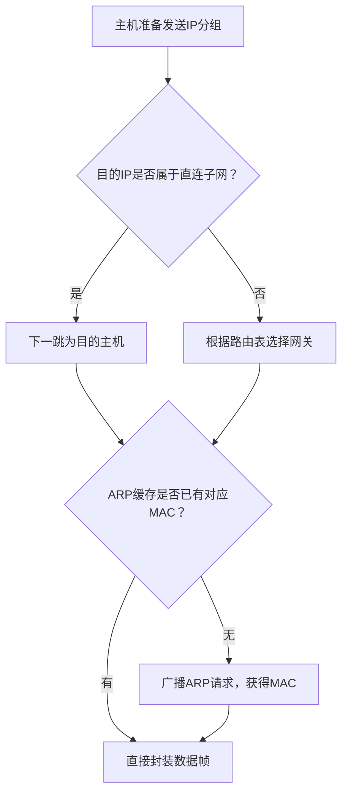
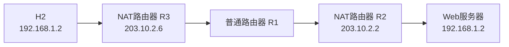
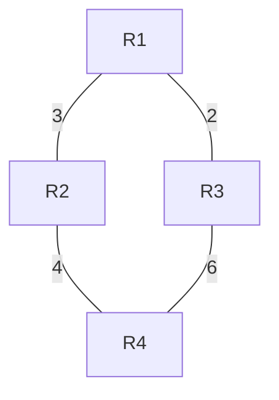

本章归纳8道历年真题（2009、2013、2014、2015、2018、2019、2020、2024年）及27王道第2、3、4、5套第47题，共12道大题。

## 一、本章大题的核心考点与复习优先级

网络层大题围绕三个核心问题展开：

**地址如何分配？分组如何选择路径？分组经过每一段链路时如何封装和转发？**

| 核心考点                | 题库中的代表题目                  | 复习优先级 |
| ------------------- | ------------------------- | ----- |
| CIDR、子网划分、VLSM      | 2009、2018、2019年，模拟第2、3、5套 | ★★★★★ |
| 路由表填写、路由聚合          | 2009、2013、2014年，模拟第2、3、5套 | ★★★★★ |
| 最长前缀匹配              | 2013年                     | ★★★★★ |
| IP地址与MAC地址、ARP、默认网关 | 2015年，模拟第3、4、5套           | ★★★★★ |
| NAT与端口映射            | 2019、2020年，模拟第4套          | ★★★★★ |
| IPv4分片              | 2018年                     | ★★★★★ |
| RIP、OSPF、BGP及路由收敛   | 2013、2014、2024年，模拟第2套     | ★★★★★ |
| DHCP及动态地址分配         | 2015年                     | ★★★★  |
| TTL生存时间             | 2014、2024年                | ★★★★  |
| 路由器、交换机、VLAN与广播域    | 2019年，模拟第3、4套             | ★★★★  |

复习优先级依据题库覆盖、基础性及迁移价值，不代表未来考试概率。

尤其值得关注的是，**模拟题并没有脱离真题的基本框架，而是将多个经典考点组合在同一道大题中，增加对网络实际运行过程的考查。**

复习ARP、NAT、RIP等协议时，应结合网络拓扑推演分组的完整转发过程。

## 二、第一类大题：IP地址分配与子网划分

### 1. 必须真正理解CIDR的本质

IP地址由两部分构成：

$$
\underbrace{\text{网络前缀}}_{n\text{位}}+\underbrace{\text{主机号}}_{32-n\text{位}}
$$

例如，`192.168.1.0/26`，表示前26位是网络前缀，后6位是主机号。

由此可以推出本类题几乎所有的计算公式。

| 计算内容       | 公式或方法        |
| ---------- | ------------ |
| 主机号位数      | $h=32-n$     |
| 地址块大小      | $2^h$        |
| 普通子网可用地址数量 | $2^h-2$      |
| 网络地址       | IP地址与子网掩码按位与 |
| 广播地址       | 主机位全部置1      |
| 第一个可用地址    | 网络地址加1       |
| 最后一个可用地址   | 广播地址减1       |

其中最重要的是：

$$
\boxed{2^h-2\geq N}
$$

$N$ 是实际需要分配的可用IP地址数量。

注意，路由器的局域网接口、服务器等设备也可能需要占用可用IP地址，而不只是普通计算机。

#### 必须熟记的地址块大小

| CIDR | 子网掩码            | 地址总数 | 可用地址数 |
| ---- | --------------- | ---- | ----- |
| /24  | 255.255.255.0   | 256  | 254   |
| /25  | 255.255.255.128 | 128  | 126   |
| /26  | 255.255.255.192 | 64   | 62    |
| /27  | 255.255.255.224 | 32   | 30    |
| /28  | 255.255.255.240 | 16   | 14    |
| /29  | 255.255.255.248 | 8    | 6     |
| /30  | 255.255.255.252 | 4    | 2     |

### 2. 代表题目：2027王道第5套第47题

企业具有地址块 `160.10.10.0/24`，需要分配给三个部门：

- 部门1：112台计算机。
- 部门2：60台计算机。
- 部门3：29台计算机。

每个部门还要给路由器网关预留一个IP地址，要求尽量节约地址空间。

<Steps>

<Step>

### 计算容量与前缀

部门1：

$$
2^h-2\geq112+1=113
$$

取 $h=7$，所以网络前缀为25位。

部门2：

$$
2^h-2\geq60+1=61
$$

取 $h=6$，所以网络前缀为26位。

部门3：

$$
2^h-2\geq29+1=30
$$

取 $h=5$，所以网络前缀为27位。

</Step>

<Step>

### 按容量从大到小分配

| 部门  | 需求地址数 | 分配地址数 | CIDR地址块          |
| --- | ----- | ----- | ---------------- |
| 部门1 | 113   | 128   | 160.10.10.0/25   |
| 部门2 | 61    | 64    | 160.10.10.128/26 |
| 部门3 | 30    | 32    | 160.10.10.192/27 |
| 剩余  | —     | 32    | 160.10.10.224/27 |

只看IP地址最后8位，整个地址空间的分配过程就是：

```text
0                 128       192   224   256
|------------------|---------|-----|-----|
       部门1          部门2    部门3  剩余
       /25            /26     /27   /27
```

</Step>

<Step>

### 确定地址边界及网关

| 部门  | 网络地址末尾 | 可用地址末尾  | 广播地址末尾 |
| --- | ------ | ------- | ------ |
| 部门1 | 0      | 1～126   | 127    |
| 部门2 | 128    | 129～190 | 191    |
| 部门3 | 192    | 193～222 | 223    |

部门1的默认网关可以选择 `160.10.10.1`，只要属于该子网的可用地址且不与其他设备冲突即可。

</Step>

</Steps>

#### 解题本质：子网划分是一个有对齐限制的空间分配问题

为什么不能随便选择一个地址作为子网起点？

例如，一个 `/26` 地址块具有64个地址，其网络地址末尾只能是：

$$
0,\ 64,\ 128,\ 192
$$

因为网络地址的主机位必须全部为0。

所以 `160.10.10.96/26` 不能作为一个规范的子网网络地址，它实际对应的网络地址是 `160.10.10.64/26`。

<Callout type="warn" title="CIDR对齐约束">

**地址块起始位置必须按照地址块大小对齐。**

</Callout>

这也是VLSM通常先分配大子网、再分配小子网的根本原因：避免地址空间碎片导致较大的子网无法正确对齐。

### 3. 已知IP地址和掩码，快速计算所属子网

模拟第5套还给出了一个 `/30` 点到点网络。

已知R1的WAN1接口为 `198.10.10.18/30`，求R2的WAN2地址。

因为 `/30` 的地址块大小为4：

$$
\left\lfloor\frac{18}{4}\right\rfloor\times4=16
$$

因此：

| 项目      | 地址           |
| ------- | ------------ |
| 网络地址    | 198.10.10.16 |
| 第一个可用地址 | 198.10.10.17 |
| 第二个可用地址 | 198.10.10.18 |
| 广播地址    | 198.10.10.19 |

R1已经占用了 `.18`，因此R2只能使用 `.17`。

对于题目中掩码长度不小于24位的情况，可以直接使用这个快速公式：

$$
\boxed{\text{网络地址末尾}
=\left\lfloor\frac{x}{B}\right\rfloor B}
$$

其中 $x$ 为IP地址最后一个字节，$B$ 为地址块大小。

### 4. 同类题的迁移

| 题库题目    | 核心变形                      |
| ------- | ------------------------- |
| 2009年真题 | 一个 /24 均分成两个 /25          |
| 2018年真题 | 计算广播地址和剩余可用地址数            |
| 2019年真题 | 根据IP地址判断所属子网及网络设备         |
| 模拟第2套   | 两部门分别需要19、26个可用地址，均分配 /27 |
| 模拟第3套   | 已知主机IP，反推网络地址、默认网关        |
| 模拟第5套   | 不同规模部门的VLSM分配             |

**掌握一种统一方法即可：先算容量，再确定前缀，最后计算边界和扣除已占用地址。**

## 三、第二类大题：路由表、路由聚合与最长前缀匹配

### 1. 路由表究竟记录了什么？

路由表并不需要保存分组到达目的地的完整路径。

它只需要回答：

**到达目的网络的下一跳及出接口是什么？**

| 路由表字段 | 实际含义            |
| ----- | --------------- |
| 目的网络  | 这条路由负责哪些目的IP    |
| 子网掩码  | 需要匹配多少位网络前缀     |
| 下一跳   | 下一个接收分组的路由器接口IP |
| 出接口   | 当前路由器从哪个接口发送分组  |

尤其注意：

<Callout type="warn" title="下一跳与出接口">

**下一跳填写相邻路由器的接口IP，出接口填写当前路由器自己的接口。**

</Callout>

### 2. 路由表的通用填写方法

| 目的地类型  | 下一跳       | 目的网络前缀    |
| ------ | --------- | --------- |
| 直连网络   | 直接交付或填 —  | 实际网络前缀    |
| 非直连网络  | 相邻路由器接口IP | 实际网络前缀    |
| 指定主机   | 通往该主机的下一跳 | /32       |
| 未知外部网络 | 通往外网的下一跳  | 0.0.0.0/0 |

2009年真题就是这个模型的经典应用。

其中R1直连两个局域网，同时经R2访问DNS服务器和互联网。

其路由表为：

| 目的网络             | 下一跳         | 出接口 |
| ---------------- | ----------- | --- |
| 202.118.1.0/25   | 直接交付        | E1  |
| 202.118.1.128/25 | 直接交付        | E2  |
| 202.118.3.2/32   | 202.118.2.2 | L0  |
| 0.0.0.0/0        | 202.118.2.2 | L0  |

这里的 `/32` 不是因为DNS服务器使用静态IP，而是因为题目要求的是**只匹配该服务器的主机路由**。

### 3. 路由聚合的本质

路由聚合是把多条具有相同转发行为的路由，压缩成更少的路由表项。

例如：

```text
211.72.32.0/27   ──→ R5
211.72.32.32/27  ──→ R5
```

可以合并为：

```text
211.72.32.0/26   ──→ R5
```

但是，如果第一条路由从D1转发，第二条路由从D2转发，即使地址连续，也不能简单地合并成一条路由。

路由聚合不能只看IP地址，还要看实际的转发结果。

通常需要检查：

- 是否具有可以合并的公共网络前缀。
- 下一跳和出接口是否相同。
- 合并后是否会造成错误转发。
- 是否有更具体的路由处理聚合范围内的例外地址。

最后一条尤其重要，也是下面这道真题的精髓。

### 4. 代表真题：2013年408

题目中，R2需要维护以下网络的路由：

| 目的网络             | 出接口 |
| ---------------- | --- |
| 153.14.5.0/25    | S0  |
| 153.14.5.128/25  | S0  |
| 194.17.20.0/25   | S1  |
| 194.17.21.0/24   | S1  |
| 194.17.20.128/25 | E0  |

要求路由表项尽可能少。

<Steps>

<Step>

### 普通聚合

$$
153.14.5.0/25
$$

$$
153.14.5.128/25
$$

这两个地址块刚好组成：

$$
\boxed{153.14.5.0/24}
$$

因为二者具有相同下一跳和出接口，可以直接合并。

</Step>

<Step>

### 保留例外的聚合

考虑以下两个网络：

```text
194.17.20.0/25
194.17.21.0/24
```

第三个字节转换成二进制：

```text
20 = 00010100
21 = 00010101
```

具有7位公共前缀，加上前两个字节的16位：

$$
16+7=23
$$

因此可以聚合为：

$$
194.17.20.0/23
$$

但是这个地址块还覆盖了 `194.17.20.128/25`，而它应该从E0转发。

**保留这条更具体的路由，利用最长前缀匹配进行区分。**

最终路由表：

| 目的网络             | 下一跳         | 出接口 |
| ---------------- | ----------- | --- |
| 153.14.5.0/24    | 153.14.3.2  | S0  |
| 194.17.20.0/23   | 194.17.24.2 | S1  |
| 194.17.20.128/25 | 直接交付        | E0  |

</Step>

<Step>

### 最长前缀匹配

若目的IP为 `194.17.20.200`，那么它同时匹配：

$$
194.17.20.0/23
$$

$$
194.17.20.128/25
$$

由于：

$$
25>23
$$

所以选择 `/25` 路由，从E0接口转发。

可以把这两条路由理解为：

```text
194.17.20.0/23     → S1（一般规则）
194.17.20.128/25   → E0（特殊规则）
```

**更具体的规则优先于一般规则。**

</Step>

</Steps>

### 5. 路由聚合的三种典型情况

| 情况                         | 能否聚合   |
| -------------------------- | ------ |
| 两个相邻子网，下一跳相同，恰好构成更大地址块     | 可以直接聚合 |
| 两个相邻子网，下一跳不同               | 不能简单合并 |
| 聚合后包含其他转发方向的子网，但保留更具体的例外路由 | 可以正确聚合 |

模拟第5套还考查了另一种情况：整个 `160.10.10.0/24` 都分配给企业，虽然内部暂未使用最后一个 `/27`，外部路由器仍然可以使用一条 `/24` 路由将整个企业地址块的流量交给企业路由器。未分配地址的流量应在企业侧妥善丢弃，避免路由环路。

所以不能死记“聚合后的地址必须全部已经使用”。

## 四、第三类大题：ARP、MAC地址、IP地址与默认网关

### 1. 必须建立的两层地址模型

| 地址类型    | 解决的问题       |
| ------- | ----------- |
| 目的IP地址  | 分组最终要到哪里    |
| 目的MAC地址 | 当前这一段链路要交给谁 |

假设主机A通过两个路由器访问主机B，所有链路均为以太网，且不存在NAT。


分组经过每一段链路时的地址：

| 传输阶段    | 源IP | 目的IP | 源MAC  | 目的MAC |
| ------- | --- | ---- | ----- | ----- |
| A → R1  | A   | B    | A     | R1入接口 |
| R1 → R2 | A   | B    | R1出接口 | R2入接口 |
| R2 → B  | A   | B    | R2出接口 | B     |

由此得到一个极其重要的结论：

<Callout type="idea" title="普通路由转发（无NAT）">

**普通路由转发不修改源IP和目的IP，但每经过一次路由转发，都要根据下一段链路重新封装链路层帧。**

</Callout>

而普通二层交换机转发以太网帧时，不需要修改源MAC和目的MAC。

### 2. ARP到底查询谁的MAC地址？

ARP的作用是：

**已知本地链路上的下一跳IPv4地址，获取对应的MAC地址。**

判断ARP查询对象，必须先判断下一跳。



访问外网时，ARP查询的通常是默认网关的MAC，而不是远端服务器的MAC。

对于路由器，同样是先查路由表，再根据下一跳进行必要的ARP解析。

### 3. 代表真题：2015年408

这道题综合考查DHCP、ARP、默认网关与局域网通信。

题目中的网络配置为：

| 设备      | IP地址            |
| ------- | --------------- |
| 路由器     | 111.123.15.1/24 |
| DHCP服务器 | 111.123.15.2/24 |
| WWW服务器  | 111.123.15.3/24 |
| 主机1     | 111.123.15.4/24 |

其他主机通过DHCP动态获取IP地址。

<Tabs items={['DHCP地址池', 'ARP与首个以太网帧', '默认网关错误']}>

<Tab value="DHCP地址池">

该网络可用主机地址范围为 `.1～.254`。

前四个地址已被占用，因此：

$$
\boxed{111.123.15.5\sim111.123.15.254}
$$

初次获取IP地址时，DHCP Discover报文对应的地址是：

| 字段    | 值                 |
| ----- | ----------------- |
| 源IP   | 0.0.0.0           |
| 目的IP  | 255.255.255.255   |
| 目的MAC | FF-FF-FF-FF-FF-FF |

此时主机尚未获得自身IP，也不知道DHCP服务器地址，因而广播寻找服务器。

</Tab>

<Tab value="ARP与首个以太网帧">

题目明确给出ARP表为空。

所以，第一个发送的帧封装的是ARP请求，目的MAC为：

```text
FF-FF-FF-FF-FF-FF
```

随后，获得网关MAC地址以后，真正封装外网IP数据报的以太网帧，其目的MAC为路由器的MAC：

```text
00-A1-A1-A1-A1-A1
```

必须区分：

| 问题描述           | 答案       |
| -------------- | -------- |
| 发出的第一个以太网帧     | 广播MAC    |
| 封装实际IP数据报的以太网帧 | 下一跳设备MAC |

</Tab>

<Tab value="默认网关错误">

假设主机1把默认网关错误地配置为DHCP服务器 `111.123.15.2`。

主机1访问WWW服务器 `111.123.15.3` 时，两者处于同一子网，因此直接通过ARP获取WWW服务器的MAC地址即可。

所以：

- 能够访问本子网内的WWW服务器。
- 在题目给出的正常设备功能前提下，不能访问Internet，因为错误的网关不会替主机完成外网路由转发。

<Callout type="warn" title="默认网关适用范围">

**默认网关配置错误，不意味着所有网络通信都失败。它主要影响需要经该网关转发的通信。**

</Callout>

</Tab>

</Tabs>

### 4. 模拟题的重要变形：PPP链路是否需要ARP？

2027王道第5套中，Internet发来的请求已经到达R2，随后沿以下路径转发：

```text
R2 ──PPP── R1 ──以太网交换机── Web服务器
```

所有设备的ARP缓存为空，求单向传输所需的ARP解析次数。

| 传输阶段        | ARP次数 | 原因                   |
| ----------- | ----- | -------------------- |
| R2 → R1     | 0     | PPP点到点链路，不需要解析以太网MAC |
| R1 → Web服务器 | 1     | 以太网，需要获取目的服务器MAC     |
| 交换机转发       | 0     | 二层交换机按照MAC表转发        |

答案为：

$$
\boxed{1\text{次}}
$$

ARP次数取决于需要进行地址解析的下一跳，而不是经过了多少台设备。

## 五、第四类大题：NAT与端口映射

### 1. NAT的核心机制

普通路由器只负责选择下一跳。

NAT路由器还可能修改IP地址；如果采用NAPT/PAT，还可能修改传输层端口。

| 转换方向        | 通常修改的字段         |
| ----------- | --------------- |
| 内网主动访问外网    | 源IP、必要时源端口      |
| 外网返回内网的响应   | 目的IP、必要时目的端口    |
| 外网主动访问内网服务器 | 根据静态映射修改目的IP及端口 |

NAT修改的字段取决于分组方向与映射关系。

### 2. 代表真题：2020年408

本题考查两次NAT转换及不同局域网的私有地址复用。

题目中的关键地址：

| 设备     | IP地址        |
| ------ | ----------- |
| H2主机   | 192.168.1.2 |
| Web服务器 | 192.168.1.2 |
| R3外网接口 | 203.10.2.6  |
| R2外网接口 | 203.10.2.2  |

网络结构可以简化为：



#### 问题一：如何允许外部主机访问内部Web服务器？

在R2设置静态端口映射。

HTTP默认端口为80，因此映射表为：

| 外网IP       | 外网端口 | 内网IP        | 内网端口 |
| ---------- | ---- | ----------- | ---- |
| 203.10.2.2 | 80   | 192.168.1.2 | 80   |

外部主机访问 `203.10.2.2:80`，R2就将相应请求转发至内部Web服务器。

#### 问题二：逐跳分析IP地址的变化

| 分组所处位置 | 源IP         | 目的IP        |
| ------ | ----------- | ----------- |
| H2刚发出  | 192.168.1.2 | 203.10.2.2  |
| 经过R3转换 | 203.10.2.6  | 203.10.2.2  |
| 经过R1转发 | 203.10.2.6  | 203.10.2.2  |
| 经过R2转换 | 203.10.2.6  | 192.168.1.2 |

理解每一步：

R3把源私有IP转换为自己的公网IP，使数据报能够在外网传输。

R1只是普通路由器，不修改源IP和目的IP。

R2根据端口映射，将目的公网IP转换为内部Web服务器的IP。

#### 更深层的理解

为什么H2和Web服务器可以同时使用 `192.168.1.2`？

因为它们属于两个相互独立的私有网络，私有地址不要求全球唯一。

而且H2访问服务器时，实际使用的目的IP是R2的公网IP。如果直接把目的IP填写为 `192.168.1.2`，就不能按照本题所设计的公网访问路径正常转发。

这就是NAT如何实现私有地址复用的具体体现。

### 3. NAT常见变形：网络故障排查

模拟第4套给出以下现象：

主机能够ping通网关，已经成功解析出Web服务器公网IP，但HTTP请求总是超时。

在给定的候选故障中，且题设已排除路由器接口和默认路由故障时，应优先怀疑NAT/PAT或转发过滤规则。

| 测试现象       | 能够支持的判断              |
| ---------- | -------------------- |
| 能ping通默认网关 | 到网关的本地通信基本正常         |
| 已获得域名对应IP  | 当前域名解析环节已成功          |
| 无法完成HTTP请求 | 进一步检查NAT、过滤规则、TCP连接等 |

真实网络中还可能是服务器或其他链路故障，因此不能只凭这些现象断言一定是NAT错误。但是在该模拟题限定的三个选项中，NAT或过滤规则是最有针对性的答案。

## 六、第五类大题：IPv4数据报分片

IPv4分片的代表题为2018年真题。

### 1. 真正理解分片的四个字段

| 字段               | 含义                        |
| ---------------- | ------------------------- |
| 总长度              | 当前IP分片首部与数据之和             |
| 标识Identification | 同一个原始数据报的各分片具有相同标识        |
| MF               | 是否还有后续分片                  |
| 片偏移              | 当前分片的数据在原始数据部分中的位置，以8B为单位 |

此外，DF表示是否禁止分片。

如果DF为1，而分组超过出口MTU，路由器不能进行IPv4分片，应丢弃该分组，并在适用条件下返回相应ICMP差错报文。

### 2. 代表真题：2018年408

原始IP数据报：

$$
L=1500\text{B}
$$

IP首部长度：

$$
H=20\text{B}
$$

出口网络：

$$
MTU=800\text{B}
$$

要求尽量使用最大分片。

<Steps>

<Step>

### 计算原始数据长度

$$
D=L-H=1500-20=1480\text{B}
$$

注意：分片的是原始IP数据部分，不是把原始IP首部当作普通数据再次分割。

</Step>

<Step>

### 确定非末片数据上限

理论上，每个分片最多携带：

$$
800-20=780\text{B}
$$

但是非最后一个分片的数据长度必须是8B的整数倍。

因此：

$$
D_{\max}
=8\left\lfloor\frac{780}{8}\right\rfloor
=776\text{B}
$$

</Step>

<Step>

### 计算各片的数据长度

$$
k=\left\lceil\frac{1480}{776}\right\rceil=2
$$

第一片数据长度：

$$
776\text{B}
$$

第二片数据长度：

$$
1480-776=704\text{B}
$$

</Step>

<Step>

### 确定片偏移、MF与总长度

第一片从原始数据第0字节开始：

$$
Offset_1=0
$$

第二片从原始数据第776字节开始：

$$
Offset_2=\frac{776}{8}=97
$$

完整答案：

| 分片  | 数据长度 | 总长度  | 片偏移 | MF |
| --- | ---- | ---- | --- | -- |
| 第1片 | 776B | 796B | 0   | 1  |
| 第2片 | 704B | 724B | 97  | 0  |

```text
原始IP数据报
┌──────┬──────────────────────────────┐
│ 20B  │           1480B 数据         │
└──────┴──────────────────────────────┘

分片1
┌──────┬──────────────────┐
│ 20B  │    776B 数据      │
└──────┴──────────────────┘
Offset = 0，MF = 1

分片2
┌──────┬────────────────┐
│ 20B  │   704B 数据     │
└──────┴────────────────┘
Offset = 97，MF = 0
```

</Step>

</Steps>

### 3. 分片题万能公式

假设原始数据报长度为 $L$，每片首部长度均为 $H$，出口MTU为 $M$。

原始数据长度：

$$
\boxed{D=L-H}
$$

非最后一片的最大数据长度：

$$
\boxed{P=8\left\lfloor\frac{M-H}{8}\right\rfloor}
$$

在需要分片、各非末片取最大长度且首部长度相同的常规考试条件下：

$$
\boxed{k=\left\lceil\frac{D}{P}\right\rceil}
$$

最后一片的数据长度：

$$
\boxed{D_{\text{last}}=D-(k-1)P}
$$

第 $i$ 个分片的片偏移：

$$
\boxed{Offset_i=\frac{(i-1)P}{8}}
$$

#### 进阶变形：分片再次被分片

如果一个原来的分片片偏移为185，后来还需要再次分片，新分片的片偏移不能重新从0开始。

因为片偏移始终是相对于**最初的原始IP数据报的数据部分**计算的。

$$
Offset_{\text{new}}
=Offset_{\text{old}}
+\frac{\text{当前分片内的数据偏移}}{8}
$$

如果原分片的MF为1，那么即使它被再次分片后的最后一个小分片，其MF也仍然为1。

最后，IPv4分片通常在最终目的主机进行重组，而不是每到一个路由器就重新组装。

## 七、第六类大题：RIP、OSPF、BGP与路由计算

2024年真题体现了本章一个很重要的命题方向：不仅要求会计算路由，还要理解路由信息是如何传播的。

### 1. 三种路由协议的本质区别

| 比较项目   | RIP            | OSPF     | BGP       |
| ------ | -------------- | -------- | --------- |
| 使用范围   | AS内部           | AS内部     | 主要用于AS之间  |
| 算法思想   | 距离向量           | 链路状态     | 路径向量      |
| 选路依据   | 跳数             | 累计链路开销   | 路由属性及策略   |
| 主要算法   | Bellman-Ford思想 | Dijkstra | 路径向量与策略选路 |
| 报文封装   | UDP            | IP       | TCP       |
| 端口或协议号 | UDP 520        | IP协议号89  | TCP 179   |
| 典型特点   | 最大有效距离15跳      | 适合较大规模网络 | 支持跨自治系统路由 |

最重要的是理解：

RIP关心经过多少跳。

OSPF关心路径累计代价。

BGP不仅关心路径，还关心自治系统之间的路由策略。

所以，最少跳数、最小开销和BGP最优路径可能完全不同。

### 2. 代表真题：2014年408——OSPF最短路径

根据题库给出的链路状态信息，可以得到以下路由器之间的链路开销：



R1需要确定到达R4所连接网络的最佳路径。

通过R2：

$$
3+4=7
$$

通过R3：

$$
2+6=8
$$

因此选择：

$$
\boxed{R1\rightarrow R2\rightarrow R4}
$$

若计算到R4直连目的网络的完整开销，还应加上R4到该网络的开销1，因此总开销为8。

这里R1到目的网络的下一跳应该是R2，而不是R4。

结合题目中其他子网，得到聚合前路由表：

| 目的网络         | 下一跳       | 出接口 |
| ------------ | --------- | --- |
| 192.1.1.0/24 | 直接交付      | E0  |
| 192.1.5.0/24 | 10.1.1.10 | L1  |
| 192.1.6.0/24 | 10.1.1.2  | L0  |
| 192.1.7.0/24 | 10.1.1.2  | L0  |

最后两个网络具有相同下一跳，可以聚合成：

$$
192.1.6.0/23
$$

**这种题的正确顺序是：先计算最优路径，再确定下一跳，最后考虑路由聚合。**

绝不能先看IP地址相邻就进行聚合。

### 3. 代表真题：2024年408——RIP收敛时间

本题考查距离向量信息传播过程。

题目规定：

路由器同时启动，启动后立即构建并交换初始距离向量，之后每隔30秒交换一次最新距离向量。

求所有路由器都获得到某个网络的正确路由，至少需要多少时间。

#### 解题本质：每轮交换只能让信息向外传播一跳


| 时间   | 已获得路由的范围  |
| ---- | --------- |
| 交换之前 | 直连路由器     |
| 0s   | 距离直连路由器1跳 |
| 30s  | 距离直连路由器2跳 |
| 60s  | 距离直连路由器3跳 |
| 90s  | 距离直连路由器4跳 |

所以在题目所设定的同步交换模型下：

设所有路由器到目标网络的直连路由器的最短距离中，最大值为 $d_{\max}$。

则：

$$
\boxed{T=\max(0,d_{\max}-1)\times30\text{s}}
$$

套入2024年真题：

| 目标网络         | 直连路由器 | 最远距离 | 收敛时间 |
| ------------ | ----- | ---- | ---- |
| 210.2.3.0/24 | R14   | 2跳   | 30s  |
| 210.2.4.0/24 | R16   | 3跳   | 60s  |

最容易出错的是忽略题干中的“立即交换初始距离向量”。

如果题目改为启动30秒后才进行第一次交换，则对应时间应为：

$$
T=d_{\max}\times30\text{s}
$$

因此，**不能死记时间公式，一定要确定第一次交换发生在什么时候。**

### 4. RIP路由更新的核心计算方法

假设路由器 $X$ 收到了邻居 $V$ 的距离向量。

那么经过 $V$ 到达目的网络 $Y$ 的候选距离为：

$$
D_X(Y\mid V)=\min(16,1+D_V(Y))
$$

考场判断方法：

| 当前情况             | 更新方法          |
| ---------------- | ------------- |
| 原来没有该目的网络        | 添加有效的新路由      |
| 新路由距离更短          | 替换旧路由         |
| 新信息来自当前下一跳       | 按新距离更新，即使距离变大 |
| 新信息来自其他下一跳，且距离更长 | 通常不替换         |

为什么当前下一跳报告的距离变大时也要更新？

因为原有路由依赖这个下一跳。如果它到目的网络的距离已经发生变化，原来的距离就不再可靠。

#### 模拟第2套的故障变形

原来R1访问Internet的最短路径是：

```text
R1 → R2 → R3 → Internet
```

R2停机后，RIP需要检测失效路由并重新收敛。

新的可达路径为：

```text
R1 → R5 → R4 → R3 → Internet
```

因此R1的默认路由要改为：

| 目的网络      | 下一跳             | 出接口 |
| --------- | --------------- | --- |
| 0.0.0.0/0 | 211.72.33.2（R5） | L1  |

RIP中需要知道的故障处理机制包括路由毒化、毒性逆转、水平分割、触发更新等，其目的主要是加快收敛或减少路由环路及“计数到无穷”问题。

### 5. BGP：2024年真题的关键知识点

BGP的基础送分点应该掌握：

| 概念       | 含义             |
| -------- | -------------- |
| eBGP     | 不同AS之间的BGP会话   |
| iBGP     | 同一AS内部的BGP会话   |
| UPDATE报文 | 通告新路由或撤销路由     |
| AS_PATH  | 记录路由所经过的自治系统路径 |
| TCP 179  | BGP使用的传输层连接    |

2024年真题还给出三条可达路由：

| 下一跳 | AS路径              | AS数量 |
| --- | ----------------- | ---- |
| R11 | AS2、AS8、AS19      | 3    |
| R12 | AS3、AS7、AS11、AS19 | 4    |
| R13 | AS4、AS10、AS19     | 3    |

在题目规定无策略约束，并按照其简化选路条件分析时，先考虑较短的AS路径，再比较到相应出口的内部路径代价。

因此：

R14选择R11，R15选择R13。

这体现了就近选择出口的思想。

注意，真实BGP选路涉及多个路由属性，不能将其简单理解为永远选择AS数量最少的路径。

## 八、第七类考点：TTL、广播域与网络设备

这些考点比较适合与前面的核心模型一起复习。

### 1. TTL的计算

IPv4数据报每经过一次路由转发，TTL通常减1。

$$
\boxed{TTL_{\text{到达}}=TTL_{\text{初始}}-n}
$$

其中 $n$ 为实际进行转发的路由器数量。

2014年真题，分组经过R1、R2、R4三个路由器：

$$
TTL=64-3=61
$$

2024年真题，任意两个主机之间通信最多经过15个路由器，为保证分组不会因TTL耗尽而被丢弃：

$$
\boxed{TTL_{\min}=15+1=16}
$$

必须加1，因为TTL减至0时，路由器会丢弃数据报。

普通交换机和AP的二层转发不会减少IP数据报的TTL。

### 2. 路由器与交换机的选择

2019年真题与模拟第3套都考查了根据IP地址判断应采用什么互连设备。

| 设备      | 判断转发依据   | 能否进行不同IP子网间的路由转发 | 是否隔离二层广播域   |
| ------- | -------- | ---------------- | ----------- |
| 普通二层交换机 | MAC地址    | 否                | 默认同VLAN内不隔离 |
| 路由器     | IP地址     | 能                | 能           |
| 三层交换机   | MAC及IP地址 | 能                | 能进行三层隔离     |
| 桥接式AP   | 链路层地址    | 否                | 通常不单独隔离     |

2019年真题中：

H1、H2属于：

$$
192.168.1.0/26
$$

H3、H4属于：

$$
192.168.1.64/26
$$

因此各子网内部使用交换机互连，两个子网之间使用路由器进行三层转发。

H3向 `192.168.1.127` 发送广播数据报，由于这是H3、H4所在子网的广播地址，且路由器隔离广播域，所以在题目给出的其他主机中，只有H4接收。

### 3. 模拟第4套：相同IP前缀不等于相同广播域

模拟题中：

VLAN10包含端口1、2、5。

VLAN20包含端口3、4。

即使两个VLAN的主机配置了相同的 `/24` 网络前缀，它们依旧属于不同的二层广播域。

一个VLAN内的ARP广播不会直接传播到另一个VLAN。

这说明必须区分两个层面的概念：

<Callout type="warn" title="子网与VLAN">

**IP子网是网络层的逻辑地址划分，VLAN是数据链路层的广播域划分。**

</Callout>

正常网络设计通常将它们对应起来，但二者不是同一个概念。

### 4. 模拟第3套：无线网络与路由器结合

题目中：

PC2为 `211.73.1.150/29`。

无线终端M1为 `211.73.1.153/29`。

计算后可知：

$$
PC2\in211.73.1.144/29
$$

$$
M1\in211.73.1.152/29
$$

二者属于不同子网，因此需要三层转发。

当M1经X1路由器向PC2发送数据时，PC2收到的以太网帧源MAC是X1面向PC2的D5接口MAC，而不是M1的MAC。

当PC2向M1返回数据时：

```text
PC2 → X1路由器 → AP → M1
```

AP发送下行802.11数据帧时：

| 地址字段 | 含义         |
| ---- | ---------- |
| 地址1  | M1的MAC     |
| 地址2  | AP的BSSID   |
| 地址3  | X1的D4接口MAC |

这类题虽然增加了802.11协议的背景，但真正考查的仍然是：**路由转发重建链路层封装，桥接转发保留相应的源、目的地址语义。**

## 九、网络层综合大题的统一解题流程

网络层综合题可按以下六步分析。

| 步骤  | 要做什么        | 解决的问题               |
| --- | ----------- | ------------------- |
| 第一步 | 标记IP地址和子网掩码 | 确定各设备所属网络           |
| 第二步 | 标记各设备功能     | 区分交换机、路由器、NAT、AP    |
| 第三步 | 根据路由协议确定路径  | RIP跳数、OSPF开销、BGP策略  |
| 第四步 | 确定下一跳和出接口   | 填写路由表、进行路由聚合        |
| 第五步 | 逐跳分析分组      | IP、MAC、ARP、NAT、TTL  |
| 第六步 | 检查链路限制      | MTU、IPv4分片、PPP、VLAN |

对于分组转发类题目，强烈建议在草稿纸上画这样一张表：

| 当前设备 | 下一跳 | 源IP | 目的IP | 源MAC | 目的MAC | TTL |
| ---- | --- | --- | ---- | ---- | ----- | --- |
| 源主机  |     |     |      |      |       |     |
| 路由器1 |     |     |      |      |       |     |
| 路由器2 |     |     |      |      |       |     |
| 目的主机 |     |     |      |      |       |     |

按照路径逐行填写。

普通路由器修改链路层封装及TTL等字段；NAT路由器还可能转换IP与端口；交换机只负责二层转发。

## 十、最值得反复练习的6道大题

以下六道代表题优先复习：

| 顺序 | 题目            | 必须掌握的能力                 |
| -- | ------------- | ----------------------- |
| 1  | 2027王道第5套第47题 | VLSM、地址边界、/30、路由聚合、ARP  |
| 2  | 2013年408真题    | 路由表、带例外的路由聚合、最长前缀匹配     |
| 3  | 2015年408真题    | DHCP、ARP、默认网关、IP与MAC的区别 |
| 4  | 2020年408真题    | NAT、端口映射、逐跳分析IP变化       |
| 5  | 2018年408真题    | IPv4分片、广播地址、剩余主机数       |
| 6  | 2024年408真题    | RIP收敛、BGP、TTL、路由协议选择    |

完成这6道之后，再使用2014年真题和模拟第2、3、4套检验OSPF、路由故障、无线通信及VLAN方面的知识迁移能力。

**原题库校订：** 2018年真题解析中有两处把包含网络地址和广播地址的整个地址块误称为“可用主机地址范围”，实际计算时必须排除这两个地址；2009年真题解析将静态IP与 `/32` 主机路由联系起来也不够准确。模拟第4套原资料还明确标注了NAT故障条件冲突的校订说明。

## 十一、考前必背的核心结论

| 考点            | 核心结论                               |
| ------------- | ---------------------------------- |
| 子网容量          | $2^h-2\geq N$                      |
| VLSM          | 从大到小分配，注意地址块对齐                     |
| 默认网关          | 所属子网内的路由器接口地址                      |
| 网络地址          | 主机位全0                              |
| 广播地址          | 主机位全1                              |
| 主机路由          | /32                                |
| 默认路由          | 0.0.0.0/0                          |
| 路由聚合          | 合并后必须保证正确的转发行为                     |
| 最长前缀匹配        | 在匹配的路由中选择前缀最长者                     |
| 下一跳           | 相邻设备接收分组的地址                        |
| 目的IP          | 最终的网络层目的地，NAT等机制可能修改               |
| 目的MAC         | 当前链路上的下一跳                          |
| ARP           | 解析本地链路上的下一跳IP对应的MAC                |
| PPP           | 不需要以太网MAC地址解析                      |
| NAT           | 根据映射关系转换源或目的地址                     |
| IPv4分片        | 非末片数据长度是8B的整数倍                     |
| 片偏移           | 相对于原始数据部分，以8B为单位                   |
| TTL           | 初始TTL减去路由转发次数                      |
| RIP           | 最少跳数，16表示不可达                       |
| OSPF          | 最小累计链路开销                           |
| BGP           | 路径属性与策略，使用TCP                      |
| VLAN          | 划分二层广播域                            |
| DHCP Discover | 初始源IP为0.0.0.0，目的IP为255.255.255.255 |

## 十二、考前自测

独立解释以下问题：

1. 为什么需要61个可用地址时，必须分配 `/26` 而不是 `/27`？
2. 为什么路由聚合不能只寻找最长公共前缀？
3. 为什么访问远端服务器时，ARP查询的是网关MAC？
4. 为什么默认网关错误，本地子网仍可能正常通信？
5. 为什么普通路由转发不修改目的IP，却要重新封装MAC地址？
6. 为什么经过NAT后，源IP或目的IP可能发生变化？
7. 为什么MTU为800B时，最大分片数据长度可能是776B而非780B？
8. 为什么最多经过15个路由器，TTL初值至少为16？
9. 为什么RIP的第一次距离向量交换时间会影响收敛时间的计算？
10. 为什么PPP链路不需要ARP，而以太网链路可能需要？

**数据报转发模型：**

$$
\boxed{
\text{确定子网}
\rightarrow\text{查询路由}
\rightarrow\text{确定下一跳}
}
$$

$$
\boxed{
\text{链路层封装}
\rightarrow\text{逐跳转发}
\rightarrow\text{到达目的主机}
}
$$
