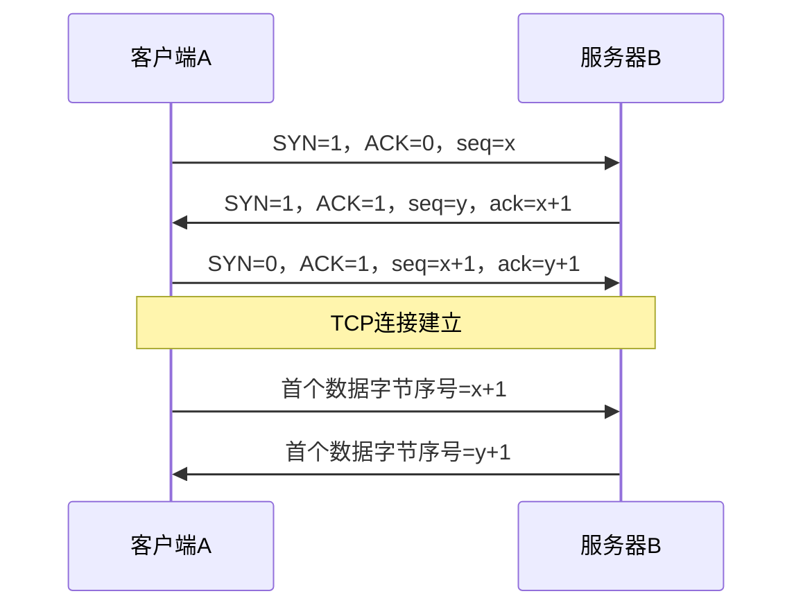
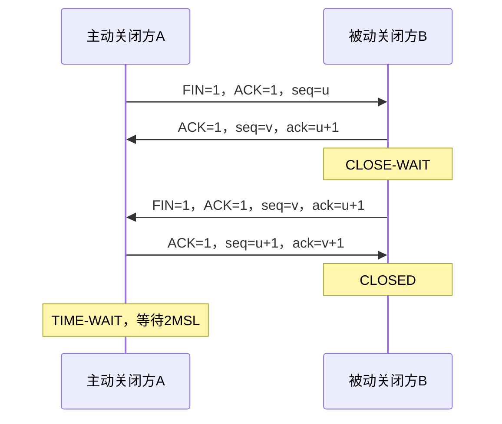
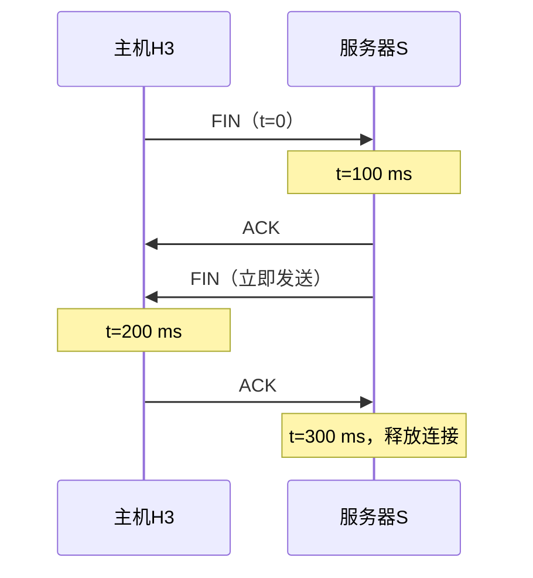
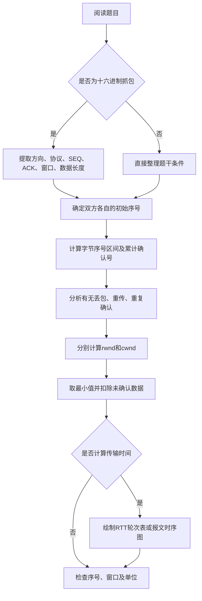

本章归纳2012、2016、2023年3道真题，以及27王道第7、8套第47题，共5道大题。

## 题库范围与代表题

| 题目来源          | 核心考点                      | 学习价值  |
| ------------- | ------------------------- | ----- |
| 2012年408真题    | IP、TCP首部解析、三次握手、TTL、以太网填充 | ★★★★★ |
| 2016年408真题    | 接收窗口、逐ACK更新拥塞窗口、传输速率、连接释放 | ★★★★★ |
| 2023年408真题    | TCP序号、拥塞控制、传输时间、FTP       | ★★★★★ |
| 2027王道第7套第47题 | 十六进制报文解析、重叠重传、剩余发送窗口      | ★★★★★ |
| 2027王道第8套第47题 | TCP报文分析、累计确认、拥塞控制与流量控制    | ★★★★  |

## 一、首先建立传输层大题的整体思维

本章五道大题围绕TCP的三个核心问题展开：

| 核心问题          | 对应知识                    |
| ------------- | ----------------------- |
| 已经发送了哪些数据？    | seq序号、字节编号、重传           |
| 对方已经确认了哪些数据？  | ack确认号、累计确认             |
| 接下来还能够发送多少数据？ | 接收窗口rwnd、拥塞窗口cwnd、未确认数据 |

再加上连接建立、连接释放和时间计算，就构成了本章最重要的大题体系。

**TCP可理解为在双向字节流上不断移动的滑动窗口。**

任何复杂的抓包分析题，都可以通过维护两条字节序列和发送窗口来解决。

## 二、核心模型一：TCP序号、确认号与连接建立

本章5道题均涉及TCP序号与确认号。

### 1. TCP按照字节编号，而不是按照报文段编号

假设一个TCP报文段：

- 序号 seq = 1001
- 数据长度 = 1000 B

那么它携带的数据字节编号为1001～2000。

如果接收方此前的数据也已连续收到，那么返回的确认号为：

$$
ack=1001+1000=2001
$$

这里最重要的区别是：

<Callout type="idea" title="TCP字节序号与确认号">

**seq表示本报文段第一个数据字节的编号；ack表示期望收到对方的下一个字节的编号。**

</Callout>

因此，确认号2001不是确认收到了2001号字节，而是表示截至2000号字节的数据均已连续收到。

### 2. TCP序号的统一计算公式

设数据长度为 $L$，则一个报文段正常占用的序号数量为：

$$
\Delta seq=L+SYN+FIN
$$

其中SYN和FIN的取值为0或1。

| 报文类型            | 占用序号数量    |
| --------------- | --------- |
| SYN建立连接报文       | 1         |
| 纯ACK确认报文        | 0         |
| 携带1000 B数据的普通报文 | 1000      |
| 不携带数据的FIN报文     | 1         |
| 重传原有数据          | 不产生新的数据序号 |

### 3. 三次握手的本质

假设A的初始序号为 $x$，B的初始序号为 $y$。



理解两个细节：

第一，TCP是全双工通信，A和B分别维护各自的序号空间，不能混在一起计算。

第二，第三次握手如果是纯ACK，就不占用序号。因此，第三次握手的seq与后续首个应用数据字节的序号可以相同。

### 4. 四次挥手的序号规律

假设A、B的下一个发送序号分别为 $u$、$v$，且关闭期间不再传输应用数据。



本质与握手完全一样：FIN占用一个序号，纯ACK不占用序号。

不要将ACK标志位与ack确认号混淆。ACK标志位为1，只表示确认号字段有效，并不是确认号等于1。

## 三、核心模型二：发送窗口、流量控制与拥塞控制

### 1. 彻底理解三个窗口

| 窗口        | 含义                 | 由什么决定  |
| --------- | ------------------ | ------ |
| 接收窗口 rwnd | 接收方允许发送方发送的范围      | 接收缓存   |
| 拥塞窗口 cwnd | 发送方根据网络拥塞情况限制的发送范围 | 网络状况   |
| 有效发送窗口 W  | 综合两个条件得到的窗口大小      | 两者的最小值 |

$$
\boxed{W=\min(rwnd,cwnd)}
$$

为什么取最小值？

因为发送数据必须同时满足两个条件：接收方有能力接收，网络有能力承载。

任何一个条件不满足，都不能继续无限发送。

### 2. 窗口大小不等于还能发送的数据量

这是模拟题特别强调的一个陷阱。

假设当前：

$$
rwnd=6000\text{ B}
$$

$$
cwnd=8000\text{ B}
$$

那么有效发送窗口为6000 B。

但假设已经发送了2000 B数据，尚未被确认，那么窗口中的这部分空间已经被占用。

```text
                 有效发送窗口 6000 B
         ├─────────────────────────────┤
已确认数据│ 已发送但未确认 │ 允许发送的新数据 │ 暂时不能发送
         │    2000 B    │    4000 B     │
         ↑              ↑               ↑
       SND.UNA        SND.NXT         窗口右边界
```

设尚未确认的不同数据字节数为 $F$，则：

$$
\boxed{ L_{\text{可新发}} =\max\left(0,\min(rwnd,cwnd)-F\right) }
$$

本例中：

$$
L_{\text{可新发}}=6000-2000=4000\text{ B}
$$

<Callout type="warn" title="窗口大小与剩余空间">

**考试看到“发送窗口大小”和“最多还能发送多少新数据”，必须意识到这是两个不同的问题。**

</Callout>

### 3. 接收窗口如何变化

在简化的考研题模型中：

$$
rwnd=\text{接收缓存容量}-\text{已占用缓存容量}
$$

如果接收方应用程序一直不取走数据，那么接收窗口会随着数据到达而不断缩小。

即使网络完全没有拥塞，接收窗口也可能降为0。

反过来，即使接收缓存非常大，网络发生拥塞时，发送方也必须受到拥塞窗口限制。

这就是流量控制与拥塞控制的本质区别。

## 四、核心模型三：拥塞窗口的变化规律

### 1. 慢开始和拥塞避免

设初始拥塞窗口为1 MSS，慢开始门限为8 MSS，采用408常见的教材轮次模型，无丢包且每轮充分发送。

| 传输轮次 | cwnd（MSS） | 所处阶段 |
| ---- | --------- | ---- |
| 1    | 1         | 慢开始  |
| 2    | 2         | 慢开始  |
| 3    | 4         | 慢开始  |
| 4    | 8         | 达到门限 |
| 5    | 9         | 拥塞避免 |
| 6    | 10        | 拥塞避免 |
| 7    | 11        | 拥塞避免 |
| 8    | 12        | 拥塞避免 |

慢开始阶段每轮近似指数增长，拥塞避免阶段每轮近似线性增长：

$$
\text{慢开始：}1\to2\to4\to8
$$

$$
\text{拥塞避免：}8\to9\to10\to11
$$

这里的一个传输轮次通常对应一个RTT。

### 2. 必须区分逐ACK计算和逐RTT计算

这是2016年、2023年真题都考查的关键细节。

在题目采用每个数据段分别确认的慢开始模型时，每收到一个确认新数据段的ACK：

$$
cwnd\leftarrow cwnd+1\text{ MSS}
$$

而在一个满窗口的传输轮次全部确认之后，才表现为：

$$
cwnd\leftarrow 2cwnd
$$

例如当前拥塞窗口为4 MSS，发送了4个数据段，那么收到各个ACK后，窗口变化为：

$$
4\to5\to6\to7\to8
$$

而不是收到第一个ACK就直接变成8。

| 题目关键词       | 应采用的计算方式              |
| ----------- | --------------------- |
| 收到第几个确认段    | 逐ACK计算                |
| 经过几个RTT     | 按传输轮次计算               |
| 第几个传输轮次     | 按传输轮次计算               |
| 收到某个确认序号    | 先换算累计确认的数据量，再结合确认方式计算 |
| 累计ACK确认整个窗口 | 检查题目对拥塞窗口更新的约定        |

特别注意：一次累计ACK确认多个MSS，并不在所有真实TCP实现中都等价于收到多份独立ACK。考试应遵循题干给定的模型。

### 3. 出现丢包时的处理

虽然本章单独分类的5道题主要考无丢包的窗口计算，但王道第1套第47题在数据链路层综合题中也涉及了TCP快速重传。因此这部分不能完全跳过。

| 情况        | 典型处理方式                     |
| --------- | -------------------------- |
| 重传超时      | 降低慢开始门限，cwnd重置为1 MSS，重新慢开始 |
| 收到3个重复ACK | 快速重传缺失的数据段                 |
| 经典快速恢复结束  | cwnd调整至新的慢开始门限，进入拥塞避免      |

在常见408简化模型中，发生拥塞后的门限通常取发生拥塞时窗口的一半。若题干明确采用TCP Reno快速恢复模型，则进入快速恢复时还应考虑额外的3 MSS窗口膨胀；若给出了FlightSize，应按照题设确定门限。

**快速重传的本质是根据重复ACK提前推断丢包，不必等待重传计时器超时。**

例如发送了以下数据：

| 数据字节范围    | 接收结果 | 累计确认号 |
| --------- | ---- | ----- |
| 1～1000    | 成功   | 1001  |
| 1001～2000 | 丢失   | —     |
| 2001～3000 | 成功   | 1001  |
| 3001～4000 | 成功   | 1001  |
| 4001～5000 | 成功   | 1001  |

接收方虽然收到了后面的数据，但是中间存在缺口，因此累计确认号始终停留在1001。

发送方收到3个重复ACK后，可以快速重传从1001开始的数据段。

## 五、代表题精讲一：2016年408真题

**推荐程度：★★★★★**

本题综合考查流量控制、拥塞控制及逐ACK计算。

### 题目核心条件

主机H3向服务器S持续发送数据。

| 条件           | 数值       |
| ------------ | -------- |
| 接收缓存         | 20 KB    |
| MSS          | 1 KB     |
| RTT          | 200 ms   |
| 初始序号         | 100      |
| 初始慢开始门限      | 32 KB    |
| 初始拥塞窗口（教材模型） | 1 KB     |
| 接收方确认方式      | 每个数据段均确认 |
| 接收应用程序       | 不从缓存取出数据 |

其中1 KB = 1024 B。

### 第一问：第二次握手的标志位和确认号

因为H3初始序号为100，SYN占用一个序号。

所以：

$$
\boxed{SYN=1,\quad ACK=1,\quad ack=101}
$$

### 第二问：收到第8个确认段时，三个窗口分别是多少？

<Steps>

<Step>

### 计算接收窗口

收到第8个数据段的确认，意味着服务器已经连续接收了8 KB数据。

因为没有应用程序取走数据，所以：

$$
rwnd=20-8=12\text{ KB}
$$

</Step>

<Step>

### 逐ACK更新拥塞窗口

初始拥塞窗口为1 KB，慢开始期间每收到一个确认新数据的ACK，拥塞窗口增加1 KB。

| 已收到ACK数量 | cwnd | rwnd  |
| -------- | ---- | ----- |
| 0        | 1 KB | 20 KB |
| 1        | 2 KB | 19 KB |
| 2        | 3 KB | 18 KB |
| 3        | 4 KB | 17 KB |
| 4        | 5 KB | 16 KB |
| 5        | 6 KB | 15 KB |
| 6        | 7 KB | 14 KB |
| 7        | 8 KB | 13 KB |
| 8        | 9 KB | 12 KB |

因此：

$$
cwnd=1+8=9\text{ KB}
$$

</Step>

<Step>

### 计算有效发送窗口

$$
W=\min(12,9)=9\text{ KB}
$$

最终答案：

$$
\boxed{ rwnd=12\text{ KB},\quad cwnd=9\text{ KB},\quad W=9\text{ KB} }
$$

</Step>

</Steps>

为什么这道题不能直接使用指数增长？

因为题目问的是第8个ACK，不是第8个RTT。

### 第三问：发送窗口降为0时，下一个发送序号和平均速率

接收窗口降为0，说明20 KB接收缓存已经全部被占用。

已经发送且确认的数据总量：

$$
20\times1024=20480\text{ B}
$$

第一个应用数据字节的序号为101，所以：

$$
seq_{\text{next}}=101+20480
$$

$$
\boxed{seq_{\text{next}}=20581}
$$

接下来计算传输时间。

| 轮次 | 轮次开始时cwnd | rwnd  | 本轮发送量 | 累计发送量 |
| -- | --------- | ----- | ----- | ----- |
| 1  | 1 KB      | 20 KB | 1 KB  | 1 KB  |
| 2  | 2 KB      | 19 KB | 2 KB  | 3 KB  |
| 3  | 4 KB      | 17 KB | 4 KB  | 7 KB  |
| 4  | 8 KB      | 13 KB | 8 KB  | 15 KB |
| 5  | 16 KB     | 5 KB  | 5 KB  | 20 KB |

注意最后一轮，虽然拥塞窗口已经达到16 KB，但接收窗口只剩5 KB，因此只能发送5 KB。

总耗时：

$$
T=5RTT=5\times200=1000\text{ ms}
$$

平均数据传输速率：

$$
v=\frac{20\times1024\times8}{1}
$$

$$
\boxed{v=163.84\text{ kb/s}}
$$

### 第四问：服务器释放连接的最短时间

假设服务器收到关闭请求后，立即确认并发送自己的FIN，单向传播时延为RTT的一半。



服务器收到最后一个ACK之后便可以释放连接。

$$
T_{\min}=\frac32RTT
$$

$$
\boxed{T_{\min}=300\text{ ms}}
$$

主动关闭方还需要等待2MSL，但题目问的是服务器S，不是H3。

### 本题核心解法

逐ACK更新拥塞窗口，逐RTT统计数据传输量，每轮发送量受到两个窗口共同限制。连接释放时间则通过报文传播路径计算。

## 六、代表题精讲二：2023年408真题

**推荐程度：★★★★★**

本题综合考查TCP拥塞控制、序号及传输时间。

### 题目核心条件

主机H通过FTP上传一个18000 B的文件。

| 条件      | 数值      |
| ------- | ------- |
| 文件大小    | 18000 B |
| MSS     | 1000 B  |
| 初始序号    | 100     |
| 初始慢开始门限 | 4 MSS   |
| RTT     | 10 ms   |
| 丢包、乱序   | 无       |

<Steps>

<Step>

### FTP连接类型

| 比较项  | 控制连接       | 数据连接    |
| ---- | ---------- | ------- |
| 主要功能 | 登录、命令、控制信息 | 文件内容传输  |
| 连接类型 | 持久连接       | 非持久连接   |
| 建立时机 | 登录FTP服务器时  | 需要传输文件时 |

登录FTP服务器时，建立的是控制连接。

注意控制连接和数据连接是两个不同的TCP连接，各自拥有独立的序号空间。

</Step>

<Step>

### 序号与FIN确认号

初始序号为100，SYN占用1个序号。

所以文件的首字节序号为：

$$
\boxed{101}
$$

文件共有18000 B，因此字节范围为：

$$
101\sim18100
$$

发送完文件后，第一个FIN的序号为18101。

FIN又占用一个序号，因此服务器返回的确认号为：

$$
\boxed{ack=18102}
$$

可以直接归纳出一个公式。

若初始序号为 $x$，传输了 $N$ 字节数据，再正常发送不携带数据的FIN，则对方确认该FIN的确认号为：

$$
\boxed{ack=x+N+2}
$$

两个额外序号分别来自SYN和FIN。

</Step>

<Step>

### 逐ACK计算拥塞窗口

遇到这种题，不要直接根据确认号猜窗口大小。

首先将确认号换算成累计确认的MSS数量。

$$
n=\frac{ack-101}{1000}
$$

因此：

$$
ack=2101\Rightarrow n=2
$$

$$
ack=7101\Rightarrow n=7
$$

再分析拥塞窗口：

| 已确认的数据段数量 | cwnd            |
| --------- | --------------- |
| 0         | 1 MSS           |
| 1         | 2 MSS           |
| 2         | 3 MSS           |
| 3         | 4 MSS（达到门限）     |
| 7         | 5 MSS（完成一轮拥塞避免） |

所以：

$$
\boxed{ack=2101\text{ 时，}cwnd=3\text{ MSS}}
$$

$$
\boxed{ack=7101\text{ 时，}cwnd=5\text{ MSS}}
$$

这道题最容易犯的错误，是在累计确认7个段后仍然按照慢开始计算出8 MSS。

必须时刻检查慢开始门限。

</Step>

<Step>

### RTT与平均速率

先算文件由多少个满MSS数据段组成：

$$
n=\frac{18000}{1000}=18
$$

然后画传输轮次表。

| 时间阶段    | cwnd  | 本轮发送段数 | 累计发送段数 |
| ------- | ----- | ------ | ------ |
| TCP建立连接 | —     | 0      | 0      |
| 第1轮数据传输 | 1 MSS | 1      | 1      |
| 第2轮数据传输 | 2 MSS | 2      | 3      |
| 第3轮数据传输 | 4 MSS | 4      | 7      |
| 第4轮数据传输 | 5 MSS | 5      | 12     |
| 第5轮数据传输 | 6 MSS | 6      | 18     |

共经历1个RTT建立连接，以及5个RTT传输和确认数据。

$$
T=RTT+5RTT=60\text{ ms}
$$

平均应用层数据发送速率：

$$
v=\frac{18000\times8}{0.06}
$$

$$
\boxed{v=2.4\text{ Mb/s}}
$$

</Step>

</Steps>

### 与2016年真题对比

| 对比内容   | 2016年真题  | 2023年真题  |
| ------ | -------- | -------- |
| 最主要的限制 | 接收窗口不断减小 | 慢开始门限    |
| 拥塞窗口变化 | 主要为慢开始   | 慢开始转拥塞避免 |
| 传输结束条件 | 接收窗口为0   | 文件全部确认   |
| 建立连接时间 | 不计入      | 计入1个RTT  |
| 核心解法   | 逐ACK＋轮次表 | 序号换算＋轮次表 |

## 七、核心模型四：十六进制抓包题

**重要程度：★★★★★**

2012年真题和王道第7套模拟题均采用了这种形式。

抓包题先提取原始字节中的首部字段，再分析TCP报文关系。

<Tabs items={['IPv4首部', 'TCP首部', 'TCP标志位']}>

<Tab value="IPv4首部">

以下字节位置从1开始计数。

| 字节位置     | 字段      | 解题作用           |
| -------- | ------- | -------------- |
| 第1字节     | 版本、首部长度 | 确定IP首部长度       |
| 第3～4字节   | 总长度     | 计算数据长度         |
| 第5～6字节   | 标识      | 辅助识别同一IP数据报    |
| 第9字节     | TTL     | 计算经过的路由器数量     |
| 第10字节    | 协议      | 判断TCP、UDP、ICMP |
| 第13～16字节 | 源IP地址   | 判断发送方          |
| 第17～20字节 | 目的IP地址  | 判断接收方          |

例如IP首部第一个字节为 `45`。

高4位为4，表示IPv4；低4位为5，表示IP首部占5个32位字。

所以：

$$
L_{\text{IP首部}}=5\times4=20\text{ B}
$$

常见协议字段：

| 十六进制协议号 | 协议   |
| ------- | ---- |
| `01`    | ICMP |
| `06`    | TCP  |
| `11`    | UDP  |

</Tab>

<Tab value="TCP首部">

以下位置从TCP首部自身开始计数，不是从IP数据报开始。

| TCP字节位置   | 字段      |
| --------- | ------- |
| 第1～2字节    | 源端口     |
| 第3～4字节    | 目的端口    |
| 第5～8字节    | 序号seq   |
| 第9～12字节   | 确认号ack  |
| 第13字节的高4位 | TCP首部长度 |
| 第14字节     | 主要控制标志位 |
| 第15～16字节  | 接收窗口    |

TCP首部数据偏移同样以4 B为单位。

例如第13字节为 `70`，则TCP首部长度为：

$$
7\times4=28\text{ B}
$$

</Tab>

<Tab value="TCP标志位">

| 标志字段常见值 | 含义      |
| ------- | ------- |
| `02`    | SYN     |
| `12`    | SYN＋ACK |
| `10`    | ACK     |
| `18`    | PSH＋ACK |
| `11`    | FIN＋ACK |

常见值记住即可。如果出现不熟悉的值，再转换为二进制，提取相应标志位。

</Tab>

</Tabs>

### 4. 应用数据长度的万能公式

$$
\boxed{ L_{\text{应用数据}} =L_{\text{IP总长度}} -L_{\text{IP首部}} -L_{\text{TCP首部}} }
$$

不要直接将IP总长度当成TCP数据长度，更不要一律认为TCP首部长度是20 B。

例如：

IP总长度为 `0030H`，即48 B，IP首部长度20 B，TCP首部长度28 B。

那么：

$$
L_{\text{应用数据}}=48-20-28=0
$$

这很可能是一个包含TCP选项但没有应用负载的握手报文。

## 八、代表题精讲三：2027王道第7套第47题

**推荐程度：★★★★★**

这道模拟题在2012年真题的抓包形式基础上，又增加了重叠重传和发送窗口计算，非常值得认真研究。

### 1. 首先将原始字节转换成有用的表格

根据原题给出的8个IP数据报，提取关键字段如下。为了便于分析，序号和确认号只保留有变化的低位，省略相同的高位前缀。

| 编号 | 方向     | 标志      | seq末尾  | ack末尾  | 数据长度 |
| -- | ------ | ------- | ------ | ------ | ---- |
| 1  | A→B    | SYN     | `B990` | 无效     | 0    |
| 2  | 无关ICMP | —       | —      | —      | —    |
| 3  | B→A    | SYN＋ACK | `F71C` | `B991` | 0    |
| 4  | A→B    | ACK     | `B991` | `F71D` | 0    |
| 5  | A→B    | PSH＋ACK | `B991` | `F71D` | 16 B |
| 6  | B→A    | ACK     | `F71D` | `B9A1` | 0    |
| 7  | A→B    | PSH＋ACK | `B9A1` | `F71D` | 16 B |
| 8  | A→B    | PSH＋ACK | `B9A1` | `F71D` | 32 B |

### 2. 判断三次握手

2号报文的IP协议字段为 `01`，属于ICMP，因此直接排除。

三次握手对应：

$$
\boxed{1\to3\to4}
$$

B的初始序号为：

`0x5B9FF71C`

SYN占用一个序号，因此B首次发送应用数据时的首字节序号为：

$$
\boxed{\texttt{0x5B9FF71D}}
$$

### 3. A究竟发送了多少不同字节的应用数据？

5号、7号、8号报文分别携带16 B、16 B、32 B数据。

如果直接相加：

$$
16+16+32=64\text{ B}
$$

这是错误的，因为7号和8号存在序号重叠。

```text
TCP字节序号（十六进制末尾）

         B991          B9A1          B9B1          B9C1
           │             │             │             │
5号报文    ├─── 16 B ────┤
7号报文                  ├─── 16 B ────┤
8号报文                  ├──────── 32 B ─────────────┤
                         │ 重复的16 B │ 新增的16 B │

不同字节   ├──────────────── 48 B ──────────────────┤
```

所以不同序号的数据总量为：

$$
16+16+(32-16)=48\text{ B}
$$

$$
\boxed{48\text{ B}}
$$

<Callout type="idea" title="重传判定依据">

**TCP依靠序号识别字节流中的位置，而不是依靠数据内容判断是否属于重传。**

</Callout>

5号和7号的数据内容即使完全相同，因为序号不同，也属于不同的应用数据。

7号和8号的部分数据虽然出现在不同的报文段中，但序号相同，因此不能重复计算。

重叠重传题可画序号区间并求其并集。

### 4. 接收方下一次的累计确认号

题目假设B最终正确接收了A的全部数据。

最后一个数据字节的序号末尾为 `B9C0`，所以下一个期望字节为 `B9C1`。

$$
\boxed{ack=\texttt{0x2268B9C1}}
$$

### 5. A最多还能发送多少新数据？

6号报文中B通告的接收窗口为：

$$
rwnd=\texttt{0x2000}=8192\text{ B}
$$

6号报文的确认号为：

`0x2268B9A1`

而A已经发送到：

`0x2268B9C0`

因此，从A的视角看，尚未被确认的不同数据字节为：

$$
F=\texttt{0xB9C1}-\texttt{0xB9A1}
$$

$$
F=\texttt{0x20}=32\text{ B}
$$

题目排除了拥塞窗口限制，因此：

$$
L_{\text{可新发}}=8192-32
$$

$$
\boxed{8160\text{ B}}
$$

<Callout type="warn" title="发送窗口更新依据">

**接收方已经收到数据，不等于发送方已经知道数据被收到。**

</Callout>

即使B实际上已经收到全部数据，只要A始终没有收到后续ACK，A就不能擅自移动发送窗口的左边界。

本题将TCP可靠传输、累计确认、重传和流量控制真正结合起来了。

## 九、其他代表题与跨层考点

### 1. 2012年408真题：跨层抓包分析

该题除了TCP序号和三次握手之外，还考查了以太网填充、TTL变化。

**以太网填充：**

普通以太网帧最小长度为64 B，其中首部14 B、FCS占4 B。

所以最小数据载荷长度为：

$$
64-14-4=46\text{ B}
$$

如果IP数据报总长度只有40 B，则需要填充：

$$
46-40=6\text{ B}
$$

统一公式：

$$
\boxed{ L_{\text{填充}}=\max(0,46-L_{\text{IP总长}}) }
$$

**TTL计算：**

原题给出的服务器发送TTL为 `40H`，主机收到时TTL为 `31H`。

$$
40H=64
$$

$$
31H=49
$$

所以在题设的普通逐跳转发模型下，经过的路由器数量为：

$$
\boxed{64-49=15}
$$

**资料纠错提醒：** 原题库的十六进制表与参考解析存在几处录入不一致。例如服务器IP应为 `d3 44 47 50`，即211.68.71.80；3号报文原始标志字段为 `f0`，解析表中却写成了 `10`。`f0` 的SYN位为0、ACK位为1，不能将其直接等同于普通纯ACK的 `10`；第三次握手需结合完整的序号、确认号与标志位判断。

### 2. 王道第8套第47题：两种窗口增长方式比较

这道题给出了HTTP文件下载过程中的14个TCP报文段。

其中前几轮服务器拥塞窗口按题目明确规定的教材轮次模型增长：

$$
1\to2\to4\quad(\text{MSS})
$$

当服务器收到S14后，先前的数据全部被确认，接收方通告的接收窗口为6000 B。

MSS为1000 B，题目要求独立比较两种假设。

| 假设     | 更新后的cwnd | rwnd   | 最多新发数据 |
| ------ | -------- | ------ | ------ |
| 继续慢开始  | 8000 B   | 6000 B | 6000 B |
| 采用拥塞避免 | 5000 B   | 6000 B | 5000 B |

所以：

$$
\boxed{L_{\text{慢开始}}=6000\text{ B}}
$$

$$
\boxed{L_{\text{拥塞避免}}=5000\text{ B}}
$$

**拥塞窗口变大不一定能发送更多数据，因为还可能受到接收窗口限制。**

此外，题库中的模拟题专门补充了按轮次增长、每个数据段满MSS等条件。因此这里的结论不能不加区别地套用到任意真实TCP抓包上。

## 十、核心模型五：RTT与传输速率的统一解法

遇到传输时间计算，最重要的不是背公式，而是确定时间的起点和终点。

### 1. 常见时间计算

| 题目所问过程               | 教材简化时间  |
| -------------------- | ------- |
| 客户端发出SYN至收到SYN＋ACK   | 1 RTT   |
| 已建立连接，发送一轮数据并收到确认    | 1 RTT   |
| 主动发起关闭至被动方最早收到最后ACK  | 1.5 RTT |
| 主动关闭方进入TIME-WAIT后的等待 | 2 MSL   |

前提是忽略相关处理时间和报文发送时延，并采用题目给定的RTT模型。

### 2. 慢开始传输轮次的快速计算

当初始拥塞窗口为1 MSS，接收窗口足够大，且始终处于慢开始时，连续 $n$ 轮可发送的数据段总数为：

$$
1+2+4+\cdots+2^{n-1}
$$

利用等比数列求和：

$$
\boxed{S_n=2^n-1}
$$

若共有 $N$ 个数据段待发送，则需要的传输轮数为：

$$
\boxed{ n=\left\lceil\log_2(N+1)\right\rceil }
$$

但这个公式有适用条件。如果中途达到慢开始门限，或者接收窗口限制了发送量，就必须分阶段计算。

考试中使用传输轮次表最稳妥。

### 3. 平均速率的计算

$$
\boxed{ v=\frac{\text{有效应用数据量}}{\text{题目指定的总时间}} }
$$

若数据量以字节为单位，要求速率以bit/s表示，则：

$$
v=\frac{8L}{T}
$$

尤其注意KB与kb的区别，以及毫秒和秒之间的转换。

## 十一、考试时的万能解题流程

以下这套流程可以解决本章题库中绝大部分TCP综合计算题。



其中最实用的考场草稿模板就是：

| RTT轮次 | cwnd | rwnd | 本轮发送量 | 累计发送量 | 确认号 |
| ----- | ---- | ---- | ----- | ----- | --- |
| 1     |      |      |       |       |     |
| 2     |      |      |       |       |     |
| 3     |      |      |       |       |     |
| 4     |      |      |       |       |     |

## 十二、考前自测

以下是依据真题与模拟题核心模型设计的迁移练习，非原题。

### 测试1

TCP初始序号为200，发送5000 B应用数据后，发送FIN。对方确认该FIN的确认号是多少？

<Accordions>

<Accordion title="参考答案与解析">

**答案：** 5202。

SYN和FIN各占1个序号。

</Accordion>

</Accordions>

### 测试2

当前接收窗口为8000 B，拥塞窗口为6000 B，已经发送但尚未确认的数据为2500 B。最多还能发送多少新数据？

<Accordions>

<Accordion title="参考答案与解析">

**答案：** 3500 B。

两窗口取最小值后扣除未确认数据。

</Accordion>

</Accordions>

### 测试3

初始拥塞窗口为1 MSS，慢开始门限为4 MSS，接收窗口足够大。传输25个MSS数据段并收到全部确认，至少需要几个数据传输RTT？

<Accordions>

<Accordion title="参考答案与解析">

**答案：** 6 RTT。

$1+2+4+5+6+7=25$。

</Accordion>

</Accordions>

### 测试4

初始数据序号为1001，MSS为1000 B。接收方收到了第1、3、4、5个数据段，但第2个数据段丢失。累计确认号是多少？什么时候触发快速重传？

<Accordions>

<Accordion title="参考答案与解析">

**答案：** 2001。

累计确认不能越过缺口，收到3个重复ACK触发经典快速重传。

</Accordion>

</Accordions>

### 测试5

两个TCP报文段的seq分别为1000和1500，数据长度均为1000 B。这两个报文共携带多少不同序号的数据？

<Accordions>

<Accordion title="参考答案与解析">

**答案：** 1500 B。

两个序号区间重叠500 B。

</Accordion>

</Accordions>

## 十三、最终复习优先级

星级依据原题库中的知识覆盖与学习价值，不代表未来考试概率。

| 核心知识点         | 重要程度  | 掌握要求        |
| ------------- | ----- | ----------- |
| TCP序号与累计确认    | ★★★★★ | 能独立计算任意字节范围 |
| 流量控制与接收窗口     | ★★★★★ | 理解窗口限制的本质   |
| 慢开始与拥塞避免      | ★★★★★ | 区分逐ACK与逐RTT |
| 发送窗口剩余空间      | ★★★★★ | 必须扣除未确认数据   |
| 三次握手与四次挥手     | ★★★★★ | 熟练计算序号及时间   |
| 传输轮次与平均速率     | ★★★★★ | 独立绘制轮次表     |
| IP、TCP首部抓包解析  | ★★★★★ | 能从十六进制提取字段  |
| 重传与序号区间重叠     | ★★★★  | 会求字节区间并集    |
| 超时与快速重传       | ★★★★  | 理解两种丢包恢复机制  |
| FTP、HTTP跨章节综合 | ★★★★  | 理解连接与数据传输过程 |
| UDP首部及相关基础    | ★★★   | 以基础知识掌握为主   |

原题库本章无独立UDP大题，故本章主要总结TCP。

## 十四、考前必须记住的五个公式

**① 字节序号推进：**

$$
\boxed{seq_{\text{next}}=seq+L+SYN+FIN}
$$

**② 连续有序数据的累计确认：**

$$
\boxed{ack=seq+L}
$$

该公式针对无序号缺口的普通数据报文，不额外包含SYN、FIN。

**③ 有效发送窗口：**

$$
\boxed{W=\min(rwnd,cwnd)}
$$

**④ 剩余可新发数据量：**

$$
\boxed{L_{\text{可新发}}=\max(0,W-F)}
$$

**⑤ 应用数据长度：**

$$
\boxed{L_{\text{data}}=L_{\text{IP总长}}-L_{\text{IP首部}}-L_{\text{TCP首部}}}
$$

**序号决定数据位置，确认号决定已可靠交付的边界，窗口决定允许发送的范围，RTT决定数据传输与反馈的时间。**

优先闭卷重做2016年真题、2023年真题、王道第7套第47题。这三道题分别训练窗口动态变化、拥塞控制与时间计算、复杂报文与重传分析。
