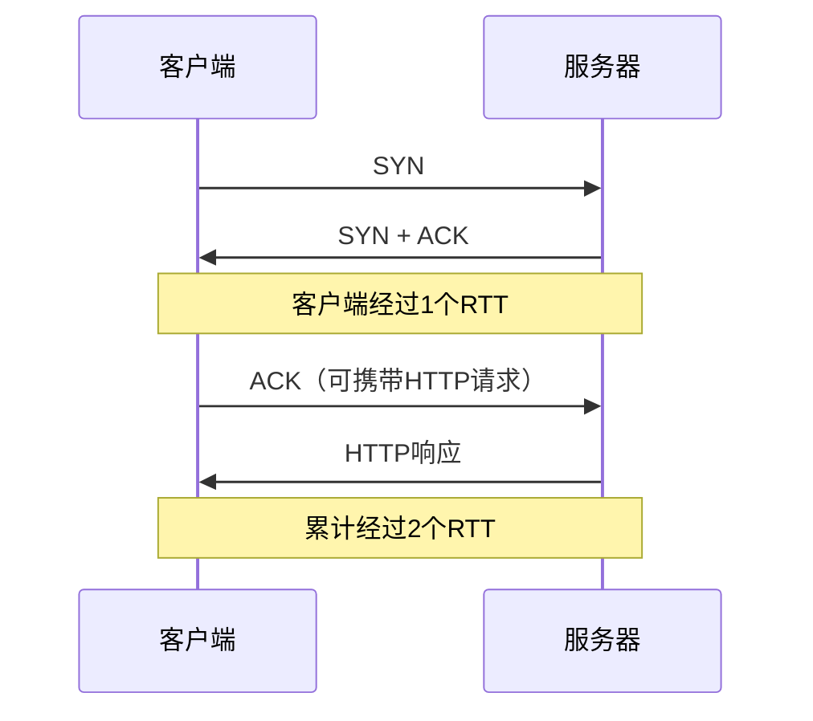
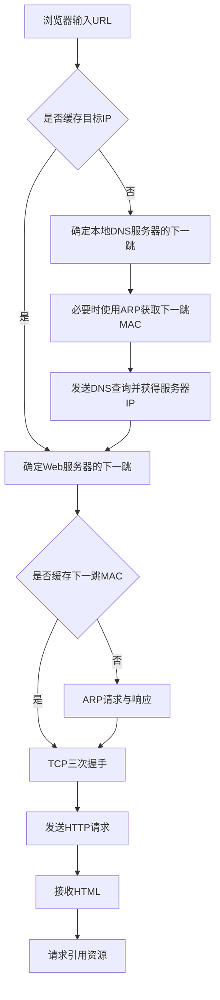
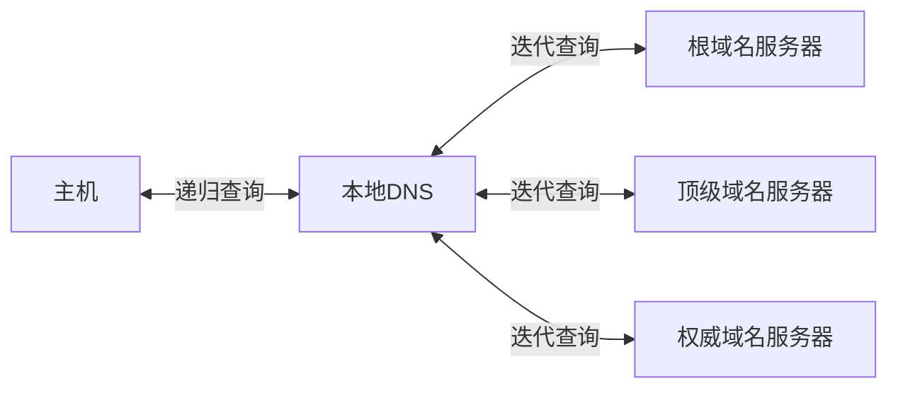
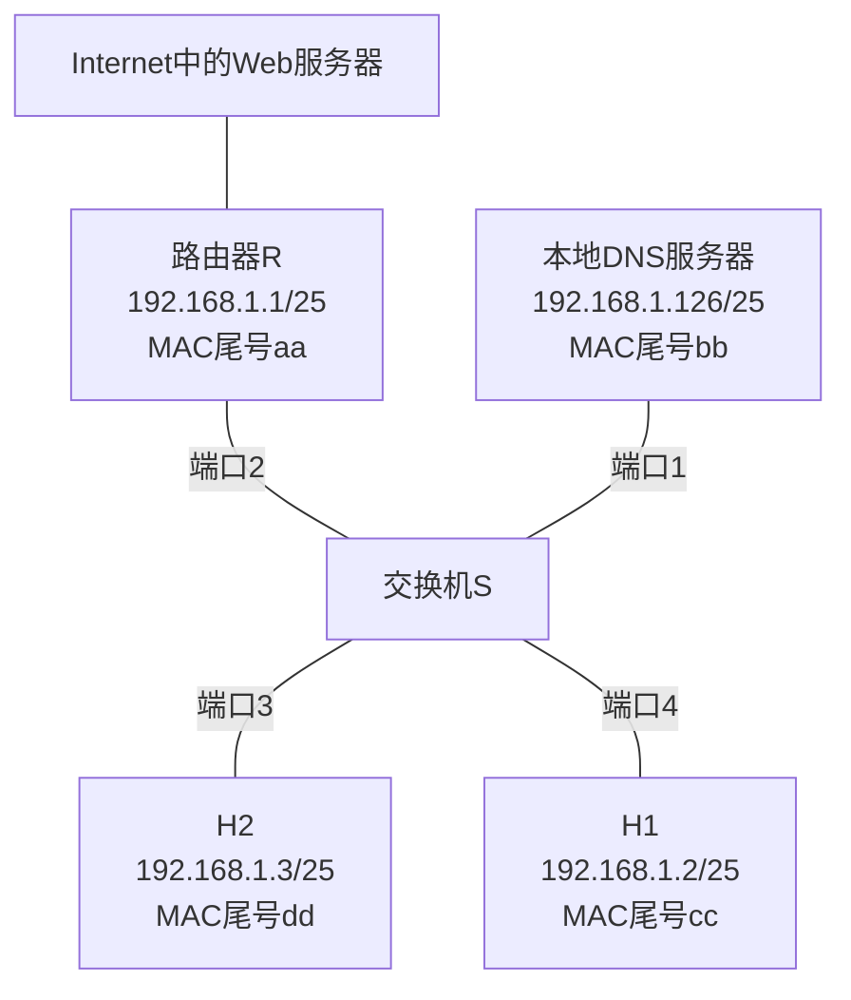
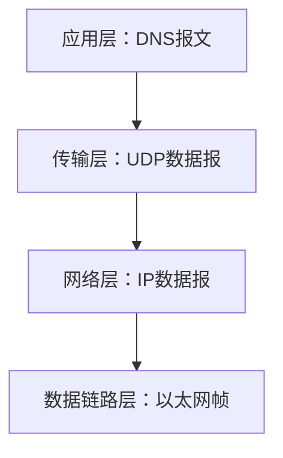
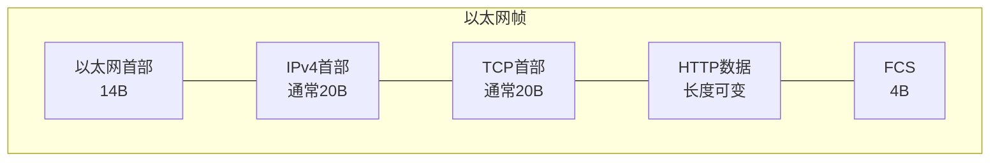

本章归纳2011、2021年两道真题及27王道第6套第47题，共3道大题，覆盖应用层与传输层、网络层、数据链路层的综合应用。

## 一、建立本章的大题知识框架

| 核心考点                  | 对应题目                  | 复习优先级 |
| --------------------- | --------------------- | ----- |
| HTTP 持续连接、非持续连接、流水线   | 2011 真题、王道第 6 套第 47 题 | ★★★★★ |
| DNS 与 HTTP 的总访问时延     | 王道第 6 套第 47 题         | ★★★★★ |
| 从输入网址到访问网页的完整过程       | 2021 真题               | ★★★★★ |
| DNS、ARP、TCP、HTTP 综合应用 | 2021 真题               | ★★★★★ |
| 十六进制报文分析              | 2011 真题               | ★★★★☆ |
| 交换机自学习与广播帧分析          | 2021 真题               | ★★★★☆ |
| NAT、TTL、IP 首部校验和      | 2011 真题               | ★★★★☆ |

**应用层大题的本质，不是孤立地考查应用层协议，而是让你从一次具体的网络应用出发，还原整个网络通信过程。**

<Cards>

<Card title="时间分析">

根据通信之间的依赖关系，计算需要多少个 RTT。

</Card>

<Card title="过程分析">

明确 HTTP 请求发出之前，主机需要解决哪些问题。

</Card>

<Card title="报文分析">

识别各层封装的字段，以及报文经过不同设备时字段如何变化。

</Card>

</Cards>

## 二、核心考点一：HTTP 访问时延计算（必须彻底掌握）

### 1. 本质：究竟是什么造成了等待？

访问网页的总时延可分解为：

$$
T_{\text{总}}=T_{\text{DNS}}+T_{\text{TCP}}+T_{\text{HTTP}}+T_{\text{其他}}
$$

在忽略小对象发送时间、排队时间和处理时间的常规题目中，只需要考虑前三项。

| 等待过程       | 产生等待的原因     | 通常的耗时        |
| ---------- | ----------- | ------------ |
| DNS 查询     | 获取服务器 IP 地址 | 每轮查询 1 RTT   |
| TCP 建立连接   | 三次握手        | 1 RTT        |
| HTTP 请求与响应 | 获取服务器上的资源   | 每轮请求响应 1 RTT |

<Callout type="idea" title="RTT计算原则">

**RTT 计算的本质是数必须串行等待的通信轮数，而不是数报文个数。**

</Callout>

如果多次通信可以同时进行，就不需要简单地把各自的 RTT 相加。

### 2. 为什么 TCP 三次握手只计算 1 个 RTT？

假设单向传播时延为 $\dfrac{RTT}{2}$。



客户端收到第二次握手报文后，就可以发送第三次握手的 ACK，并发送 HTTP 请求。

因此在常规 408 理想计算模型中：

$$
T_{\text{TCP建连}}=RTT
$$

$$
T_{\text{建立连接并获取一个小对象}}=2RTT
$$

三次握手绝不意味着需要 3 个 RTT，也不能简单地认为客户端必须等待 1.5 个 RTT 后才能发送 HTTP 请求。

### 3. 四种 HTTP 工作方式的本质区别

假设一个网页包含一个 HTML 基本文件，以及其中引用的 $m$ 个小对象。所有资源位于同一服务器，初始 TCP 连接尚未建立，暂不考虑 DNS。

<Tabs items={['非持续顺序', '持续非流水线', '持续流水线', '非持续并行']} defaultIndex={0}>

<Tab value="非持续顺序">

每下载一个对象，都需要重新建立 TCP 连接。

```text
TCP握手 → HTML
TCP握手 → 对象1
TCP握手 → 对象2
……
TCP握手 → 对象m
```

共有 $m+1$ 个对象，每个对象需要 2 个 RTT。

$$
\boxed{T=2(m+1)RTT}
$$

</Tab>

<Tab value="持续非流水线">

所有对象复用同一条 TCP 连接，但是必须收到上一个对象，才能请求下一个对象。

```text
TCP握手 → HTML → 对象1 → 对象2 → … → 对象m
```

TCP 握手只进行一次，但 HTTP 请求仍然逐个等待。

$$
\boxed{T=(m+2)RTT}
$$

</Tab>

<Tab value="持续流水线">

所有对象复用同一条 TCP 连接，得到 HTML 后，可以连续发送多个对象的请求，无须逐个等待响应。

```text
                       ┌ 对象1
TCP握手 → HTML → 请求 ├ 对象2
                       └ 对象m
```

只需要三个阶段：建立 TCP 连接、获取 HTML、获取全部引用对象。

当 $m\geq 1$，并忽略对象发送时延时：

$$
\boxed{T=3RTT}
$$

注意：流水线并不一定意味着服务器同时返回所有对象，而是客户端可以不等待前一个响应就发送下一个请求。在本题的小对象理想模型下，这批请求响应按一轮 RTT 计算。

</Tab>

<Tab value="非持续并行">

这是前三种情况的重要变式。

假设允许同时建立 $k$ 条 TCP 连接。

首先下载 HTML，需要 2 个 RTT。随后把 $m$ 个引用对象分批并行下载，每批最多 $k$ 个，每批需要 2 个 RTT。

$$
\boxed{T=2RTT+2\left\lceil\frac{m}{k}\right\rceil RTT}
$$

</Tab>

</Tabs>

### 4. 统一理解四种方式

| HTTP 工作方式            | TCP 连接次数  | 总耗时（不含 DNS）                               |
| -------------------- | --------- | ----------------------------------------- |
| 非持续、顺序               | $m+1$ | $2(m+1)RTT$                           |
| 非持续、最多 $k$ 条并行连接 | $m+1$ | $\left(2+2\lceil m/k\rceil\right)RTT$ |
| 持续、非流水线              | 1         | $(m+2)RTT$                            |
| 持续、流水线               | 1         | $3RTT$                                |

上述公式按照 $m\geq 1$、同一服务器、小对象、初始未建立 TCP 连接的条件计算。

<Callout type="idea" title="区分三种优化机制">

**持续连接解决重复建立 TCP 连接的问题；流水线解决逐个等待 HTTP 响应的问题；并行连接解决多条连接串行执行的问题。**

</Callout>

## 三、代表题一：王道第 6 套第 47 题（9 分）

本题涵盖 HTTP 时延计算的主要基本模型。

### 题目简化

主机依次查询 $n$ 台 DNS 服务器，每次查询与响应耗时为 $RTT$，主机与 Web 服务器的往返时延为 $RTT_w$。

忽略小对象实际发送时间，不考虑 TLS，不允许并行 TCP 连接。

分别求下载单张图片，以及下载一个 HTML 页面和其中 3 个引用对象的时间。

<Tabs items={['仅下载图片', '非持续HTTP', '持续非流水线', '持续流水线']} defaultIndex={0}>

<Tab value="仅下载图片">

首先进行 DNS 查询：

$$
T_{\text{DNS}}=nRTT
$$

然后建立 TCP 连接，再请求图片。

$$
T=nRTT+RTT_w+RTT_w
$$

因此：

$$
\boxed{T=nRTT+2RTT_w}
$$

</Tab>

<Tab value="非持续HTTP">

HTML 本身也是一个对象，所以一共需要下载 4 个对象。

每个对象分别建立 TCP 连接，并进行一次请求响应。

$$
T=nRTT+4\times2RTT_w
$$

$$
\boxed{T=nRTT+8RTT_w}
$$

</Tab>

<Tab value="持续非流水线">

一次 TCP 握手，四次 HTTP 请求响应。

$$
T=nRTT+(1+4)RTT_w
$$

$$
\boxed{T=nRTT+5RTT_w}
$$

</Tab>

<Tab value="持续流水线">

一次 TCP 握手，一轮 HTML 请求，最后一轮获取三个引用对象。

$$
T=nRTT+(1+1+1)RTT_w
$$

$$
\boxed{T=nRTT+3RTT_w}
$$

</Tab>

</Tabs>

### 三种方式的直观对比

以下每个方格表示一个 $RTT_w$，不计共同的 DNS 时延。

| 工作方式   | 时间分布             | 总计 |
| ------ | ---------------- | -- |
| 非持续    | 🟦🟩🟦🟨🟦🟨🟦🟨 | 8  |
| 持续非流水线 | 🟦🟩🟨🟨🟨       | 5  |
| 持续流水线  | 🟦🟩🟨           | 3  |

🟦 TCP 握手　🟩 获取 HTML　🟨 获取引用对象

### 从这道题提炼出的通用方法

遇到 HTTP 时延计算题，首先检查五个条件：

1. 是否需要 DNS 查询？
2. TCP 连接是否已经建立？
3. 一共有多少个对象，包括 HTML 本身吗？
4. TCP 连接能否复用？
5. HTTP 请求能否流水线发送，或者能否并行建立 TCP 连接？

### 特别重要：HTML 的依赖关系

为什么持续流水线不能只计算 2 个 RTT？

因为浏览器必须先获得 HTML，才能知道 HTML 中引用了哪些对象。

这是一个不可消除的前后依赖关系：

$$
\text{获得HTML}\rightarrow\text{获得引用对象的URL} \rightarrow\text{请求引用对象}
$$

考试中遇到多个资源具有前后依赖关系的情况，同样可以使用这个思想。

## 四、核心考点二：从输入 URL 到获得网页的全过程

假设主机已经配置好 IP 地址、默认网关和 DNS 服务器，但相关缓存为空，现在浏览器访问远程 Web 服务器。



每一种协议都在解决不同的问题。

| 协议或机制  | 解决的问题                    |
| ------ | ------------------------ |
| DNS    | 我知道域名，如何得到 IP 地址？        |
| 路由选择   | 知道目的 IP 后，下一跳是谁？         |
| ARP    | 知道下一跳 IP，如何得到下一跳 MAC 地址？ |
| TCP    | 如何建立可靠的端到端通信连接？          |
| HTTP   | 如何请求和获取网页资源？             |
| 交换机自学习 | 一个 MAC 地址对应哪个交换机端口？      |

### 1. DNS 和 ARP 的区别

这两个协议经常被放在一起考查。

DNS 实现：

$$
\text{域名}\longrightarrow\text{IP地址}
$$

ARP 实现：

$$
\text{本链路上的下一跳IP地址} \longrightarrow\text{MAC地址}
$$

两者的工作对象完全不同。

尤其需要注意，**ARP 解析的不一定是最终目的主机的 MAC 地址，而是本次链路传输的下一跳 MAC 地址。**

### 2. 如何确定下一跳？

使用本机子网掩码分别计算本机和目的地址的网络前缀。

$$
N_s=IP_s\mathbin{\&}Mask
$$

$$
N_d=IP_d\mathbin{\&}Mask
$$

在常规直连网络与默认路由模型下：

- 若 $N_s=N_d$，直接交付，ARP 查询目的主机的 MAC 地址。
- 若 $N_s\ne N_d$，间接交付，通常 ARP 查询默认网关的 MAC 地址。

即使要访问的是远在 Internet 上的 Web 服务器，也不需要知道远程服务器的 MAC 地址。

### 3. DNS 递归查询与迭代查询

这是综合题可能进一步延伸的考点。



在典型教材模型中，主机向本地 DNS 服务器发起递归查询，本地 DNS 服务器再进行迭代查询。

如果各次查询必须串行进行，那么：

$$
T_{\text{DNS}}=\sum_{i=1}^{n}RTT_i
$$

DNS 缓存命中可能减少甚至消除网络上的 DNS 查询过程。

注意普通 DNS 查询通常使用 UDP，端口号为 53，但 DNS 也可以使用 TCP，例如区域传送或 UDP 响应被截断后改用 TCP。

## 五、代表题二：2021 年 408 真题第 47 题（9 分）

本题综合考查 DNS、ARP、交换机、IP 寻址、TCP 和 HTTP。

### 1. 首先理解网络拓扑



<Callout type="warn" title="原稿记录的题库勘误">

题库重绘配图将本地 DNS 服务器地址写成了 `192.168.1.136/26`；原稿记载其核对的 2021 年原试卷第 9 页为 `192.168.1.126/25`。地址差异会影响是否需要经过网关的判断，以下采用后者。

</Callout>

题目给定：

初始时 H1 的 ARP 表、交换机 S 的交换表均为空。H1 通过域名访问 Web 服务器，直到交换机第一次收到封装 HTTP 请求的以太网帧。

### 2. 第一问：除了 HTTP，还使用了什么应用层协议？如何封装？

答案是 DNS 协议。

由于输入的是域名，而不是服务器 IP 地址，所以需要先进行 DNS 域名解析。

普通 DNS 查询的封装过程为：



考试标准答案：

DNS 报文依次通过 UDP 协议、IP 协议、以太网协议封装。

注意，题目只问其他**应用层协议**，因此不能把 ARP、TCP 也当成应用层协议作答。

### 3. 第二问：交换机的交换表中有哪些内容？

按时间顺序模拟通信事件，依次更新交换表。

<Steps>

<Step>

### 获取DNS服务器MAC地址

H1 与 DNS 服务器属于同一 IP 子网，但 H1 的 ARP 表为空，因此需要广播 ARP 请求。

交换机收到来自端口 4 的 ARP 请求帧，学习 H1 的 MAC 地址。

DNS 服务器发回 ARP 响应，交换机收到来自端口 1 的帧，学习 DNS 服务器的 MAC 地址。

</Step>

<Step>

### DNS查询

H1 向 DNS 服务器发送 UDP 数据报，DNS 服务器返回域名解析结果。

这一步已经知道双方的 MAC 地址，不需要再进行广播。

</Step>

<Step>

### 获取默认网关MAC地址

H1 获得 Web 服务器 IP 地址后，发现服务器不在本子网，需要通过路由器 R 转发。

于是 H1 再次发送 ARP 广播请求，获取默认网关的 MAC 地址。

路由器返回 ARP 响应时，交换机从端口 2 学习路由器的 MAC 地址。

</Step>

<Step>

### TCP握手与HTTP请求

H1 与 Web 服务器建立 TCP 连接，然后发出 HTTP 请求。

</Step>

</Steps>

最终的交换表为：

| MAC 地址            | 交换机端口 |
| ----------------- | ----- |
| 00-11-22-33-44-cc | 4     |
| 00-11-22-33-44-bb | 1     |
| 00-11-22-33-44-aa | 2     |

没有 H2 的记录。

为什么？

因为 H2 在这个过程中只是接收广播帧，没有主动向交换机发送帧。

### 4. 第三问：H2 至少收到几个以太网帧？

答案为 2 个。

第一个是 H1 查询本地 DNS 服务器 MAC 地址时发送的 ARP 请求。

第二个是 H1 查询默认网关 MAC 地址时发送的 ARP 请求。

两个帧的目的 MAC 地址均为：

```text
FF-FF-FF-FF-FF-FF
```

完整过程可以用下表理解。

| 通信事件                | H2 是否必然收到 |
| ------------------- | --------- |
| H1 广播查询 DNS 服务器 MAC | 是         |
| DNS 服务器单播 ARP 响应    | 否         |
| H1 发送 DNS 查询        | 否         |
| DNS 服务器发送 DNS 响应    | 否         |
| H1 广播查询网关 MAC       | 是         |
| 网关单播 ARP 响应         | 否         |
| TCP 三次握手            | 否         |
| HTTP 请求             | 否         |

因此：

$$
\boxed{\text{H2至少收到2个ARP广播请求帧}}
$$

### 5. 从这道真题掌握交换机的本质

交换机的工作机制只有两个最重要的部分：

<Callout type="idea" title="交换机自学习">

**学习看源 MAC，转发看目的 MAC。**

</Callout>

| 帧的目的 MAC 情况   | 交换机的处理          |
| ------------- | --------------- |
| 已知目的 MAC 对应端口 | 定向转发，若与入端口相同则过滤 |
| 未知目的 MAC 对应端口 | 向其他相关端口泛洪       |
| 广播 MAC 地址     | 向同一广播域内其他端口转发   |

主机仅接收广播帧，并不会使交换机学习到该主机的 MAC 地址。

交换机必须收到该主机发出的帧，才能根据源 MAC 地址进行学习。

### 6. 重要变式：如果题目修改条件怎么办？

| 条件变化               | 应当考虑的变化                       |
| ------------------ | ----------------------------- |
| H1 已缓存 DNS 服务器 MAC | 可以省略第一次 ARP 查询                |
| H1 已缓存默认网关 MAC     | 可以省略第二次 ARP 查询                |
| H1 已缓存 Web 服务器 IP  | 可以省略本次 DNS 解析                 |
| DNS 服务器位于其他子网      | 应通过路由确定下一跳，而不是直接 ARP 查询远程 DNS |
| 交换表为空但 ARP 表不为空    | 仍可能发生未知单播泛洪                   |
| H2 主动发送了帧          | 交换机可能学习到 H2 的 MAC 地址          |

<Callout type="warn" title="独立维护两类缓存">

**ARP 表与交换表是两个完全独立的表。**

</Callout>

| 对比项  | ARP 表       | 交换机交换表           |
| ---- | ----------- | ---------------- |
| 存储内容 | IP → MAC    | MAC → 端口         |
| 作用   | 确定链路层下一跳地址  | 确定帧的转发端口         |
| 形成方式 | ARP 等地址解析过程 | 根据收到的帧进行源 MAC 学习 |

这两个表是否为空，要分别判断，绝不能混为一谈。

## 六、核心考点三：网络抓包与十六进制报文分析

抓包题的核心是**按照协议首部的字段位置读取数据**。

### 1. 先建立报文的空间结构

一个普通的以太网帧，如果内部封装了 IPv4、TCP 和 HTTP，那么其排列结构为：



假设没有 VLAN 标签，没有 IP 首部选项，也没有 TCP 首部选项，则 HTTP 数据的起始偏移为：

$$
14+20+20=54\text{ B}
$$

也就是十六进制偏移 `0x36`。

实际上 IPv4 和 TCP 的首部长度可以变化，因此不能无条件认定 HTTP 数据总是从第 54 字节偏移处开始。

### 2. 必须掌握的报文字段位置

下表中的偏移量均从 0 开始计算。

| 协议        | 字段     | 相对本层首部起点的偏移 | 长度 |
| --------- | ------ | ----------- | -- |
| 以太网       | 目的 MAC | 0           | 6B |
| 以太网       | 源 MAC  | 6           | 6B |
| 以太网       | 类型     | 12          | 2B |
| IPv4      | 总长度    | 2           | 2B |
| IPv4      | TTL    | 8           | 1B |
| IPv4      | 协议     | 9           | 1B |
| IPv4      | 首部校验和  | 10          | 2B |
| IPv4      | 源 IP   | 12          | 4B |
| IPv4      | 目的 IP  | 16          | 4B |
| TCP / UDP | 源端口    | 0           | 2B |
| TCP / UDP | 目的端口   | 2           | 2B |

考试通常提供必要的报文结构图，重点掌握如何快速定位字段。

### 3. 常见的协议识别字段

| 字段        | 数值      | 含义       |
| --------- | ------- | -------- |
| 以太网类型     | `0800H` | IPv4     |
| 以太网类型     | `0806H` | ARP      |
| IPv4 协议字段 | 6       | TCP      |
| IPv4 协议字段 | 17      | UDP      |
| IPv4 协议字段 | 1       | ICMP     |
| TCP 目的端口  | 80      | 通常为 HTTP |
| UDP 目的端口  | 53      | 通常为 DNS  |

## 七、代表题三：2011 年 408 真题

本题考查报文字段定位、跨层寻址、HTTP 时延与 NAT。

### 1. 题目关键条件

主机的 IP 地址为 `10.2.128.100`，MAC 地址为 `00-15-C5-C1-5E-28`。

主机通过路由器访问外网 Web 服务器，路由器的公网 IP 地址为 `101.12.123.15`。

题目给出 HTTP 请求的以太网数据帧前 80B，关键内容如下：

```text
0000  00 21 27 21 51 ee 00 15 c5 c1 5e 28 08 00 45 00
0010  01 ef 11 3b 40 00 80 06 ba 9d 0a 02 80 64 40 aa
0020  62 20 04 ff 00 50 e0 e2 00 fa 7b f9 f8 05 50 18
0030  fa f0 1a c4 00 00 47 45 54 20 2f 72 66 63 2e 68
0040  74 6d 6c 20 48 54 54 50 2f 31 2e 31 0d 0a 41 63
```

### 2. 第一问：Web 服务器 IP 地址、默认网关 MAC 地址

<Steps>

<Step>

### 定位服务器IP地址

以太网首部长度为 14B。

IPv4 首部中，目的 IP 地址之前有 16B。

所以目的 IP 地址的起始偏移为：

$$
14+16=30
$$

将十进制的 30 转换为十六进制：

$$
30=1E_{\mathrm H}
$$

从偏移 `0x1E` 开始取连续四个字节：

```text
40 aa 62 20
```

分别转换成十进制：

$$
40_{\mathrm H}=64
$$

$$
AA_{\mathrm H}=170
$$

$$
62_{\mathrm H}=98
$$

$$
20_{\mathrm H}=32
$$

因此 Web 服务器 IP 地址为：

$$
\boxed{64.170.98.32}
$$

</Step>

<Step>

### 定位默认网关MAC地址

以太网帧的前 6 个字节就是目的 MAC 地址。

```text
00 21 27 21 51 ee
```

由于本次通信属于跨网段访问，目的 MAC 地址就是下一跳默认网关的 MAC 地址。

答案：

```text
00-21-27-21-51-EE
```

IP 地址负责找到最终目的主机，MAC 地址负责把当前帧送到当前链路上的下一跳。

</Step>

</Steps>

### 3. 第二问：使用什么协议确定目的 MAC 地址？

使用 ARP 协议。

ARP 请求帧的目的 MAC 地址为：

```text
FF-FF-FF-FF-FF-FF
```

常规情况下，ARP 响应帧则是单播帧。

### 4. 第三问：HTTP 持续非流水线模式需要多少个 RTT？

题目给定 `rfc.html` 页面引用了 5 个 JPEG 小图像，从已经发出图中 HTTP 请求的时刻开始计时。

因此需要下载：

$$
1+5=6\text{ 个对象}
$$

由于采用持续非流水线模式，每个对象需要一轮 HTTP 请求响应。

而题目已经明确给出了 HTTP 请求，因此无须再计算 TCP 连接建立时间。

$$
\boxed{T=6RTT}
$$

#### 计时起点的区别

如果从点击 URL 开始计时，并且 TCP 尚未建立，则不含 DNS 的耗时是：

$$
(1+6)RTT=7RTT
$$

如果从发出 HTTP 请求开始计时，则是：

$$
6RTT
$$

两道题的通信过程可能完全相同，仅仅因为计时起点不同，答案就相差一个 RTT。

<Callout type="warn" title="计时边界">

**计算网络时延时，计时边界比公式本身更重要。**

</Callout>

### 5. 第四问：经过路由器 R，IP 首部哪些字段会修改？

本题有三个字段。

| 字段         | 修改原因                 |
| ---------- | -------------------- |
| TTL        | 经过路由器时减 1            |
| IPv4 首部校验和 | TTL、IP 地址发生变化，需要更新   |
| 源 IP 地址    | NAT 将私有源 IP 转换为公网 IP |

其中源 IP 地址从：

```text
10.2.128.100
```

转换为：

```text
101.12.123.15
```

是否需要 IP 分片呢？

根据抓包数据，IPv4 总长度字段为 `01 EF`：

$$
01EF_{\mathrm H}=495\text{ B}
$$

题目给定：

$$
MTU=1500\text{ B}
$$

由于：

$$
495<1500
$$

所以不需要分片。

不会因为分片而修改总长度、分片标志和片偏移等字段。

### 6. 从这道题建立跨层字段变化模型

| 字段          | 普通路由器转发 | 出站 NAT/PAT 转发 |
| ----------- | ------- | ------------- |
| 源 MAC       | 重新封装    | 重新封装          |
| 目的 MAC      | 重新封装    | 重新封装          |
| 源 IP        | 通常不变    | 修改            |
| 目的 IP       | 通常不变    | 通常不变          |
| TTL         | 减 1     | 减 1           |
| IPv4 首部校验和  | 更新      | 更新            |
| 源端口         | 不变      | PAT 时可能修改     |
| 目的端口        | 不变      | 通常不变          |
| TCP/UDP 校验和 | 通常不变    | 地址或端口转换时相应更新  |

此表假设普通 IPv4 转发，不考虑分片、隧道等特殊情况。

记住三个原则：

<Callout type="idea" title="跨层地址的区别">

**MAC 地址是逐跳的，IP 地址通常是端到端的，端口号用于标识传输层通信端点。**

</Callout>

NAT 是 IP 地址通常端到端不变这一规则的重要例外。

## 八、其他应用层协议

原题库第 6 章没有单独针对 FTP、电子邮件、C/S 与 P2P 设置综合大题。大题训练以 HTTP、DNS 与跨层通信分析为主，以下基础知识用于应对综合题变式。

| 协议    | 功能          | 传输层协议         | 常用服务端口          |
| ----- | ----------- | ------------- | --------------- |
| HTTP  | 网页资源传输      | TCP（传统 HTTP）  | 80              |
| HTTPS | 加密的 HTTP 通信 | TCP（传统 HTTPS） | 443             |
| DNS   | 域名解析        | UDP / TCP     | 53              |
| FTP   | 文件传输        | TCP           | 21，主动模式数据连接常用20 |
| SMTP  | 发送和中继邮件     | TCP           | 25              |
| POP3  | 接收邮件        | TCP           | 110             |
| IMAP  | 邮件访问和同步     | TCP           | 143             |
| DHCP  | 动态分配网络配置    | UDP           | 67、68           |

这里按照 408 常见教材模型整理，不涉及 HTTP/3 等现代协议的额外细节。

FTP 重点掌握控制连接与数据连接相互独立；电子邮件重点掌握 SMTP 用于发送和中继邮件，POP3、IMAP 用于邮件访问；DHCP 重点理解新接入网络的主机如何自动获得 IP 地址、子网掩码、默认网关和 DNS 服务器等配置。

## 九、本章大题通用解题模板

应用层综合大题可采用以下分析流程。

| 步骤        | 要解决的问题                 |
| --------- | ---------------------- |
| 第一步：明确边界  | 从哪个事件开始，到哪个事件结束？       |
| 第二步：检查缓存  | DNS 缓存、ARP 表、交换表是否为空？  |
| 第三步：域名解析  | 是否已经知道目标服务器的 IP 地址？    |
| 第四步：路由判断  | 是否属于同一子网？下一跳是谁？        |
| 第五步：链路层寻址 | 是否需要 ARP？谁会收到广播帧？      |
| 第六步：传输层通信 | 使用 TCP 还是 UDP？需要建立连接吗？ |
| 第七步：应用层通信 | 有几个对象？能否复用连接或流水线发送？    |
| 第八步：检查转发  | 是否经过路由器、NAT，哪些字段发生变化？  |

这个模板不仅可以解决应用层大题，还能解决数据链路层、网络层、传输层之间的跨章节综合题。

## 十、考前自测

独立完成以下问题后，展开参考答案。

### 问题 1

一个 HTML 页面引用了 8 个小对象，TCP 尚未建立，忽略 DNS，分别采用不同 HTTP 模式，需要多少个 RTT？

<Accordions>

<Accordion title="参考答案与解析">

| 模式             | RTT 数量 |
| -------------- | ------ |
| 非持续、顺序         | 18     |
| 持续、非流水线        | 10     |
| 持续、流水线         | 3      |
| 非持续、最多 4 条并行连接 | 6      |

</Accordion>

</Accordions>

### 问题 2

如果上题从已经发出 HTML 的 HTTP 请求时开始计时，采用持续非流水线方式，需要多少个 RTT？

<Accordions>

<Accordion title="参考答案与解析">

9 个 RTT。无须计算 TCP 握手。

</Accordion>

</Accordions>

### 问题 3

主机访问外网 Web 服务器时，封装 HTTP 请求的以太网帧，目的 IP 和目的 MAC 分别是什么？

<Accordions>

<Accordion title="参考答案与解析">

目的 IP 是 Web 服务器的 IP 地址，目的 MAC 是本地下一跳默认网关的 MAC 地址。

</Accordion>

</Accordions>

### 问题 4

一台主机只接收广播帧，从未发送任何帧，交换机能够通过自学习获得它的 MAC 地址吗？

<Accordions>

<Accordion title="参考答案与解析">

不能。交换机根据收到的帧的源 MAC 地址学习，而不是根据收到该帧的设备学习。

</Accordion>

</Accordions>

### 问题 5

ARP 表中已经缓存目的 MAC 地址，但交换机的交换表为空，此时主机发送单播帧，其他主机是否可能收到该帧？

<Accordions>

<Accordion title="参考答案与解析">

可能。交换机不知道目的 MAC 所对应的端口，会进行未知单播泛洪。其他主机的网卡通常会过滤目的 MAC 不是自己的普通单播帧。

</Accordion>

</Accordions>

## 十一、考前必背的核心知识

考前检查以下核心知识是否掌握。

- 理解为什么 TCP 三次握手在常规时延计算中只占 1 个 RTT。
- 能独立推导四种 HTTP 工作方式的时间公式。
- 永远不会漏算 HTML 本身。
- 能区分点击 URL、建立 TCP 连接、发出 HTTP 请求三个计时起点。
- 掌握 DNS、ARP、TCP、HTTP 的完整执行过程。
- 理解 ARP 解析的是下一跳 MAC 地址。
- 理解交换机学习看源 MAC，转发看目的 MAC。
- 能分析以太网、IPv4、TCP 的首部字段。
- 能判断普通路由转发与 NAT 转发时字段的变化。
- 掌握 DNS 查询的逐层封装过程。

## 十二、代表题复习顺序

按以下顺序复习三道代表题。

| 推荐顺序  | 题目             | 要培养的核心能力       |
| ----- | -------------- | -------------- |
| 第 1 道 | 王道第 6 套第 47 题  | 通信时序与 RTT 计算   |
| 第 2 道 | 2021 年真题第 47 题 | 完整通信过程与交换机分析   |
| 第 3 道 | 2011 年真题       | 报文结构、跨层寻址与 NAT |

复习优先级依据题库三道大题及其知识迁移价值，不代表历年考试频率统计。
