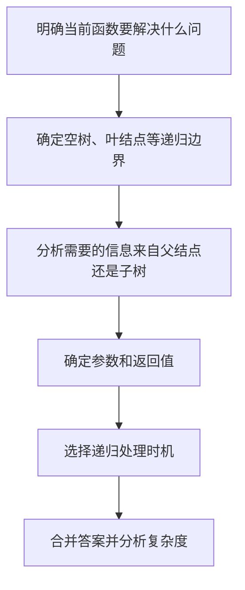

本章归纳5道历年真题和4道模拟题，统一采用第5章树与二叉树的章节编号。

## 一、从真题和模拟题看本章的核心考点

资料中本专题共收录5道真题、4道模拟题。

| 题目来源       | 考查内容           | 背后的核心思想    | 复习优先级 |
| ---------- | -------------- | ---------- | ----- |
| 2012年408真题 | 不等长有序表的最优合并    | 哈夫曼树、贪心    | ★★★★★ |
| 2014年408真题 | 求二叉树的WPL       | 递归遍历、参数传递  | ★★★★★ |
| 2016年408真题 | 正则 $k$ 叉树的结点计算 | 边数与结点数的关系  | ★★★★  |
| 2017年408真题 | 表达式树转中缀表达式     | 改造中序遍历     | ★★★★★ |
| 2020年408真题 | 前缀编码的存储、译码与判定  | 二叉树建模      | ★★★★  |
| 王道第1套第42题  | 求树高并判断平衡       | 后序递归、多结果计算 | ★★★★★ |
| 王道第2套第41题  | 组织层级关系存储       | 逻辑结构与存储结构  | ★★★   |
| 王道第4套第42题  | 判断两棵树镜像相似      | 双树同步递归     | ★★★★  |
| 王道第7套第42题  | 孩子兄弟表示法求树的度    | 存储结构与遍历    | ★★★★  |

这里的优先级是根据知识点的重要性、算法迁移能力和题目的代表性给出的，并不是对未来考试概率的预测。

本章包含五条知识主线：

- **递归算法设计**：掌握自顶向下传递信息与自底向上汇总信息。
- **遍历算法改造**：根据任务选择先序、中序、后序或层序遍历。
- **树的存储与结构建模**：二叉链表、孩子兄弟表示法、前缀编码树。
- **树的数学性质**：利用边数、结点数和度建立方程。
- **哈夫曼树与最优化问题**：识别隐藏在实际问题中的带权路径长度。

递归算法设计与遍历算法改造是本章算法大题的核心。

## 二、最重要的知识：彻底理解二叉树的递归

这一部分能够直接解决2014年、2017年真题，以及王道第1套、第4套模拟题，还能迁移到大量没有见过的算法题中。

### 1. 递归的本质：相信子问题已经解决

假设有如下二叉树：

```text
          A
        /   \
       B     C
      / \     \
     D   E     F
```

在结点 A 处，将左右子树视为已求解的子问题：

**已知左右子树的答案，如何合并得到整棵树的答案？**

例如：

| 要解决的问题 | 当前子树答案的计算方法                   |
| ------ | ----------------------------- |
| 结点总数   | 左子树结点数 + 右子树结点数 + 1           |
| 树的高度   | 左右子树高度的最大值 + 1                |
| 叶结点总数  | 左子树叶结点数 + 右子树叶结点数（当前为叶结点时返回1） |
| 是否平衡   | 左右子树均平衡，且高度差不超过1              |
| 结点权值总和 | 左子树权值和 + 右子树权值和 + 根结点权值       |

假设以下算法均采用这种基础结点定义，特殊题目再更换数据域：

```cpp
typedef struct BiTNode {
    int data;
    struct BiTNode *lchild, *rchild;
} BiTNode, *BiTree;
```

求结点总数：

```cpp
int count(BiTree T) {
    if (T == NULL)
        return 0;

    return count(T->lchild)
         + count(T->rchild) + 1;
}
```

求树的高度：

```cpp
int height(BiTree T) {
    if (T == NULL)
        return 0;

    int L = height(T->lchild);
    int R = height(T->rchild);

    return (L > R ? L : R) + 1;
}
```

这两段代码的递归结构相同，区别在于**合并左右子树答案的方式**。

### 2. 二叉树递归的两种基本思维

绝大多数基础二叉树算法题，都可以从以下两个方向思考。

<Tabs items={['自顶向下', '自底向上']}>

<Tab value="自顶向下">

```text
           A  depth=0
          / \
 depth=1 B   C depth=1
        / \
       D   E  depth=2
```

父结点将信息通过函数参数传给孩子结点。

适合解决深度、路径长度、根到叶结点的路径、祖先信息等问题。

核心代码形式：

```cpp
void dfs(BiTree T, int depth) {
    if (T == NULL)
        return;

    // 使用当前结点的深度

    dfs(T->lchild, depth + 1);
    dfs(T->rchild, depth + 1);
}
```

</Tab>

<Tab value="自底向上">

```text
           A  ← 高度3
          / \
 高度2   B   C  高度1
        / \
 高度1 D   E 高度1
```

先求左右子树的答案，再通过返回值把答案汇总到父结点。

适合解决树高、结点数、子树权值、平衡性等问题。

核心代码形式：

```cpp
int dfs(BiTree T) {
    if (T == NULL)
        return 0;

    int L = dfs(T->lchild);
    int R = dfs(T->rchild);

    return /* 根据 L 和 R 计算答案 */;
}
```

</Tab>

</Tabs>

**考场上的关键判断：**

| 题目需要的信息        | 优先考虑    |
| -------------- | ------- |
| 从根结点到当前结点的信息   | 参数向下传递  |
| 当前结点以下的子树信息    | 返回值向上汇总 |
| 左右子树处理完才能判断的性质 | 后序遍历    |
| 按从左到右的顺序输出     | 中序遍历    |
| 按层统计的信息        | 层序遍历    |
| 两棵树的结构关系       | 双树同步递归  |

## 三、代表题一：2014年408真题——求二叉树的带权路径长度

**重要程度：★★★★★**

### 1. 题目核心

给定一棵二叉链表存储的二叉树，叶结点保存非负权值，设计算法求整棵树的带权路径长度 WPL。

定义为：

$$
WPL=\sum_{i=1}^{m}w_i l_i
$$

其中，$m$ 为叶结点数，$w_i$ 为第 $i$ 个叶结点的权值，$l_i$ 为根结点到该叶结点的路径长度。

例如：

```text
          A
        /   \
      B(5)   C
            / \
          D(2) E(3)
```

三个叶结点的路径长度分别为1、2、2。

因此：

$$
WPL=5\times1+2\times2+3\times2=15
$$

### 2. 如何从题目推导出算法？

先明确递归函数的处理对象与所需信息。

| 问题         | 答案                |
| ---------- | ----------------- |
| 哪些结点需要处理？  | 叶结点               |
| 处理时需要哪些信息？ | 权值、路径长度           |
| 路径长度如何获得？  | 从父结点向孩子传递，每下降一层加1 |

### 3. 推荐掌握的代码

原参考答案使用指针参数累加结果；以下采用返回值汇总，减少参数传递开销与出错机会。

```cpp
typedef struct BiTNode {
    int weight;
    struct BiTNode *left, *right;
} BiTNode, *BiTree;

int WPL(BiTree T, int depth) {
    // 空树不产生贡献
    if (T == NULL)
        return 0;

    // 叶结点：计算带权路径长度
    if (T->left == NULL && T->right == NULL)
        return T->weight * depth;

    // 汇总左右子树的贡献
    return WPL(T->left, depth + 1)
         + WPL(T->right, depth + 1);
}
```

调用方式：

```cpp
WPL(root, 0);
```

设树有 $n$ 个结点，高度为 $h$，则：

$$
T(n)=O(n)
$$

$$
S(n)=O(h)
$$

### 4. 真正值得掌握的地方

这道题同时用到了两种递归思维：

- `depth` 通过参数自顶向下传递。
- WPL 通过返回值自底向上累加。

这是非常通用的递归设计模式。

只要改变判断条件和返回值，就能够得到许多其他算法。

| 变式题目            | 修改方法           |
| --------------- | -------------- |
| 统计第 $k$ 层结点数    | 深度等于 $k$ 时返回1  |
| 求所有叶结点的深度之和     | 叶结点返回 `depth`  |
| 求所有叶结点的权值之和     | 叶结点返回 `weight` |
| 统计权值大于 $x$ 的叶结点 | 满足条件时返回1       |
| 求最深叶结点的深度       | 将左右子树的结果取最大值   |

### 5. 必须避免的错误

根结点的层号通常为1，但根结点到自身的路径长度为0。

因此：

$$
\text{路径长度}=\text{层号}-1
$$

求树高时，只有一个根结点的树高度通常为1；但求这棵树的WPL时，其结果为0。

## 四、代表题二：王道第1套第42题——求树高并判断平衡

**重要程度：★★★★★**

本题考查如何利用一次递归同时求解多个性质。

### 1. 题目核心

求二叉树的高度，同时判断该二叉树是否平衡。

平衡的定义是：任意结点的左右子树高度差的绝对值不超过1。

即对每个结点均满足：

$$
|h_L-h_R|\leq 1
$$

### 2. 为什么不能只判断根结点？

考虑下面这棵树：

```text
             A
           /   \
          B     C
         /     / \
        D     E   F
       /
      G
```

A 的左子树高度为3，右子树高度为2。

根结点满足：

$$
|3-2|=1
$$

但是，B 的左子树高度为2，右子树高度为0。

$$
|2-0|=2
$$

所以整棵树不平衡。

<Callout type="warn" title="平衡性的全局条件">

**局部满足条件，不代表整体满足条件。**

</Callout>

这是树结构判断类题目的重要特点。

### 3. 从普通算法推导出高效算法

最直接的想法是遍历所有结点，对每个结点分别调用求高度的函数。

这样做能够得到正确结果，但会重复计算大量子树高度。

在最坏情况下，若完整检查所有结点，其时间复杂度可达：

$$
O(n^2)
$$

更好的方法是：既然求树高本身就需要遍历每个结点，为什么不在求高度时顺便判断平衡性？

于是，使用一次后序遍历即可。

### 4. 推荐掌握的代码

```cpp
int checkHeight(BiTree T, int *balanced) {
    if (T == NULL)
        return 0;

    // 先获得左右子树的高度
    int L = checkHeight(T->lchild, balanced);
    int R = checkHeight(T->rchild, balanced);

    // 判断当前结点是否失衡
    if (L - R > 1 || R - L > 1)
        *balanced = 0;

    // 返回真实的子树高度
    return (L > R ? L : R) + 1;
}
```

调用方式：

```cpp
int balanced = 1;
int h = checkHeight(root, &balanced);
```

`h` 保存树高，`balanced` 保存是否平衡的判断结果。

时间复杂度：

$$
O(n)
$$

辅助空间复杂度：

$$
O(h)
$$

### 5. 这道题的精髓：消除重复计算

树的高度天然满足递推关系：

$$
h(T)=
\begin{cases}
0,&T=\varnothing\\
1+\max(h_L,h_R),&T\ne\varnothing
\end{cases}
$$

平衡性同样可以递推：

$$
B(T)=B(T_L)\land B(T_R)
\land (|h_L-h_R|\leq1)
$$

既然两种性质都依赖子树信息，就可以在一次递归中同时求出。

这种方法还可以用于求二叉树的直径、最大子树权值和、树高与叶结点数等综合问题。

例如，求二叉树中任意两个结点之间的最长路径时，计算每个结点的左右子树高度，并维护：

$$
D=\max_{v\in T}
\left(h_L(v)+h_R(v)\right)
$$

就能在一次后序遍历中求出最长路径的边数。

### 6. 特别注意原题的要求

如果题目仅要求判断是否平衡，可以在发现失衡时直接返回特殊值 `-1`。

但这道模拟题还要求返回真实的树高。

<Callout type="warn" title="同时求真实树高">

因此，**不能因为发现失衡就停止高度计算**。

</Callout>

另外，题目仅判断高度平衡，不要求二叉搜索树的有序性，不要额外检查关键字大小关系。

## 五、代表题三：2017年408真题——表达式树转换为中缀表达式

**重要程度：★★★★★**

本题考查递归遍历中各操作的执行时机。

### 1. 题目核心

给定一棵表达式树，要求输出等价的中缀表达式，通过括号反映正确的运算次序。

资料原题图$a$的结构如下：

```text
             *
           /   \
          +     *
         / \   / \
        a   b c   -
                   \
                    d
```

正确的中缀表达式为：

$$
(a+b)\times(c\times(-d))
$$

若直接中序遍历，则会得到缺少必要括号的表达式，原本的运算次序可能被改变。

### 2. 如何想到使用中序遍历？

表达式树的每棵子树都代表一个子表达式。

对于二元运算符，中缀表达式的结构是：

```text
左操作数  运算符  右操作数
```

这与中序遍历完全一致：

```text
左子树  根结点  右子树
```

因此，可以使用中序遍历作为基础模板。

但是，还需要确定括号在哪里输出。

| 结点类型     | 处理方式            |
| -------- | --------------- |
| 叶结点      | 直接输出操作数         |
| 根结点且为运算符 | 输出整个表达式，不加最外层括号 |
| 非根分支结点   | 在整个子表达式外加括号     |

关键在于：括号包围的是整棵子树所代表的表达式，而不是单个运算符。

### 3. 推荐代码

这里沿用原题的数据结构。

```cpp
typedef struct node {
    char data[10];
    struct node *left, *right;
} BTree;
```

算法如下：

```cpp
void infix(BTree *T, int depth) {
    if (T == NULL)
        return;

    // 叶结点直接输出
    if (T->left == NULL && T->right == NULL) {
        printf("%s", T->data);
        return;
    }

    // 非根分支结点：先输出左括号
    if (depth > 1)
        printf("(");

    infix(T->left, depth + 1);

    printf("%s", T->data);

    infix(T->right, depth + 1);

    // 整棵子树处理完，输出右括号
    if (depth > 1)
        printf(")");
}
```

调用方式：

```cpp
infix(root, 1);
```

资料原图还包含仅有右孩子的一元负号运算符，这段代码也能正确处理。

### 4. 从本题学会改造遍历模板

标准递归遍历实际上有三个可以执行操作的位置：

```cpp
void dfs(BiTree T) {
    if (T == NULL)
        return;

    // 位置1：先序位置

    dfs(T->lchild);

    // 位置2：中序位置

    dfs(T->rchild);

    // 位置3：后序位置
}
```

| 执行位置 | 此时的信息状态    |
| ---- | ---------- |
| 先序位置 | 尚未处理左右子树   |
| 中序位置 | 左子树已经处理完   |
| 后序位置 | 左右子树都已经处理完 |

2017年这道题实际上同时使用了三个位置：

```text
先序位置：输出左括号
中序位置：输出运算符
后序位置：输出右括号
```

设计遍历算法时，根据操作需要的信息决定执行时机：进入递归时、处理左子树后或处理完全部子树后。

## 六、递归算法的两个重要变式

以下是双树同步递归与一般树递归的两个变式。

<Tabs items={['双树同步递归', '一般树递归']}>

<Tab value="双树同步递归">

### 1. 双树同步递归：王道第4套第42题

题目要求判断两棵二叉树是否镜像相似，只考虑结构，不要求数据域相等。

```text
      A            X
     / \          / \
    B   C        Y   Z
     \              /
      D            W
```

判断镜像相似的本质是将一棵树的左子树与另一棵树的右子树比较。

```cpp
bool mirror(BiTree A, BiTree B) {
    // 两棵树都为空
    if (A == NULL && B == NULL)
        return true;

    // 只有一棵为空
    if (A == NULL || B == NULL)
        return false;

    return mirror(A->lchild, B->rchild)
        && mirror(A->rchild, B->lchild);
}
```

双树比较的通用方法如下。

| 题目类型      | 递归比较方式        | 是否比较数据 |
| --------- | ------------- | ------ |
| 两棵树结构相同   | 左对左、右对右       | 否      |
| 两棵树完全相同   | 左对左、右对右       | 是      |
| 两棵树镜像相似   | 左对右、右对左       | 否      |
| 两棵树镜像相等   | 左对右、右对左       | 是      |
| 一棵树结构是否对称 | 比较自身左右子树的镜像关系 | 视题意而定  |

</Tab>

<Tab value="一般树递归">

### 2. 一般树递归：王道第7套第42题

题目要求计算孩子兄弟链表表示的树的度。

结点定义如下：

```cpp
typedef struct CSNode {
    int data;
    struct CSNode *firstchild;
    struct CSNode *nextsibling;
} CSNode, *CSTree;
```

假设原树如下：

```text
           A
        /  |  \
       B   C   D
          / \
         E   F
```

转换为孩子兄弟表示法：

```text
A
|
B ─── C ─── D
      |
      E ─── F
```

纵向指针代表第一个孩子，横向指针代表下一个兄弟。

<Callout type="idea" title="孩子兄弟表示法">

**求一个结点的度，本质上就是求它的孩子链表的长度。**

</Callout>

求整棵树的度，则是求所有结点度的最大值。

```cpp
int treeDegree(CSTree T) {
    if (T == NULL)
        return 0;

    int degree = 0;
    int maxDegree = 0;

    // 遍历当前结点的所有孩子
    for (CSTree p = T->firstchild;
         p != NULL;
         p = p->nextsibling) {

        degree++;

        // 递归求孩子所在子树的最大度
        int d = treeDegree(p);

        if (d > maxDegree)
            maxDegree = d;
    }

    return degree > maxDegree
           ? degree : maxDegree;
}
```

每个非根结点只在所属父结点的孩子链表中被扫描一次，因此时间复杂度为：

$$
O(n)
$$

递归栈空间为 $O(h)$，其中 $h$ 是原树的高度。

本题真正的考点是：**算法必须依据指针的实际含义设计，而不是依据结点有几个指针设计。**

孩子兄弟链表虽然有两个指针，但它表示的一般树中，结点的度完全可能大于2。

</Tab>

</Tabs>

## 七、树的数学性质：掌握一个核心等式

**重要程度：★★★★**

这部分以2016年408真题为代表。

### 1. 最根本的公式

设一棵非空树有 $n$ 个结点，其中度为 $i$ 的结点有 $n_i$ 个，树的度为 $k$。

由于每个非根结点都有且仅有一条边与双亲相连，所以：

$$
\text{边数}=n-1
$$

从父结点的角度统计边数，则有：

$$
n-1=\sum_{i=0}^{k}in_i
$$

同时：

$$
n=\sum_{i=0}^{k}n_i
$$

联立可得：

$$
\boxed{n_0=1+\sum_{i=2}^{k}(i-1)n_i}
$$

对于二叉树：

$$
\boxed{n_0=n_2+1}
$$

上述公式均来自同一个事实：**树的边数等于结点数减1。**

### 2. 结合2016年真题

题目规定一棵正则 $k$ 叉树的每个非叶结点都有 $k$ 个孩子，已知非叶结点有 $m$ 个。

求叶结点数。

设叶结点数为 $n_0$，则：

$$
n=m+n_0
$$

从边数角度：

$$
n-1=km
$$

所以：

$$
m+n_0-1=km
$$

得到：

$$
\boxed{n_0=(k-1)m+1}
$$

这就是二叉树叶结点数公式的推广。

### 3. 高度一定时，结点数的最值

题目进一步要求高度为 $h$ 时的最大、最小结点数，规定根结点位于第1层。

以 $k=3$、$h=3$ 为例。

结点数最多：

```text
                 A
          /      |      \
         B       C       D
       / | \   / | \   / | \
      ●  ●  ● ●  ●  ● ●  ●  ●
```

每一层都尽可能填满。

$$
n_{\max}=1+k+k^2+\cdots+k^{h-1}
$$

$$
\boxed{n_{\max}=\frac{k^h-1}{k-1}}
$$

上式适用于 $k>1$；当 $k=1$ 时，结点数为 $h$。

结点数最少：

```text
              A
           /  |  \
          B   ●   ●
        / | \
       ●  ●  ●
```

只让一条路径不断向下延伸，但每个分支结点仍必须具有 $k$ 个孩子。

因此，每增加一层，只增加 $k$ 个结点。

$$
\boxed{n_{\min}=1+k(h-1)}
$$

特别注意：这是正则 $k$ 叉树的最少结点数，而普通度不超过 $k$ 的树，高度为 $h$ 时最少只需要 $h$ 个结点。

### 4. 最值问题的一般解法

遇到树的结点数、高度、度之间的最值问题，先确定题目有哪些结构约束，再画出极端形态。

最大结点数通常通过尽量填满每一层实现；最小结点数通常通过尽量减少分支实现。

**先理解极端结构，再推导公式，远比背诵公式可靠。**

## 八、哈夫曼树：真正重要的是识别最优化模型

**重要程度：★★★★★**

代表题：2012年408真题。

本题需要从归并代价识别哈夫曼树模型。

### 1. 题目核心

有6个升序表，长度分别为：

$$
10,\ 35,\ 40,\ 50,\ 60,\ 200
$$

要求通过5次两两合并，将其合并为一个有序表，并且最坏情况下的比较总次数最少。

<Steps>

<Step>

### 计算单次代价

两个长度分别为 $a$、$b$ 的非空有序表进行标准二路归并，最多需要比较：

$$
C=a+b-1
$$

原解析举例勘误：两个表的元素完全分离时，并不一定产生最多比较次数。通常需要两个表的元素适当交错，使某个表直到最后阶段才耗尽，才能达到 $a+b-1$ 次比较。

公式本身是正确的。

</Step>

<Step>

### 转换为哈夫曼树

每次将两个表合并为一个新表，可以画成一棵树：

```text
         45
        /  \
       10   35
```

如果合并后得到的长度45的新表，又参与了下一次合并：

```text
            85
           /  \
          40   45
              /  \
             10   35
```

那么长度10、35的原始表均参与了两次合并，而长度40的表只参与了一次。

这说明：

**某个原始表参与合并的次数，正好等于它在合并树中的叶结点路径长度。**

设初始表长为 $w_i$，对应叶结点路径长度为 $l_i$。

所有合并的长度代价之和为：

$$
\sum_{i=1}^{n}w_il_i
$$

由于 $n$ 个表必然进行 $n-1$ 次两两合并，每次最坏比较次数都减1，所以：

$$
C_{\text{total}}=\sum_{i=1}^{n}w_il_i-(n-1)
$$

即：

$$
\boxed{C_{\text{total}}=WPL-(n-1)}
$$

由于 $n-1$ 是固定的，要使比较次数最少，只需要使 WPL 最小。

这就自然转化成了哈夫曼树问题。

</Step>

<Step>

### 执行贪心归并

每次选取当前权值最小的两个结点进行合并，将合并结果重新放回集合。

| 合并次数 | 选取的表长   | 合并后表长         | 最坏比较次数  |
| ---- | ------- | ------------- | ------- |
| 1    | 10、35   | 45            | 44      |
| 2    | 40、45   | 85            | 84      |
| 3    | 50、60   | 110           | 109     |
| 4    | 85、110  | 195           | 194     |
| 5    | 195、200 | 395           | 394     |
| 合计   |         | 830（中间结点权值之和） | **825** |

对应的哈夫曼树：

```text
                 395
                /   \
              195   200
             /   \
           85    110
          /  \   /  \
        40   45 50  60
            /  \
           10   35
```

按照叶结点带权路径长度计算：

$$
\begin{aligned}
WPL={}&10\times4+35\times4\\
&+40\times3+50\times3\\
&+60\times3+200\times1\\
={}&830
\end{aligned}
$$

也可以直接利用每次合并产生的新权值求和：

$$
WPL=45+85+110+195+395=830
$$

最终：

$$
\boxed{C_{\min}=830-5=825}
$$

</Step>

</Steps>

### 5. 为什么必须每次选最小的两个？

因为权值越大的结点，反复参与合并所产生的代价越大。

哈夫曼树的贪心策略让小权值结点在合适的情况下处于更深的位置，使大权值结点尽可能减少参与次数，从而最小化全局带权路径长度。

更本质地说，这类问题的目标函数具有以下形式：

$$
\min\sum_{i=1}^{n}w_il_i
$$

总代价为权值与重复参与次数的乘积之和，且次数由合并树决定时，可考虑哈夫曼树模型。

### 6. 两个容易忽略的考点

哈夫曼树中，内部结点的权值等于其两个孩子权值之和，因此：

$$
\boxed{WPL=\text{所有非叶结点权值之和}}
$$

这个性质适用于按子树权值和标记内部结点的哈夫曼树，计算WPL时非常方便。

其次，具有 $n$ 个叶结点的二叉哈夫曼树满足：

$$
n_2=n_0-1=n-1
$$

因此，总结点数为：

$$
\boxed{2n-1}
$$

这又回到了前面讲过的树的数学性质。

## 九、树的建模能力：2020年真题与王道第2套模拟题

这两道题虽然不是典型的递归代码题，但具有一个共同考点：如何将实际问题抽象成合适的树结构。

### 1. 2020年408真题：前缀编码

题目给出若干不等长二进制编码，要求设计存储结构，完成译码并判断是否具有前缀特性。

例如：

| 字符 | 编码  |
| -- | --- |
| A  | 0   |
| B  | 10  |
| C  | 110 |
| D  | 111 |

可以构造如下二叉树：

```text
             root
            /    \
         0 /      \ 1
          A        ●
                  / \
               0 /   \ 1
                B     ●
                     / \
                  0 /   \ 1
                   C     D
```

左边代表0，右边代表1，字符只存放在叶结点中。

#### 为什么必须将字符放在叶结点？

假设有两个编码：

$$
A=10,\qquad B=101
$$

那么 A 的编码路径就是 B 的编码路径的一部分。

```text
root
   \
    ●
   /
  A
   \
    B
```

A 所在结点成为 B 的祖先，说明 A 的编码是 B 编码的前缀。

所以，在不同字符使用不同码字的前提下，前缀特性可以转化为：

**任何字符的编码终止结点都不能是另一个字符编码终止结点的祖先。**

#### 译码的本质

例如对下面的编码串进行译码：

```text
010110111
```

从根结点出发，遇到0走左边，遇到1走右边，到达叶结点就输出字符并重新回到根结点。

结果为：

```text
0 | 10 | 110 | 111
A    B     C     D
```

无需分隔符就能够唯一地完成译码。

#### 如何判定前缀特性？

依次向编码树中插入每个字符的编码，只要考虑三种冲突：

| 冲突情况               | 原因         |
| ------------------ | ---------- |
| 插入过程中遇到已有编码终止结点    | 旧编码是新编码的前缀 |
| 新编码结束时，当前结点仍有孩子    | 新编码是旧编码的前缀 |
| 新编码结束时，已有其他字符占用该结点 | 两个字符编码相同   |

若所有编码插入时均无冲突，则满足前缀特性。

设有 $m$ 个字符，编码最长为 $L$，判定算法的时间复杂度为：

$$
O(mL)
$$

注意，前缀编码不一定是哈夫曼编码。哈夫曼编码不仅具有前缀特性，还具有带权编码长度最小的性质。

### 2. 王道第2套第41题：组织层级关系

原题描述了一个领导与两类下属组成的组织结构，两类下属拥有不同的考核指标。

对应树结构为：

```text
              咸鱼
             /    \
          木鱼     腊鱼
                  /    \
               干鱼     冻鱼
```

左孩子存储工作能力评分，右孩子存储外貌形象评分，最高层领导没有考核评分。

这道题需要区分三个层次：

| 设计层次  | 应考虑的问题       |
| ----- | ------------ |
| 逻辑结构  | 有根有序二叉树      |
| 存储结构  | 二叉链表         |
| 数据域设计 | 昵称、属性类别、对应评分 |

可以采用 `enum` 标明属性类别，采用 `union` 表示两种互斥的评分数据。

建模原则：根据实际关系确定逻辑结构，根据操作需求确定存储结构，根据业务属性设计数据域。

## 十、本章其他需要掌握的通用算法模板

以下属于前面真题与模拟题的高价值拓展，并非该压缩包中本专题的独立大题。

### 1. 层序遍历：解决与层有关的问题

层序遍历的本质是利用队列按照从上到下、从左到右的顺序访问结点。

适用场景包括求二叉树宽度、判断完全二叉树、非递归求树高、统计每层结点数等。

尤其是判断完全二叉树，需要掌握一个关键性质：

<Callout type="idea" title="完全二叉树判定">

**按层序检查二叉树的所有结点位置时，一旦出现空位置，之后就不能再出现非空结点。**

</Callout>

例如：

```text
完全二叉树             非完全二叉树

      A                    A
     / \                  / \
    B   C                B   C
   / \                      /
  D   E                    D
```

右侧二叉树先出现空位置，后面又出现了非空结点D，因此不是完全二叉树。

可以在层序遍历时将空指针也入队；第一次取出空指针后，如果队列中还能取出非空结点，则判定失败。

### 2. 遍历序列还原二叉树

这一类问题只需要掌握两个核心性质。

| 遍历序列 | 根结点的位置          |
| ---- | --------------- |
| 先序遍历 | 第一个元素           |
| 中序遍历 | 根的左侧为左子树，右侧为右子树 |
| 后序遍历 | 最后一个元素          |

在结点标识互不相同的前提下，先序加中序，或者后序加中序，可以唯一确定一棵二叉树。

例如：

```text
先序：A B D E C F
中序：D B E A C F
```

先序找到根A，中序将剩余结点划分成左右子树：

```text
D B E | A | C F
 左子树      右子树
```

然后对左右子树重复同样的操作。

本质仍是递归分解。

一般情况下，仅知道先序和后序，无法唯一确定二叉树，因为无法确定只有一个孩子时，该孩子到底是左孩子还是右孩子。

## 十一、考场上如何从零设计二叉树算法

二叉树算法设计流程如下。



例如，题目要求求二叉树中所有度为1的结点数量。

第一步，定义函数：

`count1(T)` 表示以 T 为根的子树中度为1的结点数量。

第二步，空树返回0。

第三步，只需要知道左右子树中度为1的结点数量，并判断当前结点是否度为1。

第四步，不需要额外的向下传递参数，直接返回统计结果。

第五步，写出代码：

```cpp
int count1(BiTree T) {
    if (T == NULL)
        return 0;

    int flag = 0;

    if ((T->lchild == NULL && T->rchild != NULL)
     || (T->lchild != NULL && T->rchild == NULL))
        flag = 1;

    return count1(T->lchild)
         + count1(T->rchild)
         + flag;
}
```

### 算法大题的文字答案如何写？

以求树高为例，可以组织为：

> 采用后序递归遍历二叉树。当当前子树为空时，返回0；否则分别递归求其左右子树的高度，取二者的最大值加1作为当前子树的高度并返回。由于每个结点仅被访问一次，故时间复杂度为 $O(n)$，递归栈的辅助空间复杂度为 $O(h)$，其中 $h$ 为树高。

设计思想、代码、复杂度三者应保持一致。

## 十二、本章核心知识速查表

| 知识点     | 必须掌握的本质         |
| ------- | --------------- |
| 树的递归    | 将整棵树的问题分解为子树问题  |
| 递归参数    | 自顶向下传递信息        |
| 递归返回值   | 自底向上汇总信息        |
| 先序遍历    | 进入子树时执行操作       |
| 中序遍历    | 左子树与右子树之间执行操作   |
| 后序遍历    | 利用已经求出的子树答案     |
| 层序遍历    | 利用队列处理层级信息      |
| 平衡性判断   | 检查每个结点，而非仅检查根   |
| 镜像判断    | 左右子树交叉递归比较      |
| 孩子兄弟表示法 | 孩子链表表示直接孩子集合    |
| 树的数学性质  | 边数等于结点数减1       |
| 哈夫曼树    | 最小化带权路径长度       |
| 最优归并    | 转化为哈夫曼树模型       |
| 前缀编码    | 编码终止结点之间不存在祖先关系 |

## 十三、代表题与自测

优先独立完成以下5道代表题。

| 推荐顺序 | 题目         | 掌握目标          |
| ---- | ---------- | ------------- |
| 1    | 2014年408真题 | 学会递归参数传递与结果汇总 |
| 2    | 王道第1套第42题  | 学会后序递归与消除重复计算 |
| 3    | 2017年408真题 | 学会根据需求改造遍历模板  |
| 4    | 2012年408真题 | 学会识别哈夫曼最优化模型  |
| 5    | 2020年408真题 | 学会将实际问题转化为树结构 |

自测清单：

- 不看答案，能独立写出求树高、结点数、叶结点数的代码。
- 能判断某个信息应该通过参数传递，还是通过返回值汇总。
- 能在一次后序遍历中同时计算树高和判断平衡。
- 能根据题意灵活改造先序、中序、后序遍历。
- 能独立推导树的叶结点数量公式。
- 能识别没有明确出现“哈夫曼树”字样的最优合并问题。
- 能独立描述前缀编码的存储、译码与冲突判定过程。
- 能区分一般树与二叉树中指针的不同含义。
- 能正确分析递归算法的时间与空间复杂度。

## 核心思想总结

本章三个核心思想：

**第一，递归就是信息的向下传递和向上汇总。**

**第二，树的结构性质来自边、结点以及父子关系。**

**第三，哈夫曼树的本质是带权路径长度的最优化，而不只是每次选择两个最小权值的机械操作。**

原题库2012年真题关于最坏归并情况的错误解释已在本章对应小节说明。二叉搜索树、AVL旋转、红黑树归入查找章节。
