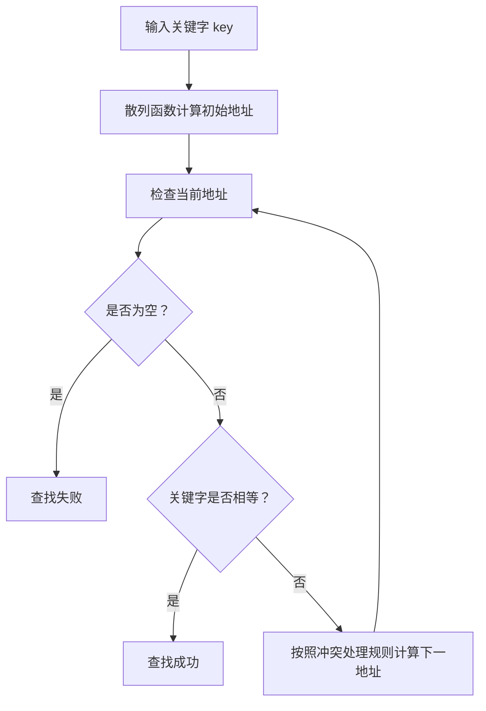
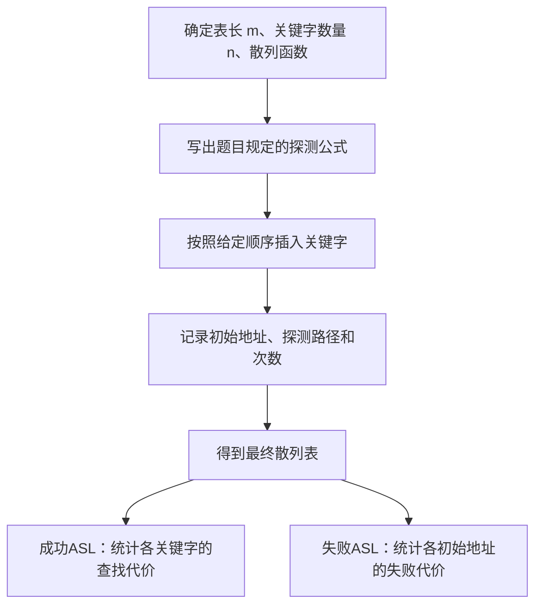

本章归纳4道历年真题和2道模拟题，统一采用第7章查找的章节编号。

## 一、本章大题的核心考点与复习优先级

| 题目来源      | 核心考点               | 复习优先级 |
| --------- | ------------------ | ----- |
| 2010 年真题  | 散列表构造、成功与失败 ASL    | ★★★★★ |
| 2024 年真题  | 二次探测、查找过程          | ★★★★★ |
| 2022 年真题  | 二叉搜索树的算法设计         | ★★★★★ |
| 王道第5套第41题 | AVL 插入、删除、旋转、红黑树比较 | ★★★★★ |
| 王道第8套第41题 | BST、二次探测、ASL、建堆    | ★★★★★ |
| 2013 年真题  | 不等概率 ASL、查找方法选择    | ★★★★  |

这里的优先级是根据知识的通用性、题目综合程度和本题库中的考查情况给出的，不是对未来考试的预测。

本章包含四种核心解题模型：

- **散列表：** 如何确定查找路径、构造散列表、计算查找代价。
- **二叉搜索树：** 如何利用全局有序性构造、查找和设计算法。
- **平衡二叉树：** 如何在保持搜索性质的同时控制树高。
- **平均查找长度：** 如何从比较次数和查找概率出发，评价与优化查找算法。

这些模型并不是相互独立的。整个查找章节实际上都在研究同一个问题：

**如何组织数据，使查找时付出的代价尽可能小，同时控制数据结构的维护成本。**

## 二、散列表大题：掌握探测路径，而不是死记公式

**重要程度：★★★★★**

涉及题目：2010 年真题、2024 年真题、王道第8套第41题。

三道题均基于探测路径计算。

### 2.1 散列查找的本质

散列函数并不能保证直接找到关键字，它只能告诉你应该从哪里开始查找。

整个过程可以分成三个部分：



上图针对未设置删除标记、探测序列能够到达空位置的开放定址散列表。如果探测序列耗尽，也应结束查找。

**插入关键字走过的探测路径，就是此后查找该关键字所走的路径（在没有删除、重散列等改变的情况下）。**

因此，只要构造散列表时记录了探测路径，查找成功的 ASL 就已经基本求出来了。

### 2.2 必须彻底区分的两个模数

设散列函数为：

$$
H(key)=key\bmod p
$$

散列表长度为 $m$，开放定址法的探测公式为：

$$
H_i=(H(key)+d_i)\bmod m
$$

注意：

| 参数        | 含义       | 作用       |
| --------- | -------- | -------- |
| $p$   | 散列函数的模数  | 确定初始地址   |
| $m$   | 散列表的长度   | 确定探测地址范围 |
| $d_i$ | 探测偏移量    | 决定冲突处理路径 |
| $n$   | 已存储关键字个数 | 计算装填因子等  |

装填因子：

$$
\alpha=\frac{n}{m}
$$

**初始地址使用散列函数的模数，冲突处理使用表长作为模数。**

<Callout type="warn" title="初始地址与探测模数">

这两个模数可能相同，也可能不同，绝对不能混用。

</Callout>

### 2.3 代表题一：2010 年408真题

本题同时考查散列表构造、成功 ASL 和失败 ASL。

#### 题目条件

关键字序列：

$$
7,8,30,11,18,9,14
$$

散列函数：

$$
H(key)=3key\bmod 7
$$

采用线性探测法，装填因子为 $0.7$。

要求构造散列表，并计算等概率情况下成功和失败的 ASL。

<Steps>

<Step>

### 确定表长

一共有7个关键字：

$$
m=\frac{n}{\alpha} =\frac{7}{0.7}=10
$$

因此初始地址的计算对7取模，冲突后的探测对10取模。

$$
H_i=(H_0+i)\bmod 10
$$

</Step>

<Step>

### 构造散列表

| 关键字 | 初始地址 | 探测路径      | 查找次数 |
| --- | ---- | --------- | ---- |
| 7   | 0    | 0         | 1    |
| 8   | 3    | 3         | 1    |
| 30  | 6    | 6         | 1    |
| 11  | 5    | 5         | 1    |
| 18  | 5    | 5 → 6 → 7 | 3    |
| 9   | 6    | 6 → 7 → 8 | 3    |
| 14  | 0    | 0 → 1     | 2    |

最终散列表：

| 地址  | 0 | 1  | 2 | 3 | 4 | 5  | 6  | 7  | 8 | 9 |
| --- | - | -- | - | - | - | -- | -- | -- | - | - |
| 关键字 | 7 | 14 | — | 8 | — | 11 | 30 | 18 | 9 | — |

</Step>

<Step>

### 成功ASL

查找成功意味着要查找的元素确实存在。

所以统计对象是表中的7个关键字。

$$
\begin{aligned} ASL_{\text{成功}} &=\frac{1+1+1+1+3+3+2}{7}\\ &=\boxed{\frac{12}{7}} \end{aligned}
$$

为什么不是除以10？

因为查找成功的事件只有7种，即分别查找这7个已经存在的关键字，而不是查找10个存储地址。

</Step>

<Step>

### 失败ASL

查找失败意味着关键字不在表中。因此，不再研究已经存在的关键字，而是研究一个不存在的关键字可能从哪里开始探测。

由于：

$$
H(key)=3key\bmod 7
$$

所以初始地址只能是0～6。

按照本题的计数口径，最终探测到空位置也计入查找长度。

| 初始地址 | 失败探测路径               | 查找长度 |
| ---- | -------------------- | ---- |
| 0    | 0 → 1 → 2（空）         | 3    |
| 1    | 1 → 2（空）             | 2    |
| 2    | 2（空）                 | 1    |
| 3    | 3 → 4（空）             | 2    |
| 4    | 4（空）                 | 1    |
| 5    | 5 → 6 → 7 → 8 → 9（空） | 5    |
| 6    | 6 → 7 → 8 → 9（空）     | 4    |

$$
\begin{aligned} ASL_{\text{失败}} &=\frac{3+2+1+2+1+5+4}{7}\\ &=\boxed{\frac{18}{7}} \end{aligned}
$$

</Step>

</Steps>

#### 这道题真正需要学会什么？

ASL 的本质是查找代价的数学期望。

$$
ASL=\sum_i p_i c_i
$$

其中 $p_i$ 是相应查找事件发生的概率，$c_i$ 是该事件的查找代价。

| 对比    | 查找成功    | 查找失败      |
| ----- | ------- | --------- |
| 统计对象  | 已存在的关键字 | 可能的初始散列地址 |
| 探测终点  | 找到目标关键字 | 确认不存在     |
| 等概率分母 | 关键字数量   | 可能的初始地址数量 |
| 主要依据  | 插入探测过程  | 构造完成后的散列表 |

对于常见的模 $p$ 散列函数，如果各初始地址均可能出现且等概率，则失败 ASL 的分母为 $p$。

<Callout type="warn" title="成功与失败ASL分母">

本题中 $n=p=7$ 只是巧合，不能因此认为成功与失败的分母总是相同。

</Callout>

### 2.4 二次探测法：2024年真题与模拟题的关键变化

2024 年真题与王道第8套模拟题都考查了二次探测，但它们的探测规则并不相同。

| 探测方法        | 偏移量序列                         |
| ----------- | ----------------------------- |
| 线性探测        | $0,1,2,3,4,\ldots$        |
| 2024年真题二次探测 | $0,1,4,9,16,\ldots$       |
| 王道第8套二次探测   | $0,1,-1,4,-4,9,-9,\ldots$ |

**考试时必须以题目明确给出的探测公式为准。**

#### 2024 年真题的关键一问

散列表长度为11，初始散列函数为：

$$
H_0=3key\bmod 11
$$

冲突处理规则：

$$
H_k=(H_0+k^2)\bmod 11
$$

最终构造的散列表如下：

| 地址  | 0  | 1 | 2  | 3 | 4 | 5  | 6 | 7 | 8 | 9 | 10 |
| --- | -- | - | -- | - | - | -- | - | - | - | - | -- |
| 关键字 | 11 | — | 14 | 7 | — | 20 | 9 | — | — | 3 | 18 |

要求查找关键字8，确定在哪个地址确认失败。

首先计算：

$$
H_0=3\times8\bmod11=2
$$

然后依次探测：

$$
\begin{aligned} H_0&=2\\ H_1&=(2+1)\bmod11=3\\ H_2&=(2+4)\bmod11=6\\ H_3&=(2+9)\bmod11=0\\ H_4&=(2+16)\bmod11=7 \end{aligned}
$$

地址7为空，因此答案为：

$$
\boxed{7}
$$

#### 最重要的易错点：偏移量不能累加

正确的是：

$$
H_k=(H_0+k^2)\bmod m
$$

而不是：

$$
H_k=(H_{k-1}+k^2)\bmod m
$$

<Callout type="warn" title="二次探测偏移">

每次探测都从初始地址 $H_0$ 出发。

</Callout>

#### 如何迁移到王道第8套模拟题？

该题的散列表长为16，初始散列函数为：

$$
H_0=key\bmod13
$$

采用正负平方交替探测。

其中最典型的是关键字5的插入：

- 初始地址5已经存放18。
- 地址6已经存放31。
- 地址4为空，因此插入地址4。

探测路径为：

$$
5\rightarrow6\rightarrow4
$$

查找长度为3，整道模拟题的成功 ASL 为：

$$
ASL_{\text{成功}}=\frac{12}{8}=\boxed{1.5}
$$

线性探测与二次探测使用同一套路径统计方法，仅偏移量规则不同。

### 2.5 散列表大题通用解题模板

遇到任何开放定址法散列表大题，都按照以下流程处理：



额外注意：开放定址法中不能随意将删除的元素位置直接清空，否则可能截断其他关键字的查找路径。通常需要设置删除标记。

## 三、二叉搜索树：从局部比较上升到全局约束

**重要程度：★★★★★**

涉及题目：2022 年真题、王道第8套第41题、2013 年真题。

### 3.1 真正理解二叉搜索树的性质

二叉搜索树（BST）要求对于任意结点：

$$
\text{左子树所有关键字} < \text{根关键字} < \text{右子树所有关键字}
$$

关键是“所有”，不是仅仅比较左右孩子。

例如：

```text
        40
       /  \
     20    60
          /
         30
```

如果只比较双亲与孩子：

- 20 小于40。
- 60 大于40。
- 30 小于60。

似乎都满足条件。

但30位于40的右子树中，却小于40。

因此这不是二叉搜索树。

<Callout type="idea" title="全局大小约束">

**BST 是一种具有全局大小约束的二叉树。**

</Callout>

由此可以推出以下核心性质：

| 操作或性质 | 本质              |
| ----- | --------------- |
| 中序遍历  | 得到严格递增序列        |
| 查找    | 每次根据比较结果排除一棵子树  |
| 插入    | 沿查找失败路径找到空位置    |
| 删除    | 删除结点后仍要保持全局大小约束 |

### 3.2 代表题二：2022年408真题——验证二叉搜索树

#### 题目核心

一棵二叉树采用数组顺序存储，结点值均为正整数，不存在的结点用 $-1$ 表示。

```cpp
typedef struct {
    int SqBiTNode[MAX_SIZE];
    int ElemNum;
} SqBiTree;
```

要求设计一个尽可能高效的算法，判断该树是否为二叉搜索树。

<Steps>

<Step>

### 识别知识模块

表面上是查找章节的题目，但实际上考查了：

| 知识模块     | 需要解决的问题       |
| -------- | ------------- |
| 二叉树的顺序存储 | 如何访问左右孩子      |
| 二叉搜索树的性质 | 如何判断整棵树满足大小约束 |

对于下标从0开始的顺序存储二叉树，若根结点下标为 $i$，则：

$$
\begin{aligned} \text{左孩子下标}&=2i+1\\ \text{右孩子下标}&=2i+2 \end{aligned}
$$

只要掌握这两个公式，就可以把顺序存储的二叉树当作普通二叉树进行递归遍历。

</Step>

<Step>

### 确定判断条件

不能只比较双亲和孩子。

应该利用：

$$
\text{BST} \iff \text{中序遍历序列严格递增}
$$

例如题目给出的第一棵树：

```text
          40
         /  \
       25    60
         \     \
         30     80
        /
       27
```

中序遍历：

$$
25,27,30,40,60,80
$$

严格递增，所以是二叉搜索树。

</Step>

<Step>

### 优化遍历

最容易想到的做法是将中序遍历结果存入数组，再判断数组是否递增。

但实际上没有必要保存整个序列。

因为判断是否递增时，只需要比较当前访问结点和上一个访问结点。

因此设置变量 `prev`，记录中序遍历中上一个访问的关键字即可。

</Step>

<Step>

### 实现算法

算法思想：

对二叉树进行中序遍历，使用变量 `prev` 保存上一个访问结点的值。每访问一个结点，就将其值与 `prev` 比较。若当前值小于或等于 `prev`，说明中序序列不是严格递增的，返回 `false`；否则更新 `prev`，继续遍历。

```cpp
bool InOrder(const SqBiTree &T, int i, int &prev) {
    // 越界或空结点
    if (i >= T.ElemNum || T.SqBiTNode[i] == -1)
        return true;

    // 遍历左子树
    if (!InOrder(T, 2 * i + 1, prev))
        return false;

    // 访问当前结点
    if (T.SqBiTNode[i] <= prev)
        return false;

    prev = T.SqBiTNode[i];

    // 遍历右子树
    return InOrder(T, 2 * i + 2, prev);
}

bool Judge(const SqBiTree &T) {
    int prev = 0;  // 题目规定结点值均为正整数
    return InOrder(T, 0, prev);
}
```

设实际结点数量为 $n$，树高为 $h$。

时间复杂度：

$$
O(n)
$$

辅助空间复杂度（递归栈）：

$$
O(h)
$$

最坏情况下，树退化为单支树：

$$
h=n
$$

因此最坏辅助空间复杂度为 $O(n)$。平衡情况下为 $O(\log n)$。

</Step>

</Steps>

#### 题库原解析存在的问题

原参考代码存在以下问题：

- 没有在递归访问数组前判断下标是否越界。
- `void` 类型函数中使用了 `return true`。
- 按值传递整棵树，并使用额外数组保存全部遍历结果，存在不必要的开销。

上面给出的算法修正了这些问题，同时能够在发现不合法结点时提前结束。

#### 这道题最重要的算法思想

**利用遍历顺序，将一个全局约束问题转换为相邻元素的比较问题。**

BST的常见操作与遍历方法如下：

| 题目要求                  | 解题思路       |
| --------------------- | ---------- |
| 判断是否为 BST             | 中序遍历判断递增   |
| 查找 BST 中第 $k$ 小元素 | 中序遍历计数     |
| 查找 BST 中最大元素          | 不断向右       |
| 查找 BST 中最小元素          | 不断向左       |
| 求 BST 中相邻关键字的最小差值     | 中序遍历，比较相邻值 |
| 按递减顺序输出 BST           | 右、根、左遍历    |

## 四、AVL树：彻底理解旋转，而不是背树形

**重要程度：★★★★★**

代表题：王道第5套第41题。

这道模拟题覆盖了 AVL 树插入、删除、LL/LR/RL 旋转以及 AVL 与红黑树的比较，综合性很强。

### 4.1 AVL树为什么需要旋转？

普通二叉搜索树的查找复杂度取决于树高：

$$
T(n)=O(h)
$$

例如，同样是插入三个关键字10、20、30：

```text
普通BST                 AVL树

  10                      20
    \                    /  \
     20                10    30
       \
        30
```

BST 如果不断退化成单支树，查找就会失去每次排除大量数据的优势。

AVL 树通过限制每个结点的左右子树高度差，使树高始终保持对数级别。

平衡因子：

$$
BF(x)=h(x.left)-h(x.right)
$$

AVL树要求每个结点都满足：

$$
|BF(x)|\leq1
$$

**旋转的目的不是单纯让树形好看，而是在不破坏 BST 有序性的前提下降低失衡子树的高度。**

### 4.2 四种旋转的统一理解

只需要找到最小失衡子树根结点，并观察从它向较高子树走的前两步方向。

| 失衡类型 | 路径形态  | 调整方式    |
| ---- | ----- | ------- |
| LL   | 左 → 左 | 右单旋     |
| RR   | 右 → 右 | 左单旋     |
| LR   | 左 → 右 | 先左旋，再右旋 |
| RL   | 右 → 左 | 先右旋，再左旋 |

#### LL型的本质

```text
      c                     b
     / \                   / \
    b   D      ---->      a   c
   / \                   / \ / \
  a   C                 A  B C  D
 / \
A   B
```

旋转前后，中序遍历顺序不变。

$$
A,a,B,b,C,c,D
$$

因此旋转不会破坏二叉搜索树性质。

#### LR型的本质

```text
      c               c                b
     /               /                / \
    a      ---->    b      ---->     a   c
     \             /
      b           a
```

先将折线调整成直线，再进行单旋。

RL型与LR型完全对称。

#### 一个更本质的旋转规律

将失衡路径上决定旋转类型的三个结点按关键字排序：

$$
a<b<c
$$

完成旋转以后，通常可以直接确定：

```text
        b
       / \
      a   c
```

也就是说，中间大小的结点成为新的局部根，再按照 BST 的大小关系将原有子树接回去。

这个思路可以用于快速检查旋转结果。

### 4.3 代表题三：王道第5套第41题

依次插入：

$$
30,20,10,25,28,27
$$

初始为空的 AVL 树。

<Steps>

<Step>

### 插入10：LL

```text
       30                   20
      /                    /  \
     20       ---->      10    30
    /
   10
```

失衡结点为30。

从30到新增结点的路径前两步是左、左，因此属于 LL 型，对30右旋。

</Step>

<Step>

### 插入25：无失衡

```text
        20
       /  \
     10    30
          /
         25
```

所有结点的平衡因子绝对值不超过1。

</Step>

<Step>

### 插入28：LR

```text
       20
      /  \
    10    30
         /
        25
          \
           28
```

从新结点向上检查，首先失衡的是30。

路径：

$$
30\xrightarrow{L}25\xrightarrow{R}28
$$

因此属于 LR 型。

先对25左旋，再对30右旋，得到：

```text
        20
       /  \
     10    28
          /  \
         25   30
```

</Step>

<Step>

### 插入27：RL

插入后：

```text
        20
       /  \
     10    28
          /  \
         25   30
           \
            27
```

从27向上检查：

| 结点 | 平衡因子 | 是否失衡 |
| -- | ---- | ---- |
| 27 | 0    | 否    |
| 25 | -1   | 否    |
| 28 | 1    | 否    |
| 20 | -2   | 是    |

因此最小失衡子树的根为20。

判断旋转类型时，观察从20出发的前两步：

$$
20\xrightarrow{R}28\xrightarrow{L}25
$$

所以是 RL 型，而不是 RR 型。

```text
调整前             对28右旋          对20左旋

     20                20                25
    /  \              /  \              /  \
  10    28          10    25          20    28
       /  \                 \        /     /  \
      25   30                28     10    27   30
        \                   /  \
         27                27   30
```

最终 AVL 树构造完成。

整个过程总结：

| 插入关键字 | 失衡结点 | 失衡类型 |
| ----- | ---- | ---- |
| 30    | 无    | 无    |
| 20    | 无    | 无    |
| 10    | 30   | LL   |
| 25    | 无    | 无    |
| 28    | 30   | LR   |
| 27    | 20   | RL   |

</Step>

</Steps>

#### 这道题的核心方法

每次插入以后，遵循：

$$
\boxed{ \text{插入} \rightarrow \text{向上找首个失衡祖先} \rightarrow \text{判断类型} \rightarrow \text{旋转} }
$$

<Callout type="warn" title="AVL旋转类型判断">

判断失衡类型一定要从失衡结点出发，不是从新插入的结点出发，也不是根据整棵树的形状随意判断。

</Callout>

### 4.4 AVL删除：首先理解普通BST的删除

AVL删除可以分为两个阶段：

先完成 BST 删除，再检查并恢复平衡性。

#### BST删除的三种情况

| 被删除结点 | 处理方法                 |
| ----- | -------------------- |
| 度为0   | 直接删除                 |
| 度为1   | 用唯一孩子替代该结点           |
| 度为2   | 用中序前驱或后继替换，再删除原前驱或后继 |

为什么可以使用中序后继？

因为中序后继是右子树中的最小结点，它大于左子树中的所有关键字，又不大于右子树中其他关键字，因而可以合法地占据原根的位置。

#### 回到模拟题

删除前：

```text
           25
         /    \
       20      28
      /       /  \
    10       27   30
```

先删除10，再删除28。题目要求度为2的结点使用中序后继替换。

```text
删除10后             删除28后

      25                 25
     /  \               /  \
   20    28           20    30
        /  \                /
       27   30             27
```

两次删除后，所有结点仍然满足平衡条件，因此均不需要旋转。

最终结果：

```text
        25
       /  \
     20    30
          /
         27
```

#### AVL插入与删除的重要区别

| 对比       | 插入             | 删除                           |
| -------- | -------------- | ---------------------------- |
| 高度变化     | 子树高度可能增加       | 子树高度可能降低                     |
| 调整位置     | 自下向上的首个失衡祖先    | 可能涉及多个失衡祖先                   |
| 旋转次数     | 至多两次基本旋转       | 最坏可能需要 $O(\log n)$ 次基本旋转 |
| 是否继续向上检查 | 首次完成再平衡后通常可以结束 | 需要根据高度变化继续检查                 |

删除时还可能出现较高孩子的平衡因子为0的情况，这是插入失衡时不会出现的典型情况。

为了完整掌握删除旋转，可使用下面这张表：

| 失衡结点 $z$   | 较高孩子 $y$ 的平衡因子 | 调整     |
| -------------- | ------------------ | ------ |
| $BF(z)=2$  | $BF(y)\geq0$   | LL，右单旋 |
| $BF(z)=2$  | $BF(y)=-1$     | LR，双旋  |
| $BF(z)=-2$ | $BF(y)\leq0$   | RR，左单旋 |
| $BF(z)=-2$ | $BF(y)=1$      | RL，双旋  |

## 五、AVL树、红黑树、BST和B树的本质区别

**重要程度：★★★★☆**

王道第5套模拟题最后一问考查的并非简单概念，而是根据实际需求选择数据结构。

### 5.1 不同查找结构在优化什么？

| 数据结构   | 主要优化目标      | 付出的代价          |
| ------ | ----------- | -------------- |
| 有序顺序表  | 快速折半查找      | 插入删除可能需要移动元素   |
| 普通BST  | 动态查找、插入、删除  | 可能退化为单支树       |
| AVL树   | 严格控制树高      | 更新时可能需要较多平衡调整  |
| 红黑树    | 平衡查找效率和更新开销 | 平衡程度不如AVL严格    |
| B树、B+树 | 减少外存访问次数    | 多路结点的维护        |
| 散列表    | 尽可能直接定位关键字  | 冲突处理、不支持天然有序遍历 |

这些结构之间没有绝对的优劣之分，它们优化的是不同的成本。

### 5.2 AVL和红黑树的比较

| 对比      | AVL树            | 红黑树             |
| ------- | --------------- | --------------- |
| 平衡要求    | 高度平衡更严格         | 通过颜色与黑高约束保持近似平衡 |
| 最坏查找复杂度 | $O(\log n)$ | $O(\log n)$ |
| 最坏插入复杂度 | $O(\log n)$ | $O(\log n)$ |
| 最坏删除复杂度 | $O(\log n)$ | $O(\log n)$ |
| 查找路径    | 通常较短            | 平衡限制相对宽松        |
| 删除旋转开销  | 可能多次旋转          | 标准算法至多常数次基本旋转   |
| 典型适用场景  | 读多写少            | 频繁动态更新          |

AVL和红黑树的区别不是时间复杂度的数量级，而是平衡程度、旋转与变色成本以及实际运行中的常数因素。

红黑树必须掌握的五条性质：

- 每个结点是红色或黑色。
- 根结点是黑色。
- NIL 空叶结点是黑色。
- 红色结点不能有红色孩子。
- 从任一结点到其后代 NIL 叶结点的所有路径，包含相同数量的黑色结点。

由后两条可以推出，最长根到 NIL 的路径长度不会超过最短路径长度的两倍。

因此红黑树不会无限制地退化。

### 5.3 B树和B+树需要掌握到什么程度？

原题库的6道大题没有专门考查B树、B+树或分块查找，本节为知识补充。

B树最核心的思想是通过提高分支数量，降低树高，从而减少外存访问次数。

对于 $m$ 阶B树，按照通常教材的定义：

$$
\text{最多孩子数}=m
$$

$$
\text{最多关键字数}=m-1
$$

非根结点最少关键字数：

$$
\left\lceil\frac{m}{2}\right\rceil-1
$$

B树的插入与删除围绕两个问题展开：

| 问题       | 处理方式           |
| -------- | -------------- |
| 插入后关键字过多 | 分裂结点，将中间关键字提升  |
| 删除后关键字过少 | 向兄弟借关键字，或者合并结点 |

B+树最重要的区别是实际记录或记录指针集中在叶结点层，叶结点通常按关键字顺序链接，因而特别适合范围查询。

## 六、平均查找长度：理解概率与查找代价的关系

**重要程度：★★★★☆**

代表题：2013年408真题。

虽然散列表已经涉及 ASL，但这道题考查了更深层次的思想：如何主动调整数据组织方式来降低 ASL。

### 6.1 ASL的统一公式

无论顺序查找、折半查找、BST还是散列表，其 ASL 的基本计算思想都是：

$$
\boxed{ASL=\sum_{i=1}^{n}p_ic_i}
$$

等概率只是特殊情况：

$$
ASL=\frac{1}{n}\sum_{i=1}^{n}c_i
$$

不同查找方法只是在 $c_i$ 的计算上有所区别。

| 查找方法   | 成功查找代价      |
| ------ | ----------- |
| 顺序查找   | 元素在查找顺序中的位置 |
| 折半查找   | 判定树中结点的层数   |
| 二叉搜索树  | 目标结点的层数     |
| 开放定址散列 | 目标关键字的探测次数  |

### 6.2 2013年真题的核心思想

四个字符串及查找概率如下：

| 元素     | 查找概率 |
| ------ | ---- |
| do     | 0.35 |
| for    | 0.15 |
| repeat | 0.15 |
| while  | 0.35 |

按照字典序排列，采用向下取整的折半查找，其判定树为：

```text
          for
         /   \
       do    repeat
                 \
                 while
```

所以：

$$
\begin{aligned} ASL &=0.35\times2+0.15\times1\\ &\quad+0.15\times2+0.35\times3\\ &=2.2 \end{aligned}
$$

题目要求找到 ASL 更短的组织方式。

<Tabs items={['概率降序顺序查找', '构造BST']}>

<Tab value="概率降序顺序查找">

排列为：

$$
do,\ while,\ for,\ repeat
$$

此时：

$$
\begin{aligned} ASL &=0.35\times1+0.35\times2\\ &\quad+0.15\times3+0.15\times4\\ &=\boxed{2.1} \end{aligned}
$$

比折半查找的2.2更小。

这说明：

**折半查找的渐进时间复杂度更优，不代表在任意具体的数据规模和访问概率下，其平均查找长度都比顺序查找小。**

#### 为什么概率大的元素应该放在前面？

假设两个元素的查找概率满足：

$$
p_a>p_b
$$

却将概率大的元素放在后面，使其查找代价满足：

$$
c_a>c_b
$$

交换前后的代价差为：

$$
\begin{aligned} \Delta &=(p_ac_a+p_bc_b)\\ &\quad-(p_ac_b+p_bc_a)\\ &=(p_a-p_b)(c_a-c_b)>0 \end{aligned}
$$

说明交换后 ASL 一定下降。

因此，要想使顺序查找的 ASL 最小，应该将查找概率按照非递增顺序排列。

</Tab>

<Tab value="构造BST">

```text
           for
          /   \
        do    while
              /
           repeat
```

此时高概率元素都位于第二层。

$$
\begin{aligned} ASL &=0.15\times1+0.35\times2\\ &\quad+0.35\times2+0.15\times3\\ &=\boxed{2.0} \end{aligned}
$$

这道题的核心其实是带权查找代价优化。

不一定需要专门学习最优二叉搜索树的完整动态规划算法，现阶段更重要的是理解查找概率会影响最佳的数据组织方式。

</Tab>

</Tabs>

### 6.3 三种树的优化目标不能混淆

| 树       | 优化目标        | 是否要求BST性质 |
| ------- | ----------- | --------- |
| AVL树    | 控制树高        | 是         |
| 最优二叉搜索树 | 最小化带权平均查找代价 | 是         |
| 哈夫曼树    | 最小化带权路径长度   | 否         |

平衡树关注的是形态，最优二叉搜索树还要关注访问概率。

需要指出的是，题库对2013年真题的文字解析有一处小错误：四个元素按原顺序的比较次数应该是2、1、2、3，而不是解析文字中所写的2、1、3、2。不过其公式和最终答案2.2是正确的。

## 七、综合题中必须区分的三种二叉树

王道第8套第41题将普通 BST、散列表和大根堆组合在一道题中。本题考查不同数据结构的约束条件。

| 性质       | 二叉搜索树 | AVL树 | 大根堆        |
| -------- | ----- | ---- | ---------- |
| 左子树小于根   | 是     | 是    | 不要求        |
| 右子树大于根   | 是     | 是    | 不要求        |
| 中序遍历递增   | 是     | 是    | 不保证        |
| 双亲大于等于孩子 | 不要求   | 不要求  | 是          |
| 必须是完全二叉树 | 否     | 否    | 是          |
| 必须高度平衡   | 否     | 是    | 由完全二叉树形态保证 |

大根堆关注的是最大元素的快速获取，不是任意关键字的快速查找。

该模拟题要求对：

$$
24,15,39,26,18,31,5,22
$$

自底向上建立大根堆。

最终结果为：

```text
            39
          /    \
        26      31
       /  \    /  \
     22   18  24   5
    /
   15
```

中序遍历显然不是有序的，但仍然是合法的大根堆。

建堆的详细方法更适合放在第8章排序中学习。本章只需要确保不会将堆和二叉搜索树的性质混用。

## 八、本章大题最重要的易错点

| 常见错误             | 正确理解                 |
| ---------------- | -------------------- |
| 散列函数和探测公式使用同一个模数 | 初始地址使用散列函数，探测使用表长    |
| 成功ASL一律除以表长      | 等概率时应除以实际关键字数量       |
| 失败ASL一律除以表长      | 根据可能的初始地址及其概率计算      |
| 二次探测在上一次地址上累加平方  | 按题设公式从初始地址计算偏移       |
| 只比较BST的双亲和孩子     | 必须满足整棵子树的全局大小关系      |
| BST中序遍历允许相等      | 通常采用关键字互异、严格递增的约定    |
| 顺序存储二叉树递归不判断越界   | 必须先判断下标是否合法          |
| LL型应该左旋          | LL型实际需要右旋            |
| AVL失衡从整棵树根开始判断   | 找到自下向上的首个失衡祖先        |
| AVL删除最多调整一次      | 可能沿祖先路径多次调整          |
| AVL查找和红黑树查找复杂度不同 | 最坏均为 $O(\log n)$ |
| 堆的中序遍历一定有序       | 堆仅保证堆序性质             |

## 九、自测清单

自测清单如下。

- 能够独立构造使用线性探测法的散列表。
- 能够解释成功 ASL 和失败 ASL 的分母为什么可能不同。
- 能够根据题目给出的任意探测公式还原查找路径。
- 能够解释为什么只比较双亲和孩子不能判断 BST。
- 能够独立写出2022年真题的算法代码。
- 能够不背旋转图，独立推导 AVL 的四种旋转。
- 能够完成 BST 和 AVL 的插入与删除。
- 能够解释为什么 AVL 删除可能比插入需要更多旋转。
- 能够根据查找概率选择更合理的数据组织方式。
- 能够解释 AVL、红黑树、B树、散列表各自在优化什么。

## 十、复习建议

优先复习以下四道代表题。

| 学习顺序 | 题目        | 掌握的核心能力        |
| ---- | --------- | -------------- |
| 1    | 2010年真题   | 彻底掌握散列表与ASL    |
| 2    | 2022年真题   | 彻底掌握BST性质与算法设计 |
| 3    | 王道第5套第41题 | 彻底掌握AVL旋转与动态维护 |
| 4    | 2013年真题   | 理解查找概率与查找代价优化  |

2024年真题和王道第8套第41题，可以留作变式练习，检验你能否将已经掌握的方法迁移到新题目中。

**本章最值得记住的六句话：**

1. 散列表的核心是探测路径。
2. 平均查找长度的核心是查找代价的数学期望。
3. 二叉搜索树的核心是全局大小约束与有序性。
4. AVL树的核心是在保持有序性的同时控制树高。
5. 红黑树的核心是在查找效率与动态维护开销之间取得平衡。
6. B树的核心是通过多路分支减少外存访问。
