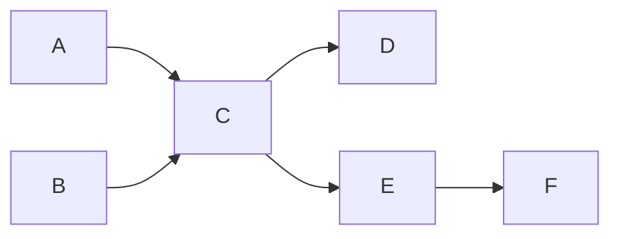
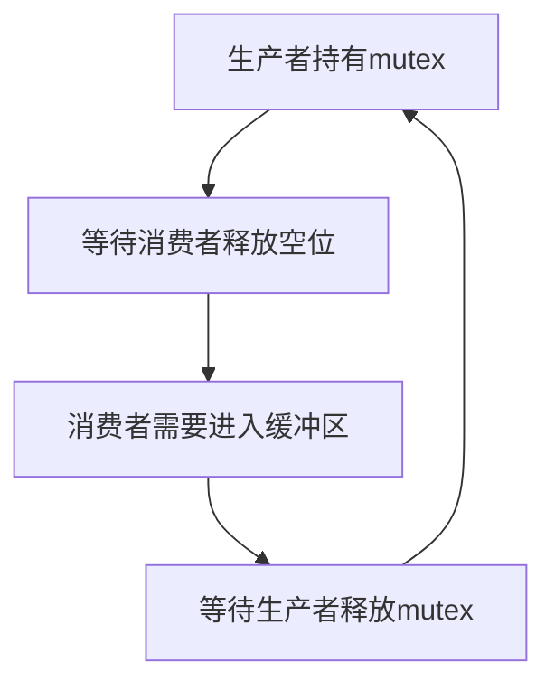
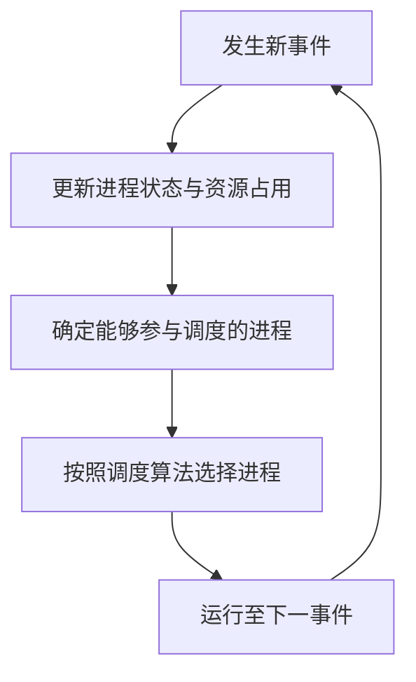
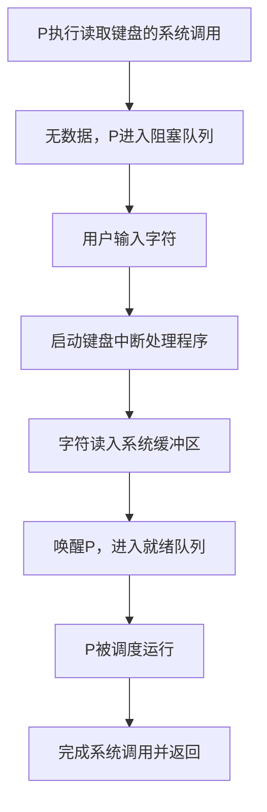

本章归纳14道历年真题与6道模拟题，共20道大题，按核心约束和解题模型分类。

## 一、本章大题的考查规律

### 1. 真题与模拟题的考点分布

| 核心考点          | 真题数量 | 模拟题数量 | 复习优先级 |
| ------------- | ---- | ----- | ----- |
| 生产者与消费者及其变式   | 5    | 4     | S     |
| 前驱关系与简单同步互斥   | 3    | 0     | S     |
| 读者写者与最大并发     | 1    | 1     | S     |
| 死锁与哲学家进餐      | 1    | 0     | A     |
| 软件、硬件互斥机制及原子性 | 2    | 0     | A     |
| 进程调度与状态转换     | 2    | 1     | A     |

这里按照每道题的主要考点归类，其中生产者消费者一类也包括容量限制、资源申请与释放问题。优先级是根据这份题库的考查情况和知识迁移价值划分的，并非对未来考试的概率预测。

在这20道题中，有15道涉及编写P/V同步互斥程序。

因此，**本章最值得投入时间的不是背诵各种经典同步问题的标准代码，而是学会根据陌生题目的约束条件，独立设计信号量和P/V操作。**

### 2. 本章大题的知识体系

| 知识模块   | 必须掌握的底层能力      |
| ------ | -------------- |
| 进程同步   | 分析谁必须等待谁       |
| 进程互斥   | 分析谁不能与谁同时执行    |
| 计数信号量  | 将数量约束转化为资源许可   |
| 生产者消费者 | 分析资源的产生、消耗与回收  |
| 读者写者   | 实现组内共享、组间互斥    |
| 死锁     | 判断等待关系能否形成闭环   |
| 原子性    | 分析指令被交叉执行后的结果  |
| 进程调度   | 维护进程状态、资源和剩余时间 |

这些知识看起来是八个模块，实际上彼此紧密相关。

尤其是P/V大题，几乎都可以归结为三个问题：

**什么条件下允许执行？执行时需要独占什么资源？执行结束后给谁创造了新的执行条件？**

## 二、P/V操作的本质：管理执行许可

信号量可理解为一种**执行许可证**。

### 1. P操作和V操作究竟在做什么？

| 操作      | 本质               |
| ------- | ---------------- |
| `P(S)`  | 申请一个执行许可，没有许可就等待 |
| `V(S)`  | 归还或产生一个执行许可      |
| `S = 0` | 初始没有执行许可         |
| `S = 1` | 初始有一个执行许可        |
| `S = n` | 初始有 $n$ 个执行许可    |

注意，这里是从资源许可角度理解信号量。记录型信号量的内部数值可以为负，负值的绝对值通常表示等待进程数。

例如，一个缓冲区可以存放100件产品，初始为空。

```c
semaphore empty = 100;
semaphore full = 0;
semaphore mutex = 1;
```

三个信号量实际上管理三种不同的许可：

| 信号量     | 管理的许可    |
| ------- | -------- |
| `empty` | 放入产品的许可  |
| `full`  | 取出产品的许可  |
| `mutex` | 独占缓冲区的许可 |

生产者每放入一个产品，就是消耗一个空位许可、产生一个取出许可。

消费者每取出一个产品，就是消耗一个取出许可、产生一个空位许可。

所以生产者消费者模型的本质是：

$$
\text{空位}\xrightarrow{\text{生产者}}\text{产品}
$$

$$
\text{产品}\xrightarrow{\text{消费者}}\text{空位}
$$

信号量是在维护这种资源转换关系。

### 2. 如何确定信号量的初值？

“同步为0，互斥为1”仅适用于部分情况。

应当问：**系统刚开始运行时，已经拥有多少个对应的执行许可？**

| 题目条件                     | 信号量初值         |
| ------------------------ | ------------- |
| 等待A操作完成后才能执行B            | 0             |
| 互斥使用一台打印机                | 1             |
| 博物馆最多容纳500人，初始无人         | 500           |
| 容量为 $N$ 的缓冲区，初始有 $k$ 件产品 | `full = k`    |
| 同上，空闲位置数                 | `empty = N-k` |
| 有 $m$ 个同类可分配资源           | $m$           |

2013年真题的博物馆、2015年真题的双信箱辩论，考查的都是这个原理。

### 3. P/V大题通用五步解题法

| 步骤        | 思考内容                   |
| --------- | ---------------------- |
| 第一步：找执行主体 | 有哪些进程或线程？每个主体执行什么操作？   |
| 第二步：找执行条件 | 每个操作必须满足什么条件才能执行？      |
| 第三步：定义信号量 | 为资源数量、前驱事件、互斥关系设置许可    |
| 第四步：安排P/V | 使用资源前P，产生或归还许可后V       |
| 第五步：检查正确性 | 是否越界、读空、覆盖、死锁或不必要地串行化？ |

## 三、核心题型一：前驱关系与操作顺序

**重要程度：★★★★★**

对应题库：2020年真题、2022年真题、2024年真题。

### 1. 核心原理：把前驱关系变成信号量

假设操作B必须在操作A完成之后执行，即：

$$
A\rightarrow B
$$

设置：

```c
semaphore S = 0;
```

两个进程分别执行：

```text
进程1：
    A;
    V(S);

进程2：
    P(S);
    B;
```

这个模型特别重要，因为复杂的同步关系，本质上就是若干个简单前驱关系的组合。

记住：

<Callout type="idea" title="前驱同步">

**前驱操作完成后V，后继操作开始前P。**

</Callout>

### 2. 代表题：2022年408真题

线程T1执行A、E、F，线程T2执行B、C、D，要求满足以下前驱关系。



<Steps>

<Step>

### 识别跨线程依赖

先把操作按照所属线程划分。

| 前驱关系  | 是否跨线程 | 是否需要额外同步 |
| ----- | ----- | -------- |
| A → C | 是     | 需要       |
| B → C | 否     | 不需要      |
| C → D | 否     | 不需要      |
| C → E | 是     | 需要       |
| E → F | 否     | 不需要      |

同一个线程内部已经通过程序的顺序执行保证了操作顺序，因此只需要两个信号量。

</Step>

<Step>

### 编写P/V程序

```c
semaphore S_AC = 0;  // A完成后允许C执行
semaphore S_CE = 0;  // C完成后允许E执行

T1() {
    A;
    V(S_AC);

    P(S_CE);
    E;
    F;
}

T2() {
    B;
    P(S_AC);

    C;
    V(S_CE);

    D;
}
```

</Step>

<Step>

### 检查并发性

T2不必等待A完成才开始B，因为A和B可以并发执行。

因此，`P(S_AC)` 应该放在B之后、C之前。

同理，T1只需要在执行E之前等待C，不需要等待D。

添加不必要的等待条件可能降低并发程度。

**同步的目标不是让所有操作按顺序串行执行，而是只限制必须限制的顺序。**

</Step>

</Steps>

### 3. 延伸：2024年真题为什么不需要mutex？

2024年真题第（2）问中，缓冲区初始为空，P1写入一次，P2读取一次，要求使用尽可能少的信号量。

答案只需要：

```c
semaphore S = 0;

P1() {
    写入缓冲区;
    V(S);
}

P2() {
    P(S);
    读取缓冲区;
}
```

原因是这两个操作已经被同步关系强制分开，不可能同时访问缓冲区。

如果再添加一个互斥信号量，就是多余的。

而第（3）问要求两个进程分别修改已经存在的数据，没有固定的先后顺序，此时只需要：

```c
semaphore mutex = 1;
```

#### 必须掌握的结论

| 关系              | 解题方法        |
| --------------- | ----------- |
| A必须先于B          | 初值为0的事件信号量  |
| A、B不能同时执行，但先后不限 | 初值为1的互斥信号量  |
| 同线程顺序执行         | 通常无需额外信号量   |
| 已有同步关系保证不重叠访问   | 无需重复设置互斥锁   |
| 一个操作必须等待多个前驱    | 等待所有必要的前驱完成 |

## 四、核心题型二：生产者消费者及其变式

**重要程度：★★★★★**

这是整章最重要、变化最多的题型。

### 1. 必须彻底掌握的基础模型

```c
semaphore empty = N;
semaphore full = 0;
semaphore mutex = 1;

Producer() {
    while (true) {
        produce();

        P(empty);
        P(mutex);

        put();

        V(mutex);
        V(full);
    }
}

Consumer() {
    while (true) {
        P(full);
        P(mutex);

        get();

        V(mutex);
        V(empty);

        consume();
    }
}
```

#### 为什么必须先P(empty)，再P(mutex)？

假设缓冲区已满，而生产者错误地执行：

```text
P(mutex);
P(empty);
```

生产者先占有缓冲区的互斥锁，再等待空位。

消费者虽然可以申请到产品许可，却无法取得互斥锁，因此无法取出产品、释放空位。



两者互相等待，形成死锁。

所以，通常要先申请资源数量许可，再获取保护该资源的互斥锁。

更深层的原则是：

<Callout type="warn" title="持锁等待">

**不能在持有某个锁时，等待一个必须由其他进程取得该锁才能创造的条件。**

</Callout>

这条原则比简单背诵“先同步后互斥”更加通用。

#### 为什么produce和consume通常放在临界区之外？

因为生产产品和消费已经取出的产品通常不访问共享缓冲区。

如果将这些操作全部放在锁内，会让原本可以并发执行的操作变成串行执行。

临界区应该只覆盖必要的共享资源操作。

### 2. 代表题：2014年408真题——连续取出10件产品

题目概要：

多个生产者、多个消费者共享一个容量为1000的缓冲区，要求一个消费者连续取出10件产品后，其他消费者才能取产品。

#### 最关键的分析

题目实际上存在两种不同层次的互斥。

| 互斥信号量            | 保护对象        | 保护范围      |
| ---------------- | ----------- | --------- |
| `mutex_buffer`   | 缓冲区         | 单次取放产品    |
| `mutex_consumer` | 消费者连续取产品的资格 | 完整的10次取产品 |

#### 正确代码

```c
semaphore empty = 1000;
semaphore full = 0;
semaphore mutex_buffer = 1;
semaphore mutex_consumer = 1;

Producer() {
    while (true) {
        produce();

        P(empty);
        P(mutex_buffer);

        put();

        V(mutex_buffer);
        V(full);
    }
}

Consumer() {
    while (true) {
        P(mutex_consumer);

        for (int i = 0; i < 10; i++) {
            P(full);
            P(mutex_buffer);

            get();

            V(mutex_buffer);
            V(empty);
        }

        V(mutex_consumer);
    }
}
```

#### 为什么需要两个互斥信号量？

假设缓冲区当前只有3件产品。

消费者A取得消费者资格后，取走这3件产品。随后，它还需要等待生产者继续生产7件产品。

此时必须允许生产者访问缓冲区，但不能允许消费者B取产品。

所以消费者A可以继续持有 `mutex_consumer`，却不能一直持有 `mutex_buffer`。

这个区别就是本题的核心。

#### 从本题学到的通用方法

当题目出现“连续执行若干次”“一组操作期间不允许其他同类进程介入”等描述时，要考虑额外设置一个保护完整操作组的信号量。

| 题目变式        | 解法      |
| ----------- | ------- |
| 一个消费者连续取10件 | 消费者组操作锁 |
| 一个生产者连续放5件  | 生产者组操作锁 |
| 一个人连续完成3项业务 | 业务操作组锁  |
| 单次访问共享数据    | 共享资源互斥锁 |

不要把不同范围、不同对象的互斥关系混为一谈。

### 3. 其他生产者消费者变式的本质

题库中还有几道非常值得理解、但不必逐题背代码的题。

| 题目来源     | 新增条件               | 应对方法                       |
| -------- | ------------------ | -------------------------- |
| 2009年真题  | 消费者分别取奇数、偶数        | 将`full`拆成`odd`与`even`      |
| 2011年真题  | 银行取号、10个座位、营业员叫号   | 空座位许可、等待顾客许可、叫号许可及取号机互斥    |
| 2013年真题  | 最多500人，出入口一次只能通过一人 | 容量许可与出入口互斥分开               |
| 2015年真题  | 双方通过两个信箱通信         | 每个信箱分别维护`empty/full/mutex` |
| 模拟第2套45题 | 装配需要1个A和3个B        | 按零件类别申请对应数量的许可             |
| 模拟第7套45题 | 三个进程通过两个缓冲区逐级传递数据  | 每个缓冲区设置独立的`empty/full`     |

#### 特别理解：模拟第2套的装配问题

装配需要1件A和3件B，那么装配线的执行条件就是：

```text
P(fullA);

P(fullB);
P(fullB);
P(fullB);

P(mutex);
取走1件A和3件B;
V(mutex);

assemble();

V(emptyA);

V(emptyB);
V(emptyB);
V(emptyB);
```

这里的三次P操作并不是特殊技巧，而是因为需要消耗三个B产品许可。

题目如果规定装配完成才能开始下一轮，那么空位许可就必须在装配结束之后释放。

如果规定取走零件就可以开始下一轮，则可以在取走零件后立即释放空位许可。

**同一个信号量的V操作应该放在哪里，取决于题目对资源释放时机的定义。**

## 五、核心题型三：将数学约束转化为信号量

**重要程度：★★★★★**

### 代表题：模拟第1套第45题

两个生产者A、B和一个销售者C共享无限容量的仓库，要求累计生产量满足：

$$
-n\leq N_A-N_B\leq m
$$

其中 $N_A$、$N_B$ 分别表示从程序开始至当前时刻A、B的累计生产量。

要求设计P/V程序，保证上述限制始终成立。

<Steps>

<Step>

### 辨析库存与累计量

普通生产者消费者模型维护的是仓库当前库存量。

但是这道题限制的是累计生产量的差值。

销售者取走一个产品，会减少库存，但不会减少累计生产量。

所以必须使用新的信号量来描述累计生产量约束。

</Step>

<Step>

### 推导信号量

令：

$$
D=N_A-N_B
$$

原约束变为：

$$
-n\leq D\leq m
$$

A每生产一个产品，$D$ 增加1。A还能继续生产的数量上限为：

$$
allowA=m-D
$$

B每生产一个产品，$D$ 减少1。B还能继续生产的数量上限为：

$$
allowB=n+D
$$

因此可以得到：

$$
allowA=m-N_A+N_B
$$

$$
allowB=n+N_A-N_B
$$

这是许可余额的推导模型；实际并发执行时，已经申请但尚未完成的操作也会暂时占用许可。

初始时：

$$
N_A=N_B=0
$$

所以：

$$
allowA=m,\qquad allowB=n
$$

</Step>

<Step>

### 编写P/V程序

| 操作      | 差值变化  | 信号量操作                      |
| ------- | ----- | -------------------------- |
| A生产一个产品 | $D+1$ | `P(allowA)`，完成后`V(allowB)` |
| B生产一个产品 | $D-1$ | `P(allowB)`，完成后`V(allowA)` |
| C销售一个产品 | $D$不变 | 不操作`allowA/allowB`         |

再加上仓库互斥和已有产品数量，就得到了完整答案。

```c
semaphore allowA = m;
semaphore allowB = n;
semaphore products = 0;
semaphore mutex = 1;

A() {
    while (true) {
        P(allowA);
        produceA();

        P(mutex);
        putA();
        V(mutex);

        V(products);
        V(allowB);
    }
}

B() {
    while (true) {
        P(allowB);
        produceB();

        P(mutex);
        putB();
        V(mutex);

        V(products);
        V(allowA);
    }
}

C() {
    while (true) {
        P(products);

        P(mutex);
        get();
        V(mutex);

        sell();
    }
}
```

</Step>

<Step>

### 检验许可余额

设 $m=2,n=1$。

初始状态下，各生产动作都完成了相应P/V操作时，许可余额如下：

| 已完成的生产操作 | $N_A-N_B$ | allowA | allowB |
| -------- | --------- | ------ | ------ |
| 初始       | 0         | 2      | 1      |
| A生产一次    | 1         | 1      | 2      |
| A再生产一次   | 2         | 0      | 3      |
| B生产一次    | 1         | 1      | 2      |
| B再生产一次   | 0         | 2      | 1      |
| B再生产一次   | -1        | 3      | 0      |

当差值到达上界时，A不能继续生产；当差值到达下界时，B不能继续生产。

两种许可在完成的生产操作之间相互转化。

</Step>

</Steps>

#### 5. 提炼出的万能方法

如果遇到形如：

$$
L\leq X\leq U
$$

的数量限制，可以尝试构造两类许可：

$$
S_{\text{增加}}=U-X
$$

$$
S_{\text{减少}}=X-L
$$

每增加一次 $X$，就消耗一个增加许可，产生一个减少许可；每减少一次 $X$，就进行相反的操作。

这个模型可以解决生产数量差、流水线进度差、有限超前执行等多种问题。

**遇到数学不等式时，不要生硬套用empty和full，而应该先从约束中推导出“还允许执行多少次”。**

## 六、核心题型四：资源的生命周期与多消费者问题

**重要程度：★★★★★**

### 代表题：模拟第5套第45题——广播缓冲区

题目有多个发送进程、多个接收进程，共享 $m$ 个缓冲区。

特殊要求是：每一条消息都必须被所有 $n_2$ 个接收进程分别读取一次，所有接收者都读完后，缓冲区才能重新使用。

#### 1. 普通生产者消费者模型为什么失效？

| 普通消费模型        | 广播消费模型         |
| ------------- | -------------- |
| 一件产品由一个消费者取走  | 一条消息由所有消费者读取   |
| 取走后立即释放缓冲区    | 最后一人读完才能释放     |
| 所有消费者共享`full` | 每个消费者需要独立的读取许可 |
| 一个公共读取位置      | 每个消费者有独立的读取位置  |

这道题改变的是资源的生命周期。


#### 2. 如何设计共享变量？

| 变量          | 初值  | 作用                |
| ----------- | --- | ----------------- |
| `empty`     | $m$ | 可重用缓冲区数量          |
| `ready[j]`  | 0   | 接收者j的未领取读取许可      |
| `mutex`     | 1   | 保护缓冲区及共享计数        |
| `remain[k]` | 0   | 第k条槽位中的消息还需要多少人读取 |
| `tail`      | 0   | 下一次写入位置           |
| `head[j]`   | 0   | 接收者j的下一次读取位置      |

关键代码如下，利用题目规定的所有接收者按统一发送顺序读取的条件。

```c
Sender() {
    while (true) {
        msg = make_message();

        P(empty);
        P(mutex);

        buffer[tail] = msg;
        remain[tail] = n2;
        tail = (tail + 1) % m;

        for (int j = 0; j < n2; j++)
            V(ready[j]);

        V(mutex);
    }
}

Receiver(int j) {
    while (true) {
        P(ready[j]);
        P(mutex);

        int k = head[j];
        msg = copy(buffer[k]);
        head[j] = (head[j] + 1) % m;

        remain[k]--;

        if (remain[k] == 0)
            V(empty);

        V(mutex);

        process(msg);
    }
}
```

其中 `msg` 是进程私有的消息副本。

#### 3. 必须理解的三个关键点

**第一，每个接收者必须具有独立的读取许可。**

如果大家共享一个`full`，可能一个速度较快的接收者领取了多次许可，而另一个接收者没有读取机会。

**第二，必须记录每条消息还剩多少消费者未读。**

仅记录总读取次数是不够的，因为不同消息的读取进度可能不同。

**第三，最后一个读者才能释放资源。**

因此必须判断：

```c
remain[k]--;

if (remain[k] == 0)
    V(empty);
```

这种方法称为引用计数思想。

#### 知识迁移

独立许可与引用计数适用于以下场景：

- 每份数据必须被所有线程读取。
- 每个任务必须经过多个参与者处理。
- 所有使用者完成工作后才能回收资源。
- 共享数据只能在最后一个使用者离开后释放。

这也是下面读者写者问题的核心思想之一。

## 七、核心题型五：读者写者与最大限度并发

**重要程度：★★★★★**

对应题库：2017年真题、模拟第3套第45题。

### 1. 读者写者模型的本质

普通互斥要求所有访问者一次只能进入一个，而读者写者问题并非如此。

| 操作组合 | 是否允许同时执行 |
| ---- | -------- |
| 读与读  | 允许       |
| 读与写  | 不允许      |
| 写与写  | 不允许      |

本质上要求实现：

**组内共享，组间互斥。**

实现组内共享最重要的技巧就是：

<Callout type="idea" title="首进末出">

**第一个成员申请资源，最后一个成员释放资源。**

</Callout>

### 2. 代表题：模拟第3套第45题——猴子过绳索

南行和北行的猴子不能同时使用绳索，但同方向允许多个猴子同时通过。

如果给所有猴子设置一个 `rope=1`，然后每只猴子过绳索之前执行P，结束后执行V，就会变成每次只能通过一只猴子。

虽然安全，但不满足题目的并发要求。

#### 正确建模

设置：

```c
semaphore rope = 1;
semaphore mutexN = 1;
semaphore mutexS = 1;

int north = 0;
int south = 0;
```

北行猴子代码：

```c
GoNorth() {
    P(mutexN);

    north++;
    if (north == 1)
        P(rope);

    V(mutexN);

    crossNorth();

    P(mutexN);

    north--;
    if (north == 0)
        V(rope);

    V(mutexN);
}
```

南行猴子执行完全对称的程序，使用 `south` 和 `mutexS`，但两种方向共享同一个 `rope`。

#### 第一个和最后一个成员为什么如此重要？

| 北行成员数量变化 | 对绳索的操作 |
| -------- | ------ |
| 0 → 1    | 申请绳索   |
| 1 → 2    | 无需再次申请 |
| 2 → 3    | 无需再次申请 |
| 3 → 2    | 不释放绳索  |
| 2 → 1    | 不释放绳索  |
| 1 → 0    | 释放绳索   |

注意，这里的计数还可能包含正在申请绳索的首个成员，因此不应机械地认为它在每一条指令执行期间都等于绳索上的实际猴子数量。

#### 为什么计数器也需要互斥？

因为 `north++` 并不天然具有原子性。

多个进程同时执行计数操作可能发生更新丢失，还可能无法正确识别哪个是第一个、哪个是最后一个。

因此：

- `rope` 保护绳索的组间互斥。
- `mutexN` 保护北行计数。
- `mutexS` 保护南行计数。

它们是不同层次的互斥关系。

#### 这个算法还有什么问题？

可能发生饥饿。

如果北行猴子源源不断地到达，使得北行计数始终无法降为0，南行猴子就可能长期等待。

解决办法是增加一个公共入口信号量：

```c
semaphore turnstile = 1;
```

两种方向都在各自进入区之前执行 `P(turnstile)`，在进入区完成之后执行 `V(turnstile)`，退出绳索时不经过这个入口。

这样，当一个反方向成员占有入口等待绳索时，其他同方向的新成员不能继续加入，原来的队伍就可以逐渐清空。

严格的无饥饿保证还需要公平的信号量唤醒或排队机制。

### 3. 延伸：2017年真题的最大限度并发

2017年真题中三个线程对全局变量的访问关系如下。

| 线程      | 变量x | 变量y | 变量z |
| ------- | --- | --- | --- |
| thread1 | 读   | 读   | 无   |
| thread2 | 无   | 读   | 读   |
| thread3 | 无   | 读写  | 读写  |

只需要识别真正冲突的访问。

| 冲突关系            | 需要保护的资源 |
| --------------- | ------- |
| thread1与thread3 | y       |
| thread2与thread3 | y       |
| thread2与thread3 | z       |
| thread1与thread2 | 无冲突     |

按照题库参考答案，可以为上述三种冲突分别设置互斥信号量：

```c
semaphore y13 = 1;
semaphore y23 = 1;
semaphore z23 = 1;
```

thread1读取y时只申请`y13`，thread2读取y时申请`y23`，thread3修改y时同时申请这两个信号量。

thread2与thread3对z的冲突由`z23`控制。

这样thread1和thread2仍然可以同时读取y。

**当题目要求最大限度并发时，不仅要检查有没有遗漏互斥关系，还要检查有没有添加不必要的互斥关系。**

这一点经常比单纯实现正确性更难。

## 八、核心题型六：死锁与资源分配

**重要程度：★★★★☆**

### 1. 死锁的本质是无法解除的循环等待

死锁产生需要同时满足四个必要条件：

| 条件    | 含义                |
| ----- | ----------------- |
| 互斥    | 资源不能同时被多个进程占用     |
| 请求并保持 | 已占有资源，同时继续申请其他资源  |
| 不可剥夺  | 资源不能被其他进程强行取走     |
| 循环等待  | 多个进程形成首尾相接的资源等待关系 |

大题中最常用的解决方法是破坏循环等待条件。

### 2. 代表题：2019年408真题——带碗的哲学家进餐问题

有 $n$ 个哲学家、$n$ 根筷子、$m$ 个碗。

每个哲学家必须同时获得一个碗和左右两根筷子才能进餐。要求避免死锁，并允许尽可能多的人同时进餐。

<Tabs items={['错误方案', '正确方案']}>

<Tab value="错误方案">

```text
P(chopstick[i]);
P(chopstick[(i+1)%n]);
eat();
```

当所有哲学家都取得一根筷子，并等待另一根筷子时，就会形成循环等待。

</Tab>

<Tab value="正确方案">

利用碗作为进入筷子竞争阶段的许可：

$$
bowl=\min(m,n-1)
$$

```c
semaphore bowl = min(m, n-1);
semaphore chopstick[n];  // 每个初值为1

Philosopher(int i) {
    while (true) {
        think();

        P(bowl);
        P(chopstick[i]);
        P(chopstick[(i+1)%n]);

        eat();

        V(chopstick[(i+1)%n]);
        V(chopstick[i]);
        V(bowl);
    }
}
```

</Tab>

</Tabs>

#### 为什么限制为 $(n-1)$？

如果最多只有 $n-1$ 个哲学家进入筷子竞争阶段，那么至少有一个哲学家没有参与竞争。

所有人各持一根筷子并围成完整等待环的状态就不会出现。

在题目给定的圆桌资源分配模型下，可以破坏循环等待条件。

#### 为什么还要与 $m$ 取最小值？

因为真实的碗也只有 $m$ 个，不能凭空产生更多资源。

同时进餐人数受碗和筷子两种资源限制，理论最大值为：

$$
\min\left(m,\left\lfloor\frac n2\right\rfloor\right)
$$

而 $n-1$ 限制的是参与筷子竞争阶段的人数，不是同时真正进餐的人数。

这两个数量不能混淆。

### 3. 死锁相关计算题也必须掌握

原题库未单独收录银行家算法综合计算题；以下内容为知识补充。

#### 银行家算法

首先计算尚需资源：

$$
Need=Max-Allocation
$$

然后令：

$$
Work=Available
$$

不断寻找满足以下条件的未完成进程：

$$
Need_i\leq Work
$$

假设该进程可以运行至结束并释放资源：

$$
Work\leftarrow Work+Allocation_i
$$

若最终所有进程都能够完成，则存在安全序列。

如果进程提出资源请求，还应当先判断请求不超过其剩余需求，也不超过当前可用资源，再试分配并检查安全性。

#### 单类资源避免死锁的计算

若有 $n$ 个进程，每个最多需要 $k$ 个同类资源，在资源逐个申请、完成后释放的标准模型下，保证不发生资源死锁所需的最少资源数为：

$$
\boxed{R_{\min}=n(k-1)+1}
$$

为什么？

最坏情况下，每个进程都已经获得 $k-1$ 个资源，却还差一个才能执行完毕。

此时再增加一个资源，就能至少满足其中一个进程，使其完成并释放资源，其他进程便有机会继续执行。

如果各进程的最大需求不同，则推广为：

$$
R_{\min}=\sum_{i=1}^{n}(k_i-1)+1
$$

## 九、核心题型七：原子性与硬件互斥机制

**重要程度：★★★★☆**

对应题库：2021年真题、2023年真题。

### 1. 原子性为什么重要？

假设共享变量初始为：

$$
S=1
$$

两个线程同时执行：

```text
S = S - 1;
```

如果把这条语句拆分成读取、计算和写回三个步骤，就可能发生以下情况。

| 执行步骤 | 线程A   | 线程B   |
| ---- | ----- | ----- |
| 1    | 读取S=1 |       |
| 2    |       | 读取S=1 |
| 3    | 计算结果0 |       |
| 4    |       | 计算结果0 |
| 5    | 写回0   |       |
| 6    |       | 写回0   |

执行了两次减1，最终却得到0，而不是两次减法顺序执行应得到的 $-1$。

这就是更新丢失。

如果两个线程通过这种方式申请同一个资源，就可能错误地认为自己都获得了资源。

**原子性要求其他线程不能观察或干扰一个原子操作的中间执行状态。**

### 2. 2023年真题：swap指令实现互斥

正确的代码是：

```c
bool lock = FALSE;   // 共享变量

bool key = TRUE;     // 线程私有变量

while (key == TRUE)
    swap(key, lock);

临界区;

lock = FALSE;
```

#### 理解swap的执行过程

| 交换前lock | 交换前key | 交换后lock | 交换后key | 结果        |
| ------- | ------ | ------- | ------ | --------- |
| FALSE   | TRUE   | TRUE    | FALSE  | 成功获取锁     |
| TRUE    | TRUE   | TRUE    | TRUE   | 获取失败，继续等待 |

这里有两个重要结论。

第一，必须使用`while`而不是`if`。因为一次获取锁失败后，线程需要继续等待，不能直接进入临界区。

第二，普通交换函数不能替代具有原子性的硬件swap指令。

```c
void newSwap(bool *a, bool *b) {
    bool temp = *a;
    *a = *b;
    *b = temp;
}
```

这个函数可能在执行过程中被其他线程打断，导致多个线程错误地获得锁。

判断此类题目时，要关注的不是程序在顺序执行时能否实现交换，而是**并发交叉执行时是否仍然正确**。

### 3. 2021年真题：开关中断实现信号量

错误方案：

```c
关中断;

while (S <= 0);

S--;

开中断;
```

如果 $S\leq 0$，在题目所采用的单处理机模型下，当前进程会不断忙等。

由于中断关闭，其他进程无法通过正常的抢占调度获得CPU并执行V操作，因此S无法得到更新。

改进方案：

```c
关中断;

while (S <= 0) {
    开中断;
    关中断;
}

S--;

开中断;
```

等待过程中暂时打开中断，为其他进程获得CPU并释放资源创造机会。

#### 考试必须区分的概念

| 概念                | 核心结论                       |
| ----------------- | -------------------------- |
| 关中断               | 可以在适当的单处理机内核场景下防止当前代码被中断抢占 |
| 多处理机              | 仅关闭本CPU中断不能阻止其他CPU访问共享资源   |
| 开关中断指令            | 属于特权指令                     |
| Test-and-Set、Swap | 利用硬件原子操作实现互斥               |
| 整型信号量             | 可能产生忙等                     |
| 记录型信号量            | 资源不足时可以阻塞等待                |
| 原子性               | 不等于一条C语言语句                 |

## 十、核心题型八：进程调度与状态转换

**重要程度：★★★★☆**

### 1. 调度题的本质：维护状态，而不是背诵算法

所有进程调度题都应该按照以下逻辑求解。



最关键的是第三步。

<Callout type="warn" title="调度前先判断就绪条件">

**进程已经到达，不代表进程已经就绪；进程优先级最高，也不代表它现在能够运行。**

</Callout>

### 2. 代表题：模拟第4套第45题

系统有100K内存和1台打印机，使用可抢占的最短剩余时间优先算法SRTF。打印机采用静态分配，在进程结束时才释放。

| 进程 | 到达时刻 | 执行时间 | 内存需求 | 打印机需求 |
| -- | ---- | ---- | ---- | ----- |
| P1 | 0    | 8    | 15K  | 1     |
| P2 | 4    | 4    | 30K  | 1     |
| P3 | 10   | 1    | 60K  | 0     |
| P4 | 11   | 20   | 20K  | 1     |
| P5 | 16   | 14   | 10K  | 1     |

#### 关键事件分析

| 时刻 | 分析                     | 调度结果 |
| -- | ---------------------- | ---- |
| 0  | P1获得资源                 | P1   |
| 4  | P2到达，但打印机被P1占用         | P1继续 |
| 8  | P1结束并释放资源              | P2   |
| 10 | P3可装入内存，执行时间1小于P2剩余时间2 | P3抢占 |
| 11 | P3结束，P4无法获得打印机         | P2恢复 |
| 13 | P2结束并释放打印机             | P4   |
| 16 | P5到达，但无法获得打印机          | P4继续 |
| 33 | P4结束                   | P5   |
| 47 | P5结束                   | 全部完成 |

CPU运行时间线：

```text
0       8   10  11  13         33        47
|  P1   | P2 |P3| P2 |    P4    |    P5   |
```

因此，总历时为：

$$
T=8+4+1+20+14=47
$$

本题没有CPU空闲时间。

#### 本题最容易出错的地方

时刻16，P4已经运行3个时间单位，因此剩余时间为：

$$
20-3=17
$$

而P5只需要14个时间单位。

虽然：

$$
14<17
$$

但P5没有获得打印机，无法进入可调度集合，所以不能抢占P4。

另外，被抢占的进程并不会自动释放它已占有的内存和打印机。

这就是资源分配与CPU调度综合题的解题关键。

### 3. 调度计算题的常用公式

设进程到达时间为 $A_i$，完成时间为 $C_i$，首次运行时间为 $F_i$，CPU服务时间为 $B_i$。

| 指标       | 计算公式                              |
| -------- | --------------------------------- |
| 周转时间     | $T_i=C_i-A_i$                     |
| 带权周转时间   | $W_i=\dfrac{T_i}{B_i}$            |
| 响应时间     | $R_i=F_i-A_i$                     |
| 平均周转时间   | $\overline T=\dfrac{\sum T_i}{n}$ |
| 平均带权周转时间 | $\overline W=\dfrac{\sum W_i}{n}$ |

如果题目中没有I/O阻塞、资源准入等待等其他非CPU运行阶段，则就绪等待时间可以计算为：

$$
T_{\text{wait}}=T_i-B_i
$$

否则不能直接将所有非运行时间都视为就绪等待时间。

高响应比优先算法：

$$
R=\frac{\text{等待时间}+\text{服务时间}}{\text{服务时间}}
$$

即：

$$
R=1+\frac{\text{等待时间}}{\text{服务时间}}
$$

它通过提高长期等待进程的响应比，兼顾短作业和长作业。

### 4. 2016年真题：动态优先级与饥饿

题目规定优先数越小，越容易获得CPU，并要求利用 `nice`、`cpuTime`、`waitTime` 设计动态优先数。

最直接的答案为：

$$
\boxed{
priority=nice+\alpha\cdot cpuTime-\beta\cdot waitTime
}
$$

其中：

$$
\alpha>0,\qquad\beta>0
$$

- `nice` 越小，基础优先级越高。
- 运行时间越长，优先数越大，降低调度优先级。
- 等待时间越长，优先数越小，提高调度优先级。

在静态优先数有界、优先数不被过早截断并且调度能够持续进行等通常假设下，这种老化机制有助于避免低优先级进程长期饥饿。

**题库纠错：** 原资料给出的分式公式存在问题。当 `cpuTime=0` 时，其结果可能恒为0，无法正确区分不同就绪进程的静态优先数和等待时间。上面的线性公式可以避免该问题。

### 5. 2023年真题：系统调用与进程状态转换

进程P通过系统调用等待键盘输入。

正确过程是：



这道题要彻底区分四件事情。

| 事件          | 本质        |
| ----------- | --------- |
| 进程请求的资源暂不可用 | 运行态 → 阻塞态 |
| 资源或等待事件已经满足 | 阻塞态 → 就绪态 |
| 调度程序选中就绪进程  | 就绪态 → 运行态 |
| 时间片用完或被抢占   | 运行态 → 就绪态 |

注意：

- 中断发生不等于被唤醒的进程立即运行。
- 进程进入阻塞态后会让出CPU。
- 中断处理程序在内核态执行。
- 键盘驱动程序负责相关的设备数据传送。
- 被唤醒的进程还要等待调度，之后才能完成系统调用。

## 十一、P/V大题最常见的12个错误

这部分适合在考试之前反复复习。

| 常见错误            | 正确理解            |
| --------------- | --------------- |
| 所有同步信号量初值都是0    | 初值取决于初始许可数量     |
| 所有进程共用一个mutex   | 应分析实际的共享对象和冲突关系 |
| 先锁住缓冲区再等待产品     | 可能导致持锁等待死锁      |
| 把生产、消费全部放进临界区   | 降低并发程度          |
| 连续取10件时一直锁住缓冲区  | 生产者无法补充产品，可能死锁  |
| 不同类别产品共享一个full  | 无法正确区分消费条件      |
| 一个资源被读取一次就释放    | 广播模型需要最后一个读者释放  |
| 每个读者都申请资源独占锁    | 无法实现同类成员并发      |
| 不保护共享计数器        | 可能产生竞争条件        |
| 同线程操作之间添加同步量    | 通常属于多余同步        |
| 已有顺序约束仍重复加mutex | 浪费信号量、可能增加不必要限制 |
| 没有死锁就认为没有饥饿     | 活性、公平性与互斥正确性不同  |

还要注意，某些锁可以在等待其他条件时继续持有。例如2014年真题中，消费者可以持有消费者组操作锁等待产品，因为生产者补充产品不需要该锁。

所以不能机械地使用“所有P操作都必须放在互斥锁之前”这样的规则。应当根据实际依赖关系判断。

## 十二、最值得反复做的6道代表题

以下6道代表题覆盖大部分核心同步模型。

| 推荐顺序 | 题目         | 必须掌握的能力        | 重要程度  |
| ---- | ---------- | -------------- | ----- |
| 1    | 2022年408真题 | 前驱关系与最少同步量     | ★★★★★ |
| 2    | 2014年408真题 | 多层次互斥、生产者消费者变式 | ★★★★★ |
| 3    | 模拟第1套45题   | 从数学约束推导信号量     | ★★★★★ |
| 4    | 模拟第3套45题   | 首进末出、组内共享、饥饿   | ★★★★★ |
| 5    | 模拟第5套45题   | 独立读取许可、引用计数    | ★★★★★ |
| 6    | 2019年408真题 | 多资源分配与死锁预防     | ★★★★☆ |

完成这些题后，再使用模拟第4套检验调度综合计算能力，使用2021年、2023年真题检验原子性和硬件互斥知识。

## 十三、最终解题思维：把P/V题当作资源转换题

整个第2章最值得记住的，是下面这张表。

| 看到题目中的描述      | 应立即想到              |
| ------------- | ------------------ |
| 必须在某操作之后执行    | 前驱事件信号量            |
| 最多允许N个        | 初值为N的容量信号量         |
| 一次只允许一个       | 互斥信号量              |
| 按类别取产品        | 分类别的资源信号量          |
| 一次需要多个产品      | 多次申请资源许可           |
| 必须连续执行K次      | 完整操作组互斥            |
| 所有人都必须读取      | 独立读取许可             |
| 最后一个使用者才能释放   | 引用计数               |
| 同类可以并发，异类不能并发 | 首进末出模型             |
| 两种操作数量之差受限制   | 双向差额许可             |
| 必须同时持有多个资源    | 检查死锁               |
| 尽可能并发         | 缩小临界区、消除无效互斥       |
| 尽可能少的信号量      | 删除已被程序顺序或其他同步保证的约束 |

### 自测练习

独立完成自测后核对答案。

<Accordions>

<Accordion title="为什么生产者不能持有缓冲区锁等待空位？">

消费者无法释放空位，可能死锁

</Accordion>

<Accordion title="为什么连续取10件需要额外的锁？">

单次缓冲区互斥不等于消费者操作组互斥

</Accordion>

<Accordion title="为什么广播模型需要每个消费者独立的ready？">

每个消费者都必须获得一次读取机会

</Accordion>

<Accordion title="为什么读者写者由最后一个读者释放资源？">

其他同组成员可能仍在使用

</Accordion>

<Accordion title="为什么生产量差约束与销售无关？">

销售改变库存，不改变累计生产量

</Accordion>

<Accordion title="为什么最短的进程不一定能抢占？">

必须首先具备就绪和资源条件

</Accordion>

<Accordion title="为什么普通交换函数不能实现硬件swap互斥？">

不具备原子性

</Accordion>

</Accordions>

### 四种解题思维

操作系统第2章的大题，最重要的不是掌握几十种P/V代码，而是形成四种底层思维：

**① 许可思维：** P是消耗许可，V是产生或归还许可。

**② 约束思维：** 从题目中的数量、顺序和互斥条件直接推导信号量。

**③ 生命周期思维：** 明确资源什么时候被申请、什么时候被使用、什么时候真正能够释放。

**④ 并发思维：** 既要保证程序正确，又不能不必要地限制并发，同时检查死锁与饥饿。
