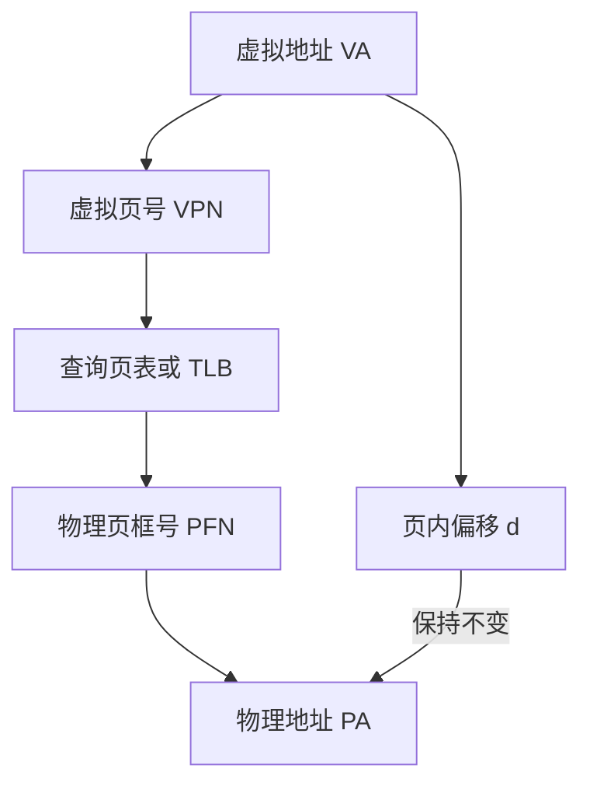
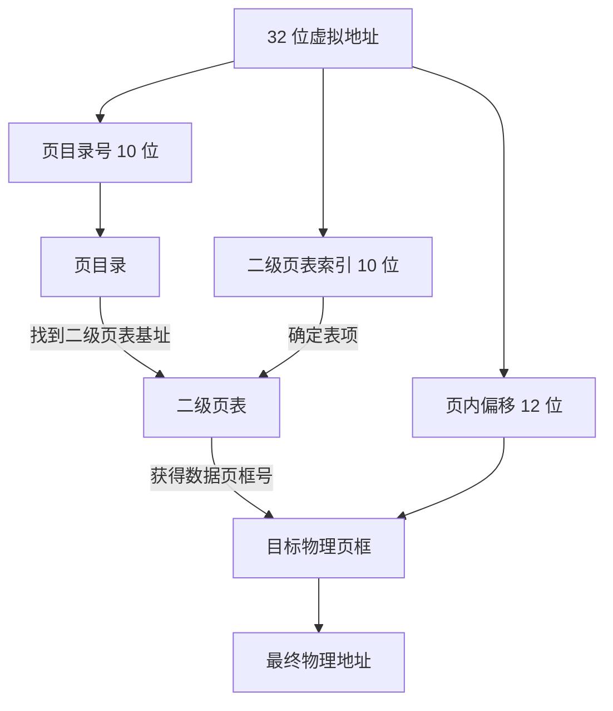
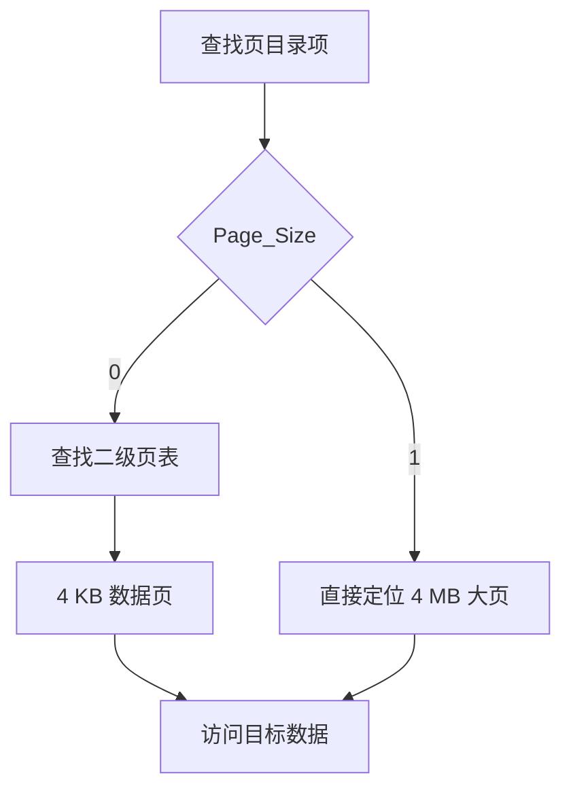
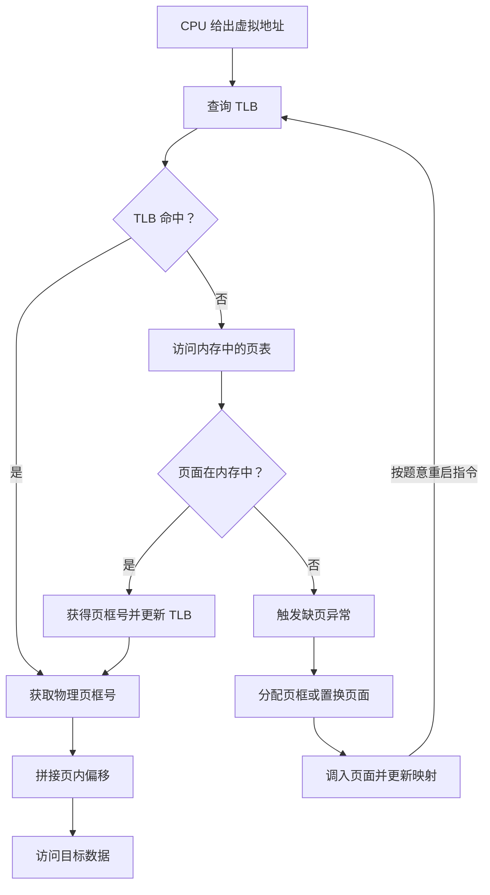
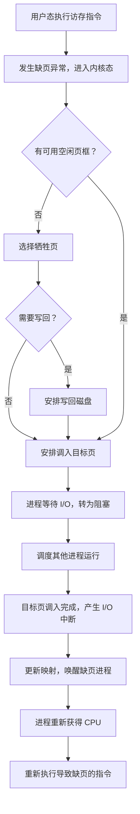
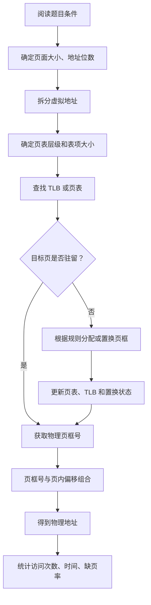

本章归纳9道历年真题（2009、2010、2012、2013、2015、2017、2018、2020、2024年）和4道27王道模拟题（第1、5、6、8套），共13道大题。核心问题是虚拟地址如何转换为物理地址，以及页面未驻留时如何完成访问。

## 一、本章大题的重要程度与命题规律

以下优先级依据原题库的考查内容、知识点复用程度和综合解题价值，不代表未来考试概率。

| 核心考点                | 重要程度  | 对应代表题目            |
| ------------------- | ----- | ----------------- |
| 虚拟地址与物理地址转换         | ★★★★★ | 2013、2020、2024 真题 |
| 二级页表与表项地址计算         | ★★★★★ | 2015、2017、2020 真题 |
| TLB、缺页与访存时间         | ★★★★★ | 2009 真题、模拟第8套     |
| FIFO、LRU、CLOCK 页面置换 | ★★★★★ | 2010 真题、模拟第6、8套   |
| 大页与混合页面大小           | ★★★★☆ | 2024 真题、模拟第1套     |
| 缺页异常处理与进程调度         | ★★★★☆ | 模拟第5、6套           |
| 数组存储与程序局部性          | ★★★★☆ | 2020 真题           |
| 页表大小与占用页数           | ★★★★☆ | 2013、2015 真题      |
| 自定义页面回收策略           | ★★★☆☆ | 2012 真题           |
| PDBR、页表项标志位         | ★★★☆☆ | 2018 真题           |

资料中最值得重视的命题趋势，是将**地址转换、页面置换、TLB、异常处理、程序代码**结合起来考查。

复习时应结合完整地址转换与异常处理流程，而非孤立计算页号或模拟置换算法。

## 二、第一核心模型：地址转换的本质

### 1. 分页与地址转换原理

分页实际上是把虚拟地址空间和物理地址空间分别划分为大小相同的块。

虚拟地址空间中的块称为页（Page），物理地址空间中的块称为页框（Page Frame）。

假设页面大小为 $S$，虚拟地址为 $VA$，则：

$$
VA=\underbrace{VPN\times S}_{\text{虚拟页起始地址}}+\underbrace{d}_{\text{页内偏移}}
$$

其中：

- $VPN$：虚拟页号。
- $PFN$：物理页框号。
- $d$：页内偏移量。

通过页表找到虚拟页对应的物理页框后：

$$
PA=PFN\times S+d
$$

整个分页地址转换的本质如下：



<Callout type="idea" title="分页地址转换">

**最重要的结论：地址转换只改变页号，不改变页内偏移。**

</Callout>

因为页面整体被装入一个等大的页框，页面内部各字节之间的相对位置不发生改变。

### 2. 地址计算的万能公式

无论页面大小是多少，都可以使用下面的公式：

$$
VPN=\left\lfloor\frac{VA}{S}\right\rfloor
$$

$$
d=VA\bmod S
$$

$$
PA=PFN\times S+d
$$

如果页面大小为 $2^k$ B，则页内偏移占 $k$ 位。

| 页面大小  | 页内偏移位数 | 十六进制计算特点     |
| ----- | ------ | ------------ |
| 1 KB  | 10 位   | 不能直接按十六进制位切分 |
| 4 KB  | 12 位   | 最后 3 个十六进制数字 |
| 64 KB | 16 位   | 最后 4 个十六进制数字 |
| 4 MB  | 22 位   | 不能直接按十六进制位切分 |

尤其注意：

$$
4\text{ KB}=2^{12}\text{ B}
$$

$$
4\text{ MB}=2^{22}\text{ B}
$$

考试最容易出错的地方之一，就是习惯了 4 KB 页面之后，遇到其他页面大小仍然按照低 12 位划分。

### 3. 必须区分的三个概念

| 概念    | 含义               |
| ----- | ---------------- |
| 页号    | 虚拟地址属于哪一页        |
| 页框号   | 该页实际被存放在哪个物理块中   |
| 页表项地址 | 记录上述映射关系的表项存放在哪里 |

页表就像一个数组，虚拟页号是数组下标，页框号是表项中记录的内容。

如果页表基址为 $PTBR$，每个页表项占 $e$ 字节：

$$
\boxed{PTE_{\text{addr}}=PTBR+VPN\times e}
$$

而真正的数据物理地址为：

$$
\boxed{PA=PFN\times S+d}
$$

这两个公式绝对不能混淆。

前者是去哪里找映射关系，后者是去哪里找真正的数据。

### 4. 代表真题：2013 年 408

题目主要条件：

| 条件          | 数值          |
| ----------- | ----------- |
| 虚拟地址长度      | 32 位        |
| 物理地址长度      | 32 位        |
| 页面大小        | 4 KB        |
| 页表项大小       | 4 B         |
| 代码段起始虚拟地址   | `00008000H` |
| 代码段长度       | 8 KB        |
| 装入物理内存的起始地址 | `00900000H` |
| 页表起始物理地址    | `00200000H` |

要求计算代码段对应的两个页表项地址、页框号等信息。

<Steps>

<Step>

### 确定虚拟页

因为：

$$
8\text{ KB}\div4\text{ KB}=2
$$

且代码段起始地址恰好按页对齐，因此占用两个页面。

| 虚拟页起始地址     | 虚拟页号 |
| ----------- | ---- |
| `00008000H` | `8H` |
| `00009000H` | `9H` |

</Step>

<Step>

### 求页表项地址

第一个页表项：

$$
\texttt{00200000H}+8\times4
=\boxed{\texttt{00200020H}}
$$

第二个页表项：

$$
\texttt{00200000H}+9\times4
=\boxed{\texttt{00200024H}}
$$

</Step>

<Step>

### 求页框号

题目明确说明代码段被装入连续的物理空间。

所以两个页面的物理起始地址分别是：

$$
\texttt{00900000H}
$$

$$
\texttt{00901000H}
$$

去掉低 12 位页内偏移，得到页框号：

$$
\boxed{\texttt{00900H},\quad\texttt{00901H}}
$$

</Step>

</Steps>

#### 页号、表项与页框对照

同一个页面涉及三个不同的位置：

| 虚拟页号 | 页表项物理地址     | 物理页框号    |
| ---- | ----------- | -------- |
| `8H` | `00200020H` | `00900H` |
| `9H` | `00200024H` | `00901H` |

另外，分页本身不要求物理页框连续。本题的两个页框连续，仅仅是因为题目特意给出了连续装入的条件。

#### 拓展：程序占用多少页？

不要机械使用：

$$
\left\lceil\frac{\text{程序长度}}{\text{页面大小}}\right\rceil
$$

如果程序起始地址没有按页对齐，这个公式可能出错。

设程序起始地址为 $a$，长度为 $L$，页面大小为 $S$，则当 $L>0$ 时：

$$
\boxed{
N=
\left\lfloor\frac{a+L-1}{S}\right\rfloor-
\left\lfloor\frac{a}{S}\right\rfloor+1
}
$$

也就是：

**最后一个字节所在页号 − 第一个字节所在页号 + 1。**

2017 年真题考查的函数机器指令占用多少页，本质上就是这个问题。

## 三、第二核心模型：二级页表

### 1. 为什么需要二级页表？

假设虚拟地址为 32 位，页面大小为 4 KB。

则虚拟页号占 20 位，最多有：

$$
2^{20}
$$

个虚拟页。

如果每个页表项占 4 B，一级页表最大大小为：

$$
2^{20}\times4=4\text{ MB}
$$

每个进程都维持这样一个完整页表，会造成很大的内存开销。

而一个进程实际上可能只使用虚拟地址空间中的少量区域。

**二级页表的本质，是将一个庞大的页表拆分成许多小页表，只为需要使用的地址区域建立相应的下级页表。**



必须理解：**页目录项指向二级页表，而二级页表项才指向真正的数据页框。**

### 2. 二级页表的万能公式

对于经典的 32 位地址结构：

| 页目录号 $p_1$ | 二级页表索引 $p_2$ | 页内偏移 $d$ |
| ---------- | ------------ | -------- |
| 10 位       | 10 位         | 12 位     |

提取地址字段：

$$
p_1=\left\lfloor\frac{VA}{2^{22}}\right\rfloor
$$

$$
p_2=\left\lfloor\frac{VA}{2^{12}}\right\rfloor\bmod2^{10}
$$

$$
d=VA\bmod2^{12}
$$

对应的位运算写法：

```c
p1 = VA >> 22;
p2 = (VA >> 12) & 0x3FF;
d  = VA & 0xFFF;
```

这里假设 `VA` 为 32 位无符号整数。

页目录项物理地址：

$$
\boxed{PDE_{\text{addr}}=PDBR+p_1\times e_1}
$$

二级页表项物理地址：

$$
\boxed{PTE_{\text{addr}}=PFN_1\times S+p_2\times e_2}
$$

其中 $PFN_1$ 是页目录项中记录的、用于存放二级页表的物理页框号。

最终数据的物理地址：

$$
\boxed{PA=PFN_2\times S+d}
$$

其中 $PFN_2$ 才是数据页的物理页框号。

这三个公式实际上是同一个思想：

**基址 + 偏移量。**

### 3. 代表真题：2020 年 408

它将二维数组地址计算、二级页表、物理地址、程序局部性结合在了一起。

题目主要条件：

| 条件         | 数值                  |
| ---------- | ------------------- |
| 二维数组       | `int a[1024][1024]` |
| 每个元素大小     | 4 B                 |
| 数组起始虚拟地址   | `10800000H`         |
| 页目录起始物理地址  | `00201000H`         |
| 页目录项及页表项大小 | 4 B                 |
| 地址结构       | 10 + 10 + 12 位      |

求 `a[1][2]` 的虚拟地址、页目录号、二级页表索引、页目录项地址和页表项地址。

<Steps>

<Step>

### 数组元素虚拟地址

C 语言二维数组按行优先存放：

$$
VA(a[i][j])=Base+(i\times n+j)\times e
$$

其中 $n$ 是列数。

因此：

$$
\begin{aligned}
VA(a[1][2])
&=\texttt{10800000H}+(1024+2)\times4\\
&=\texttt{10800000H}+\texttt{1008H}\\
&=\boxed{\texttt{10801008H}}
\end{aligned}
$$

</Step>

<Step>

### 拆分地址

根据 10 + 10 + 12 位的结构：

$$
p_1=\boxed{\texttt{42H}}
$$

$$
p_2=\boxed{\texttt{1H}}
$$

$$
d=\boxed{\texttt{008H}}
$$

</Step>

<Step>

### 页目录项地址

$$
\begin{aligned}
PDE_{\text{addr}}
&=\texttt{00201000H}+\texttt{42H}\times4\\
&=\boxed{\texttt{00201108H}}
\end{aligned}
$$

</Step>

<Step>

### 二级页表项地址

题目给出页目录项中的页框号为 `00301H`。

因此，二级页表起始物理地址为：

$$
\texttt{00301H}\times2^{12}
=\texttt{00301000H}
$$

再加上二级页表项的偏移：

$$
\begin{aligned}
PTE_{\text{addr}}
&=\texttt{00301000H}+1\times4\\
&=\boxed{\texttt{00301004H}}
\end{aligned}
$$

注意，题目没有提供二级页表项中的数据页框号，因此不能进一步求出 `a[1][2]` 的最终物理地址。

**能够判断哪些信息足够、哪些信息不足，也是理解地址转换的重要标志。**

</Step>

</Steps>

### 4. 二级页表大小如何计算？

对应 2015 年真题。

对于 10 + 10 + 12 位的地址结构，每个表项占 4 B：

页目录的大小：

$$
2^{10}\times4=4\text{ KB}
$$

每张二级页表的大小：

$$
2^{10}\times4=4\text{ KB}
$$

一张二级页表能够映射的虚拟地址空间：

$$
2^{10}\times4\text{ KB}=4\text{ MB}
$$

如果建立覆盖整个虚拟地址空间的完整二级页表结构，最多需要 $2^{10}$ 张二级页表。

因此：

$$
\boxed{1+1024=1025\text{ 页}}
$$

这里有几个必须区分的数字：

| 对象               | 大小或数量  |
| ---------------- | ------ |
| 一张页目录            | 4 KB   |
| 一张二级页表           | 4 KB   |
| 一张二级页表能够映射的空间    | 4 MB   |
| 最大虚拟地址空间         | 4 GB   |
| 完整二级页表占用页数（含页目录） | 1025 页 |

<Callout type="warn" title="页表大小与映射容量">

**页表自身的大小，不等于它能够映射的地址空间大小。**

</Callout>

此外，实际进程通常不需要建立全部 1024 张二级页表。1025 页是完整映射结构所需的数量。

#### 如何判断两个虚拟地址是否使用同一张二级页表？

只需要比较页目录号是否相同。

2015 年真题中的两个虚拟地址：

```text
01000000H
01112048H
```

页目录号都为 4，因此属于同一张二级页表。

不要去比较它们的完整虚拟页号，因为不同虚拟页完全可以由同一张二级页表管理。

## 四、第三核心模型：灵活地址转换与大页

这一部分尤其值得重视，因为 2024 年真题和王道第1套模拟题都考查了这方面的内容。

两题均考查页面大小改变后的地址字段拆分与映射计算。

### 1. 代表真题：2024 年 408

题目的特殊之处在于：

页面大小为 4 MB，而不是常见的 4 KB；同时给出了页表自身的虚拟地址和物理地址。

| 条件       | 数值          |
| -------- | ----------- |
| 地址长度     | 32 位        |
| 页面大小     | 4 MB        |
| 页表项大小    | 4 B         |
| 页表起始虚拟地址 | `B8C00000H` |
| 页表起始物理地址 | `65400000H` |
| 访问虚拟地址   | `12345678H` |
| 转换后的物理地址 | `BAB45678H` |

<Steps>

<Step>

### 拆分大页地址

$$
4\text{ MB}=2^{22}\text{ B}
$$

因此：

| 页号   | 页内偏移 |
| ---- | ---- |
| 10 位 | 22 位 |

从目标虚拟地址提取页号：

$$
VPN=\texttt{12345678H}\gg22
=\texttt{48H}
$$

从转换后的物理地址提取页框号：

$$
PFN=\texttt{BAB45678H}\gg22
=\boxed{\texttt{2EAH}}
$$

</Step>

<Step>

### 页表项的两种地址

页表项相对于页表起始位置的偏移量是：

$$
\texttt{48H}\times4=\texttt{120H}
$$

所以页表项的虚拟地址：

$$
\texttt{B8C00000H}+\texttt{120H}
=\boxed{\texttt{B8C00120H}}
$$

页表项的物理地址：

$$
\texttt{65400000H}+\texttt{120H}
=\boxed{\texttt{65400120H}}
$$

</Step>

<Step>

### 页表自身映射

题目继续询问：进程 P 的页表所在页的页号，以及该页对应的页表项。

页表本身也是存储在内存中的数据结构，在本题设定中，它同样具有虚拟地址和物理地址。

因此，把页表本身当成普通数据来计算即可。

页表所在虚拟页号：

$$
\texttt{B8C00000H}\gg22
=\boxed{\texttt{2E3H}}
$$

其对应页表项的虚拟地址：

$$
\begin{aligned}
&\texttt{B8C00000H}+\texttt{2E3H}\times4\\
&=\boxed{\texttt{B8C00B8CH}}
\end{aligned}
$$

页表所在的物理页框号：

$$
\texttt{65400000H}\gg22
=\boxed{\texttt{195H}}
$$

#

</Step>

</Steps>

#### 大页地址计算规律

大页与普通页共享以下计算原理。

始终是：

$$
\text{页号}=\text{地址}\div\text{页面大小}
$$

$$
\text{表项地址}=\text{表基址}+\text{索引}\times\text{表项长度}
$$

真正的难点是认识到：

**页表记录其他页面的映射关系，但页表自身也需要占用内存；在题目给定的映射机制下，它也可以拥有自己的虚拟地址。**

### 2. 模拟题的重要拓展：4 KB 与 4 MB 混合分页

来源：27 王道第1套第46题。

这道模拟题在二级页表的基础上增加了大页机制。

普通页面：

| 页目录号 | 二级页号 | 页内偏移 |
| ---- | ---- | ---- |
| 10 位 | 10 位 | 12 位 |

大页：

| 页目录号 | 页内偏移 |
| ---- | ---- |
| 10 位 | 22 位 |

页目录项中通过 `Page_Size` 判断使用哪种方式。



无 TLB、映射有效且数据已驻留时：

| 页面类型      | 查页目录 | 查二级页表 | 访问数据 | 合计  |
| --------- | ---- | ----- | ---- | --- |
| 普通 4 KB 页 | 1    | 1     | 1    | 3 次 |
| 4 MB 大页   | 1    | 0     | 1    | 2 次 |

例如，题中访问虚拟地址 `015F123DH`，查得大页页框号为 `163H`。

页内偏移为 `1F123DH`。

按照该题对大页页框号的定义：

$$
\begin{aligned}
PA&=\texttt{163H}\times2^{22}+\texttt{1F123DH}\\
&=\boxed{\texttt{58DF123DH}}
\end{aligned}
$$

#### 必须掌握的迁移能力

如果发生大页缺页，而系统分别管理普通页框和大页页框，那么应在题目规定的大页置换范围内选择牺牲页，不能把两种页框混在一起比较。

此外，**有效位为 0 的页表项中即使残留着旧页框号，也不能用于有效的地址转换。**

必须先完成缺页处理，获得新的物理映射关系。

## 五、第四核心模型：页面置换算法

页面置换题的核心是：

**在连续的访问过程中，能否正确维护系统状态，并根据当前状态作出下一步决定。**

### 1. 四种重要算法的统一理解

| 算法        | 淘汰对象          | 命中时的状态变化       |
| --------- | ------------- | -------------- |
| FIFO      | 最早装入内存的页      | 不改变装入次序        |
| LRU       | 最久没有被访问的页     | 更新最近访问次序       |
| OPT       | 未来最久不再使用的页    | 依据后续访问序列判断     |
| CLOCK     | 扫描到的访问位为 0 的页 | 将该页访问位置 1      |
| 改进型 CLOCK | 综合访问位和修改位选择   | 更新访问位，写操作设置修改位 |

FIFO 关注的是装入时刻。

LRU 关注的是最近访问时刻。

OPT 关注的是未来访问时刻。

CLOCK 用访问位近似描述页面近期是否被访问。

**这些算法不是四套毫无关系的规则，而是使用不同信息来预测哪个页面最适合被淘汰。**

### 2. 代表模拟题：王道第6套第45题

题目给出页面大小 100 B，两个物理页框，初始为空。

字节地址访问序列：

```text
10, 11, 104, 170, 73, 309,
185, 245, 246, 434, 458, 364
```

#### 第一步：必须将地址序列转化为页号序列

$$
VPN=\left\lfloor\frac{VA}{100}\right\rfloor
$$

得到：

```text
0, 0, 1, 1, 0, 3, 1, 2, 2, 4, 4, 3
```

页面置换针对的是页面，而不是具体字节地址。

#### 第二步：分别维护 FIFO 与 LRU 状态

下表中驻留页均按旧到新的顺序排列。

| 访问页 | FIFO 驻留页 | FIFO | LRU 驻留页 | LRU |
| --- | -------- | ---- | ------- | --- |
| 0   | 0        | 缺页   | 0       | 缺页  |
| 0   | 0        | 命中   | 0       | 命中  |
| 1   | 0，1      | 缺页   | 0，1     | 缺页  |
| 1   | 0，1      | 命中   | 0，1     | 命中  |
| 0   | 0，1      | 命中   | 1，0     | 命中  |
| 3   | 1，3      | 缺页   | 0，3     | 缺页  |
| 1   | 1，3      | 命中   | 3，1     | 缺页  |
| 2   | 3，2      | 缺页   | 1，2     | 缺页  |
| 2   | 3，2      | 命中   | 1，2     | 命中  |
| 4   | 2，4      | 缺页   | 2，4     | 缺页  |
| 4   | 2，4      | 命中   | 2，4     | 命中  |
| 3   | 4，3      | 缺页   | 4，3     | 缺页  |

最终：

$$
\boxed{\text{FIFO缺页6次}}
$$

$$
\boxed{\text{LRU缺页7次}}
$$

#### FIFO 与 LRU 的差异

<Callout type="warn" title="置换算法比较">

**LRU 并不保证对任意访问序列都比 FIFO 缺页次数少。**

</Callout>

观察第 5 次访问页 0：

FIFO 不改变页的装入次序。

LRU 将页 0 移到最近使用的位置。

所以第 6 次访问页 3 时，两个算法选择了不同的淘汰对象，最终产生不同的缺页次数。

#### 缺页次数和置换次数不是一回事

本题初始有两个空闲页框，因此最初两次缺页不需要淘汰页面。

FIFO：

$$
\text{置换次数}=6-2=4
$$

LRU：

$$
\text{置换次数}=7-2=5
$$

对于初始为空、固定分配且不主动回收页框的系统，若确实填满了全部 $m$ 个页框：

$$
\text{置换次数}=\text{缺页次数}-m
$$

不要把这个等式无条件套用到所有系统中。

### 3. CLOCK 算法真正要理解什么？

对应 2010 年真题。

题中页面大小为 1 KB，访问虚拟地址 `17CAH`。

拆分得到：

$$
VPN=5
$$

$$
d=\texttt{3CAH}
$$

当前驻留状态：

| 页号 | 页框号 | 装入时刻 | 访问位 |
| -- | --- | ---- | --- |
| 0  | 7   | 130  | 1   |
| 1  | 4   | 230  | 1   |
| 2  | 2   | 200  | 1   |
| 3  | 9   | 160  | 1   |

访问页 5 时发生缺页。

如果采用 FIFO，淘汰最早装入的页 0，复用页框 7：

$$
PA=7\times1024+\texttt{3CAH}
=\boxed{\texttt{1FCAH}}
$$

如果采用 CLOCK，当前指针指向页框 2，扫描顺序为：

$$
2\rightarrow1\rightarrow0\rightarrow3\rightarrow2
$$

第一次扫描时各页访问位均为 1，因此依次清零。

第二次遇到页 2 时，其访问位已经为 0，于是淘汰页 2，复用页框 2：

$$
PA=2\times1024+\texttt{3CAH}
=\boxed{\texttt{0BCAH}}
$$

CLOCK 的核心就是给予访问过的页面一次额外机会。

**第一次看到访问位为 1，不淘汰，而是清零；下一轮仍未被访问，才有可能被淘汰。**

#### 改进型 CLOCK

对应 2018 年真题。

引入访问位 $A$ 与修改位 $M$。

| 访问位 | 修改位 | 页面特征      | 通常的淘汰优先级 |
| --- | --- | --------- | -------- |
| 0   | 0   | 最近未访问，未修改 | 最高       |
| 0   | 1   | 最近未访问，已修改 | 较高       |
| 1   | 0   | 最近访问，未修改  | 较低       |
| 1   | 1   | 最近访问，已修改  | 最低       |

实际模拟时要按照题目规定的扫描轮次、指针移动和清零规则操作，不要只按上表静态排序。

引入修改位的原因是：淘汰脏页通常需要写回磁盘，代价比直接淘汰具有有效后备副本的干净页更高。

## 六、第五核心模型：TLB、缺页异常与访问时间

### 1. TLB 到底缓存的是什么？

TLB 缓存的是近期使用过的虚拟页到物理页框的映射信息。

它不是用来直接缓存程序数据的。

| 结构    | 存储内容          | 主要作用   |
| ----- | ------------- | ------ |
| TLB   | 页表映射信息        | 加快地址转换 |
| 页表    | 虚拟页与物理页框的映射信息 | 实现地址转换 |
| Cache | 主存数据或指令的副本    | 加快数据访问 |

因此：

<Callout type="warn" title="TLB与缺页">

**TLB 未命中不等于缺页。**

</Callout>

TLB 未命中，仅仅表示快表中没有找到需要的地址映射。

页面可能仍然在内存中。

### 2. 完整访存流程



按实际访问路径统计各操作次数和耗时。

### 3. 代表真题：2009 年 408

题目条件：

| 项目       | 数值        |
| -------- | --------- |
| 页面大小     | 4 KB      |
| 主存访问时间   | 100 ns    |
| TLB 查询时间 | 10 ns     |
| 缺页处理时间   | $10^8$ ns |
| 驻留集大小    | 2         |
| 置换算法     | 局部 LRU    |
| TLB 初始状态 | 空         |

页表如下：

| 虚拟页号 | 物理页框号  | 有效位 |
| ---- | ------ | --- |
| 0    | `101H` | 1   |
| 1    | —      | 0   |
| 2    | `254H` | 1   |

访问序列为：

```text
2362H → 1565H → 25A5H
```

<Steps>

<Step>

### 首次查表

虚拟页号为 2，页内偏移为 `362H`。

TLB 为空，查询失败。

查内存页表，发现页 2 已经在内存中，更新 TLB，然后访问目标数据。

$$
T_1=10+100+100
$$

$$
\boxed{T_1=210\text{ ns}}
$$

此时页 2 是最近访问的页面。

</Step>

<Step>

### 缺页与重启

虚拟页号为 1，页内偏移为 `565H`。

TLB 未命中，访问页表后发现有效位为 0，发生缺页。

当前驻留页为 0 和 2。由于刚刚访问过页 2，LRU 选择淘汰页 0。

页 1 复用页框 `101H`。

因此最终物理地址为：

$$
\boxed{\texttt{101565H}}
$$

接下来计算时间：

| 操作            | 耗时        |
| ------------- | --------- |
| 首次查询 TLB      | 10 ns     |
| 首次查询页表        | 100 ns    |
| 缺页处理          | $10^8$ ns |
| 重启指令后再次查询 TLB | 10 ns     |
| 访问目标数据        | 100 ns    |

所以：

$$
T_2=10+100+10^8+10+100
$$

$$
\boxed{T_2=100000220\text{ ns}}
$$

</Step>

<Step>

### TLB命中

虚拟页号仍然是 2。

页 2 的 TLB 项依然有效，直接命中。

$$
T_3=10+100
$$

$$
\boxed{T_3=110\text{ ns}}
$$

</Step>

</Steps>

#### 三种访问路径及计时条件

设 TLB 查询时间为 $B$，主存访问时间为 $A$，缺页处理时间为 $C$。

在串行查询、一级页表、缺页处理完成时已更新 TLB、随后重启指令的题设下：

| 访问情况          | 总时间       |
| ------------- | --------- |
| TLB 命中        | $B+A$     |
| TLB 未命中，但页表命中 | $B+2A$    |
| TLB 未命中，发生缺页  | $2B+2A+C$ |

第三个公式尤其容易忘记重启指令前后的重复查询。

这些公式不是无条件成立的。若 TLB 与 Cache 并行查询、采用多级页表，或者缺页处理时间已经包含重启代价，就必须重新根据实际访问路径计算。

### 4. 如何处理 TLB 与页面置换相结合的题目？

对应王道第8套第45题。

题目中页面大小为 4 KB，两个物理页框分别为 9 和 6，采用局部 LRU。

初始访问完成后：

- 虚拟页 0 位于页框 9。
- 虚拟页 1 位于页框 6，且最近被访问。

接下来的访问序列及转换结果：

| 虚拟地址     | 虚拟页号 | 淘汰页 | 实际页框 | 最终物理地址   |
| -------- | ---- | --- | ---- | -------- |
| `02C76H` | 2    | 0   | 9    | `09C76H` |
| `01A56H` | 1    | 无   | 6    | `06A56H` |
| `03B33H` | 3    | 2   | 9    | `09B33H` |
| `04478H` | 4    | 1   | 6    | `06478H` |

后四次访问发生 3 次缺页。

这类题应该同时维护三个状态：当前驻留的虚拟页、各虚拟页对应的物理页框、TLB 中仍然有效的映射。

必须牢记：

<Callout type="warn" title="映射一致性">

**物理页面被置换后，与旧页面对应的 TLB 映射必须失效。**

</Callout>

否则访问旧虚拟页时，可能错误地访问已经装入新页面的物理页框。

反过来，TLB 表项被淘汰，并不意味着物理页面也被淘汰。

## 七、第六核心模型：平均有效访存时间 EAT

这一部分实际上不是计算难题，而是概率和计时边界问题。

### 1. 万能计算模型

假设系统有多种访问情况，每种情况的概率为 $p_i$，相应的完整耗时为 $T_i$。

那么：

$$
\boxed{EAT=\sum_i p_iT_i}
$$

不要盲目背诵某个包含命中率、缺页率的复杂公式。

先把所有互斥的情况列出来，再分别计算每种情况的总时间。

### 2. TLB 命中率

设 TLB 命中率为 $h$，查询 TLB 耗时 $B$，访问主存耗时 $A$。

在没有缺页、一级页表、串行查询的条件下：

$$
EAT=h(B+A)+(1-h)(B+2A)
$$

整理得：

$$
\boxed{EAT=B+(2-h)A}
$$

如果没有 TLB，且采用一级页表：

$$
EAT=2A
$$

如果采用 $n$ 级页表，无 TLB 且没有缺页：

$$
EAT=(n+1)A
$$

其中多出来的 1 是最后一次实际的数据访问。

### 3. 代表模拟题：王道第6套第45题

题目条件：

- 无 TLB，一级页表访存模型。
- 一次主存访问耗时 10 ms。
- 每次缺页的额外处理代价为 25 ms。
- 平均有效访存时间不超过 22 ms。

求最大缺页率。

正常访问：

$$
T_0=2\times10=20\text{ ms}
$$

题目明确指出，25 ms 是正常访问基线之外的全部额外代价。

设缺页率为 $p$。

$$
EAT=(1-p)\times20+p\times45
$$

化简：

$$
EAT=20+25p
$$

所以：

$$
20+25p\leq22
$$

$$
\boxed{p\leq8\%}
$$

#### 最重要的知识点：区分总耗时与额外耗时

如果题目给的是缺页访问的完整总耗时 $T_f$，那么：

$$
EAT=(1-p)T_0+pT_f
$$

如果题目给的是正常访问以外的额外耗时 $C$，那么：

$$
EAT=T_0+pC
$$

如果 $C$ 仅仅是缺页服务程序耗时，不包含首次失败查表与重新访问，则必须把这些时间额外计算进去。

这也是为什么 2009 年真题和两道模拟题中的时间公式看似不同，但本质完全一致。

## 八、第七核心模型：缺页异常与进程调度

对应王道第5套第46题，以及第6套第45题。这一类题将操作系统第2章和第3章进行了结合。

### 1. 缺页异常到底发生了什么？

CPU 执行访存指令时，发现需要访问的虚拟页面尚未驻留在内存中。

此时产生缺页异常，CPU 进入内核态，由操作系统处理。

如果没有空闲页框，需要先根据置换算法选出牺牲页。

如果牺牲页已被修改，且必须保留其内容，则需要写回后备存储。

然后再将目标页读入内存。



上面是需要磁盘 I/O 的典型处理流程；如果缺页可以通过已有内存内容直接解决，则不一定需要阻塞和磁盘读写。

### 2. 缺页异常与普通外部中断的区别

| 比较项目       | 缺页异常        | 外部中断          |
| ---------- | ----------- | ------------- |
| 来源         | 当前指令的访存行为   | 外设、时钟等        |
| 同步性        | 同步          | 通常异步          |
| 发生位置       | 指令执行过程中     | 通常在可响应的指令边界响应 |
| 返回位置       | 成功处理后重启缺页指令 | 通常继续被中断的程序    |
| 是否需要磁盘 I/O | 不一定         | 取决于中断类型       |
| 是否会引起进程调度  | 可能          | 可能            |

要特别理解：

传统教材常称其为“缺页中断”，但从异常分类上讲，缺页属于与当前指令同步的内部异常。

而磁盘 I/O 完成产生的是外部中断。

二者不能混为一谈。

### 3. 代表模拟题：王道第5套第46题

高优先级进程 P 在用户态访问虚拟地址时发生缺页，无空闲页框。

采用局部 LRU，当前驻留状态如下：

| 虚拟页号     | 最近访问时刻  | 是否为脏页 |
| -------- | ------- | ----- |
| `00120H` | $t_0-9$ | 是     |
| `00A10H` | $t_0-3$ | 否     |
| `00B00H` | $t_0-7$ | 否     |

首先选择 LRU 牺牲页：

$$
\boxed{\texttt{00120H}}
$$

因为它距离上次访问的时间最长。

该页面是脏页，根据题目条件，需要先写回磁盘。

P 等待 I/O 时阻塞，CPU 调度低优先级进程 Q。

页面调入完成后，产生磁盘 I/O 中断，唤醒 P。

由于题目采用可抢占优先级调度，P 优先级更高，所以在允许调度的位置抢占 Q，重新执行访存指令。

整个过程中的进程状态变化：

$$
\boxed{
\text{运行态}
\rightarrow\text{阻塞态}
\rightarrow\text{就绪态}
\rightarrow\text{运行态}
}
$$

#### 两个重要的调度时机

第一次：P 由于等待页面调入而阻塞，必须调度其他可运行的进程。

第二次：页面调入完成，P 从阻塞态变为就绪态，由于它比当前运行的 Q 优先级更高，因此发生抢占调度。

注意，第二次调度是否立即导致抢占，取决于具体调度策略。

**被唤醒不等于马上运行。阻塞态不能直接转换成运行态。**

另外，该模拟题特别约定了目标页读请求可以先提交到等待队列，但必须等脏页写回完成后才能实际执行。这是题设简化的 I/O 时序，不应当把它当成所有操作系统的固定实现。

## 九、第八核心模型：程序局部性

局部性不是一个只需要背诵定义的选择题考点。

它实际上解释了为什么分页虚拟存储、TLB 和 Cache 能够高效工作。

### 1. 两种局部性

| 局部性   | 本质                   | 典型场景       |
| ----- | -------------------- | ---------- |
| 时间局部性 | 刚访问过的数据，近期可能再次访问     | 循环变量、循环体指令 |
| 空间局部性 | 刚访问过的地址，其附近地址近期可能被访问 | 顺序遍历数组     |

### 2. 结合 2020 年真题理解二维数组遍历

数组：

```c
int a[1024][1024];
```

每个元素占 4 B，采用行优先存储。

每一行占用：

$$
1024\times4=4096\text{ B}=4\text{ KB}
$$

本题数组起始地址又恰好按页对齐，因此每一行对应一个页面。

<Tabs items={['按行遍历', '按列遍历']}>

<Tab value="按行遍历">

```c
for (int i = 0; i < 1024; i++)
    for (int j = 0; j < 1024; j++)
        sum += a[i][j];
```

相邻两次访问的地址差为：

$$
4\text{ B}
$$

访问一个页面之后，可以连续利用该页面中的 1024 个元素。

</Tab>

<Tab value="按列遍历">

```c
for (int j = 0; j < 1024; j++)
    for (int i = 0; i < 1024; i++)
        sum += a[i][j];
```

相邻两次访问的地址差为：

$$
1024\times4=4096\text{ B}
$$

每次访问都会跨到另一页。

</Tab>

</Tabs>

下面用缩小的四行四列数组说明两种访问方式（元素序号按行依次为1至16）：

| 遍历批次 | 按行遍历的元素序号 | 按列遍历的元素序号 |
| ----- | --------------- | ------------- |
| 第 1 批 | **1　2　3　4**     | **1　5　9　13**  |
| 第 2 批 | **5　6　7　8**     | **2　6　10　14** |
| 第 3 批 | **9　10　11　12**  | **3　7　11　15** |
| 第 4 批 | **13　14　15　16** | **4　8　12　16** |

按行访问时，同一页面内的数据被连续使用。

按列访问时，频繁在不同页面之间跳转。

在驻留集容量不足以容纳全部数组页的典型情况下，按列遍历可能引发大量重复缺页。

### 3. 拓展：如何计算缺页次数？

在原题基础上，额外假设数组所有页面初始均不驻留，忽略其他访存，采用 LRU，分配给数组页面的页框数不足 1024。

那么按行遍历时，每页只需要调入一次：

$$
N_{\text{行}}=1024
$$

按列遍历时，由于每次重新访问同一个页面之前，会访问另外 1023 个不同页面，在上述条件下每次元素访问都会缺页：

$$
N_{\text{列}}=1024\times1024=1048576
$$

上述缺页次数是基于附加假设的拓展计算，并非2020年真题直接给出的结论。

如果所有数组页都能同时驻留，按列遍历就不一定会产生更多缺页，但其访问顺序的空间局部性仍然较差。

## 十、其他真题中值得掌握的本质知识

### 1. 自定义页面置换策略

对应 2012 年真题。

这道题给出了一种特殊页面回收算法：

系统每隔 5 个时间单位扫描驻留集，回收期间未被访问的页面，将页框放到空闲链表末尾，但暂时不清除原有内容。

如果之后访问该页，而原来的页框仍然在空闲链表中，就重新将其加入驻留集。

题目的部分过程如下：

| 时刻 | 事件      | 结果         |
| -- | ------- | ---------- |
| 1  | 访问页 1   | 分配页框 32    |
| 2  | 访问页 3   | 分配页框 15    |
| 4  | 访问页 0   | 分配页框 21    |
| 6  | 再次访问页 0 | 命中页框 21    |
| 10 | 扫描回收    | 回收页框 32、15 |
| 11 | 再次访问页 1 | 取回原页框 32   |
| 14 | 访问新页 2  | 分配页框 41    |

这道题最重要的结论是：

**发生缺页不一定需要从磁盘重新读入页面。**

该算法允许把尚未被覆盖的空闲页框直接重新纳入驻留集，因此可能避免磁盘 I/O。

同时，这种策略可以利用程序的时间局部性。

遇到这种创新题时，不需要先判断它属于哪种背过的算法。只要根据题目规则，维护驻留集、空闲链表、访问记录等状态，逐个事件模拟即可。

### 2. PDBR 为什么保存物理地址？

对应 2018 年真题。

PDBR 保存页目录基址。

在题目给出的硬件地址转换机制中，MMU 查询页目录是地址转换的第一步。

如果这个起始地址本身也是一个尚待翻译的普通虚拟地址，就会出现先查页表才能获得页表地址的循环依赖。

因此 PDBR 保存的是物理地址。

| 操作               | PDBR 是否需要改变 |
| ---------------- | ----------- |
| 切换到具有不同独立地址空间的进程 | 需要          |
| 同一进程内部的线程切换      | 通常不需要       |
| 普通函数调用           | 不需要         |
| 用户态切换到内核态        | 不一定         |

同一个进程的线程共享该进程的地址空间，因此一般共享页表。

这也是为什么进程切换通常比同一进程内线程切换涉及更多的地址空间管理工作。

还要注意：切换进程时 TLB 不一定必须全部清空。如果支持 ASID 等地址空间标识机制，可以保留并区分不同进程的映射项。

## 十一、整章大题的万能解题流程

遇到一道综合内存管理大题，可以严格按照下面的思维流程进行。



对于不同题目，可能只需要其中的一部分过程。

## 十二、考前必须掌握的公式

这些公式值得熟练掌握，但每一个都应该能够解释来源和适用条件。

| 考点                 | 公式                                             |
| ------------------ | ---------------------------------------------- |
| 页面大小               | $S=2^k$ B                                      |
| 虚拟页号               | $VPN=\lfloor VA/S\rfloor$                      |
| 页内偏移               | $d=VA\bmod S$                                  |
| 物理页框号              | $PFN=\lfloor PA/S\rfloor$                      |
| 物理地址               | $PA=PFN\times S+d$                             |
| 页表项地址              | $PTE=Base+VPN\times e$                         |
| 页目录项地址             | $PDE=PDBR+p_1\times e_1$                       |
| 二级页表项地址            | $PTE=PFN_1\times S+p_2\times e_2$              |
| 最大虚拟页数             | $2^{n-k}$                                      |
| 一级页表最大大小           | $2^{n-k}\times e$                              |
| 程序占用页数             | $\lfloor(a+L-1)/S\rfloor-\lfloor a/S\rfloor+1$ |
| 二维数组元素地址           | $Base+(i\times n+j)\times e$                   |
| 缺页率                | $\text{缺页次数}/\text{访问次数}$                      |
| 无 TLB、多级页表、无缺页访存时间 | $T=(m+1)A$                                     |
| 平均有效访存时间           | $EAT=\sum_i p_iT_i$                            |

表中 $e$ 表示相应元素或表项的字节数，$n$ 在不同公式中分别表示地址位数或数组列数，$m$ 表示页表级数，应结合具体题意使用。

## 十三、最容易丢分的陷阱

| 错误认识               | 正确理解                |
| ------------------ | ------------------- |
| TLB 未命中就会缺页        | 还要查询页表判断            |
| 缺页一定发生页面置换         | 有可用空闲页框时可以直接分配      |
| 缺页一定访问磁盘           | 有些缺页可利用已有内存内容解决     |
| 缺页次数等于置换次数         | 初始装入通常不需要置换         |
| LRU 一定比 FIFO 好     | 特定访问序列中不一定          |
| FIFO 命中时更新顺序       | FIFO 命中不改变装入次序      |
| 分页后物理地址必须连续        | 虚拟页可以映射到不连续的物理页框    |
| 页框号就是物理地址          | 还要乘以页框大小并加上偏移       |
| 页表项地址就是数据地址        | 页表项只记录映射等信息         |
| 二级页表只需要两次访存        | 无 TLB 且无缺页时还需访问实际数据 |
| 缺页处理结束后直接继续下一条指令   | 通常需要重启导致缺页的指令       |
| TLB 项被淘汰意味着物理页被淘汰  | 两者是不同层次的管理机制        |
| 页面被置换后 TLB 可以保持旧映射 | 必须使旧映射失效            |
| 进程被唤醒后马上运行         | 先进入就绪态，再由调度器决定      |
| 页内偏移永远为 12 位       | 取决于页面大小             |

## 十四、最值得反复练习的题目

以下6道代表题具有较高的综合训练价值。

| 建议顺序 | 题目        | 必须学会的能力           |
| ---- | --------- | ----------------- |
| 1    | 2020 年真题  | 二级页表、地址转换、数组局部性   |
| 2    | 2009 年真题  | TLB、缺页、LRU、访存时间   |
| 3    | 2024 年真题  | 灵活地址拆分、页表自身的地址    |
| 4    | 王道第8套第45题 | 综合维护页面、页框与 TLB 状态 |
| 5    | 王道第6套第45题 | FIFO、LRU、有效访存时间   |
| 6    | 王道第5套第46题 | 缺页异常、脏页写回、进程调度    |

完成这六道题之后，再使用 2010 年真题补充 CLOCK 算法，使用王道第1套第46题补充混合大页机制。

资料核对方面，有两个细节值得注意：2009 年真题的资料解析中将 4 KB 误写成了 $2^{12}\text{ KB}$，正确单位应为 $2^{12}\text{ B}$；另外，2020 年真题关于遍历方式与缺页次数的关系，还需要结合驻留集容量及置换策略判断。

## 十五、自测练习

独立回答以下问题。

- 为什么地址转换过程中页内偏移量不变？
- 能否在页面大小改变之后，重新推导地址结构？
- 能否区分页表项地址、页框号和数据物理地址？
- 为什么二级页表能够节约内存？
- 能否解释 TLB 未命中为什么不一定缺页？
- 能否正确模拟 FIFO、LRU、CLOCK 的全部状态变化？
- 为什么页面置换后必须更新或作废相应的 TLB 项？
- 能否不背公式，独立推导缺页访问的完整耗时？
- 能否解释缺页异常处理过程中发生进程调度的原因？
- 为什么页表自身也可能拥有虚拟地址？
- 能否解释二维数组遍历方式为什么影响缺页率？
- 遇到从未学过的页面回收规则，能否按照题意正确模拟？

## 最后的核心总结

整个内存管理章节的大题，可以浓缩成五个思想。

**第一，地址转换的本质是改变页号，保留页内偏移。**

**第二，页表计算的本质是基址加索引乘以表项大小。**

**第三，页面置换的本质是维护状态，并按照指定规则选择牺牲页。**

**第四，访存时间的本质是分析实际执行路径，统计每一步的代价。**

**第五，虚拟存储的高效运行依赖程序局部性。**
