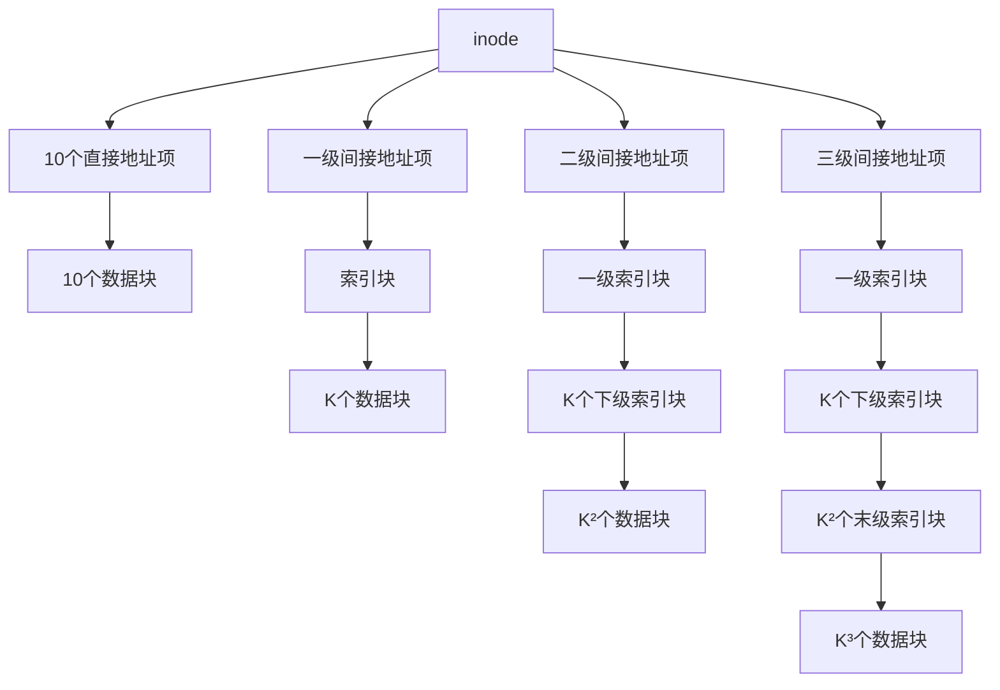
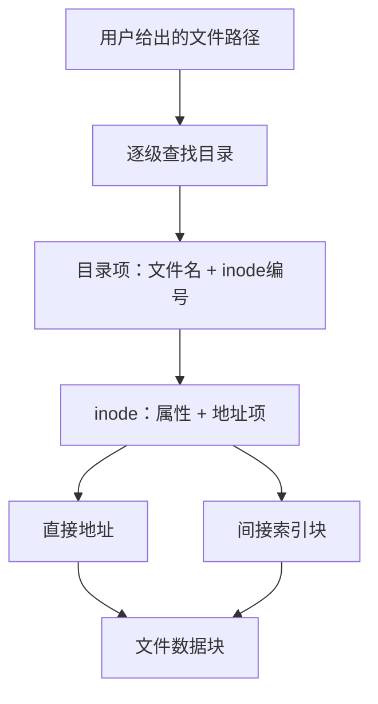
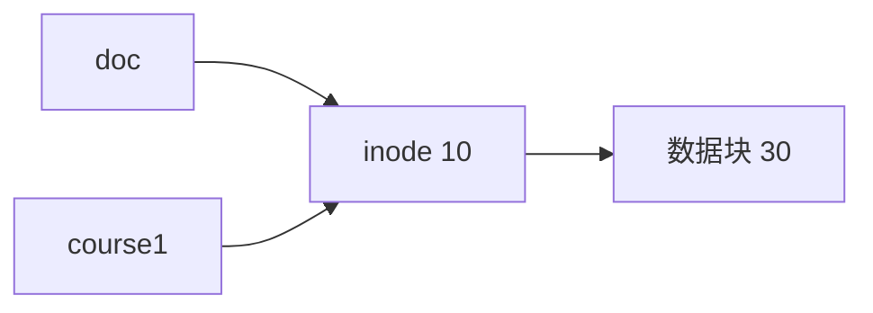
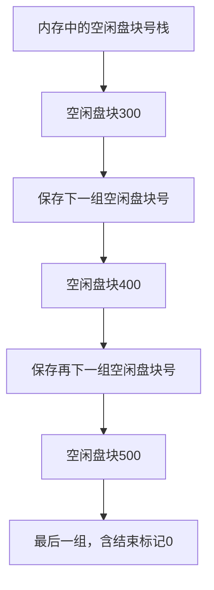
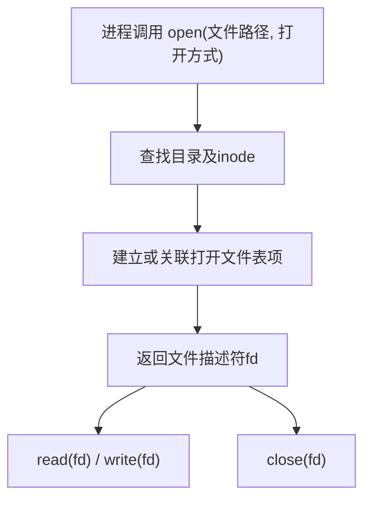
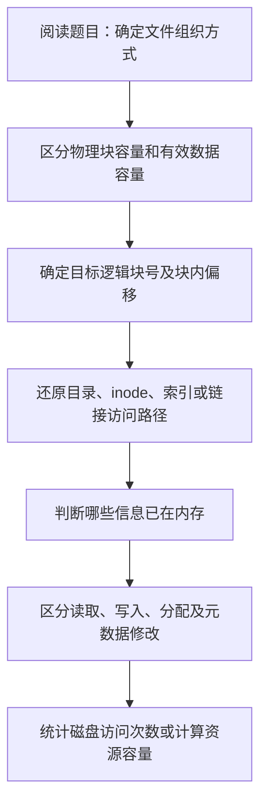

本章归纳6道历年真题（2011、2012、2014、2016、2018、2022年）和4道27王道模拟题（第3、4、7、8套第46题），共10道大题。重点分析逻辑地址转换、文件组织结构及各级元数据的实际存放位置。

## 一、本章大题的核心考点

以下优先级是根据这份题库的考查内容和知识迁移价值划分的，并非对未来考试的概率预测。

| 核心考点            | 对应真题                | 对应模拟题   | 重要程度  |
| --------------- | ------------------- | ------- | ----- |
| 混合索引分配、最大文件长度   | 2012、2018、2022      | 第3、4套   | ★★★★★ |
| 磁盘访问次数计算        | 2014、2016、2018、2022 | 第3、4、8套 | ★★★★★ |
| 连续分配与链接分配       | 2011、2012、2014      | 第8套     | ★★★★★ |
| inode、目录、文件共享   | 2011、2018、2022      | 第4套     | ★★★★★ |
| FAT 文件分配表       | 2016                | —       | ★★★★  |
| 文件系统容量与文件数量     | 2012、2016、2018      | 第3、8套   | ★★★★  |
| 成组链接法           | —                   | 第7套     | ★★★   |
| open、close 系统调用 | —                   | 第4套     | ★★★   |

**整个文件管理章节，最重要的是理解三个问题：**

1. 文件的逻辑位置如何转换成物理磁盘位置？
2. 为了完成这个转换，需要读取哪些信息？
3. 这些信息在内存还是在磁盘上？

## 二、建立文件管理的底层模型

### 1. 必须区分四种信息

| 信息            | 含义              |
| ------------- | --------------- |
| 字节偏移量 $d$ | 目标数据距离文件开头多少字节  |
| 逻辑块号 $i$  | 目标数据位于文件的第几个数据块 |
| 块内偏移量 $w$ | 目标数据在该数据块中的具体位置 |
| 物理块号          | 该数据块在磁盘上的实际编号   |

假设每个数据块的有效数据容量为 $B$，则：

$$
i=\left\lfloor\frac{d}{B}\right\rfloor
$$

$$
w=d\bmod B
$$

但是，求出逻辑块号之后，并不意味着已经知道物理块号。

接下来需要根据不同的文件分配方式进行地址转换：

| 分配方式        | 如何得到物理块号        |
| ----------- | --------------- |
| 连续分配        | 起始物理块号加逻辑块号     |
| 隐式链接分配      | 沿数据块中的指针逐个查找    |
| 显式链接分配（FAT） | 沿 FAT 中的指针逐个查找  |
| 索引分配        | 查询索引表           |
| 混合索引分配      | 根据逻辑块号进入对应层级的索引 |

这就是文件物理组织的本质。

### 2. 访盘次数的统一计算模型

$$
\boxed{ N_{\text{总}} =N_{\text{目录}} +N_{\text{inode}} +N_{\text{索引}} +N_{\text{数据}} +N_{\text{其他元数据}} }
$$

这里每一项都必须结合题目给出的操作和缓存条件进行判断。

例如 inode 已经在内存，则不需要从磁盘重新读取 inode；FAT 已经在内存，则遍历 FAT 不产生磁盘 I/O。

**磁盘访问次数不是由文件大小直接决定的，而是由完成操作需要访问哪些尚未缓存的磁盘块决定的。** 写操作还需要考虑哪些修改后的磁盘块必须写回。

## 三、核心题型一：混合索引分配

**重要程度：★★★★★**

对应题目：2018 年真题、2022 年真题、王道第 3 套第 46 题、第 4 套第 46 题。

### 1. 理解多级索引的本质

假设 inode 中有 10 个直接地址项，以及一级、二级、三级间接地址项各一个。



假设磁盘块大小为 $B$，每个盘块地址占 $a$ 字节，那么一个索引块最多保存的地址数量为：

$$
\boxed{K=\left\lfloor\frac{B}{a}\right\rfloor}
$$

$K$ 就是每个索引块的分支数量，也称为扇出。

假设有 $D$ 个直接地址项，各级间接地址项各一个：

| 地址项  | 能管理的数据块数量 | inode 已在内存时读取一个未缓存数据块所需访盘次数（索引块未缓存） |
| ---- | --------- | ----------------------------------- |
| 直接地址 | $D$   | 1                                   |
| 一级间接 | $K$   | 2                                   |
| 二级间接 | $K^2$ | 3                                   |
| 三级间接 | $K^3$ | 4                                   |

所以最大文件长度为：

$$
\boxed{L_{\max}=(D+K+K^2+K^3)B}
$$

这是索引结构能够表示的理论最大文件长度。实际最大文件长度还可能受到磁盘容量、地址位数、文件长度字段以及索引块开销的限制。

### 2. 代表题：王道第 3 套第 46 题

本题综合考查最大文件长度、地址转换、索引定位和访盘次数。

**题目条件：**

FCB 包含 10 个直接地址项，一级、二级、三级间接地址项各一个。磁盘块大小为 512 B，盘块号占 3 B。

<Steps>

<Step>

### 最大文件长度

先计算索引块的扇出：

$$
K=\left\lfloor\frac{512}{3}\right\rfloor=170
$$

剩余的 2 B 不足以存放一个地址，因此绝不能向上取整。

最大文件长度为：

$$
L_{\max}=(10+170+170^2+170^3)\times512
$$

$$
=\boxed{2\,530\,344\,960\text{ B}}
$$

</Step>

<Step>

### 索引路径定位

首先求逻辑块号和块内偏移量：

$$
i=\left\lfloor\frac{150000}{512}\right\rfloor=292
$$

$$
w=150000\bmod512=496
$$

接下来确定逻辑块号 292 属于哪一级索引。

| 索引方式 | 逻辑块号范围        |
| ---- | ------------- |
| 直接地址 | 0～9           |
| 一级间接 | 10～179        |
| 二级间接 | 180～29079     |
| 三级间接 | 29080～4942079 |

显然，292 属于二级间接索引。

但是不能直接拿 292 除以 170，因为前面的 180 个数据块已经被直接地址和一级间接地址覆盖了。

先求二级间接索引区域内部的相对块号：

$$
r=292-10-170=112
$$

再求两个索引下标：

$$
j_1=\left\lfloor\frac{112}{170}\right\rfloor=0
$$

$$
j_2=112\bmod170=112
$$

最终访问路径为：

```text
FCB 第11项（二级间接地址）
        ↓
上级索引块第0项
        ↓
下级索引块第112项
        ↓
目标数据块
        ↓
块内偏移496 B
```

因此只能确定索引访问路径，不能确定最终的物理盘块号，因为题目没有给出各个索引项中实际保存的盘块地址。

</Step>

<Step>

### 访盘次数

FCB 已经在内存，其余磁盘块均未缓存。

访问直接地址对应的数据块，最少访盘 1 次；访问三级间接索引对应的数据块，最多访盘 4 次。

</Step>

</Steps>

### 3. 必须掌握的通用方法：多级索引就是进制转换

如果目标数据位于二级间接索引，先减去前面所有索引区域覆盖的数据块数量，得到相对逻辑块号 $r$。

那么：

$$
r=j_1K+j_2
$$

如果目标数据位于三级间接索引：

$$
r=j_1K^2+j_2K+j_3
$$

于是：

$$
j_1=\left\lfloor\frac{r}{K^2}\right\rfloor
$$

$$
j_2=\left\lfloor\frac{r}{K}\right\rfloor\bmod K
$$

$$
j_3=r\bmod K
$$

<Callout type="idea" title="多级索引定位">

**多级索引的定位，本质上就是把相对逻辑块号转换成 $K$ 进制，各位数字分别对应各级索引下标。**

</Callout>

该方法同样适用于四级及更高层级的索引。

### 4. 必须区分：获取块号、读取一个块、读取整个文件

2018 年真题和王道第 4 套模拟题恰好考查了这三个不同的操作。

以二级间接索引为例，假设 inode 已在内存、其余块均未缓存：

| 操作           | 访盘次数               |
| ------------ | ------------------ |
| 获取目标数据块的物理块号 | 2                  |
| 读取目标数据块中的内容  | 3                  |
| 读取整个文件       | 必须统计所有数据块和实际需要的索引块 |

<Callout type="warn" title="获取块号与读取数据">

**如果只是获取块号，根本不需要读取最后的数据块。**

</Callout>

王道第 4 套第 46 题给出了一个 5 MiB 的文件，盘块为 4 KiB，10 个直接地址项，一级和二级间接地址项各一个。

数据块数量：

$$
n=\frac{5\times2^{20}}{4096}=1280
$$

索引块扇出：

$$
K=\frac{4096}{4}=1024
$$

文件中实际使用的索引块包括：

- 一级间接索引块：1 个。
- 二级间接的上级索引块：1 个。
- 二级间接的下级索引块：1 个。

因此，在 inode 已在内存、不计目录检索、已读索引块可以复用的条件下，读取整个文件需要：

$$
\boxed{1280+3=1283\text{ 次}}
$$

不能认为每读取一个数据块都要重新访问其上级索引块。

#### 写入文件时的进一步变化

同一道模拟题还要求分析写入 12 KiB 数据的访盘次数。

若块大小为 4 KiB，且写入位置按块对齐，则涉及 3 个数据块。

| 写入情形               | 典型写盘次数 |
| ------------------ | ------ |
| 仅覆盖已有数据块           | 3      |
| 同时需要回写 inode       | 4      |
| 同时需要更新一个索引块和 inode | 5      |

如果写入位置未对齐，可能跨越 4 个数据块；如果还需要新建索引块、更新空闲空间管理信息，则可能产生更多 I/O。

因此，遇到写文件的题目，一定要判断它是**覆盖已有数据，还是追加数据并分配新块**。条件不足时，不应该强行给出唯一答案。

## 四、核心题型二：连续分配与链接分配

**重要程度：★★★★★**

对应题目：2011、2012、2014 年真题，王道第 8 套第 46 题。

### 1. 真正理解不同分配方式的取舍

| 特性      | 连续分配     | 隐式链接分配 | 索引分配  |
| ------- | -------- | ------ | ----- |
| 随机访问    | 快        | 慢      | 较快    |
| 顺序访问    | 快        | 支持     | 支持    |
| 动态扩展    | 困难       | 容易     | 较容易   |
| 外部碎片    | 有        | 无      | 无     |
| 额外空间开销  | 较小       | 每块需要指针 | 需要索引块 |
| 中间插入数据块 | 可能需要移动数据 | 修改链接   | 修改索引  |

2011 年真题给出的条件是：文件一次性写入，以后不可修改。

这种情况下选择连续分配，因为文件不需要动态增长和插入，可以充分利用连续分配的高访问效率、低管理开销等优势。

但需要注意，**文件不可修改不代表连续分配在任何情况下都绝对不会产生外部碎片**。题库解析中的这个说法过于绝对。考试时应重点强调题目条件避免了文件动态扩展带来的空间分配困难。

### 2. 代表题：2014 年 408 真题

文件 F 由 200 条记录组成，每个磁盘块存放一条记录。现在将一条新记录插入为第 30 条记录。

本题考查插入记录时不同分配方式的实际磁盘操作。

<Tabs items={['连续分配', '隐式链接分配']}>

<Tab value="连续分配">

如果只能向后扩展，那么需要移动原来的第 30～200 条记录，共 171 条。

每移动一条记录需要读一次、写一次，再写入新记录一次。

$$
N_{\text{后移}}=2\times171+1=343
$$

但是题目明确说明：文件存储区域前后均有足够的空闲空间。

因此，可以将前 29 条记录向前移动一个块，原来的第 30～200 条记录保持不动。

$$
N_{\text{前移}}=2\times29+1=\boxed{59}
$$

```text
插入前：

空闲块 [1 ... 29] [30 ........ 200] 空闲块

向前扩展：

[1 ... 29] [新记录] [30 ........ 200]
```

FCB 中需要改变的字段为：

起始盘块号减 1，文件占用块数加 1（或文件长度增加一条记录的长度）。

#### 提炼通用公式

共有 $n$ 条记录，将新记录插入为第 $k$ 条，且前后都有足够空间，每条记录恰好占一个块。

在仅统计数据块读写的条件下：

$$
\boxed{ N_{\min}=2\min(k-1,n-k+1)+1 }
$$

如果题目只允许向后扩展，就不能取最小值。

</Tab>

<Tab value="隐式链接分配">

需要将新记录插入原第 29 条和第 30 条之间。

```text
插入前：

第29块 ──────→ 第30块

插入后：

第29块 → 新数据块 → 第30块
```

具体操作：

读取前 29 个数据块，找到第 29 块及其后继地址，需要 29 次读盘。

写入新数据块，需要 1 次写盘；修改第 29 块的后继指针，需要 1 次写盘。

因此：

$$
N=29+1+1=\boxed{31}
$$

这里按原题口径统计文件数据块操作，不额外计入空闲盘块分配、FCB 写回等未指定的管理开销。

**连续分配的插入开销来自移动数据；链接分配的插入开销来自查找前驱和修改指针。**

</Tab>

</Tabs>

### 3. 隐式链接分配必须减去指针空间

2014 年真题和王道第 8 套模拟题都考查了这个易错点。

如果盘块大小为 $B$，链接指针占 $a$ 字节，则每个盘块实际存放的文件数据为：

$$
\boxed{B_{\text{有效}}=B-a}
$$

若盘块地址占 $a$ 字节，其理论可编号的盘块数为：

$$
2^{8a}
$$

于是仅考虑地址宽度时，最大文件长度的理论上界为：

$$
\boxed{L_{\max}=2^{8a}(B-a)}
$$

例如王道第 8 套给出的条件是盘块大小 4096 B、地址占 4 B，所以有效数据容量为 4092 B。

$$
L_{\max}=2^{32}\times4092\text{ B}
$$

如果有保留块号、空指针标记或其他容量限制，则实际文件长度会更小。

进一步，访问偏移量为 $d$ 的字节时：

$$
i=\left\lfloor\frac{d}{4092}\right\rfloor
$$

在 FCB 已在内存、沿文件头开始查找且没有缓存的条件下：

$$
\boxed{N_{\text{访盘}}=i+1}
$$

因为必须依次读取逻辑块 0～$i$。

**连续分配可以直接计算目标物理块号；隐式链接必须沿链逐块找到目标物理块号。** 这才是两者随机访问效率差距巨大的根本原因。

## 五、核心题型三：inode、目录与 FAT

**重要程度：★★★★★**

对应题目：2016 年真题、2022 年真题、王道第 4 套第 46 题。

这个题型最重要的是建立文件系统的访问路径，而不是死记访问几次磁盘。

### 1. 理解文件名、inode、数据块的关系

采用 inode 的文件系统中，目录项主要负责保存文件名和 inode 编号，inode 负责保存文件属性和数据块定位信息。



需要特别注意：

- 目录本身也是一种文件，也有自己的 inode 和数据块。
- 文件名不等于 inode 编号。
- inode 编号不等于文件数据块号。
- 一个 inode 可以对应多个文件名。
- 一个文件可以占用多个数据块。

### 2. 代表题：2022 年 408 真题

原题给出的目录结构为：

<Files>
  <Folder name="stu" defaultOpen>
    <Folder name="course" defaultOpen>
      <File name="course1" />
      <File name="course2" />
    </Folder>
    <File name="doc" />
  </Folder>
</Files>

相关文件信息如下：

| 文件名     | inode 编号 | 数据盘块号   |
| ------- | -------- | ------- |
| stu     | 1        | 10      |
| course  | 2        | 20      |
| course1 | 10       | 30      |
| course2 | 100      | 40      |
| doc     | 10       | $x$ |

<Steps>

<Step>

### 目录项内容

只需要查看 stu 的直接子文件和子目录。

| 文件名    | inode 编号 |
| ------ | -------- |
| course | 2        |
| doc    | 10       |

不能将 course1 和 course2 写入 stu 的目录项，因为它们不是 stu 的直接子项。

目录项也不能填数据块号，因为本题规定的目录结构为“文件名＋inode 编号”。

</Step>

<Step>

### 硬链接与盘块号

doc 和 course1 的 inode 编号都是 10。

这意味着它们指向同一个文件的 inode，进而共享同一份文件数据。

所以：

$$
\boxed{x=30}
$$



这就是硬链接的本质。

| 对比         | 硬链接              | 软链接        |
| ---------- | ---------------- | ---------- |
| 实现方式       | 多个目录项指向同一个 inode | 独立文件保存目标路径 |
| 是否共享 inode | 是                | 否          |
| 删除原文件名     | 其他硬链接仍然可以访问      | 目标路径可能失效   |
| 能否跨文件系统    | 通常不能             | 可以         |

硬链接没有真正意义上的“原文件”和“副本”，多个文件名地位相同。

当最后一个硬链接被删除，且没有进程继续打开该文件时，其占用资源才可以被回收。

</Step>

<Step>

### 读取文件访盘次数

第一步，从内存中的 course 目录项中查到：

$$
\text{course1}\longrightarrow\text{inode 10}
$$

不需要访盘。

第二步，读取 inode 10 所在磁盘块，需要 1 次访盘，并获得数据块号 30。

第三步，读取数据块 30，需要 1 次访盘。

因此：

$$
\boxed{N=0+1+1=2}
$$

注意，inode 编号为 10 并不代表 inode 存储在磁盘的第 10 号块中。

**目录已经在内存，不代表文件对应的 inode 已经在内存；inode 已经在内存，也不代表数据块已经在内存。**

</Step>

<Step>

### 累计索引容量

题中有 10 个直接地址项，盘块大小为 4 KiB，每个地址项占 4 B。

| 索引方式 | 可管理的数据容量 |
| ---- | -------- |
| 直接地址 | 40 KiB   |
| 一级间接 | 4 MiB    |
| 二级间接 | 4 GiB    |
| 三级间接 | 4 TiB    |

6 MiB 超过了直接地址和一级间接地址的总容量，但没有超过二级间接地址覆盖的范围。

因此，需要使用一级和二级间接地址项。

这里使用的是**累计容量判断法**，不能只比较文件长度与某一级索引的单独容量。

</Step>

</Steps>

### 3. FAT：2016 年真题的核心思想

FAT 属于显式链接分配。它与隐式链接分配最大的区别是：后继盘块地址被集中存放在文件分配表中，而不是分散存放在数据块内。

2016 年真题中，文件 file1 的磁盘簇依次为：

$$
100\rightarrow106\rightarrow108
$$

那么 FAT 中的相关内容为：

| FAT 下标 | 表项内容   |
| ------ | ------ |
| 100    | 106    |
| 106    | 108    |
| 108    | 文件结束标记 |

目录项中只需要保存文件名 file1 和首簇号 100。

因此，如果 FAT 已经在内存，即使要访问文件的第三个数据块，也不需要读取前两个数据块。

#### 目录与 FAT 的访问路径

目录结构为：

<Files>
  <Folder name="dir" defaultOpen>
    <Folder name="dir1" defaultOpen>
      <File name="file1" />
      <File name="file2" />
    </Folder>
  </Folder>
</Files>

已知 dir1 位于 48 号簇，file1 的簇链为 100、106、108，簇大小为 4096 B。

FAT 和 dir 目录文件已经在内存。

现在读取 file1 的第 5000 个字节。

首先确定该字节位于文件的第二个数据簇。

然后读取 48 号簇，得到 file1 的首簇号 100。

接下来查询内存中的 FAT：

$$
FAT[100]=106
$$

最后直接读取 106 号簇。

所以只需要访问两个磁盘簇：

$$
\boxed{48,\ 106}
$$

不需要读取 100 号簇。

#### 对比三种文件系统访问第 $i$ 个逻辑块

假设从 0 编号，FCB 已在内存，目标数据块未缓存：

| 分配方式       | 访盘次数或规律            |
| ---------- | ------------------ |
| 连续分配       | 1 次                |
| 隐式链接分配     | 从头查找时为 $i+1$ 次 |
| FAT 已全部在内存 | 1 次                |

但是 FAT 已经在内存并不意味着随机定位的时间复杂度就是 $O(1)$，因为仍然可能需要沿 FAT 查找 $i$ 次。

<Callout type="warn" title="访盘与算法复杂度">

**内存访问次数、磁盘访问次数和算法时间复杂度，是三个不同的概念。**

</Callout>

## 六、核心题型四：文件系统容量与资源约束

**重要程度：★★★★☆**

对应题目：2012、2016、2018 年真题。

这一类题目的本质是：任何文件系统的资源都是有限的，真正的容量取决于最先耗尽的资源。

### 1. 由磁盘容量计算地址位数

假设文件系统总容量为 $C$，磁盘块大小为 $B$。

磁盘块总数：

$$
N=\left\lfloor\frac{C}{B}\right\rfloor
$$

盘块号最少需要的位数：

$$
m=\lceil\log_2N\rceil
$$

如果要求盘块号必须占用整数个字节：

$$
a=\left\lceil\frac{m}{8}\right\rceil
$$

例如 2012 年真题给出磁盘容量 4 TiB，盘块大小 1 KiB。

$$
N=\frac{2^{42}}{2^{10}}=2^{32}
$$

所以每个磁盘块的编号至少需要 32 位，即 4 B。

如果 FCB 中有 512 B 的直接索引表，那么最大文件长度为：

$$
\frac{512}{4}\times1024 =128\text{ KiB}
$$

这道题考查的是下面的完整推导链：

$$
\text{磁盘容量} \longrightarrow \text{磁盘块数量}
$$

$$
\longrightarrow \text{地址位数} \longrightarrow \text{索引容量} \longrightarrow \text{文件长度}
$$

2012 年真题的第二问还涉及连续预分配区域和直接索引区域的组合。做法没有变化：分别求出两部分能够管理的数据块数量，再相加，并检查磁盘总容量限制。

需要注意题库原解析存在一个边界问题：普通无符号 16 位整数最大值是 $2^{16}-1$，不是 $2^{16}$。块数能否表示 $2^{16}$，取决于是否采用特殊编码约定。起始块号也应当有足够位数覆盖所有磁盘块。因此在设计 8 B 的“起始块号＋块数”字段时，各占 4 B 是更合理的通用设计。

### 2. 代表题：2018 年 408 真题

题目条件：

| 参数          | 数值                       |
| ----------- | ------------------------ |
| 簇大小         | 4 KiB                    |
| 每个 inode 大小 | 64 B                     |
| 直接地址项       | 8 个                      |
| inode 区容量   | $2^{20}$ 个簇          |
| 数据区容量       | $512\times2^{20}$ 个簇 |
| 每个图像文件大小    | 5600 B                   |

问最多能够存放多少个这样的图像文件？

<Steps>

<Step>

### inode数量限制

每个簇能够存放：

$$
\frac{4096}{64}=64
$$

个 inode。

所以 inode 总数为：

$$
N_1=2^{20}\times64=2^{26}
$$

每个独立文件至少需要一个 inode，因此最多支持 $2^{26}$ 个这样的文件。

</Step>

<Step>

### 数据区容量限制

每个文件需要的簇数：

$$
n=\left\lceil\frac{5600}{4096}\right\rceil=2
$$

因为 2 个簇可以由直接地址项管理，不需要额外的间接索引块。

因此数据区最多能够存放：

$$
N_2=\frac{512\times2^{20}}{2}=2^{28}
$$

个文件。

</Step>

<Step>

### 取最小值

$$
N_{\max}=\min(N_1,N_2)
$$

$$
=\boxed{2^{26}}
$$

即 67108864 个文件。

即使数据区还有大量空闲空间，只要 inode 已经分配完毕，也无法继续创建独立的新文件。

</Step>

</Steps>

#### 通用公式

在每个文件占一个 inode，且每个文件资源需求相同的条件下：

$$
\boxed{ N_{\max}= \min\left( N_{\text{inode}}, \left\lfloor \frac{N_{\text{可用数据区块}}} {n_{\text{数据块}}+n_{\text{索引块}}} \right\rfloor \right) }
$$

如果文件很大，需要使用间接索引，那么还要统计索引块占用的存储空间。

例如，某个文件需要 300 个数据块，10 个直接地址项，每个索引块可存 1024 个地址，则该文件实际需要 301 个块，其中 1 个是一级间接索引块。

这类题一定要区分：

**文件的逻辑长度、数据块占用的空间、文件实际消耗的全部存储空间，并不一定相等。**

### 3. FAT 表长度计算

2016 年真题中每个 FAT 表项占 2 B，簇大小为 4 KiB。

理论上最多可以编号：

$$
N=2^{16}
$$

个簇。

因此 FAT 最大长度为：

$$
L_{\text{FAT}}=2^{16}\times2 =\boxed{128\text{ KiB}}
$$

理论最大文件长度为：

$$
L_{\max}=2^{16}\times4096 =\boxed{256\text{ MiB}}
$$

这里采用题目的理论容量模型，不额外扣除保留簇号及文件系统管理区域。

特别注意，FAT 属于显式链接分配，链接地址保存在独立的 FAT 中，所以数据块内部不需要扣除链接指针的空间。

## 七、核心题型五：成组链接法

**重要程度：★★★☆☆**

对应题目：王道第 7 套第 46 题。

原题库中成组链接法仅见于模拟题，重点是分配时栈空与回收时栈满的处理。

### 1. 成组链接法的本质

成组链接法是将空闲盘块号分组管理，使用内存中的空闲盘块号栈记录当前一组空闲盘块，并通过部分空闲盘块保存下一组的空闲盘块号。



它结合了空闲表集中管理的特点和链表组织的特点，不需要将所有空闲盘块号一直保存在内存中。

### 2. 分配与回收的四种情况

| 操作 | 状态            | 处理方法             |
| -- | ------------- | ---------------- |
| 分配 | 栈中有多个有效空闲块号   | 正常出栈             |
| 分配 | 分配当前组最后一个有效盘块 | 先从该块装入下一组，再分配该块  |
| 回收 | 栈未满           | 正常入栈             |
| 回收 | 栈已满           | 将原栈内容写入新回收的块，重置栈 |

最容易考查的是分配导致栈空，以及回收时栈满。

### 3. 王道第 7 套模拟题的关键过程

原题给出栈容量为 100，初始内存栈中有两个空闲盘块号：

```text
下标0：300
下标1：299 ← 栈顶
```

根据后续磁盘分组，实际空闲盘块为 299～599，共 301 个。数字 0 是结束标志，不是可分配的空闲盘块。

连续分配三个盘块：

| 操作          | 分配的盘块 | 栈中剩余项数 | 新栈顶 |
| ----------- | ----- | ------ | --- |
| 第一次分配       | 299   | 1      | 300 |
| 第二次分配并装入下一组 | 300   | 100    | 301 |
| 第三次分配       | 301   | 99     | 302 |

随后依次回收 700、711、703、788、701。

回收 700 后，栈中有 100 项，栈满。

此时再回收 711，要将原来的 100 个空闲盘块号全部写入 711 号磁盘块，然后将内存栈重置为：

```text
[711]
```

继续回收剩余三个块，最终结果为：

```text
[711, 703, 788, 701]
                 ↑
                栈顶
```

$$
\boxed{s_{\text{nfree}}=4}
$$

**成组链接法不要背诵复杂的图，只需要维护两个状态：栈中的有效元素数量和实际盘块号，遇到栈空、栈满执行特殊操作。**

## 八、补充考点：open、close 与打开文件表

**重要程度：★★★☆☆**

王道第 4 套第 46 题考查了 `open()` 和 `close()` 的参数区别。



应当理解三个层次：

| 层次       | 保存的信息             |
| -------- | ----------------- |
| 进程文件描述符表 | 文件描述符与打开文件表项的对应关系 |
| 系统打开文件表  | 打开状态、当前文件偏移、访问方式等 |
| inode    | 文件属性、长度、数据块地址等    |

`open()` 需要根据文件路径定位文件，并返回文件描述符。

`read()`、`write()`、`close()` 使用文件描述符，无须每次重新根据文件名查找目录。

需要掌握几个容易出题的结论：

打开文件不代表读取整个文件；关闭文件不代表删除文件；文件描述符不等于 inode 编号；多个独立的打开操作可以对应同一个 inode，但具有不同的文件读写偏移。

## 九、本章最容易丢分的细节

| 易错点           | 正确理解                     |
| ------------- | ------------------------ |
| 索引块能存多少地址     | 向下取整                     |
| 文件需要多少数据块     | 向上取整                     |
| 目标字节所在逻辑块号    | 向下取整                     |
| 多级索引定位        | 先减去前面区域覆盖的块数             |
| 获取物理块号        | 不需要读取目标数据块               |
| 读取整个文件        | 已读取的索引块可能复用              |
| 隐式链接分配        | 每个数据块要扣除指针空间             |
| FAT 显式链接      | 数据块不用扣除 FAT 指针空间         |
| FAT 已在内存      | 查找后继地址不需要访盘              |
| 目录已在内存        | 不代表 inode 也在内存           |
| inode 相同      | 多个文件名对应同一文件              |
| 连续分配中间插入      | 考虑向前、向后两种移动方式            |
| 移动一个数据块       | 通常需要一读一写                 |
| 计算文件数量上限      | 取各类资源约束的最小值              |
| 成组链接法回收时栈满    | 将旧栈写入新回收的盘块              |
| 文件逻辑块号        | 不等于物理磁盘块号                |
| 第 $n$ 个字节 | 若从 1 开始编号，偏移量是 $n-1$ |

特别记住三个不同的取整方向：

$$
\boxed{ \text{索引项数}= \left\lfloor\frac{\text{块大小}}{\text{地址大小}}\right\rfloor }
$$

$$
\boxed{ \text{占用块数}= \left\lceil\frac{\text{文件长度}}{\text{块有效容量}}\right\rceil }
$$

$$
\boxed{ \text{逻辑块号}= \left\lfloor\frac{\text{字节偏移}}{\text{块有效容量}}\right\rfloor }
$$

## 十、最值得反复做的代表题

以下6道代表题优先复习。

| 推荐顺序 | 题目         | 必须掌握的能力          |
| ---- | ---------- | ---------------- |
| 1    | 王道第3套第46题  | 混合索引、容量计算、索引定位   |
| 2    | 2014年408真题 | 连续分配、链接分配、插入操作   |
| 3    | 2022年408真题 | inode、文件共享、目录、访盘 |
| 4    | 2018年408真题 | 多级索引、资源约束、文件数量   |
| 5    | 2016年408真题 | FAT、目录查找、访问路径    |
| 6    | 王道第4套第46题  | 缓存、全文件读写、元数据更新   |

其他题作为补充练习：2011 年真题训练分配方式的选择，2012 年真题训练字段设计和容量边界，王道第 8 套训练隐式链接的有效容量与访盘口径，王道第 7 套训练成组链接法。

变式训练可改变文件大小、地址长度、块大小、直接地址项数量及缓存状态。

## 十一、自测练习

以下为依据核心考点设计的迁移测试，非原题。

建议先在草稿纸上推导，再核对答案。

<Accordions>

<Accordion title="盘块大小 4096 B，盘块号 6 B，一个索引块能保存多少个地址？">

682 个

</Accordion>

<Accordion title="文件大小 4097 B，盘块大小 4096 B，需要几个数据块？">

2 个

</Accordion>

<Accordion title="10 个直接地址项，扇出 1024，逻辑块 1034 属于哪一级索引？">

二级间接

</Accordion>

<Accordion title="inode 在内存，其余块未缓存，获取三级间接索引对应的数据块号，需要访盘几次？">

3 次

</Accordion>

<Accordion title="上题若要求读取数据块内容呢？">

4 次

</Accordion>

<Accordion title="FAT 在内存，首块号已知，读取未缓存的第 100 个数据块，需要读取多少个磁盘块？">

1 个

</Accordion>

<Accordion title="两个不同文件名的 inode 编号相同，修改其中一个文件的内容，另一个能否看到变化？">

能

</Accordion>

<Accordion title="inode 区还可分配 100 个 inode，数据区还可容纳 200 个同样的文件，最多能创建几个独立文件？">

100 个

</Accordion>

<Accordion title="块大小 1024 B，隐式链接指针 4 B，文件大小 2041 B，需要几个数据块？">

3 个

</Accordion>

</Accordions>

## 十二、最终总结：本章统一解题思维

遇到任何文件管理的综合应用题，在草稿纸上按照下面的逻辑分析：



本章真正需要形成的五种核心能力是：

**地址转换能力**：能够从字节偏移推导逻辑块号，再定位物理块。

**结构分析能力**：理解连续、链接、索引三种组织方式的实现和取舍。

**资源计算能力**：能够分析磁盘块、索引块、inode、地址字段等容量约束。

**访问路径分析能力**：清楚目录、inode、索引块、数据块之间的关系。

**I/O 分析能力**：能够根据缓存状态和实际操作准确计算磁盘读写次数。

**文件管理大题的本质不是背公式，而是模拟操作系统如何找到数据、如何组织数据、如何修改数据。**
