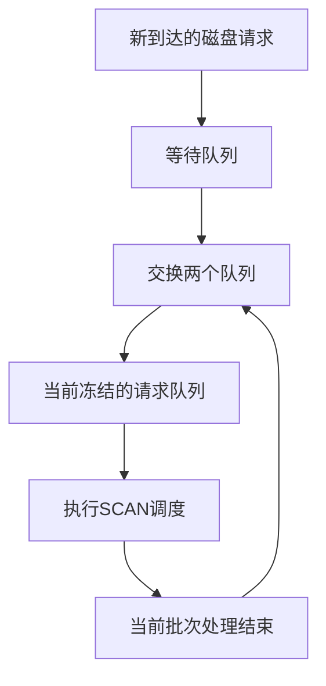
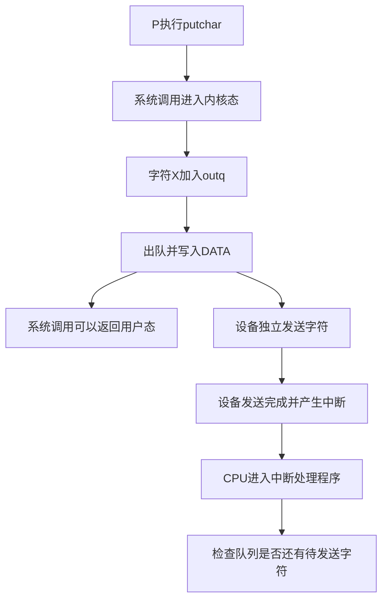
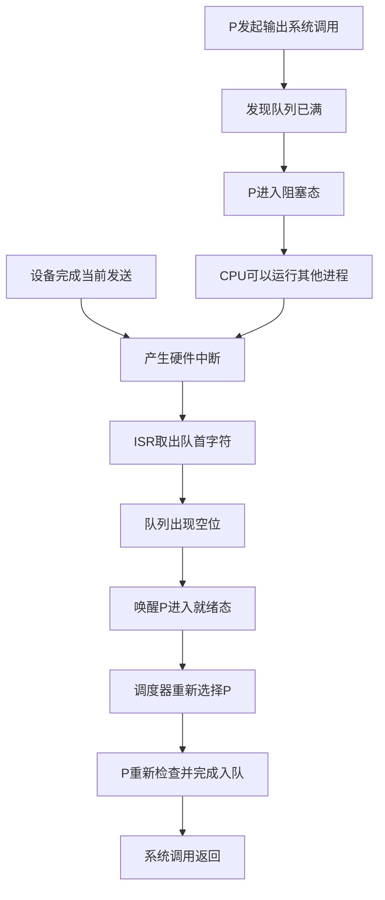
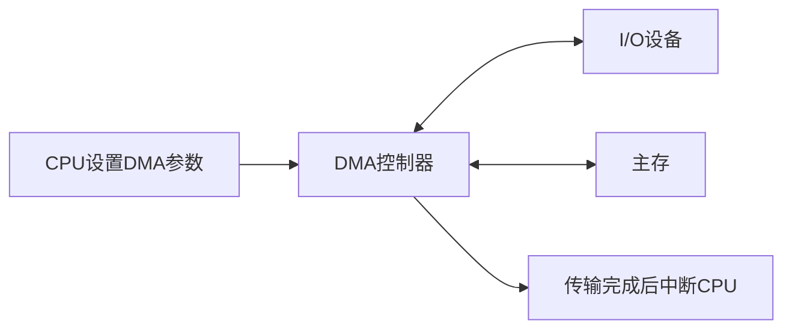
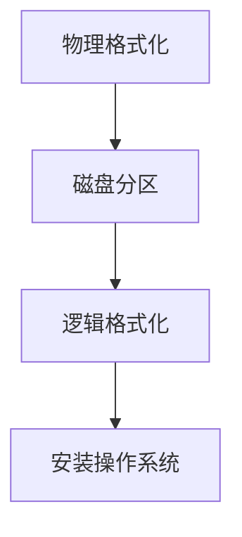
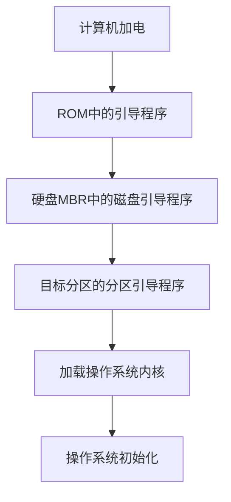

本章归纳3道历年真题和2道模拟题。重点辨析磁盘调度算法的移动距离计算口径，以及设备、CPU和进程的异步协作。

## 一、建立本章的核心知识框架

本章大题的本质，是考查操作系统如何管理外部设备，以及如何高效地完成数据传输。

| 核心考点         | 对应题库题目               | 复习优先级 |
| ------------ | -------------------- | ----- |
| 磁盘调度算法       | 2010、2019真题，模拟第6套46题 | ★★★★★ |
| 磁盘访问时间计算     | 2010真题，模拟第6套46题      | ★★★★★ |
| 磁盘结构与物理地址转换  | 2019真题               | ★★★★★ |
| 中断驱动I/O与进程状态 | 模拟第2套46题             | ★★★★★ |
| DMA与I/O控制方式  | 模拟第6套46题             | ★★★★  |
| 磁盘初始化与操作系统引导 | 2021真题               | ★★★★  |
| 位示图与空闲磁盘块管理  | 2010真题               | ★★★   |
| SSD与机械磁盘的区别  | 2010真题               | ★★★   |

这里的优先级是根据这份题库的覆盖情况、知识点的迁移能力和解题价值划分的，并非对未来考试频率的统计预测。

本章的五个核心解题模型：

- **路径模型**：磁盘调度就是规划磁头移动路径。
- **时间模型**：磁盘访问就是移动、等待、传输。
- **地址模型**：磁盘物理地址转换就是整数除法与取余。
- **事件模型**：I/O过程就是硬件、CPU、进程之间的异步协作。
- **依赖模型**：磁盘初始化与系统启动就是按照前置条件安排操作顺序。

## 二、核心模型一：磁盘调度算法

### 1. 本质：磁头如何移动

机械磁盘访问数据时，磁头需要移动到指定柱面。磁头移动需要消耗时间，因此磁盘调度的核心目标之一就是减少寻道开销，同时兼顾公平性和响应时间。

磁盘调度问题，本质上可以理解成一条数轴上的路径规划问题。

各种算法真正的区别只有三个：

1. 下一次访问哪个请求？
2. 磁头什么时候改变方向？
3. 磁头是否必须移动到物理边界？

### 2. 六种磁盘调度算法的本质区别

| 算法     | 选择请求的规则                      | 关键特征         |
| ------ | ---------------------------- | ------------ |
| FCFS   | 按请求到达顺序                      | 公平，但可能移动距离很长 |
| SSTF   | 每次选择距离当前位置最近的请求              | 局部最优，可能饥饿    |
| SCAN   | 沿一个方向服务，到物理端点再反向             | 双向服务         |
| LOOK   | 沿一个方向服务，到最远请求就反向             | 不进行无意义的端点移动  |
| C-SCAN | 沿固定方向服务，到物理端点后回到另一端          | 单向服务         |
| C-LOOK | 沿固定方向服务，到最远请求后跳到另一侧最远端的待处理请求 | 单向服务，不必到物理端点 |

**最重要的两个区别：**

SCAN与LOOK的区别，是折返位置不同。

SCAN与C-SCAN的区别，是折返过程中是否服务请求。

不要把这两组区别混在一起。

### 3. 代表题：王道第6套第46题

题目给出的请求序列为：

$$
35,58,40,28,80,160,143,38,204
$$

磁头初始位置为95，初始移动方向为柱面号增大的方向。

要求计算SSTF、SCAN、C-SCAN的总移动距离。

#### 第一步：在数轴上排列请求

```text
28  35  38  40  58  80  [95]  143  160  204
                         →
```

做磁盘调度题时，除了FCFS需要保留原始到达顺序，其他算法通常都可以借助排序后的数轴进行分析。

<Tabs items={['SSTF', 'SCAN', 'C-SCAN']}>

<Tab value="SSTF">

初始位置为95，最近的两个候选请求为80和143。

$$
95-80=15
$$

$$
143-95=48
$$

因此选择80。

到达80后，再从剩余请求中选择最近的请求，不能继续使用95作为比较基准。

完整路径为：

$$
95\to80\to58\to40\to38\to35
$$

$$
\to28\to143\to160\to204
$$

总移动距离：

$$
\begin{aligned}
D={}&15+22+18+2+3\\
&+7+115+17+44\\
={}&243
\end{aligned}
$$

但这里有一个更快的计算技巧。

从95一直下降到28，中途虽然处理了很多请求，但总移动距离仍然只是：

$$
95-28=67
$$

从28再一直上升到204：

$$
204-28=176
$$

所以：

$$
\boxed{D=67+176=243}
$$

**高质量做题技巧：连续同方向移动时，只需要计算起点和终点的差值。**

</Tab>

<Tab value="SCAN">

模拟题原题没有给出最大柱面号。因此，严格来说无法直接得出唯一的数值答案。

设磁盘柱面范围为 $0\sim M$。

移动路线为：

$$
95\to143\to160\to204\to M
$$

$$
\to80\to58\to40\to38\to35\to28
$$

总距离只需要考虑两段：

$$
D_{\text{SCAN}}=(M-95)+(M-28)
$$

所以：

$$
\boxed{D_{\text{SCAN}}=2M-123}
$$

假如磁盘范围为0～299，则：

$$
D_{\text{SCAN}}=475
$$

</Tab>

<Tab value="C-SCAN">

路径为：

$$
95\to143\to160\to204\to M
$$

$$
\to0\to28\to35\to38\to40\to58\to80
$$

注意，从 $M$ 返回0的过程中，不处理沿途请求，但磁头仍然发生了移动。

因此，在所有实际移动均计入的情况下：

$$
D_{\text{C-SCAN}}=(M-95)+M+80
$$

$$
\boxed{D_{\text{C-SCAN}}=2M-15}
$$

若最大柱面号为299：

$$
D_{\text{C-SCAN}}=583
$$

</Tab>

</Tabs>

### 4. 五种算法的路径对照

假设最大柱面号为299，对比同一请求序列下的移动路径及距离。

| 算法     | 简化移动路线       | 总移动距离 |
| ------ | ------------ | ----- |
| SSTF   | 95→28→204    | 243   |
| SCAN   | 95→299→28    | 475   |
| LOOK   | 95→204→28    | 285   |
| C-SCAN | 95→299→0→80  | 583   |
| C-LOOK | 95→204→28→80 | 337   |

这里的简化路线省略了中间被服务的请求，只保留影响总移动距离的关键位置。

可以看出，SSTF在这道题中移动距离最短，但不能因此认为SSTF在任何情况下都是全局最优。

SSTF只保证当前一步选择最近的请求，不保证整个路径最短，也不保证所有请求都能及时得到服务。

### 5. 总移动距离计算公式

无论遇到什么磁盘调度算法，最终总移动距离都可以统一成：

$$
\boxed{D=\sum_{i=1}^{n}|x_i-x_{i-1}|}
$$

其中 $x_0$ 是磁头初始位置，其他 $x_i$ 是磁头实际移动到的位置，包括需要经过的物理端点。

<Callout type="idea" title="磁盘调度方法">

**先确定路径，再计算距离；算法负责确定路径，绝对值负责计算距离。**

</Callout>

### 6. 磁臂黏着、饥饿与公平性

模拟题还考查了磁臂黏着，这个知识点不能只背结论。

假设磁头位于100号柱面，而100号柱面附近不断产生新的访问请求。

SSTF会不断优先服务附近的请求，远处请求可能长期得不到处理。

在允许新请求不断加入当前扫描批次的某些SCAN、C-SCAN实现中，也可能发生磁臂长期停留在热点位置的情况。

解决问题的核心思路是：**限制新请求对当前调度批次的干扰。**

例如FSCAN使用两个队列：



当前批次开始处理后，新请求不能插入当前批次，而是进入另一个队列。

N-Step-SCAN则通过限制每批请求数量达到类似目的。

这里考查的并不仅仅是磁盘知识，而是操作系统中非常重要的公平性思想：

**不能只追求当前效率，还必须防止部分任务长期得不到服务。**

## 三、核心模型二：磁盘访问时间计算

### 1. 磁盘访问为什么需要三个时间？

一次磁盘访问需要经历三个阶段。


分别对应寻道时间、旋转延迟时间、数据传输时间。

因此：

$$
\boxed{T=T_s+T_r+T_t}
$$

| 时间         | 本质           | 影响因素         |
| ---------- | ------------ | ------------ |
| 寻道时间 $T_s$ | 磁头移动到目标柱面    | 移动距离、磁盘寻道性能  |
| 旋转延迟 $T_r$ | 等待目标扇区到达磁头下方 | 磁盘转速         |
| 传输时间 $T_t$ | 实际读写数据       | 转速、数据大小、磁道容量 |

磁盘调度算法主要优化的是**寻道时间**。

下面的公式默认不额外计入控制器处理、排队等开销；如果题目给出这些开销，则需要另外计算。

### 2. 必须掌握的三个公式

#### 寻道时间

如果题目给出移动一个磁道需要 $m$ 时间，磁头共移动 $D$ 个磁道：

$$
T_s=mD
$$

如果还存在每次启动磁头的固定开销 $s$，一次非零距离寻道可能使用：

$$
T_s=s+mn
$$

多次寻道时，应按照题目规定分别计算固定开销。

#### 平均旋转延迟

假设磁盘每秒旋转 $r$ 圈。

转一圈的时间：

$$
T_{\text{circle}}=\frac{1}{r}
$$

由于目标扇区随机分布，平均需要等待半圈：

$$
\boxed{T_r=\frac{1}{2r}}
$$

如果磁盘转速单位为r/min，必须先除以60转换成r/s。

#### 数据传输时间

假设每个磁道可存储 $N$ 字节，需要读取 $b$ 字节：

$$
\boxed{T_t=\frac{b}{rN}}
$$

如果题目以扇区为单位，每个磁道有 $S$ 个扇区，需要连续读取 $k$ 个扇区：

$$
\boxed{T_t=\frac{k}{rS}}
$$

实际上就是：

$$
\text{传输时间}=\text{旋转一圈时间}\times\text{读取数据占一圈的比例}
$$

### 3. 代表题：2010年408真题

本题综合考查磁盘调度、访问时间、位示图及SSD。

题目主要条件：

| 条件       | 数值           |
| -------- | ------------ |
| 磁盘转速     | 6000 r/min   |
| 每个磁道的扇区数 | 100          |
| 相邻磁道移动时间 | 1 ms         |
| 磁头初始位置   | 100          |
| 初始方向     | 增大方向         |
| 请求序列     | 50、90、30、120 |
| 每次访问     | 1个随机分布的扇区    |

采用题库参考答案中的循环扫描路径：

$$
100\to120\to30\to50\to90
$$

求处理全部请求的时间。

<Steps>

<Step>

### 寻道时间

按照题库参考答案的路径计算：

$$
\begin{aligned}
D={}&(120-100)+(120-30)\\
&+(50-30)+(90-50)\\
={}&170
\end{aligned}
$$

因此：

$$
T_s=170\times1=170\text{ ms}
$$

</Step>

<Step>

### 旋转延迟

转速：

$$
r=\frac{6000}{60}=100\text{ r/s}
$$

旋转一圈：

$$
T_{\text{circle}}=\frac{1}{100}
=10\text{ ms}
$$

平均旋转延迟为半圈：

$$
T_r=\frac{10}{2}=5\text{ ms}
$$

四次独立的随机扇区访问：

$$
T_{r,\text{total}}=4\times5=20\text{ ms}
$$

</Step>

<Step>

### 传输时间

一个磁道有100个扇区，旋转一圈需要10 ms。

所以：

$$
T_{\text{sector}}=\frac{10}{100}
=0.1\text{ ms}
$$

四个扇区：

$$
T_{t,\text{total}}=4\times0.1
=0.4\text{ ms}
$$

</Step>

<Step>

### 总时间

$$
T=170+20+0.4
$$

$$
\boxed{T=190.4\text{ ms}}
$$

各部分时间占比如下：

| 时间组成 | 耗时       | 占比     |
| ---- | -------- | ------ |
| 寻道时间 | 170 ms   | 89.29% |
| 旋转延迟 | 20 ms    | 10.50% |
| 数据传输 | 0.4 ms   | 0.21%  |
| 合计   | 190.4 ms | 100%   |

这也解释了为什么机械磁盘要进行磁盘调度：在这个例子中，真正读取数据的时间非常短，绝大多数时间消耗在寻找数据的位置上。

</Step>

</Steps>

### 4. 特别重要：2010真题与模拟题的算法口径冲突

2010真题的题库参考答案将以下路径称为CSCAN：

$$
100\to120\to30\to50\to90
$$

但按照严格区分C-SCAN和C-LOOK的教材定义，这实际上更符合C-LOOK，因为磁头没有移动到物理边界。

2010年题干及其配图没有明确给出最大磁道号。

如果严格按照C-SCAN的物理端点定义，设磁盘范围为 $0\sim M$，那么：

$$
D=(M-100)+M+90
$$

$$
D=2M-10
$$

在其他条件不变时：

$$
T=(2M-10)+20+0.4
$$

$$
\boxed{T=(2M+10.4)\text{ ms}}
$$

没有最大磁道号就无法确定唯一数值。

**考试处理原则：**

题目给出物理边界时，按照严格定义计算；题目没有给出边界时，检查是否有额外约定或配图说明。必要时在答案中明确采用的移动规则，再进行计算。

对于这道2010真题，可以记住题库给出的190.4 ms，但不能因此误认为C-SCAN永远只移动到最远请求。

### 5. 连续访问与随机访问的区别

这是磁盘时间计算中非常容易变化的考法。

假设要读取同一个磁道上的10个扇区。

如果10个扇区连续存放，只考虑一次寻道和一次平均旋转延迟，则：

$$
T=T_s+T_r+10T_{\text{sector}}
$$

如果10个扇区属于10次独立的随机位置访问，则平均旋转延迟可能需要累计10次。

如果访问发生在同一磁道上，后续访问未必需要再次寻道。

**不是读取几个扇区就一定计算几次寻道和旋转延迟，而是看实际进行了多少次定位和等待。**

## 四、核心模型三：磁盘结构与物理地址转换

### 1. 不要混淆柱面、磁道、扇区和簇

| 概念  | 本质                    |
| --- | --------------------- |
| 柱面  | 不同盘面上半径相同的一组磁道        |
| 磁道  | 一个盘面上的环形存储区域          |
| 扇区  | 磁道划分出的基本物理存储区域        |
| 簇   | 文件系统进行空间分配的单位，可包含多个扇区 |
| 磁头号 | 在经典磁盘几何模型中用于选择对应盘面    |

同一个柱面上的不同磁道，可以通过切换磁头访问，而不需要将磁头组件移动到其他柱面。

因此，在经典磁盘SSTF题目中，通常比较的是柱面号之间的距离，而不是逻辑簇号之间的距离。

磁盘容量：

$$
\boxed{
C=N_c\times N_h\times N_s\times B
}
$$

其中：

$N_c$ 为柱面数，$N_h$ 为每个柱面的磁道数，$N_s$ 为每个磁道的扇区数，$B$ 为每个扇区的字节数。

### 2. 代表题：2019年408真题

题目条件：

| 项目       | 数值    |
| -------- | ----- |
| 柱面数      | 300   |
| 每个柱面磁道数  | 10    |
| 每个磁道扇区数  | 200   |
| 扇区大小     | 512 B |
| 每簇包含的扇区数 | 2     |

<Steps>

<Step>

### 磁盘容量

$$
C=300\times10\times200\times512
$$

$$
=307200000\text{ B}
$$

按照题库采用的 $1\text{ KB}=1024\text{ B}$ 换算：

$$
\boxed{C=300000\text{ KB}}
$$

这里如果题目已经给出每个柱面的磁道数，就不需要再额外乘以盘面数。

</Step>

<Step>

### 簇号转换与调度

题目给出四个磁盘访问请求：

$$
100260,\quad60005,\quad101660,\quad110560
$$

磁头初始位置为85号柱面，采用SSTF算法。

先计算一个柱面能够容纳多少个簇：

$$
N_{\text{cluster}}
=\frac{10\times200}{2}
=1000
$$

因此：

$$
\boxed{\text{柱面号}=
\left\lfloor\frac{\text{簇号}}{1000}\right\rfloor}
$$

转换结果：

| 簇号     | 对应柱面号 |
| ------ | ----- |
| 100260 | 100   |
| 60005  | 60    |
| 101660 | 101   |
| 110560 | 110   |

现在问题就退化成了最普通的SSTF磁盘调度题。

磁头从85出发：

$$
85\to100\to101\to110\to60
$$

因此访问簇的顺序为：

$$
\boxed{100260\to101660\to110560\to60005}
$$

**这类题目的本质就是：先做地址转换，再做磁盘调度。**

</Step>

<Step>

### 物理地址

磁盘的经典物理地址形式为：

$$
(\text{柱面号},\text{磁头号},\text{扇区号})
$$

在题目采用从0开始编号、连续映射的模型下，最稳妥的通用方法是先将簇号转换成逻辑扇区号，再逐级进行除法和取余。

第100530簇的起始扇区号：

$$
L=100530\times2=201060
$$

一个柱面有：

$$
10\times200=2000
$$

个扇区。

首先计算柱面号：

$$
C=\left\lfloor\frac{201060}{2000}\right\rfloor
=100
$$

柱面内部剩余扇区偏移：

$$
R=201060\bmod2000=1060
$$

磁头号：

$$
H=\left\lfloor\frac{1060}{200}\right\rfloor
=5
$$

扇区号：

$$
S=1060\bmod200=60
$$

所以该簇的起始物理地址为：

$$
\boxed{(100,5,60)}
$$

这个簇包含60号和61号两个扇区。

按照本题经典I/O系统模型，逻辑地址到磁盘物理地址的转换由磁盘驱动程序完成。

</Step>

</Steps>

### 3. 物理地址转换的万能模板

设每个柱面有 $H$ 个磁道，每个磁道有 $S$ 个扇区，逻辑扇区号为 $L$，从0开始编号。

$$
\boxed{
\begin{aligned}
c&=\left\lfloor\frac{L}{HS}\right\rfloor\\
h&=\left\lfloor\frac{L\bmod(HS)}{S}\right\rfloor\\
s&=L\bmod S
\end{aligned}
}
$$

反过来，已知物理地址求逻辑扇区号：

$$
\boxed{L=cHS+hS+s}
$$

这个过程与分页存储管理中的地址转换、多维数组的地址计算，本质上是一样的。

都是把一个线性编号拆解成不同层级的位置。

## 五、核心模型四：中断驱动I/O与进程状态

原题库中此类综合模拟题有一道，涉及操作系统概述、进程管理与I/O管理。

### 1. 首先区分四个独立主体

| 主体     | 负责的工作              |
| ------ | ------------------ |
| 用户进程   | 提出I/O请求            |
| 操作系统内核 | 管理请求、缓冲区、设备驱动、进程状态 |
| 设备控制器  | 控制设备实际完成数据传输       |
| CPU    | 执行程序、系统调用、中断处理程序   |

实际上，进程提出请求后，设备可以独立完成操作；CPU则可以执行其他进程。

<Callout type="idea" title="I/O事件分析">

**必须把进程执行的时间线与设备工作的时间线分开。**

</Callout>

### 2. 代表题：王道第2套第46题

进程P在用户态执行：

```c
putchar('X');
```

内核维护待发送队列 `outq`，设备具有数据寄存器 `DATA` 和状态位 `READY`。

其中：

- `READY=1`：设备空闲。
- `READY=0`：设备正在发送。
- 向 `DATA` 写入字符会启动发送。
- 发送完成后，硬件产生中断。

题目还规定，字符一旦从队列取出并提交给设备，就不再位于待发送队列中；系统调用也不必等到字符真正显示出来才返回。

<Tabs items={['队列为空、设备空闲', '队列已满、设备忙']}>

<Tab value="队列为空、设备空闲">

此时没有任何资源不足的问题。



按照题目编号，一种合法顺序为：

$$
\boxed{\text{①}\to\text{②}\to\text{③}\to\text{④}\to\text{⑤}\to\text{⑥}\to\text{⑦}}
$$

这里最关键的知识点是：

<Callout type="warn" title="异步I/O">

**系统调用返回与设备完成I/O不是同一个事件。**

</Callout>

只要操作系统已经接收了数据，并按照题意成功入队或启动发送，进程就可以返回用户态继续执行。

终端真正完成输出的时间可能更晚。由于两者异步，在其他合法的时序中，中断也可能发生在系统调用返回之前。

</Tab>

<Tab value="队列已满、设备忙">

因为队列已经满了，所以进程P不能把新字符写入队列。

进程P需要阻塞，等待队列出现空位。



按照题库给出的编号，在没有其他进程抢占新空位等干扰的情况下：

$$
\boxed{\text{①}\to\text{⑧}\to\text{⑤}\to\text{⑥}\to\text{⑦}\to\text{⑨}\to\text{②}\to\text{④}}
$$

这里必须掌握三个不同的事件。

**事件一：进程阻塞。**

$$
\text{运行态}\to\text{阻塞态}
$$

原因是进程需要等待某个尚未满足的条件，即输出队列出现空位。

**事件二：进程唤醒。**

$$
\text{阻塞态}\to\text{就绪态}
$$

等待条件得到满足，进程具备继续执行的可能。

**事件三：进程被调度。**

$$
\text{就绪态}\to\text{运行态}
$$

只有得到CPU之后，进程才能继续执行原来的系统调用。

<Callout type="warn" title="进程状态转换">

唤醒不等于立即运行，这一点极其重要。

</Callout>

</Tab>

</Tabs>

### 5. 设备中断时，发起I/O的进程处于什么状态？

进程P在设备中断到来时，可能处于：

| P的状态 | 可能发生的场景               |
| ---- | --------------------- |
| 运行态  | P已经返回用户态，中断恰好在P执行期间到来 |
| 就绪态  | P正在等待CPU，其他进程正在执行     |
| 阻塞态  | P正在等待输出队列空位或其他事件      |

但是，无论P处于什么状态：

$$
\boxed{\text{CPU执行中断处理程序时，一定处于内核态}}
$$

进程状态和CPU工作模式是两个不同维度。

进程状态回答的是：这个进程目前是否正在执行、是否能执行。

CPU工作模式回答的是：CPU当前能够执行哪一类指令。

不要将运行态等同于用户态，也不要将阻塞态等同于内核态。

### 6. 系统调用、中断与硬件事件的区别

| 事件      | 谁发起        | 执行环境           |
| ------- | ---------- | -------------- |
| 系统调用    | 当前用户进程主动提出 | 进入内核后在进程上下文中执行 |
| I/O完成中断 | 外部设备控制器提出  | 中断处理上下文        |
| 设备发送字符  | 设备硬件       | 不需要CPU一直参与     |
| 唤醒等待进程  | 内核或中断处理程序  | 内核态            |
| 进程调度    | 操作系统内核     | 内核态            |

尤其注意：

中断处理程序不是发起I/O的用户进程自己执行的一段普通代码。中断发生时，CPU完全可能正在执行另一个进程。

### 7. I/O流程大题的通用解法

键盘输入、终端输出、网卡收发及磁盘读写均可按以下流程分析：

| 分析步骤 | 需要回答的问题         |
| ---- | --------------- |
| 第一步  | 谁发起了I/O请求？      |
| 第二步  | 请求是否能够立即提交？     |
| 第三步  | 进程需要等待什么资源或事件？  |
| 第四步  | CPU能否去执行其他任务？   |
| 第五步  | 设备完成后如何通知CPU？   |
| 第六步  | 中断处理程序完成了什么操作？  |
| 第七步  | 哪个进程被唤醒，何时重新运行？ |

## 六、I/O控制方式：理解CPU究竟参与了什么

这部分是模拟第6套第46题涉及的考点，同时也是计组输入输出系统与操作系统输入输出管理的交叉知识。

### 1. 四种I/O控制方式

| 控制方式   | CPU如何知道设备状态    | 谁负责数据搬运 | 特点           |
| ------ | -------------- | ------- | ------------ |
| 程序直接控制 | CPU不断查询        | CPU     | CPU参与程度高     |
| 中断驱动   | 设备产生中断通知CPU    | CPU     | 减少忙等待        |
| DMA    | 数据块传输完成后通常产生中断 | DMA控制器  | CPU不逐字搬运     |
| 通道控制   | 通道程序执行完后通知CPU  | I/O通道   | 能组织更复杂的I/O操作 |

#### 中断驱动方式

CPU不需要一直轮询设备，但实际的数据搬运通常仍需要CPU执行相关指令。

因此：

**中断驱动解决的主要问题是忙等待。**

#### DMA方式

CPU首先设置传输参数，例如内存起始地址、传输方向和传输数量。

之后由DMA控制器负责在设备与内存之间进行数据传输。



因此：

**DMA进一步解决的是CPU参与大量数据搬运的问题。**

### 2. 为什么磁盘批量读写通常采用DMA？

因为磁盘一次通常需要传输一整个数据块，而不是偶尔传输一个字符。

如果CPU需要为每个字节执行数据搬运指令，就会产生大量额外开销。

DMA能够让设备和内存之间直接进行成批数据传输，CPU可以在此期间执行其他工作，但仍可能发生总线或内存访问竞争。

注意，DMA不是完全不需要CPU。

CPU仍然负责初始化传输，并在传输完成后处理相应事件。

### 3. DMA与阻塞的关系

DMA能够减少CPU参与数据传输，但不代表发起I/O的进程一定不会阻塞。

例如，某个进程需要从磁盘读取数据后才能继续计算。

即使系统使用DMA，该进程也可能需要阻塞等待数据准备完成；与此同时，CPU运行其他进程。

因此：

$$
\boxed{\text{CPU不等待}\ne\text{发起I/O的进程不等待}}
$$

## 七、核心模型五：磁盘初始化与操作系统引导

### 1. 代表题：2021年408真题

它考查两个顺序：

磁盘如何从一个存储设备变成可以安装操作系统的启动盘，以及计算机开机后如何找到并启动操作系统。

### 2. 磁盘初始化顺序



| 阶段     | 主要工作                  |
| ------ | --------------------- |
| 物理格式化  | 建立底层磁道、扇区等物理存储结构      |
| 磁盘分区   | 将磁盘空间划分为不同区域          |
| 逻辑格式化  | 创建文件系统、根目录、空闲空间管理结构等  |
| 安装操作系统 | 将操作系统相关文件及启动所需内容安装到磁盘 |

为什么必须是这个顺序？

因为没有底层存储结构，就无法在其上划分逻辑区域；没有分区，就无法针对该分区建立文件系统；没有合适的文件系统，就无法按照题设的常规方式安装操作系统文件。

**本质就是从物理结构逐步建立逻辑结构，再存储真正的系统数据。**

真题还问了两个容易混淆的问题：

磁盘扇区的划分发生在物理格式化阶段。

文件系统根目录的建立发生在逻辑格式化阶段。

### 3. 操作系统启动顺序

2021真题采用的是传统MBR、多阶段引导模型。



| 程序        | 主要任务             |
| --------- | ---------------- |
| ROM中的引导程序 | 完成必要的硬件准备，找到启动设备 |
| 磁盘引导程序    | 根据分区表等信息选择启动分区   |
| 分区引导程序    | 引导对应分区中的操作系统     |
| 操作系统初始化程序 | 初始化操作系统自身        |

正确顺序：

$$
\boxed{\text{ROM引导程序}\to\text{磁盘引导程序}}
$$

$$
\boxed{\to\text{分区引导程序}\to\text{OS初始化程序}}
$$

### 4. 为什么要采用多阶段引导？

计算机刚刚开机时，操作系统还没有加载进内存。

因此不能依赖操作系统来寻找并加载操作系统自己。

必须先运行预先固化、能够被CPU直接执行的引导程序，然后逐步找到更复杂的引导程序，最终加载操作系统。

这就是引导过程的本质：

**先依靠已经能够执行的小程序，加载后续更复杂的程序。**

现代UEFI/GPT系统的具体启动过程可能不同，但回答这道真题时，应当严格按照题目给出的传统MBR模型。

## 八、两个容易被忽略的送分知识点

### 1. 位示图与空闲磁盘块管理

对应2010年408真题第1问。

题目要求使用2 KB的内存空间记录16384个磁盘块的空闲状态。

核心思路：每个磁盘块只有两种状态，已分配或者空闲，因此只需要一个二进制位表示。

$$
16384\text{ bit}
=\frac{16384}{8}\text{ B}
=2048\text{ B}
=2\text{ KB}
$$

恰好能够满足要求。

采用位示图法。

例如约定0表示空闲，1表示已分配：

```text
磁盘块号：0 1 2 3 4 5 6 7
位示图：  1 0 0 1 1 0 1 0
```

位示图的0、1含义也可以反过来，只需要按照题目约定保持一致。

如果共有 $N$ 个磁盘块，位示图占用的字节数为：

$$
\boxed{
B=\left\lceil\frac{N}{8}\right\rceil
}
$$

这个考点很容易与第4章的文件系统空闲空间管理结合。

### 2. 为什么SSD不需要传统的磁盘寻道调度？

对应2010年408真题第3问。

机械磁盘使用SCAN、SSTF等算法的主要目的，是减少机械磁头移动带来的寻道开销。

SSD使用Flash存储器，不存在机械磁头，也不存在盘片旋转。

因此不存在传统意义上的：

$$
T_s,\quad T_r
$$

SSD无需为了减少机械寻道而对请求进行类似的柱面排序。

按照2010真题的简化模型，采用FCFS就可以避免不必要的排序开销。

但要注意，不是说SSD永远不需要I/O调度，也不是说SSD访问所有数据的实际延迟完全相同。现代SSD仍然存在并行访问、控制器处理、垃圾回收、读写差异等问题。

答题时抓住最根本的区别即可：

**硬件结构发生变化，原本针对机械寻道时间设计的优化策略也就失去了原来的意义。**

## 九、本章最重要的易错点汇总

| 常见错误                 | 正确理解               |
| -------------------- | ------------------ |
| SSTF只需要按照初始距离排序一次    | 每次移动后都要重新选择最近请求    |
| SSTF一定能使总寻道距离最短      | 只保证当前一步的局部最优       |
| SCAN到最远请求就折返         | 严格定义下到物理端点才折返      |
| C-SCAN返回过程不计移动距离     | 实际移动通常应计入，除非题目另有规定 |
| 最大请求柱面就是磁盘最大柱面       | 两者不是同一个概念          |
| 平均旋转延迟是一整圈           | 随机扇区的平均旋转延迟为半圈     |
| 6000 r/min直接代入每秒转速公式 | 必须先除以60            |
| SSTF直接比较簇号           | 应先转换成柱面号           |
| 读取几个扇区就进行几次寻道        | 取决于实际访问位置和方式       |
| 系统调用返回代表I/O全部完成      | 可能只是请求已成功提交        |
| 唤醒进程后立即进入运行态         | 唤醒首先进入就绪态          |
| 设备中断必须由请求进程响应        | 中断与请求进程异步          |
| DMA方式完全不需要CPU        | CPU仍负责初始化及完成处理     |
| DMA方式下进程一定不阻塞        | 是否阻塞取决于进程是否需要等待结果  |
| 物理格式化建立文件系统根目录       | 根目录在逻辑格式化时建立       |

## 十、自测练习

独立完成以下自测，再核对答案。

### 测试1：磁盘调度

磁盘柱面范围为0～199，当前磁头位置100，初始方向为增大方向，请求为20、60、140、180。

分别计算SSTF、SCAN、LOOK、C-SCAN和C-LOOK的移动距离。SSTF距离相同时优先选择较小柱面号。

<Accordions>

<Accordion title="参考答案与解析">

| 算法     | 总移动距离 |
| ------ | ----- |
| SSTF   | 240   |
| SCAN   | 278   |
| LOOK   | 240   |
| C-SCAN | 358   |
| C-LOOK | 280   |

</Accordion>

</Accordions>

### 测试2：磁盘访问时间

磁盘转速7200 r/min，每个磁道有200个扇区。

平均旋转延迟是多少？连续读取10个扇区需要多少数据传输时间？

<Accordions>

<Accordion title="参考答案与解析">

$$
r=\frac{7200}{60}=120\text{ r/s}
$$

$$
T_r=\frac{1}{240}\text{ s}
\approx4.167\text{ ms}
$$

$$
T_t=\frac{10}{120\times200}\text{ s}
\approx0.417\text{ ms}
$$

</Accordion>

</Accordions>

### 测试3：地址转换

每个柱面有8个磁道，每个磁道有100个扇区，每个簇有4个扇区。

从0开始编号，第1234号簇的起始物理地址是什么？

<Accordions>

<Accordion title="参考答案与解析">

$$
L=1234\times4=4936
$$

$$
c=\left\lfloor\frac{4936}{800}\right\rfloor=6
$$

$$
4936\bmod800=136
$$

$$
h=\left\lfloor\frac{136}{100}\right\rfloor=1
$$

$$
s=136\bmod100=36
$$

答案：

$$
\boxed{(6,1,36)}
$$

</Accordion>

</Accordions>

### 测试4：I/O事件分析

进程P使用DMA进行磁盘读操作，并且必须等待读取完成后才能继续计算。

为什么CPU可以运行其他进程，但P仍然处于阻塞态？DMA完成中断后，P是否立即进入运行态？

<Accordions>

<Accordion title="参考答案与解析">

DMA负责数据传输，CPU不需要等待传输结束，可以运行其他进程。但P后续计算依赖尚未准备好的数据，因此需要阻塞。DMA完成中断后，P被唤醒进入就绪态，再经过进程调度进入运行态。

</Accordion>

</Accordions>

### 测试5：磁盘初始化

为什么必须先进行逻辑格式化，才能按照常规方式安装操作系统？逻辑格式化与物理格式化的区别是什么？

<Accordions>

<Accordion title="参考答案与解析">

物理格式化建立底层物理存储结构，逻辑格式化建立文件系统。常规安装过程需要在已经建立的文件系统中存储和管理操作系统文件。

</Accordion>

</Accordions>

## 十一、核心解题方法速查

| 遇到的题目    | 第一反应                |
| -------- | ------------------- |
| 磁盘调度题    | 画数轴，确定移动方向、折返点和服务顺序 |
| 总移动距离题   | 分解成单调移动区间           |
| 磁盘访问时间题  | 分别计算寻道、旋转、传输        |
| 转速计算题    | 先统一成每秒转数            |
| 簇号调度题    | 先转换为柱面号             |
| 磁盘物理地址题  | 逐级整除与取余             |
| 中断驱动I/O题 | 分开进程、CPU、设备三条执行逻辑   |
| 队列满的题目   | 阻塞、资源释放、唤醒、重新调度     |
| DMA题     | 判断CPU是否需要参与数据搬运     |
| 磁盘初始化题   | 按照物理结构到逻辑结构的依赖顺序    |
| 操作系统启动题  | 按照逐级加载程序的依赖顺序       |
| 位示图题     | 一个磁盘块对应一个bit        |
| SSD题     | 从没有机械寻道和旋转延迟出发分析    |

**本章最值得反复练习的四道题：** 2010年真题、2019年真题、王道第6套第46题、王道第2套第46题。2021年真题则适合通过主动回忆快速掌握。

变式训练可改变磁盘参数、访问请求、设备状态、缓冲区容量及进程执行时机。
