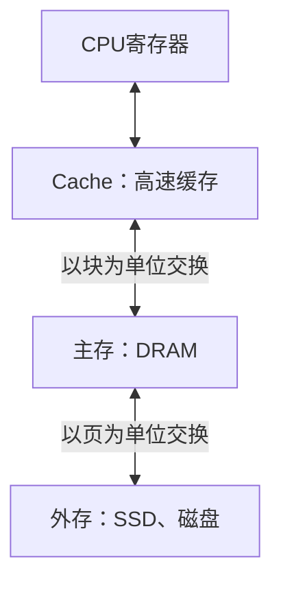
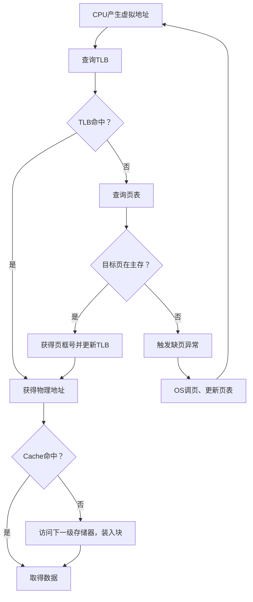

本章归纳37道历年真题和32道模拟题，共69道选择题，以地址分析、数据映射、访存过程和时间开销为主线。

## 一、整章考点的重要程度

以下为原题库章节分类统计。

| 知识模块        | 真题 | 模拟题 | 复习优先级 |
| ----------- | -- | --- | ----- |
| 存储器概述与局部性   | 1  | 1   | ★★★   |
| 半导体存储器与多体存储 | 7  | 5   | ★★★★  |
| 主存组织与CPU连接  | 8  | 5   | ★★★★★ |
| 外部存储器       | 4  | 6   | ★★★   |
| Cache       | 9  | 13  | ★★★★★ |
| 虚拟存储器       | 8  | 2   | ★★★★★ |
| 合计          | 37 | 32  | —     |

模拟题中部分TLB题目被归入了Cache章节，表格保留了原资料的分类。这些数量也不代表未来考试的实际出题概率。

**最值得投入时间的四大核心能力：**

1. 掌握存储容量、编址方式、地址线、芯片扩展之间的关系。
2. 掌握Cache地址划分、映射、替换和容量计算。
3. 能够根据程序的访存序列分析Cache命中率及性能。
4. 彻底理解TLB、页表、Cache和主存之间的关系。

## 二、首先建立整个存储系统的知识框架

### 1. 存储器层次结构的本质

计算机为什么不直接使用一种存储器？

因为速度、容量和成本难以同时达到最优。



越靠近CPU，通常速度越快、容量越小、单位容量成本越高。

两个重要的存储层次：

| 比较项目 | Cache—主存   | 主存—外存       |
| ---- | ---------- | ----------- |
| 主要目的 | 提高访存速度     | 扩大可用的逻辑地址空间 |
| 交换单位 | 块          | 页           |
| 管理方式 | 主要由硬件完成    | 硬件与操作系统共同完成 |
| 未命中  | 通常由硬件处理    | 缺页异常，由OS处理  |
| 映射方式 | 直接、组相联、全相联 | 页可装入任意可用页框  |
| 写策略  | 直写或回写      | 通常采用回写      |
| 共同基础 | 局部性原理      | 局部性原理       |

对应题目：2024年真题第29题、王道卷四第18道分类题、王道卷七第23道分类题。

注意：虚拟存储器的容量并不等于主存容量加外存容量，其理论地址空间主要由虚拟地址位数决定，实际可用容量还受到系统资源限制。

### 2. 局部性原理：为什么Cache能够发挥作用？

| 局部性   | 本质         | 典型例子          |
| ----- | ---------- | ------------- |
| 时间局部性 | 同一个地址被反复访问 | 循环变量、循环体指令    |
| 空间局部性 | 相邻地址被陆续访问  | 顺序遍历数组、顺序执行指令 |

2017年408真题，资料第1题：

```c
for (i = 0; i <= 9; i++) {
    temp = 1;
    for (j = 0; j <= i; j++)
        temp *= a[j];
    sum += temp;
}
```

数组的访问顺序为：

```text
a[0]
a[0] a[1]
a[0] a[1] a[2]
a[0] a[1] a[2] a[3]
...
```

同一元素反复访问，体现时间局部性；相邻元素连续访问，体现空间局部性。

因此两种局部性都有，选A。

**以后遇到局部性题目，不要只看代码中有没有循环，而要看实际产生的地址访问序列。**

## 三、半导体存储器：从物理原理推导性质

### 1. SRAM、DRAM、ROM、Flash的核心区别

| 属性      | SRAM  | DRAM | ROM   | Flash  |
| ------- | ----- | ---- | ----- | ------ |
| 断电丢失数据  | 是     | 是    | 否     | 否      |
| 需要周期性刷新 | 否     | 是    | 否     | 否      |
| 典型存储原理  | 双稳态电路 | 电容电荷 | 依类型而定 | 电荷存储   |
| 速度      | 快     | 相对较慢 | 依类型而定 | 读写不对称  |
| 集成度     | 较低    | 较高   | —     | 较高     |
| 典型用途    | Cache | 主存   | 固件    | SSD、U盘 |
| 行列地址复用  | 通常不采用 | 通常采用 | 通常不采用 | 依接口而定  |

真题中的常见陷阱：

- SRAM虽然不需要刷新，但仍然是易失性存储器。
- SDRAM中的S表示同步，不表示静态，因此仍然需要刷新。
- 随机存取不等于可以任意写入，ROM也可以采用随机存取方式读取。
- Flash是非易失性半导体存储器，但读写速度并不相同。
- Cache和TLB通常不使用DRAM。

### 2. DRAM地址引脚：必须理解地址复用

这是2014、2018、2022年真题反复出现的考点，模拟题也专门强化了这一部分。

假设DRAM芯片具有 $r$ 行、$c$ 列，每个位置存储 $w$ 位。

芯片容量为：

$$
C=r\times c\times w\ \mathrm{bit}
$$

由于行地址和列地址分时使用同一组引脚，因此地址引脚数为：

$$
n=\max(\lceil\log_2r\rceil,\lceil\log_2c\rceil)
$$

而不是：

$$
\log_2r+\log_2c
$$

这是DRAM与普通SRAM地址引脚计算的关键区别。

#### 代表题1：2018年408真题，第7题

一个 $2K\times1$ 位的DRAM芯片，要求地址引脚数最少，并尽量减少刷新开销，行数和列数分别是多少？

A. 2048、1

B. 64、32

C. 32、64

D. 1、2048

首先：

$$
2K=2^{11}=2048
$$

| 行数   | 列数   | 地址引脚数 | 每轮刷新行数 |
| ---- | ---- | ----- | ------ |
| 2048 | 1    | 11    | 2048   |
| 64   | 32   | 6     | 64     |
| 32   | 64   | 6     | 32     |
| 1    | 2048 | 11    | 1      |

先满足地址引脚最少，再满足刷新开销最小。

答案为C。

#### 这道题真正要学会什么？

DRAM地址引脚复用的目的是减少引脚数量，因此行列地址位数应该尽量接近。

DRAM按行刷新，因此在地址引脚数相同的情况下，行数越少，需要执行的刷新操作次数通常越少。

对于采用均衡行列地址设计的 $2^n\times w$ 位DRAM芯片：

$$
\text{地址引脚数}=\left\lceil\frac n2\right\rceil
$$

$$
\text{数据引脚数}=w
$$

例如2014年真题：

$$
4M\times8=2^{22}\times8
$$

地址引脚为11根，数据引脚为8根，两者合计19根。

<Callout type="warn" title="DRAM引脚计算">

**易错点：题目问地址引脚和数据引脚总数时，不要额外加上片选、读写控制、RAS和CAS等控制引脚。**

</Callout>

如果题目问行缓冲区大小，则计算一整行的数据量：

$$
C_{\text{row buffer}}=c\times w
$$

该公式可以直接解决2022年真题中的行缓冲区问题。

## 四、主存容量扩展：掌握二维模型

这是本章最稳定、最容易通过系统训练拿分的计算题。

### 1. 存储容量的本质

所有存储器规格都可以写成：

$$
\boxed{\text{地址单元数量}\times\text{每单元位数}}
$$

例如：

$$
4K\times8\mathrm{bit}
$$

表示有4K个存储单元，每个单元存储8位，因此芯片容量为4KB。

而：

$$
4K\times4\mathrm{bit}
$$

容量只有2KB，而不是4KB。

### 2. 字扩展与位扩展

假设目标存储器规格为 $N\times W$，单个芯片规格为 $n\times w$。

则：

$$
\text{字扩展倍数}=\frac Nn
$$

$$
\text{位扩展倍数}=\frac Ww
$$

$$
\boxed{\text{芯片数量}=\frac Nn\times\frac Ww}
$$

两种扩展解决的问题不同：

| 扩展方式   | 增加什么      | 硬件实现        |
| ------ | --------- | ----------- |
| 字扩展    | 可寻址单元数量   | 高位地址选择不同芯片组 |
| 位扩展    | 每个单元的数据宽度 | 多片芯片同时工作    |
| 字位同时扩展 | 地址数量和位宽   | 先并联成组，再扩展组数 |

例如使用 $2K\times4$ 位芯片组成 $8K\times8$ 位存储器。

```text
              高位地址进行片选

        芯片组0     芯片组1     芯片组2     芯片组3
        ┌──┬──┐    ┌──┬──┐    ┌──┬──┐    ┌──┬──┐
        │4 │4 │    │4 │4 │    │4 │4 │    │4 │4 │
        └──┴──┘    └──┴──┘    └──┴──┘    └──┴──┘
          8位        8位        8位        8位

          2K         2K         2K         2K
```

每组2片进行位扩展，一共4组进行字扩展，因此需要8片。

### 3. 编址方式决定一个地址代表多少容量

这是主存计算题最大的陷阱之一。

$$
\boxed{\text{存储容量}=\text{地址数量}\times\text{编址单位大小}}
$$

假设地址线有20根：

| 编址方式    | 地址数量         | 实际容量 |
| ------- | ------------ | ---- |
| 按字节编址   | $2^{20}$ | 1MB  |
| 按16位字编址 | $2^{20}$ | 2MB  |
| 按32位字编址 | $2^{20}$ | 4MB  |
| 按64位字编址 | $2^{20}$ | 8MB  |

地址数量没有变化，变化的是每个地址对应的数据量。

#### 代表题2：2021年408真题，第15题

某计算机具有24位地址线和32位数据线，按字编址，字长32位。

地址范围000000H～3FFFFFH为RAM区，使用 $512K\times8$ 位RAM芯片，需要多少片？

<Steps>

<Step>

### 第一步：计算RAM区的地址数量

$$
3FFFFF_{\mathrm H}-000000_{\mathrm H}+1 =2^{22}
$$

</Step>

<Step>

### 第二步：根据按字编址确定目标规格

$$
2^{22}\times32\mathrm{bit}
$$

</Step>

<Step>

### 第三步：分别计算字扩展和位扩展

$$
\text{字扩展}=\frac{2^{22}}{2^{19}}=8
$$

$$
\text{位扩展}=\frac{32}{8}=4
$$

所以：

$$
\boxed{8\times4=32\text{片}}
$$

答案C。

如果错误地按照字节编址，就会少算4倍。

</Step>

</Steps>

### 4. 芯片所在地址区间的通用解法

对应2010年真题第10题、王道卷一第8道分类模拟题。

假设每个芯片组管理 $S$ 个连续地址，目标地址为 $A$。

则所在芯片组号为：

$$
g=\left\lfloor\frac AS\right\rfloor
$$

该芯片组的最小地址为：

$$
A_{\min}=gS
$$

最大地址为：

$$
A_{\max}=(g+1)S-1
$$

王道卷一模拟题中，使用 $8K\times8$ 位芯片组成 $32K\times32$ 位存储器，按字编址。

每组管理：

$$
8K=2000_{\mathrm H}
$$

因此地址区间划分为：

| 芯片组 | 地址范围        |
| --- | ----------- |
| 0   | 0000H～1FFFH |
| 1   | 2000H～3FFFH |
| 2   | 4000H～5FFFH |
| 3   | 6000H～7FFFH |

地址41F0H属于第2组，所在芯片组最大地址为5FFFH。

### 5. MAR和MDR究竟由什么决定？

| 寄存器 | 决定因素                            |
| --- | ------------------------------- |
| MAR | 主存地址空间和编址方式                     |
| MDR | 存储器一次交换的数据宽度，在常见题设中与存储器数据总线宽度对应 |

2011年真题给出主存地址空间64MB，实际安装的主存只有32MB，按字节编址。

MAR仍然至少需要：

$$
\log_2(64\times2^{20})=26\text{位}
$$

<Callout type="warn" title="MAR位数">

**MAR取决于能够寻址的空间，而不是当前安装的内存容量。**

</Callout>

## 五、多体交叉存储器：本质是流水并行

这部分在2015、2017年真题中出现过，模拟题对带宽、体冲突、突发传送进行了大量强化。

### 1. 高位交叉与低位交叉

假设有4个存储体，采用低位交叉编址：

| 体内地址 | 体0 | 体1 | 体2 | 体3 |
| ---- | -- | -- | -- | -- |
| 0    | 0  | 1  | 2  | 3  |
| 1    | 4  | 5  | 6  | 7  |
| 2    | 8  | 9  | 10 | 11 |
| 3    | 12 | 13 | 14 | 15 |

对于 $m$ 体低位交叉存储器：

$$
\boxed{\text{体号}=A\bmod m}
$$

$$
\boxed{\text{体内地址}=\left\lfloor\frac Am\right\rfloor}
$$

连续地址被分散在不同存储体中，因此可以让多个存储体交错工作。

注意，普通位扩展是多片芯片共同组成一个更宽的存储字，而多体交叉主要强调多个存储体的独立访问能力与并行性，不能仅凭芯片数量就认定采用了交叉编址。

### 2. 带宽计算的本质

假设存储体数量为 $m$，每个存储体的存储周期为 $T$，单体一次传输 $W$ 字节。

理想情况下：

$$
\Delta t=\frac Tm
$$

$$
\boxed{B_{\max}=\frac{mW}{T}}
$$

这个公式计算的是稳态最大带宽，需要总线支持相应的传输速率，并且没有体冲突。

例如王道卷八与竞成模拟七的重复考点：

8体交叉存储器，每体数据宽度64位，存储周期80ns。

$$
W=8B
$$

$$
\Delta t=\frac{80}{8}=10ns
$$

$$
B_{\max}=\frac{8B}{10ns}=800MB/s
$$

这里的核心不是记公式，而是理解8个存储体交错工作，把数据输出间隔从80ns缩短到10ns。

#### 特别注意三个不同时间

| 时间概念   | 含义               |
| ------ | ---------------- |
| 存取时间   | 发起一次访问到数据可用的时间   |
| 存储周期   | 同一存储体两次访问启动的最短间隔 |
| 总线传输间隔 | 总线上连续传输数据的时间间隔   |

计算同一存储体的持续吞吐能力，要使用存储周期，而不是存取时间。

### 3. 体冲突的判断方法

<Callout type="warn" title="体冲突的判定条件">

**相同体号不一定产生冲突，只有前一次访问尚未结束存储周期时再次访问，才发生冲突。**

</Callout>

竞成模拟一，资料第4题：

4体低位交叉，存储周期80ns，总线启动间隔20ns，访问地址：

$$
0,3,9,17,2,4,8,67,51,10
$$

转化为体号：

$$
0,3,1,1,2,0,0,3,3,2
$$

| 地址 | 体号 | 计划启动时间/ns | 实际启动时间/ns |
| -- | -- | --------- | --------- |
| 0  | 0  | 0         | 0         |
| 3  | 3  | 20        | 20        |
| 9  | 1  | 40        | 40        |
| 17 | 1  | 60        | **120**   |
| 2  | 2  | 140       | 140       |
| 4  | 0  | 160       | 160       |
| 8  | 0  | 180       | **240**   |
| 67 | 3  | 260       | 260       |
| 51 | 3  | 280       | **340**   |
| 10 | 2  | 360       | 360       |

发生3次冲突。

可推广的公式：

$$
t_i=\max(t_{i-1}+\Delta t,\ t_{\text{同体上次启动}}+T)
$$

发生冲突后，后面的访问时间也要随之延后。

### 4. 非对齐访问：容易被忽视的真题考点

2017年408真题第14题：32位存储器总线，读取起始地址为804001AH的double变量，需要几个存储周期？

double占8B，一次对齐访问可以读取4B。

```text
地址末尾： 18 19 1A 1B
                 x  x

地址末尾： 1C 1D 1E 1F
           x  x  x  x

地址末尾： 20 21 22 23
           x  x
```

数据虽然只有8B，却跨越了3个对齐的数据区间，所以在题目的组织方式下需要3个存储周期。

通用公式：访问起始字节地址为 $A$，数据长度为 $L$，每次访问一个大小为 $W$ 的对齐区间。

$$
N=\left\lfloor\frac{A+L-1}{W}\right\rfloor -\left\lfloor\frac AW\right\rfloor+1
$$

不要机械地用数据长度除以总线宽度。

## 六、Cache映射：全章最重要的知识点

Cache的核心问题是：

> 主存中的某一个块，应该存放到Cache的什么位置？如何判断该位置存放的是不是我要找的块？

### 1. 三种映射方式的本质区别

| 映射方式  | 一个主存块可以放在哪里 | 特点          |
| ----- | ----------- | ----------- |
| 直接映射  | 唯一指定行       | 简单、快，容易产生冲突 |
| 全相联映射 | 任意一行        | 灵活，比较硬件开销大  |
| 组相联映射 | 指定组中的任意一行   | 两者折中        |

最重要的认识是：

**直接映射和全相联映射都可以看作组相联映射的特殊情况。**

直接映射就是每组只有1行。

全相联映射就是整个Cache只有1组。

因此不需要背三套公式。

### 2. 统一的地址划分公式

设主存地址长度为 $n$ 位，Cache数据区容量为 $C$，块大小为 $B$，采用 $k$ 路组相联。

$$
\text{Cache行数}=\frac CB
$$

$$
\text{Cache组数}=\frac{C}{Bk}
$$

假设按字节编址：

$$
b=\log_2B
$$

$$
s=\log_2\frac{C}{Bk}
$$

$$
\boxed{t=n-s-b}
$$

其中 $b$ 为块内偏移位数，$s$ 为组号位数，$t$ 为标记位数。

如果按字编址，则块内偏移的计算单位应该是字，而不是字节。

### 3. 不要死记地址字段，理解它们的功能

| 地址字段       | 解决的问题           |
| ---------- | --------------- |
| Tag标记      | 这一行到底是哪一个主存块    |
| Index组号    | 应该去Cache的哪一组寻找  |
| Offset块内偏移 | 找到块后，需要块中的哪部分数据 |

对于具体地址 $A$，有：

$$
\text{主存块号}=\left\lfloor\frac AB\right\rfloor
$$

$$
\text{Cache组号}=\text{主存块号}\bmod S
$$

$$
\text{Tag}=\left\lfloor\frac{\text{主存块号}}S\right\rfloor
$$

其中 $S$ 为组数，$A$ 与 $B$ 必须使用相同的编址单位。

#### 代表题3：2022年408真题，第28题

主存地址32位，按字节编址，Cache数据区32KB，块大小64B，采用8路组相联。

求比较器的个数与位数。

先计算行数：

$$
L=\frac{32KB}{64B}=512=2^9
$$

然后计算组数：

$$
S=\frac{512}{8}=64=2^6
$$

块内偏移：

$$
b=\log_2 64=6
$$

标记位：

$$
t=32-6-6=20
$$

主存地址划分如下：

```text
31                    12 11         6 5          0
┌───────────────────────┬────────────┬────────────┐
│       Tag：20位       │ 组号：6位  │ 偏移：6位  │
└───────────────────────┴────────────┴────────────┘
```

访问Cache时，通过组号选择64组中的一组，再比较该组8行的Tag。

因此需要8个20位的比较器。

答案A。

#### 这道题需要掌握的真正规律

在常见的并行标记比较模型下：

$$
\boxed{\text{比较器数量}=\text{相联路数}}
$$

$$
\boxed{\text{比较器宽度}=\text{Tag位数}}
$$

直接映射只需要比较一行，全相联需要比较所有行，组相联只比较选定组中的所有路。

<Callout type="warn" title="Cache地址字段">

**路数不是地址字段。** 8路组相联并不意味着地址中还需要额外划出3位路号。

</Callout>

## 七、Cache容量计算：数据区不等于总容量

这是2015、2021年真题和竞成多套模拟题共同强调的考点。

### 1. 一个Cache行究竟包含什么？

```text
┌────────┬────────┬────────────┬──────────────┐
│ 有效位 │  脏位  │  Tag标记   │   数据块     │
└────────┴────────┴────────────┴──────────────┘
```

| 字段   | 作用                |
| ---- | ----------------- |
| 有效位  | 判断该行内容是否有效        |
| 脏位   | 判断数据是否被修改但尚未写回主存  |
| Tag  | 标识对应的主存块          |
| 数据块  | 存放真正的数据           |
| 替换信息 | 在需要时维护LRU、FIFO等状态 |

回写法需要脏位，普通直写法通常不需要脏位。直接映射不需要替换算法；随机替换通常不需要为每行记录LRU状态。

#### 代表题4：2021年408真题，第27题

主存地址32位，Cache数据区32KB，块大小32B，采用直接映射和回写法，求Cache每一行至少多少位。

<Steps>

<Step>

### 第一步，块内偏移

$$
b=\log_2 32=5
$$

</Step>

<Step>

### 第二步，行数

$$
L=\frac{32KB}{32B}=1024=2^{10}
$$

</Step>

<Step>

### 第三步，标记位

$$
t=32-10-5=17
$$

</Step>

<Step>

### 第四步，计算每行全部信息

| 字段  | 位数      |
| --- | ------- |
| 数据  | 256     |
| Tag | 17      |
| 有效位 | 1       |
| 脏位  | 1       |
| 总计  | **275** |

因此：

$$
\boxed{256+17+1+1=275\mathrm{bit}}
$$

答案A。

如果求整个Cache容量：

$$
275\times1024=275Kbit
$$

</Step>

</Steps>

### 2. 通用公式

$$
\boxed{ C_{\text{总}} =L(8B+t+v+d)+R }
$$

其中：

- $L$：Cache行数。
- $B$：每行数据的字节数。
- $t$：Tag位数。
- $v$：有效位数，通常为1。
- $d$：脏位数，回写法通常为1。
- $R$：额外的替换状态等信息。

题目没有明确替换状态实现方式时，不要擅自假定所有LRU实现都使用相同数量的状态位。

### 3. 从公式进一步理解Cache设计

其他条件不变时：

| 改变条件      | 可能产生的影响                     |
| --------- | --------------------------- |
| 增大Cache容量 | 通常减少容量缺失                    |
| 增大块大小     | 可能更好地利用空间局部性，但行数减少、缺失代价可能增加 |
| 增大相联度     | 通常有利于减少冲突缺失，但比较开销增加         |
| 使用全相联     | Tag更长，需要比较的行更多              |
| 使用回写法     | 减少部分主存写入，但增加脏位管理            |

模拟题经常使用“一定提高”“一定降低”作为干扰项。

Cache性能取决于程序访问模式、容量、块大小、相联度、替换算法和缺失代价，不能只由某一个参数判断。

## 八、Cache替换算法：用状态模拟，不凭感觉

### 1. 必须区分三种替换依据

| 算法   | 替换对象      | 命中时是否更新状态 |
| ---- | --------- | --------- |
| FIFO | 最早进入的块    | 不改变进入顺序   |
| LRU  | 最久没有被访问的块 | 更新访问顺序    |
| LFU  | 访问次数最少的块  | 增加访问次数    |

最容易犯的错误是把LRU和FIFO混为一谈。

### 2. 模拟题的标准解法

竞成模拟五，资料第24题：

Cache有4行，采用2路组相联，每块1个字，按字编址，LFU替换。

访问地址：

$$
0,4,9,0,2,6,0,5,5,2
$$

因为共有2组：

$$
\text{组号}=A\bmod2
$$

偶数进入第0组，奇数进入第1组。

括号中为当前访问次数。

| 访问地址 | 第0组        | 第1组        | 是否命中 |
| ---- | ---------- | ---------- | ---- |
| 0    | 0(1)       | —          | 否    |
| 4    | 0(1), 4(1) | —          | 否    |
| 9    | 0(1), 4(1) | 9(1)       | 否    |
| 0    | 0(2), 4(1) | 9(1)       | 是    |
| 2    | 0(2), 2(1) | 9(1)       | 否    |
| 6    | 0(2), 6(1) | 9(1)       | 否    |
| 0    | 0(3), 6(1) | 9(1)       | 是    |
| 5    | 0(3), 6(1) | 9(1), 5(1) | 否    |
| 5    | 0(3), 6(1) | 9(1), 5(2) | 是    |
| 2    | 0(3), 2(1) | 9(1), 5(2) | 否    |

共命中3次。

真正需要形成的解题习惯是：

**先计算主存块号，再计算组号，最后只在指定组内部执行替换。**

不能因为Cache其他组还有空闲行，就把主存块放到其他组。

<Callout type="warn" title="题库勘误：2012年真题LRU命中次数">

2012年408真题，资料第23题：

4行Cache，2路组相联，LRU算法，每块1个字，按字编址，访问序列：

$$
0,4,8,2,0,6,8,6,4,8
$$

由于所有地址都是偶数，根据标准组相联映射规则，全部映射到第0组，而该组只有2行。

按照标准LRU模拟，仅第8次访问地址6时命中，共命中1次。

但是题库标注的答案为C，即3次；其详细解析也明确指出存在争议，并推导出1次。

**建议掌握标准映射与LRU规则，不要为了迎合这道争议题而记忆特殊规则。**

</Callout>

## 九、程序访问Cache的命中率：必须真正理解块

Cache缺失率分析的关键是理解Cache以块为单位加载数据，而不是只进行地址字段划分。

### 1. Cache一次装入的不是一个变量，而是一个块

假设int占4B，Cache块大小16B。

那么一个块可以存放4个int。

```text
主存中的数组

块0：a[0]  a[1]  a[2]  a[3]
块1：a[4]  a[5]  a[6]  a[7]
块2：a[8]  a[9]  a[10] a[11]
```

第一次读取a[0]发生缺失时，通常会将整个块装入Cache。

在该块没有被替换的情况下，后续读取a[1]、a[2]、a[3]均可命中。

这就是空间局部性能够提高Cache命中率的原因。

#### 代表题5：2016年408真题，第26题

```c
for (k = 0; k < 1000; k++)
    a[k] = a[k] + 32;
```

int占4B，Cache数据区1KB，块大小16B，直接映射，初始为空。

求访问数组a的Cache缺失率。

<Steps>

<Step>

### 第一步：每个块容纳的元素数量

$$
\frac{16}{4}=4
$$

</Step>

<Step>

### 第二步：每次循环的访存次数

```text
a[k] = a[k] + 32;
```

这条语句包含读取a[k]、修改数值、写回a[k]。

其中读和写各访问一次数组，因此：

$$
N_{\text{访问}}=1000\times2=2000
$$

</Step>

<Step>

### 第三步：计算缺失次数

按题目通常采用的数组块对齐模型，每4个元素产生一次首次访问缺失。

$$
N_{\text{miss}}=\frac{1000}{4}=250
$$

一个块内的访问情况为：

| 操作    | 结果   |
| ----- | ---- |
| 读a[0] | Miss |
| 写a[0] | Hit  |
| 读a[1] | Hit  |
| 写a[1] | Hit  |
| 读a[2] | Hit  |
| 写a[2] | Hit  |
| 读a[3] | Hit  |
| 写a[3] | Hit  |

8次访问只有1次缺失。

$$
\boxed{\text{缺失率}=\frac{250}{2000}=12.5\%}
$$

答案C。

</Step>

</Steps>

#### 题目变形

在数组块对齐、缓存块未被提前替换等条件下，假设每个Cache块容纳 $k$ 个数组元素：

| 程序类型           | 每块访问次数   | 每块缺失次数  | 缺失率          |
| -------------- | -------- | ------- | ------------ |
| 顺序读取           | $k$  | 1       | $1/k$    |
| 先读后写           | $2k$ | 1       | $1/(2k)$ |
| 顺序写入，写分配       | $k$  | 1       | $1/k$    |
| 顺序写入，非写分配，初始为空 | $k$  | $k$ | 100%         |

注意：写分配和非写分配是写缺失时的处理策略，不能与直写和回写混淆。

### 2. 二维数组：不要看到按列遍历就判定命中率低

竞成模拟二，资料第27题，是一道很有价值的强化题。

```c
int a[32][64];

for (int j = 0; j < 64; j++)
    for (int i = 0; i < 32; i++)
        a[i][j] = 1;
```

数组按行优先存储，Cache有64组，每组4行，块大小32B。

按照题库解析采用的int为4B、数组块对齐、写分配模型：

一个块容纳：

$$
32/4=8\text{个元素}
$$

每行数组占8个块。

数组元素所在主存块的相对编号：

$$
b(i,j)=8i+\left\lfloor\frac j8\right\rfloor
$$

其相对Cache组号为：

$$
g(i,j)=b(i,j)\bmod64
$$

假设固定第0列，访问的块号为：

$$
0,8,16,24,\ldots,248
$$

对应组号依次为：

$$
0,8,16,24,32,40,48,56,0,8,\ldots
$$

每个被使用的组恰好需要容纳4个不同块，而每组正好有4行。

因此不会发生组内容量溢出，访问下一列时，前面载入的块仍然可以保留在Cache中。

总块数：

$$
32\times64/8=256
$$

总访问次数：

$$
32\times64=2048
$$

所以：

$$
h=1-\frac{256}{2048}=87.5\%
$$

这里最有价值的不是87.5%这个答案，而是以下认识：

**按列遍历只是使连续访问的地址间隔增大，并不必然导致Cache命中率很低。真正决定命中率的是数据块是否能够保留到下一次使用。**

原题引用了同套试卷的另一道题作为硬件条件，题库解析给出了对应Cache参数；数组对齐及写分配是计算该答案所采用的假设，条件改变时结论也可能改变。

### 3. 掌握Cache三类缺失

| 缺失类型 | 本质             | 改善方式         |
| ---- | -------------- | ------------ |
| 强制缺失 | 某块首次被访问        | 预取、合理选择块大小   |
| 容量缺失 | Cache总容量装不下工作集 | 增大Cache容量    |
| 冲突缺失 | 多个块竞争有限的指定位置   | 提高相联度、改善数据布局 |

做复杂命中率题目时，先数第一次访问的块，再检查是否有块被替换后重新访问。

## 十、Cache写策略：两组概念必须彻底分开

很多综合选择题都依赖这里。

<Tabs items={['写命中', '写未命中']}>
<Tab value="写命中">

| 策略                | 写命中时         | 特点             |
| ----------------- | ------------ | -------------- |
| 直写法 Write Through | 更新Cache并写主存  | 主存写流量较大        |
| 回写法 Write Back    | 更新Cache并设置脏位 | 脏块被替换等必要时才写回主存 |

</Tab>
<Tab value="写未命中">

| 策略                     | 写未命中时                |
| ---------------------- | -------------------- |
| 写分配 Write Allocate     | 将所在主存块装入Cache，再进行写入  |
| 非写分配 No Write Allocate | 不调入Cache，直接向下一级存储器写入 |

常见组合是直写配合非写分配，回写配合写分配，但并不是逻辑上必须这样组合。

</Tab>
</Tabs>

#### 代表题6：2015年408真题，第32题

执行指令：

```asm
add xaddr, 3
```

系统使用分页虚拟存储管理，有TLB，Cache采用直写法，问至少访问几次主存。

分析完整指令执行过程：

| 阶段    | 最理想情况        | 主存访问次数 |
| ----- | ------------ | ------ |
| 取指令   | TLB、Cache均命中 | 0      |
| 读取x   | TLB、Cache均命中 | 0      |
| ALU计算 | CPU内部完成      | 0      |
| 写回x   | 直写法必须更新主存    | 1      |
| 合计    |              | **1**  |

答案B。

如果改为回写法，并且写命中时无需立即写回，那么至少访问主存0次。

这道题体现了选择题中非常重要的思维方式：**看到“至少”，就应该主动构造满足题意的最理想情况，再判断有哪些访问无论如何都无法省略。**

## 十一、Cache性能计算：区分时间、次数和代价

### 1. 平均访存时间

设Cache命中率为 $h$，命中时间为 $T_c$，一次缺失相对于命中的额外开销为 $P$。

则：

$$
\boxed{T_{\text{avg}}=T_c+(1-h)P}
$$

这个公式是最通用的，因为它明确区分了基础访问时间与额外缺失代价。

若Cache和主存串行访问，主存额外访问时间为 $T_m$：

$$
T_{\text{avg}}=hT_c+(1-h)(T_c+T_m)
$$

化简：

$$
T_{\text{avg}}=T_c+(1-h)T_m
$$

如果题目直接给的是缺失情况下的总时间 $T_{\text{miss}}$，则使用：

$$
T_{\text{avg}}=hT_c+(1-h)T_{\text{miss}}
$$

不要把Cache探测时间重复计算。

### 2. Cache系统效率

在本题库采用的定义下：

$$
\eta=\frac{T_c}{T_{\text{avg}}}
$$

王道卷七第20道分类模拟题给出命中4800次，缺失200次，Cache访问时间10，主存访问时间50，两者不能同时访问。

$$
h=\frac{4800}{5000}=0.96
$$

$$
T_{\text{avg}}=10+0.04\times50=12
$$

$$
\eta=\frac{10}{12}\approx0.833
$$

命中率是96%，而效率是83.3%，不要将两者混淆。

### 3. Cache缺失引起的CPU执行时间增加

竞成模拟五，资料第30题：

主频1GHz，命中时CPI为10，每次缺失额外耗时100ns，执行100条指令，平均每条指令访存1.5次，缺失率10%。

基础执行时间：

$$
T_{\text{base}} =100\times10\times1ns =1000ns
$$

缺失次数：

$$
N_{\text{miss}}=100\times1.5\times10\%=15
$$

额外时间：

$$
T_{\text{extra}}=15\times100ns=1500ns
$$

总执行时间：

$$
\boxed{T=1000+1500=2500ns}
$$

可推广为：

$$
\boxed{ T_{\text{CPU}} =IC\times CPI_{\text{base}}\times T_{\text{clk}} +IC\times r\times m\times P }
$$

其中 $r$ 是每条指令的平均访存次数，$m$ 是缺失率，$P$ 是每次缺失的额外时间。

该公式适用于题目采用的缺失停顿简单相加模型。

### 4. 突发传送与DDR带宽

模拟题第7、28、29题均考查数据传输的时序。

突发传送的典型过程：

```text
发送地址和命令 → 等待首个数据 → 连续传送多个数据
```

例如500MHz总线，发送命令1周期，准备首数据8周期，块大小64B，每拍传输8B。

总线周期：

$$
T=\frac1{500MHz}=2ns
$$

传输拍数：

$$
64/8=8
$$

按题目明确给出的先准备再传送模型：

$$
T_{\text{miss}}=(1+8+8)\times2=34ns
$$

DDR在一个总线时钟周期的上升沿和下降沿各传输一次。

$$
\text{传输率}=2f_{\text{总线时钟}}
$$

$$
\text{带宽}=\text{每秒传输次数}\times\text{每次传输字节数}
$$

DDR3的8n预取表示内部核心频率与数据传输率之间具有相应的8倍关系，不能因此将总线时钟频率也直接认为是核心频率的8倍。

## 十二、虚拟存储器、TLB与Cache：最重要的综合知识

这部分是计组与操作系统的交叉考点，尤其值得掌握。

### 1. 三个结构分别保存什么？

| 结构    | 保存的内容           | 主要作用   |
| ----- | --------------- | ------ |
| 页表    | 虚页到物理页框的映射及状态信息 | 完成地址转换 |
| TLB   | 最近使用的部分页表项      | 加快地址转换 |
| Cache | 主存中的数据块或指令块     | 加快数据访问 |

一句话理解：

<Callout type="info" title="TLB与Cache">

**TLB帮助CPU找到数据的物理地址，Cache帮助CPU更快地取得该地址对应的数据。**

</Callout>

TLB不是普通数据Cache，Cache也不是页表。

### 2. 完整的访存过程

以下采用408常见的先完成地址转换、再按物理地址访问Cache的简化模型。



最重要的区别是：TLB缺失、Cache缺失通常不是程序异常；页面缺失需要触发缺页异常，由操作系统处理。

缺页处理完成后，需要重新执行产生缺页的指令，而不是直接执行下一条指令。

### 3. TLB、Page、Cache命中组合

2010年408真题第30题专门考查这一关系。

| TLB | 页面在主存 | Cache | 能否发生 |
| --- | ----- | ----- | ---- |
| 命中  | 是     | 命中    | 能    |
| 命中  | 是     | 缺失    | 能    |
| 缺失  | 是     | 命中    | 能    |
| 缺失  | 是     | 缺失    | 能    |
| 缺失  | 否     | 缺失    | 能    |
| 命中  | 否     | 命中或缺失 | 不能   |
| 缺失  | 否     | 命中    | 不能   |

上述判断建立在正常有效的地址转换以及Cache、主存保持一致管理的考试模型下。

需要形成的逻辑关系：

$$
\text{TLB命中}\Rightarrow\text{目标页在主存}
$$

$$
\text{Cache命中}\Rightarrow\text{目标页在主存}
$$

$$
\text{TLB缺失}\nRightarrow\text{缺页}
$$

$$
\text{Cache缺失}\nRightarrow\text{缺页}
$$

TLB缺失之后需要查页表，但页表项本身也可能被普通Cache缓存，因此不一定真的访问DRAM。这正是王道卷六模拟题强化的细节。

### 4. 虚拟地址转换的本质

设页面大小为 $P$，虚拟地址为 $VA$。

$$
VPN=\left\lfloor\frac{VA}{P}\right\rfloor
$$

$$
Offset=VA\bmod P
$$

然后根据页表或TLB获得对应的物理页框号 $PFN$。

$$
\boxed{PA=PFN\times P+Offset}
$$

需要牢记：**地址转换只改变页号，不改变页内偏移。**

#### 代表题7：2022年408真题，第35题

主存地址24位，虚拟地址32位，页面大小4KB。

访问虚拟地址00082840H。

页表部分内容：

| 虚页号（十进制） | 实页号  | 存在位 |
| -------- | ---- | --- |
| 82       | 024H | 0   |
| 129      | 180H | 1   |
| 130      | 018H | 1   |

页面大小：

$$
4KB=2^{12}B
$$

因此页内偏移为12位，也就是3个十六进制数字。

```text
虚拟地址：00082 | 840
          虚页号  页内偏移
```

虚页号为：

$$
82_{\mathrm H}=8\times16+2=130
$$

查找十进制虚页号130，对应物理页框号018H，存在位为1。

拼接得到物理地址：

$$
\boxed{018840_{\mathrm H}}
$$

答案C。

这道题容易错误地将十六进制82当作十进制82，进而误判缺页。

因此进行地址转换时，应同时关注地址字段和进制。

### 5. TLB的组相联映射：与Cache完全同构

2024年408真题第36题：

虚拟地址32位，主存地址30位，页面大小1KB，TLB有32个表项，4路组相联，求TLB的Tag位数。

页内偏移：

$$
\log_2 1024=10
$$

虚页号长度：

$$
32-10=22
$$

TLB组数：

$$
32/4=8
$$

组号位数：

$$
\log_2 8=3
$$

Tag长度：

$$
\boxed{22-3=19}
$$

地址结构：

```text
┌───────────────────┬────────────┬──────────────┐
│ TLB Tag：19位     │ 组号：3位  │ 页内偏移10位 │
└───────────────────┴────────────┴──────────────┘
```

这是一个特别重要的知识迁移。

| 对比项    | Cache    | TLB        |
| ------ | -------- | ---------- |
| 被映射的对象 | 主存块号     | 虚页号        |
| 典型查找依据 | 物理地址     | 虚拟地址       |
| 偏移     | 块内偏移     | 页内偏移       |
| Tag    | 主存块号高位   | 虚页号高位      |
| 表项内容   | 数据块、状态信息 | 页框号、权限、状态等 |

**只要真正理解了Cache组相联映射，就可以直接迁移到TLB，不需要重新背一套公式。**

## 十三、磁盘与SSD：以理解公式和基本机制为主

这部分不需要投入过多时间，但是公式题和基本概念必须拿分。

### 1. 磁盘平均存取时间

$$
\boxed{ T=T_{\text{寻道}}+T_{\text{旋转}}+T_{\text{传输}} +T_{\text{其他}} }
$$

平均旋转延迟为旋转半圈的时间。

如果磁盘转速为 $r$ rpm：

$$
T_{\text{一圈}}=\frac{60}{r}s
$$

$$
T_{\text{平均旋转}}=\frac{30}{r}s
$$

传输时间：

$$
T_{\text{传输}}=\frac{\text{数据量}}{\text{传输速率}}
$$

2013年真题第18题给出转速10000rpm、寻道时间6ms、传输速率20MB/s、控制器延迟0.2ms，读取4KB扇区。

$$
T_{\text{旋转}}=3ms
$$

$$
T_{\text{传输}}\approx0.2ms
$$

$$
T\approx6+3+0.2+0.2=9.4ms
$$

答案B。

注意：若连续读取同一磁道中的多个相邻扇区，通常不需要对每个扇区重新计算一次寻道时间和平均旋转延迟。

### 2. 磁盘和SSD的核心区别

| 特点     | 机械磁盘  | SSD        |
| ------ | ----- | ---------- |
| 存储介质   | 磁性介质  | Flash      |
| 机械寻道   | 有     | 无          |
| 旋转延迟   | 有     | 无          |
| 随机访问性能 | 相对较差  | 通常较好       |
| 擦写寿命限制 | 机制不同  | 闪存存在有限擦写寿命 |
| 磨损均衡   | 非主要机制 | 用于延长使用寿命   |

SSD的磨损均衡不是为了直接提高读写速度，而是让不同物理块承担较均衡的擦写次数。

Flash通常以页为单位读取或编程，以块为单位擦除。

### 3. RAID的本质

| RAID机制 | 主要目的       |
| ------ | ---------- |
| 条带化    | 多盘并行，提高性能  |
| 镜像     | 保留副本，提高可靠性 |
| 奇偶校验   | 利用冗余信息恢复数据 |
| Cache  | 改善访问性能     |

RAID 0只有条带化，没有容错能力。

RAID 1使用镜像提高可靠性。

RAID 5利用分布式奇偶校验，通常可以容忍一块磁盘故障。

RAID 6使用双重校验，通常可以容忍两块磁盘故障。

2013年真题与多道模拟题都在考查一个核心区别：**提高性能与提高可靠性不是同一个目标。**

## 十四、本章所有计算题的统一解题思维

本章计算题可以归纳为以下四类数学模型。

### 模型一：容量与数量

$$
\text{容量}=\text{单元数量}\times\text{单元大小}
$$

适用于芯片扩展、主存容量、Cache行数、页框数量、DRAM行缓冲。

### 模型二：除法与取模

$$
\text{块号}=\left\lfloor\frac{\text{地址}}{\text{块大小}}\right\rfloor
$$

$$
\text{组号}=\text{块号}\bmod\text{组数}
$$

$$
\text{偏移}=\text{地址}\bmod\text{块大小}
$$

适用于Cache映射、TLB映射、虚拟地址转换、多体交叉编址、芯片地址区间。

### 模型三：地址位数划分

$$
\text{地址位数} =\text{标记位数}+\text{索引位数}+\text{偏移位数}
$$

适用于Cache、TLB、主存芯片选择、分页地址转换。

### 模型四：基础开销与额外开销

$$
\text{总时间}=\text{基础时间}+\text{额外时间}
$$

$$
\text{额外时间} =\text{事件发生次数}\times\text{单次额外开销}
$$

适用于Cache平均访问时间、CPU执行时间、缺失代价、突发传送和磁盘访问时间。

**真正学透这四个模型，比单独记忆几十条公式更加重要。**

## 十五、考前最容易出错的25个知识点

| 序号 | 常见错误             | 正确理解            |
| -- | ---------------- | --------------- |
| 1  | SRAM不刷新，所以不易失    | SRAM仍然易失        |
| 2  | SDRAM属于SRAM      | SDRAM属于DRAM     |
| 3  | DRAM地址引脚等于地址位数   | 通常采用行列分时复用      |
| 4  | DRAM逐个单元刷新       | 通常按行刷新          |
| 5  | ROM不能随机存取        | ROM可以随机读取       |
| 6  | 地址数量直接等于字节容量     | 必须考虑编址单位        |
| 7  | MAR由实际内存容量决定     | 由可寻址空间决定        |
| 8  | 地址范围直接用末地址减首地址   | 还需要加1           |
| 9  | 位扩展增加地址线         | 位扩展增加数据宽度       |
| 10 | 相同存储体号必然冲突       | 还要判断时间间隔        |
| 11 | 存取时间等于存储周期       | 两者含义不同          |
| 12 | 数据长度除以总线宽度就是访问次数 | 还需考虑是否对齐        |
| 13 | Cache组数等于行数      | 组数等于行数除以路数      |
| 14 | 相联路号是地址字段        | 路号不是地址字段        |
| 15 | Tag是完整主存块号       | 还需扣除组号部分        |
| 16 | Cache总容量就是数据容量   | 还需要Tag及状态信息     |
| 17 | LRU与FIFO相同       | 一个看访问时间，一个看进入时间 |
| 18 | 数组读改写只有一次访存      | 通常有一次读和一次写      |
| 19 | 按列遍历必然缺失率很高      | 需要分析映射与替换       |
| 20 | 增大块大小必然提高性能      | 可能增加冲突和缺失代价     |
| 21 | 直写法等于非写分配        | 属于不同分类维度        |
| 22 | TLB缺失就是缺页        | 目标页可能仍在主存       |
| 23 | TLB保存普通数据        | TLB保存地址转换信息     |
| 24 | 虚实地址转换改变页内偏移     | 页内偏移保持不变        |
| 25 | 缺页处理后执行下一条指令     | 应重新执行产生缺页的指令    |

## 十六、最值得反复练习的代表性题目

以下代表题应达到能够独立推导、处理条件变化的程度。

| 题目来源    | 资料题号 | 核心训练目标         |
| ------- | ---- | -------------- |
| 2018年真题 | 7    | DRAM地址复用与刷新    |
| 2021年真题 | 15   | 编址方式与芯片扩展      |
| 2017年真题 | 14   | 非对齐访问          |
| 2022年真题 | 28   | Cache映射与比较器    |
| 2021年真题 | 27   | Cache行容量       |
| 2016年真题 | 26   | 程序访存与缺失率       |
| 2015年真题 | 32   | 写策略与最少访存次数     |
| 2010年真题 | 30   | TLB、Cache与缺页关系 |
| 2022年真题 | 35   | 虚实地址转换         |
| 2024年真题 | 36   | TLB组相联映射       |
| 竞成模拟一   | 4    | 多体冲突时间轴        |
| 竞成模拟二   | 27   | 二维数组与Cache映射   |
| 竞成模拟五   | 24   | Cache替换算法      |
| 竞成模拟五   | 30   | Cache缺失与CPU性能  |

## 十七、如何判断自己是否真正学透了第三章？

独立回答以下问题，检验掌握程度。

- 为什么DRAM需要刷新，而SRAM不需要？
- 为什么按字编址与按字节编址会影响芯片数量？
- 为什么多体交叉能够提高带宽，却不一定缩短单次存储体访问延迟？
- 为什么组相联映射地址中没有路号字段？
- 为什么Cache的数据容量小于其实际存储容量？
- 为什么数组顺序访问通常具有较高的Cache命中率？
- 为什么按列遍历二维数组不一定导致大量Cache缺失？
- 为什么采用直写法时，即使命中Cache也可能必须访问主存？
- 为什么TLB缺失不一定产生缺页？
- 为什么虚实地址转换只改变页号，不改变页内偏移？
- 为什么提高Cache命中率不一定意味着总缺失开销更小？
- 为什么Cache映射与TLB映射可以用同一套数学模型解决？

## 本章总结

计算机组成原理第三章表面上讲的是各种存储器，实际上主要研究的是三个问题：

**数据放在哪里？怎样找到数据？取得数据需要付出多少代价？**

主存芯片扩展解决数据如何组织，多体交叉解决如何并行访问，Cache解决如何快速取得数据，TLB和页表解决如何找到数据对应的物理位置，虚拟存储器解决如何管理有限的物理存储资源。

Cache和虚拟存储器应达到能够从硬件结构直接推导公式、从程序代码直接推导访存序列的程度。
