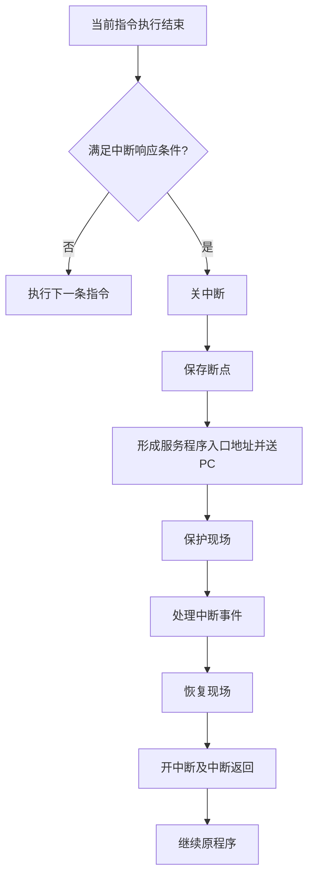
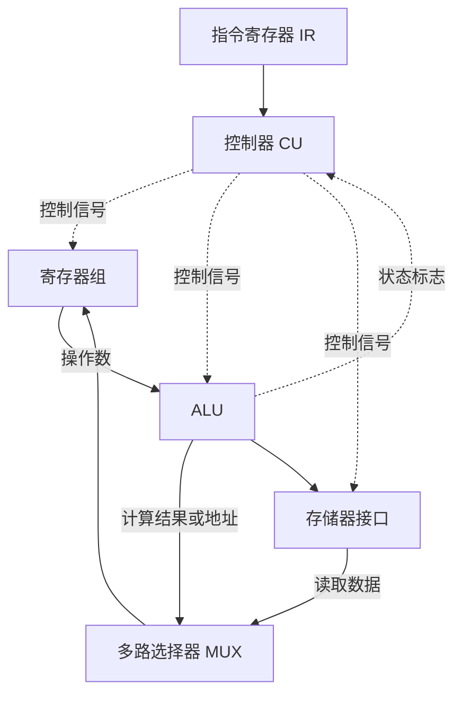
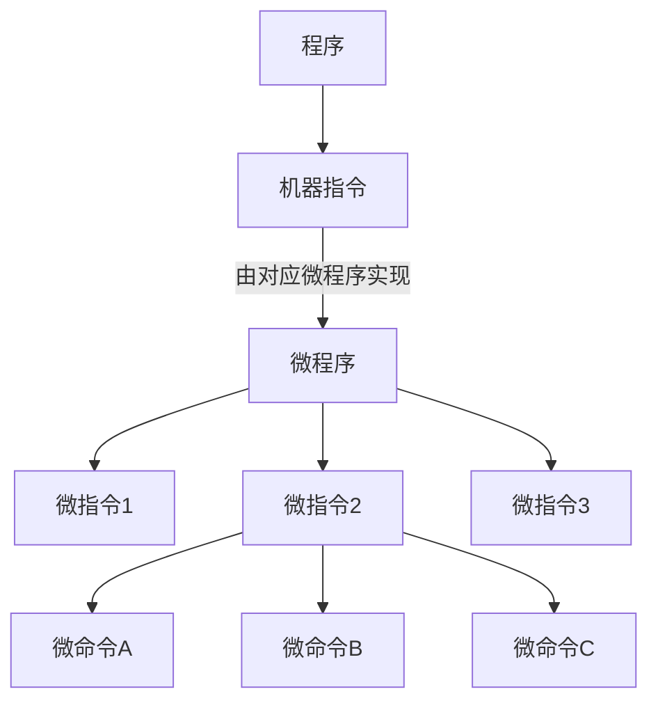

本章归纳34道历年真题和44道模拟题，共78道选择题，重点掌握数据流、控制流、流水线时序和性能计算。

## 一、本章的知识框架与复习优先级

中央处理器这一章，看起来知识点很多，但实际上主要研究三个问题：

<Cards>
<Card title="数据流">

数据在哪里，如何流动？寄存器、ALU、数据通路。

</Card>
<Card title="控制流">

谁控制数据流动，什么时候控制？控制器、指令周期、微程序。

</Card>
<Card title="指令并行">

多条指令如何高效而正确地执行？流水线、冒险、异常与中断、并行处理。

</Card>
</Cards>

根据题库原有章节分类，题目分布如下：

| 知识模块        | 真题 | 模拟题 | 合计 |
| ----------- | -- | --- | -- |
| CPU的功能和基本结构 | 5  | 5   | 10 |
| 指令执行过程      | 2  | 3   | 5  |
| 数据通路        | 2  | 5   | 7  |
| 控制器与微程序     | 4  | 7   | 11 |
| 异常和中断机制     | 8  | 11  | 19 |
| 指令流水线       | 12 | 11  | 23 |
| 多处理器基本概念    | 1  | 2   | 3  |
| 合计          | 34 | 44  | 78 |

部分流水线题目被题库放在CPU基本结构等小节，因此流水线实际涉及的题目比表中更多。

**建议复习优先级（根据题库覆盖情况及知识迁移价值综合判断）：**

| 优先级 | 知识点            | 掌握要求        |
| --- | -------------- | ----------- |
| S   | 流水线数据冒险、转发、NOP | 能独立推导时序     |
| S   | 流水线性能、时钟周期、CPI | 能灵活计算       |
| S   | 异常与中断的分类、响应流程  | 理解硬件与软件的分工  |
| A   | 单周期、多周期、数据通路   | 理解关键路径与部件复用 |
| A   | 微程序控制器与微指令编码   | 熟练计算与辨析     |
| A   | CPU寄存器、部件分类    | 准确判断概念      |
| B   | 超标量、超流水线、多处理器  | 掌握核心区别      |

这里的优先级是学习建议，不是对未来考试题量的预测。

## 二、流水线数据冒险：本章最值得彻底学会的知识点

### 1. 五段流水线的本质

首先，必须真正理解每一个流水段在做什么。

| 流水段 | 名称    | 核心任务         |
| --- | ----- | ------------ |
| IF  | 取指    | 根据PC读取机器指令   |
| ID  | 译码/取数 | 解析指令、读取寄存器   |
| EX  | 执行    | ALU运算、计算有效地址 |
| MEM | 访存    | 读取或写入数据存储器   |
| WB  | 写回    | 将结果写入寄存器     |

不同指令经过相同的流水段，但不一定在每个流水段都有实际操作。

| 指令    | EX阶段       | MEM阶段   | WB阶段  |
| ----- | ---------- | ------- | ----- |
| ADD   | 计算加法       | 无有效操作   | 写回结果  |
| LOAD  | 计算有效地址     | 读取数据    | 写回数据  |
| STORE | 计算有效地址     | 写入数据    | 无有效操作 |
| BEQ   | 比较、计算转移地址等 | 依具体设计而定 | 通常不写回 |

<Callout type="warn" title="LOAD产生数据的时刻">

**最重要的是区分：计算出数据的地址，不等于已经获得数据。**

</Callout>

LOAD指令虽然在EX阶段使用了ALU，但真正需要的数据要到MEM阶段结束时才能获得。这正是流水线题目最核心的出题依据。

### 2. 三种流水线冒险的本质

| 冒险类型 | 本质             | 常用解决方法       |
| ---- | -------------- | ------------ |
| 结构冒险 | 多条指令争抢同一个硬件资源  | 增加资源、暂停      |
| 数据冒险 | 后续指令需要的数据尚未准备好 | 转发、NOP、指令调度  |
| 控制冒险 | 下一条指令的地址尚未确定   | 分支预测、提前判断、阻塞 |

做题时直接问自己：

**抢资源？等数据？还是等PC？**

例如，IF阶段和MEM阶段同时访问单端口存储器，属于结构冒险。将指令Cache和数据Cache分离，可以消除这一类冲突。

条件转移和无条件跳转都可能产生控制冒险。分支预测错误时，需要取消错误路径上的指令，不能让错误结果提交。

### 3. 如何准确判断数据相关

不要看到两条指令出现相同寄存器，就认为存在数据冒险。

正确方法是写出每条指令的**读集合和写集合**。

| 相关类型 | 英文  | 含义           |
| ---- | --- | ------------ |
| 写后读  | RAW | 前一条写，后一条读    |
| 读后写  | WAR | 前一条读，后一条写    |
| 写后写  | WAW | 两条都写         |
| 读后读  | RAR | 两条都读，不产生数据冲突 |

在408经典的顺序执行五段流水线中，主要发生RAW数据冒险。由于读、写阶段的顺序固定，WAR和WAW通常不会造成实际冒险；在乱序执行处理器中则可能发生。

对于前面的指令 $I_i$ 和后面的指令 $I_j$，判断RAW相关的方法为：

$$
W(I_i)\cap R(I_j)\ne\varnothing
$$

其中，$W$ 表示写集合，$R$ 表示读集合。若存在中间指令重新写入该寄存器，还需要寻找真正提供新值的最近生产者。

<Callout type="warn" title="数据相关与阻塞">

**数据相关不等于一定发生数据冒险，数据冒险也不等于一定发生流水线阻塞。**

</Callout>

是否阻塞，还要看数据产生和使用的具体时刻，以及有没有转发技术。

### 4. 代表题一：无转发时需要插入多少条NOP

**来源：王道卷一第20题，题库模拟题第2题。**

题目给出如下指令：

```asm
I1: add t1, 0, 20
I2: lw  t2, 12(a0)
I3: add v0, t1, t2
```

采用五段流水线，不使用转发技术，允许一个时钟周期内前半周期写寄存器，后半周期读寄存器。

问：在I3前至少插入多少条NOP？

<Steps>

<Step>

### 第一步：分析数据依赖

| 指令 | 读取    | 写入 |
| -- | ----- | -- |
| I1 | —     | t1 |
| I2 | a0    | t2 |
| I3 | t1、t2 | v0 |

I3必须等待I1和I2产生结果。

</Step>

<Step>

### 第二步：画出原始时序

| 指令/周期 | 1  | 2  | 3  | 4      | 5      | 6      | 7  |
| ----- | -- | -- | -- | ------ | ------ | ------ | -- |
| I1    | IF | ID | EX | MEM    | **WB** |        |    |
| I2    |    | IF | ID | EX     | MEM    | **WB** |    |
| I3    |    |    | IF | **ID** | EX     | MEM    | WB |

I3原本在第4周期读取数据，但I1第5周期才写回，I2第6周期才写回。

因此I3最早只能在第6周期读取寄存器。

$$
N_{\mathrm{NOP}}=6-4=2
$$

**答案：B，2条NOP。**

</Step>

</Steps>

#### 提炼通用规律

在无转发、同周期先写后读的五段流水线中，假设前后指令没有受到其他阻塞影响：

| 生产者与消费者之间的独立指令数 | 需要插入的NOP数 |
| --------------- | --------- |
| 0               | 2         |
| 1               | 1         |
| 2               | 0         |
| 3及以上            | 0         |

若指令间原本有 $d$ 条独立指令，则：

$$
N_{\mathrm{NOP}}=\max(0,2-d)
$$

若不允许同周期先写后读，则需要再多等待一个周期。

当一条指令依赖多个结果时，取最晚能够获得的结果作为限制条件，而不是将各个依赖需要的NOP数量相加。

这道题与模拟题第35、39题的解题本质完全一致。

### 5. 转发技术为什么不能解决所有数据冒险？

转发也叫旁路技术，其核心思想是：

**只要结果已经产生，就可以提前交给后续指令，不必等到WB阶段写回寄存器。**

但是，转发只能传递已经产生的数据，不能提前创造尚未产生的数据。

<Tabs items={['ALU → ALU', 'LOAD → ALU']}>
<Tab value="ALU → ALU">

```asm
I1: add R1, R2, R3
I2: sub R4, R1, R5
```

| 指令/周期 | 1  | 2  | 3      | 4      | 5   | 6  |
| ----- | -- | -- | ------ | ------ | --- | -- |
| I1    | IF | ID | **EX** | MEM    | WB  |    |
| I2    |    | IF | ID     | **EX** | MEM | WB |

I1在第3周期结束时产生结果。

I2在第4周期执行时需要这个结果。

因此，使用EX到EX的转发即可，不需要停顿。

</Tab>
<Tab value="LOAD → ALU">

```asm
I1: lw  R1, 0(R2)
I2: add R3, R1, R4
```

| 指令/周期 | 1  | 2  | 3  | 4       | 5   | 6  |
| ----- | -- | -- | -- | ------- | --- | -- |
| I1    | IF | ID | EX | **MEM** | WB  |    |
| I2    |    | IF | ID | **EX**  | MEM | WB |

I1直到第4周期结束时才能得到数据。

但是I2在第4周期开始执行时就需要数据。

**即使存在转发电路，时间上也来不及。**

因此必须停顿一个周期：

| 指令/周期 | 1  | 2  | 3  | 4   | 5  | 6   | 7  |
| ----- | -- | -- | -- | --- | -- | --- | -- |
| I1    | IF | ID | EX | MEM | WB |     |    |
| I2    |    | IF | ID | 停顿  | EX | MEM | WB |

这就是经典的 **Load-use冒险（先装入后使用）**。

</Tab>
</Tabs>

在标准五段流水线、具有常规完整转发、消费者在EX阶段使用数据的条件下：

| 依赖类型             | 无转发 | 有转发 |
| ---------------- | --- | --- |
| 相邻ALU → ALU      | 2周期 | 0周期 |
| 相邻ALU → LOAD地址计算 | 2周期 | 0周期 |
| 相邻LOAD → ALU     | 2周期 | 1周期 |

注意：STORE写入的数据可能到MEM阶段才需要，分支比较也可能在不同阶段完成，因此遇到特殊数据通路时，应该根据题目给出的使用时刻判断，而不是机械地套表。

### 6. 代表题二：2023年408真题第19题

这道题是本章非常值得掌握的综合选择题，同时考查数据转发、Load-use冒险和控制冒险。

原总结注明：题库第32题的I3源寄存器存在录入错误，以下使用原总结校正后的指令。

```asm
I1: add  s2, s1, s0
I2: load s3, 0(s2)
I3: beq  t2, s3, L1
I4: addi t2, t2, 20
I5: L1: add ...
```

采用转发技术处理数据冒险，采用硬件阻塞处理控制冒险。

问：I1至I4中，哪些指令会发生流水线阻塞？

| 指令关系    | 分析           | 是否需要阻塞     |
| ------- | ------------ | ---------- |
| I1 → I2 | ALU结果用于地址计算  | 否，转发即可     |
| I2 → I3 | LOAD结果用于分支比较 | 是，Load-use |
| I3 → I4 | 分支结果尚未确定     | 是，控制冒险     |

因此，**I3和I4发生阻塞，选C。**

这道题的价值不是记住答案，而是理解三种不同情况：结果已经产生，可以转发；结果尚未产生，必须等待；下一条指令地址尚未确定，需要处理控制冒险。

2024年408真题又直接考查了“所有数据冒险都可以通过转发解决”这一错误说法。

### 流水线冒险的通用解题流程

以后遇到任何指令序列，按照以下顺序思考：

1. 写出每条指令读、写的寄存器。
2. 找到真正的RAW相关。
3. 判断生产者在哪个流水段产生结果。
4. 判断消费者在哪个流水段需要结果。
5. 根据转发条件判断是否来得及。
6. 再检查控制冒险和结构冒险。

其中第3、4步是核心。只要真正掌握这两步，就不需要死记大量题型。

## 三、流水线性能计算：时钟周期、吞吐率、CPI

### 1. 为什么时钟周期由最慢的流水段决定？

假设某流水线的五段处理时间分别为：

$$
80,\ 50,\ 50,\ 70,\ 50\ \mathrm{ps}
$$

即使某段只需要50ps，也不能在其他段还未完成时统一推进流水线。

因为各流水段由统一时钟协调工作，必须等待最慢的流水段完成。

如果流水段寄存器延迟为 $t_r$，则：

$$
\boxed{T_{\mathrm{clk}}=\max(t_1,t_2,\ldots,t_k)+t_r}
$$

这里计算的是典型同步流水线的最小时钟周期。

对应2018年408真题，若流水段寄存器延迟为20ps，则：

$$
T_{\mathrm{clk}}=80+20=100\ \mathrm{ps}
$$

选D。

王道卷八第21题在此基础上增加了“合并两个流水段”的条件，解题方法仍然一样：先计算合并后的各段延迟，再寻找最长的一段。

<Callout type="warn" title="流水线时钟周期">

**流水线时钟周期既不是所有流水段时间之和，也不是平均时间。**

</Callout>

### 2. 执行多条指令需要多少时间？

设流水线有 $k$ 段，每段占用一个时钟周期，共执行 $n$ 条指令。

无阻塞的单发射流水线中：

第一条指令需要 $k$ 个周期完成，剩余每条指令理想情况下间隔一个周期完成。

因此：

$$
\boxed{C=n+k-1}
$$

如果存在总计 $b$ 个额外停顿周期：

$$
\boxed{C=n+k-1+b}
$$

其中 $b$ 是实际增加的总周期数，应注意不同冒险造成的停顿可能重叠。

总执行时间：

$$
T=(n+k-1+b)T_{\mathrm{clk}}
$$

平均CPI：

$$
\mathrm{CPI}=\frac{n+k-1+b}{n}
$$

实际吞吐率：

$$
TP=\frac{n}{(n+k-1+b)T_{\mathrm{clk}}}
$$

稳态理想吞吐率：

$$
TP_{\max}=\frac{1}{T_{\mathrm{clk}}}=f
$$

### 3. 代表题三：2013年408真题

CPU主频为1.03GHz，采用四级流水线，每段需要一个时钟周期，无阻塞地执行100条指令。

求实际吞吐率。

总周期数：

$$
C=100+4-1=103
$$

执行时间：

$$
T=\frac{103}{1.03\times10^9} =10^{-7}\ \mathrm{s}
$$

吞吐率：

$$
TP=\frac{100}{10^{-7}} =1.0\times10^9\ \text{条/s}
$$

**答案：C。**

这道题最容易选错的是 $1.03\times10^9$。

因为它是理想稳态吞吐率，没有考虑流水线建立的时间。

### 4. 将性能计算与数据冒险结合

竞成模拟一第21题（题库第36题）给出了下面的指令序列：

```asm
I1: add s2, s1, s0
I2: sub t2, s0, s3
I3: lw  t1, 0(t2)
I4: add t1, t1, t2
```

五段流水线，采用转发技术。

I2到I3的数据相关可以转发解决，I3到I4属于Load-use冒险，需要额外停顿一个周期。

所以：

$$
C=4+5-1+1=9
$$

$$
\mathrm{CPI}=\frac{9}{4}=2.25
$$

答案为B。

这也说明：即使是流水线CPU，实际CPI也不一定等于1。

### 5. 流水线究竟提高了什么？

| 性能指标      | 流水线的影响       |
| --------- | ------------ |
| 单条指令执行延迟  | 不一定缩短，甚至可能增加 |
| 多条指令总执行时间 | 通常缩短         |
| 指令吞吐率     | 提高           |
| 平均CPI     | 通常降低         |
| 硬件利用率     | 通常提高         |

流水线不是让一条指令的所有步骤同时完成，而是让**不同指令的不同步骤重叠执行**。

在各段时间相等、忽略额外开销的理想模型中，加速比为：

$$
S=\frac{nk}{n+k-1}
$$

流水线效率为：

$$
E=\frac{n}{n+k-1}
$$

当指令数趋于无穷时：

$$
S\to k,\qquad E\to100\%
$$

如果题目中各段实际时间不同，或者存在流水段寄存器开销，则应分别计算采用流水线前后的执行时间，不能直接套用等长模型的加速比公式。

## 四、异常与中断：理解事件来源和处理流程

这一模块在题库中有19道题，是仅次于流水线的重要知识板块，而且与操作系统高度关联。

### 1. 异常和外部中断的本质区别

最可靠的判断方法不是看事件严重不严重，而是看：

**事件是否由当前正在执行的指令引起？**

| 事件         | 分类       |
| ---------- | -------- |
| 除数为0       | 内部异常     |
| 非法操作码      | 内部异常     |
| 访问内存时缺页    | 内部异常     |
| 地址越界       | 内部异常     |
| 执行系统调用指令   | 内部异常中的自陷 |
| 键盘输入       | 外部中断     |
| 定时器到时      | 外部中断     |
| 网络数据包到达    | 外部中断     |
| 磁盘操作完成     | 外部中断     |
| 普通Cache未命中 | 正常硬件缓存事件 |

尤其要注意：缺页虽然常被叫作“缺页中断”，实际上属于内部异常。

定时器即使集成在CPU芯片中，在逻辑分类上仍属于异步外部中断源。所谓“外部”不是简单指物理位置在CPU外。

### 2. 内部异常的三种类型

2015年、2020年408真题均涉及这一知识点。

| 类型        | 产生原因         | 处理后的返回位置       |
| --------- | ------------ | -------------- |
| 故障（Fault） | 指令执行遇到可处理的问题 | 若成功修复，重新执行故障指令 |
| 陷阱（Trap）  | 程序主动触发等      | 典型情况返回下一条指令    |
| 终止（Abort） | 严重、不可恢复的错误   | 通常不能继续原程序      |

为什么缺页要返回原指令？

因为产生缺页时，原来的访存操作还没有正确完成。操作系统将页面调入主存后，必须重新执行访存指令。

为什么系统调用通常返回下一条指令？

因为陷阱指令已经成功实现了进入内核的目的，系统调用服务完成后，应当继续后面的程序。

<Callout type="idea" title="异常返回地址">

**故障是修好再做，陷阱是做完继续，终止是无法继续。**

</Callout>

注意：除零、缺页不能统统归类为自陷。题库2020年真题第18题的解析在这一点上存在混淆，应按上述分类掌握。

### 3. 中断请求不等于中断响应

外设可以在CPU执行当前指令的过程中发出中断请求。

但在经典408模型中，可屏蔽外部中断通常需要满足以下条件才能响应：当前指令执行结束、中断请求有效、CPU允许中断且该中断源未被屏蔽。

不可屏蔽中断NMI不受普通开关中断标志控制。

因此：

- 关中断不意味着外设停止发送中断请求。
- 开中断不意味着立即响应所有中断。
- 中断请求产生时刻不等于CPU响应时刻。
- 外部中断通常在指令边界响应，而异常与当前指令的执行过程相关。

2020年408真题和王道卷四第22题都考查了这一组概念。

### 4. 中断隐指令与中断服务程序

这是本模块最重要的记忆点，但一定要理解原因。



在传统单级中断模型下，上图可以划分为两个部分：

| 操作            | 完成者        |
| ------------- | ---------- |
| 关中断           | 中断隐指令（硬件）  |
| 保存断点          | 中断隐指令（硬件）  |
| 获取服务程序入口并修改PC | 中断隐指令（硬件）  |
| 保护通用寄存器现场     | 中断服务程序（软件） |
| 处理具体中断事件      | 中断服务程序（软件） |
| 恢复现场          | 中断服务程序（软件） |
| 开中断、中断返回      | 中断服务程序（软件） |

具体体系结构可能通过中断返回指令恢复原来的中断允许状态，但408经典模型通常采用上述分工。

#### 为什么保存断点必须由硬件完成？

因为在执行中断服务程序之前，CPU已经要改变PC。

如果等到软件开始执行再保存原PC，那么原程序的返回地址可能已经丢失。

硬件必须首先保存必要的返回位置和处理器状态，而通用寄存器的保护可以在进入服务程序后由软件完成。

### 5. 代表题四：2012年408真题

中断隐指令除保护断点外，还包括哪些操作？

I. 关中断。

II. 保存通用寄存器内容。

III. 形成中断服务程序入口地址并送PC。

根据前面的分工：

I和III由中断隐指令完成，II属于软件保护现场。

**答案：B，仅I、III。**

这道题可以同时解决2010年408单级中断流程题，以及竞成模拟四、模拟五的相关题目。

还要特别记住：

<Callout type="warn" title="中断硬件与软件分工">

**中断隐指令并不是真正的机器指令，而是硬件自动执行的一系列操作。中断服务程序也不是在一个中断周期中全部执行完毕的。**

</Callout>

### 6. 多重中断：响应优先级和处理优先级

| 概念    | 解决的问题          |
| ----- | -------------- |
| 响应优先级 | 多个请求同时到来，先响应谁  |
| 处理优先级 | 正在处理中断时，谁可以打断谁 |

王道卷一第22题给出的关系是：B的响应优先级更高，A的处理优先级更高。

如果A、B同时提出请求，先响应B；当B允许中断嵌套后，A可以打断B，因此可能先完成A，再继续完成B。

多级中断的典型处理流程是在保护现场和设置屏蔽字后开中断，允许更高处理优先级的中断进入；恢复现场前通常需要关中断。

**谁先响应，不一定谁先处理完成。**

## 五、数据通路与CPU结构：理解部件的功能，而不是死背名称

### 1. CPU各部件的功能

| 部件     | 存放内容或功能   | 汇编程序员是否可见 |
| ------ | --------- | --------- |
| PC     | 指令地址      | 可见        |
| IR     | 当前机器指令    | 不可见       |
| MAR    | 访存地址      | 不可见       |
| MDR    | 访存数据      | 不可见       |
| GPR    | 操作数和运算结果  | 可见        |
| PSW    | 状态、条件码等   | 通常可见      |
| SP     | 栈顶指针      | 可见        |
| 微指令寄存器 | 当前微指令     | 不可见       |
| 流水段寄存器 | 流水段间的中间信息 | 不可见       |

2010年、2021年408真题都考查了寄存器可见性。

理解这一概念，要区分两个层次：

**ISA是软件能够感知的机器功能；微体系结构是硬件实现这些功能的内部方式。**

PC虽然通常由硬件更新，但程序可以通过跳转、调用、返回等指令影响PC，因此属于体系结构可见状态。

IR、MAR、MDR则是硬件执行指令时内部使用的部件。

### 2. 组合逻辑元件与状态元件

2023年408真题直接考查过这一知识点。

| 类型     | 本质         | 典型部件              |
| ------ | ---------- | ----------------- |
| 组合逻辑元件 | 根据当前输入计算输出 | ALU、MUX、加法器、译码器   |
| 时序逻辑元件 | 能够保存状态     | PC、寄存器堆、IR、流水段寄存器 |

判断方法：

**这个部件本身能不能保存一个值，供后续时刻使用？**

ALU能够计算结果，但ALU本身通常不保存结果，因此是组合逻辑元件。

PC和通用寄存器能够保存信息，因此属于状态元件。

### 3. 数据通路与控制器的区别



数据通路负责传递、计算和保存数据，控制器负责决定数据什么时候传递、传到哪里、执行什么操作。

| 部件         | 是否属于经典数据通路 |
| ---------- | ---------- |
| ALU        | 是          |
| 通用寄存器      | 是          |
| 状态寄存器      | 是          |
| MUX        | 是          |
| 内部总线       | 是          |
| 流水段寄存器     | 是          |
| 产生控制信号的控制器 | 否          |
| 控制器中的指令译码器 | 否          |

2017年、2021年408真题以及竞成模拟二、模拟六，都在反复考查这些区别。

不要把“控制器不属于数据通路”误解成“数据通路中没有控制信号”。数据通路当然需要接收控制信号，流水段寄存器也需要保存和传递控制信号。

### 4. 哪些部件需要显式控制信号？

竞成模拟一第20题考查了这一问题。

ALU需要选择做加法还是减法，MUX需要选择输入端，三态门需要决定是否向总线输出，因此都需要控制信号。

专门用于PC自增的固定功能加法器则不同，它只需要完成固定的加法功能，不需要额外的ALU操作选择信号。但是否将结果写入PC，仍由相应数据通路控制。

**部件具有多种可选操作，或者需要决定是否执行某项操作时，通常需要对应的控制信号。**

## 六、单周期、多周期和流水线CPU

### 1. 四种处理器的核心区别

| 特性         | 单周期    | 多周期    | 基本流水线 | 超标量流水线   |
| ---------- | ------ | ------ | ----- | -------- |
| 多条指令重叠执行   | 否      | 否      | 是     | 是        |
| 理想CPI      | 1      | 大于1    | 稳态为1  | 可小于1     |
| 时钟周期依据     | 最长指令路径 | 最慢基本步骤 | 最慢流水段 | 最慢流水段等约束 |
| 同一指令分时复用部件 | 通常不能   | 可以     | 依具体设计 | 依具体设计    |
| 同周期发射多条指令  | 否      | 否      | 否     | 可以       |

2020年408真题专门考查了理想情况下CPI为1的处理器类型，答案是单周期CPU和基本流水线CPU。

但一定不要认为CPI越小，CPU性能就必然越好。

$$
\boxed{T_{\mathrm{CPU}}=IC\times\mathrm{CPI}\times T_{\mathrm{clk}}}
$$

执行时间取决于指令数、CPI和时钟周期三个因素。

### 2. 单周期CPU的三个核心特征

第一，所有指令都必须在一个周期内执行完成，因此时钟周期必须迁就最慢的指令。

第二，在典型单周期数据通路中，同一个资源不能在一条指令的不同执行步骤中分时复用。例如取指和数据访存通常需要不同的存储资源或访问端口。

第三，同一条指令执行期间，控制信号不需要像多周期CPU那样按多个时钟阶段切换。

2016年408真题问单周期CPU能否采用传统单总线结构数据通路，答案是否定的。

原因就是单总线结构依赖分时传送，而单周期CPU没有多个时钟周期供这些传送操作依次完成。

### 3. 代表题五：单周期CPU的关键路径

**来源：竞成模拟三第20题，题库第12题。**

给出各部件的操作时间：

| 部件    | 延迟  |
| ----- | --- |
| 指令存储器 | 3ns |
| 数据存储器 | 3ns |
| ALU   | 2ns |
| 寄存器堆读 | 1ns |
| 寄存器堆写 | 1ns |

求单周期CPU的最小时钟周期。

先判断哪类指令需要经过最长的数据路径。

在题设的典型数据通路中，LOAD指令需要经历取指、读寄存器、计算地址、读取数据存储器、写回寄存器。

因此：

$$
T_{\mathrm{clk}}=3+1+2+3+1=10\ \mathrm{ns}
$$

**答案：C。**

这一知识点一定要和流水线区分开：

$$
\begin{aligned} T_{\text{单周期}}&=\max(\text{各指令的完整关键路径延迟})\\ T_{\text{流水线}}&=\max(\text{各段逻辑延迟})+t_r \end{aligned}
$$

如果多个操作能够并行进行，计算关键路径时只取其中最长的依赖路径，不能把全部硬件延迟无条件相加。

## 七、微程序控制器：掌握两个层次、两种编码计算

### 1. 机器指令和微指令的关系

程序与微程序属于不同层次。



机器指令是提供给软件使用的指令。

微指令是控制器内部用来控制微操作的控制字。

一条机器指令的执行过程通常由多条微指令组成的微程序实现，一条微指令可以发出若干个微命令。

微命令是控制信号，微操作是控制信号引发的具体硬件动作。

例如，令PC内容送入MAR的控制信号是微命令，而数据从PC传入MAR的实际动作是微操作。

### 2. 两种控制器的区别

| 比较维度   | 硬布线控制器 | 微程序控制器  |
| ------ | ------ | ------- |
| 控制信号来源 | 逻辑电路   | 控存中的微指令 |
| 执行速度   | 通常较快   | 通常较慢    |
| 结构规整性  | 相对较差   | 相对较好    |
| 修改与扩展  | 较困难    | 相对容易    |
| 传统应用倾向 | RISC   | CISC    |

2009年408真题和竞成模拟三都考查了这一内容。

本质是硬布线控制器直接用电路生成控制信号，而微程序控制器需要从控制存储器取出微指令，再产生控制信号。

RISC与CISC的对应关系是传统设计倾向，并不是绝对限制。

### 3. 主存与控制存储器

| 属性     | 主存      | 控制存储器    |
| ------ | ------- | -------- |
| 存放内容   | 机器指令和数据 | 微指令      |
| 传统位置   | CPU外部   | CPU控制器内部 |
| 访问方式   | 按地址访问   | 按微地址访问   |
| 地址相关部件 | PC、MAR等 | 微地址寄存器   |

**控制存储器不是相联存储器，不是按内容访问。**

机器指令执行微程序的入口地址由机器指令操作码经过映射形成；进入微程序以后，后续微指令地址则可以通过计数器法或下地址字段法等方式确定。

### 4. 代表题六：2012年408微命令编码真题

共有33个微命令，分成5个互斥类，每类分别包含：

$$
7,\ 3,\ 12,\ 5,\ 6
$$

采用字段直接编码法，求操作控制字段最少需要多少位。

#### 理解互斥类

如果一组微命令不可能同时执行，就没有必要为每个微命令单独设置一个控制位，可以对它们进行编码。

但每一个字段除了表示其中的微命令，还要能够表示“不发出该组任何微命令”。

因此，一组有 $m$ 个互斥微命令时：

$$
\boxed{b=\lceil\log_2(m+1)\rceil}
$$

计算各个字段：

| 微命令数 | 所需编码状态数 | 字段位数 |
| ---- | ------- | ---- |
| 7    | 8       | 3    |
| 3    | 4       | 2    |
| 12   | 13      | 4    |
| 5    | 6       | 3    |
| 6    | 7       | 3    |

所以：

$$
b=3+2+4+3+3=15
$$

**答案：C，15位。**

如果题目改成直接控制法，则33个微命令需要33个控制位。

必须记住的是：

$$
\begin{aligned} b_{\text{直接控制}}&=\sum_i m_i\\ b_{\text{字段编码}}&=\sum_i\lceil\log_2(m_i+1)\rceil \end{aligned}
$$

这里计算的只是操作控制字段，不是包含顺序控制字段在内的完整微指令长度。

### 5. 微指令下地址字段计算

这是另一种编码问题，和前面的微命令编码完全不同。

2014年408真题给出32种机器指令，每种指令对应的执行微程序平均包含4条微指令，公共取指微程序包含2条微指令。

因此：

$$
N=32\times4+2=130
$$

下地址字段需要能够寻址这130条微指令：

$$
b=\lceil\log_2 130\rceil=8
$$

竞成模拟二第20题则进行了反向考查，给出8位微地址、63种机器指令，每种对应4条微指令，求公共取指微程序的最大长度。

$$
N_{\mathrm{fetch}}\le2^8-63\times4=4
$$

两题本质完全一致，前提是题设中的各执行微程序不额外共享微指令空间。

**看到互斥类，计算编码状态数；看到下地址字段，计算控存寻址容量。**

### 6. 微指令格式的其他易错概念

| 比较      | 核心区别               |
| ------- | ------------------ |
| 水平型微指令  | 字长通常较长，并行控制能力强     |
| 垂直型微指令  | 编码程度高，字长较短，并行能力较弱  |
| 直接控制法   | 不需对控制位进行字段译码，速度通常快 |
| 字段直接编码法 | 节省控制字段位数，但需要译码     |
| 断定法     | 通过微指令中的下地址字段确定后继地址 |
| 计数器法    | 通常顺序递增，必要时发生微程序转移  |

## 八、寄存器位数问题：先确定究竟要表示什么

2016年408真题考查了一个容易出现思维误区的问题。

主存空间4GB，按字节编址，指令长度32位，指令按字边界对齐存放，求PC与IR的最小位数。

主存共有：

$$
4\ \mathrm{GB}=2^{32}\ \mathrm{B}
$$

每条指令占4B，且指令地址必须为4的整数倍。

因此可能的指令起始位置有：

$$
\frac{2^{32}}{4}=2^{30}
$$

表示这些位置只需要30位。

IR则需要存放完整的32位指令。

所以：

$$
PC=30\text{位},\qquad IR=32\text{位}
$$

答案为B。

但是这里问的是**理论上的最少位数**。实际体系结构中的PC完全可以保存完整的32位字节地址，低两位为0。

归根结底：

| 寄存器 | 位数的决定因素        |
| --- | -------------- |
| PC  | 需要表示的指令地址范围    |
| IR  | 需要保存的指令长度      |
| MAR | 可寻址存储单元的数量     |
| MDR | 存储器接口一次传送的数据宽度 |

千万不要认为所有寄存器的位数都必须等于机器字长。

## 九、高级流水线和多处理器：抓住不同的并行维度

### 1. 超标量、超流水线和超长指令字

| 技术          | 核心思想      | 主要特点         |
| ----------- | --------- | ------------ |
| 超标量         | 增加流水线发射宽度 | 一个周期可以发射多条指令 |
| 超流水线        | 增加流水线深度   | 缩短流水段、争取提高主频 |
| 超长指令字（VLIW） | 编译器组织并行操作 | 多个操作组合到长指令中  |

2017年408真题、王道卷六以及竞成模拟五都考查了超标量和超流水线的区别。

最简单的记忆方法是：

**超标量是变宽，超流水线是变深。**

超标量不一定缩短单个流水段的处理时间，它主要通过增加并行执行能力提高吞吐率，并使理想CPI可以小于1。

### 2. Flynn分类

| 类型   | 指令流 | 数据流 | 典型实例      |
| ---- | --- | --- | --------- |
| SISD | 单   | 单   | 传统串行处理机   |
| SIMD | 单   | 多   | 向量处理器     |
| MISD | 多   | 单   | 极少见       |
| MIMD | 多   | 多   | 多核、多处理器系统 |

不要将“一个CPU内部有多个ALU”直接等同于MIMD，应当根据独立指令流和数据流数量判断。

### 3. 硬件多线程

硬件多线程可以在单核处理器上实现，不一定需要多核。

多个线程可以共享执行单元、部分Cache等硬件资源，但每个线程必须具有自己独立的体系结构状态，例如PC和逻辑寄存器值。

| 多线程方式    | 特点               |
| -------- | ---------------- |
| 粗粒度多线程   | 遇到较长等待时切换线程      |
| 细粒度多线程   | 更频繁地交替执行线程       |
| 同时多线程SMT | 同一周期可发射来自不同线程的指令 |

### 4. UMA与NUMA

| 类型   | 地址空间 | 访存时间          |
| ---- | ---- | ------------- |
| UMA  | 共享   | 统一            |
| NUMA | 共享   | 不同位置的访问时间可能不同 |

王道卷二第20题的陷阱就是将“共享地址空间”理解为“访存时间一定相同”。

共享内存不等于所有内存位置的访问速度一致。

## 十、题库中需要特别注意的错误与不严谨表述

以下为原总结记录的题库勘误与适用前提；其中两道流水线真题原总结注明已对照公开版本。

| 题库位置            | 问题              | 正确理解              |
| --------------- | --------------- | ----------------- |
| 真题第30题，2019年408 | I3的源寄存器录入错误     | 应为 `add s2,s2,s3` |
| 真题第32题，2023年408 | BEQ的第二个源寄存器录入错误 | 应为 `beq t2,s3,L1` |
| 真题第18题，2020年408 | 解析混淆自陷和除零、缺页    | 自陷与故障应区别          |
| 模拟题第8题          | 取指和译码“不需要控制信号”  | 仅在简化模型下理解，不能绝对化   |
| 模拟题第24题         | 混淆检测中断请求和响应中断请求 | 被屏蔽的请求可能仍被硬件记录    |
| 模拟题第35、39题      | NOP数量隐含时序前提     | 默认同周期先写后读，才能得到2条  |

其中2019年真题的原始指令应使I3同时读取s2和s3，这样I1、I2与I3之间才存在对应的RAW相关，题库给出的C选项也才能成立。

模拟题中存在一些基于教材简化模型的说法。复习时可以按照408的经典模型作答，但必须知道这些结论成立的前提。

## 十一、本章考前速记：最重要的公式

| 考点               | 公式                                           |
| ---------------- | -------------------------------------------- |
| 时钟周期与主频          | $T_{\mathrm{clk}}=1/f$                  |
| CPU执行时间          | $T=IC\times CPI\times T_{\mathrm{clk}}$ |
| 流水线最小时钟周期        | $T_{\mathrm{clk}}=\max(t_i)+t_r$        |
| 理想流水线周期数         | $C=n+k-1$                                |
| 考虑阻塞的周期数         | $C=n+k-1+b$                              |
| 平均CPI            | $CPI=C/n$                                |
| 吞吐率              | $TP=n/T$                                 |
| 稳态单发射吞吐率         | $TP_{\max}=f$                           |
| 理想等长流水线加速比       | $S=nk/(n+k-1)$                           |
| 理想等长流水线效率        | $E=n/(n+k-1)$                            |
| 互斥类字段编码          | $b=\lceil\log_2(m+1)\rceil$              |
| 微地址字段位数          | $b=\lceil\log_2N\rceil$                  |
| 无转发NOP数（同周期先写后读） | $N_{\mathrm{NOP}}=\max(0,2-d)$          |

## 十二、真正掌握本章的20条自测标准

不看答案，尝试解释下列问题。能够从原理出发解释清楚，比单纯刷完78道题更有价值。

- 01\. 为什么LOAD指令的EX阶段还没有得到真正的数据？
- 02\. 为什么RAW、WAR、WAW不能一概而论？
- 03\. 为什么数据相关不一定导致流水线阻塞？
- 04\. 为什么相邻ALU指令可以通过转发消除停顿？
- 05\. 为什么Load-use通常仍需要停顿一个周期？
- 06\. 为什么无转发的相邻依赖指令通常需要插入两条NOP？
- 07\. 为什么流水线时钟周期由最慢段决定？
- 08\. 为什么流水线不一定缩短单条指令的执行时间？
- 09\. 为什么有限指令序列的CPI不一定等于1？
- 10\. 为什么单周期CPU的CPI小，却不一定更快？
- 11\. 为什么单周期数据通路不能依赖跨周期的部件分时复用？
- 12\. 为什么ALU属于组合逻辑元件而PC属于状态元件？
- 13\. 为什么PC对汇编程序员可见而IR不可见？
- 14\. 为什么微命令的字段编码需要额外增加一个状态？
- 15\. 为什么执行微程序入口地址由机器指令操作码形成？
- 16\. 为什么缺页属于内部异常而不是外部中断？
- 17\. 为什么缺页处理后要重新执行原指令？
- 18\. 为什么中断断点由硬件保存，而通用寄存器现场通常由软件保存？
- 19\. 为什么中断响应优先级高不一定先处理完毕？
- 20\. 为什么超标量能够使CPI小于1？

## 十三、建议重点重做的题目

以下题号为原分类题库内部题号，按知识点覆盖率和代表性筛选。

| 题目来源       | 题库题号 | 训练目标             |
| ---------- | ---- | ---------------- |
| 2016年408真题 | 8    | 单周期数据通路          |
| 2012年408真题 | 11   | 微命令编码            |
| 2014年408真题 | 12   | 微地址计算            |
| 2012年408真题 | 16   | 中断硬件与软件分工        |
| 2015年408真题 | 17   | 异常分类             |
| 2013年408真题 | 25   | 流水线吞吐率           |
| 2019年408真题 | 30   | RAW相关判断（先纠正题干）   |
| 2023年408真题 | 32   | 数据冒险和控制冒险（先纠正题干） |
| 2024年408真题 | 33   | 转发技术的局限          |
| 王道卷一       | 2    | 无转发NOP计算         |
| 竞成模拟三      | 12   | 单周期关键路径          |
| 竞成模拟一      | 36   | 转发、停顿与CPI        |

## 本章总结

本章四个核心解题模型：

**第一，数据通路问题：追踪数据从哪里来、经过哪里、到哪里去。**

**第二，流水线问题：比较数据产生时刻与数据使用时刻。**

**第三，中断问题：区分事件的来源、响应的条件，以及硬件和软件各自的职责。**

**第四，性能问题：区分单条指令延迟、时钟周期、指令吞吐率和平均CPI。**

流水线题应根据数据产生与使用的时刻推导等待周期，而不是机械背诵“有转发停一拍、无转发停两拍”。
