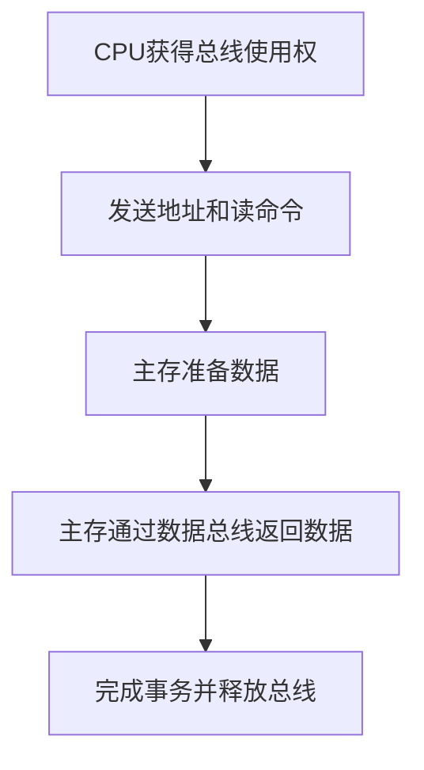
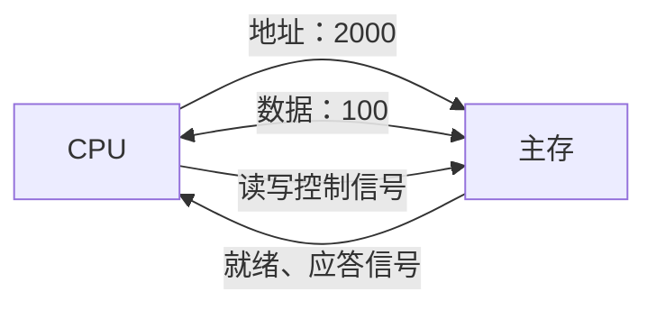
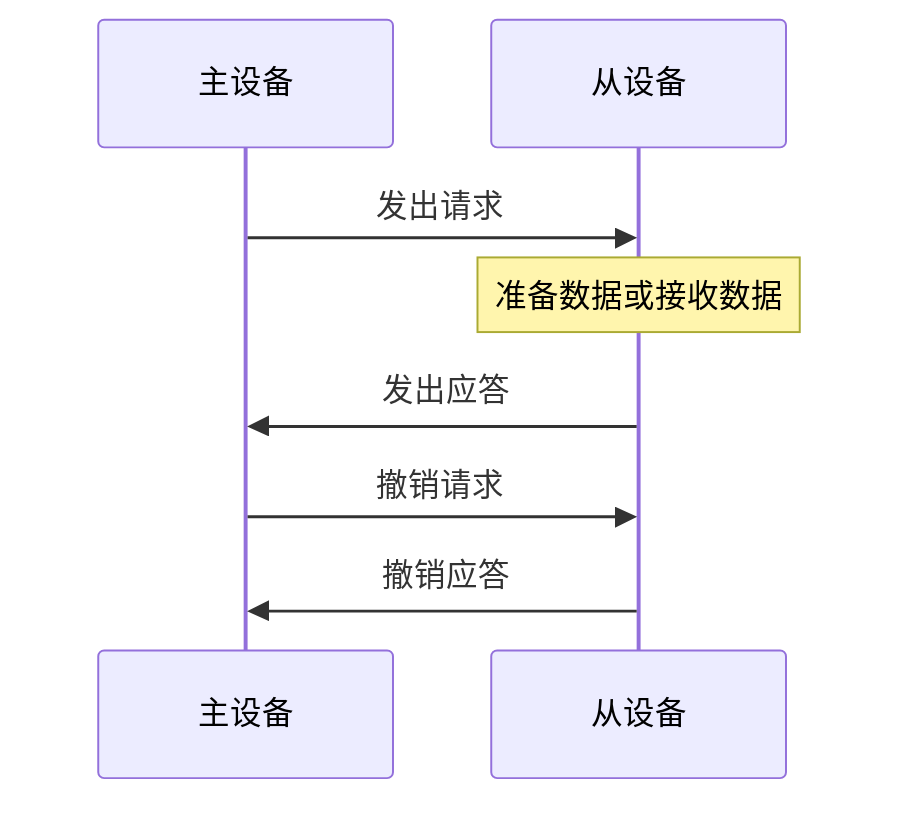
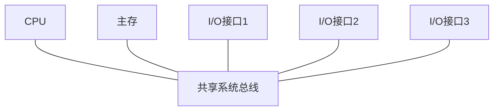
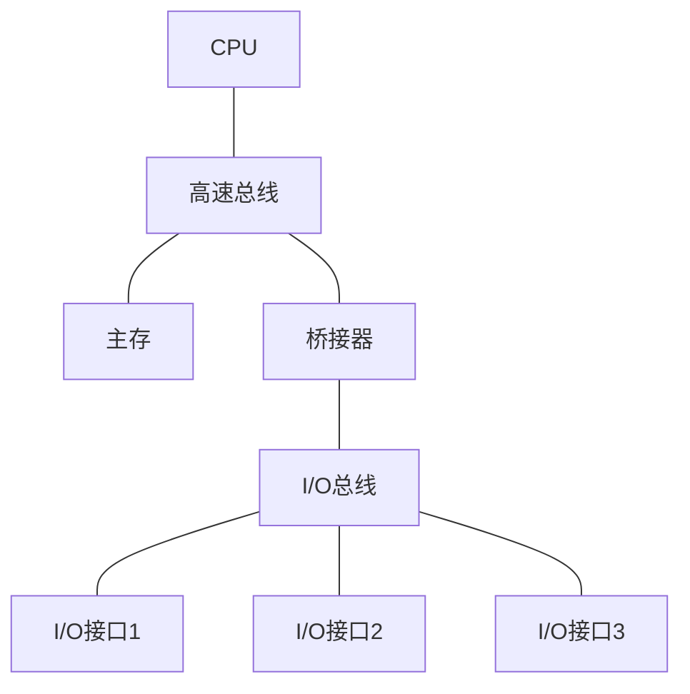
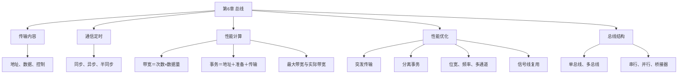

本章归纳18道历年总线真题与5道模拟题。原真题第6章合并总线和输入输出系统（39题），本文聚焦总线，不展开中断与DMA。

## 一、本章核心考点与复习优先级

| 核心考点      | 重要程度  | 必须掌握的内容         |
| --------- | ----- | --------------- |
| 总线带宽计算    | ★★★★★ | 时钟频率、传输次数、有效数据量 |
| 突发传输      | ★★★★★ | 一次寻址、多次传输       |
| 总线事务时间计算  | ★★★★★ | 地址、准备、数据传输阶段    |
| 三类总线的信息传输 | ★★★★★ | 数据、地址、控制信号的区别   |
| 同步与异步通信   | ★★★★  | 时钟、握手、互锁        |
| 总线性能优化    | ★★★★  | 不同优化技术的实际作用     |
| 串行与并行传输   | ★★★★  | 位宽与传输频率的关系      |
| 多总线结构     | ★★★   | 桥接器、速度分层        |
| 常见总线标准    | ★★    | USB、PCIe等基本特点   |

整章实际上可以归结为四个本质问题：

1. **传什么？**——地址、数据和控制信息。
2. **什么时候传？**——同步、异步、半同步通信。
3. **传得有多快？**——总线带宽与事务时间。
4. **如何提高效率？**——突发传输、分离事务、提高频率和位宽。

## 二、核心考点一：总线带宽的计算本质

★★★★★ 必须彻底掌握

### 1. 不要死记公式，理解带宽的定义

总线带宽就是单位时间内能够传输的数据量。

$$
\boxed{B=\frac{\text{传输的数据量}}{\text{所用时间}}}
$$

将这个定义进一步拆解：

$$
\boxed{ B=\text{每秒传输次数}\times\text{每次传输数据量} }
$$

所有总线带宽计算题，无论题目包装成DDR、QPI、多通道还是全双工，本质上都没有超出这个公式。

如果总线时钟频率为 $f$，每个时钟周期传输 $k$ 次，每次传输有效数据 $w$ 位，那么单通道、单方向的最大有效带宽为：

$$
\boxed{B=f\times k\times\frac{w}{8}}
$$

结果单位为 B/s。

如果题目给出的是多通道或者要求计算全双工双向总带宽，再根据实际情况乘以对应数量。

### 2. 必须区分三个容易混淆的概念

| 概念        | 本质              |
| --------- | --------------- |
| 总线时钟频率    | 每秒有多少个时钟周期      |
| 总线时钟周期    | 一个时钟周期持续多长时间    |
| 数据传输率（次数） | 每秒实际能够进行多少次数据传输 |

三者不是一回事。

假设总线时钟频率为100MHz：

| 传输方式      | 每秒传输次数 |
| --------- | ------ |
| 两个时钟周期传一次 | 50M次   |
| 一个时钟周期传一次 | 100M次  |
| 一个时钟周期传两次 | 200M次  |
| 一个时钟周期传四次 | 400M次  |

因此，**拿到时钟频率后，不要直接乘总线宽度，必须先确认每秒到底传输多少次。**

### 3. 代表性真题：2020年408——QPI总线

**题库真题第15题，答案C。**

QPI总线是一种点对点、全双工、同步串行总线。每个方向同时传输20位信息，其中16位为数据、4位为校验位。每个时钟周期传输两次，时钟频率为2.4GHz。

求总线带宽。

<Steps>

<Step>

### 第一步：计算每秒传输次数

每个时钟周期传输两次：

$$
N=2.4\times10^9\times2
$$

$$
=4.8\times10^9
$$

</Step>

<Step>

### 第二步：计算每次有效传输量

虽然传输的是20位信息，但其中只有16位是有效数据。

$$
16\text{ bit}=2\text{ B}
$$

</Step>

<Step>

### 第三步：考虑全双工

发送和接收可以同时进行，本题要求双向合计带宽。

$$
B=4.8\times10^9\times2\times2
$$

$$
\boxed{B=19.2\text{ GB/s}}
$$

</Step>

</Steps>

#### 这道题真正重要的地方

题目中的复杂技术名词并不重要，重要的是能够分辨哪些条件决定有效带宽。

| 题目条件    | 对带宽的影响   |
| ------- | -------- |
| 2.4GHz  | 决定时钟周期数量 |
| 每周期传输两次 | 乘2       |
| 16位有效数据 | 每次传输2B   |
| 4位校验位   | 不计入有效数据量 |
| 全双工双向合计 | 再乘2      |
| 80位数据包  | 不需要额外乘除  |

QPI等技术名称不影响带宽的基本计算模型。

### 4. 模拟题变式：竞成·模拟五

**题库模拟题第2题，答案C。**

设备A和设备B采用全双工同步串行总线，每个总线周期内双方各传输24位信息，其中16位数据、8位校验。

时钟频率为1GHz，一个总线周期包含两个时钟周期。

求有效带宽。

与上一道题相比，唯一重要的变化是每两个时钟周期才进行一次传输。

$$
N=\frac{10^9}{2}
$$

每个总线周期双向合计有效数据量：

$$
\frac{16\times2}{8}=4\text{ B}
$$

所以：

$$
B=\frac{10^9}{2}\times4
$$

$$
\boxed{B=2\text{ GB/s}}
$$

如果问单方向带宽，则为1GB/s。

本题与2020年真题采用同一带宽计算模型。

### 5. 其他真题的快速归纳

| 真题    | 关键条件              | 计算过程                     | 答案      |
| ----- | ----------------- | ------------------------ | ------- |
| 2009年 | 10MHz，每两个周期传4B    | $10\div2\times4$     | 20MB/s  |
| 2014年 | 66MHz，32位，每周期两次   | $66\times4\times2$   | 528MB/s |
| 2019年 | DDR3-1333，64位，3通道 | $1333\times8\times3$ | 约32GB/s |

特别注意2019年真题中的DDR3-1333，1333已经对应有效数据传输率，不应再因为DDR额外乘2。

如果题目给出的是基础时钟频率，并说明采用双倍数据率传输，才需要乘2。

### 6. 带宽题的万能检查法

带宽计算题依次检查：

- 给出的是时钟频率还是有效传输率？
- 每个时钟周期能够传输多少次？
- 每次传输多少有效数据？
- 是否包含校验位、编码等额外开销？
- 是否有多个独立通道？
- 求的是单方向还是双向总带宽？
- 最后有没有将 bit 转换为 Byte？

<Callout type="idea" title="带宽计算检查">

**不要根据题目中的数字机械地乘来除去，每一个乘数都必须有实际的物理意义。**

</Callout>

## 三、核心考点二：突发传输与总线事务

★★★★★ 本章最值得深入理解的知识点

### 1. 什么是一次总线事务？

总线事务是主设备和从设备之间完成的一次完整的信息交换过程。

以CPU从主存读取数据为例：

可以将一次读取事务抽象成：

$$
T_{\text{事务}} = T_{\text{地址}} + T_{\text{准备}} + T_{\text{数据}}
$$

如果题目额外给出申请总线、释放总线等时间，还要根据实际情况计入。

其中只有传输数据的阶段直接产生有效数据，其余阶段都可能构成额外开销。

### 2. 普通传输与突发传输的本质区别

假设需要连续读取4个数据。

<Tabs items={['普通传输', '突发传输']}>

<Tab value="普通传输">

每次传输都需要单独寻址。

</Tab>

<Tab value="突发传输">

只发送一次首地址，连续传输多个数据。

</Tab>

</Tabs>

突发传输提高效率的原因，不是让每一次数据传输变快，而是减少了重复发送地址等操作的开销。

这是一种典型的**摊薄固定开销**的思想。

如果每次发送地址需要时间 $t_a$，每个数据传输需要时间 $t_d$，暂不考虑其他等待开销，那么传输 $n$ 个数据：

普通传输：

$$
T_{\text{普通}}=n(t_a+t_d)
$$

突发传输：

$$
T_{\text{突发}}=t_a+nt_d
$$

节省的时间为：

$$
\Delta T=(n-1)t_a
$$

数据越多，重复寻址造成的开销越明显，突发传输的优势也就越明显。

### 3. 代表性真题：2012年408——突发传输时间

**题库真题第4题，答案C。**

已知：

- 总线时钟频率100MHz。
- 总线宽度32位。
- 地址线和数据线复用。
- 每传输一个地址或数据需要一个时钟周期。
- 支持突发传输。
- 需要写入128位数据。

求完成该总线事务至少需要多长时间。

<Steps>

<Step>

### 第一步：计算时钟周期

$$
T=\frac{1}{100\times10^6}=10\text{ ns}
$$

</Step>

<Step>

### 第二步：计算需要传输几次数据

$$
n=\frac{128}{32}=4
$$

</Step>

<Step>

### 第三步：画出总线事务过程

| 时钟周期 | 总线传输内容 |
| ---- | ------ |
| 第1个  | 首地址    |
| 第2个  | 数据1    |
| 第3个  | 数据2    |
| 第4个  | 数据3    |
| 第5个  | 数据4    |

总共需要5个时钟周期。

$$
\boxed{T_{\text{总}}=5\times10=50\text{ ns}}
$$

</Step>

</Steps>

#### 为什么不能选40ns？

因为40ns只计算了数据传输时间，忽略了发送首地址的时间。

题目还特别说明地址线与数据线复用，意味着地址与数据不能在同一组物理线路上同时传输。

#### 为什么不能选80ns？

因为支持突发传输，不需要在每次传输数据之前都发送地址。

这道题必须掌握的不是50ns这个答案，而是**根据总线事务的各阶段计算时间**的方法。

### 4. 对照真题：2023年408——不支持突发传输

**题库真题第17题，答案D。**

已知：

- 总线宽度64位。
- 时钟频率1GHz。
- 传输地址或数据各需要一个时钟周期。
- 不支持突发传输。
- 主存每次准备64位数据需要6ns。
- 主存块大小为32B。

求读取一个主存块需要的时间。

时钟周期：

$$
T=1\text{ ns}
$$

一次能够传输：

$$
64\text{ bit}=8\text{ B}
$$

因此需要进行：

$$
n=\frac{32}{8}=4
$$

次独立的读事务。

每一次读事务包括三个阶段：

| 阶段     | 时间  |
| ------ | --- |
| 发送地址   | 1ns |
| 主存准备数据 | 6ns |
| 返回数据   | 1ns |
| 合计     | 8ns |

由于不支持突发传输，按照本题给定的串行事务模型，四次读事务必须分别完成上述过程。

$$
\boxed{T_{\text{总}}=4\times(1+6+1)=32\text{ ns}}
$$

#### 两道真题放在一起理解

| 对比     | 2012年真题   | 2023年真题 |
| ------ | --------- | ------- |
| 是否支持突发 | 支持        | 不支持     |
| 传输次数   | 4次        | 4次      |
| 地址发送次数 | 1次        | 4次      |
| 主存准备时间 | 未单独给出     | 每次6ns   |
| 核心解法   | 一次寻址，多次传输 | 重复完整事务  |

注意，即使支持突发传输，也不能直接断定主存只需要准备一次数据。主存是否能够连续输出数据、后续数据之间的等待时间是多少，必须根据题目的具体条件判断。

## 四、核心考点三：最大带宽与实际传输率

★★★★★ 本章最容易被忽略的计算区别

### 代表性真题：2024年408

**题库真题第18题，答案B。**

某存储器总线：

- 时钟频率420MHz。
- 总线宽度64位。
- 每个时钟周期传输两次数据。
- 支持突发传输，最多传输8次。
- 第1个时钟周期传输地址和读写命令。
- 第4至第7个时钟周期连续传输8次数据。

求总线带宽（最大数据传输率）。

#### 1. 先把完整过程画出来

| 时钟周期 | 事务内容    | 有效数据量 |
| ---- | ------- | ----- |
| 1    | 地址和读写命令 | 0B    |
| 2    | 等待      | 0B    |
| 3    | 等待      | 0B    |
| 4    | 数据1、2   | 16B   |
| 5    | 数据3、4   | 16B   |
| 6    | 数据5、6   | 16B   |
| 7    | 数据7、8   | 16B   |

这里存在两个不同的传输率。

#### 2. 最大数据传输率

最大带宽关注总线在连续传输数据时所能达到的速率。

每个时钟周期传输：

$$
2\times\frac{64}{8}=16\text{ B}
$$

因此：

$$
B_{\max}=420\times10^6\times16
$$

$$
\boxed{B_{\max}=6.72\text{ GB/s}}
$$

#### 3. 完整事务的平均有效传输率

如果题目改为求本次完整事务的平均有效数据传输率，那么应该把地址阶段和等待阶段都算进去。

本次传输64B数据，共用7个时钟周期：

$$
B_{\text{实际}} = \frac{64}{7/(420\times10^6)}
$$

$$
\boxed{B_{\text{实际}}=3.84\text{ GB/s}}
$$

原题的A选项恰好就是3.84GB/s。

这说明命题人考查的根本不是复杂运算，而是能否区分最大带宽和完整事务的实际传输率。

### 两种带宽的对比

| 项目      | 最大带宽      | 本次事务平均传输率 |
| ------- | --------- | --------- |
| 统计数据量   | 64B       | 64B       |
| 统计时钟周期  | 4         | 7         |
| 地址和等待时间 | 不计入峰值数据阶段 | 计入        |
| 最终结果    | 6.72GB/s  | 3.84GB/s  |

用数据传输阶段占比来理解：

$$
\eta=\frac{4}{7}
$$

于是：

$$
B_{\text{实际}}=B_{\max}\times\eta
$$

$$
=6.72\times\frac47=3.84\text{ GB/s}
$$

<Callout type="warn" title="峰值与平均值">

**解题原则：最大带宽看传输能力，平均有效传输率看完整过程。**

</Callout>

这是本章最重要的辨析之一，而且可以迁移到Cache、主存、磁盘和计算机网络等其他章节。

## 五、核心考点四：地址总线、数据总线、控制总线

★★★★★ 概念选择题重点

### 1. 从一次访存操作理解三类总线

假设CPU要将数字100写入主存地址2000。

| 总线   | 传输内容   | 解决的问题  |
| ---- | ------ | ------ |
| 地址总线 | 地址2000 | 去哪里？   |
| 数据总线 | 数字100  | 传什么？   |
| 控制总线 | 写命令信号  | 做什么操作？ |

总线的分类依据是信息在通信过程中的功能，而不是信息名称里有没有“控制”“状态”等字样。

### 2. 代表性真题：2011年与2012年408

这两道真题应该放在一起学习。

2011年408，题库真题第3题：

在系统总线的数据线上，不可能传输的是哪一种？

A. 指令

B. 操作数

C. 握手（应答）信号

D. 中断类型号

**答案：C。**

2012年408，题库真题第6题：

I/O总线的数据线上可以传输哪些信息？

Ⅰ. I/O接口中的命令字

Ⅱ. I/O接口中的状态字

Ⅲ. 中断类型号

**答案：三项均可以。**

### 3. 真正的难点：控制命令与控制信号的区别

很多人会认为：

命令字是控制信息，所以应该在控制总线上传输。

这种理解是不正确的。

例如CPU要向打印机接口的控制寄存器写入一个命令字：

- 地址总线：指出控制寄存器的地址。
- 数据总线：传送命令字的具体二进制内容。
- 控制总线：发出写操作信号。

命令字虽然具有控制含义，但对于总线来说，它仍然是一段需要被传送的数据。

| 数据总线传输 | 控制总线传输 |
| ------ | ------ |
| 指令机器码  | 读信号    |
| 操作数    | 写信号    |
| 中断类型号  | 中断请求信号 |
| 命令字    | 中断响应信号 |
| 状态字    | 握手应答信号 |

尤其注意下面三组对比：

| 容易混淆的信息        | 前者   | 后者   |
| -------------- | ---- | ---- |
| 命令字 / 写信号      | 数据总线 | 控制总线 |
| 状态字 / 就绪信号     | 数据总线 | 控制总线 |
| 中断类型号 / 中断请求信号 | 数据总线 | 控制总线 |

<Callout type="idea" title="信息内容与控制信号">

**判断本质：它是在被读写的信息内容，还是用于协调本次读写过程的信号？**

</Callout>

前者通常通过数据总线传输，后者通常通过控制总线传输。

### 4. 总线的传输方向

| 总线   | 典型传输方向      |
| ---- | ----------- |
| 地址总线 | 当前主设备到从设备   |
| 数据总线 | 双向          |
| 控制总线 | 整体上可以双向交换信号 |

王道卷四的模拟题考查了地址、数据、控制、状态信息的传输方向。

按照该题采用的传统主从设备模型：

- 地址由主设备发往从设备。
- 控制命令由主设备发往从设备。
- 状态响应由从设备发往主设备。
- 数据既可以读取，也可以写入。

但不要由此得出“控制总线整体是单向的”这一结论。

控制总线由多根功能不同的信号线构成，有的负责发送控制命令，有的负责返回应答信号。

## 六、核心考点五：同步、异步和半同步通信

★★★★ 重点理解通信机制

### 1. 同步通信的本质

同步通信依靠统一的时钟信号来协调各个部件的操作。

主设备和从设备按照事先约定的时序工作。

例如：

| 时钟周期 | 操作      |
| ---- | ------- |
| 第1周期 | 主设备发送地址 |
| 第2周期 | 从设备准备数据 |
| 第3周期 | 从设备返回数据 |

大家根据统一时钟执行规定的操作。

同步通信的优点是控制简单、时序明确；缺点是设备之间的速度差异较大时，固定时序可能带来等待或设计困难。

### 2. 异步通信的本质

异步通信不依赖统一的总线时钟进行事务定时，而是通过请求和应答信号协调工作。

上图为全互锁握手过程。

异步通信的核心思想是：不要求设备在固定时刻完成操作，而是在设备实际准备好后，通过信号通知对方。

因此适合速度差异较大或者响应时间不确定的设备。

例如王道卷二模拟题考查I/O接口与打印机之间的通信，打印机响应时间不固定，采用异步通信更合适。

### 3. 三种异步握手方式

| 方式  | 请求方撤销请求 | 应答方撤销应答   | 可靠性 |
| --- | ------- | --------- | --- |
| 非互锁 | 不等待对方应答 | 不等待对方撤销请求 | 相对低 |
| 半互锁 | 等待对方应答  | 不等待对方撤销请求 | 居中  |
| 全互锁 | 等待对方应答  | 等待对方撤销请求  | 相对高 |

这里的本质是双方是否确认对方已经完成相应操作。

在其他条件相同的教材模型中，互锁越充分，可靠性越高，但握手控制开销通常越大。

### 4. 半同步通信

半同步通信兼有同步与异步通信的特点：

- 仍然使用统一时钟。
- 允许从设备发出WAIT等等待信号。
- 主设备在规定时钟边沿采样等待信号。
- 如果从设备没有准备好，就插入等待周期。

所以，看到“统一时钟＋等待信号”就应联想到半同步通信。

### 5. 结合2015年408真题

**题库真题第10题，答案C。**

下列关于总线定时的说法，错误的是：

| 选项                       | 判断       |
| ------------------------ | -------- |
| A. 异步通信中，全互锁协议最慢         | 正确，按教材模型 |
| B. 异步通信中，非互锁协议可靠性最差      | 正确       |
| C. 同步通信中，同步时钟信号可由各设备分别提供 | 错误       |
| D. 半同步通信中，握手信号的采样由同步时钟控制 | 正确       |

同步通信的关键是统一的定时基准，而不是各设备分别按照自己的独立时钟决定通信时刻。

### 6. 必须避免的几个错误认识

| 说法               | 判断 |
| ---------------- | -- |
| 总线一定有统一的时钟信号线    | 错误 |
| 异步通信采用握手信号协调操作   | 正确 |
| 异步通信一次握手只能传输一位数据 | 错误 |
| 异步总线一定比同步总线慢     | 错误 |
| 同步总线工作频率一定等于时钟频率 | 错误 |
| 每个时钟周期最多只能传输一次数据 | 错误 |

其中，“一次握手只能传输一位数据”是2021年408真题考过的错误说法。

握手是一种定时协调机制，与数据位宽没有必然联系。异步总线同样可以采用并行传输。

## 七、核心考点六：不同总线优化技术到底优化了什么？

★★★★★ 非常重要的综合概念题

理解各种技术的作用，比记住某个技术能不能提高性能更重要。

### 1. 将总线性能拆成三个方面

$$
B_{\text{有效}} = B_{\max}\times\eta
$$

其中：

$$
B_{\max} = \text{每秒传输次数} \times \text{每次传输数据量}
$$

而 $\eta$ 表示在给定统计口径下，有效数据传输所占的比例。

因此，提高有效传输率主要有三种思路：增加每次传输的数据量、增加单位时间内的传输次数、减少非数据传输开销。

### 2. 不同优化技术的本质

| 技术       | 直接优化目标  | 原理            |
| -------- | ------- | ------------- |
| 增加总线宽度   | 最大带宽    | 每次传输更多位       |
| 提高总线时钟频率 | 最大带宽    | 单位时间内有更多时钟周期  |
| DDR      | 最大带宽    | 一个时钟周期传输两次    |
| 多通道      | 聚合带宽    | 多个通道并行工作      |
| 突发传输     | 有效传输率   | 减少重复发送地址      |
| 分离事务     | 总线利用率   | 减少等待期间对总线的占用  |
| 地址/数据线复用 | 成本、引脚数量 | 多种信息分时使用同一组线  |
| 多总线结构    | 系统整体性能  | 减少不同设备之间的总线争用 |

### 3. 突发传输与分离事务的区别

这两个概念容易混淆。

假设CPU向主存发出读取请求，主存需要较长时间准备数据。

<Tabs items={['普通事务', '分离事务']}>

<Tab value="普通事务">

在等待期间，总线没有传输有效数据，却仍被设备A的事务占用。

</Tab>

<Tab value="分离事务">

</Tab>

</Tabs>

分离事务将请求和响应拆开，使其他设备可以利用原本的等待时间。

因此：

| 技术    | 解决的问题        |
| ----- | ------------ |
| 突发传输  | 地址重复发送造成浪费   |
| 分离事务  | 等待期间占用总线造成浪费 |
| 信号线复用 | 物理线路和引脚太多    |

分离事务能够提高总线整体利用率，但不意味着某个具体请求的响应时间一定缩短。

### 4. 代表性真题：2018年408

**题库真题第13题，答案B。**

下列哪些措施能够提高同步总线的数据传输率？

Ⅰ. 增加总线宽度

Ⅱ. 提高总线工作频率

Ⅲ. 支持突发传输

Ⅳ. 采用地址/数据线复用

| 选项 | 判断 | 原因           |
| -- | -- | ------------ |
| Ⅰ  | 正确 | 每次传输数据更多     |
| Ⅱ  | 正确 | 每秒传输次数更多     |
| Ⅲ  | 正确 | 减少重复寻址开销     |
| Ⅳ  | 错误 | 主要目的在于减少线路数量 |

这道题非常有代表性，四个选项分别对应不同的设计思想。

<Callout type="warn" title="线路复用的作用">

**地址/数据线复用的主要作用不是提高传输率，而是节省引脚、降低硬件成本。**

</Callout>

因为同一组物理线路不能同时传输地址和数据，在其他条件不变的情况下，复用还可能增加传输所需的时间。

## 八、核心考点七：串行与并行传输

★★★★ 重点掌握反直觉的结论

### 1. 串行和并行的区别

| 特点     | 串行传输        | 并行传输        |
| ------ | ----------- | ----------- |
| 基本传输方式 | 单通道按位依次传输   | 多位同时传输      |
| 物理线路   | 相对较少        | 相对较多        |
| 线路间串扰  | 相对容易控制      | 多线高速工作时更明显  |
| 时序协调   | 相对容易        | 多条线路需协调到达时刻 |
| 传输距离   | 通常更有优势      | 高速长距离实现较困难  |
| 实际速度   | 取决于频率及通道等因素 | 取决于频率及位宽等因素 |

### 2. 为什么并行传输不一定比串行传输快？

假设有两种总线：

总线A采用8位并行传输，每秒传输100M次：

$$
B_A=8\times100\text{ Mbit/s}
$$

$$
=800\text{ Mbit/s}
$$

总线B采用单通道串行传输，每秒传输2G位：

$$
B_B=2\text{ Gbit/s}
$$

显然，串行总线B的传输速度反而更快。

并行总线虽然一次可以传输多位，但会面临多条线路的信号串扰、时钟偏移和同步困难等问题，因此频率往往受到更多限制。

**并行的优势是一次传得多，串行的优势可以是传得更频繁。最终速度取决于二者的综合结果。**

### 3. 2016年408真题

**题库真题第11题，答案A。**

错误选项是：

> 并行总线传输比串行总线传输速度快。

这个说法不能作为一般性结论。

另外三个选项分别考查信号线复用、突发传输和分离事务，均为正确描述。

这道真题实际上把本章多个核心设计思想结合到了一起，非常值得反复理解。

### 4. PCIe ×16是不是并行传输？

2017年408真题专门考查了这一点。

PCIe采用高速串行传输。

PCIe ×16代表使用16条串行通道（lane），而不是传统意义上的16位并行总线。

每条通道内部仍采用串行传输，可以通过多个通道同时工作提高聚合带宽。

所以：

$$
\text{多条串行通道}\ne\text{传统并行总线}
$$

## 九、核心考点八：单总线与多总线结构

★★★ 理解设计目的即可

### 1. 单总线结构

所有部件共享同一条总线。

优点是结构简单、成本较低、扩展方便。

缺点是所有设备都要竞争有限的总线资源，容易形成系统性能瓶颈。

在传统单通路共享总线模型中，同一时刻只能由一个主设备控制该总线，通常只能有一对主从设备利用该通路进行通信。

### 2. 多总线结构

多总线结构能够将不同速度、不同用途的设备分开连接，减少对同一总线的争用。

桥接器负责连接不同总线，并协调协议、速度、位宽等差异。

2017年408真题考查的核心结论包括：典型分层结构中靠近CPU的总线速度较快；存储器总线可以支持突发传输；不同总线通过桥接器等连接部件实现互连。

### 3. 常见总线标准

这部分不建议投入过多时间，但应掌握基础概念。

| 总线标准 | 基本特点       |
| ---- | ---------- |
| PCI  | 传统并行总线     |
| PCIe | 高速串行、点对点互连 |
| USB  | 通用串行外设接口   |
| ISA  | 早期扩展总线标准   |
| EISA | ISA的扩展标准   |
| SATA | 串行存储设备接口   |

USB支持即插即用、热插拔，并可以通过集线器连接多台设备。

另外注意ISA这个缩写具有不同含义。在总线标准语境中可以表示工业标准体系结构，在指令系统语境中可以表示指令集体系结构。

## 十、题库中需要注意的两处表述问题

以下两处模拟题表述需要结合适用条件理解。

### 1. 王道卷三：存储器总线一定有时钟线？

题库模拟题第3题，给定答案为C，即“一定有时钟信号线用于总线操作的定时”错误。

这一判断是正确的，因为异步总线不依靠统一时钟定时。

但D选项认为每个时钟周期内只能并行传输一次数据，这在DDR总线中同样不成立。

因此，该模拟题严格来说存在表述不严谨的问题。

应该记住：

- 异步总线不一定有统一时钟信号线。
- DDR可以在上升沿和下降沿分别传输数据。
- 并行传输与每周期传输次数属于不同维度。

### 2. 王道卷四：控制信息是单向传输的？

题库模拟题第1题给定答案D，采用的是传统主从设备模型，分别考查控制命令和状态响应的传输方向。

不要把这个答案推广为所有控制总线都只能单向传输。

控制总线整体可以包含不同方向的信号。

这两处问题也提醒我们：**学习模拟题的目的应该是掌握正确原理，而不是把模拟题中的每一个选项都背下来。**

## 十一、本章选择题的通用解题思维

### 方法一：计算题先建立物理模型

看到时钟频率、位宽、全双工等条件，先判断依据：

究竟每秒传几次？每次传多少有效数据？

$$
B=N\times D
$$

看到地址、等待、存储块、突发传输等条件，则先画出时间过程。

$$
T=T_{\text{地址}}+T_{\text{等待}}+T_{\text{数据}}
$$

不要将两类题混为一谈。

### 方法二：概念题判断它属于哪个维度

| 题目关键词      | 所属维度         |
| ---------- | ------------ |
| 串行、并行      | 数据的空间传输方式    |
| 同步、异步      | 时间协调方式       |
| 单工、半双工、全双工 | 信息传输方向       |
| 突发传输       | 一次事务内的数据组织方式 |
| 分离事务       | 总线事务的组织与调度   |
| 信号线复用      | 物理线路的使用方式    |
| 单总线、多总线    | 系统互连结构       |

这些维度相互独立。

例如一条总线完全可以同时具有以下特点：

**串行、同步、全双工、多通道。**

因此不能因为总线采用串行传输，就断定它一定采用异步通信；也不能因为采用同步通信，就断定每个时钟周期只能传输一次。

### 方法三：所有性能优化题都问“究竟减少了什么？”

| 措施    | 真正改变的因素    |
| ----- | ---------- |
| 增加位宽  | 每次传输的数据量   |
| 提高频率  | 单位时间内的传输次数 |
| 突发传输  | 重复寻址时间     |
| 分离事务  | 总线空等时间     |
| 信号线复用 | 物理线路数量     |
| 多总线结构 | 总线争用       |

这样就不容易被命题人偷换概念。

## 十二、掌握程度自测

以下为根据题库核心考点设计的迁移练习，非原题。先独立作答，再展开答案。

### 自测1：综合带宽

某全双工同步总线时钟频率为800MHz，每个时钟周期每个方向传输两次，每次传输40位信息，其中32位为有效数据。

求双向总有效带宽。

<Accordions>
<Accordion title="参考答案与计算">

**答案：**

$$
B=800\times10^6\times2\times\frac{32}{8}\times2
$$

$$
\boxed{B=12.8\text{ GB/s}}
$$

</Accordion>
</Accordions>

### 自测2：突发传输

某32位总线的时钟周期为5ns，发送地址需要一个时钟周期，发送一个数据也需要一个时钟周期。不考虑其他开销。

若要传输32B数据，分别求普通传输和突发传输的时间。

<Accordions>
<Accordion title="参考答案与计算">

**答案：**

需要传输：

$$
n=\frac{32}{4}=8
$$

普通传输：

$$
T=8\times(5+5)=80\text{ ns}
$$

突发传输：

$$
T=5+8\times5=45\text{ ns}
$$

</Accordion>
</Accordions>

### 自测3：最大带宽与平均带宽

某64位总线时钟频率为200MHz，每周期传输两次数据，一次突发事务的前两个周期用于传送地址和等待，后四个周期连续传输数据。

求最大带宽与此次事务的平均有效带宽。

<Accordions>
<Accordion title="参考答案与计算">

**答案：**

$$
B_{\max}=200\times10^6\times2\times8
$$

$$
=3.2\text{ GB/s}
$$

$$
B_{\text{实际}}=3.2\times\frac46
$$

$$
\approx2.13\text{ GB/s}
$$

</Accordion>
</Accordions>

### 自测4：概念判断

<Accordions>
<Accordion title="命令字必须在控制总线上传输">

**答案：** 错

</Accordion>

<Accordion title="状态字可以在数据总线上传输">

**答案：** 对

</Accordion>

<Accordion title="同步总线每周期只能传输一次数据">

**答案：** 错

</Accordion>

<Accordion title="突发传输可以减少重复寻址开销">

**答案：** 对

</Accordion>

<Accordion title="地址和数据线复用主要为了提高带宽">

**答案：** 错

</Accordion>

<Accordion title="分离事务可以提高总线利用率">

**答案：** 对

</Accordion>

<Accordion title="异步总线只能采用串行传输">

**答案：** 错

</Accordion>

<Accordion title="PCIe ×16属于传统16位并行总线">

**答案：** 错

</Accordion>

<Accordion title="并行总线一定比串行总线快">

**答案：** 错

</Accordion>

<Accordion title="全双工总线可以同时发送和接收数据">

**答案：** 对

</Accordion>
</Accordions>

## 十三、考前速记：全章最重要的15条结论

| 序号 | 必须掌握的知识                        |
| -- | ------------------------------ |
| 1  | 带宽等于每秒传输次数乘每次传输数据量             |
| 2  | 时钟频率不一定等于实际传输次数                |
| 3  | 有效带宽不计入校验位等非有效数据               |
| 4  | 全双工双向总带宽要考虑两个方向                |
| 5  | DDR可以在一个时钟周期内传输两次数据            |
| 6  | 最大带宽和完整事务平均带宽不同                |
| 7  | 突发传输的本质是一次寻址、连续传输多个数据          |
| 8  | 不支持突发传输时，应根据各次独立事务计算时间         |
| 9  | 分离事务通过释放等待期间占用的总线来提高利用率        |
| 10 | 信号线复用的主要作用是减少线路和引脚             |
| 11 | 指令、操作数、命令字、状态字、中断类型号均可通过数据总线传输 |
| 12 | 读写信号、握手信号、中断请求信号通过控制总线传输       |
| 13 | 同步靠统一时钟，异步靠握手，半同步可以插入等待周期      |
| 14 | 并行传输不一定比串行传输快                  |
| 15 | PCIe采用串行传输，多个lane不等于传统并行总线     |

## 十四、最值得反复做的题目

优先复习以下8道代表题。

| 推荐顺序 | 题目来源          | 核心价值               |
| ---- | ------------- | ------------------ |
| 1    | 2020年408，真题15 | 全双工、有效带宽的综合计算      |
| 2    | 2024年408，真题18 | 最大带宽与实际传输率的区别      |
| 3    | 2012年408，真题4  | 突发传输时间计算           |
| 4    | 2023年408，真题17 | 普通总线事务时间计算         |
| 5    | 2012年408，真题6  | 数据与控制信号的本质区别       |
| 6    | 2018年408，真题13 | 总线性能优化的综合辨析        |
| 7    | 2015年408，真题10 | 同步、异步、互锁与半同步       |
| 8    | 竞成模拟五，模拟题2    | 有效数据、全双工、总线周期的综合变式 |

### 最终应该形成的知识体系

本章最重要的学习目标，是能够在遇到陌生的总线技术、复杂的题目背景时，迅速将其还原成**数据量、传输时间、控制机制和额外开销**这几个基本因素。
