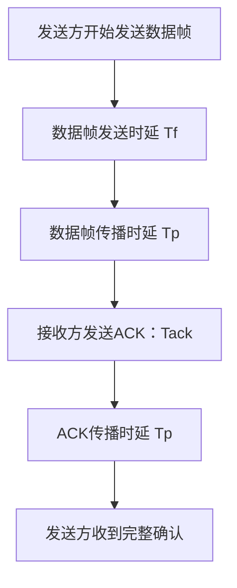
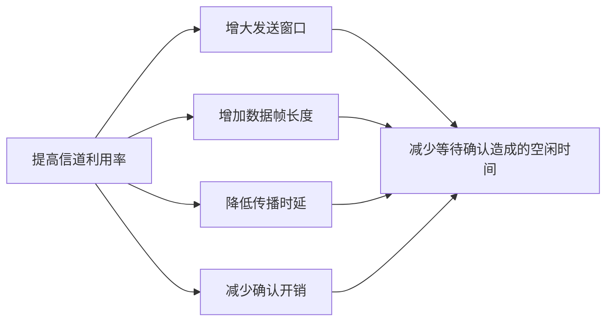
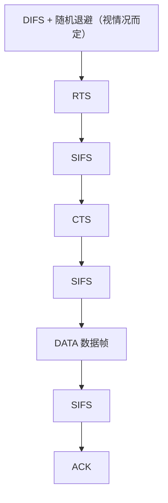
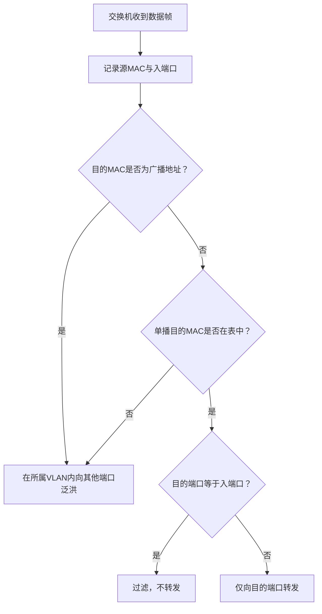

本章归纳30道历年真题与27道模拟题，共57道选择题。题号采用原分类题库的章节内编号。

## 一、本章考点分布与复习优先级

| 核心考点               | 真题数 | 模拟题数 | 重要程度  |
| ------------------ | --- | ---- | ----- |
| 流量控制与可靠传输          | 10  | 5    | ★★★★★ |
| 介质访问控制             | 11  | 5    | ★★★★★ |
| 交换机与集线器            | 5   | 2    | ★★★★★ |
| 差错控制与透明传输          | 2   | 5    | ★★★★  |
| 局域网、以太网、无线局域网、VLAN | 2   | 8    | ★★★★  |
| PPP协议              | 0   | 2    | ★★★   |

上述数量按照题库自身的分类统计，并非对未来考试频率的预测。模拟题中还有IPv4分片、子网划分、TCP窗口等跨章考点。

其中，滑动窗口与可靠传输、介质访问控制、交换机这三个模块，共占所收录真题的26道，即30道中的约87%。

**本章真正重要的不是记住各种协议的名字，而是理解以下六个问题：**

| 问题            | 对应知识                 |
| ------------- | -------------------- |
| 如何发现传输错误？     | CRC、海明码              |
| 如何保证数据可靠交付？   | 停止等待、GBN、SR          |
| 如何减少发送方等待时间？  | 滑动窗口、信道利用率           |
| 多台设备如何共享信道？   | CSMA/CD、CSMA/CA、CDMA |
| 数据帧究竟应该发给谁？   | MAC地址、802.11帧格式      |
| 数据帧经过设备后会到哪里？ | 交换机、集线器、VLAN         |

## 二、滑动窗口与可靠传输 ★★★★★

### 1. 停止等待、GBN、SR的本质区别

这三种协议都在解决可靠传输问题，但解决问题的效率不同。

停止等待协议每发送一帧，就必须等待确认。等待期间发送方无法发送下一帧，造成信道资源浪费。

GBN和SR允许发送方在尚未收到确认时继续发送后续帧，这就是流水线传输。

设帧序号占用 $n$ 个比特。

| 比较项目    | 停止等待 | GBN后退N帧     | SR选择重传  |
| ------- | ---- | ----------- | ------- |
| 发送窗口    | 1    | 最大 $2^n-1$  | 受接收窗口限制 |
| 接收窗口    | 1    | 1           | 可以大于1   |
| 确认机制    | 逐帧确认 | 累计确认        | 独立确认    |
| 乱序帧     | 不接收  | 丢弃          | 窗口内可以缓存 |
| 超时重传    | 当前帧  | 从最早未确认帧开始重传 | 重传对应超时帧 |
| 接收方缓存开销 | 小    | 小           | 较大      |

#### 为什么需要限制窗口大小？

帧序号是循环使用的。

例如，3位序号只能表示：

$$
0,1,2,3,4,5,6,7
$$

发送完7号帧后，又会使用0号。

如果窗口过大，接收方就可能无法判断一个0号帧究竟是旧帧的重传，还是新一轮的0号帧。

因此，在408常用滑动窗口模型下，需要满足：

$$
\boxed{W_T+W_R\leq 2^n}
$$

其中 $W_T$ 为发送窗口大小，$W_R$ 为接收窗口大小。

对于GBN：

$$
W_R=1
$$

因此：

$$
\boxed{W_T\leq 2^n-1}
$$

对于收发窗口相等的SR：

$$
W_T=W_R
$$

因此：

$$
\boxed{W_T=W_R\leq 2^{n-1}}
$$

**特别注意：只有SR的发送窗口与接收窗口相等时，才能直接使用后一条公式。** 如果题目给出了不相等的窗口，应当使用窗口之和的约束。

### 2. 窗口移动的真正含义

滑动窗口中应区分以下四种状态：

| 帧的状态    | 含义          |
| ------- | ----------- |
| 已发送且已确认 | 发送方知道该帧已经收到 |
| 已发送但未确认 | 仍然可能需要重传    |
| 窗口内尚未发送 | 当前允许发送的新帧   |
| 窗口外尚未发送 | 暂时不允许发送     |

发送窗口不是“所有未确认帧的集合”，而是一个连续的序号范围。

<Callout type="warn" title="窗口移动">

**窗口左边界必须等到前面的帧得到确认后，才能向右移动。**

</Callout>

#### 代表题1：王道卷一，模拟题第6题

采用SR协议，帧序号为4位，接收窗口大小为5，发送窗口取最大值。

发送方已经发送0～6号帧，收到1、3、5号帧的确认，而0、2、4号帧超时。问还可以发送多少个新的数据帧？

**第一步：计算窗口大小。**

$$
W_T+5\leq 2^4
$$

所以：

$$
W_T=11
$$

初始窗口包含0～10号帧。

**第二步：画出每个帧的状态。**

| 帧序号 | 0  | 1  | 2  | 3  | 4  | 5  | 6   | 7  | 8  | 9  | 10 |
| --- | -- | -- | -- | -- | -- | -- | --- | -- | -- | -- | -- |
| 状态  | 超时 | 确认 | 超时 | 确认 | 超时 | 确认 | 未确认 | 未发 | 未发 | 未发 | 未发 |

虽然1、3、5号帧已经确认，但0号帧尚未确认，导致窗口左边界仍然停在0。

所以新帧只能使用7、8、9、10四个位置。

**答案：D，4帧。**

如果另外问需要重传多少帧，则答案为3帧，即0、2、4。

原题的“最多能发送”表述略有歧义，根据选项和解析，其实际考查的是新帧的数量，不包含重传帧。

#### 举一反三：GBN与SR怎么快速区分？

2009年真题（题库第3题）：GBN已发送0～7，收到0、2、3号确认。

因为ACK3累计确认了0～3，所以超时后重传4、5、6、7，共4帧。

2011年真题（题库第4题）：SR已发送0～3，收到ACK1，0、2号帧超时。

因为SR独立确认，只重传0、2，共2帧。

2024年真题（题库第12题）也是相同思想：收到ACK0后窗口移动，可以发送F4；随后F1超时，只重传F1。

**统一做题方法：先确定窗口范围，再标记确认状态，然后判断左边界能否移动，最后分别数新帧和重传帧。**

## 三、信道利用率计算 ★★★★★

这是本章最重要的计算题模型之一。2012、2014、2015、2018、2020、2023年真题均涉及这一模型。

不要针对停止等待、GBN、SR分别死记公式，它们本质上使用同一个公式。

### 1. 从时间轴理解信道利用率

设数据帧长度为 $L$，发送速率为 $R$，单向传播时延为 $T_p$，ACK发送时延为 $T_{\mathrm{ACK}}$。

数据帧发送时延：

$$
T_f=\frac{L}{R}
$$

从开始发送一帧，到收到该帧完整确认的时间为：

$$
\boxed{T=T_f+2T_p+T_{\mathrm{ACK}}}
$$

过程如下：



这个周期内，如果允许连续发送 $W$ 帧，那么发送方能够用于发送数据的时间最多为 $WT_f$。

在无差错、确认及时、正反向链路可并行传输的常见考试模型下：

$$
\boxed{
U=\min\left(1,\frac{WT_f}{T_f+2T_p+T_{\mathrm{ACK}}}\right)
}
$$

停止等待协议只需要令 $W=1$。

最大平均数据传输速率为：

$$
\boxed{R_{\mathrm{avg}}=UR}
$$

如果题目要求的是纯有效载荷的吞吐率，还需扣除帧首部等开销。

### 2. 四种常见命题方式

| 题目要求      | 解题方法        |
| --------- | ----------- |
| 求信道利用率    | 直接代入统一公式    |
| 求实际数据传输速率 | 利用率乘以发送速率   |
| 求最小发送窗口   | 根据目标利用率反推   |
| 求最少序号位数   | 先求窗口，再用窗口约束 |

若要求利用率不低于 $U_0$，最小发送窗口为：

$$
\boxed{
W_{\min}=\left\lceil
\frac{U_0(T_f+2T_p+T_{\mathrm{ACK}})}{T_f}
\right\rceil
}
$$

特别地，要让发送方始终有帧可发，达到100%利用率：

$$
W_{\min}=
\left\lceil
\frac{T_f+2T_p+T_{\mathrm{ACK}}}{T_f}
\right\rceil
$$

### 3. 代表题2：2012年408真题（题库第5题）

本题综合帧长度、ACK发送时间、窗口大小和序号位数。

两台主机采用GBN协议，发送速率16kbps，单向传播时延270ms，数据帧长度范围128～512B，ACK与数据帧等长。

问为使信道利用率达到最高，帧序号至少需要多少位？

<Steps>

<Step>

### 判断最苛刻条件

由统一公式可知，当ACK与数据帧等长时：

$$
U=\min\left(1,\frac{WT_f}{2T_f+2T_p}\right)
$$

达到100%利用率需要：

$$
W\geq 2+\frac{2T_p}{T_f}
$$

传播时间固定，帧越短，$T_f$ 越小，需要的窗口越大。

所以最短帧对应最苛刻的条件。

</Step>

<Step>

### 计算确认周期

$$
T_f=\frac{128\times8}{16000}
=0.064\ \mathrm{s}
$$

即64ms。

由于确认帧等长：

$$
T_{\mathrm{ACK}}=64\ \mathrm{ms}
$$

完整周期：

$$
T=64+270\times2+64=668\ \mathrm{ms}
$$

</Step>

<Step>

### 求最小窗口

$$
W_{\min}=
\left\lceil\frac{668}{64}\right\rceil
=11
$$

</Step>

<Step>

### 求序号位数

$$
2^n-1\geq11
$$

3位序号最多支持7帧，4位序号最多支持15帧。

因此：

$$
\boxed{n=4}
$$

答案：B。

**这道题真正值得掌握的是：求最小序号位数必须先求最小发送窗口，不能直接根据帧数量取对数。**

</Step>

</Steps>

### 4. 利用率的直观理解



假设发送一帧耗时1ms，从开始发送到收到确认需要10ms：

| 发送窗口大小 | 理想信道利用率 |
| ------ | ------- |
| 1      | 10%     |
| 2      | 20%     |
| 4      | 40%     |
| 7      | 70%     |
| 10     | 100%    |
| 15     | 100%    |

这也解释了2023年真题（题库第11题）：

3位序号、SR收发窗口相等时，停止等待、GBN、SR的最大发送窗口分别为1、7、4。

因此：

$$
\boxed{U_{\mathrm{SW}}\leq U_{\mathrm{SR}}\leq U_{\mathrm{GBN}}}
$$

注意这里比较的是无差错条件下的最大信道利用率，并不意味着GBN在有差错的实际环境中一定比SR效率更高。

#### 必须避免的计算错误

忽略ACK发送时延，并不意味着忽略ACK传播时延；单向传播时延必须乘2；信道利用率不可能超过100%；发送窗口需要向上取整；字节转换为比特时必须乘8。

## 四、CSMA/CD与最小帧长 ★★★★★

这一部分在2009、2015、2016、2019、2023年真题中均有涉及。

### 1. 为什么监听到信道空闲，仍然会发生碰撞？

因为信号传播需要时间。

假设A、B分别位于一条共享链路的两端。A开始发送数据时，信号还没有传播到B，因此B监听到的信道可能仍然是空闲的。

如果B此时也发送数据，就会发生碰撞。

<Callout type="info" title="碰撞产生原因">

**载波监听只能知道当前位置的信道状态，无法立即知道整个信道的状态。**

</Callout>

这就是CSMA仍然会发生碰撞的根本原因。

### 2. 为什么以太网需要规定最小帧长？

设两个最远站点之间的单向传播时延为 $\tau$。

最坏情况下，A发送的信号即将到达B时，B恰好发送数据并发生碰撞。

碰撞信号还需要接近 $\tau$ 的时间才能返回A。

因此，A最迟可能在开始发送后 $2\tau$ 才发现碰撞。

如果A在此之前已经发送完毕，就可能错误地认为发送成功。

所以必须满足：

$$
\frac{L}{R}\geq2\tau
$$

得到本章另一条核心公式：

$$
\boxed{L_{\min}=2\tau R}
$$

其中：

$$
\tau=\frac{d}{v}
$$

进一步得到：

$$
\boxed{L_{\min}=\frac{2dR}{v}}
$$

| 条件变化       | 最小帧长的变化 |
| ---------- | ------- |
| 网络跨距增大     | 增大      |
| 数据发送速率提高   | 增大      |
| 信号传播速度提高   | 减小      |
| 中间设备处理时延增加 | 增大      |

理解这几个变化关系，很多定性选择题甚至不需要计算。

### 3. 代表题3：2016年408真题（题库第18题）

100Base-T以太网，集线器再生比特流时引入1.535μs时延，信号传播速度为200m/μs，问两端主机理论上的最大距离。

题目隐藏了两个条件：

- 经典以太网最小MAC帧长为64B，即512bit。
- 100Base-T的数据传输速率为100Mbps。

因此，最大争用期为：

$$
2\tau=\frac{512}{100\times10^6}
=5.12\ \mu\mathrm{s}
$$

单向总时延不能超过：

$$
\tau=2.56\ \mu\mathrm{s}
$$

其中已经有1.535μs被集线器再生消耗。

留给信号传播的时间为：

$$
T_p=2.56-1.535=1.025\ \mu\mathrm{s}
$$

所以最远距离：

$$
d=200\times1.025=205\ \mathrm{m}
$$

**答案：B，205m。**

#### 这道题的本质

争用期不仅包含电缆的传播时间，还应包含信号往返途中经过设备产生的时延。

更加一般的公式为：

$$
\boxed{
L_{\min}\geq R\cdot T_{\mathrm{round-trip}}
}
$$

如果正反向路径对称，每个方向经过相同的设备：

$$
T_{\mathrm{round-trip}}
=2(T_{\mathrm{prop}}+T_{\mathrm{device}})
$$

以后遇到改变网速、帧长、网络距离、集线器延迟的题目，都可以用这个模型解决。

### 4. 截断二进制指数退避算法

发生碰撞之后，如果两个站点立即重传，就可能再次碰撞。

因此要随机等待一段时间，使两个站点有机会错开发送时间。

设连续发生碰撞的次数为 $i$，则：

$$
k=\min(i,10)
$$

随机整数 $r$ 的取值范围：

$$
\boxed{r\in[0,2^k-1]}
$$

退避时间：

$$
\boxed{T_{\mathrm{backoff}}=r\cdot2\tau}
$$

连续碰撞达到16次后，放弃该帧的本次发送。

#### 2023年408真题（题库第22题）

争用时间片为51.2μs，连续发生4次冲突，问最长退避时间。

$$
r_{\max}=2^4-1=15
$$

所以：

$$
T_{\max}=15\times51.2=768\ \mu\mathrm{s}
$$

答案：C。

最常见的错误是使用16而不是15。

#### 模拟题中的概率变式

王道卷三（模拟题第12题）问：两个站点发生碰撞后，第二次重传才成功的概率。

第一次重传时，每个站点有2种退避选择，因此再次碰撞概率为：

$$
P_1=\frac12
$$

第二次重传时，每个站点有4种选择，选择不同退避值的概率为：

$$
P_2=1-\frac14=\frac34
$$

在题目的理想化退避模型下，恰好第二次重传才成功的概率为：

$$
P=\frac12\times\frac34
=\boxed{\frac38}
$$

记住：**“第几次才成功”意味着前面的尝试必须全部失败。**

## 五、CSMA/CA与无线局域网 ★★★★★

无线局域网是容易被忽视、但在较近年份真题中出现过计算考法的模块。

### 1. CSMA/CD和CSMA/CA的本质区别

| 比较项目      | CSMA/CD     | CSMA/CA     |
| --------- | ----------- | ----------- |
| 典型应用      | 传统共享式半双工以太网 | 802.11无线局域网 |
| 核心思想      | 碰撞检测        | 碰撞避免        |
| 发送时能否检测碰撞 | 可以          | 通常难以实现      |
| 是否逐帧确认    | 否           | 普通单播数据帧通常需要 |
| 信道预约      | 不使用RTS/CTS  | 可使用RTS/CTS  |
| 是否能彻底避免碰撞 | 不能          | 不能          |

无线设备自身发送的信号往往远强于接收到的远端信号，因此很难在发送的同时可靠检测碰撞。

再加上无线网络存在隐蔽站问题，无法直接套用CSMA/CD。

现代全双工交换式以太网不存在共享介质的碰撞竞争，通常也不需要使用CSMA/CD。

### 2. 隐蔽站问题的本质

```text
A ───────── AP ───────── B

A能够与AP通信
B能够与AP通信
但A和B彼此无法监听到对方
```

A向AP发送数据时，B可能监听不到A的信号，于是认为信道空闲，也向AP发送数据，最终在AP处发生碰撞。

解决方法之一是RTS/CTS信道预约。

A先发送RTS，AP回复CTS。即使B听不到A发送的RTS，也可能听到AP发送的CTS，从而知道在接下来的一段时间内不应发送数据。

<Callout type="warn" title="无线信道预约">

**RTS/CTS能够缓解隐蔽站问题，但不能保证彻底消灭碰撞。**

</Callout>

### 3. 帧间间隔IFS

$$
\boxed{\mathrm{SIFS}<\mathrm{PIFS}<\mathrm{DIFS}}
$$

等待时间越短，优先级越高。

| 间隔   | 主要用途                  | 优先级 |
| ---- | --------------------- | --- |
| SIFS | CTS、ACK等紧随上一帧的响应及同次交换 | 高   |
| PIFS | 点协调功能PCF              | 中   |
| DIFS | DCF下发起新的竞争传输          | 低   |

为什么ACK和CTS使用较短的SIFS？

因为一次通信既然已经开始，就应该优先完成，而不是让其他站点在中途抢走信道。

这也是2020年真题（题库第21题）的核心。

### 4. 代表题4：2024年408真题（题库第23题）

给定：

$$
\mathrm{DIFS}=128\ \mu\mathrm{s}
$$

$$
\mathrm{SIFS}=28\ \mu\mathrm{s}
$$

RTS、CTS、ACK发送时延分别为3、2、2μs，数据帧长1998B，链路速率54Mbps。

问隐蔽站收到CTS之后，设置的NAV是多少？

#### 首先掌握完整时间顺序



NAV是网络分配向量，表示当前这次通信还需要占用信道多长时间。

重点是题目问的是：**收到CTS之后的剩余时间。**

因此前面的DIFS、RTS、CTS发送时间都不应该再计算。

数据帧发送时间为：

$$
T_{\mathrm{DATA}}=
\frac{1998\times8}{54\times10^6}
=296\ \mu\mathrm{s}
$$

CTS之后还剩下：

$$
\mathrm{SIFS}+\mathrm{DATA}
+\mathrm{SIFS}+\mathrm{ACK}
$$

因此：

$$
\begin{aligned}
\mathrm{NAV}
&=28+296+28+2\\
&=\boxed{354\ \mu\mathrm{s}}
\end{aligned}
$$

答案：B。

#### 通用解题模型

若收到的是RTS：

$$
\mathrm{NAV}_{\mathrm{RTS}}
=3\mathrm{SIFS}+T_{\mathrm{CTS}}
+T_{\mathrm{DATA}}+T_{\mathrm{ACK}}
$$

若收到的是CTS：

$$
\mathrm{NAV}_{\mathrm{CTS}}
=2\mathrm{SIFS}+T_{\mathrm{DATA}}+T_{\mathrm{ACK}}
$$

若收到的是本次交换中等待ACK的最后一个数据帧：

$$
\mathrm{NAV}_{\mathrm{DATA}}
=\mathrm{SIFS}+T_{\mathrm{ACK}}
$$

以上均基于本题所用的简单四次帧交换模型，忽略传播时延。

**不需要死记三个公式，只需要画出时间顺序，计算当前帧之后的剩余时间。**

## 六、其他介质访问控制方式 ★★★

### 1. 静态划分与动态竞争

多个站点共享信道，最基本的解决方法有两种：提前分配资源，或者需要时再竞争资源。

| 方式   | 区分用户的依据 | 经典模型下是否碰撞 |
| ---- | ------- | --------- |
| FDMA | 不同频率    | 否         |
| TDMA | 不同时隙    | 否         |
| CDMA | 不同正交码片  | 否         |
| WDMA | 不同光波长   | 否         |
| CSMA | 动态竞争信道  | 可能        |
| 令牌传递 | 是否持有令牌  | 正常运行时不碰撞  |

2013年真题（题库第15题）就是直接考查这些方式中哪一种可能发生冲突，答案为CSMA。

### 2. 三种CSMA监听策略

王道卷六和竞成模拟五均考查这一知识点。

| 策略     | 信道忙时      | 信道空闲时      |
| ------ | --------- | ---------- |
| 1-坚持   | 持续监听      | 立即发送       |
| 非坚持    | 随机等待后重新监听 | 立即发送       |
| $p$-坚持 | 等待空闲时隙    | 以概率 $p$ 发送 |

从本质上理解：

1-坚持策略就像很多人同时等待一个资源释放，一旦释放，所有人立即争抢，因此容易碰撞，但信道空闲时间较短。

非坚持策略让等待者错开检查时间，因此能够减少碰撞，但信道可能已经空闲，站点却仍在等待。

$p$-坚持策略则在冲突概率和信道利用率之间进行折中。

**尤其注意：**$p$**-坚持CSMA监听到空闲后，不一定立即发送。**

### 3. CDMA计算题

CDMA在题库中有2014年真题及竞成模拟三的对应题型。

其本质是利用不同码片序列之间的正交性，使多个站点可以同时发送数据。

设目标站点码片为 $\boldsymbol S$，码片长度为 $m$，接收到的混合信号为 $\boldsymbol R$。

解码公式：

$$
\boxed{b=\frac{\boldsymbol R\cdot\boldsymbol S}{m}}
$$

| 计算结果 | 含义      |
| ---- | ------- |
| $+1$ | 发送了比特1  |
| $-1$ | 发送了比特0  |
| $0$  | 该站点没有发送 |

例如2014年真题中，A站点的码片为：

$$
\boldsymbol S=(1,1,1,1)
$$

接收序列分成三组：

$$
(2,0,2,0)
$$

$$
(0,-2,0,-2)
$$

$$
(0,2,0,2)
$$

分别与A的码片做规格化内积，结果为：

$$
1,-1,1
$$

因此原始数据为101。

最容易错的是把内积结果0当成比特0。实际上，内积为 $-1$ 才表示发送比特0。

## 七、交换机、集线器与转发表 ★★★★★

这一部分是典型的理解型考点。只要真正理解设备的工作机制，几乎不需要背具体题目的答案。

### 1. 从设备能够识别什么信息入手

| 设备      | 工作层次  | 转发依据   | 隔离冲突域 | 隔离广播域 |
| ------- | ----- | ------ | ----- | ----- |
| 中继器     | 物理层   | 比特信号   | 否     | 否     |
| 集线器Hub  | 物理层   | 比特信号   | 否     | 否     |
| 网桥      | 数据链路层 | MAC地址  | 是     | 否     |
| 普通二层交换机 | 数据链路层 | MAC地址  | 是     | 默认不隔离 |
| 路由器     | 网络层   | 目的IP地址 | 是     | 是     |

集线器不知道MAC地址是什么，只负责再生并转发信号。

交换机知道MAC地址，可以根据目的MAC地址选择端口。

路由器能够识别IP地址，可以在不同IP网络之间转发分组。

**一个设备能够根据哪一层的信息作出转发决策，决定了它的基本工作能力。**

### 2. 交换机自学习的完整规则

交换机收到一个数据帧后，执行两个不同的操作。

**第一步：根据源MAC地址进行学习。**

$$
\text{源MAC地址}\longrightarrow\text{入端口}
$$

因为源主机发出的帧是从这个端口进入的，所以交换机可以知道该主机位于哪个方向。

**第二步：根据目的MAC地址进行转发。**



注意，交换机学习的是源MAC，查询的是目的MAC。

它不能通过一个帧的目的地址来判断目的主机位于哪个端口。

### 3. 代表题5：2014年408真题（题库第28题）

将题目中的长MAC地址简化为A、B、C。

网络结构如下：

```text
   A           B           C
   │           │           │
 端口1       端口2       端口3
   └───────────┼───────────┘
             交换机
```

初始转发表只有：

| MAC地址 | 端口 |
| ----- | -- |
| B     | 2  |

现在A向C发送数据帧，C收到后立即向A发送确认帧。

问交换机对两个帧的转发端口分别是什么？

<Steps>

<Step>

### A发往C

帧从端口1进入，因此交换机先学习A。

| MAC地址 | 端口 |
| ----- | -- |
| B     | 2  |
| A     | 1  |

目的地址C尚未记录，因此执行未知单播泛洪，向端口2和3转发。

</Step>

<Step>

### C确认A

帧从端口3进入，因此交换机学习C。

| MAC地址 | 端口 |
| ----- | -- |
| B     | 2  |
| A     | 1  |
| C     | 3  |

由于已经知道A位于端口1，所以仅向端口1转发。

**答案：B，第一次转发至端口2、3，第二次转发至端口1。**

</Step>

</Steps>

#### 这道题最重要的三个结论

第一，交换机的转发表会随通信过程动态变化，不能每次都使用初始转发表。

第二，未知单播泛洪不等于广播帧。交换机只是复制该帧向多个端口转发，并不会把目的MAC修改为全1地址。

第三，普通二层交换机转发数据帧时，不会像路由器那样重新封装链路层地址。

### 4. 集线器和交换机混合拓扑

王道卷一（模拟题第26题）和2016年真题（题库第30题）都是这个考法。

将王道模拟题的拓扑简化如下：

```text
 A       B       C
 │       │       │
 └──────Hub──────┘
         │
       Switch
      /   │   \
     D    E    F
```

假设A向E发送ARP请求，E再回复ARP响应。

ARP请求是广播帧，因此B、C、D、E、F均能收到。

共5台主机。

交换机在转发请求时已经学习到A位于连接Hub的端口。

E发送ARP响应时，采用单播，交换机只转发到Hub所在端口。

但是Hub不识别MAC地址，它会复制信号给A、B、C。

所以响应帧在物理层能够被3台主机收到。

答案为5、3。

#### 必须区分三个层次

| 表述      | 实际含义          |
| ------- | ------------- |
| 物理层收到信号 | 网卡能够收到比特流     |
| MAC层接收帧 | 根据目的MAC判断是否接收 |
| 上层协议处理  | 经过解封装后交给相应协议  |

B和C虽然收到ARP响应对应的物理信号，但在普通非混杂模式下，不会把这个目的MAC为A的单播帧交给上层处理。

<Callout type="warn" title="收到信号与接收帧">

**这种题最容易错在把“收到”理解为“接受并处理”。**

</Callout>

### 5. 冲突域与广播域

冲突域关注的是：哪些站点可能同时发送并产生碰撞。

广播域关注的是：一个二层广播帧可以传播到哪些站点。

| 网络结构          | 冲突域 | 广播域 |
| ------------- | --- | --- |
| 8台主机连接一个Hub   | 1   | 1   |
| 8台主机分别连接交换机端口 | 8   | 1   |
| 8台主机分属两个VLAN  | 8   | 2   |

上述为经典考试计数模型；全双工交换链路实际上不会产生以太网碰撞。

VLAN划分的是广播域，而不是冲突域。

一个VLAN可以跨越多台交换机，不同VLAN之间虽然不能直接进行普通二层转发，但可以通过路由器或三层交换机实现通信。

### 6. 交换机的转发方式

2013年真题（题库第27题）考查过直通交换。

| 方式    | 开始转发的条件    | 特点          |
| ----- | ---------- | ----------- |
| 直通交换  | 已获得目的MAC   | 时延小，可能转发错误帧 |
| 无碎片转发 | 收到前64B     | 可以过滤部分短碎片   |
| 存储转发  | 收到完整帧并进行校验 | 可以过滤检测到的错误帧 |

以太网帧最前面是6B目的MAC地址，因此100Mbps交换机采用直通方式时，理论最小转发延迟为：

$$
T=\frac{6\times8}{100\times10^6}
=\boxed{0.48\ \mu\mathrm{s}}
$$

题目如果改成存储转发，只需要把6B替换为完整帧长，并按题意考虑处理时延。

## 八、CRC、海明码与差错控制 ★★★★

这一部分计算过程并不复杂，真正困难的是概念容易混淆。

### 1. 检错、纠错、可靠传输是三个不同概念

| 机制    | 发现错误   | 直接纠正错误  | 保证可靠交付            |
| ----- | ------ | ------- | ----------------- |
| 奇偶校验  | 可以     | 不可以     | 不可以               |
| CRC   | 可以     | 通常不用于纠错 | 不可以               |
| 基本海明码 | 可以     | 可纠正一位错误 | 单独不能保证            |
| ARQ   | 依赖检错机制 | 通过重传恢复  | 在协议正常工作的模型下提供可靠传输 |

CRC只能判断收到的数据是否存在可检测的差错。

即使CRC校验通过，也不能保证数据一定完全正确，更不能保证数据没有丢失、重复或乱序。

因此：

$$
\boxed{\text{检错能力}\neq\text{可靠传输能力}}
$$

这正是竞成模拟二、模拟六反复考查的概念。

### 2. CRC循环冗余校验

CRC的本质是让发送的合法码字能够被双方约定的生成多项式整除。

假设生成多项式为：

$$
G(x)=x^3+1
$$

对应二进制除数：

$$
G=1001
$$

生成多项式最高次数为3，因此需要3位CRC校验码。

#### 代表题6：竞成模拟七（模拟题第3题）

原始数据为101110，生成多项式为 $x^3+1$，求FCS。

第一步，在原始数据后面添加3个0：

```text
101110000
```

第二步，进行模2除法。每一步使用异或，而不是普通减法。

```text
  101110000
⊕ 100100000
  ---------
  001010000
⊕ 001001000
  ---------
  000011000
⊕ 000010010
  ---------
  000001010
⊕ 000001001
  ---------
  000000011
```

余数为011。

因此：

$$
\boxed{\mathrm{FCS}=011}
$$

完整发送码字为：

```text
101110011
```

答案：C。

#### CRC发送端和接收端的区别

| 位置  | 操作                 |
| --- | ------------------ |
| 发送端 | 原数据补0，模2除法求余数，拼接余数 |
| 接收端 | 收到的完整码字直接进行模2除法    |

接收端余数非0，说明检测到了错误；余数为0，说明没有检测到错误，但仍存在漏检的可能。

**题库勘误：** 2023年真题（题库第1题）的原解析要求接收端先补0再进行校验，这是不规范的操作描述。标准方法应直接对完整接收码字做模2除法。

四个选项的校验结果如下：

| 收到的比特串    | 除以10011的余数 |
| --------- | ---------- |
| 101110000 | 1100       |
| 101110100 | 1000       |
| 101111000 | 0100       |
| 101111100 | 0000       |

所以原题答案D没有问题，但应当理解为没有检测出差错，而非绝对证明传输没有出错。

### 3. 海明码为什么需要那些校验位？

设信息位为 $m$，校验位为 $r$。

总码字长度为：

$$
m+r
$$

为了实现单比特纠错，必须能够区分：

- 无错误的状态；
- 第1位出错；
- 第2位出错；
- 直到第 $m+r$ 位出错。

一共需要区分：

$$
m+r+1
$$

种状态。

而 $r$ 个校验位最多能够表示 $2^r$ 种不同的校验结果。

因此：

$$
\boxed{2^r\geq m+r+1}
$$

这是海明码校验位数公式的真正来源。

| 信息位数 | 最少校验位数 |
| ---- | ------ |
| 4    | 3      |
| 8    | 4      |
| 10   | 4      |
| 11   | 4      |
| 16   | 5      |
| 32   | 6      |

海明码的校验位通常位于：

$$
1,2,4,8,16,\ldots
$$

它们分别检查编号二进制表示中对应位为1的位置。

在偶校验模型下，将各组校验结果组合成二进制数，就能定位单比特错误。

例如题库模拟第5题的综合校验结果为：

$$
(S_8S_4S_2S_1)_2=(1000)_2
$$

所以错误位置为第8位。

本题规定从右往左编号，因此必须从右端数第8位，不能机械地从左端数。

#### 码距公式

设最小海明距离为 $d_{\min}$。

若只用于检错，能够保证检测出的最大错误位数：

$$
\boxed{e=d_{\min}-1}
$$

能够保证纠正的最大错误位数：

$$
\boxed{
t=\left\lfloor\frac{d_{\min}-1}{2}\right\rfloor
}
$$

基本海明码的最小码距为3，所以单独用于检错时可以保证检测两位错误，用于纠错时可以保证纠正一位错误。

但不能将这两个能力简单相加，认为基本海明码可以同时可靠地区分单错和双错。通常需要增加一个总体奇偶校验位，实现SECDED（单错纠正、双错检测）。

## 九、组帧与透明传输 ★★★

### 1. 为什么要透明传输？

接收方需要知道一个帧从哪里开始，到哪里结束。

如果用某个特殊比特串表示帧边界，而原始数据中刚好也出现了这个比特串，接收方就可能错误地认为帧已经结束。

因此必须使用填充或转义机制，保证任意内容都能够作为数据传输。

常见的组帧方式：

| 方式     | 核心机制                  |
| ------ | --------------------- |
| 字符计数法  | 在首部记录长度               |
| 字节填充法  | 特殊字符前使用转义             |
| 零比特填充法 | 连续5个1后插入0             |
| 违规编码法  | 使用正常数据编码不会出现的信号形式标识边界 |

### 2. 零比特填充法

2013年真题（题库第2题）考查的就是这一机制。

帧标志为：

```text
01111110
```

为了防止数据内部出现与标志相同的内容，发送端规定：

<Callout type="idea" title="零比特填充">

**数据部分每出现连续5个1，就插入一个0。**

</Callout>

例如：

| 原始数据   | 填充结果    |
| ------ | ------- |
| 1111   | 1111    |
| 11111  | 111110  |
| 111111 | 1111101 |
| 111110 | 1111100 |

尤其注意最后一种情况：即使五个1后面的原始数据本来就是0，也必须再插入一个0。

接收端进行相反的操作，删除数据部分连续五个1之后的填充0。

填充规则应针对整个连续的比特流判断，不能因为人为按照8位分组显示，就把连续1的计数清零。

## 十、以太网、PPP、802.11和ARP的细节考点 ★★★★

### 1. 以太网帧格式

经典Ethernet II帧格式：

| 字段       | 长度       |
| -------- | -------- |
| 目的MAC地址  | 6B       |
| 源MAC地址   | 6B       |
| 类型字段     | 2B       |
| 数据及必要的填充 | 46～1500B |
| FCS      | 4B       |

因此普通无VLAN标签以太网MAC帧的最小长度为：

$$
6+6+2+46+4=64\ \mathrm B
$$

最大长度为：

$$
6+6+2+1500+4=1518\ \mathrm B
$$

需要区分：

$$
\text{最小MAC帧长}=64\ \mathrm B
$$

$$
\text{最小数据字段长度}=46\ \mathrm B
$$

$$
\text{普通以太网MTU}=1500\ \mathrm B
$$

前导码7B和帧开始定界符1B通常不计入MAC帧长度。

#### 类型字段的作用

王道卷八（模拟题第20题）考查过类型字段与服务访问点的关系。

不同层次都有自己的协议分用依据：

| 层次          | 分用依据 |
| ----------- | ---- |
| Ethernet II | 类型字段 |
| IP          | 协议字段 |
| TCP、UDP     | 端口号  |

不要把识别目的设备的MAC地址，与识别上层协议的类型字段混淆。

### 2. PPP和以太网的服务特性

| 比较项目    | PPP             | 以太网MAC  |
| ------- | --------------- | ------- |
| 通信方式    | 点对点             | 支持多点网络  |
| CRC检错   | 有               | 有       |
| 普通数据帧编号 | 无               | 无       |
| 普通数据帧确认 | 无               | 无       |
| 自动可靠重传  | 无               | 无       |
| 服务特性    | 先协商建立链路，数据交付不可靠 | 无连接、不可靠 |

PPP支持多种网络层协议，也可以运行在多种物理链路上。

典型考试模型中：

| 链路        | 透明传输方式 |
| --------- | ------ |
| 异步传输      | 字节填充   |
| 面向比特的同步传输 | 零比特填充  |

PPP通过LCP建立、配置和管理链路，通过NCP配置网络层协议。

**LCP和NCP存在控制报文的请求及响应，并不意味着PPP普通数据帧具有确认重传机制。**

题库中的竞成模拟四（第25题）存在双错项风险：B项颠倒了同步、异步链路的填充方式；C项称PPP支持多种数据链路层协议，也不准确，应改为能够运行在多种物理链路上。原题预期选B，但不建议机械背诵原选项。

### 3. 802.11无线数据帧为什么需要多个MAC地址？

普通以太网帧主要需要知道源地址和目的地址。

而无线网络存在AP转发，因此必须进一步区分：

- 当前无线链路的发送设备TA和接收设备RA；
- 原始链路层通信的源设备SA和目的设备DA。

完整地址对应关系如下。

| 场景       | To DS | From DS | 地址1  | 地址2  | 地址3   | 地址4 |
| -------- | ----- | ------- | ---- | ---- | ----- | --- |
| 自组织网络    | 0     | 0       | DA   | SA   | BSSID | 无   |
| 主机发往AP   | 1     | 0       | AP   | SA   | DA    | 无   |
| AP发往主机   | 0     | 1       | DA   | AP   | SA    | 无   |
| AP之间无线转发 | 1     | 1       | 接收AP | 发送AP | DA    | SA  |

不用硬背整张表，最重要的是：

$$
\boxed{\text{地址1：当前无线跳接收方}}
$$

$$
\boxed{\text{地址2：当前无线跳发送方}}
$$

2017年真题（题库第25题）：

```text
无线主机H ─── AP ─── 路由器R ─── Internet
```

H访问Internet时，H发出的802.11帧中：

地址1是AP，地址2是H，地址3是路由器R的接口MAC。

注意这里的目的MAC地址是当前链路层通信的下一跳路由器地址，不是互联网远端服务器的MAC地址。

竞成模拟七（模拟题第22题）则考查四地址帧：

```text
H1 ─── AP1 ─── AP2 ─── H2
```

AP1向AP2发送无线帧时：

| 地址字段 | 设备  |
| ---- | --- |
| 地址1  | AP2 |
| 地址2  | AP1 |
| 地址3  | H2  |
| 地址4  | H1  |

记忆方式：**一接收、二发送、三目的、四来源（四地址帧）。**

802.11另外几个需要掌握的概念：主动扫描通过Probe Request发现AP，被动扫描通过监听Beacon发现AP；SSID是无线网络标识，不是每个数据帧必须携带的首部字段；传统802.11中DCF是基本竞争访问机制，PCF属于可选的协调机制。

### 4. ARP与各种广播地址

ARP通过已知IPv4地址解析对应的MAC地址。

普通ARP请求使用广播，因为请求方尚不知道对方的MAC地址。

普通ARP响应使用单播，因为请求报文中已经包含请求方的MAC地址。

| 报文            | 目的MAC地址 | 目的IP地址          |
| ------------- | ------- | --------------- |
| ARP请求         | 广播      | 没有外层IP首部        |
| ARP响应         | 通常单播    | 没有外层IP首部        |
| DHCP Discover | 广播      | 255.255.255.255 |
| 普通HTTP请求      | 通常单播    | 通常单播            |
| 典型IGMP报文      | 组播      | 组播              |

王道卷二（模拟题第16题）问哪种报文同时使用广播IP地址和广播MAC地址，答案只有DHCP Discover。

为什么不能选ARP请求？

因为ARP报文直接封装在以太网帧中，而不是封装在IP数据报中。

ARP内部虽然存在发送方和目标协议地址字段，但不等于存在IP数据报的目的IP地址字段。

## 十一、本章必须掌握的公式汇总

这些公式基本覆盖了题库中数据链路层核心计算题的主要模型。

| 考点              | 公式                                      |
| --------------- | --------------------------------------- |
| 数据帧发送时延         | $T_f=L/R$                               |
| 传播时延            | $T_p=d/v$                               |
| 确认周期            | $T=T_f+2T_p+T_{\mathrm{ACK}}$          |
| 信道利用率           | $U=\min(1,WT_f/T)$                      |
| 平均数据传输速率        | $R_{\mathrm{avg}}=UR$                  |
| 最小发送窗口          | $W_{\min}=\lceil U_0T/T_f\rceil$       |
| 滑动窗口约束          | $W_T+W_R\leq2^n$                        |
| GBN最大发送窗口       | $2^n-1$                                 |
| 等窗口SR最大发送窗口     | $2^{n-1}$                               |
| CSMA/CD最小帧长     | $L_{\min}=2\tau R$                     |
| 最大网络跨距（无设备附加时延） | $d_{\max}=L_{\min}v/(2R)$             |
| 最大退避时间          | $(2^k-1)\cdot2\tau$                     |
| 海明码校验位数         | $2^r\geq m+r+1$                         |
| CRC校验位数         | 生成多项式最高次数                               |
| CDMA解码          | $b=(\boldsymbol R\cdot\boldsymbol S)/m$ |

公式中最需要建立联系的是前九条，它们不是孤立的知识点，而是共同构成了滑动窗口与信道利用率的完整计算模型。

## 十二、考前最容易犯的错误

以下为57道题目中的常见陷阱。

| 错误理解                 | 正确理解                 |
| -------------------- | -------------------- |
| CRC校验通过就一定没有错误       | 只是没有检测到错误            |
| 检错能力意味着可靠传输          | 检错和可靠交付是两回事          |
| 接收端进行CRC校验还要补0       | 直接对完整接收码字校验          |
| GBN只重传一个超时帧          | 重传从最早未确认帧开始的已发送未确认部分 |
| SR收到任意确认就移动窗口        | 最左侧未确认帧决定窗口能否移动      |
| SR窗口一定为序号空间的一半       | 收发窗口相等且取最大值时才成立      |
| 收到ACK意味着所有后续帧均已收到    | 取决于具体协议的确认规则         |
| 忽略ACK发送时延就是忽略ACK全部时延 | ACK仍需要传播时间           |
| 利用率可以超过100%          | 最大只能是100%            |
| 帧越短越容易充分利用信道         | 固定窗口下，短帧更容易出现等待      |
| CSMA监听空闲就不会碰撞        | 传播时延导致监听结果存在局限       |
| 最小帧长由单向传播时延决定        | 需要考虑往返时延             |
| 连续4次碰撞最长退避16个时间片     | 最多15个时间片             |
| CSMA/CA能够完全避免碰撞      | 只能降低碰撞概率             |
| 交换机根据目的MAC学习         | 根据源MAC学习             |
| 未知单播泛洪会修改为广播地址       | 原MAC地址保持不变           |
| Hub能根据MAC选择转发端口      | Hub只负责比特流再生与转发       |
| 交换机每个端口都是独立广播域       | 默认隔离冲突域，不隔离广播域       |
| VLAN必须位于同一台交换机上      | VLAN可以跨越多台交换机        |
| 不同VLAN一定无法通信         | 可以进行三层路由             |
| ARP请求与响应均为广播         | 请求通常广播，响应通常单播        |
| PPP支持数据帧确认重传         | 普通PPP数据帧没有该机制        |

## 十三、最值得反复练习的题目

优先掌握以下代表题，再用其他题目检验迁移能力。

题号均为原分类题库内部题号，并非原试卷题号。

| 优先级 | 题目来源    | 题库题号 | 需要掌握的能力         |
| --- | ------- | ---- | --------------- |
| 1   | 2012年真题 | 5    | 窗口、利用率、序号位数综合计算 |
| 2   | 王道卷一    | 模拟6  | SR发送窗口动态变化      |
| 3   | 2024年真题 | 12   | SR新帧发送与超时重传     |
| 4   | 2016年真题 | 18   | 最小帧长与最大网络跨距     |
| 5   | 2024年真题 | 23   | CSMA/CA与NAV计算   |
| 6   | 2014年真题 | 28   | 交换机动态自学习        |
| 7   | 王道卷一    | 模拟26 | Hub、交换机、ARP综合   |
| 8   | 2023年真题 | 1    | CRC接收端校验        |
| 9   | 竞成模拟七   | 模拟3  | CRC发送端编码        |
| 10  | 竞成模拟七   | 模拟22 | 802.11四地址帧      |
| 11  | 王道卷三    | 模拟12 | 指数退避概率          |
| 12  | 竞成模拟三   | 模拟5  | 海明码错误定位         |

题库模拟第17、18题分别属于IPv4分片与VLSM子网划分，更适合在第4章网络层重点复习；模拟第7题虽然使用TCP作为背景，但可以运用本章的滑动窗口思想解答。

## 十四、考前自测

完成复习后，尝试不看答案回答以下原创变式题。

### 自测1：滑动窗口

SR使用5位帧序号，发送窗口和接收窗口大小相等且取最大值。

发送方已发送0～9号帧，收到1～8号帧的确认，但未收到0号确认。

最多还能发送多少个新帧？

<Accordions>

<Accordion title="参考答案与解析">

**答案：6帧。**

窗口大小为16，0号没有确认，窗口不能移动，尚未发送的序号为10～15。

</Accordion>

</Accordions>

### 自测2：信道利用率

GBN采用3位帧序号，数据帧发送时间为2ms，单向传播时间为10ms，忽略ACK发送时间。

最大信道利用率是多少？

<Accordions>

<Accordion title="参考答案与解析">

**答案：约63.64%。**

$$
U=\frac{7\times2}{2+20}
=\frac7{11}\approx63.64\%
$$

</Accordion>

</Accordions>

### 自测3：最小帧长

某CSMA/CD网络保持最大跨距和信号传播速度不变，将发送速率提高到原来的4倍。

最小帧长应变为原来的多少倍？

<Accordions>

<Accordion title="参考答案与解析">

**答案：4倍。**

因为往返传播时间不变，而最小帧的发送时间仍必须覆盖整个争用期。

</Accordion>

</Accordions>

### 自测4：交换机转发

A和B连接在同一个Hub上，Hub再连接交换机。

交换机已经知道A和B都位于连接Hub的端口。

当A向B发送单播帧时，交换机会怎样处理？

<Accordions>

<Accordion title="参考答案与解析">

**答案：过滤，不向其他端口转发。**

因为目的端口与入端口相同，B在Hub内部已经能够收到该帧。

</Accordion>

</Accordions>

### 自测5：CRC

接收端对收到的完整码字进行CRC校验，结果为0，是否意味着数据一定没有发生差错？

<Accordions>

<Accordion title="参考答案与解析">

**答案：不意味着。**

部分错误模式可能恰好是生成多项式的倍数，导致CRC漏检。

</Accordion>

</Accordions>

## 十五、八条核心规律

1. **CRC负责检错，ARQ通过确认与重传实现可靠传输。**
2. **GBN累计确认、成批重传；SR独立确认、选择重传。**
3. **滑动窗口左边界由最早尚未确认的帧决定。**
4. **信道利用率等于实际发送数据时间除以完整确认周期，上限为100%。**
5. **CSMA/CD最小帧的发送时间必须覆盖最坏情况下的往返碰撞检测时间。**
6. **CSMA/CA使用退避、确认及可选的RTS/CTS预约机制，NAV表示剩余预约时间。**
7. **交换机根据源MAC学习，根据目的MAC转发，未知单播和广播在所属广播域内泛洪。**
8. **集线器转发比特，交换机转发帧，路由器转发IP分组；VLAN隔离广播域。**

本章最理想的学习状态，不是看到题目就想起某一道类似真题的答案，而是看到窗口题就能画窗口，看到利用率题就能画时间轴，看到碰撞题就能推导往返传播时延，看到交换机题就能动态更新转发表。
