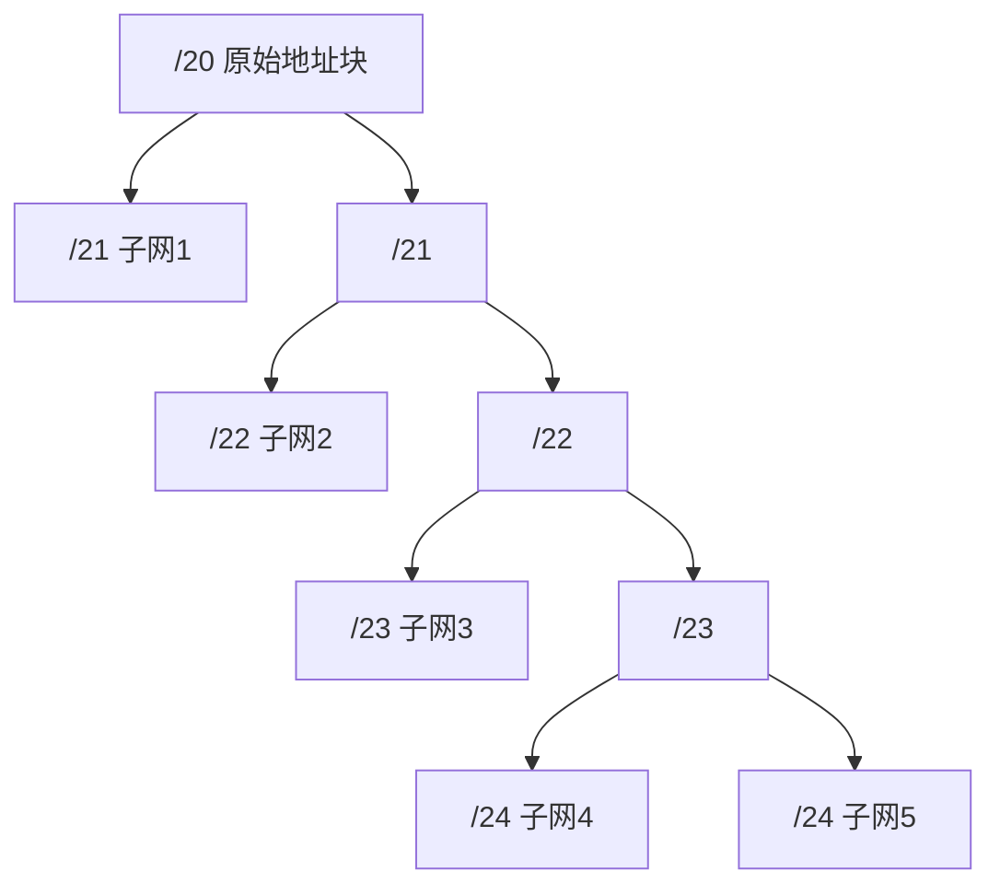
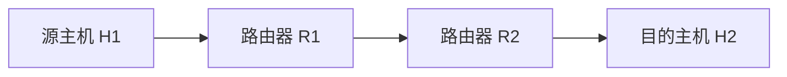
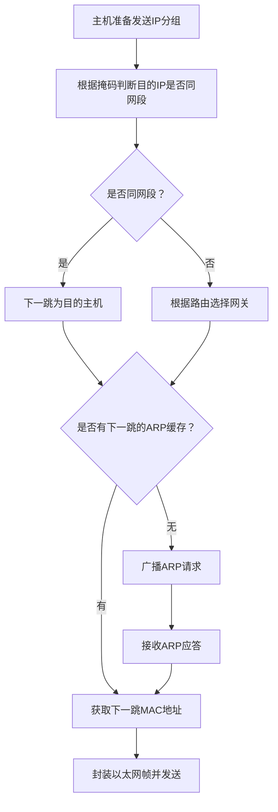
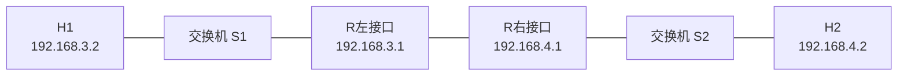
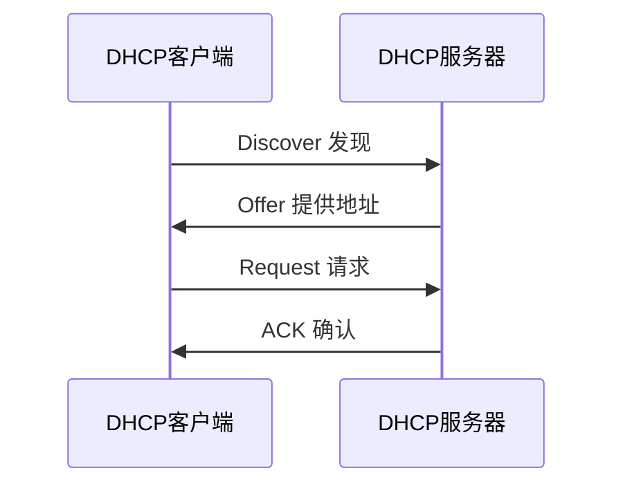
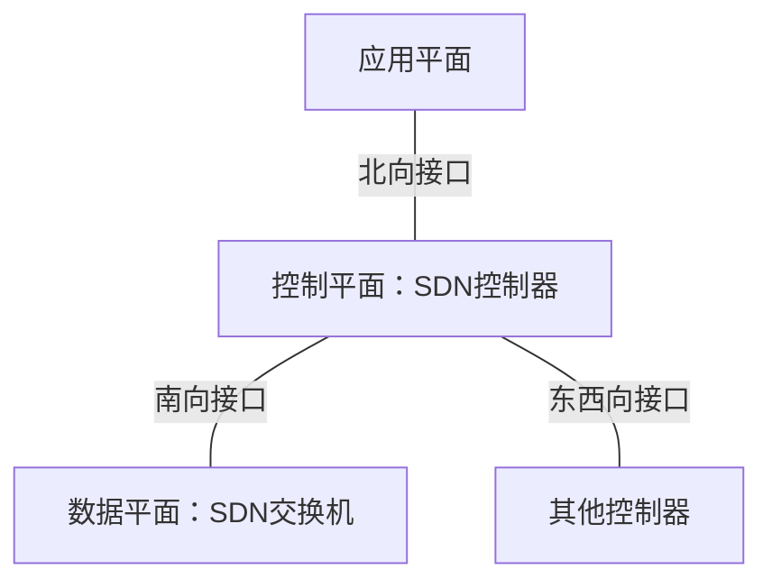

本章归纳31道历年真题与27道模拟题，共58道选择题。题号采用原分类题库的章节内编号。

## 一、本章核心考点与复习优先级

| 核心考点              | 重要程度  | 对应代表题             |
| ----------------- | ----- | ----------------- |
| IP地址、子网划分、CIDR    | ★★★★★ | 真题2、7、12、15、16、21 |
| 路由聚合与最长前缀匹配       | ★★★★★ | 真题8、13、28         |
| IP、MAC、ARP、NAT与网关 | ★★★★★ | 真题10、14、20、22     |
| RIP与距离向量算法        | ★★★★★ | 真题25、31，模拟19      |
| IPv4分片与首部字段       | ★★★★★ | 真题17，模拟2、5、6      |
| RIP、OSPF、BGP协议比较  | ★★★★  | 真题26，模拟18、20～23   |
| ICMP与特殊IP地址       | ★★★★  | 真题3、5、11，模拟12、16  |
| IPv6              | ★★★★  | 真题23，模拟7、17       |
| 广播域、冲突域           | ★★★★  | 真题27、30           |
| IP多播              | ★★★   | 模拟24、25           |
| 移动IP              | ★★★   | 模拟3、26            |
| SDN               | ★★★   | 真题1，模拟1           |

这里的星级是根据题库考查情况、知识的可迁移性和解题价值综合划分的复习优先级，并非对未来考试的概率预测。

**网络层真正需要建立的是四种思维：**

<Cards>

<Card title="地址块思维">

解决子网划分、地址范围、路由聚合。

</Card>

<Card title="逐跳转发思维">

解决IP、MAC、ARP、网关、NAT。

</Card>

<Card title="首部字段思维">

解决分片、TTL、检验和、IPv6。

</Card>

<Card title="路由计算思维">

解决RIP、OSPF、BGP及路由表更新。

</Card>

</Cards>

## 二、IP地址与子网划分：本章最重要的基础

### 2.1 把IP地址理解为一个地址区间

不要将IP地址理解为四个相互独立的十进制数字。

IPv4地址本质上是一个32位二进制数，而CIDR的前缀长度决定了哪些位固定、哪些位可以变化。

对于一个 `/n` 地址块：

$$
\text{主机位数}=32-n
$$

$$
\text{地址总数}=2^{32-n}
$$

$$
\text{普通子网可分配地址数}=2^{32-n}-2
$$

其中减去的两个地址分别是网络地址和广播地址。特殊的 `/31` 点对点链路及 `/32` 主机路由另有规则，普通408子网计算题使用上述方法即可。

最重要的是理解：

- 网络地址：所有主机位为0。
- 广播地址：所有主机位为1。
- 最小可分配地址：网络地址加1。
- 最大可分配地址：广播地址减1。

#### 子网掩码快速换算表

| 掩码中的十进制数 | 二进制      | 地址块步长 |
| -------- | -------- | ----- |
| 128      | 10000000 | 128   |
| 192      | 11000000 | 64    |
| 224      | 11100000 | 32    |
| 240      | 11110000 | 16    |
| 248      | 11111000 | 8     |
| 252      | 11111100 | 4     |
| 254      | 11111110 | 2     |
| 255      | 11111111 | 1     |

步长的计算方法：

$$
\text{步长}=256-\text{对应掩码字节}
$$

做选择题时，通常只需要计算发生网络位与主机位分界的那个字节，不需要将整个IP地址转换为二进制。

### 2.2 代表题一：快速确定子网地址范围

**来源：2023年408真题，题库第21题。**

主机 `168.16.84.24/20` 所在子网的最小可分配IP地址和最大可分配IP地址分别是什么？

#### 解题过程

`/20` 的子网掩码为：

```text
255.255.240.0
```

前两个字节固定，重点分析第三个字节。

$$
256-240=16
$$

因此第三个字节按照16划分区间：

```text
0  ～ 15
16 ～ 31
32 ～ 47
48 ～ 63
64 ～ 79
80 ～ 95   ← 84在这里
96 ～ 111
……
```

得到：

| 地址类型     | 计算结果          |
| -------- | ------------- |
| 网络地址     | 168.16.80.0   |
| 最小可分配地址  | 168.16.80.1   |
| 题目中的主机地址 | 168.16.84.24  |
| 最大可分配地址  | 168.16.95.254 |
| 广播地址     | 168.16.95.255 |

因此选择 **B**。

#### 这道题应该掌握的本质

只要确定了地址块的起点和终点，就可以同时解决网络地址、广播地址、可分配地址范围以及两个IP是否属于同一子网等问题。

例如王道卷七模拟第11题，掩码为 `255.255.192.0`，主机地址为 `129.23.144.16`。

第三字节步长为64，所以144属于128～191区间，而选项中的 `129.23.127.222` 不在该区间内，需要经过路由器通信。

### 2.3 定长子网划分与变长子网划分

假设原网络前缀为 `/p`，划分后的子网前缀为 `/q`。

定长划分时：

$$
\text{子网数量}=2^{q-p}
$$

$$
\text{每个子网的可分配地址数}=2^{32-q}-2
$$

例如2010年408真题第2题，将 `/24` 网络采用 `/29` 掩码划分子网：

$$
2^{29-24}=32
$$

$$
2^{32-29}-2=6
$$

因此有32个子网，每个子网有6个可分配地址。

<Callout type="warn" title="子网数与主机数">

注意：**普通现代子网划分中，子网数量不减2，可分配主机地址数量才减2。**

</Callout>

### 2.4 代表题二：不等长子网划分的最小子网问题

**来源：2019年408真题，题库第15题。**

将 `101.200.16.0/20` 划分为5个子网，最小的子网可能有多少个可分配IP地址？

本题的模型也出现在模拟题中。

#### 解题本质：每二分一次，子网数量增加1

要让其中一个子网尽可能小，就不断对同一个分支进行二分。



最终有5个子网，其中最小的两个子网前缀为 `/24`。

$$
2^{32-24}-2=254
$$

因此选择 **B**。

#### 提炼通用公式

将一个 `/p` 地址块完整划分成恰好 $k$ 个CIDR子块，允许不等长划分，并且前缀长度未超过32时：

$$
\text{最小子块的最大前缀长度}=p+k-1
$$

因此：

$$
\text{最小子块的地址总数} =2^{32-(p+k-1)}
$$

如果问普通子网的可分配地址数，再减2。

#### 真题与模拟题的迁移

王道卷二模拟第8题：将 `/17` 地址块恰好划分成9个子块，问最小子块包含多少个IP地址。

$$
17+9-1=25
$$

$$
2^{32-25}=128
$$

答案为128，而不是126。

两道题唯一重要的区别：

| 题目问法        | 是否减2   |
| ----------- | ------ |
| 包含多少个IP地址   | 不减     |
| 有多少个可分配IP地址 | 普通子网减2 |

**子网划分的本质就是二叉树的不断分裂；路由聚合则是这个过程的逆过程。** 这是理解本章地址计算难题的关键。

## 三、路由聚合与最长前缀匹配

### 3.1 路由聚合：找最长公共前缀

路由聚合的目的是用一条路由表示多个地址块，从而减少路由表中的表项数量。

例如2018年408真题第13题，四条路由的转发接口相同：

```text
35.230.32.0/21
35.230.40.0/21
35.230.48.0/21
35.230.56.0/21
```

观察第三个字节：

| 十进制 | 二进制          |
| --- | ------------ |
| 32  | **001**00000 |
| 40  | **001**01000 |
| 48  | **001**10000 |
| 56  | **001**11000 |

前两个字节共16位相同，第三个字节前3位相同。

$$
16+3=19
$$

因此聚合结果为：

**35.230.32.0/19**

还可以使用快速判断法：4个等长、连续且正确对齐的 `/21` 地址块，可以合并为一个 `/19` 地址块。

但不能只看到4个子网就直接减少2位前缀，必须检查地址是否连续、是否正确对齐，以及转发路径是否适合聚合。

### 3.2 代表题三：最长前缀匹配

**来源：2015年408真题，题库第8题。**

路由器收到目的IP地址为 `169.96.40.5` 的分组。

| 目的网络           | 转发接口 | 是否匹配 |
| -------------- | ---- | ---- |
| 169.96.40.0/23 | S1   | 是    |
| 169.96.40.0/25 | S2   | 是    |
| 169.96.40.0/27 | S3   | 是    |
| 0.0.0.0/0      | S4   | 是    |

因为四条路由都匹配，而 `/27` 的前缀最长，所以选择 **S3，答案C**。

#### 为什么选择最长的前缀？

网络前缀越长，描述的地址范围越小，目标网络就越具体。

```text
/23：较大的地址范围
  /25：更具体的地址范围
    /27：更加具体的地址范围
```

路由器应当优先选择最具体的匹配路由。

数学上，判断路由表项是否匹配就是：

$$
(\text{目的IP}\mathbin{\&}\text{子网掩码}) =\text{目的网络地址}
$$

#### 必须区分的三种问题

| 问题     | 判断依据     |
| ------ | -------- |
| 路由聚合   | 最长公共前缀   |
| 分组转发   | 最长匹配前缀   |
| 路由算法计算 | 路由度量、策略等 |

最长前缀匹配不是比较哪条路径的距离最短，也不是选择路由表中最先出现的表项。

默认路由 `0.0.0.0/0` 能匹配所有地址，但是优先级最低。如果没有任何匹配项，也没有配置默认路由，就应丢弃分组。

## 四、IP地址、MAC地址、ARP、NAT：掌握完整的分组转发过程

逐跳转发是网络层、数据链路层及跨章节综合题的共同基础。

### 4.1 最核心的思想：端到端与逐跳

**IP地址负责寻找最终目的主机，MAC地址负责当前链路上的交付。**

假设H1经过两个路由器向H2发送数据。



假设每段链路都是以太网，且不存在NAT等特殊机制：

| 传输阶段    | 源IP | 目的IP | 源MAC  | 目的MAC |
| ------- | --- | ---- | ----- | ----- |
| H1 → R1 | H1  | H2   | H1    | R1入接口 |
| R1 → R2 | H1  | H2   | R1出接口 | R2入接口 |
| R2 → H2 | H1  | H2   | R2出接口 | H2    |

需要牢记：

<Callout type="info" title="逐跳封装">

**普通IP转发：源IP和目的IP端到端保持不变，MAC地址随链路重新封装。**

</Callout>

但IP首部并非完全不变，TTL和IPv4首部检验和会发生更新。

### 4.2 主机发送数据的完整流程



ARP的本质并不是简单地“查询目的主机的MAC地址”，而是：

**在本地链路上，根据下一跳的IPv4地址查询下一跳的MAC地址。**

如果目的主机在其他网络，ARP查询的是网关，而不是远程目的主机。

### 4.3 代表题四：跨网段通信与MAC地址

**来源：2018年408真题，题库第14题。**

题目拓扑可以简化为：



题目给出了以下MAC地址：

| 设备   | MAC地址             |
| ---- | ----------------- |
| H1   | 00-1a-2b-3c-4d-52 |
| R左接口 | 00-1a-2b-3c-4d-51 |
| R右接口 | 00-a1-b2-c3-d4-61 |
| H2   | 00-a1-b2-c3-d4-62 |

题目问：H1发出的数据帧的目的MAC地址，以及H2收到的数据帧的源MAC地址。

<Steps>

<Step>

### 分析源主机的帧

H1和H2属于不同子网，因此H1必须先将数据交给路由器。

目的MAC地址：

`00-1a-2b-3c-4d-51`

即路由器左接口的MAC地址。

</Step>

<Step>

### 分析目的主机收到的帧

路由器取出IP分组，重新封装以太网帧，从右接口发出。

源MAC地址：

`00-a1-b2-c3-d4-61`

因此选择 **D**。

</Step>

</Steps>

#### 逐跳封装的通用判断方法

分析网络拓扑图时，先确定：

**当前考查的是IP分组，还是封装IP分组的以太网帧？当前考查的是哪一段链路？**

普通二层交换机转发以太网帧时，不改写帧的源MAC、目的MAC；路由器则会进行链路层的重新封装。

### 4.4 模拟题的进阶考法：ARP缓存为空

竞成模拟六第14题在上述真题基础上增加了一个条件：所有ARP缓存为空。

当H1要向其他子网的H2发送IP分组时，路由器入接口会先后收到两种帧。

| 顺序  | 帧的类型       | 目的MAC             |
| --- | ---------- | ----------------- |
| 第一次 | ARP请求      | FF-FF-FF-FF-FF-FF |
| 第二次 | 封装IP分组的数据帧 | 默认网关的MAC          |

容易出错的地方是将第二次收到的帧的目的MAC误认为H2的MAC。

ARP请求是广播，ARP应答通常是单播。

原模拟题选项中的广播MAC少写了一组FF，属于题目笔误，按照命题意图选择A。

### 4.5 NAT：IP地址不变原则的重要例外

普通路由器不会修改分组的源IP和目的IP，但执行NAT的路由器可能会修改。

| 传输方向   | 普通出站NAT的转换方式 |
| ------ | ------------ |
| 内网访问外网 | 修改源IP地址      |
| 外网响应内网 | 修改目的IP地址     |

如果采用NAPT，还会涉及传输层端口号的转换。

**2023年408真题第20题**考查了NAT和 `/30` 子网的结合。

已知R1接口地址是 `195.123.0.34/30`，R2执行NAT。

`/30` 有4个地址：

| 地址           | 用途     |
| ------------ | ------ |
| 195.123.0.32 | 网络地址   |
| 195.123.0.33 | R2公网接口 |
| 195.123.0.34 | R1接口   |
| 195.123.0.35 | 广播地址   |

所以，内网主机发出的分组经过R2执行题设NAT之后，源IP地址变为 `195.123.0.33`。

这道题没有考查新的复杂算法，本质上是两个基础知识点的组合：

**子网地址范围计算 + NAT修改源IP。**

## 五、IPv4分片：理解8字节对齐的原因

### 5.1 必须掌握的首部字段

| 字段    | 位数 | 核心作用           |
| ----- | -- | -------------- |
| 首部长度  | 4  | 单位为4B          |
| 总长度   | 16 | 首部与数据之和，单位为B   |
| 标识    | 16 | 辅助识别同一原始数据报的分片 |
| 标志    | 3  | 包含DF、MF        |
| 片偏移   | 13 | 单位为8B          |
| TTL   | 8  | 限制分组在网络中的生存跳数  |
| 协议    | 8  | 指出上层协议         |
| 首部检验和 | 16 | 只检验IPv4首部      |

最容易考查的是这三个单位：

| 字段   | 单位 |
| ---- | -- |
| 首部长度 | 4B |
| 总长度  | 1B |
| 片偏移  | 8B |

IPv4首部最小20B，最大60B。

### 5.2 代表题五：IPv4分片计算

**来源：2021年408真题，题库第17题。**

一个IP数据报总长度为1580B，首部为20B，经过MTU为800B的链路时进行分片，要求每个分片尽可能大。

求第二个分片的总长度和MF。

<Steps>

<Step>

### 计算原始数据长度

$$
1580-20=1560\text{B}
$$

</Step>

<Step>

### 计算最大非末片数据长度

$$
\left\lfloor\frac{800-20}{8}\right\rfloor \times8 =776\text{B}
$$

为什么不是780B？

因为片偏移以8B为单位，非末尾分片的数据长度必须是8B的整数倍，否则下一个分片的位置无法准确表示。

</Step>

<Step>

### 生成分片并计算字段

原始数据部分：


每个分片都需要自己的IP首部。

| 分片  | 数据长度 | 总长度  | 片偏移 | MF |
| --- | ---- | ---- | --- | -- |
| 第1片 | 776B | 796B | 0   | 1  |
| 第2片 | 776B | 796B | 97  | 1  |
| 第3片 | 8B   | 28B  | 194 | 0  |

所以第二个分片的总长度为796B，MF为1，选择 **B**。

</Step>

</Steps>

#### 通用解题公式

在题目给定各片首部长度相同的情况下，设原始总长度为 $L$，首部长度为 $H$，链路MTU为 $M$。

原始数据长度：

$$
D=L-H
$$

最大非末片数据长度：

$$
d=8\left\lfloor\frac{M-H}{8}\right\rfloor
$$

分片数量：

$$
n=\left\lceil\frac{D}{d}\right\rceil
$$

第 $i$ 个分片的片偏移：

$$
\text{Offset}_i=\frac{(i-1)d}{8}
$$

最后一个公式适用于对原始未分片数据报按最大载荷依次分片的情况。

### 5.3 分片中的概念题：不要只会计算

王道模拟第2、5、6题分别从重组、首部修改、检验和三个角度考查分片。

#### 哪些字段会改变？

| 字段               | 普通路由转发 | 路由器执行分片 |
| ---------------- | ------ | ------- |
| 源IP、目的IP         | 不变     | 不变      |
| 标识Identification | 不变     | 不变      |
| TTL              | 减少     | 减少      |
| 首部检验和            | 更新     | 更新      |
| 总长度              | 不变     | 重新填写    |
| MF               | 不变     | 按分片位置填写 |
| 片偏移              | 不变     | 按分片位置填写 |

需要注意，分片时相关字段会重新确定，并不意味着每一片的每个字段数值都一定与原报文不同。

#### 分片重组的关键

接收端通过源IP、目的IP、协议号、标识字段判断分片归属，再根据片偏移和MF完成重组。

因此，王道卷一模拟第2题中，第一次传输收到后两个分片，第二次重传收到前两个分片，不能因为内容相同就混合重组。这是两个不同的原始IP数据报。

**IPv4允许源主机和中间路由器进行分片，但普通IP分片在最终目的主机重组。**

## 六、路由算法与路由协议：另一个核心计算考点

### 6.1 距离向量算法的本质

假设路由器 $x$ 想到达目的网络 $y$，邻居路由器为 $v$。

$$
D_x(y)=\min_v \left\{c(x,v)+D_v(y)\right\}
$$

这个公式不必机械背诵，理解它的意思即可：

**我到目的地的距离 = 我到邻居的距离 + 邻居到目的地的距离。然后选择总代价最小的邻居。**

### 6.2 代表题六：距离向量计算

**来源：2021年408真题，题库第31题。**

路由器E与邻居A、B、C、D的直接链路距离分别为：

$$
8,\quad10,\quad12,\quad6
$$

收到邻居的距离向量如下：

| 目的网络 | A  | B  | C  | D  |
| ---- | -- | -- | -- | -- |
| Net1 | 1  | 23 | 20 | 22 |
| Net2 | 12 | 35 | 30 | 28 |
| Net3 | 24 | 18 | 16 | 36 |
| Net4 | 36 | 30 | 8  | 24 |

计算时，直接给每一列加上对应的链路代价。

| 目的网络 | 经A（+8） | 经B（+10） | 经C（+12） | 经D（+6） |
| ---- | ------ | ------- | ------- | ------ |
| Net1 | **9**  | 33      | 32      | 28     |
| Net2 | **20** | 45      | 42      | 34     |
| Net3 | 32     | **28**  | **28**  | 42     |
| Net4 | 44     | 40      | **20**  | 30     |

每行取最小值：

$$
\boxed{9,\ 20,\ 28,\ 20}
$$

因此选择 **D**。

#### 必须注意

这是一般的距离向量算法，不是明确限定为RIP协议。

所以不能因为出现大于15的距离，就判断该网络不可达。

<Callout type="warn" title="距离向量与RIP">

**只有题目明确使用RIP时，才使用16代表不可达的规则。**

</Callout>

### 6.3 RIP更新最容易出错的地方

王道卷三模拟第19题涉及收到某一个邻居的路由通告后更新路由表。

对比上一道真题，这类题更加容易出错。

RIP更新规则如下：

| 原路由表情况        | 更新方法               |
| ------------- | ------------------ |
| 原来没有该目的网络     | 可加入新的可达路由          |
| 原下一跳就是发送通告的邻居 | 根据该邻居的新距离更新，即使距离变大 |
| 原下一跳是其他邻居     | 新路径更短时才替换          |
| 直接连接的网络       | 正常可达时保留直连路由        |

设原路由器到Net1的路由为：

```text
目的网络：Net1
距离：4
下一跳：R2
```

现在R2通告自己到Net1的距离为8，那么经过R2的新距离为：

$$
8+1=9
$$

虽然9比原来的4大，但仍然要更新为9。

为什么？

因为原来的4本来就是通过R2得到的。现在R2已经告诉你原来的路径变差了，你不能继续相信旧数据。

<Callout type="idea" title="RIP更新">

**同一个下一跳的新消息是在修正旧信息，而不是在提供一条独立的新路径。**

</Callout>

#### RIP为什么会慢收敛？

2016年408真题第25题考查了网络故障后，RIP路由器仍可能相信其他邻居已经过时的路由通告。

例如某个网络已经不可达，但邻居仍报告距离为2，路由器可能暂时认为经过该邻居的距离为3。随后错误的距离不断增加，直到达到16。

这就是RIP的慢收敛以及计数到无穷问题。

RIP中的最大有效距离为15，16代表不可达。

### 6.4 RIP、OSPF、BGP核心对照

2017年408真题第26题，以及模拟第18、20～23题都围绕这三种协议展开。

| 比较项目   | RIP     | OSPF       | BGP        |
| ------ | ------- | ---------- | ---------- |
| 使用范围   | AS内部    | AS内部       | AS之间为主     |
| 类型     | 内部网关协议  | 内部网关协议     | 外部网关协议     |
| 算法     | 距离向量    | 链路状态       | 路径向量       |
| 直接承载协议 | UDP     | IP         | TCP        |
| 端口或协议号 | UDP 520 | IP协议号89    | TCP 179    |
| 路由选择依据 | 跳数      | 链路代价       | 路径属性和策略    |
| 交换对象   | 相邻路由器   | 链路状态在区域内洪泛 | BGP对等体     |
| 交换内容   | 距离向量    | 链路状态信息     | 前缀可达性与路径属性 |
| 15跳限制  | 有       | 无          | 无          |
| 典型特点   | 简单、收敛较慢 | 适合较大型网络    | 支持自治系统间策略  |

#### 从本质上理解三个算法

**RIP：问邻居怎么走。**

路由器不知道完整的网络拓扑，只知道邻居报告的距离，然后计算经过哪个邻居最合适。

**OSPF：获得拓扑图，自己计算怎么走。**

通过洪泛获得链路状态信息，建立链路状态数据库，再通过Dijkstra算法计算最短路径。

**BGP：根据跨自治系统路径与策略决定怎么走。**

BGP的目标不只是寻找最短路径，还需要考虑自治系统之间的路由策略。

#### BGP模拟题中的新增考法

王道模拟第20～23题对BGP考查比较深入，需要额外掌握：

| 概念    | 含义                           |
| ----- | ---------------------------- |
| eBGP  | 不同AS之间交换BGP路由                |
| iBGP  | 同一AS内部传递BGP路由                |
| IGP   | 解决AS内部的路径可达性                 |
| 热土豆路由 | 在更高优先级属性相同的情况下，优先选择内部代价较小的出口 |

经典iBGP模型中，从一个iBGP邻居学到的路由不能直接再通告给另一个普通iBGP邻居，因此传统方式需要逻辑全连接。

若有 $n$ 台BGP路由器，会话数为：

$$
\frac{n(n-1)}{2}
$$

这里是逻辑全连接，不是物理全连接。现代部署可以使用路由反射器等机制，不必始终全连接。

## 七、重要辅助协议：从协议的作用与封装方式理解

本部分以概念选择题为主，不需要复杂计算，但很容易因协议混淆而失分。

### 7.1 协议封装关系

| 协议   | 主要作用           | 直接承载方式  |
| ---- | -------------- | ------- |
| ARP  | IPv4地址解析为MAC地址 | 链路层帧    |
| ICMP | 差错报告、网络诊断      | IP      |
| IGMP | IPv4组播成员关系管理   | IP      |
| RIP  | 距离向量路由选择       | UDP     |
| OSPF | 链路状态路由选择       | IP      |
| BGP  | BGP路由交换        | TCP     |
| DHCP | 自动分配网络配置       | UDP     |
| DNS  | 域名解析           | UDP或TCP |

**协议解决哪一层的问题，不等于它直接由哪一层协议承载。**

例如DHCP负责分配IP地址，但它属于应用层协议，通过UDP传输。

RIP和BGP虽然负责网络层路由选择，但按408常见的封装分类口径，通常归入应用层路由协议。

### 7.2 ICMP的重点

| ICMP报文  | 典型触发条件       |
| ------- | ------------ |
| 目的不可达   | 无法交付分组等      |
| 时间超过    | TTL耗尽或分片重组超时 |
| 参数问题    | IP首部参数存在问题   |
| 路由重定向   | 提示存在更合适的下一跳  |
| 回显请求与应答 | Ping网络诊断     |

ICMP直接封装在IP数据报中，而不是TCP或UDP。

另外，不是所有分组出错都会产生ICMP差错报告。

通常不会对ICMP差错报告报文本身、广播或组播报文、非首片IPv4分片等再次产生相应的ICMP差错报告。

2010年408真题第3题考查的ICMP源抑制报文已经被现代标准废弃，做历史真题时需要按照当年的知识背景理解，不应将其视为当前网络的常规拥塞控制机制。

### 7.3 DHCP必须掌握的知识

DHCP的基本过程可以概括为DORA。



DHCP使用UDP，服务器端口为67，客户端端口为68。

在客户端尚未获得IP地址的初始发现阶段：

```text
源IP：0.0.0.0
目的IP：255.255.255.255
```

DHCP不仅可以分配IP地址，还可以提供子网掩码、默认网关、DNS服务器地址等配置信息。

### 7.4 特殊IPv4地址

2017年408真题第11题与竞成模拟第12题形成了非常好的互补。

| 特殊地址            | 含义     | 源/目的地址限制    |
| --------------- | ------ | ----------- |
| 0.0.0.0         | 未指定地址  | 初始化时可作源地址   |
| 255.255.255.255 | 受限广播   | 只能作目的地址     |
| 主机位全1           | 子网定向广播 | 只能作目的地址     |
| 主机位全0           | 网络地址   | 普通子网中不分配给主机 |
| 127.0.0.0/8     | 环回地址   | 本机内部使用      |
| 224.0.0.0/4     | 组播地址   | 只能作目的地址     |

私有IPv4地址范围：

$$
10.0.0.0/8
$$

$$
172.16.0.0/12
$$

$$
192.168.0.0/16
$$

其中第二个范围是172.16.0.0～172.31.255.255，不是全部172开头的IP地址。

私有地址可以在内部网络中正常作为源地址或目的地址，只是不能作为普通公网可路由地址使用。

## 八、IPv6：重点理解为什么要修改首部

2023年408真题第23题，以及模拟第7、17题主要考查IPv4和IPv6的区别。

### 8.1 IPv4与IPv6对照

| 项目      | IPv4   | IPv6        |
| ------- | ------ | ----------- |
| 地址长度    | 32位    | 128位        |
| 首部长度    | 20～60B | 基本首部固定40B   |
| 首部检验和   | 有      | 无           |
| 中间路由器分片 | 支持     | 不支持         |
| 源主机分片   | 支持     | 支持          |
| 生存跳数限制  | TTL    | Hop Limit   |
| 可选功能    | 首部可选字段 | 扩展首部        |
| 广播      | 支持     | 不支持，使用组播等机制 |
| 地址表示    | 点分十进制  | 冒号分隔的十六进制   |

IPv6地址空间是IPv4的：

$$
\frac{2^{128}}{2^{32}}=2^{96}
$$

不是96倍。

#### IPv6设计思想

IPv6不仅仅是为了扩大地址空间，也希望简化中间路由器的处理过程。

取消基本首部检验和，就不需要每次修改Hop Limit后重新计算首部检验和。

取消中间路由器分片，也可以减少路由器的处理负担。

<Callout type="warn" title="IPv6分片">

**IPv6取消的是路由器分片，并没有取消分片功能。**

</Callout>

### 8.2 IPv6地址压缩

竞成模拟四第17题考查了地址压缩。

原地址：

```text
8000:0000:0000:0000:D000:1230:CDEF:89A0
```

正确压缩：

```text
8000::D000:1230:CDEF:89A0
```

规则只有两个：组内可以省略前导零，连续的全零组可以用一次 `::` 代替。

`0008` 可以缩写成 `8`，但是 `8000` 不能缩写成 `8`。

IPv4到IPv6的过渡技术还应记住双协议栈和隧道技术。

## 九、网络设备与广播域：通过隔离范围理解

2010年、2020年408真题以及竞成模拟五都考查了这一知识点。

| 网络设备       | 隔离冲突域 | 隔离广播域     |
| ---------- | ----- | --------- |
| 中继器        | 否     | 否         |
| 集线器        | 否     | 否         |
| 网桥         | 是     | 否         |
| 普通二层交换机    | 是     | 否         |
| 支持VLAN的交换机 | 是     | 可以按VLAN隔离 |
| 路由器        | 是     | 是         |

冲突域关注的是哪些设备共享传输介质、可能发生发送冲突。

广播域关注的是一个广播帧可以传播到哪些设备。

做拓扑图题时，可以把普通集线器连接的共享网段看作一个整体；交换机隔离传统共享介质上的冲突范围；路由器和VLAN划分广播范围。

实际全双工交换链路不会发生传统的以太网碰撞，因此遇到冲突域计数题，应结合题设链路类型和教材使用的统计口径判断。

#### 2024年408真题第22题的本质

这道题将VLAN与ARP表结合起来。

ARP广播不能直接传播到其他VLAN，主机通常也不会直接解析其他VLAN中的远程主机MAC。

因此判断某个地址是否可能出现在ARP表中，不能只看是否连接了同一台交换机，还要考虑VLAN和三层可达关系。

同一个物理交换机可以被划分成多个逻辑广播域。

## 十、模拟题重点补充：IP多播、移动IP、SDN

以下是模拟题中的补充考点。

### 10.1 IP多播：低23位映射

IPv4多播地址范围：

$$
224.0.0.0\sim239.255.255.255
$$

IPv4组播地址映射到以太网MAC地址时，使用固定前缀和IP地址的低23位。

**竞成模拟五第24题：**

求IP地址 `238.212.24.5` 对应的组播MAC地址。

将其转换为十六进制：

```text
238.212.24.5
 EE  D4 18 05
```

取低23位，相当于保留后三个字节，并将第二个IP字节的最高位清零：

$$
\texttt{D4}\mathbin{\&}\texttt{7F} =\texttt{54}
$$

拼接固定前缀：

```text
01:00:5E:54:18:05
```

选择C。

由于IPv4组播地址有28个可变位，而组播MAC只有23个可变位：

$$
2^{28-23}=32
$$

所以可能有32个不同的IPv4组播地址映射为同一个MAC地址。

#### IGMP的本质

IGMP负责管理本地链路上的组播成员关系，使本地组播路由器知道是否存在某个组的接收者。

它不负责计算整个互联网中的组播路由，也不需要统计整个组播组的精确成员数量。

### 10.2 移动IP：区分身份和位置

移动IP中存在两种不同含义的地址。

| 地址         | 作用            |
| ---------- | ------------- |
| 永久地址（归属地址） | 标识移动主机的身份     |
| 转交地址       | 标识移动主机当前所在的位置 |

经典三角路由过程：


王道卷二模拟第3题中，移动主机永久地址为 `218.75.230.16`，转交地址为 `175.1.1.1`。

远程主机发送的原始IP分组目的地址为永久地址；经过归属代理隧道封装后，新外层首部的目的地址为转交地址。

内部原始IP首部仍然保留永久地址。

竞成模拟第26题进一步考查：移动主机回复远程主机时，不一定需要经过归属代理。

### 10.3 SDN：控制平面与数据平面分离



2022年408真题第1题直接考查：控制器通过什么接口向交换机下发流表？

答案是南向接口。

SDN的本质：

传统路由器通常既负责控制层面的路由选择，也负责实际的数据分组转发；SDN将这两种职责分离，使控制逻辑可以由逻辑集中化的控制器管理。

竞成模拟一第1题还考查了OpenFlow 1.0流表的匹配字段，可以涉及数据链路层MAC地址、网络层IP地址、运输层端口号，但不包含HTTP URL等应用层内容的标准匹配字段。

## 十一、本章最容易出错的判断题汇总

以下归纳真题和模拟题中的常见错误选项。

| 容易出现的错误说法             | 正确理解              |
| --------------------- | ----------------- |
| IP地址最后一段为255就是广播地址    | 取决于子网掩码           |
| 划分子网时子网数量要减2          | 普通现代子网划分不减        |
| 地址块的地址总数需要减2          | 可分配地址数量才需要减       |
| 地址聚合只要求地址连续           | 还需要满足前缀对齐等条件      |
| 路由器选择距离最短的匹配表项        | 转发时先遵循最长前缀匹配      |
| 目的主机的IP就是下一跳IP        | 跨网络时下一跳通常是路由器     |
| ARP总是查询目的主机的MAC       | 查询本地链路上的下一跳MAC    |
| 经过路由器源IP一定改变          | 普通转发不改变，NAT是例外    |
| 交换机会修改源MAC和目的MAC      | 普通二层转发不会修改        |
| 分片的标识字段各不相同           | 同一原始数据报的分片标识相同    |
| 分片总长度必须是8B的倍数         | 非末片的数据部分才必须对齐     |
| IP首部检验和检验整个数据报        | 只检验首部             |
| IP保证分组不丢失             | IP提供尽最大努力交付       |
| RIP总是保留较小的旧距离         | 当前下一跳的更新即使变大也要接受  |
| 所有距离向量算法都限制15跳        | RIP才有这一特定限制       |
| RIP、OSPF、BGP都直接封装在IP中 | 分别由UDP、IP、TCP直接承载 |
| IPv6不能进行分片            | 源主机可以进行分片         |
| IPv6地址空间是IPv4的96倍     | 是 $2^{96}$ 倍  |
| IGMP管理整个互联网的组播成员      | 管理本地链路上的组播成员关系    |
| 没有匹配路由一定走默认路由         | 必须存在默认路由，否则丢弃     |

## 十二、考场解题思维：看到题目应该立即想到什么

| 题目关键词          | 第一反应           |
| -------------- | -------------- |
| 子网掩码、网络地址、广播地址 | 计算地址块的起点和终点    |
| 划分成恰好几个子网、最小子网 | 不断二分，块数每次增加1   |
| 路由聚合、超网        | 找最长公共前缀        |
| 目的IP、路由表、输出接口  | 最长前缀匹配         |
| 默认网关           | 本地链路可达的路由器接口   |
| ARP、MAC地址      | 确定当前链路的下一跳     |
| NAT            | 判断入站还是出站方向     |
| MTU、MF、片偏移     | 先减首部，再做8B对齐    |
| 距离向量           | 邻居距离加直连链路代价    |
| RIP路由更新        | 先加1，再判断下一跳是否相同 |
| OSPF           | 链路状态、Dijkstra  |
| BGP            | AS边界、路径属性、策略   |
| ICMP           | IP直接承载、差错报告    |
| IPv6           | 固定40B、源端分片     |
| 多播MAC          | 固定前缀加低23位      |
| 移动IP           | 永久地址与转交地址      |
| SDN            | 控制与转发分离        |

## 十三、考前自测

以下为根据题库考点设计的迁移练习，非原题。

| 自测问题                                     | 检验的知识点   |
| ---------------------------------------- | -------- |
| 172.16.73.21/19的广播地址是什么？                 | CIDR地址区间 |
| 将 `/22` 地址块完整划分为恰好6个不等长子块，最小子块有多少个可分配地址？ | 二叉划分     |
| 跨网段通信时，ARP查询的是谁的MAC？                     | 逐跳转发     |
| 总长2000B、首部20B的IP数据报经过MTU为620B的链路，需要多少片？  | IPv4分片   |
| RIP原路由距离为3，下一跳R2，现在R2通告距离为7，应更新为什么？      | RIP更新    |
| IPv6路由器为什么不必更新首部检验和？                     | IPv6设计本质 |

<Accordions>

<Accordion title="参考答案与解析">

**参考答案：**

第一题：`172.16.95.255`。

第二题：

$$
22+6-1=27
$$

$$
2^{32-27}-2=30
$$

第三题：默认网关或路由所指定的本地下一跳接口的MAC地址。

第四题：

$$
d=8\left\lfloor\frac{620-20}{8}\right\rfloor =600\text{B}
$$

$$
n=\left\lceil\frac{2000-20}{600}\right\rceil=4
$$

第五题：8。原下一跳就是R2，即使距离变大也要接受更新。

第六题：IPv6基本首部取消了首部检验和字段。

</Accordion>

</Accordions>

## 十四、六条核心规律

**第一，IP子网就是一个对齐的二进制地址区间。**

**第二，子网划分是二分，路由聚合是合并，分组转发是最长前缀匹配。**

**第三，IP地址寻找最终目的主机，MAC地址完成当前链路的交付。**

**第四，IPv4分片先减首部，再按8字节对齐，最终目的主机负责重组。**

**第五，距离向量算法是链路代价相加，RIP更新必须区分下一跳是否相同。**

**第六，协议的功能、协议的承载方式、协议的作用范围是三个不同的概念。**

原题库的省略前提、格式笔误及历史协议标准变化，见相关章节说明。

优先掌握**地址块计算、分组转发全过程、IPv4分片、距离向量更新**这四个知识体系。它们既是网络层选择题的核心，也是后续解决网络层综合大题的重要基础。
