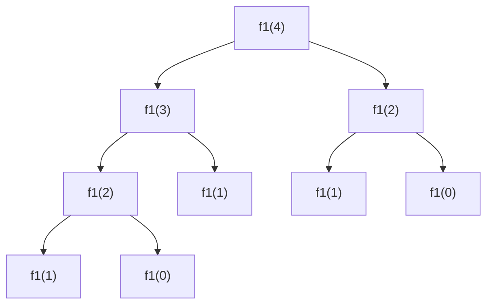
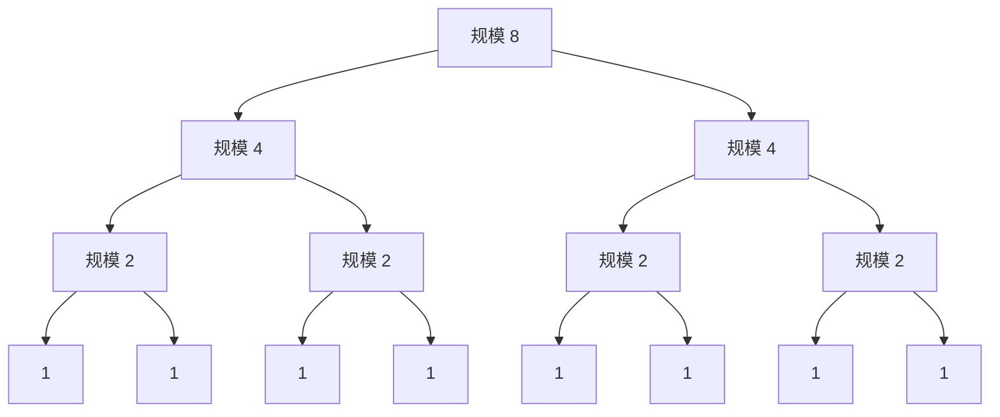

本章基于分类题库的 7 道历年真题和 9 道 2027 年模拟题，共 16 道选择题。重点是复杂度分析与基本操作效率（15 道），另有 1 道考查算法基本特征。复习主线是将陌生代码转换成可分析的数学模型。

## 一、核心考点与复习优先级

| 核心考点        | 对应题库来源                   | 重要程度  |
| ----------- | ------------------------ | ----- |
| 循环变量变化与终止条件 | 2011、2017、2019真题，王道卷三、卷四 | ★★★★★ |
| 多层循环与累加求和   | 2014、2022真题，王道卷一、竟成模拟五   | ★★★★★ |
| 双指针与累计操作次数  | 竟成模拟一                    | ★★★★★ |
| 递归时间与空间复杂度  | 2012真题，王道卷二、竟成模拟二、模拟七    | ★★★★★ |
| 数据结构基本操作效率  | 2023真题                   | ★★★★  |
| 算法的基本特征     | 王道卷一                     | ★★★   |

星级依据题库考查情况、题目区分度及知识迁移价值，不代表未来考试概率。

## 二、首先理解复杂度分析的本质

### 1. 时间复杂度究竟在计算什么？

时间复杂度研究的是：**随着问题规模 $n$ 增大，算法所需要执行的基本操作次数，以怎样的速度增长。**

它不是实际运行的秒数，也不是代码行数，更不是循环嵌套的层数。

例如：

$$
T(n)=3n^2+5n+10
$$

当 $n$ 足够大时，决定增长速度的是 $n^2$，所以其紧确渐近阶为：

$$
T(n)=\Theta(n^2)
$$

408选择题通常写成 $O(n^2)$。

严格来说，$O$ 表示渐近上界，$\Theta$ 表示紧确渐近界。因此，线性复杂度的算法也满足 $O(n^2)$，但考试通常要求选择最紧的、最符合实际增长量级的选项。

### 2. 必须熟悉的复杂度增长顺序

当 $n$ 足够大时：

$$
1<\log\log n<\log n<\sqrt n<n<n\log n<n^2<n^3<2^n<n!
$$

以下几个数学规律非常重要，能够直接解决大量复杂度选择题。

| 数学模型                                    | 增长量级                  |
| --------------------------------------- | --------------------- |
| $1+1+\cdots+1$，共 $n$ 项          | $\Theta(n)$       |
| $1+2+\cdots+n$                      | $\Theta(n^2)$     |
| $1^2+2^2+\cdots+n^2$                | $\Theta(n^3)$     |
| $1+2+4+\cdots+2^k$                  | $\Theta(2^k)$     |
| $1+\frac12+\cdots+\frac1n$          | $\Theta(\log n)$  |
| $\frac n1+\frac n2+\cdots+\frac nn$ | $\Theta(n\log n)$ |

尤其要掌握**等差数列求和、等比数列求和、调和级数**。很多看起来复杂的代码，最终只是在考查这些数学模型。

## 三、第一类核心题型：单层循环与终止条件

**重要程度：★★★★★**

这种题型的本质是：根据变量的变化规律，反推出循环执行次数。

不要仅仅根据 `i++` 或 `i *= 2` 判断复杂度，还要关注循环的结束条件。

### 代表题1：2017年408真题

```c
int func(int n) {
    int i = 0, sum = 0;
    while (sum < n)
        sum += ++i;
    return i;
}
```

A. $O(\log_2 n)$

B. $O(\sqrt n)$

C. $O(n)$

D. $O(n\log_2 n)$

**正确答案：B。**

<Steps>

<Step>

### 第一步：观察变量的变化规律

| 循环次数    | i       | sum                  |
| ------- | ------- | -------------------- |
| 0       | 0       | 0                    |
| 1       | 1       | 1                    |
| 2       | 2       | 3                    |
| 3       | 3       | 6                    |
| 4       | 4       | 10                   |
| 5       | 5       | 15                   |
| $k$ | $k$ | $\frac{k(k+1)}2$ |

假设循环执行了 $k$ 次，那么：

$$
sum=1+2+\cdots+k=\frac{k(k+1)}2
$$

</Step>

<Step>

### 第二步：建立退出条件

循环在 `sum >= n` 时结束，因此：

$$
\frac{k(k+1)}2\geq n
$$

首次满足条件时：

$$
k=\left\lceil\frac{\sqrt{8n+1}-1}{2}\right\rceil
$$

只考虑数量级：

$$
k=\Theta(\sqrt n)
$$

每轮循环只需要常数时间，所以：

$$
\boxed{T(n)=\Theta(\sqrt n)}
$$

</Step>

<Step>

### 第三步：理解命题陷阱

看到 `++i` 就选择 $O(n)$，是典型的机械套公式。

虽然 $i$ 每次只增加1，但真正决定循环何时结束的变量是 `sum`，而不是 $i$。

`sum` 的增长速度是循环次数的平方级，因此只需要根号级的循环次数就能达到 $n$。

<Callout type="idea" title="反推循环次数">

**变量增长得越快，达到固定目标所需要的迭代次数通常越少。**

</Callout>

</Step>

</Steps>

### 同类题目的统一解法

题库中的2011年、2019年真题和王道卷三、卷四，本质上都可以使用同一个方法。

假设执行了 $k$ 次循环，建立变量与 $k$ 的关系，再根据退出条件反解 $k$。

| 题目来源   | 第 $k$ 次迭代后的关键关系            | 时间复杂度            |
| ------ | ------------------------------ | ---------------- |
| 2011真题 | $x=2^{k+1}$                | $O(\log n)$  |
| 2017真题 | $sum=\frac{k(k+1)}2$       | $O(\sqrt n)$ |
| 2019真题 | $x=k$，通过平方条件控制结束           | $O(\sqrt n)$ |
| 王道卷三   | $i=2\cdot3^k$              | $O(\log n)$  |
| 王道卷四   | $i=\lfloor n^2/2^k\rfloor$ | $O(\log n)$  |

#### 必须掌握的反推模型

| 循环次数与规模的关系             | 循环次数的量级                  |
| ---------------------- | ------------------------ |
| $k\approx n$       | $\Theta(n)$          |
| $k^2\approx n$     | $\Theta(\sqrt n)$    |
| $k^3\approx n$     | $\Theta(\sqrt[3]n)$  |
| $2^k\approx n$     | $\Theta(\log n)$     |
| $2^{2^k}\approx n$ | $\Theta(\log\log n)$ |

记住的不是某一种代码形式，而是**增长函数与其反函数之间的关系**。

## 四、第二类核心题型：多层循环与求和

**重要程度：★★★★★**

这是第1章最值得深入掌握的知识点之一。

### 代表题2：2022年408真题

```c
int sum = 0;
for (int i = 1; i < n; i *= 2)
    for (int j = 0; j < i; j++)
        sum++;
```

A. $O(\log_2 n)$

B. $O(n)$

C. $O(n\log_2 n)$

D. $O(n^2)$

**正确答案：B。**

这道题考查嵌套循环的实际工作量。

<Steps>

<Step>

### 第一步：分别观察每轮工作量

| 外层循环轮次 | i  | 内层执行次数 |
| ------ | -- | ------ |
| 1      | 1  | 1      |
| 2      | 2  | 2      |
| 3      | 4  | 4      |
| 4      | 8  | 8      |
| 5      | 16 | 16     |
| …      | …  | …      |

例如，当 $n=16$ 时，内层基本操作的执行次数为：

$$
1+2+4+8=15
$$

如果 $n=64$，则执行次数为：

$$
1+2+4+8+16+32=63
$$

显然，总次数与 $n$ 是同一数量级。

</Step>

<Step>

### 第二步：建立求和表达式

设外层最后一次取值为 $2^k$，则：

$$
2^k<n\leq 2^{k+1}
$$

基本操作的总执行次数：

$$
\begin{aligned} T(n)&=1+2+4+\cdots+2^k\\ &=2^{k+1}-1\\ &=\Theta(n) \end{aligned}
$$

因此：

$$
\boxed{T(n)=\Theta(n)}
$$

</Step>

</Steps>

#### 为什么不能直接相乘？

外层执行 $O(\log n)$ 次，内层单轮最多执行 $O(n)$ 次。

如果直接相乘：

$$
O(\log n)\times O(n)=O(n\log n)
$$

只能得到一个宽松的上界，而不是最紧的复杂度。

因为内层并不是每一轮都执行 $n$ 次。

**真正的复杂度是所有轮次的实际工作量之和，而不是循环轮数乘以最大单轮工作量。**

### 对比2014年408真题

```c
count = 0;
for (k = 1; k <= n; k *= 2)
    for (j = 1; j <= n; j++)
        count++;
```

这道题的答案却是：

$$
O(n\log n)
$$

比较两道真题：

| 对比项目  | 2014年真题               | 2022年真题                    |
| ----- | --------------------- | -------------------------- |
| 外层次数  | $\Theta(\log n)$  | $\Theta(\log n)$       |
| 内层次数  | 每轮都是 $n$          | 每轮分别为 $1,2,4,8,\ldots$ |
| 总工作量  | $n+n+\cdots+n$    | $1+2+4+\cdots$         |
| 最终复杂度 | $\Theta(n\log n)$ | $\Theta(n)$            |

这两道题放在一起学习，比单独做十道普通循环题更有价值。

### 统一解题模型

假设外层循环执行 $m$ 次，第 $k$ 轮的内层执行次数为 $f(k)$，那么：

$$
\boxed{T(n)\asymp \sum_{k=1}^{m}f(k)}
$$

这里的 $\asymp$ 表示在通常的常数开销循环模型下具有相同数量级。

如果每轮的工作量相同，可以直接相乘；如果每轮工作量不同，就要使用求和或者合理的上下界估计。

#### 常见嵌套循环速查表

| 外层变化     | 内层工作量                    | 总时间复杂度           |
| -------- | ------------------------ | ---------------- |
| `i++`    | $n$                  | $O(n^2)$     |
| `i++`    | $i$                  | $O(n^2)$     |
| `i++`    | $n-i$                | $O(n^2)$     |
| `i++`    | $i^2$                | $O(n^3)$     |
| `i++`    | $\lfloor n/i\rfloor$ | $O(n\log n)$ |
| `i *= 2` | $n$                  | $O(n\log n)$ |
| `i *= 2` | $i$                  | $O(n)$       |
| `i *= 2` | $\lfloor n/i\rfloor$ | $O(n)$       |

表中默认外层从1开始，运行到 $n$ 附近。

### 模拟题中的两种重要变式

**王道卷一：三角形循环**

```c
for (i = 1; i <= n; i++)
    for (j = 2 * i; j <= n; j++)
        y += i * j;
```

只有当 $i\leq\lfloor n/2\rfloor$ 时，内层才执行。

令 $m=\lfloor n/2\rfloor$，则：

$$
\begin{aligned} T(n)&=\sum_{i=1}^{m}(n-2i+1)\\ &=m(n-m)\\ &=\Theta(n^2) \end{aligned}
$$

关键是先确定有效循环范围，再计算每一轮的工作量。

**竟成模拟五：平方增长循环**

```c
for (int i = 2; i <= n; i *= i)
    for (int j = 1; j <= i; j++)
        sum++;
```

外层变量不是普通倍增，而是不断平方：

$$
2,\ 4,\ 16,\ 256,\ 65536,\ldots
$$

第 $k$ 轮取值（从第0轮开始计数）为：

$$
i=2^{2^k}
$$

所以单独看外层，循环次数为：

$$
\Theta(\log\log n)
$$

但是整个程序的工作量为：

$$
T(n)=2+4+16+\cdots+M
$$

其中 $M$ 是不超过 $n$ 的最后一项。

由于：

$$
M\leq T(n)<2M\leq2n
$$

所以最紧的给定选项是 $O(n)$。

这道模拟题有一个数学上的细节：严格来说，并不是所有 $n$ 都满足 $T(n)=\Theta(n)$，因为相邻两项之间的差距非常大。但按照题目的选项和命题意图，应选择 $O(n)$。

这类题目进一步说明：**外层循环次数并不能单独决定整个算法的复杂度，必须考虑每轮的实际代价。**

## 五、第三类核心题型：双指针与摊还分析

**重要程度：★★★★★**

这是模拟题中很有迁移价值的一类知识，也是学习后续线性表、字符串和滑动窗口算法的重要基础。

### 代表题3：竟成模拟一

```c
int getK(int k) {
    int cnt = 0, left = 0;
    for (int right = 0; right < n; right++) {
        if (nums[right] == 1) cnt++;

        while (left <= right && cnt >= k) {
            if (nums[left] == 1) cnt--;
            left++;
        }
    }
}
```

A. $O(\log_2 n)$

B. $O(n)$

C. $O(n\log_2 n)$

D. $O(n^2)$

**正确答案：B。**

#### 核心突破口：left没有重置

一般的二重循环：

```c
for (int i = 0; i < n; i++)
    for (int j = 0; j < n; j++)
        count++;
```

每次外层循环开始，`j` 都从0重新出发，所以总次数是 $n^2$。

而本题的 `left` 在外层循环之前初始化，在整个算法运行过程中只会向右移动，不会回退。

假设某次执行的指针变化如下：

| right的位置 | left的变化 | 内层执行次数 |
| -------- | ------- | ------ |
| 0        | 0 → 0   | 0      |
| 1        | 0 → 2   | 2      |
| 2        | 2 → 2   | 0      |
| 3        | 2 → 4   | 2      |
| 4        | 4 → 5   | 1      |
| 合计       | 0 → 5   | 5      |

有些轮次执行得多，有些轮次执行得少，但所有轮次加起来，`left` 最多移动 $n$ 次。

因此：

$$
T_{\text{right}}(n)=\Theta(n)
$$

$$
T_{\text{left}}(n)=O(n)
$$

总复杂度：

$$
\boxed{T(n)=\Theta(n)}
$$

#### 摊还分析的本质

不要孤立地问：

> 内层循环一次最多执行多少次？

而应该问：

> 在整个算法运行期间，内层的基本操作一共最多执行多少次？

两种问题的答案可能完全不同。

摊还分析关注的是一系列操作的总体代价，而不是假设每次操作都同时达到最坏情况。它也不需要假设输入服从某种概率分布，这与平均时间复杂度的分析有所区别。

#### 遇到双指针题目的判断方法

首先检查指针是否单调移动，然后检查指针是否会重新初始化，最后检查每个元素在整个算法中最多被访问多少次。

如果两个指针都只向前移动，每个指针最多移动 $n$ 次，并且每次移动只需常数时间，那么总体时间复杂度就是 $O(n)$。

这种方法在有序表合并、滑动窗口、字符串匹配以及部分单调栈算法中都会用到。

## 六、第四类核心题型：递归的时间与空间复杂度

**重要程度：★★★★★**

题库中递归相关的题目有4道。其中最需要掌握的是：

**时间复杂度看累计工作量，空间复杂度看最大同时占用的额外空间。**

这两个概念绝对不能混淆。

### 代表题4：竟成模拟二——斐波那契数列

```c
int f1(int n) {
    if (n == 1) return 1;
    if (n == 0) return 0;
    return f1(n - 1) + f1(n - 2);
}

int f2(int n) {
    int dp[n + 2], i;
    dp[0] = 0;
    dp[1] = 1;

    for (i = 2; i <= n; i++) {
        dp[i] = dp[i - 1] + dp[i - 2];
    }
    return dp[n];
}
```

题目要求两个函数的**空间复杂度**。

A. $O(n)$、$O(1)$

B. $O(2^n)$、$O(1)$

C. $O(n)$、$O(n)$

D. $O(2^n)$、$O(n)$

**正确答案：C。**

#### f1：理解递归树和递归栈的区别

以 `f1(4)` 为例，它的递归调用树为：



整棵树中有大量重复计算，所以时间复杂度是指数级的。

但这些递归调用并不是同时占用内存。

如果先执行 `f1(n-1)`，那么最深的一条递归路径为：

$$
f_1(n)\to f_1(n-1)\to\cdots\to f_1(1)
$$

最多同时存在数量级为 $n$ 的栈帧。

在一条分支执行完毕并返回后，其内部栈帧会被释放，然后才会展开另一条分支。

因此：

$$
\boxed{S_{f_1}(n)=\Theta(n)}
$$

补充理解：朴素斐波那契递归的时间复杂度为：

$$
T(n)=T(n-1)+T(n-2)+\Theta(1)
$$

其紧确时间复杂度是：

$$
\Theta(\varphi^n),\qquad \varphi=\frac{1+\sqrt5}{2}
$$

考试中通常使用 $O(2^n)$ 表示其指数级上界。

#### f2：辅助数组决定空间复杂度

代码分配了：

```c
int dp[n + 2];
```

因此需要 $n+2$ 个整数的额外存储空间。

$$
\boxed{S_{f_2}(n)=\Theta(n)}
$$

虽然斐波那契数列可以只使用两个变量进行滚动计算，将空间优化到 $O(1)$，但是题目给出的代码并没有这样做。

<Callout type="warn" title="复杂度分析的对象">

**分析的是当前算法的复杂度，而不是可能实现的最优算法的复杂度。**

</Callout>

### 代表题5：竟成模拟七——分治递归空间

```c
int fun(int *arr, int m, int n) {
    if (m == n)
        return 1;
    else {
        int mid = (m + n) / 2;
        return fun(arr, m, mid)
             + fun(arr, mid + 1, n);
    }
}
```

题目要求空间复杂度，答案为 $O(\log n)$（按题目给定选项）。

令区间长度：

$$
L=n-m+1
$$

每递归一层，问题规模约缩小为原来的一半。

$$
L\to\frac L2\to\frac L4\to\cdots\to1
$$

因此，递归深度满足：

$$
\frac{L}{2^k}\approx1
$$

解得：

$$
k\approx\log_2L
$$

每个栈帧只需要常数额外空间，所以：

$$
\boxed{S(L)=\Theta(1+\log L)}
$$

#### 如果题目改问时间复杂度呢？

这段代码会执行两条递归分支。

假设 $L=8$，递归结构如下：



第0层有1次调用，第1层有2次调用，第2层有4次调用，第3层有8次调用。

总调用次数为：

$$
1+2+4+8=15
$$

对于一般规模 $L$，递归树有 $L$ 个叶结点、$L-1$ 个内部结点，所以总调用次数为：

$$
2L-1
$$

因此：

$$
\boxed{ \begin{aligned} T(L)&=\Theta(L)\\ S(L)&=\Theta(1+\log L) \end{aligned} }
$$

同一个算法，时间复杂度和空间复杂度完全不同。

### 递归题目的统一分析方法

结合2012年阶乘真题、王道卷二的二叉树高度题，以及上述两道竟成模拟题，可以归纳为：

| 递归模型                      | 时间复杂度            | 辅助空间复杂度         |
| ------------------------- | ---------------- | --------------- |
| 每次递归规模减1，只递归一次            | $O(n)$       | $O(n)$      |
| 每次递归规模减半，只递归一次            | $O(\log n)$  | $O(\log n)$ |
| 每次划分为两个近似等大的子问题，每次调用做常数工作 | $O(n)$       | $O(\log n)$ |
| 每次划分为两个近似等大的子问题，每次调用做线性工作 | $O(n\log n)$ | 取决于额外空间分配       |
| 朴素斐波那契递归                  | $O(2^n)$     | $O(n)$      |
| 遍历整棵二叉树                   | $O(n)$       | $O(h)$      |

其中 $h$ 表示二叉树的高度，表中递归空间按常规递归调用、不考虑尾递归优化的情况分析。

### 特别重要：不要把二叉树高度当作遍历复杂度

王道卷二给出了计算二叉树高度的代码：

```c
int maxFunc(TreeNode* root) {
    if (root == NULL) return 0;

    return max(maxFunc(root->left),
               maxFunc(root->right)) + 1;
}
```

虽然函数求的是树的高度，但是为了计算高度，需要递归访问所有结点。

因此时间复杂度为：

$$
T(n)=\Theta(n)
$$

而不是 $O(\log n)$。

如果是平衡二叉树，递归栈空间复杂度是 $O(\log n)$；如果退化为链，则为 $O(n)$。

**求解的结果是什么，与求解这个结果需要执行多少工作，是两回事。**

## 七、空间复杂度必须掌握的底层知识

空间复杂度不能只看变量数量，而要看变量实际占用了多少空间，以及这些空间是否同时存在。

| 代码或操作                       | 辅助空间复杂度         |
| --------------------------- | --------------- |
| `int a, b, c;`              | $O(1)$      |
| `int a[n];`                 | $O(n)$      |
| `int a[n][n];`              | $O(n^2)$    |
| `int a[10000];`             | $O(1)$      |
| 单个指针指向已有数组                  | $O(1)$      |
| 原地交换数组中的元素                  | $O(1)$      |
| 每层使用常数空间，递归深度为 $n$      | $O(n)$      |
| 每层使用常数空间，递归深度为 $\log n$ | $O(\log n)$ |

注意两个很重要的细节。

第一，固定长度为10000的数组，虽然实际占用空间不小，但其大小不会随着问题规模 $n$ 增长，所以仍是常数级空间。

第二，空间复杂度通常分析算法额外使用的辅助空间，不重复计算题目已经提供的输入数组。

更严格的理解是：

$$
S(n)=\text{运行期间额外空间占用的峰值}
$$

递归深度只是其中一个影响因素。如果每一层递归还会分配大型数组，就必须进一步累加同时存在的数组空间。

## 八、第五类考点：数据结构基本操作的效率

**重要程度：★★★★**

2023年408真题考查了顺序存储的有序表中，哪种操作的平均时间复杂度为 $O(1)$。

答案是：**获取第 $i$ 个元素。**

这道题不需要复杂的数学计算，考查的是数据结构的存储方式与操作效率之间的关系。

| 操作              | 顺序存储的有序表                 |
| --------------- | ------------------------ |
| 获取第 $i$ 个元素 | $\Theta(1)$          |
| 折半查找指定值         | 平均 $\Theta(\log n)$  |
| 插入元素并保持有序       | 通常平均 $\Theta(n)$     |
| 删除第 $i$ 个元素 | 位置等概率时平均 $\Theta(n)$ |

### 理解三种基本操作成本

**访问成本：能不能直接计算地址？**

顺序表中，第 $i$ 个元素的地址为：

$$
LOC(a_i)=LOC(a_1)+(i-1)L
$$

其中 $L$ 为每个元素所占的存储长度。

只需要常数次运算就可以得到地址，所以支持随机访问。

**查找成本：是否已经知道元素的位置？**

知道第 $i$ 个位置和知道元素的值，是两个不同的问题。

已知下标，可以直接访问；已知元素的值，却不知道位置，就需要执行查找。

**修改成本：是否需要移动其他元素？**

顺序表插入和删除元素后，通常需要移动其他元素以维持连续存储。

例如，在长度为 $n$ 的顺序表中删除第 $i$ 个元素，需要移动：

$$
n-i
$$

个元素。

若每个删除位置等概率出现，平均移动次数为：

$$
\frac{0+1+\cdots+(n-1)}n =\frac{n-1}{2}
$$

因此平均时间复杂度为 $\Theta(n)$。

这部分是第1章与第2章线性表之间的重要衔接知识。

## 九、第六类考点：数据结构与算法的基本概念

**重要程度：★★★**

这部分不需要投入大量做题时间，但容易在概念辨析题中丢分。

### 1. 算法的五大基本特征

王道卷一考查了可读性是否属于算法的主要特征。

| 特征  | 核心含义              |
| --- | ----------------- |
| 有穷性 | 执行有限步后终止          |
| 确定性 | 每条指令含义明确          |
| 可行性 | 每一步都能够通过有限次基本操作实现 |
| 输入  | 可以有零个或多个输入        |
| 输出  | 至少有一个输出           |

优秀算法的设计目标则包括正确性、可读性、健壮性、高效率和低存储需求。

必须区分：

- 算法基本特征：决定一系列步骤是否符合算法的基本定义。
- 算法设计目标：决定一个算法是否足够优秀。

一个算法即使非常难懂，也不代表它不再是算法。因此题目中的可读性不是算法的五大基本特征。

### 2. 逻辑结构与存储结构

这一小节属于教材基础知识，虽然本章题库没有单独考查，但对后续章节有重要影响。

| 概念   | 本质               |
| ---- | ---------------- |
| 逻辑结构 | 数据元素之间的逻辑关系      |
| 存储结构 | 数据及其关系在计算机中的表示方式 |
| 数据运算 | 对数据进行的操作         |

逻辑结构主要分为集合、线性结构、树形结构和图状结构。

常见存储方式包括顺序存储、链式存储、索引存储和散列存储。

尤其需要理解：

**逻辑上的相邻不一定意味着物理上的相邻。**

例如，顺序表和单链表都属于线性逻辑结构，但是因为存储方式不同，它们支持的操作效率也不同。

## 十、最值得警惕的选择题陷阱

这些陷阱基本涵盖了本次题库中最容易出错的思维方式。

| 错误思维                     | 正确思维                |
| ------------------------ | ------------------- |
| 看到 `i++` 就选 $O(n)$   | 根据退出条件反解次数          |
| 两层循环一定是平方级               | 累加实际工作量             |
| 看到乘法就认为是对数级              | 区分初始值、更新方式和终止条件     |
| 外层次数乘以内层最大次数             | 只有单轮代价同阶时才能直接得到紧确量级 |
| 看到两条递归分支就是指数级            | 分析子问题规模与重叠情况        |
| 递归调用总次数等于空间复杂度           | 空间看最大同时驻留量          |
| 树高为 $O(\log n)$，遍历也是 | 遍历要看访问了多少结点         |
| 有序数组插入就是 $O(\log n)$ | 定位位置后还需要移动元素        |
| 使用一个数组变量就是 $O(1)$    | 数组占用空间取决于数组长度       |
| 根据优化后的代码判断复杂度            | 必须分析题目实际给出的代码       |

原题解析校注：2014年真题解析漏算了外层的一次迭代，准确次数应为 $\lfloor\log_2n\rfloor+1$；2022年真题解析中的求和边界也不够严谨。这些不影响原题正确选项，但上面的讲解已经采用了更准确的推导方式。竟成模拟五关于平方增长循环的渐近界问题，也已单独说明。

## 十一、本章迁移自测

以下 4 道为迁移练习（非原题），建议独立推导。

### 自测1

```c
int i = 2;
while (i <= n)
    i *= i;
```

### 自测2

```c
for (int i = 1; i <= n; i++)
    for (int j = 1; j <= n / i; j++)
        count++;
```

### 自测3

```c
int j = 1;
for (int i = 1; i <= n; i++)
    while (j <= i)
        j++;
```

### 自测4

```c
int f(int n) {
    if (n <= 1) return 1;
    return f(n / 2) + f(n / 2);
}
```

分别求时间复杂度，自测4同时求空间复杂度。默认采用常数时间基本运算、忽略整数溢出的常规算法分析模型。

<Accordions>
<Accordion title="展开自测参考答案">

| 题目    | 答案                       | 核心依据               |
| ----- | ------------------------ | ------------------ |
| 自测1   | $\Theta(\log\log n)$ | $2^{2^k}$ 增长模型 |
| 自测2   | $\Theta(n\log n)$    | 调和级数求和             |
| 自测3   | $\Theta(n)$          | 指针不回退、不重置          |
| 自测4时间 | $\Theta(n)$          | 递归树总调用次数           |
| 自测4空间 | $\Theta(\log n)$     | 最大递归栈深度            |

</Accordion>
</Accordions>

## 十二、本章最终需要形成的解题思维

本章五类核心模型：

1. **单层循环：** 写出第 $k$ 次迭代后的变量表达式，根据退出条件反解 $k$。
2. **多层循环：** 将每轮实际工作量求和，不机械地相乘。
3. **单调指针：** 统计整个算法运行期间的累计移动次数。
4. **递归时间：** 统计递归树中所有调用的工作量。
5. **算法空间：** 统计运行期间额外空间的最大同时占用量。

优先掌握2017、2022两道真题，以及竟成模拟一、模拟二、模拟七，再用其他题目检验这些方法。

复杂度分析贯穿后续线性表、树、图、查找和排序。重点是将代码转换为可分析的数学模型。
