本章归纳 2009—2024 年题库中的 30 道历年真题和 27 道模拟题，共 57 道选择题。真题与模拟题的章节编号不同，统一按图的知识范围整理。

## 一、本章的核心考点与复习优先级

| 核心考点       | 真题数量 | 模拟题数量 | 复习优先级 |
| ---------- | ---- | ----- | ----- |
| 图的基本概念、连通性 | 4    | 6     | ★★★★★ |
| 图的存储结构     | 2    | 4     | ★★★★  |
| BFS、DFS 遍历 | 5    | 2     | ★★★★★ |
| 最小生成树      | 3    | 5     | ★★★★★ |
| 最短路径       | 3    | 3     | ★★★★★ |
| 拓扑排序及其变式   | 8    | 4     | ★★★★★ |
| 关键路径       | 4    | 3     | ★★★★★ |
| DAG 描述表达式  | 1    | 0     | ★★★   |

这里按每道题的主要考点归类，综合题不重复计数。优先级不仅考虑出现次数，也考虑知识的基础性和变式能力。

这一章真正重要的不是背诵各种算法的步骤，而是理解不同算法究竟在解决什么问题、每一步为什么可以这样选择。

| 算法       | 本质           | 每一步的核心操作    |
| -------- | ------------ | ----------- |
| BFS      | 按最少边数分层搜索    | 扩展队首顶点      |
| DFS      | 尽可能向深处探索     | 深入或回溯       |
| Prim     | 扩大一棵最小生成树    | 选择跨集合的最轻边   |
| Kruskal  | 合并不同的连通分量    | 选择不成环的最轻边   |
| Dijkstra | 确定单源最短路径     | 选择累计距离最小的顶点 |
| Floyd    | 动态规划求各点对最短路径 | 尝试经过新的中间顶点  |
| 拓扑排序     | 满足所有前后依赖     | 删除入度为零的顶点   |
| 关键路径     | 找到限制工程工期的路径  | 正向取最大，逆向取最小 |

尤其要区分 **Prim、Dijkstra、Kruskal**，以及 **拓扑排序、关键路径、DFS** 之间的联系和区别。这些是综合选择题非常喜欢考查的内容。

## 二、图的基本概念：掌握极限构造与连通性

### 2.1 度、顶点数、边数的数量关系

设图有 $n$ 个顶点、$e$ 条边。

无向图：

$$
\boxed{\sum_{i=1}^{n}\deg(v_i)=2e}
$$

有向图：

$$
\boxed{\sum ID(v_i)=\sum OD(v_i)=e}
$$

$$
\sum \deg(v_i)=2e
$$

本质是一条边有两个端点；一条有向边贡献一个入度和一个出度。

由此可以直接推出：**无向图中度为奇数的顶点个数一定是偶数。**

遇到顶点数最少的问题，应尽可能增大未知顶点的度；遇到度数未知的问题，应优先建立总度数等式。

例如，2017 年真题（题库第 3 题）给出 16 条边，3 个度为 4 的顶点、4 个度为 3 的顶点，其余顶点的度小于 3。

剩余的度数为：

$$
2\times16-3\times4-4\times3=8
$$

其余顶点的度最大为 2，因此至少还需要 4 个顶点，共 11 个顶点。

这类题的本质是**总量固定，让每个未知个体承担尽可能多的数量**。

### 2.2 连通图的边数极值 ★★★★★

以下均默认简单图，且 $n\geq2$。

| 图的类型   | 最少边数      | 最多边数                     |
| ------ | --------- | ------------------------ |
| 无向图    | $0$   | $\frac{n(n-1)}2$     |
| 无向连通图  | $n-1$ | $\frac{n(n-1)}2$     |
| 无向非连通图 | $0$   | $\frac{(n-1)(n-2)}2$ |
| 有向图    | $0$   | $n(n-1)$             |
| 有向强连通图 | $n$   | $n(n-1)$             |
| 有向无环图  | $0$   | $\frac{n(n-1)}2$     |

其中最容易考错的不是完全图的边数，而是下面两个问题的区别：

- 使一个无向图**可能连通**，最少需要多少条边？
- 使一个无向图**一定连通**，最少需要多少条边？

前者是 $n-1$，后者则必须考虑最坏情况。

#### 代表题 1：2010 年 408 真题（题库第 2 题）

一个含有 7 个顶点的无向图，要保证它在任何情况下都是连通的，至少需要多少条边？

A. 6　 B. 15　 C. 16　 D. 21

**解题的本质：不直接构造连通图，而是构造边数最多的非连通图。**

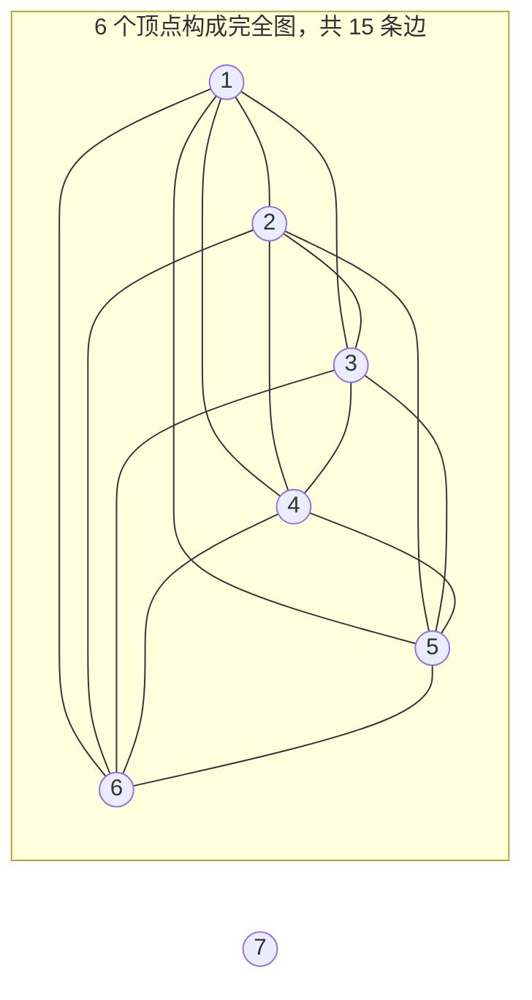

让 6 个顶点组成完全图，剩下一个顶点孤立。

此时图不连通，但边数已经达到非连通图的最大值：

$$
e_{\max}=\frac{6\times5}{2}=15
$$

所以只要边数超过 15，无论如何安排边，图都必须连通。

$$
\boxed{e_{\min}=16}
$$

答案：C。

#### 推广到任意同类题

对于有 $n$ 个顶点的简单无向图：

$$
\boxed{e_{\text{保证连通}}=\binom{n-1}{2}+1}
$$

如果恰好有 $k$ 个连通分量，那么最少边数和最多边数分别为：

$$
\boxed{e_{\min}=n-k}
$$

$$
\boxed{e_{\max}=\binom{n-k+1}{2}}
$$

最少边数：每个分量都是树。

最多边数：让一个分量尽可能大，其余 $k-1$ 个顶点全部孤立。

王道卷三第 6 题（模拟题库第 11 题）给出非连通图有 36 条边，求最少顶点数，就是 2010 年真题的反向变式：

$$
\binom{n-1}{2}\geq36
$$

得到 $n\geq10$。

**出现“保证”“至少”“任何情况下”等词时，优先考虑极限构造和反例，而不是机械套用 $n-1$。**

### 2.3 强连通分量：本质是双向可达

强连通要求任意两个顶点相互可达，而不是任意两个顶点之间都有直接的弧。

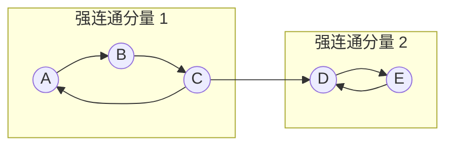

上图中，左侧分量可以到达右侧分量，但右侧不能返回左侧，因此是两个不同的强连通分量。

假如增加一条从 E 到 A 的边，两个分量就会合并。

王道卷一第 7 题、竞成模拟三第 6 题反复考查的就是这个思想。

必须掌握以下性质：

| 操作  | 连通分量或强连通分量的数量变化 |
| --- | --------------- |
| 增加边 | 减少或不变           |
| 删除边 | 增加或不变           |

此外，将每个强连通分量缩成一个顶点，得到的图一定是 DAG。

为什么？因为如果缩点之后还有环，环上的多个分量就能够互相到达，说明它们原本应该属于同一个强连通分量。

这是理解强连通问题最有价值的思维模型。

## 三、图的存储：不要死记复杂度，要理解访问成本

### 3.1 邻接矩阵与邻接表

对于无权有向图，若 $A_{ij}=1$，表示：

$$
v_i\to v_j
$$

因此：

- 第 $i$ 行的 1 的个数：出度。
- 第 $i$ 列的 1 的个数：入度。
- 行、列的 1 的个数之和：总度。

对于带权图，应统计表示实际存在边的元素，而不是直接把权值相加；也要留意零权边的表示方式。

| 比较项目      | 邻接矩阵         | 普通邻接表                            |
| --------- | ------------ | -------------------------------- |
| 存储空间      | $O(n^2)$ | $O(n+e)$                     |
| 判断指定边是否存在 | $O(1)$   | $O(\deg^+(v))$，最坏 $O(n)$ |
| 枚举出邻接点    | $O(n)$   | 与实际出度成正比                         |
| 求有向图某顶点入度 | $O(n)$   | $O(n+e)$                     |
| BFS       | $O(n^2)$ | $O(n+e)$                     |
| DFS       | $O(n^2)$ | $O(n+e)$                     |
| 拓扑排序      | $O(n^2)$ | $O(n+e)$                     |
| 适合存储      | 稠密图          | 稀疏图                              |

表中邻接表默认没有额外保存入度、逆邻接表等辅助结构。

#### 复杂度的本质

邻接矩阵的缺点是：**不存在的边也要检查。**

邻接表的优点是：**只需要访问实际存在的边。**

所以遍历整个图时：

$$
T_{\text{邻接矩阵}}=O(n\times n)
$$

$$
T_{\text{邻接表}}=O(n+e)
$$

2012 年 BFS 真题、2016 年拓扑排序真题，以及王道卷四、卷五、竞成模拟五，都考查了这一思想。

### 3.2 四种存储结构的区别

| 存储结构  | 适用对象    | 核心特点        |
| ----- | ------- | ----------- |
| 邻接矩阵  | 有向图、无向图 | 直接定位两个顶点间的边 |
| 邻接表   | 有向图、无向图 | 方便寻找出邻接点    |
| 十字链表  | 有向图     | 同时方便查找入边和出边 |
| 邻接多重表 | 无向图     | 一条边只存储一个边结点 |

普通邻接表的边结点数量：

$$
\begin{cases} e,&\text{有向图}\\ 2e,&\text{无向图} \end{cases}
$$

2024 年真题（题库第 6 题）考查邻接多重表求顶点的度。

统计包含指定顶点作为端点的边结点数量即可。

### 3.3 补充理解：邻接矩阵的幂

对于 0-1 邻接矩阵 $A$，使用普通矩阵乘法：

$$
(A^k)_{ij}
$$

表示从顶点 $i$ 到顶点 $j$，恰好经过 $k$ 条边的游走数量，允许重复顶点和边。

这是邻接矩阵乘法的本质。因为：

$$
(A^2)_{ij}=\sum_t A_{it}A_{tj}
$$

每个乘积相当于判断是否存在：

$$
i\to t\to j
$$

这一知识点虽然不是本题库的集中考点，但很适合用于理解邻接矩阵的综合变式。

## 四、BFS 和 DFS：掌握两个不能违反的规则

### 4.1 BFS 的本质：按最短边数分层

BFS 使用队列，先发现的顶点先扩展。

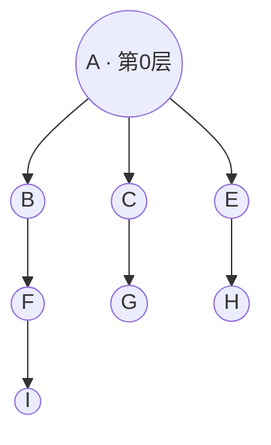

从 A 出发，必须先访问距离为 1 的所有顶点，然后才能访问距离为 2 的顶点。

但是注意：**满足层次顺序，不代表一定是合法的 BFS 序列。**

同一层内还要满足上一层顶点的出队和邻接点发现顺序。

BFS 必须掌握的性质：

- 能够求无权图的单源最短路径。
- 能够求边权相同且为正数的图的单源最短路径。
- 对于无向图，一次 BFS 可以访问一个完整的连通分量。
- BFS 生成树中，根到任一顶点的路径都是原图中的一条最短边数路径。
- 顶点入队时就应该标记为已访问，避免重复入队。

### 4.2 DFS 的本质：有路就深入，无路才回溯

DFS 使用递归或栈。

DFS 的核心约束：

<Callout type="warn" title="DFS 的回溯约束">

**当前顶点只要还有未访问的邻接点，就不能回溯到祖先结点去访问其他分支。**

</Callout>

相反，DFS 序列中相邻的两个顶点不一定有直接边，因为中间可能发生回溯。

#### 代表题 2：王道卷八第 6 题（模拟题库第 8 题）

从顶点 A 出发，下列序列既不是 DFS，也不是 BFS 的是哪一个？

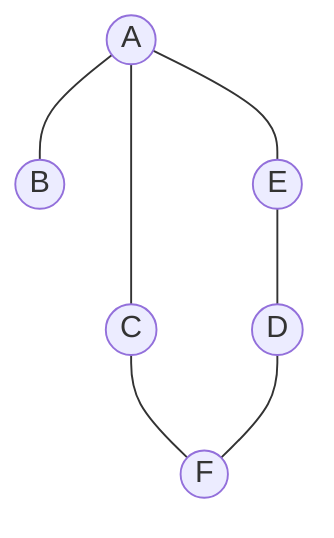

| 选项 | 遍历序列        |
| -- | ----------- |
| A  | A,B,C,E,F,D |
| B  | A,B,E,C,D,F |
| C  | A,E,D,F,C,B |
| D  | A,E,D,C,B,F |

首先判断 D 是否为 BFS。

从 A 出发：

$$
L_1=\{B,C,E\}
$$

$$
L_2=\{D,F\}
$$

D 在 B、C 之前出现，破坏了分层规则，所以不是 BFS。

然后判断 D 是否为 DFS。

执行：

$$
A\to E\to D
$$

此时 D 还有未访问的邻接点 F，必须先访问 F，不能提前回溯去访问 C。

所以 D 也不是 DFS。

答案：**D**。

#### BFS 与 DFS 序列的判断方法

判断 BFS 序列，先查层次，再查队列顺序。

判断 DFS 序列，重点查是否发生了不合法的回溯。

如果题目已经给出邻接表，必须严格按照邻接表中结点出现的顺序遍历；如果只给出图而没有规定邻接点扫描顺序，则可能存在多种正确序列。

### 4.3 BFS 生成树与 DFS 生成树的高度

同一个连通图，从同一个顶点出发：

$$
\boxed{h_{\mathrm{BFS}}\leq h_{\mathrm{DFS}}}
$$

原因不是 BFS 搜索速度更快，而是 BFS 保证根到每个顶点的路径边数最少。

设原图中从 $s$ 到 $v$ 的最短边数距离为 $d(s,v)$。

那么：

$$
d_{\mathrm{BFS}}(s,v)=d(s,v)
$$

$$
d_{\mathrm{DFS}}(s,v)\geq d(s,v)
$$

对所有顶点的深度取最大值，即得到高度关系。

王道卷八第 7 题直接考查了这一结论。

注意两个陷阱：不能写成严格小于；不能忽略同一起点的前提。

如果原图本身就是一棵树，从同一个根出发，BFS 和 DFS 的生成树高度必然相等。

### 4.4 遍历与连通性的关系

对于无向图：

$$
\boxed{\text{外层循环启动 BFS 或 DFS 的次数} =\text{连通分量数}}
$$

若有 $n$ 个顶点、$k$ 个连通分量，则生成森林的边数为：

$$
\boxed{n-k}
$$

但对有向图，普通 DFS 启动次数不一定等于强连通分量数。

例如：

$$
A\to B\to C
$$

从 A 出发，只需启动一次 DFS 就能访问所有顶点，但它有三个强连通分量。

## 五、最小生成树：核心不是选最小边，而是安全地选边

这是本章非常重要的部分。

### 5.1 生成树与最小生成树

生成树必须满足：包含原图所有顶点、连通、无环，恰好有 $n-1$ 条边。

最小生成树（MST）还要求：

$$
\min_T\sum_{e\in T}w(e)
$$

也就是在所有生成树中，使边权之和最小。

<Callout type="warn" title="MST 的优化目标">

**最小生成树追求的是整棵树的总权值最小，而不是某两个顶点之间的路径最短。**

</Callout>

这是 2023 年真题考查 BFS 与最小生成树区别的根本所在。

### 5.2 Prim 与 Kruskal 的真正区别

| 比较项目    | Prim          | Kruskal          |
| ------- | ------------- | ---------------- |
| 生长方式    | 扩大一棵树         | 合并多棵树            |
| 初始状态    | 一个起始顶点        | 所有顶点各自为一个集合      |
| 候选边     | 跨越已选集合与未选集合的边 | 全图尚未处理的边         |
| 选边条件    | 跨集合的最小权边      | 不形成环的最小权边        |
| 常用辅助结构  | 最小代价数组、优先队列   | 边排序、并查集          |
| 常见时间复杂度 | $O(n^2)$  | $O(e\log e)$ |
| 常见适用场景  | 稠密图           | 稀疏图              |

邻接表结合堆优化的 Prim 常见复杂度为 $O(e\log n)$，但只是更换存储结构并不必然提高效率。

#### 代表题 3：2020 年 408 真题（题库第 20 题）

用 Kruskal 算法求最小生成树，依次加入的边是什么？

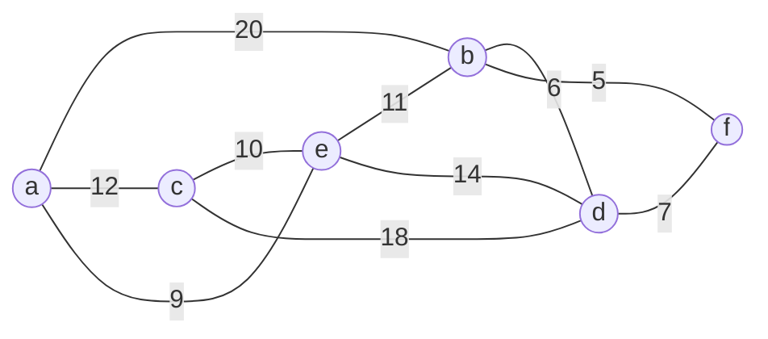

按照权值由小到大处理：

| 候选边      | 权值 | 是否选入 | 原因               |
| -------- | -- | ---- | ---------------- |
| $bf$ | 5  | 是    | 连接不同集合           |
| $bd$ | 6  | 是    | 连接不同集合           |
| $df$ | 7  | 否    | $d,b,f$ 已经连通 |
| $ae$ | 9  | 是    | 连接不同集合           |
| $ce$ | 10 | 是    | 连接不同集合           |
| $be$ | 11 | 是    | 合并剩余两个集合         |

最终选择：

$$
\boxed{bf,bd,ae,ce,be}
$$

总代价：

$$
5+6+9+10+11=41
$$

答案：A。

这道题最重要的是权值为 7 的边 $df$。

虽然它比后面的边都轻，但是它会形成环，因此必须舍弃。

**Kruskal 判环的本质不是检查两端点有没有直接边，而是检查两端点是否已经属于同一个连通分量。**

所以使用并查集维护的是顶点的集合关系，而不是边。王道卷五第 6 题正好利用这一细节设计了干扰选项。

### 5.3 MST 最重要的两个性质

<Tabs items={["割性质", "环性质"]}>
<Tab value="割性质">

将顶点划分为两个非空集合，连接两个集合的边中：

**权值最小的边一定属于某棵最小生成树。**

如果该边是唯一最轻的跨割边，那么它属于所有最小生成树。

这就是 Prim 算法能够正确工作的理论基础。

</Tab>
<Tab value="环性质">

在一个环中，如果某条边的权值严格大于其余所有边，那么该边不可能属于任何最小生成树。

如果多条边并列为最大权值，则至少存在一棵最小生成树不包含其中某条指定的最大权边。

这两条性质比背诵大量 MST 判断题更有价值。

</Tab>
</Tabs>

### 5.4 MST 唯一性与常见判断题

2012 年真题（题库第 18 题）、竞成模拟二第 5 题、竞成模拟七第 8 题，都在考查最小生成树的性质。

| 判断                        | 正误 |
| ------------------------- | -- |
| 最小生成树的总代价唯一               | 正确 |
| 最小生成树的结构一定唯一              | 错误 |
| 所有边权互不相同，则 MST 唯一         | 正确 |
| 存在相同边权，则 MST 一定不唯一        | 错误 |
| 全图最轻边一定属于某棵 MST           | 正确 |
| 每一条全图最轻边都属于所有 MST         | 错误 |
| MST 中的边一定比所有未选边轻          | 错误 |
| Prim 和 Kruskal 可以处理负权边    | 正确 |
| 减小 MST 中一条边的权值，原 MST 仍然最优 | 正确 |

理解其中两个最典型的反例即可。

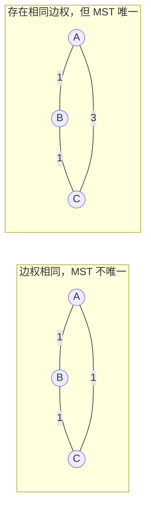

左边任选两条边，都是 MST；右边必须选择两条权值为 1 的边，因此 MST 唯一。

注意：最小生成树允许负权，但它必须是一棵树。不能因为加入额外负权边可以使总权值更低，就允许形成环。

## 六、最短路径：理解松弛操作

### 6.1 三种最短路径算法的选择

| 算法       | 解决的问题     | 适用边权   | 常见复杂度             |
| -------- | --------- | ------ | ----------------- |
| BFS      | 单源最短路径    | 无权或等正权 | $O(n+e)$，邻接表  |
| Dijkstra | 单源最短路径    | 非负权    | $O(n^2)$，普通实现 |
| Floyd    | 任意两点间最短路径 | 可以含负权边 | $O(n^3)$      |

Floyd 可以处理负权边，但对于能够经过负权环的点对，不存在通常意义下有限的最短路径。

### 6.2 Dijkstra：每轮确定一个最短距离

Dijkstra 维护：

- 集合 $S$：最短距离已经确定的顶点。
- 数组 $dist$：从源点到各顶点目前已知的最短距离。

每轮选择未确定顶点中 $dist$ 最小的顶点 $u$，然后利用它更新其他顶点。

$$
\boxed{dist[v]=\min\{dist[v],dist[u]+w(u,v)\}}
$$

这个操作叫作松弛。

松弛操作的本质：

**如果绕道经过刚刚确定的顶点，能不能找到更短的路径？**

#### 代表题 4：2021 年 408 真题（题库第 23 题）

使用 Dijkstra 从顶点 1 出发，求出第二条最短路径之后，数组 $dist$ 的内容是什么？

以下保留原题求解前两轮所需的边。

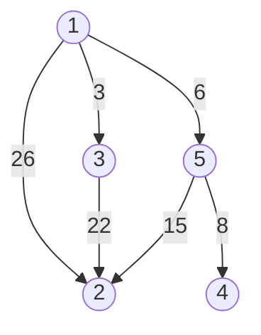

初始状态：

$$
S=\{1\}
$$

$$
dist=[26,3,\infty,6]
$$

第一轮：选择顶点 3，因为它的距离最小，为 3。

经过顶点 3 可以更新顶点 2：

$$
dist[2]=\min(26,3+22)=25
$$

得到：

$$
dist=[25,3,\infty,6]
$$

第二轮：选择顶点 5，因为未确定顶点中，它的距离最小，为 6。

经过顶点 5 更新：

$$
dist[2]=\min(25,6+15)=21
$$

$$
dist[4]=\min(\infty,6+8)=14
$$

整个过程汇总如下：

| 阶段      | 选定顶点 | $dist[2]$ | $dist[3]$ | $dist[4]$ | $dist[5]$ |
| ------- | ---- | ------------- | ------------- | ------------- | ------------- |
| 初始化     | 1    | 26            | 3             | $\infty$  | 6             |
| 第一条最短路径 | 3    | 25            | 3             | $\infty$  | 6             |
| 第二条最短路径 | 5    | 21            | 3             | 14            | 6             |

因此：

$$
\boxed{dist=[21,3,14,6]}
$$

答案：C。

这道题真正的考点是：**确定第二条最短路径后，还要完成以第二个顶点为中转点的松弛操作。**

### 6.3 为什么 Dijkstra 不适用于负权边？

考虑下面这个补充反例。

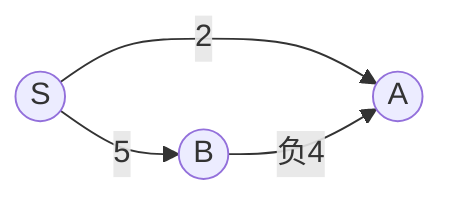

Dijkstra 会先确定：

$$
dist[A]=2
$$

但实际上：

$$
S\to B\to A
$$

路径长度为：

$$
5-4=1
$$

比原先确定的距离 2 更短。

这说明负权边可能推翻之前已经确定的结果，破坏贪心算法的正确性。

非负权的意义就在于：继续走下去不会凭空减少已经累积的距离。

因此 Dijkstra 所确定的最短路径长度一定按照**非递减顺序**排列。

### 6.4 Prim 与 Dijkstra 的区别 ★★★★★

两种算法非常相似，但更新公式完全不同。

Prim 更新的是连接代价：

$$
lowcost[v]=\min\{lowcost[v],w(u,v)\}
$$

Dijkstra 更新的是累计距离：

$$
dist[v]=\min\{dist[v],dist[u]+w(u,v)\}
$$

例如从 A 到 B 的距离为 4，B 到 C 的边权为 3。

对于 Prim，连接 C 的候选代价为 3。

对于 Dijkstra，经过 B 到达 C 的候选距离为：

$$
4+3=7
$$

| 比较   | Prim       | Dijkstra   |
| ---- | ---------- | ---------- |
| 考虑什么 | 当前连接边的权值   | 从源点出发的累计权值 |
| 优化目标 | 整棵树总代价     | 各顶点到源点的距离  |
| 允许负权 | 是          | 不保证正确      |
| 起点影响 | 可能影响所得树的结构 | 改变最短路径问题本身 |

### 6.5 Floyd 算法：核心是允许新的中转点

设：

$$
D^{(k)}_{ij}
$$

表示只允许前 $k$ 个顶点作为中间顶点时，从 $i$ 到 $j$ 的最短距离。

那么对于新加入的中间顶点 $k$，只有两种选择：经过它，或者不经过它。

$$
\boxed{ D^{(k)}_{ij} =\min\left( D^{(k-1)}_{ij}, D^{(k-1)}_{ik}+D^{(k-1)}_{kj} \right) }
$$

对应代码：

```c
for (int k = 0; k < n; k++)
    for (int i = 0; i < n; i++)
        for (int j = 0; j < n; j++)
            if (D[i][k] + D[k][j] < D[i][j])
                D[i][j] = D[i][k] + D[k][j];
```

这是算法的核心伪代码，实际使用整数表示无穷大时，需要判断两个子距离是否有限，并避免溢出。

最重要的是：

<Callout type="warn" title="Floyd 的阶段顺序">

**标准 Floyd 原地更新算法的 $k$ 必须放在最外层循环。**

</Callout>

因为 $k$ 表示动态规划的阶段，而不是普通的矩阵下标。

竞成模拟二第 6 题、竞成模拟三第 7 题集中考查了 Floyd。

Floyd 的距离矩阵具有以下性质：随着允许的中间顶点越来越多，距离只能减小或不变；已经可达的点对不会变得不可达。但具体最短路径可能被一条完全不同的路径替换。

## 七、拓扑排序：本章最值得彻底掌握的考点之一

### 7.1 拓扑排序的本质是满足依赖关系

对于一条有向边：

$$
u\to v
$$

任何合法的拓扑序列都必须满足：

$$
pos(u)<pos(v)
$$

这就是拓扑排序的全部核心约束。

因此判断某个序列是否是拓扑序列，最快的方法不一定是完整执行拓扑排序，而是检查有没有一条边从序列后面指向前面。

2018 年真题（题库第 16 题）就是这种题型。

题目选项 D 为：

$$
5,2,1,6,3,4
$$

但原图存在：

$$
1\to2
$$

显然 1 必须在 2 之前，因此可以立即排除 D。

### 7.2 拓扑排序存在与唯一性的充要条件

对于有向图：

$$
\boxed{\text{存在拓扑序列}\iff\text{图是 DAG}}
$$

对于 DAG：

$$
\boxed{\text{拓扑序列唯一}\iff \text{每轮恰好只有一个入度为0的候选顶点}}
$$

还存在一个很重要的等价结论：

拓扑序列唯一，当且仅当该拓扑序列中每两个相邻顶点之间都存在一条从前指向后的直接边。

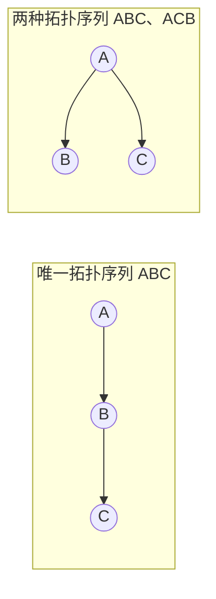

右图中的 B、C 互不依赖，因此可以交换位置。

### 7.3 拓扑排序计数：先寻找固定链

#### 代表题 5：竞成模拟七第 9 题（模拟题库第 24 题）

原题中的依赖关系化简后，可以得到下面的核心结构：

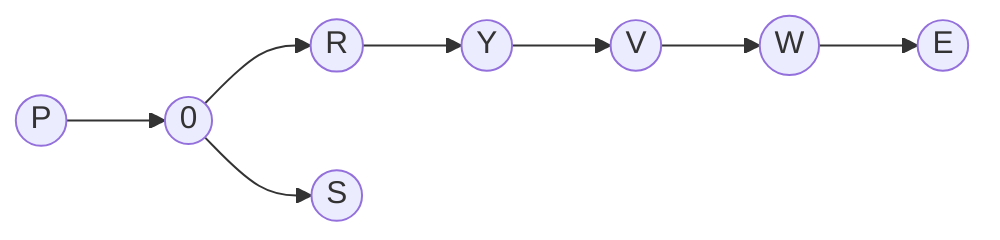

注意：这里省略了不改变拓扑约束的传递边。

第一位和第二位固定为 P、0。

剩余顶点中有一条固定链：

$$
R\prec Y\prec V\prec W\prec E
$$

顶点 S 只需要排在 0 后面，所以可以插入固定链的任意空隙。

```text
_ R _ Y _ V _ W _ E _
```

一共有 6 个位置。

$$
\boxed{N=6}
$$

答案：B。

如果遇到复杂的拓扑计数题，应当先提取固定链，再找相互独立的顶点。

如果存在两个完全独立的固定链，分别有 $p$ 和 $q$ 个顶点，且链之间没有额外依赖关系，则合法交错排列数为：

$$
\binom{p+q}{p}
$$

因为只需要确定第一条链的顶点占据哪些位置，各条链内部的顺序是不变的。

如果依赖关系复杂，无法简化为独立链，再采用入度为 0 的分支枚举法。

### 7.4 拓扑序列中的先后关系不代表一定可达

假设 $u$ 出现在 $v$ 之前。

能够推出什么？

| 结论                         | 是否一定正确 |
| -------------------------- | ------ |
| 存在 $u\to v$ 的直接边       | 否      |
| 存在从 $u$ 到 $v$ 的路径  | 否      |
| 不存在从 $v$ 到 $u$ 的路径 | 是      |

也就是说：

$$
u\leadsto v\Rightarrow pos(u)<pos(v)
$$

但是逆命题不成立。

竞成模拟四第 6 题、模拟五第 6 题均集中考查了这一逻辑陷阱。

<Callout type="warn" title="拓扑序与可达性">

**拓扑排序能够限制路径的方向，却不能凭借排序结果证明某条路径存在。**

</Callout>

### 7.5 拓扑排序与邻接矩阵的关系

2012 年真题以及竞成模拟五、模拟六都考过这一知识点。

如果无自环有向图的邻接矩阵为严格上三角矩阵：

$$
A= \begin{pmatrix} 0&1&1\\ 0&0&1\\ 0&0&0 \end{pmatrix}
$$

那么所有边都从编号较小的顶点指向编号较大的顶点，不可能形成环。

因此一定存在拓扑序列，但不一定唯一。

然而反过来：

**DAG 的邻接矩阵不一定是三角矩阵。**

例如：

$$
1\to3\to2
$$

其邻接矩阵为：

$$
A= \begin{pmatrix} 0&0&1\\ 0&0&0\\ 0&1&0 \end{pmatrix}
$$

主对角线上下都有非零元素，但它仍然是 DAG。

只有按照某个拓扑序列重新排列顶点之后，邻接矩阵才一定是严格上三角矩阵。

### 7.6 DFS 与逆拓扑排序

2020 年真题（题库第 29 题）是一道很有价值的算法变式题。

将 DFS 的输出语句从刚进入递归时，移到退出递归之前。对于 DAG，最终输出的完整序列是什么？

答案：**逆拓扑序列。**

```c
void DFS(Graph G, int v) {
    visited[v] = true;

    for (每个出邻接点 w) {
        if (!visited[w])
            DFS(G, w);
    }

    visit(v);  // 退出递归之前输出
}
```

对于一条边：

$$
A\to B
$$

DFS 处理时，B 一定比 A 更早完成递归：

如果 B 未访问，就先递归处理 B；如果 B 已经访问，在 DAG 中它不会是当前递归栈上尚未完成的祖先，否则会形成环。

因此输出序列中 B 在 A 之前，刚好与拓扑约束相反。

$$
\boxed{\text{DFS 完成顺序}=\text{逆拓扑序列}}
$$

$$
\boxed{\text{DFS 完成顺序的逆序}=\text{拓扑序列}}
$$

这是比单纯记住删除入度为 0 的算法更深入的知识点。

原题库解析将 `visited` 标记移动到了递归末尾，此写法不适用于一般图，在有环图中可能导致无限递归；标准 DFS 在递归入口标记。

## 八、关键路径：用最长路径统一理解所有公式

### 8.1 AOV 网与 AOE 网

| 比较   | AOV 网    | AOE 网  |
| ---- | -------- | ------ |
| 顶点表示 | 活动       | 事件     |
| 边表示  | 活动间的依赖关系 | 活动     |
| 权值表示 | 通常不涉及    | 活动持续时间 |
| 主要用途 | 拓扑排序     | 求关键路径  |

AOE 网的事件本身不消耗时间，真正消耗时间的是边代表的活动。

### 8.2 为什么工期等于最长路径？

假如工程必须完成三条任务链：

$$
P_1=10,\qquad P_2=15,\qquad P_3=12
$$

即使另外两条任务链很早完成，也必须等待最慢的任务链结束。

因此：

$$
T=\max(10,15,12)=15
$$

关键路径就是从源点到汇点的**带权最长路径**。

注意：最长指边权和最大，不是边数最多。

### 8.3 四个时间量必须彻底区分

| 符号          | 含义                 |
| ----------- | ------------------ |
| $ve(i)$ | 事件 $i$ 的最早发生时间 |
| $vl(i)$ | 事件 $i$ 的最迟发生时间 |
| $e(a)$  | 活动 $a$ 的最早开始时间 |
| $l(a)$  | 活动 $a$ 的最迟开始时间 |

对于活动：

$$
v_i\xrightarrow{w}v_j
$$

首先正向求事件最早时间：

$$
\boxed{ve(j)=\max_{(i,j)\in E} \{ve(i)+w(i,j)\}}
$$

因为所有前置活动都完成，事件才能发生。

然后逆向求事件最迟时间：

$$
\boxed{vl(i)=\min_{(i,j)\in E} \{vl(j)-w(i,j)\}}
$$

因为必须满足所有后继活动的时间限制。

接下来得到活动时间：

$$
\boxed{e(a)=ve(i)}
$$

$$
\boxed{l(a)=vl(j)-w(i,j)}
$$

活动的时间余量：

$$
\boxed{d(a)=vl(j)-ve(i)-w(i,j)}
$$

如果：

$$
d(a)=0
$$

则该活动为关键活动。

记忆口诀：**事件正推取最大，逆推取最小；活动最早看起点，最迟看终点再减边权。**

### 8.4 代表题 6：王道卷二第 7 题（模拟题库第 25 题）

求下列 AOE 网中活动的最大时间余量。

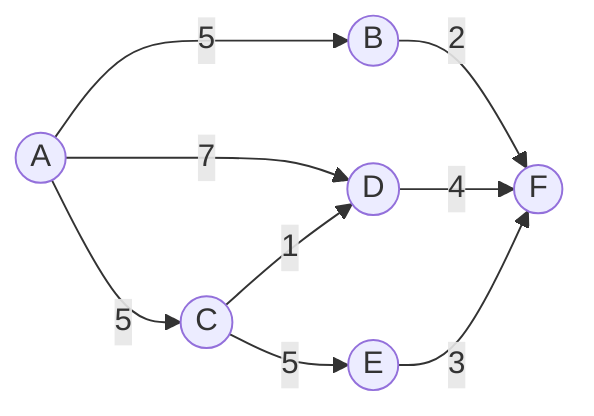

<Steps>

<Step>

#### 第一步：正向取最大值

$$
ve(A)=0
$$

$$
ve(B)=5,\quad ve(C)=5
$$

$$
ve(D)=\max(7,5+1)=7
$$

$$
ve(E)=5+5=10
$$

$$
ve(F)=\max(5+2,7+4,10+3)=13
$$

所以工程工期为 13。

</Step>

<Step>

#### 第二步：逆向取最小值

$$
vl(F)=13
$$

$$
vl(B)=13-2=11
$$

$$
vl(D)=13-4=9
$$

$$
vl(E)=13-3=10
$$

$$
vl(C)=\min(9-1,10-5)=5
$$

$$
vl(A)=0
$$

整理为：

| 事件       | A | B  | C | D | E  | F  |
| -------- | - | -- | - | - | -- | -- |
| $ve$ | 0 | 5  | 5 | 7 | 10 | 13 |
| $vl$ | 0 | 11 | 5 | 9 | 10 | 13 |

</Step>

<Step>

#### 第三步：求活动时间余量

| 活动  | 权值 | 时间余量 |
| --- | -- | ---- |
| A→B | 5  | 6    |
| A→C | 5  | 0    |
| A→D | 7  | 2    |
| C→D | 1  | 3    |
| C→E | 5  | 0    |
| B→F | 2  | 6    |
| D→F | 4  | 2    |
| E→F | 3  | 0    |

因此最大时间余量为：

$$
\boxed{6}
$$

答案：B。

</Step>

</Steps>

#### 更深入的理解：时间余量就是距离关键路径有多远

对于活动 $a=(u,v)$，设从 $v$ 到汇点的最长路径长度为 $L(v)$，总工期为 $T$。

因为：

$$
vl(v)=T-L(v)
$$

所以：

$$
d(a)=T-[ve(u)+w(u,v)+L(v)]
$$

括号里面其实就是**经过活动 $a$ 的最长源汇路径长度**。

因此：

$$
\boxed{\text{活动余量} =\text{总工期}-\text{经过该活动的最长路径长度}}
$$

当经过该活动的最长路径已经达到总工期时，余量为 0，因此该活动为关键活动。

### 8.5 多条关键路径与工程工期 ★★★★★

2013 年、2020 年真题，以及竞成模拟四第 9 题，都非常重视这一部分。

#### 代表题 7：2013 年 408 真题（题库第 24 题）

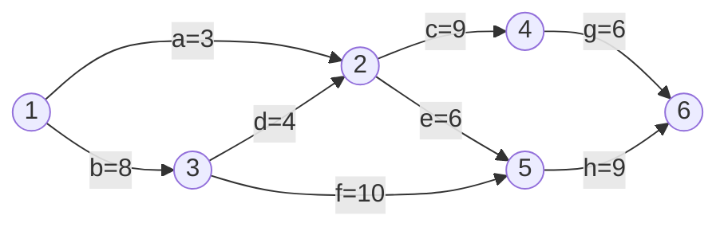

该图有三条关键路径。

| 关键路径                    | 经过的活动   | 路径长度 |
| ----------------------- | ------- | ---- |
| $1\to3\to2\to4\to6$ | b、d、c、g | 27   |
| $1\to3\to2\to5\to6$ | b、d、e、h | 27   |
| $1\to3\to5\to6$     | b、f、h   | 27   |

题目问：同时加快哪两个活动可以缩短整个工程的工期？

A. c 和 e

B. d 和 c

C. f 和 d

D. f 和 h

判断时不要只看它们是不是关键活动，而要看它们是否覆盖了所有关键路径。

| 方案  | 覆盖第一条 | 覆盖第二条 | 覆盖第三条 |
| --- | ----- | ----- | ----- |
| c、e | 是     | 是     | 否     |
| d、c | 是     | 是     | 否     |
| f、d | 是     | 是     | 是     |
| f、h | 否     | 是     | 是     |

只有 C 覆盖了全部三条关键路径。

答案：**C**。

这道题充分揭示了关键路径的本质：工程进度取决于最慢的任务链。只要还有一条原关键路径没有缩短，工期就不会缩短。

### 8.6 关于关键活动的判断结论

假设单独改变一个活动的持续时间，其余条件不变。

| 操作               | 工期变化             |
| ---------------- | ---------------- |
| 延长关键活动           | 一定延长，且等量延长       |
| 缩短关键活动           | 可能缩短，也可能不变       |
| 缩短非关键活动          | 一定不变             |
| 延长非关键活动，未超过其时间余量 | 不变               |
| 延长非关键活动，超过其时间余量  | 工期延长，延长量为超出余量的部分 |

特别注意：一个事件是关键事件，不代表所有连接该事件的活动都是关键活动。

即使一条边的两个端点都是关键事件，这条边也不一定是关键活动。仍然需要计算：

$$
vl(j)-ve(i)-w(i,j)
$$

2022 年真题考查的最大活动余量，就特别需要区分事件余量和活动余量。

## 九、DAG 描述表达式：冷门但容易拿分

2019 年真题（题库第 28 题）：

用 DAG 描述表达式：

$$
(x+y)\times((x+y)/x)
$$

至少需要多少个顶点？

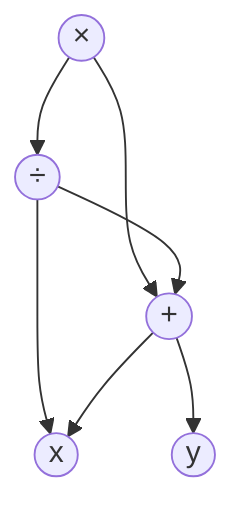

普通表达式树中的重复子表达式可以合并。

这个表达式只需要：

变量 $x,y$，子表达式 $x+y$，除法运算，乘法运算。

总共 5 个顶点。

$$
\boxed{n=5}
$$

答案：A。

需要注意：能合并的是相同变量或相同子表达式，而不是所有相同的运算符。

例如：

$$
(a+b)\times(c+d)
$$

虽然两个子表达式都有加号，但操作数不同，所以不能合并为同一个加法结点。

## 十、本章最重要的易错陷阱汇总

以下判断题基本覆盖了这 57 道题中最值得反复辨析的概念。

| 判断题                       | 答案             |
| ------------------------- | -------------- |
| 无向图有 $n-1$ 条边，则一定连通   | ×              |
| 无向连通图有 $n-1$ 条边，则一定是树 | ✓              |
| 强连通图任意两个顶点间都有直接弧          | ×              |
| 增加一条边可能增加强连通分量数           | ×              |
| 邻接矩阵对称，则原图一定是无向图          | ×，双向对称的有向图也是反例 |
| DAG 的邻接矩阵必然是三角矩阵          | ×              |
| BFS 遍历序列一定唯一              | ×              |
| DFS 序列中相邻顶点之间一定有边         | ×              |
| 同根 BFS 生成树高度一定不大于 DFS 生成树 | ✓              |
| 一次 DFS 访问所有顶点说明有向图强连通     | ×              |
| 最小生成树总代价唯一                | ✓              |
| 最小生成树一定是最短路径树             | ×              |
| 有相同边权就一定有多棵 MST           | ×              |
| Prim 和 Kruskal 不能处理负权边    | ×              |
| Dijkstra 按最短距离非递减顺序确定顶点   | ✓              |
| Floyd 不能处理任何负权边           | ×              |
| 有拓扑序列的有向图一定无环             | ✓              |
| DAG 一定只有一种拓扑序列            | ×              |
| 拓扑排序中前面的顶点一定能到达后面的顶点      | ×              |
| DAG 的 DFS 完成顺序是逆拓扑序列      | ✓              |
| 关键路径一定是边数最多的路径            | ×              |
| 缩短任意关键活动一定能缩短工期           | ×              |
| 延长单个关键活动会等量延长工期           | ✓              |
| 关键路径一定唯一                  | ×              |
| 两端均为关键事件的活动一定是关键活动        | ×              |

## 十一、做题时的考点识别与方法选择

遇到选择题，先识别题目究竟属于哪种数学模型，而不是盲目模拟。

| 题目出现的关键词      | 首选解题方法        |
| ------------- | ------------- |
| 至少多少边、保证连通    | 构造极限反例        |
| 顶点的度、边数       | 握手定理          |
| 增加边、删除边、强连通   | 可达性单调性、缩点     |
| 邻接矩阵、邻接表      | 行出列入、实际边扫描成本  |
| 判断 BFS 序列     | 分层与队列         |
| 判断 DFS 序列     | 深入与回溯         |
| 最小生成树是否唯一     | 割性质、环性质、三角形反例 |
| Kruskal 选边顺序  | 全局排序、集合判环     |
| Prim 选边顺序     | 画出已选顶点集合      |
| Dijkstra 数组变化 | 每轮选最小、再松弛     |
| Floyd 矩阵变化    | 新增中间顶点        |
| 判断拓扑序列        | 检查是否存在逆向边     |
| 拓扑序列数量        | 固定链、自由插入、分支枚举 |
| DFS 修改输出位置    | 递归完成顺序        |
| 求关键路径长度       | 正向最长路径        |
| 求活动时间余量       | 正推、逆推、活动公式    |
| 缩短工程工期        | 覆盖全部原关键路径     |

## 十二、最值得反复练习的题目

以下代表题兼顾基础知识、计算能力和综合变式。

| 来源         | 题库编号  | 训练目标         | 重要程度  |
| ---------- | ----- | ------------ | ----- |
| 2010 年真题   | 2     | 连通性极值构造      | ★★★★★ |
| 2015 年真题   | 9     | DFS 序列计数     | ★★★★  |
| 2012 年真题   | 18    | MST 唯一性      | ★★★★★ |
| 2020 年真题   | 20    | Kruskal 判环   | ★★★★★ |
| 2021 年真题   | 23    | Dijkstra 松弛  | ★★★★★ |
| 2020 年真题   | 29    | DFS 与逆拓扑排序   | ★★★★★ |
| 2013 年真题   | 24    | 多条关键路径       | ★★★★★ |
| 2023 年真题   | 30    | BFS 与最短路径    | ★★★★★ |
| 王道卷八第 6 题  | 模拟 8  | BFS、DFS 综合辨析 | ★★★★★ |
| 王道卷二第 7 题  | 模拟 25 | 关键路径完整计算     | ★★★★★ |
| 竞成模拟七第 8 题 | 模拟 18 | MST 割性质与环性质  | ★★★★★ |
| 竞成模拟二第 6 题 | 模拟 20 | Floyd 的适用条件  | ★★★★  |
| 竞成模拟七第 9 题 | 模拟 24 | 拓扑序列计数       | ★★★★★ |

练习时可改变边权、边的方向、算法起点和题目条件，独立推导变式结论。

## 十三、最终需要形成的八个核心思维

<Cards>
<Card title="极值思维">

连通性问题通过构造边数最大或最小的特殊图解决。

</Card>
<Card title="可达性思维">

路径、连通分量、强连通分量，本质都是顶点之间能否到达的问题。

</Card>
<Card title="分层思维">

BFS 本质上按照最短边数向外扩展。

</Card>
<Card title="回溯思维">

DFS 本质上是不断深入，直到无法继续才返回。

</Card>
<Card title="贪心思维">

Prim 和 Kruskal 选择安全的最轻边，Dijkstra 确定当前最小累计距离。

</Card>
<Card title="动态规划思维">

Floyd 通过逐步扩大允许的中转点范围求最优解。

</Card>
<Card title="依赖关系思维">

拓扑排序不是普通排序，而是满足所有有向边代表的前后约束。

</Card>
<Card title="瓶颈思维">

关键路径决定工程工期，要缩短工期，就要消除所有当前最长路径形成的瓶颈。

</Card>
</Cards>

<Callout type="info" title="原题库校注">

原题库校注：Floyd 路径矩阵的含义、BFS 与 DFS 高度比较的同源点条件、邻接矩阵三角性质的无自环条件，均须按各节给出的严格条件理解。原总结仅核查了重点配图，未逐一复算所有配图题选项。

</Callout>

复习重点：**拓扑排序、最小生成树、Dijkstra、关键路径和 BFS/DFS 的综合性质**。
