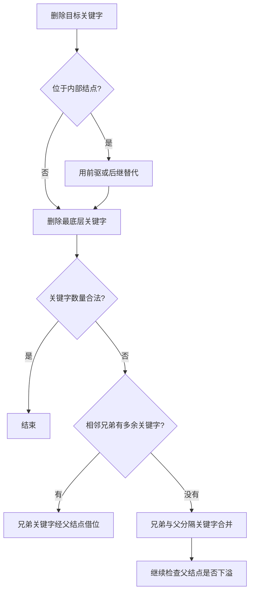

原题库含查找真题38道、模拟题36道，其中3道KMP真题已归入第4章串，本章聚焦其余71道题对应的知识点。

## 一、本章复习重点

以下优先级是结合资料中的真题、模拟题和知识点的可迁移性给出的，并非对未来考试的预测。

| 知识模块    | 重要程度  | 必须掌握的能力            |
| ------- | ----- | ------------------ |
| B树      | ★★★★★ | 关键字数量、树高、插入分裂、删除合并 |
| 散列表     | ★★★★★ | 冲突处理、成功与失败ASL、逻辑删除 |
| AVL树    | ★★★★★ | 四种旋转、最少结点数、插入与删除   |
| 折半查找    | ★★★★★ | 判定树、比较次数、成功与失败ASL  |
| 二叉排序树   | ★★★★★ | 查找路径合法性、中序性质、插入删除  |
| 红黑树     | ★★★★☆ | 性质、黑高、插入调整、与AVL比较  |
| B+树     | ★★★★☆ | 与B树的本质区别、数据库索引     |
| 分块与顺序查找 | ★★★☆☆ | 使用条件、ASL、索引组织      |

整章最值得掌握的四种思维方式是：**区间约束、判定树深度、结构不变量、极限状态构造。** 很多看似不同的题目，其实都能用这四种方法解决。

## 二、折半查找：本质是不断缩小有效区间

### 1. 折半查找的两个必要条件

**数据有序 + 支持随机访问。**

这两个条件缺一不可。

| 存储结构   | 是否适合直接折半查找 |
| ------ | ---------- |
| 有序顺序表  | 是          |
| 无序顺序表  | 否          |
| 有序单链表  | 否          |
| 有序静态链表 | 否          |
| 无序静态链表 | 否          |

2024年408真题就考查了这个知识点。

静态链表虽然使用数组存储，但其逻辑后继关系由游标决定，并不是按照数组下标顺序排列的，所以不能直接通过下标定位逻辑上的中间元素。

<Callout type="warn" title="随机访问条件">

**物理上使用数组，不代表逻辑上支持随机访问。**

</Callout>

### 2. 折半查找判定树的真正性质

折半查找的每一次关键字比较，都可以看成访问判定树中的一个结点。

例如，对有序序列 $1,2,\ldots,10$ 采用向下取整的中点计算方式，判定树为：

```text
             5
          /     \
         2       8
        / \     / \
       1   3   6   9
            \   \   \
             4   7   10
```

这棵树具有以下性质：

- 中序遍历为原有序序列。
- 一定是二叉排序树，也是AVL树。
- 不一定是完全二叉树。
- 除最后一层之外，其余各层都是满的。
- 每个结点左右子树的结点数之差不超过1。
- 统一向下取整时，右子树结点数等于左子树或比左子树多1；向上取整则相反。

特别注意，**AVL树限制的是子树高度差，而折半查找判定树还限制子树结点数之差。**

因此，并不是所有AVL树都能成为折半查找判定树。

2017年408真题考查的就是这种区别。遇到判定树形态判断题，不要仅仅判断树是否平衡，而要检查每棵子树的结点数量，以及中点取整方向是否统一。

### 3. 最大比较次数与平均查找长度

长度为 $n$ 的非空有序顺序表，其折半查找判定树高度为：

$$
\boxed{h=\lfloor\log_2 n\rfloor+1}
$$

查找成功和失败的最大关键字比较次数均为 $h$。

2010年408真题给出16个元素，2023年真题给出600个元素，实际上考的是同一个公式。

$$
n=16\Rightarrow h=5
$$

$$
n=600\Rightarrow h=10
$$

不要直接记成 $\lceil\log_2 n\rceil$，因为当 $n$ 恰好是2的整数次幂时，该公式会少算一次。

#### ★ 代表题1：竟成·模拟一，第10题

对长度为10的有序序列进行折半查找，求成功与失败的平均查找长度。

这道题非常值得掌握，因为它同时考查判定树、树的遍历、成功ASL和失败ASL。

<Steps>

<Step>

### 第一步：计算成功ASL

利用前面画出的判定树：

| 层次 | 结点数 | 比较次数 |
| -- | --- | ---- |
| 1  | 1   | 1    |
| 2  | 2   | 2    |
| 3  | 4   | 3    |
| 4  | 3   | 4    |

因此：

$$
ASL_{\text{成功}} =\frac{1+4+12+12}{10} =\boxed{\frac{29}{10}}
$$

成功ASL的本质就是所有实际关键字所在层次的加权平均值。

$$
\boxed{ASL=\sum_{i=1}^{n}p_ic_i}
$$

其中 $p_i$ 是查找概率，$c_i$ 是比较次数。

</Step>

<Step>

### 第二步：计算失败ASL

查找失败不是查找某个不存在的结点，而是查找目标值所属的空白区间。

10个关键字将整个关键字范围划分成11个失败区间。

这11个区间中，5个需要比较3次，6个需要比较4次。因此，假设失败区间等概率：

$$
ASL_{\text{失败}} =\frac{5\times3+6\times4}{11} =\boxed{\frac{39}{11}}
$$

</Step>
</Steps>

<Accordions>
<Accordion title="进阶：内外路径长度关系与题库勘误">

设实际关键字的比较次数之和为 $S$，所有失败区间的比较次数之和为 $F$，则：

$$
\boxed{F=S+n}
$$

这里假设每个实际结点从第1层开始计比较次数，失败只统计经过的实际结点。

本题：

$$
S=29
$$

$$
F=29+10=39
$$

所以直接得到：

$$
ASL_{\text{失败}}=\frac{39}{11}
$$

在成功关键字等概率、失败区间也等概率的条件下，还可以写成：

$$
\boxed{ ASL_{\text{失败}} =\frac{n(ASL_{\text{成功}}+1)}{n+1} }
$$

这比逐个枚举失败区间更快，而且适用于一般二叉排序树的判定过程。

**题库勘误：** 原来的四个选项实际上全部正确，资料增加了E选项进行订正。不要为了迎合原题答案而记忆错误结论。

</Accordion>
</Accordions>

## 三、二叉排序树：最重要的是祖先区间约束

二叉排序树（BST）的本质不是简单的“左孩子小于根，右孩子大于根”，而是：

$$
\boxed{\text{左子树所有关键字}<\text{根}<\text{右子树所有关键字}}
$$

注意是整棵子树，而不是直接孩子。

理解这一点，就能解决查找路径、前序遍历合法性、关键字大小关系等大量题目。

### 1. 查找路径合法性：维护上下界

#### ★ 代表题2：2011年408真题

下列序列不可能成为某棵二叉排序树查找路径的是：

A. 95，22，91，24，94，71

B. 92，20，91，34，88，35

C. 21，89，77，29，36，38

D. 12，25，71，68，33，34

**不要画整棵树，直接维护区间。**

以A选项为例，目标关键字为71。

| 当前访问结点 | 下一步方向 | 剩余合法区间             |
| ------ | ----- | ------------------ |
| 95     | 向左    | $(-\infty,95)$ |
| 22     | 向右    | $(22,95)$      |
| 91     | 向左    | $(22,91)$      |
| 24     | 向右    | $(24,91)$      |
| 94     | 不合法   | 超出上界91             |

因此答案为A。

即使94大于它的父结点24，符合局部大小关系，但它违反了祖先结点91施加的限制。

**正确的解题方法：**

每访问一个结点，就更新一个边界。任何后续结点都不能突破之前祖先建立的约束。

这套方法也适用于2015年408折半查找路径题、2024年408子树关键字范围题，以及王道卷五、竟成模拟五的BST查找路径题。

#### 更快的做法

对于已知查找目标的路径：

- 所有小于目标的已访问关键字，必须依次递增。
- 所有大于目标的已访问关键字，必须依次递减。

例如目标为71，A选项中大于71的关键字依次出现95、91、94，显然不满足递减关系。

直接排除。

### 2. BST前序遍历与插入序列

BST的前序遍历必须满足：

```text
根结点 → 完整的左子树序列 → 完整的右子树序列
```

每棵子树也必须递归满足该性质。

王道卷一第8题中：

$$
6,5,3,4,2,7
$$

不能成为BST的前序遍历序列。

原因是访问3之后，访问4意味着进入3的右子树，随后却又出现了2，试图重新访问3的左子树。

这违反了前序遍历的顺序。

不过，**BST的插入序列不等于前序遍历序列。**

对于一棵确定的BST，只要每个祖先都先于其后代插入，就可以构造出这棵树；左右子树的插入过程可以交替进行。

2020年408真题考查的正是这一点。

### 3. BST的最大值、最小值、前驱和后继

按照左小右大的BST定义：

| 操作       | 方法                   |
| -------- | -------------------- |
| 找最小值     | 一直向左                 |
| 找最大值     | 一直向右                 |
| 有左子树时找前驱 | 左子树的最右结点             |
| 有右子树时找后继 | 右子树的最左结点             |
| 无左子树时找前驱 | 向上找到第一个当前结点位于其右子树的祖先 |
| 无右子树时找后继 | 向上找到第一个当前结点位于其左子树的祖先 |

需要特别注意：

最大值不一定是叶结点，只是一定没有右孩子；最小值不一定是叶结点，只是一定没有左孩子。

如果题目规定中序遍历为降序，则所有方向相反。2015年408真题就使用了这一陷阱。

### 4. 删除后再插入，树形是否变化

这是2013年与2019年408真题之间非常值得对比的知识点。

| 删除后重新插入 | 普通BST  | AVL树       |
| ------- | ------ | ---------- |
| 删除叶结点   | 一定恢复原树 | 可能相同，也可能不同 |
| 删除非叶结点  | 一定不同   | 可能相同，也可能不同 |

为什么普通BST删除非叶结点后一定不同？

因为普通BST的新结点总是作为叶结点插入。原来的非叶结点重新插入后变成了叶结点，因此结构一定发生改变。

但AVL树存在旋转，新插入的叶结点可能通过旋转变成分支结点，甚至成为根。

**两种题目的本质区别就是旋转是否改变原有结构。**

## 四、AVL树：必须掌握旋转与最少结点数

AVL树的本质是：

> 在BST有序性的基础上，通过限制每个结点左右子树的高度差，防止树退化成链表。

平衡因子定义为：

$$
BF=h_L-h_R
$$

对于任意结点，都有：

$$
|BF|\leq1
$$

这个条件是局部的，但必须对所有结点成立。

### 1. 四种旋转不应该死记硬背

| 失衡类型 | 插入位置相对于失衡根 | 调整方法   |
| ---- | ---------- | ------ |
| LL   | 左孩子的左子树    | 右旋     |
| RR   | 右孩子的右子树    | 左旋     |
| LR   | 左孩子的右子树    | 先左旋后右旋 |
| RL   | 右孩子的左子树    | 先右旋后左旋 |

```text
LL型                     RR型

      C                      A
     /                        \
    B            →             B
   /                            \
  A                              C

              调整后

                 B
                / \
               A   C
```

```text
LR型                     RL型

    C                       A
   /                         \
  A                           C
   \                         /
    B                       B

              调整后

                 B
                / \
               A   C
```

观察这四种旋转可以发现一个共同规律：

**三个参与调整的主干结点，大小居中的结点最终成为局部子树的根。**

最小结点放左边，最大结点放右边，其余子树按照关键字范围重新连接。

这个方法比单纯背诵旋转方向更加可靠。

### 2. 最小不平衡子树的定位

#### ★ 代表题3：王道·卷六，第8题

依次插入：

$$
27,16,75,38,51
$$

问首次出现的最小不平衡子树的根结点。

插入51之后：

```text
        27
       /  \
     16    75
          /
         38
           \
            51
```

此时从51向上检查：

| 结点 | 平衡因子 | 是否失衡 |
| -- | ---- | ---- |
| 51 | 0    | 否    |
| 38 | -1   | 否    |
| 75 | 2    | 是    |

所以最小不平衡子树的根是75，属于LR型。

取三个主干关键字：

$$
38<51<75
$$

中间值51成为调整后的局部根。

```text
        27
       /  \
     16    51
          /  \
         38   75
```

**做AVL插入题的固定流程：**

先按普通BST插入，再从新结点向上找到第一个失衡祖先，最后进行局部旋转。

不要一看到整棵树的根失衡，就直接围绕整棵树的根旋转。必须优先处理距离插入结点最近的失衡结点。

2010年、2013年、2021年408真题以及多套模拟题，都可以通过这套方法解决。

另外，AVL插入通常只需要调整一棵最小不平衡子树，而AVL删除可能沿祖先路径进行多次调整。

### 3. AVL树的最少结点数：本章必背递推

#### ★ 代表题4：2012年408真题

一棵高度为6的AVL树，所有非叶结点的平衡因子均为1，求结点总数。

设高度为 $h$ 的AVL树最少包含 $N_h$ 个结点。

为了让树在给定高度下结点尽量少，根的两棵子树高度分别取：

$$
h-1,\quad h-2
$$

因此：

$$
\boxed{N_h=N_{h-1}+N_{h-2}+1}
$$

初始条件：

$$
N_0=0,\qquad N_1=1
$$

得到：

| 高度 | 最少结点数 |
| -- | ----- |
| 1  | 1     |
| 2  | 2     |
| 3  | 4     |
| 4  | 7     |
| 5  | 12    |
| 6  | 20    |
| 7  | 33    |
| 8  | 54    |
| 9  | 88    |
| 10 | 143   |
| 11 | 232   |

原题中所有非叶结点的平衡因子都为1，因此每个非叶结点都恰好左右高度相差1，结点数就是该高度对应的最少结点数。

答案为20。

**强烈建议熟记：**

$$
\boxed{1,2,4,7,12,20,33,54,88,143,232}
$$

这组数不仅可以求最少结点数，还可以反过来求最大树高。

例如，王道卷八第8题问15个结点的AVL树中，某条查找路径是否可能经过6个结点。

因为：

$$
N_5=12\leq15<N_6=20
$$

所以AVL树最大高度为5，不可能进行6次成功查找比较。

王道卷一又将结点数改为232，要求非叶结点平衡因子均为1或-1，答案为高度11。

三道题实际上考查的是同一个递推关系。

### 4. AVL树常见概念陷阱

| 说法                              | 判断 |
| ------------------------------- | -- |
| AVL树一定是BST                      | 正确 |
| AVL树一定是完全二叉树                    | 错误 |
| 完全二叉树如果同时是BST，则一定是AVL树          | 正确 |
| AVL树任意两个叶结点的层次差不超过1             | 错误 |
| 左右孩子的平衡因子均为0，父结点的平衡因子也为0        | 错误 |
| 最后插入的关键字一定是叶结点                  | 错误 |
| AVL树查找的最坏时间复杂度为 $O(\log n)$ | 正确 |

牢记：**AVL树约束的是每个结点两棵子树的高度差，而不是整棵树所有叶结点之间的层次差。**

## 五、红黑树：理解颜色约束如何保证树高

提供的查找真题文件中，红黑树没有单独的直接考题，但模拟题对红黑树考查较为集中，因此值得掌握。

### 1. 五条基本性质

1. 每个结点不是红色就是黑色。
2. 根结点是黑色。
3. 外部空叶结点NIL是黑色。
4. 红色结点的孩子必须是黑色。
5. 从任一结点到其所有后代NIL结点的路径，包含的黑色结点数相同。

最重要的是第4条和第5条。

因为黑色结点数量受到限制，红色结点又不能连续出现，所以一条路径最多在黑色结点之间插入红色结点。

因此，最长路径的长度不会超过最短路径长度的2倍（统一按标准NIL路径口径计数）。

设红黑树含有 $n$ 个内部结点，其高度具有经典上界：

$$
\boxed{h\leq2\log_2(n+1)}
$$

所以红黑树的查找、插入和删除最坏时间复杂度都是 $O(\log n)$。

### 2. 红黑树插入调整

新插入的结点通常染成红色。

为什么不直接染黑？

因为插入黑色结点会破坏路径上的黑结点数量相等这一性质，而插入红色结点只可能产生局部的双红冲突。

| 情况          | 调整方式             |
| ----------- | ---------------- |
| 插入结点为根      | 染黑               |
| 父结点为黑色      | 无须调整             |
| 父红、叔红       | 父叔染黑、祖父染红，继续向上检查 |
| 父红、叔黑，LL或RR | 单旋并变色            |
| 父红、叔黑，LR或RL | 双旋并变色            |

这里的叔结点是父结点的兄弟，NIL也视为黑色。

#### ★ 代表题5：竟成·模拟四、模拟七

两套模拟题均使用同一个插入序列：

$$
41,38,31,12,19,8
$$

插入前三个元素，发生LL型双红冲突，右旋并变色：

```text
       38黑
      /    \
    31红   41红
```

插入12后，父结点31和叔结点41均为红色，执行变色。

```text
       38黑
      /    \
    31黑   41黑
    /
  12红
```

继续插入19，出现LR型双红冲突，调整后：

```text
          38黑
         /    \
       19黑   41黑
       /  \
     12红 31红
```

最后插入8，父结点12与叔结点31都是红色，因此再次进行变色：

```text
          38黑
         /    \
       19红   41黑
       /  \
     12黑 31黑
     /
    8红
```

最终可以直接判断：

红结点2个，黑色内部结点4个；12和41不在同一层；8是12的左孩子；38和41是相邻黑色结点。

<Callout type="warn" title="红黑树颜色约束">

**黑结点可以有黑孩子，但红结点不能有红孩子。**

</Callout>

这是模拟题中反复考查的逻辑陷阱。

### 3. AVL树与红黑树的本质区别

| 比较项目  | AVL树            | 红黑树             |
| ----- | --------------- | --------------- |
| 平衡方式  | 限制子树高度差         | 限制颜色与黑高         |
| 平衡程度  | 更严格             | 相对宽松            |
| 查找复杂度 | $O(\log n)$ | $O(\log n)$ |
| 插入复杂度 | $O(\log n)$ | $O(\log n)$ |
| 删除复杂度 | $O(\log n)$ | $O(\log n)$ |
| 典型优势  | 查找路径通常更短        | 动态修改时旋转开销通常较小   |

红黑树不一定是AVL树，AVL树也不能仅凭其AVL性质就认定为一棵满足着色要求的红黑树。

不要将“旋转次数少”误解成“整个插入操作只需要 $O(1)$ 时间”。

## 六、B树：本章最值得深入掌握的内容之一

B树选择题看起来很多，但绝大部分都围绕三个不变量：

**关键字数量合法、关键字范围有序、所有叶结点同层。**

### 1. B树的结点容量

对于一棵非空的 $m$ 阶B树，设：

$$
t=\left\lceil\frac m2\right\rceil
$$

则有：

| 结点类型     | 最少关键字数    | 最多关键字数    |
| -------- | --------- | --------- |
| 根结点      | 1         | $m-1$ |
| 非根含关键字结点 | $t-1$ | $m-1$ |

对于非叶根结点，最少有2个孩子；其余非叶结点最少有 $t$ 个孩子。

最关键的关系是：

$$
\boxed{\text{分支数}=\text{关键字数}+1}
$$

该关系对于非叶含关键字结点的实际孩子数成立；在最底层则对应外部失败指针数量。

例如：

| B树阶数 | 非根结点关键字范围 | 非根分支结点孩子数范围 |
| ---- | --------- | ----------- |
| 3阶   | 1～2       | 2～3         |
| 4阶   | 1～3       | 2～4         |
| 5阶   | 2～4       | 3～5         |
| 6阶   | 2～5       | 3～6         |

<Callout type="warn" title="B树阶数">

**B树的阶数表示最大分支数，不是最大关键字数。**

</Callout>

### 2. B树高度与关键字数量

考虑一棵高度为 $h$ 的 $m$ 阶B树，高度不计外部失败结点。

<Tabs items={['最密集结构', '最稀疏结构']}>
<Tab value="最密集结构">

每个结点尽量装满。

$$
\begin{aligned} n_{\max} &=(m-1)(1+m+\cdots+m^{h-1})\\ &=\boxed{m^h-1} \end{aligned}
$$

</Tab>
<Tab value="最稀疏结构">

根结点只放1个关键字，其余结点只放 $t-1$ 个关键字。

各层结点数依次为：

$$
1,\ 2,\ 2t,\ 2t^2,\ldots
$$

因此：

$$
\begin{aligned} n_{\min} &=1+2(t-1)\sum_{i=0}^{h-2}t^i\\ &=\boxed{2t^{h-1}-1} \end{aligned}
$$

</Tab>
</Tabs>

于是得到本章最重要的B树公式：

$$
\boxed{ 2\left\lceil\frac m2\right\rceil^{h-1}-1 \leq n\leq m^h-1 }
$$

反过来，已知关键字数量求高度：

$$
\boxed{ h_{\min}=\lceil\log_m(n+1)\rceil }
$$

$$
\boxed{ h_{\max} =\left\lfloor 1+\log_t\frac{n+1}{2} \right\rfloor }
$$

其中 $m\geq3$。

2013年、2014年、2018年408真题以及王道卷七、竟成模拟四等题目，都与这些极限数量关系有关。

**记忆的核心不是对数公式，而是最大高度对应最稀疏结构，最小高度对应最密集结构。**

### 3. 利用分支数快速计算B树结点数

#### ★ 代表题6：2021年408真题

一棵高度为3、阶数为3的B树，第2层有4个关键字，问整棵树最多有多少个结点。

对于3阶B树，根最多有3个孩子。

所以第2层最多有3个结点。

假设这三个结点分别有1、1、2个关键字：

```text
第1层              [ • | • ]

                 /     |     \

第2层          [ • ]  [ • ]  [ • | • ]

分支数           2      2       3

第3层                 共7个结点
```

因此：

$$
n=1+3+7=\boxed{11}
$$

根本不用画出每个关键字。

直接利用：

$$
\boxed{ \text{下一层结点数} =\text{当前层关键字数} +\text{当前层结点数} }
$$

当然，当前层必须是实际分支结点所在层。

这一关系还可以推广到整棵B树：如果共有 $n$ 个关键字，那么外部失败结点有 $n+1$ 个。

### 4. B树插入：上溢、分裂、中间关键字上升

插入一定先找到最底层含关键字的结点。

如果插入后结点的关键字数量超过 $m-1$，则发生上溢，需要分裂。

以4阶B树为例：

```text
插入后上溢：

[ 5 | 6 | 9 | 13 ]

         分裂
           ↓

          [ 6 ]
         /     \
       [5]    [9 | 13]
```

注意，6上升到父结点，分裂后的左、右结点不再保存6。

如果父结点也上溢，则继续向上分裂。

2020年408真题要求依次向4阶B树插入：

$$
5,6,9,13,8,2,12,15
$$

采用上述分裂方式，最终得到：

```text
              [ 6 | 9 ]
             /    |    \
        [2 | 5]  [8]  [12 | 13 | 15]
```

因此根结点包含6和9。

#### 关于树高增长的关键结论

B树插入发生在底部，但**树高增长发生在顶部**。

只有当分裂传播至根结点，并创建一个新根时，树高才增加1。

竟成模拟二还考查了分裂产生的新结点数量：

原树高度为 $h$，如果每一层都发生分裂，那么：

- 按内容发生改变的结点计数，最多为 $2h+1$。
- 按整棵树实际增加的结点数计数，最多为 $h+1$。

两种问法不能混淆。

### 5. B树删除：借不到就合并

首先判断被删除的关键字是否位于最底层。

如果位于内部结点，则用前驱或后继关键字替代它，将删除转换成对最底层关键字的删除。

删除后，如果关键字数量仍合法，则结束；否则发生下溢。



**借位不是直接从兄弟结点拿一个关键字。**

正确操作是兄弟关键字上升到父结点，父结点的分隔关键字下降到当前结点。

例如3阶B树：

```text
删除前：

           [65]
          /    \
     [60 | 62] [78]

删除78后，下溢：

           [65]
          /    \
     [60 | 62] [ ]

借位调整后：

           [62]
          /    \
        [60]  [65]
```

这正是2012年408真题考查的删除机制，最右叶结点的关键字为65。

#### ★ 代表题7：2022年408真题——B树删除的高级解法

原来是一棵5阶B树：

```text
                   [60 | 90 | 260 | 350]
             /         |         |         |         \
         [30,50] [70,80,85] [100,110] [280,300] [400,500]
```

删除260后，问哪个选项不可能成为新根的关键字序列。

A. 60，90，280

B. 60，90，350

C. 60，85，110，350

D. 60，90，110，350

**这种选择题最有效的方法不一定是完整模拟删除，而是反向检查结构合法性。**

如果D选项成立，根结点为：

$$
60,90,110,350
$$

那么90和110之间的子结点只能保存关键字100。

但对于5阶B树，非根结点最少有：

$$
\left\lceil\frac52\right\rceil-1=2
$$

个关键字。

只有100这一个关键字，违反容量约束。

所以D一定不可能。

这种方法值得重点学习：**对于询问某种结果是否可能的题目，优先检查数据结构必须始终满足的不变量，而不是机械执行所有操作。**

### 6. B树操作的高频判断题

2023年408真题综合考查了以下结论：

| 说法                          | 判断 |
| --------------------------- | -- |
| 插入可能增加B树高度                  | 正确 |
| 删除实际存在的关键字一定导致最底层含关键字结点发生变化 | 正确 |
| 成功查找一定到达叶结点                 | 错误 |
| 新插入的关键字最终一定在叶结点             | 错误 |
| 删除一定导致结点合并                  | 错误 |
| B树高度只能在根分裂时增加               | 正确 |
| B树高度只能在根收缩时减少               | 正确 |

区分初始插入位置与最终位置，是这一类概念题的重要技巧。

## 七、B+树：从数据库索引的角度理解

B树和B+树都属于多路平衡查找树，但B+树有意将索引与实际数据记录分离。

```text
B树：

                  [30 | 60]
                 /    |    \
            [10,20] [40,50] [70,80]

各层都可能存储实际记录。
```

```text
B+树：

                  [20 | 50 | 80]
                 /      |      \
            [10,20]  [30,50]  [60,80]
                └──────→└──────→

非叶结点提供索引，叶结点保存全部关键字及记录信息。
```

上图采用考研教材常见的最大关键字索引方式。

| 比较内容               | B树             | B+树                    |
| ------------------ | -------------- | ---------------------- |
| 有 $k$ 个孩子的分支结点 | $k-1$ 个关键字 | 教材常见定义为 $k$ 个索引关键字 |
| 非叶结点               | 可保存实际记录信息      | 保存索引关键字和孩子指针           |
| 叶结点                | 保存部分关键字        | 保存全部实际关键字              |
| 叶结点之间              | 通常不设置顺序链       | 使用指针顺序链接               |
| 成功查找               | 可能在内部结点结束      | 查找实际记录需要到叶层            |
| 范围查询               | 需要跨层有序访问       | 可以直接沿叶链扫描              |
| 数据库索引              | 可以使用           | 通常更适合                  |

2009年、2016年、2017年408真题以及王道卷一都考查过相关性质。

为什么数据库更适合使用B+树？

因为数据库关心的不只是比较次数，还关心磁盘I/O次数。非叶结点不保存完整记录，同样大小的磁盘块可以容纳更多索引项，从而增加分支数、降低树高。

同时，范围查询只需要定位起点，然后沿叶结点的链表向后扫描。

需要注意资料中关于“B树支持顺序查找”的表述并不完全统一。严格来说，B树可以通过中序方式进行有序遍历，但B+树额外提供了直接沿叶链顺序访问的能力。考试比较两者时，重点理解这种结构上的区别。

## 八、散列表：关键在于区分初始地址、实际地址与探测次数

散列表是本章最容易因为细节丢分的知识模块。

### 1. 两个模数必须区分

设散列函数为：

$$
H(key)=key\bmod p
$$

散列表实际长度为 $m$。

开放定址法的探测公式为：

$$
\boxed{H_i(key)=(H(key)+d_i)\bmod m}
$$

注意：

初始地址对 $p$ 取模，冲突后的探测地址对表长 $m$ 取模。

两者不一定相等。

| 冲突处理方式 | 探测增量                                 |
| ------ | ------------------------------------ |
| 线性探测   | $0,1,2,3,\ldots$                 |
| 二次探测   | 常见为 $0,1^2,-1^2,2^2,-2^2,\ldots$ |
| 双散列法   | $0,H_2(key),2H_2(key),\ldots$    |
| 拉链法    | 将同一地址的关键字组织在链表中                      |

王道卷三第9题给出表长14、散列函数对11取模，王道卷八第10题给出表长18、散列函数对17取模，都是专门考查这一点。

### 2. 成功ASL与失败ASL的分母

这是散列表选择题中必须彻底掌握的区别。

| 比较项目    | 成功ASL        | 失败ASL             |
| ------- | ------------ | ----------------- |
| 枚举对象    | 表中实际存在的有效关键字 | 所有可能的初始散列地址       |
| 分母      | 有效关键字数量      | 等概率条件下可能的初始散列地址数量 |
| 开放定址法终点 | 找到目标         | 找到真正空槽或穷尽探测序列     |
| 是否统计空槽  | 不涉及          | 通常统计最后一次空槽探测      |

#### ★ 代表题8：2019年408真题

散列表长度为11，散列函数：

$$
H(key)=key\bmod7
$$

采用线性探测法，依次插入：

$$
87,40,30,6,11,22,98,20
$$

求查找失败的平均查找长度。

构造后的散列表：

| 地址 | 关键字 | 从该地址出发的失败探测次数 |
| -- | --- | ------------- |
| 0  | 98  | 9             |
| 1  | 22  | 8             |
| 2  | 30  | 7             |
| 3  | 87  | 6             |
| 4  | 11  | 5             |
| 5  | 40  | 4             |
| 6  | 6   | 3             |
| 7  | 20  | —             |
| 8  | 空   | —             |
| 9  | 空   | —             |
| 10 | 空   | —             |

例如，从地址6开始：

$$
6\to7\to8
$$

需要探测3次，遇到地址8的空槽时确认失败。

因为散列函数对7取模，所以初始地址只有0～6这7种可能。

$$
ASL_{\text{失败}} =\frac{9+8+7+6+5+4+3}{7} =\boxed{6}
$$

最容易出现的错误是分母使用11。

<Callout type="idea" title="散列表的两个模数">

**记住：表长决定探测范围，散列函数决定探测起点。**

</Callout>

### 3. 开放定址法删除：为什么需要逻辑删除

#### ★ 代表题9：2023年408真题

散列表长度为5，散列函数：

$$
H(k)=(k+4)\bmod5
$$

依次插入2022、12、25，然后删除25，求失败ASL。

计算初始地址：

$$
H(2022)=1
$$

$$
H(12)=1
$$

$$
H(25)=4
$$

插入完成后：

| 地址 | 0 | 1    | 2  | 3 | 4  |
| -- | - | ---- | -- | - | -- |
| 内容 | 空 | 2022 | 12 | 空 | 25 |

删除25时，不能将该位置按照普通空槽处理，而应该保留删除标记。

| 地址     | 0 | 1    | 2  | 3 | 4   |
| ------ | - | ---- | -- | - | --- |
| 内容     | 空 | 2022 | 12 | 空 | 已删除 |
| 失败探测次数 | 1 | 3    | 2  | 1 | 2   |

从地址4开始，需要继续探测到地址0才能确认失败。

因此：

$$
ASL_{\text{失败}} =\frac{1+3+2+1+2}{5} =\boxed{1.8}
$$

为什么不能直接删除？

假设某个关键字因为冲突被放在它初始地址之后。如果把前面占据探测路径的结点直接变成空槽，查找可能会提前结束，错误地认为后面的关键字不存在。

所以常规开放定址法需要区分三种状态：

```text
未使用空槽：可以确认查找失败
有效关键字：进行比较
已删除标记：继续向后探测
```

删除标记可以在后续插入中重新利用，但查找时不能当作真正空槽。

### 4. 拉链法ASL的快速计算

竟成模拟一第9题同时比较拉链法和线性探测法，非常有代表性。

对于拉链法，假设 $m$ 个桶的链长分别为：

$$
l_0,l_1,\ldots,l_{m-1}
$$

有效关键字总数为 $n$。

一条长度为 $l_i$ 的链，成功查找比较次数总和为：

$$
1+2+\cdots+l_i =\frac{l_i(l_i+1)}2
$$

因此等概率成功查找时：

$$
\boxed{ ASL_{\text{成功}} =\frac{\sum_{i=0}^{m-1}l_i(l_i+1)}{2n} }
$$

等概率命中各桶、失败只统计实际关键字比较时：

$$
\boxed{ ASL_{\text{失败}} =\frac{\sum_{i=0}^{m-1}l_i}{m} =\frac nm =\alpha }
$$

这意味着在标准等概率条件下，拉链法的失败ASL恰好等于装填因子。

例如题库中删除一个关键字后，两个非空桶的链长分别为3和1，表长为7：

$$
ASL_{\text{成功}} =\frac{1+2+3+1}{4} =\frac74
$$

$$
ASL_{\text{失败}}=\frac47
$$

而同样的数据采用线性探测法，成功ASL为 $9/4$，失败ASL为 $22/7$。

这说明即使装填因子相同，冲突处理方式不同，查找效率也可能不同。

### 5. 散列表性能的三个决定因素

2011年、2014年、2022年408真题反复考查这一点。

散列表的平均查找长度主要取决于：

- 散列函数的设计。
- 处理冲突的方法。
- 装填因子。

装填因子定义：

$$
\boxed{\alpha=\frac nm}
$$

装填因子越大，通常冲突越多，平均查找长度越大。

开放定址法中：

$$
\alpha\leq1
$$

拉链法中：

$$
\alpha\text{ 可以大于 }1
$$

开放定址法达到1时意味着表已满，通常不允许继续插入。

另外，聚集现象会直接增大平均查找长度，但在关键字数量与表长不变时，并不会改变装填因子。

**散列表平均查找时间通常为 $O(1)$，但最坏情况仍可能为 $O(n)$。**

## 九、顺序查找与分块查找：掌握基础即可

### 1. 顺序查找

无序表中，假设每个关键字被查找的概率相等：

$$
ASL_{\text{成功}}=\frac{n+1}{2}
$$

失败时需要检查全部关键字：

$$
ASL_{\text{失败}}=n
$$

如果题目采用哨兵，并把与哨兵的比较也计入，则失败比较次数为 $n+1$。

有序表的顺序查找可以利用大小关系提前确认失败。

对于查找概率不同的静态顺序表，通常将查找概率大的元素放在前面，以降低平均查找长度。

### 2. 分块查找

本质是：

**块间有序，块内可以无序。**

```text
索引表      [20]       [50]       [90]
              |          |          |
数据块    [15,8,20]  [50,30,42] [90,65,72]
```

先查找索引表，确定目标在哪一个数据块，再进入块内顺序查找。

假设有 $n$ 个元素，分成 $b$ 块，每块有 $s$ 个元素：

$$
n=bs
$$

若索引表和块内都使用顺序查找，且等概率：

$$
ASL=\frac{b+1}{2}+\frac{s+1}{2}
$$

代入 $b=n/s$：

$$
ASL=\frac{n}{2s}+\frac{s}{2}+1
$$

当：

$$
s\approx\sqrt n
$$

时，平均查找长度最小，量级为 $O(\sqrt n)$。

竟成模拟六第10题考查了分块查找的组织方式。

注意：数据块不必等长，块内也不必有序，只有块间有序是基本要求。

## 十、各种查找结构的综合比较

这一张表建议考前反复回顾。

| 查找结构  | 主要查找依据   | 平均或典型查找复杂度                  | 最坏查找复杂度         |
| ----- | -------- | --------------------------- | --------------- |
| 顺序查找  | 逐个比较     | $O(n)$                  | $O(n)$      |
| 折半查找  | 中点缩小区间   | $O(\log n)$             | $O(\log n)$ |
| 分块查找  | 块索引      | $O(\sqrt n)$（合理分块）      | 取决于分块方式         |
| 普通BST | 关键字范围    | $O(\log n)$（适当随机或平衡条件下） | $O(n)$      |
| AVL树  | 严格高度平衡   | $O(\log n)$             | $O(\log n)$ |
| 红黑树   | 颜色与黑高    | $O(\log n)$             | $O(\log n)$ |
| B树    | 多路关键字索引  | $O(\log n)$（固定阶数）       | $O(\log n)$ |
| B+树   | 多路索引与叶链  | $O(\log n)$（单关键字查询）     | $O(\log n)$ |
| 散列表   | 散列地址     | $O(1)$（适当条件下）           | $O(n)$      |
| 二叉堆   | 父子局部大小关系 | 任意关键字查找通常为 $O(n)$       | $O(n)$      |

竟成模拟二第10题问为什么二叉堆的任意关键字查找效率较低。

原因在于二叉堆只能保证父子之间的大小关系，不能像BST一样，通过一次比较排除一整棵左子树或者右子树。

**树高为 $O(\log n)$，并不意味着任意关键字查找一定为 $O(\log n)$。**

能否利用关键字信息排除大量不可能的候选结点，才是决定查找效率的核心。

## 十一、最值得反复做的代表题

优先掌握以下代表题的独立推导方法。

| 推荐顺序 | 题目来源           | 必须掌握的知识         |
| ---- | -------------- | --------------- |
| 1    | 2011年408       | BST查找路径区间约束     |
| 2    | 竟成模拟一第10题      | 折半查找成功与失败ASL    |
| 3    | 王道卷六第8题        | AVL最小失衡子树及旋转    |
| 4    | 2012年408       | AVL最少结点数递推      |
| 5    | 2013年、2019年408 | BST与AVL删除再插入的区别 |
| 6    | 竟成模拟四第8题       | 红黑树插入与变色        |
| 7    | 2021年408       | B树结点数量关系        |
| 8    | 2020年408       | B树插入与分裂         |
| 9    | 2022年408       | B树删除及不变量判断      |
| 10   | 2019年408       | 散列表失败ASL        |
| 11   | 2023年408       | 散列表逻辑删除         |
| 12   | 竟成模拟一第9题       | 拉链法与开放定址法综合比较   |

### 题库中需要注意的几处问题

其余题库校注如下：

王道卷五第9题关于装填因子“大于或等于1”的表述不够严谨，开放定址法理论上也能够达到1，只是此时表已满。只有拉链法能够超过1。

竟成模拟四的B树最大高度公式存在取整符号排版问题，正确底数应为 $\lceil m/2\rceil$，最终高度还需要向下取整。

另外，竟成模拟四、模拟七的红黑树插入题答案树正确，但部分中间变色过程的解析有遗漏。上文按标准红黑树插入算法展示了完整过程。

2015年、2019年、2024年三道KMP真题归入第4章串，不再重复展开。

## 十二、最终必须形成的解题思维

| 看到题目的特征       | 第一时间想到的方法        |
| ------------- | ---------------- |
| 判断BST查找路径是否合法 | 维护祖先上下界          |
| 判断折半查找判定树是否合法 | 检查左右子树结点数量       |
| 求平均查找长度       | 比较次数加权平均         |
| AVL插入失衡       | 找最低失衡祖先，三个关键字取中  |
| AVL树高与结点数     | 最少结点数递推          |
| 红黑树插入         | 检查父结点与叔结点颜色      |
| B树关键字数量       | 最大、最小分支数         |
| B树结果是否可能      | 反向检查容量和关键字区间     |
| B树插入删除        | 上溢分裂、下溢借位合并      |
| 散列表ASL        | 区分初始地址、实际地址和探测路径 |
| 散列表删除         | 区分删除标记和真正空槽      |

**整章最核心的思想，就是利用结构不变量解决问题。**

BST的不变量是关键字范围；AVL树的不变量是高度差；红黑树的不变量是颜色和黑高；B树的不变量是结点容量与等高性；散列表的不变量是关键字必须能够通过原有探测序列被找到。
