本章归纳25道历年真题和28道模拟题，共53道选择题，重点掌握硬件权限、中断机制、系统调用和并发资源管理。跨章节考点另列。

## 一、本章的考点优先级

| 核心考点        | 重要程度  | 必须掌握的内容            |
| ----------- | ----- | ------------------ |
| 用户态与内核态     | ★★★★★ | 权限、特权指令、状态切换       |
| 中断与异常       | ★★★★★ | 触发原因、处理流程、软硬件分工    |
| 系统调用        | ★★★★★ | 执行过程、接口、与普通函数调用的区别 |
| 并发、并行与多道程序  | ★★★★★ | 资源利用率、运行机制、必要条件    |
| 操作系统内核架构    | ★★★★  | 宏内核、微内核、外核         |
| 操作系统的发展与特征  | ★★★★  | 批处理、分时、实时、虚拟化      |
| 操作系统的引导     | ★★★   | BIOS、引导程序、内核加载     |
| 操作系统接口与基本功能 | ★★★   | 联机接口、脱机接口、资源管理     |

尤其值得注意的是，25道真题中，第6～20题以及第22～24题，共18道，都直接涉及运行权限、中断、异常、系统调用及其相关机制，占这份真题分类文件的72%。

因此，**本章最重要的不是背诵操作系统的发展历史，而是彻底理解CPU、用户程序、操作系统内核、硬件之间是如何配合工作的。**

掌握以下三个问题，实际上就掌握了本章的大部分解题本质：

1. 当前CPU处于什么运行状态，有什么权限？
2. 什么事件使CPU进入操作系统内核？
3. 进入内核之后，哪些工作由硬件完成，哪些工作由操作系统完成？

## 二、用户态、内核态与特权指令

这是本章最基础、最重要的知识点。后面学习进程调度、内存管理、文件管理和I/O管理时，都会用到这里的知识。

### 2.1 从操作系统为什么需要双重工作模式开始理解

假设操作系统允许任何用户程序：

- 随意修改其他进程的内存。
- 随意关闭时钟中断。
- 随意控制磁盘。
- 随意修改页表。
- 永久占用CPU而不释放。

那么整个计算机系统将无法正常运行。

因此，CPU必须提供两种不同权限的工作模式。

| 对比     | 用户态（目态）    | 内核态（管态、核心态） |
| ------ | ---------- | ----------- |
| 主要运行对象 | 普通应用程序     | 操作系统内核      |
| 特权指令   | 不允许执行      | 可以执行        |
| 非特权指令  | 可以执行       | 可以执行        |
| 内存访问   | 获得授权的地址空间  | 具有更高的访问权限   |
| 硬件设备控制 | 通常通过系统调用申请 | 可以直接控制      |
| 权限级别   | 低          | 高           |

CPU当前处于哪种工作模式，在408教材模型中通常由程序状态字寄存器（PSW）中的相应状态位表示。

特别注意：

<Callout type="warn" title="用户态与内核态">

**用户态只能执行非特权指令，但内核态可以执行特权指令和非特权指令。**

</Callout>

内核也需要进行加减乘除、数据传送等普通操作，因此绝不能认为内核态只能执行特权指令。

### 2.2 判断特权指令的本质

不要机械背诵每一条指令，而要判断依据：

**如果允许用户程序自由执行这项操作，是否会破坏系统的资源管理、权限隔离或者操作系统对CPU的控制权？**

如果会，那么通常属于特权操作。

| 操作        | 是否属于特权操作 | 原因              |
| --------- | -------- | --------------- |
| 开中断、关中断   | 是        | 影响CPU控制权的回收     |
| 设置硬件定时器   | 是        | 影响进程调度          |
| 直接执行I/O指令 | 是        | 影响共享设备          |
| 修改页表      | 是        | 影响内存隔离          |
| 初始化中断向量表  | 是        | 影响中断处理入口        |
| 修改CPU特权级  | 是        | 影响权限保护          |
| 停机指令      | 是        | 影响整个系统          |
| 普通加减乘除    | 否        | 普通数据处理          |
| 通用寄存器清零   | 否        | 仅改变当前程序的数据      |
| 普通访存指令    | 否        | 可以访问获得授权的内存     |
| 普通跳转指令    | 否        | 实现程序控制流         |
| 普通压栈、出栈   | 否        | 实现程序的数据保存       |
| Trap访管指令  | 否        | 用户主动请求内核服务的合法入口 |
| 设置软件断点指令  | 否        | 用于程序调试          |

### 2.3 最重要的例外：Trap指令

Trap指令又称陷入指令、访管指令，在系统调用语境下是用户程序进入内核的合法入口。

常见错误认识：

> Trap指令能使CPU进入内核态，所以它一定是特权指令。

恰恰相反，如果Trap指令只能在内核态执行，那么用户程序就无法通过它主动申请内核服务。

所以必须牢记：

<Callout type="warn" title="Trap指令的权限">

**Trap指令是非特权指令，Trap引起的内核服务程序在内核态执行。**

</Callout>

### 代表题1：竞成模拟三第23题（模拟题库第14题）

下列操作中，可以在用户态执行的有多少种？

Ⅰ. 执行除法指令

Ⅱ. 初始化中断向量表

Ⅲ. 执行Trap指令

Ⅳ. 从内存中取数

Ⅴ. 改变程序计数器PC的值

Ⅵ. 关闭中断允许位

#### 深入分析

| 操作 | 判断 | 解题依据             |
| -- | -- | ---------------- |
| Ⅰ  | 正确 | 除法是普通算术运算        |
| Ⅱ  | 错误 | 中断向量表决定系统的中断处理入口 |
| Ⅲ  | 正确 | 用户程序申请内核服务的入口    |
| Ⅳ  | 正确 | 可以读取拥有访问权限的内存    |
| Ⅴ  | 正确 | 跳转、循环、函数调用都会改变PC |
| Ⅵ  | 错误 | 关闭中断会影响操作系统回收CPU |

**答案：C，共4种。**

这道模拟题的价值非常高，它将2014年、2021年、2022年408真题涉及的特权指令知识进行了综合考查。

尤其需要理解两个容易误判的选项。

**第一，除法可能产生异常，不代表除法是特权指令。**

是否允许在用户态执行，与执行时是否可能出现异常，是两个不同的问题。

**第二，PC是CPU寄存器，不代表改变PC一定需要特权。**

如果用户程序不能改变PC，那么循环、条件分支和函数调用都无法实现。

#### 同类题迁移

| 题库题目         | 考查内容          | 答案 |
| ------------ | ------------- | -- |
| 真题第11题，2014年 | 关中断属于特权指令     | D  |
| 真题第16题，2021年 | I/O指令属于特权指令   | B  |
| 真题第18题，2022年 | 用户态只能执行非特权指令  | C  |
| 模拟第9题，王道卷二   | 通用寄存器清零不需要特权  | C  |
| 模拟第11题，王道卷六  | Trap允许在用户态执行  | B  |
| 模拟第12题，王道卷八  | I/O指令不能在用户态执行 | C  |
| 模拟第15题，竞成模拟四 | 命令解释程序运行在用户态  | B  |

这些题看起来不同，本质上考查的都是**系统权限的边界**。

## 三、中断、异常与CPU状态切换

这一部分是本章最容易出现高质量辨析题的地方。

### 3.1 为什么操作系统必须能够重新获得CPU控制权？

假设一个用户程序正在执行死循环：

```c
while (1) {
    // 不断执行
}
```

如果只能等用户程序主动交出CPU，那么其他程序将永远无法运行。

操作系统可以设置硬件定时器。当时间片用完，定时器发出时钟中断，CPU响应中断后进入内核态，操作系统重新获得控制权。

这就是中断机制的重要意义之一。

**中断不仅仅是为了处理I/O设备，更重要的是为操作系统重新获得CPU控制权提供机制。**

### 3.2 外部中断、异常、系统调用的区别

| 对比          | 外部中断       | 异常（内中断）  | 系统调用            |
| ----------- | ---------- | -------- | --------------- |
| 来源          | CPU外部事件    | 当前指令执行   | 用户程序主动请求        |
| 与当前指令是否直接相关 | 通常无关       | 有关       | 有关              |
| 同步性         | 异步         | 同步       | 同步              |
| 触发方式        | 通常被动       | 可能主动或被动  | 主动              |
| 典型例子        | 时钟、键盘、磁盘完成 | 缺页、除零、越界 | read、write、fork |
| 是否需要内核处理    | 是          | 是        | 是               |

按照408教材的常用分类，系统调用通过自陷机制实现，自陷属于广义异常的一种。因此，这三者不是完全互斥的分类。

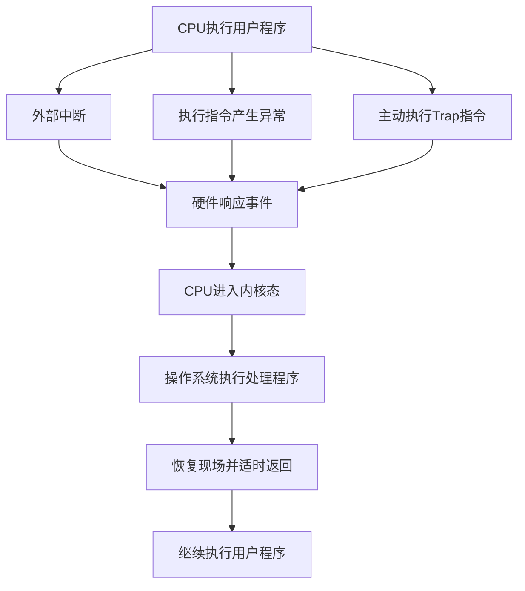

### 3.3 必须区分中断的三个阶段

出题人特别喜欢利用下面三个词制造陷阱：

| 阶段   | 含义                 |
| ---- | ------------------ |
| 中断发生 | 设备产生中断请求，或CPU检测到异常 |
| 中断响应 | CPU接受请求并执行硬件响应动作   |
| 中断处理 | 操作系统执行相应服务程序       |

<Callout type="warn" title="区分发生与处理">

**中断发生时，CPU可能处于用户态，也可能处于内核态；而中断服务程序开始执行时，CPU已经处于内核态。**

</Callout>

另外，外部设备发出中断请求，不意味着CPU一定立即响应。

CPU可能处于关中断状态，或者当前中断优先级不满足响应条件。

### 代表题2：2024年408真题（真题库第23题）

下面关于中断、异常和系统调用的叙述中，错误的是：

A. 中断或异常发生时，CPU处于内核态

B. 每个系统调用都有对应的内核服务例程

C. 中断处理程序开始执行时，CPU处于内核态

D. 系统添加新类型设备时，需注册相应的中断服务例程

<Accordions>
<Accordion title="查看答案">

**答案：A。**

</Accordion>
</Accordions>

#### 解题的本质

A与C的区别仅仅在于时间点不同。

假设用户程序访问某个不在内存中的页面：

| 时刻        | 事件          | CPU状态  |
| --------- | ----------- | ------ |
| $t_1$ | 用户程序执行访存指令  | 用户态    |
| $t_2$ | CPU检测到缺页    | 用户态    |
| $t_3$ | 硬件执行异常响应操作  | 切换至内核态 |
| $t_4$ | 执行缺页处理程序    | 内核态    |
| $t_5$ | 缺页处理完成并适时返回 | 恢复用户态  |

所以异常发生时，并不要求CPU已经处于内核态。

这道题与2012年408真题第8题属于同一考点：系统调用、外部中断和缺页都可以在用户态发生，但进程切换由内核执行。

以后看到类似题目，首先圈出题干中的“发生”“响应”“处理”“开始”“完成”等词语。

### 3.4 区分三种完全不同的变化

这是操作系统第一章与第二章之间最重要的联系。

| 类型      | 变化的对象      | 例子        |
| ------- | ---------- | --------- |
| CPU模式切换 | CPU的权限级别   | 用户态转为内核态  |
| 进程状态转换  | 进程的运行状态    | 运行态转为阻塞态  |
| 进程切换    | 当前占用CPU的进程 | 进程A切换到进程B |

进入内核态不一定发生进程切换。

<Tabs items={['查询时间', '阻塞式磁盘读取']}>

<Tab value="查询时间">

进程A通过系统调用查询系统时间：


整个过程中始终是进程A，只发生了CPU模式切换。

</Tab>

<Tab value="阻塞式磁盘读取">

进程A通过系统调用读取磁盘数据，需要阻塞等待：

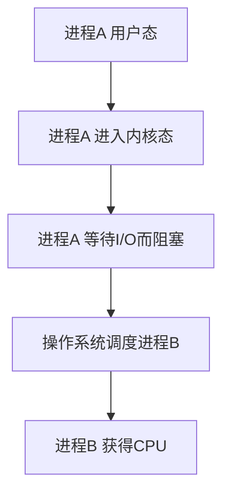

这个过程中则可能同时发生三种变化。

</Tab>

</Tabs>

王道卷三第23题（模拟题库第10题）和竞成模拟一第24题（模拟题库第23题），都考查了这一重要区别。

<Callout type="warn" title="三类切换">

**记住：模式切换不等于进程切换；中断处理不一定引起进程调度，更不一定引起进程切换。**

</Callout>

## 四、中断处理过程：硬件与软件的分工

如果说第三部分解决的是“什么时候进入内核”，那么这一部分解决的就是“进入内核的过程由谁完成”。

2022年408真题、2015年408真题以及竞成模拟五均考查了这一内容。

### 4.1 理解完整的中断处理流程

以典型的408外部中断处理模型为例：

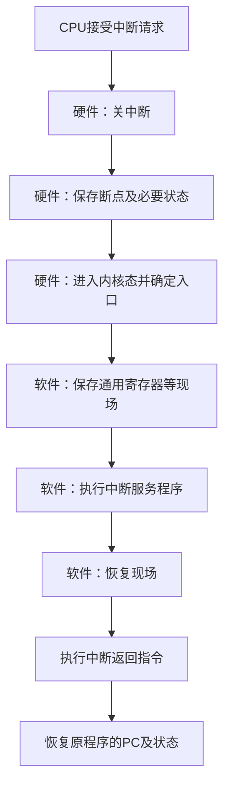

具体硬件动作的次序、寄存器保存位置会因体系结构而异，但408通常考查以下分工。

| 操作             | 完成者   |
| -------------- | ----- |
| 检测并接受中断        | CPU硬件 |
| 自动关中断          | CPU硬件 |
| 保存断点PC         | CPU硬件 |
| 保存必要的程序状态字PSW  | CPU硬件 |
| 将CPU模式切换为内核态   | CPU硬件 |
| 根据中断向量确定处理入口   | CPU硬件 |
| 保存需要保护的通用寄存器   | 操作系统  |
| 执行中断服务程序       | 操作系统  |
| 恢复通用寄存器现场      | 操作系统  |
| 发出中断返回指令       | 操作系统  |
| 按返回指令恢复PC和必要状态 | CPU硬件 |

#### 为什么进入内核态必须由硬件完成？

假如CPU必须先执行内核程序，才能切换到内核态，就会产生矛盾：

内核程序需要内核权限才能执行，但CPU又需要执行内核程序才能获得内核权限。

因此，必须由硬件提供受控的权限切换机制。

硬件完成最初的状态保护和转移后，操作系统才能接管处理过程。

### 4.2 区分中断隐指令、Trap指令和中断返回指令

| 名称       | 是否是真实的机器指令 | 作用           |
| -------- | ---------- | ------------ |
| 中断隐指令    | 否          | 硬件自动完成中断响应操作 |
| Trap指令   | 是          | 主动触发陷入机制     |
| 中断返回指令   | 是          | 恢复原来的执行状态    |
| 普通函数返回指令 | 是          | 返回普通子程序调用点   |

**中断隐指令不是指令系统中一条可以由程序直接执行的机器指令，而是一系列硬件自动完成的操作。**

这是竞成模拟五第31题（模拟题库第20题）的直接考点。

### 代表题3：2022年408真题（真题库第19题）

执行系统调用的过程涉及下列操作，其中由操作系统完成的是：

Ⅰ. 保存断点和程序状态字

Ⅱ. 保存通用寄存器的内容

Ⅲ. 执行系统调用服务例程

Ⅳ. 将CPU模式改为内核态

A. 仅Ⅰ、Ⅲ

B. 仅Ⅱ、Ⅲ

C. 仅Ⅱ、Ⅳ

D. 仅Ⅱ、Ⅲ、Ⅳ

#### 分析

| 操作         | 完成者  | 是否选中 |
| ---------- | ---- | ---- |
| Ⅰ 保存断点和PSW | 硬件   | 否    |
| Ⅱ 保存通用寄存器  | 操作系统 | 是    |
| Ⅲ 执行服务例程   | 操作系统 | 是    |
| Ⅳ 切换CPU模式  | 硬件   | 否    |

**答案：B。**

这道题几乎是本章最值得反复理解的一道真题，因为它同时考查了：

- 中断响应与中断处理的区别。
- 系统调用的底层实现。
- 用户态与内核态的切换。
- CPU硬件与操作系统之间的职责划分。

可以将解题规律总结为：

<Callout type="idea" title="软硬件分工">

**硬件负责安全地进入内核，软件负责进入内核后具体做什么。**

</Callout>

### 4.3 中断与普通函数调用有什么区别？

2012年408真题第9题考查过这一问题。

| 对比       | 中断处理        | 普通函数调用    |
| -------- | ----------- | --------- |
| 触发方式     | 可能来自外部事件或异常 | 程序主动调用    |
| 保存返回地址   | 需要          | 需要        |
| 保存必要的PSW | 需要          | 通常不需要完整保存 |
| 保存通用寄存器  | 按需要保存       | 按调用约定保存   |
| CPU模式切换  | 可能发生        | 普通调用不发生   |
| 返回方式     | 中断返回        | 普通函数返回    |

为什么中断必须保存程序状态字？

因为中断响应可能改变CPU特权级、中断允许位等状态。返回原程序时，不仅需要知道从哪里继续执行，还需要恢复原来的运行环境。

而普通函数调用通常不改变CPU的权限级别，不需要像中断那样保存完整的程序状态字。

### 4.4 中断的两个补充考点

**中断向量表：** 存储或描述各中断类型对应的处理程序入口。由于可以通过中断类型号进行索引，适合采用数组结构，索引访问的时间复杂度为：

$$
O(1)
$$

这是2023年408真题第22题的考点。

**键盘中断的数据流向：**

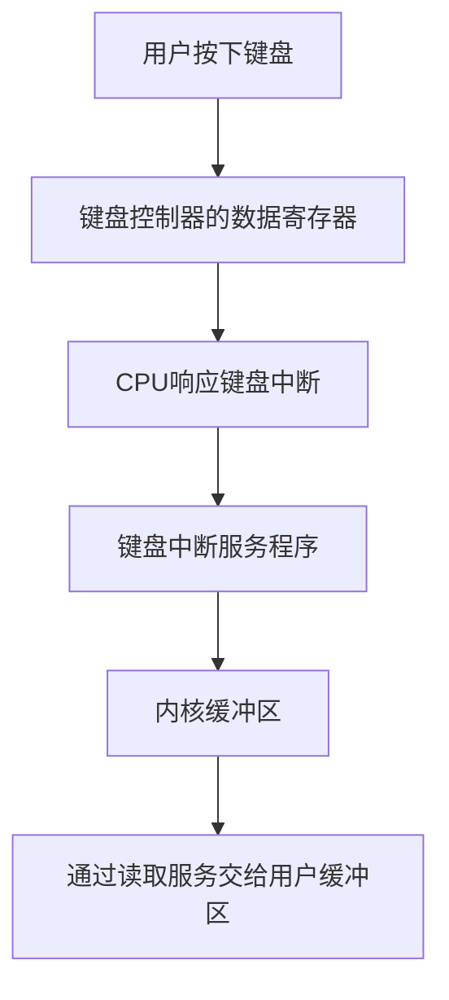

2024年408真题第24题问键盘中断服务例程执行结束时，输入的数据存在哪里。

答案是**内核缓冲区**，而不是用户缓冲区。

不要将操作系统接收设备数据与应用程序读取设备数据混为一谈。

## 五、系统调用：用户程序如何使用操作系统

### 5.1 系统调用的本质

系统调用是操作系统内核为应用程序提供服务的接口。

用户程序需要使用受保护的系统资源，但又不能直接执行特权指令，因此需要通过系统调用向内核提出请求。

可以把这个过程理解为：

用户程序说明自己需要什么，由内核检查请求是否合法，再代替用户执行具有特权的操作。

| 操作          | 是否通常需要系统调用     |
| ----------- | -------------- |
| 创建进程        | 是              |
| 打开文件        | 是              |
| 读取文件        | 是              |
| 写入文件        | 是              |
| 请求网络通信      | 是              |
| 计算两个整数的和    | 否              |
| 计算正弦函数      | 否              |
| 普通伪随机数生成    | 否              |
| 操作系统内部的进程调度 | 不是直接提供给用户的系统调用 |
| 操作系统内部的页置换  | 不是直接提供给用户的系统调用 |

<Callout type="warn" title="系统调用的范围">

**不是所有操作系统内核完成的工作，都属于系统调用。**

</Callout>

判断系统调用需要抓住一个核心条件：应用程序是否在通过内核提供的接口主动申请某项服务。

### 5.2 系统调用的完整执行过程

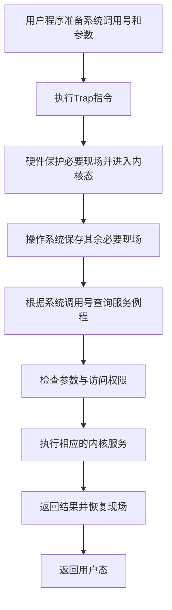

最需要记住的简化顺序是：

$$
\boxed{\text{传递参数}\rightarrow\text{执行Trap} \rightarrow\text{内核服务}\rightarrow\text{返回用户态}}
$$

这是2017年408真题第14题直接考查的内容，答案为C。

为什么一定要先传递参数？

因为内核接收到系统调用请求之后，需要知道用户要执行什么操作，以及操作的具体对象。

例如：

```c
read(fd, buf, count);
```

内核需要知道文件描述符、缓冲区地址、读取长度等信息，才能提供相应服务。

### 5.3 区分库函数、系统调用、Trap指令

这三者不是同一个概念。

| 概念       | 所属层次    | 主要作用      |
| -------- | ------- | --------- |
| 库函数      | 用户程序层   | 提供方便的编程接口 |
| 系统调用     | 操作系统接口层 | 请求内核服务    |
| Trap指令   | 硬件指令层   | 实现受控陷入    |
| 系统调用服务例程 | 操作系统内核层 | 真正完成服务    |

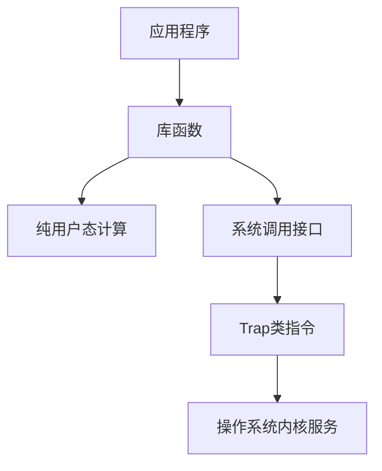

并不是每个库函数都会产生系统调用。例如 `sin()` 通常可以完全在用户态执行。

另外，系统调用也可以通过直接使用相应的机器指令和调用约定来发起，并非必须经过某个标准库函数。

### 代表题4：2015年408真题（真题库第13题）

假定下列指令已经装入指令寄存器，执行时不可能因为该指令自身而导致CPU从用户态变为内核态的是：

A. `DIV R0, R1`：将R0除以R1

B. `INT n`：产生软中断

C. `NOT R0`：将寄存器R0取反

D. `MOV R0, addr`：读取指定内存地址的数据

<Accordions>
<Accordion title="查看答案">

**答案：C。**

</Accordion>
</Accordions>

#### 这道题真正考查的不是特权指令

如果只是判断特权指令，很容易做错。

题干问的是：**指令执行过程中，是否可能产生使CPU进入内核态的事件。**

| 指令  | 是否可能进入内核态  | 原因                |
| --- | ---------- | ----------------- |
| DIV | 可能         | 除数为0时产生异常         |
| INT | 可以         | 主动触发软中断           |
| NOT | 不会由该操作本身引起 | 仅进行普通寄存器位运算       |
| MOV | 可能         | 访存时可能缺页、越界或违反访问权限 |

题目特意强调指令已经装入指令寄存器，就是为了排除取指阶段可能发生的缺页等异常。

外部中断属于与当前指令无关的事件，也不应被用来干扰本题的判断。

#### 提炼出三个完全不同的问题

| 问题               | 判断依据        |
| ---------------- | ----------- |
| 指令能否在用户态执行？      | 指令权限        |
| 指令执行时是否可能进入内核态？  | 是否可能触发异常或陷入 |
| 相应的内核服务能否在用户态执行？ | 服务程序权限      |

例如：

除法指令允许在用户态执行，但除零可能导致CPU进入内核态，除零异常处理程序则在内核态执行。

真正掌握这三个层次，就能同时解决大量用户态、内核态和异常相关的题目。

### 5.4 系统调用指令与系统调用接口由谁决定？

王道卷二第23题（模拟题库第21题）是一道很有价值的拓展题。

题目比较两种情况：

第一种：在相同硬件上运行Windows、Linux等不同操作系统。

第二种：在不同硬件平台上运行相同的Linux操作系统。

问两种情况下使用的系统调用机器指令一般是相同还是不同。

题库答案：B，相同、不同。

理解这一题，需要区分硬件与软件层次。

| 对象        | 主要决定因素        |
| --------- | ------------- |
| 系统调用机器指令  | CPU指令集体系结构ISA |
| 系统调用号     | 操作系统及ABI      |
| 系统调用参数约定  | 操作系统及ABI      |
| 系统调用接口    | 操作系统          |
| 内核服务的具体实现 | 操作系统          |

相同CPU提供相同的指令集和可用的陷入机制；不同ISA可能使用不同的陷入指令。

不过，同一ISA也可能提供多种系统调用入口指令，不同操作系统未必选用完全相同的一条。本题按照教材的一般化模型作答即可。

2019年408真题第15题也考查过：不同操作系统不一定提供统一的系统调用接口。

## 六、并发、并行与多道程序设计

这部分知识虽然不如系统调用考得集中，但它是理解整个操作系统的理论基础。

### 6.1 并发与并行的本质区别

| 对比          | 并发       | 并行                  |
| ----------- | -------- | ------------------- |
| 时间要求        | 同一时间段内推进 | 同一时刻真正同时执行          |
| 单核CPU上的多个进程 | 可以       | 不可以                 |
| 多核CPU上的多个进程 | 可以       | 可以                  |
| 是否必须有多个处理器  | 否        | 多个CPU计算任务并行需要多个执行资源 |

下面是两个任务在单核CPU和双核CPU上的执行情况。

```text
单核CPU：

时间 →
CPU： A A B B A A B B A B

A和B交替执行，实现并发。

双核CPU：

时间 →
CPU1：A A A A A A
CPU2：B B B B B B

A和B同时执行，实现并行。
```

但是，不要错误地推出单处理机系统不能存在任何形式的并行。

CPU之外还有磁盘控制器、DMA控制器、I/O通道及其他设备，这些硬件具有相对独立的工作能力。

2009年408真题第1题就考查了这一知识点。

| 单处理机系统中的对象    | 能否并行 |
| ------------- | ---- |
| 进程与进程的CPU指令执行 | 否    |
| CPU与I/O设备     | 能    |
| CPU与通道        | 能    |
| 设备与设备         | 能    |

因此该题选择D。

**判断并行的核心，是有没有相互独立的执行资源，而不是只看CPU数量。**

### 6.2 多道程序为什么能够提高CPU利用率？

考虑两个程序A、B。

每个程序先使用CPU计算4ms，再进行I/O操作4ms。假设两个程序使用相互独立的I/O设备，忽略调度开销。

单道程序执行时：

```text
时间(ms)   0       4       8       12      16
CPU        |  A计算 |  空闲  |  B计算 |  空闲  |
```

CPU利用率：

$$
U_{\text{CPU}}=\frac{4+4}{16}=50\%
$$

多道程序执行时：

```text
时间(ms)   0       4       8       12
CPU        |  A计算 |  B计算 |  空闲  |
I/O设备A   |  空闲  |  A I/O |  空闲  |
I/O设备B   |  空闲  |  空闲  |  B I/O |
```

CPU利用率：

$$
U_{\text{CPU}}=\frac{4+4}{12}\approx66.7\%
$$

CPU完成的有效计算工作没有改变，但总完成时间缩短了。

这就是多道程序设计的核心思想：

**让一个程序等待I/O的时间，被其他程序用于CPU计算，使不同资源的工作尽可能重叠。**

### 6.3 多道程序系统的优点和代价

| 优点         | 代价         |
| ---------- | ---------- |
| 提高CPU利用率   | 增加进程调度开销   |
| 提高I/O设备利用率 | 增加进程切换开销   |
| 提高系统吞吐量    | 需要资源保护     |
| 减少资源空闲时间   | 需要同步与互斥    |
| 提高资源利用效率   | 执行顺序具有不确定性 |

2017年408真题第3题直接考查了这一点。

其中正确的是Ⅰ、Ⅲ、Ⅳ，即CPU利用率高、系统吞吐量大、I/O设备利用率高，答案为D。

<Callout type="warn" title="多道程序的代价">

**效率提高不等于系统开销减少。**

</Callout>

原题库第3题的解析末尾将正确序号误写成了Ⅰ、Ⅱ、Ⅳ，但其逐项分析与答案D均正确。复习时应以Ⅰ、Ⅲ、Ⅳ为准。

### 代表题5：2022年408真题（真题库第5题）

下列关于多道程序系统的叙述中，不正确的是：

A. 支持进程的并发执行

B. 不必支持虚拟存储管理

C. 需要实现对共享资源的管理

D. 进程数越多CPU利用率越高

<Accordions>
<Accordion title="查看答案">

**答案：D。**

</Accordion>
</Accordions>

#### 为什么B正确？

多道程序只要求多个程序能够共同驻留内存并并发执行。

即使使用固定分区等较简单的内存管理方式，也可以实现多道程序，不一定需要虚拟存储器。

#### 为什么D错误？

增加进程数确实可以在一定程度上减少CPU空闲时间，但这种收益不是无限的。

进程过多之后，会出现更严重的内存竞争、频繁的进程切换、缺页和抖动等问题。

因此，多道程序度与CPU有效利用率的关系通常可以用下面的示意图理解。

```text
CPU有效利用率
 ↑
 │                  ______
 │              ___/      \__
 │           __/             \__
 │        __/
 │     __/
 │____/
 └─────────────────────────────→ 多道程序度
      并发不足    合适范围    资源竞争过度
```

这是一种定性示意关系，不是固定的数学曲线。

竞成模拟七第23题（模拟题库第28题）几乎再次考查了这个知识点，只是在题干中增加了虚拟存储器的条件。

无论是否采用虚拟存储器，都不能认为进程数越多，CPU利用率一定越高。

#### 多道程序相关的必要条件辨析

| 条件         | 多道程序系统是否必须具备 |
| ---------- | ------------ |
| 并发执行能力     | 必须           |
| 共享资源管理     | 必须           |
| 适当的内存保护机制  | 必须           |
| 多个CPU      | 不必须          |
| 虚拟存储器      | 不必须          |
| 多进程真正同时计算  | 不必须          |
| 所有进程执行顺序固定 | 不需要          |

## 七、操作系统的四大基本特征

操作系统的四个基本特征不是孤立的，而是具有内在联系。

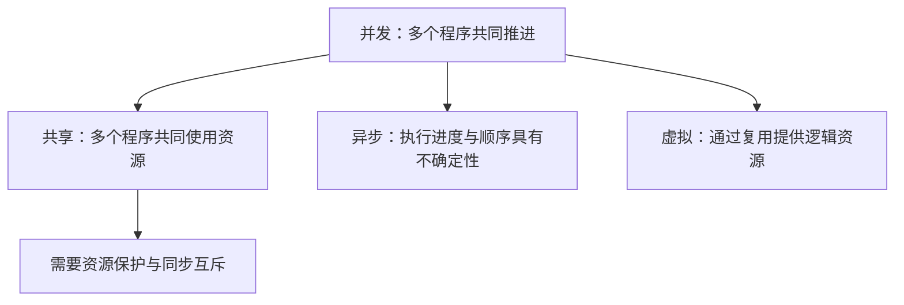

### 7.1 四大特征的本质

| 特征 | 本质              | 典型例子         |
| -- | --------------- | ------------ |
| 并发 | 多个任务在同一时间段执行    | 单核CPU进行多任务处理 |
| 共享 | 多个任务共同使用系统资源    | 多个进程访问文件     |
| 虚拟 | 将物理资源抽象成逻辑资源    | 虚拟处理器、虚拟存储器  |
| 异步 | 程序推进速度和时机具有不确定性 | 进程因I/O、调度而暂停 |

其中，并发和共享是操作系统最基本的两个特征。

没有多个程序共同运行，就不存在通常意义上的多程序资源共享问题；而没有资源共享和分配机制，也难以支持有效的并发执行。

#### 异步性为什么重要？

假设两个进程同时修改一个共享变量：

```c
x = x + 1;
```

这条高级语言语句在机器层面可能拆成读取、加1、写回等多个操作。

如果两个进程的执行顺序不同，最终结果可能不同。

这就是后面第二章为什么需要互斥、同步和信号量的原因。

异步性不是说所有并发程序的结果必然错误，而是说执行的先后与推进速度可能不可预知，需要正确的同步机制保障结果。

### 7.2 虚拟技术的两种基本思想

| 技术   | 思想              | 典型应用        |
| ---- | --------------- | ----------- |
| 时分复用 | 不同任务在不同时间使用同一资源 | 时间片轮转、虚拟CPU |
| 空分复用 | 不同任务利用资源的不同空间部分 | 内存分区、地址空间管理 |

SPOOLing技术则通过输入井、输出井及后台服务，使多个进程能够逻辑上共享独占式设备。

例如多个用户同时提交打印任务：

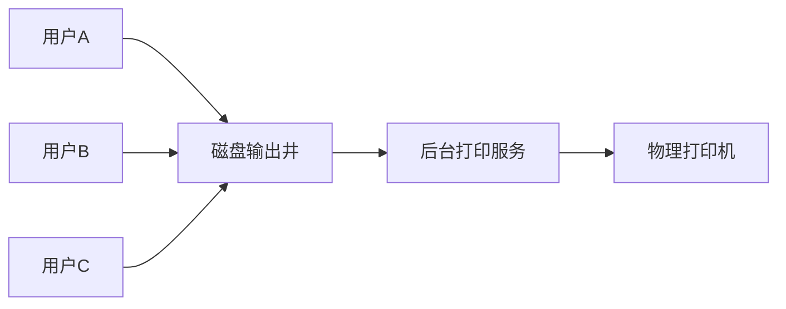

从用户角度看，仿佛每个人都可以使用打印设备；从物理层面看，仍然只有一台打印机在依次打印。

### 代表题6：王道卷一第23题（模拟题库第5题）

下列关于虚拟化的说法中，正确的是：

Ⅰ. 时间片轮转调度算法是一种对CPU资源的虚拟化

Ⅱ. 内存分区是一种对内存资源的虚拟化

Ⅲ. SPOOLing是一种设备虚拟技术，采用类似脱机I/O的思想

Ⅳ. 虚拟机管理程序一定运行在内核态

**答案：A，即Ⅰ、Ⅱ、Ⅲ正确。**

Ⅰ体现时间复用，Ⅱ按照题库的宽泛定义体现空间复用，Ⅲ体现设备虚拟化。

Ⅳ错误，因为虚拟机管理程序存在不同的实现方式。

| 虚拟机管理程序     | 特点                          |
| ----------- | --------------------------- |
| 第一类（Type 1） | 直接运行于硬件之上，管理虚拟机             |
| 第二类（Type 2） | 建立在宿主操作系统之上，可以借助宿主系统提供的服务运行 |

第二类虚拟机管理程序可以包含运行在宿主系统用户态的部分，因此不能说整个虚拟机管理程序一定运行在内核态。

另外，内存分区本身属于空间分配与隔离，不等同于完整的虚拟存储器机制，这一点不要被模拟题的宽泛措辞误导。

## 八、操作系统的发展：理解不同系统的设计目标

学习这一部分最有效的方法，是理解每一种操作系统试图解决什么问题，而不是背诵出现年代。

| 系统类型    | 主要目标        | 典型特征            |
| ------- | ----------- | --------------- |
| 手工操作阶段  | 完成计算任务      | 人工操作，资源浪费严重     |
| 单道批处理系统 | 减少人工干预      | 自动性、顺序性、单道性     |
| 多道批处理系统 | 提高资源利用率和吞吐量 | 多道性、无交互性        |
| 分时操作系统  | 改善多用户交互体验   | 多路性、独立性、及时性、交互性 |
| 实时操作系统  | 满足规定的时间约束   | 及时性、可靠性         |
| 分布式操作系统 | 协调多个独立计算机   | 资源共享、分布透明性      |

### 8.1 批处理系统与分时系统

批处理系统的核心是成批自动处理作业。

用户提交作业之后，通常不能在其执行过程中直接与程序交互。

分时系统的核心是多个用户交替使用CPU，并能及时获得响应。

因此：

**批处理追求整体处理效率，分时系统追求交互响应。**

2016年408真题第2题考查了批处理系统是否允许用户直接交互，答案是否定的。

### 8.2 分时系统与实时系统

这两个概念很容易混淆。

| 对比         | 分时系统    | 实时系统      |
| ---------- | ------- | --------- |
| 目标         | 较快地响应用户 | 满足时间约束    |
| 时间要求       | 交互体验较好  | 特定任务有截止时间 |
| 典型应用       | 多用户交互系统 | 工业控制、实时控制 |
| 是否保证严格截止时间 | 通常不保证   | 硬实时系统要求保证 |

假设两个系统都需要执行一个任务。

分时系统中，任务延迟可能使用户体验变差；硬实时系统中，任务错过截止时间可能意味着任务失败，即使它最终得出了正确结果。

<Callout type="warn" title="实时系统">

**实时不等于单纯速度快，而是强调结果与时间约束同时满足。**

</Callout>

竞成模拟二第23题（模拟题库第7题）就设置了“分时系统中所有任务必须在约定时间内完成”这一错误选项。

## 九、操作系统内核架构

近年来这部分内容具有较高的复习价值。2023年408真题第21题以及题库中的多道模拟题都涉及这一知识点。

### 9.1 宏内核与微内核

两者最大的区别是：**哪些功能放在内核态，哪些功能放在用户态。**

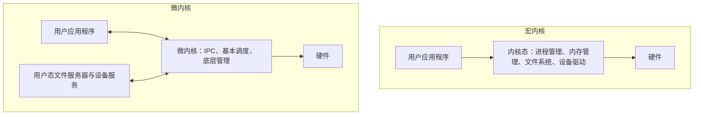

| 对比        | 宏内核（大内核）     | 微内核        |
| --------- | ------------ | ---------- |
| 内核功能      | 较多           | 较少         |
| 文件系统、设备驱动 | 通常在内核中       | 可以作为用户态服务  |
| 模块通信      | 通常直接函数调用     | 更多依赖IPC    |
| 通信开销      | 通常较小         | 通常较大       |
| 性能        | 通常较好         | 可能受通信开销影响  |
| 可靠性       | 故障影响范围可能较大   | 故障隔离能力通常更好 |
| 安全性       | 特权代码规模较大     | 特权代码规模通常较小 |
| 可扩展性      | 相对较弱         | 相对较强       |
| 典型系统      | 传统UNIX、Linux | MINIX、QNX  |

微内核一般保留中断与异常处理、底层地址空间管理、基本调度、进程间通信等核心机制。

### 9.2 为什么微内核更加可靠，却不一定更快？

假设某个设备驱动发生错误。

宏内核中，驱动通常具有内核权限，其错误可能破坏其他内核数据，甚至导致整个系统崩溃。

微内核中，驱动如果作为独立的用户态服务运行，其错误更容易被限制在相应的地址空间内，系统也更容易单独恢复该服务。

但是，微内核中的服务之间通常需要借助进程间通信进行协作，这可能增加模式切换、上下文切换和消息传递的成本。

所以微内核的本质是：

**通过缩小特权代码范围来增强隔离性，以一定的通信开销换取可靠性、安全性和可扩展性。**

### 代表题7：2023年408真题（真题库第21题）

与宏内核操作系统相比，微内核操作系统具有的特征是：

Ⅰ. 较好的性能

Ⅱ. 较高的可靠性

Ⅲ. 较高的安全性

Ⅳ. 较强的可扩展性

**答案：D，即Ⅱ、Ⅲ、Ⅳ。**

这道题没有必要死记答案。只要能从“功能放在哪里”“故障影响谁”“通信如何进行”三个角度推导，就可以完成判断。

### 9.3 外核结构

外核（Exokernel）强调将资源管理策略尽可能交给用户级程序或者库操作系统，内核主要负责物理资源的安全分配、保护和复用。

| 架构  | 核心思想                         |
| --- | ---------------------------- |
| 宏内核 | 大量操作系统服务在内核中实现               |
| 微内核 | 内核只保留基本机制，其他服务移至用户态          |
| 外核  | 内核负责安全保护与资源复用，管理策略更多交给应用或库OS |

竞成模拟一第23题、模拟七第23题均涉及外核结构。

需要注意：外核并不是没有内核，也不是允许应用程序无保护地随意访问所有硬件资源。

## 十、操作系统引导

这部分内容不难，但比较容易考查步骤顺序以及不同部件的职责。

### 10.1 传统BIOS启动过程

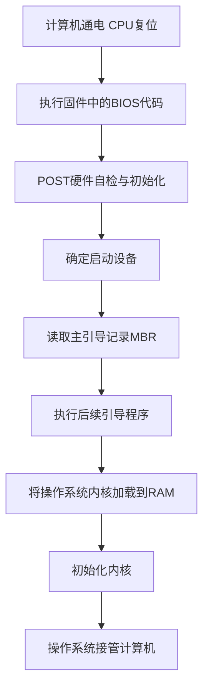

必须区分以下几个概念。

| 对象          | 作用或存储位置        |
| ----------- | -------------- |
| BIOS        | 主板非易失性存储器中的固件  |
| MBR         | 传统启动磁盘上的主引导记录  |
| 引导程序        | 负责后续引导及加载操作系统  |
| 操作系统内核文件    | 通常存放在非易失性存储设备中 |
| 正在运行的操作系统内核 | 加载到RAM         |

题库中三道相关题目：

| 题目             | 核心问题        | 答案         |
| -------------- | ----------- | ---------- |
| 2013年408真题第25题 | 操作系统最终加载到哪里 | RAM        |
| 王道卷一第24题       | 引导扇区代码何时写入  | 安装OS或引导程序时 |
| 竞成模拟五第23题      | BIOS引导首先做什么 | 硬件自检       |

可以用一句话串联：

**安装时写入引导代码，开机时固件进行自检并启动引导程序，引导程序将内核加载至内存。**

现代UEFI启动流程与传统BIOS/MBR有所不同，通常使用EFI系统分区中的引导程序，但操作系统内核最终仍需加载到内存运行。

不要因为技术更新就认定BIOS绝对不会再考。只要题干采用传统BIOS模型，就按照该模型作答。

## 十一、操作系统功能与用户接口

### 11.1 操作系统的基本功能

| 功能     | 管理对象    | 典型工作          |
| ------ | ------- | ------------- |
| 处理机管理  | CPU、进程  | 调度、同步、互斥      |
| 存储器管理  | 内存      | 分配、回收、地址转换、保护 |
| 文件管理   | 文件与目录   | 文件读写、目录检索     |
| 设备管理   | I/O设备   | 分配设备、驱动设备、缓冲  |
| 提供用户接口 | 用户、应用程序 | 命令接口、GUI、系统调用 |

题目经常故意将一种管理功能描述成另一种。

例如竞成模拟六第23题把“分配CPU时间给不同进程”说成作业调度，这是错误的。

作业调度决定后备作业是否进入内存并获得运行资格；进程调度决定哪个就绪进程获得CPU。

### 11.2 操作系统提供的接口

| 接口         | 使用者  | 特征          |
| ---------- | ---- | ----------- |
| 联机命令接口     | 用户   | 用户逐条输入命令并交互 |
| 脱机命令接口     | 用户   | 成批提交作业命令    |
| 图形用户界面GUI  | 用户   | 图形化交互       |
| 程序接口（系统调用） | 应用程序 | 程序请求内核服务    |

GUI是一种交互式用户接口，不属于脱机命令接口。在有些教材中，GUI作为独立类别介绍，不直接归入联机命令接口，但它绝不是脱机接口。

另外，命令解释程序（Shell）通常运行在用户态，而不是内核态。

例如用户输入一条命令来启动程序，Shell负责解析命令，然后通过相关系统调用请求内核创建或执行进程。

**Shell使用操作系统服务，但Shell本身通常不是操作系统内核。**

## 十二、模拟题中的跨章节知识与有争议的表述

原题库28道模拟题中包含部分跨章节知识。

建议结合对应章节复习。

| 模拟题库题号  | 涉及的知识     | 建议掌握的结论                        |
| ------- | --------- | ------------------------------ |
| 第1题     | 信号量与互斥    | 正确使用PV操作能实现互斥，但不自动避免死锁         |
| 第2题     | 进程三态      | 单核正常调度的稳定状态下，有就绪进程时CPU不应闲置     |
| 第3题     | 文件访问      | CPU利用率提高不等于文件访问速度直接提高          |
| 第4题     | 银行家算法     | 存在安全序列才是安全状态                   |
| 第6题     | 三级调度      | 作业调度与进程调度不同                    |
| 第16题    | I/O方式     | I/O控制方式与用户进程是否阻塞是不同概念          |
| 第18题    | 虚拟存储器     | 基本分页不等于请求分页，页面并非越小越好           |
| 第19题    | 地址转换      | 越界、缺页、权限错误均可触发异常               |
| 第22题    | 文件打开与关闭   | open建立引用，close释放引用，不保证每次立即写回磁盘 |
| 第23题    | 内核栈与进程切换  | 陷入内核态不等于进程切换                   |
| 第24、28题 | 虚拟内存与文件映射 | 地址映射、按需调页与物理内存容量是不同概念          |

此外，有几道模拟题的表述不够严谨，不能将其答案直接当作无条件成立的知识点。

| 模拟题  | 题库的预期判断         | 更严谨的理解                         |
| ---- | --------------- | ------------------------------ |
| 第8题  | 保护定时器，选D        | 现代系统中的内核代码和数据读取通常也需要保护         |
| 第10题 | I/O完成后立即进入内核态   | 应当是CPU响应中断时进入内核态               |
| 第13题 | 访管指令导致状态切换      | 非法执行特权指令也可能因异常进入内核，Trap是合法主动入口 |
| 第16题 | 三种I/O方式都会使进程阻塞  | 是否阻塞取决于同步、异步、轮询等具体实现           |
| 第17题 | 没有中断就不可能多道运行    | 按教材常规中断驱动模型理解，不宜无限扩大           |
| 第22题 | 打开后任何操作都使用fd    | 普通读写如此，但重命名等操作仍可能使用路径          |
| 第25题 | 用户程序不直接与文件服务器通信 | 实际上可以通过微内核提供的IPC机制通信           |

复习时应该优先以真题的严谨考点为依据，而不是为了记住某道模拟题的答案，形成错误的知识体系。

## 十三、本章选择题的六种通用解题方法

本章六类通用解题方法：

### 方法一：系统控制权判断法

适用于特权指令题。

判断依据：该操作是否会改变系统权限、共享资源或者CPU的控制权？

如果会，通常属于特权操作；如果只是普通计算和合法访存，通常不需要特权。

注意Trap指令这一受控入口。

### 方法二：时间节点判断法

适用于中断、异常、系统调用。

严格区分：

$$
\text{事件发生}\rightarrow\text{硬件响应} \rightarrow\text{软件处理}\rightarrow\text{返回}
$$

不能将发生时的CPU状态与处理时的CPU状态混淆。

### 方法三：硬件与软件分层法

适用于中断处理流程。

硬件负责提供受控入口、保护必要状态以及权限切换；操作系统负责具体资源管理和服务处理。

尤其牢记PC、PSW与通用寄存器的保存分工。

### 方法四：变化对象判断法

看到“切换”“转换”时，先判断变化的到底是什么。

CPU权限变化属于模式切换，进程运行状态变化属于状态转换，占用CPU的进程变化属于进程切换。

三者不能互相等同。

### 方法五：设计目标反推法

适用于操作系统类型、虚拟化、内核结构。

| 技术   | 从什么目标出发推导 |
| ---- | --------- |
| 多道程序 | 提高资源利用率   |
| 分时系统 | 改善交互响应    |
| 实时系统 | 满足时间约束    |
| 虚拟技术 | 提供逻辑资源    |
| 微内核  | 增强隔离与模块化  |
| 系统调用 | 安全地提供内核服务 |

先理解设计目标，再推导特点和优缺点，往往比背结论更可靠。

### 方法六：构造反例法

遇到“一定”“必须”“全部”“越多越好”“不可能”等绝对表述，尝试构造一个反例。

| 绝对表述          | 反例          |
| ------------- | ----------- |
| 多任务必须有多个CPU   | 单核时间片轮转     |
| 进程越多CPU利用率越高  | 内存抖动        |
| 中断发生时一定处于用户态  | 内核态发生中断嵌套   |
| 进入内核态一定发生进程切换 | 查询系统时间后直接返回 |
| 所有库函数都需要系统调用  | sin函数       |
| 多道程序必须支持虚拟内存  | 固定分区多道程序系统  |
| 非特权指令不会引发异常   | 除法指令除零      |

不要看到绝对词就直接判错，而是判断是否存在真正成立的反例。

## 十四、考前必须牢记的核心结论

| 知识点        | 必须记住的结论          |
| ---------- | ---------------- |
| 用户态        | 只能执行非特权指令        |
| 内核态        | 可以执行特权和非特权指令     |
| Trap       | 非特权指令，用户态可以执行    |
| 系统调用       | 应用程序请求内核服务的接口    |
| 库函数        | 不一定涉及系统调用        |
| 中断发生       | 可以在用户态，也可以在内核态   |
| 中断处理       | 在内核态执行           |
| 中断隐指令      | 不是指令系统中的真实指令     |
| 保存PC、必要PSW | 典型408模型中由硬件完成    |
| 保存通用寄存器    | 由操作系统完成必要的保存     |
| 用户态转内核态    | 通过中断、异常、自陷等机制实现  |
| 内核态返回用户态   | 通过受控的返回机制实现      |
| 模式切换       | 不一定伴随进程切换        |
| 中断向量表      | 适合使用数组           |
| 键盘中断处理结束   | 数据通常存于内核缓冲区      |
| 并发         | 同一时间段内推进         |
| 并行         | 同一时刻同时执行         |
| 多道程序       | 提高资源利用率，但会增加管理开销 |
| 多任务系统      | 不必须具有多CPU        |
| 多道程序系统     | 不必须具有虚拟存储器       |
| 分时系统       | 强调交互及时性          |
| 实时系统       | 强调时间约束           |
| SPOOLing   | 将独占设备逻辑上改造为共享设备  |
| 微内核        | 可靠性、安全性、可扩展性通常更好 |
| 宏内核        | 通信开销通常较小         |
| Shell      | 通常运行在用户态         |
| OS引导       | 最终将内核加载至RAM      |

## 十五、检验自己是否真正掌握本章

以下为根据真题和模拟题考点设计的自测判断题，非原题。先独立判断，再展开答案。

<Accordions>
<Accordion title="用户态不能改变PC的值">

**答案：** 错

普通跳转可以改变PC

</Accordion>

<Accordion title="Trap指令是特权指令">

**答案：** 错

用户程序需要通过它主动申请服务

</Accordion>

<Accordion title="用户态执行除法可能进入内核态">

**答案：** 对

可能发生除零异常

</Accordion>

<Accordion title="中断发生时CPU一定处于内核态">

**答案：** 错

用户态也可以发生中断

</Accordion>

<Accordion title="CPU响应中断后一定切换进程">

**答案：** 错

可以返回原进程

</Accordion>

<Accordion title="系统调用的权限切换由硬件完成">

**答案：** 对

必须有受控的硬件入口

</Accordion>

<Accordion title="保存通用寄存器属于典型中断隐指令的主要工作">

**答案：** 错

408模型中由操作系统保存

</Accordion>

<Accordion title="进程调度属于用户主动申请的系统调用">

**答案：** 错

它是内核的资源管理行为

</Accordion>

<Accordion title="单核CPU可以实现多任务">

**答案：** 对

可以并发执行

</Accordion>

<Accordion title="单处理机系统中CPU与磁盘不能并行">

**答案：** 错

具有独立的工作资源

</Accordion>

<Accordion title="多道程序系统一定支持虚拟内存">

**答案：** 错

基本分区管理也能支持

</Accordion>

<Accordion title="多道程序的系统开销一定更小">

**答案：** 错

调度和资源管理会增加开销

</Accordion>

<Accordion title="分时系统必须保证所有任务满足硬截止时间">

**答案：** 错

混淆分时与硬实时

</Accordion>

<Accordion title="微内核的性能一定优于宏内核">

**答案：** 错

IPC等机制可能增加开销

</Accordion>

<Accordion title="普通函数调用一定需要进入内核态">

**答案：** 错

可以完全在用户态运行

</Accordion>

<Accordion title="操作系统所有组成程序均运行于内核态">

**答案：** 错

Shell等程序通常运行于用户态

</Accordion>
</Accordions>

## 十六、最终复习建议：最值得反复做的10道题

优先重做以下代表题，并分析各错误选项的原因。

| 优先级 | 题目来源      | 题库编号 | 核心价值           |
| --- | --------- | ---- | -------------- |
| 1   | 2022年408  | 真题19 | 硬件与软件分工        |
| 2   | 2015年408  | 真题13 | 指令权限与异常的区别     |
| 3   | 2024年408  | 真题23 | 中断发生与处理的区别     |
| 4   | 2022年408  | 真题5  | 多道程序的必要条件      |
| 5   | 2017年408  | 真题14 | 系统调用执行过程       |
| 6   | 2012年408  | 真题9  | 中断与普通函数调用      |
| 7   | 竞成模拟三第23题 | 模拟14 | 综合特权指令判断       |
| 8   | 王道卷一第23题  | 模拟5  | 资源虚拟化          |
| 9   | 2023年408  | 真题21 | 微内核与宏内核        |
| 10  | 竞成模拟七第23题 | 模拟28 | 多道程序、外核与接口综合辨析 |

上述编号均为原分类题库内部编号；优先级依据题目综合性、迁移价值和重复考点制定，并非官方考试权重统计。

### 本章真正需要建立的知识体系

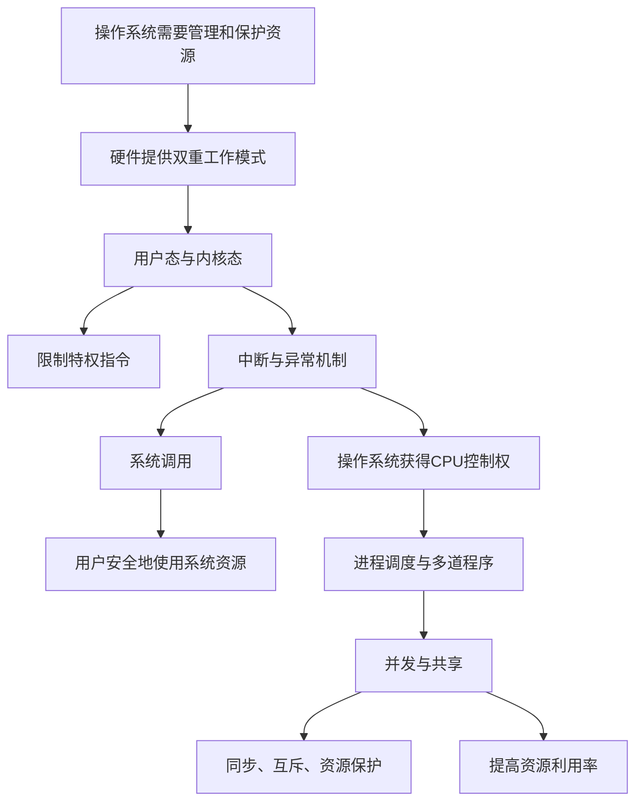

**第一章的核心实际上是解决三个问题：操作系统凭什么能够管理计算机，用户程序如何安全地使用系统资源，以及多个程序为什么能够共同运行。**
