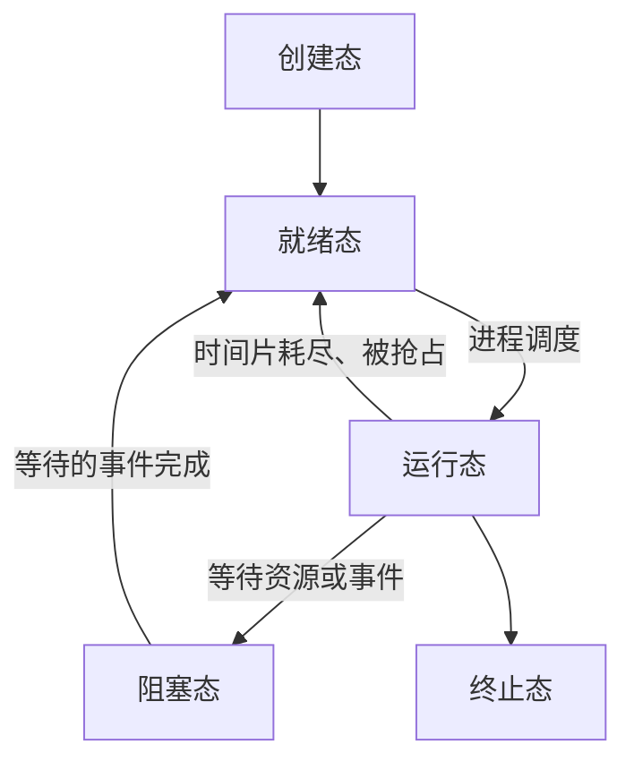
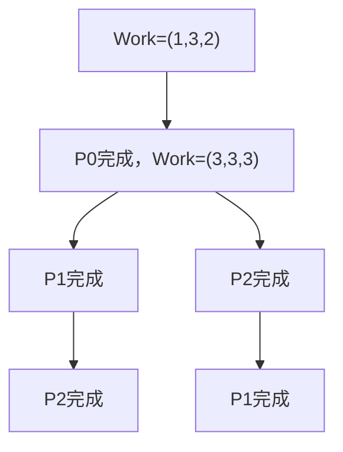
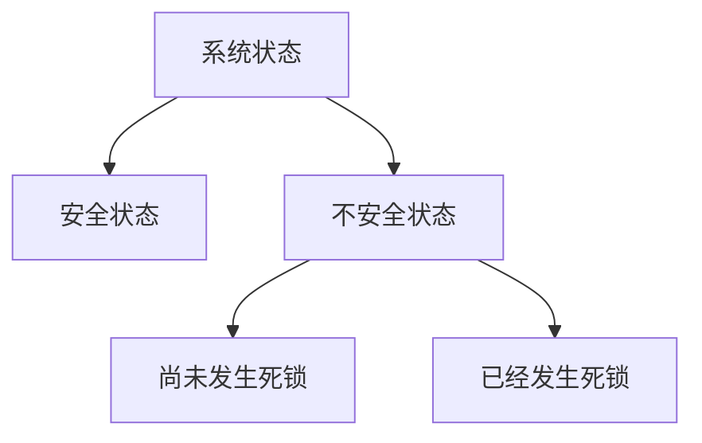
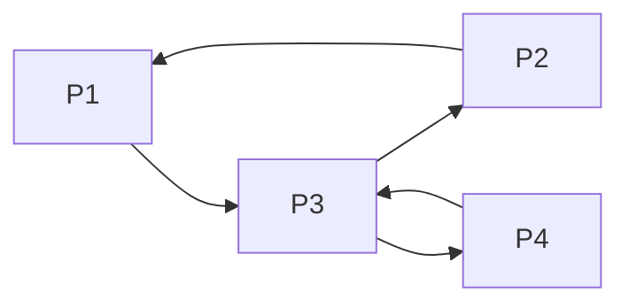

本章归纳57道历年真题与43道模拟题，共100道选择题，重点建立状态转换、资源共享、时间轴、指令交错、PV操作与安全序列六类解题模型。

## 一、本章考点分布与复习优先级

| 知识模块  | 真题数量 | 模拟题数量 | 重要程度  |
| ----- | ---- | ----- | ----- |
| 进程与线程 | 16   | 15    | ★★★★★ |
| CPU调度 | 19   | 10    | ★★★★★ |
| 同步与互斥 | 10   | 10    | ★★★★★ |
| 死锁    | 12   | 7     | ★★★★★ |
| 综合疑难点 | —    | 1     | ★★★★  |

注：以上按照原题库的章节归类统计，模拟题中个别题目涉及其他章节。

这一章看似知识点很多，但实际上可以归结为六个核心问题：

| 核心问题         | 解题思维            |
| ------------ | --------------- |
| 进程为什么发生状态转换？ | 判断缺少CPU还是缺少其他条件 |
| 线程之间哪些资源共享？  | 区分资源所有权和执行现场    |
| CPU应该分配给谁？   | 按照调度规则模拟时间轴     |
| 并发程序为什么出错？   | 将操作拆成不可分割的基本指令  |
| PV操作究竟在做什么？  | 资源计数、阻塞与唤醒      |
| 系统是否会发生死锁？   | 构造最坏情况或寻找完成顺序   |

## 二、进程状态转换：判断进程究竟在等待什么

**重要程度：★★★★★**

对应题库：真题第4、6、7、9、12、13题，模拟题第2～5题。

这是本章重复考查非常多、也最应该稳定拿分的知识点。

### 1. 三种状态的本质

不要只是记忆三种状态的定义，要理解进程不能运行的原因。

| 状态  | 是否具备运行条件 | 是否占有CPU |
| --- | -------- | ------- |
| 运行态 | 是        | 是       |
| 就绪态 | 是        | 否       |
| 阻塞态 | 否        | 否       |

**就绪态与阻塞态的根本区别：现在给它一个CPU，它能不能继续执行？**

- 能：就绪态。
- 不能，还需要等待某个资源或事件：阻塞态。



### 2. 必须形成条件反射的状态转换

| 发生的事件         | 状态转换    |
| ------------- | ------- |
| 时间片耗尽         | 运行 → 就绪 |
| 被高优先级进程抢占     | 运行 → 就绪 |
| 主动让出CPU但不等待事件 | 运行 → 就绪 |
| 请求I/O且需要等待    | 运行 → 阻塞 |
| 申请资源失败        | 运行 → 阻塞 |
| 执行P操作且资源不足    | 运行 → 阻塞 |
| 缺页后需要等待磁盘读取   | 运行 → 阻塞 |
| I/O操作完成       | 阻塞 → 就绪 |
| 被V操作唤醒        | 阻塞 → 就绪 |
| 被调度程序选中       | 就绪 → 运行 |

特别注意，在经典三态模型中，不存在直接的：

- 就绪态 → 阻塞态；
- 阻塞态 → 运行态。

因为进程必须先执行才能主动提出阻塞请求，而阻塞进程被唤醒后还需要经过调度才能获得CPU。

### 3. 代表真题：2022年408（题库第12题）

下列事件或操作中，可能导致进程由执行态变为阻塞态的是：

Ⅰ. 进程读文件。

Ⅱ. 进程的时间片用完。

Ⅲ. 进程申请外设。

Ⅳ. 进程执行信号量的 `wait()` 操作。

**答案：Ⅰ、Ⅲ、Ⅳ，选D。**

这道题不需要分别背诵四个知识点，只需要使用一个判断标准：

| 操作     | 是否可能需要等待其他资源 |
| ------ | ------------ |
| 读文件    | 是，可能等待磁盘     |
| 时间片用完  | 否，只是失去CPU    |
| 申请外设   | 是，外设可能被占用    |
| wait操作 | 是，信号量资源可能不足  |

还要特别注意题目中的“可能”。

读文件可能命中缓存，申请外设可能立即成功，P操作也可能无需等待。因此，这些操作并不一定导致阻塞。

#### 4. 状态转换与调度的三个易错点

第一，阻塞通常由运行进程主动发起，但唤醒需要外部事件或操作系统完成。

第二，发生中断不代表一定发生进程切换。中断处理结束后，完全可能恢复原进程继续运行。

第三，进入内核态不等于发生进程切换。系统调用可以在当前进程的上下文中完成。

<Callout type="warn" title="状态、进程与模式切换">

**解题本质：状态转换看运行条件，进程切换看CPU使用权，用户态与内核态转换看执行权限。三者不能混淆。**

</Callout>

## 三、进程与线程：区分资源和执行现场

**重要程度：★★★★★**

对应题库：2011、2012、2019、2020、2024年真题，模拟题第11～15题。

### 1. 从设计目的理解线程

为什么操作系统已经有了进程，还要引入线程？

因为进程同时承担了两个职责：

1. 管理程序运行所需的资源。
2. 作为程序的执行实体。

引入线程，就是将资源管理和程序执行两个职责进一步分离。

**进程负责拥有资源，线程负责执行程序。**

在支持线程的系统中：

- 进程是资源分配的基本单位。
- 线程是CPU调度的基本单位。

### 2. 线程资源共享的统一判断方法

| 资源           | 同一进程内的线程是否共享 |
| ------------ | ------------ |
| 代码段          | 共享           |
| 全局变量         | 共享           |
| 静态变量         | 共享           |
| 堆空间          | 共享           |
| 虚拟地址空间       | 共享           |
| 打开的文件、文件描述符表 | 共享           |
| 程序计数器PC      | 独立           |
| 通用寄存器        | 独立           |
| 栈指针SP        | 独立           |
| 调用栈          | 各自拥有         |
| 线程控制块TCB     | 独立           |
| 线程运行状态       | 独立           |

为什么线程必须拥有独立的PC、寄存器和栈？

因为不同线程可能同时执行不同函数，也可能执行同一个函数的不同位置。如果它们共享同一套执行现场，就无法独立暂停和恢复执行。

记忆方法：

**与程序资源有关的通常共享；与当前执行到哪里、如何恢复执行有关的通常独立。**

注意，线程独立拥有栈，并不意味着其他线程在硬件层面绝对无法访问该栈。它们仍然处于同一个虚拟地址空间内。

### 3. 代表真题：2024年408（题库第16题）

线程T打开一个文件获得文件描述符fd，随后创建线程Ta和Tb。

Ta和Tb可以共享哪些资源？

Ⅰ. 进程P的地址空间。

Ⅱ. 线程T的栈。

Ⅲ. 文件描述符fd。

**答案：Ⅰ、Ⅲ，选B。**

这道题与题库中2011年真题第2题的考查本质几乎完全相同。

不要因为文件是由线程T打开的，就认为文件描述符属于线程T。打开文件属于进程的资源管理范畴，而栈属于线程的执行现场。

### 4. 用户级线程与内核级线程

| 比较维度        | 用户级线程ULT      | 内核级线程KLT   |
| ----------- | ------------- | ---------- |
| 管理者         | 用户态线程库        | 操作系统内核     |
| 线程调度        | 用户态完成         | 内核完成       |
| 线程切换开销      | 通常较小          | 通常较大       |
| 内核是否直接感知该线程 | 否             | 是          |
| 多核并行        | 取决于映射模型       | 可以支持       |
| 一个线程阻塞的影响   | 多对一模型可能阻塞整个进程 | 其他线程可以继续运行 |

理解关键是：**操作系统能看到几个可以独立调度的执行实体？**

例如，多个用户级线程映射到一个内核级线程时，即使拥有多个CPU核心，也不能让这些用户级线程同时在多个核心上运行。

### 5. 进程相关的补充高频考点

| 考点      | 应掌握的结论                      |
| ------- | --------------------------- |
| PCB     | 进程存在的重要标志，记录进程管理信息          |
| 创建进程    | 申请PCB、初始化PCB、分配必要资源，通常进入就绪态 |
| 终止进程    | 回收资源，但不一定终止其子进程             |
| 父子进程    | 拥有独立PCB和虚拟地址空间              |
| 进程切换    | 保存旧执行现场、恢复新执行现场，并切换相关地址空间信息 |
| 同进程线程切换 | 通常无须切换所属进程的地址空间             |
| 原语      | 执行过程具有原子性，不能被其他相关操作分割       |
| 进程内存映像  | 代码段、数据段、堆、栈各有用途             |

### 6. 进程通信

2014年真题和竞成模拟题均涉及管道通信。

| 通信方式 | 核心特点                  |
| ---- | --------------------- |
| 共享存储 | 通过共同可访问的内存交换数据，需要同步互斥 |
| 消息传递 | 通过发送、接收消息通信           |
| 管道通信 | 通过内核缓冲区传输数据           |

关于管道，重点掌握：

普通管道单向传输，双向通信通常需要两个管道；管道空时读操作可能阻塞，管道满时写操作可能阻塞；命名管道可以用于没有亲缘关系的进程之间。

## 四、CPU调度：所有计算题统一使用时间轴

**重要程度：★★★★★**

CPU调度是这份题库中真题数量最多的模块，共19道。

这一部分不要分别背每一种题型的解题公式。最重要的能力是：**按照调度规则准确还原CPU的使用过程。**

### 1. 经典调度算法的本质

| 算法           | 选择依据      | 抢占性   | 可能饥饿   |
| ------------ | --------- | ----- | ------ |
| FCFS先来先服务    | 最早到达      | 非抢占   | 否      |
| SJF短作业优先     | 所需服务时间最短  | 非抢占   | 是      |
| SRTN最短剩余时间优先 | 剩余服务时间最短  | 抢占    | 是      |
| HRRN高响应比优先   | 响应比最高     | 通常非抢占 | 教材模型下否 |
| RR时间片轮转      | 就绪队列轮流执行  | 抢占    | 否      |
| 优先级调度        | 优先级最高     | 两种均可  | 是      |
| 多级反馈队列       | 队列级别及队内规则 | 通常抢占  | 可能     |

所有调度算法都可以通过三个问题理解：

- 谁最先获得CPU？
- 什么情况下当前进程会失去CPU？
- 当前进程失去CPU后会去哪里？

#### 高响应比优先为什么重要？

$$
R=\frac{W+S}{S}=1+\frac{W}{S}
$$

其中，$W$ 为等待时间，$S$ 为要求的服务时间。

当等待时间相同时，短作业的响应比更高；当长作业等待时间不断增加时，它的响应比也会升高。

所以，高响应比优先兼顾了短作业优先与公平性。

2011年真题第19题正是考查这个结论。

#### 短作业优先为什么能够减少平均等待时间？

假设两个同时到达的作业，运行时间分别为10和2。

长作业先执行：

$$
\overline W=\frac{0+10}{2}=5
$$

短作业先执行：

$$
\overline W=\frac{0+2}{2}=1
$$

前面的长作业会让后面的所有作业多等待。因此，在所有作业同时到达、服务时间已知的经典模型下，按照运行时间从小到大排列，可以使平均等待时间和平均周转时间最短。

这也是王道卷六模拟题第20题的考查本质。

<Callout type="warn" title="SJF最优性的前提">

**注意：当作业到达时间不同时，不能无条件宣称非抢占式SJF一定全局最优。**

</Callout>

### 2. 调度计算题的全部核心公式

设到达时刻为 $A$，首次执行时刻为 $B$，完成时刻为 $F$，CPU服务时间为 $S$。

| 指标             | 计算方法                                           |
| -------------- | ---------------------------------------------- |
| 周转时间           | $T=F-A$                                        |
| 带权周转时间         | $T_w=\dfrac{T}{S}$                             |
| 响应时间           | $R=B-A$                                        |
| 等待时间（无I/O模型）   | $W=T-S$                                        |
| 平均周转时间         | $\dfrac{\sum_{i=1}^{n}T_i}{n}$                |
| CPU利用率（忽略系统开销） | $\dfrac{\text{CPU忙碌时间}}{\text{总时间}}\times100\%$ |

如果题目中还有I/O阻塞时间，那么等待时间不能直接用周转时间减CPU运行时间，因为阻塞期间并不是在就绪队列中等待CPU。

### 3. 代表真题：2023年408（题库第34题）

系统采用抢占式优先级调度，数值越大优先级越高。

| 进程 | 到达时刻 | 优先级 | CPU执行时间 |
| -- | ---- | --- | ------- |
| P1 | 0    | 1   | 60      |
| P2 | 20   | 10  | 42      |
| P3 | 30   | 100 | 13      |

求平均周转时间。

<Steps>

<Step>

### 第一步：只关注能够改变调度结果的事件

0时刻，只有P1，运行P1。

20时刻，P2到达，抢占P1。此时P1还剩40。

30时刻，P3到达，抢占P2。此时P2还剩32。

43时刻，P3完成，恢复优先级最高的P2。

75时刻，P2完成，继续执行P1。

115时刻，P1完成。

```text
0       20     30     43        75          115
|  P1   |  P2  |  P3  |   P2    |     P1     |
```

</Step>

<Step>

### 第二步：记录完成时间

| 进程 | 到达时间 | 完成时间 | 周转时间 |
| -- | ---- | ---- | ---- |
| P1 | 0    | 115  | 115  |
| P2 | 20   | 75   | 55   |
| P3 | 30   | 43   | 13   |

$$
\overline T=\frac{115+55+13}{3}=61\text{ ms}
$$

**答案：B。**

</Step>

</Steps>

#### 这道题应该学会什么？

所有抢占式调度题，都可以按照事件驱动的方式计算。

每次只考虑下一个事件：新进程到达、当前进程完成、时间片耗尽或进程阻塞。

不要逐毫秒模拟，也不要把尚未到达的进程加入候选集合。

### 4. 时间片轮转的快速计算：2024年408

真题第35题：

10个进程初始均处于就绪队列，时间片大小为5ms。队尾进程P需要25ms，且它是所需CPU时间最短的进程。

求P的周转时间。

因为P最短，其他进程所需执行时间均不少于25ms，所以在P完成前，不会有其他进程提前退出并减少它所经历的轮转次数。

P需要的轮数：

$$
k=\frac{25}{5}=5
$$

每一轮耗时：

$$
10\times5=50\text{ ms}
$$

P处于队尾，因此：

$$
T_P=5\times50=250\text{ ms}
$$

**答案：C。**

这道题的关键不是公式，而是识别题目中的“队尾”和“运行时间最短”两个特殊条件。

如果存在提前完成的进程，每一轮的长度就会改变，不能直接套用上述计算。

### 5. 多级反馈队列：把它理解成多层调度

多级反馈队列有两层规则。

| 层次   | 解决的问题       |
| ---- | ----------- |
| 队列之间 | 先执行哪个级别的队列  |
| 队列内部 | 先执行队列中的哪个进程 |

一般情况下，新进程进入最高优先级队列；较高级别的队列优先执行；耗尽时间片而未完成的进程降级。

但题目可能指定不同的队内调度算法。

例如，2019年真题规定第一级采用RR，第二级采用短进程优先。竞成模拟二则采用三级队列，时间片分别为1、2、4。

因此遇到多级反馈队列题，首先明确四件事：队列数量、队列优先级、队内调度算法和进程迁移条件。

**被高优先级队列抢占不一定意味着时间片耗尽，也不一定立即降级。** 竞成模拟二第22题就采用了保留剩余时间片的约定。

### 6. 调度概念题容易混淆的知识点

| 常见说法                   | 判断         |
| ---------------------- | ---------- |
| 时间片越短越好                | 错，切换开销增加   |
| 时间片非常大时RR接近FCFS        | 对          |
| 抢占式调度一定基于时间片           | 错          |
| 短作业优先可能导致长作业饥饿         | 对          |
| 优先调度I/O密集型进程有助于提高资源利用率 | 对          |
| 进程长期等待时适合降低优先级         | 错，应考虑提高优先级 |
| 处于任何临界区都不能发生调度         | 错          |
| 每次时钟中断都必然发生进程切换        | 错          |
| 进程调度程序在内核态执行           | 对          |

时钟中断的典型职责包括更新系统时钟、统计CPU占用时间、更新剩余时间片。这是2018、2021年真题直接考查过的内容。

## 五、CPU与I/O并行：把不同设备看作不同流水段

**重要程度：★★★★★**

对应2012、2016年真题，以及竞成模拟三第23题。

这类题最常见的错误是把所有操作耗时直接相加。

实际上，多道程序系统中：

同一个CPU不能同时执行两个作业，但CPU可以与输入设备、输出设备同时工作，不同I/O设备也可以并行工作。

### 代表真题：2016年408（题库第24题）

单CPU系统具有一台输入设备和一台输出设备。

三个作业都需要按照输入、计算、输出的顺序执行：

| 操作    | 耗时  |
| ----- | --- |
| 输入    | 2ms |
| CPU计算 | 3ms |
| 输出    | 4ms |

问三个作业最少需要多少时间完成？

#### 正确做法：为每种设备分别安排时间

| 作业  | 输入设备 | CPU  | 输出设备  |
| --- | ---- | ---- | ----- |
| 作业1 | 0～2  | 2～5  | 5～9   |
| 作业2 | 2～4  | 5～8  | 9～13  |
| 作业3 | 4～6  | 8～11 | 13～17 |

第三个作业在17ms时完成。

**答案：B，17ms。**

这道题还可以通过流水线思想快速计算。

第一个作业必须经历三个阶段：

$$
T_1=2+3+4=9\text{ ms}
$$

系统稳定运行后，最慢的输出阶段决定完成间隔：

$$
T_{\text{周期}}=\max(2,3,4)=4\text{ ms}
$$

因此：

$$
T=9+(3-1)\times4=17\text{ ms}
$$

对于同构作业、相同执行顺序、各阶段独立且能够连续流水的理想情况：

$$
\boxed{
T=\sum_{i=1}^{k}t_i+(n-1)\max(t_1,\ldots,t_k)
}
$$

若题目中的作业执行顺序不一致，或存在复杂抢占和资源冲突，就应回到设备时间轴的方法。

## 六、同步与互斥：真正的难点是并发执行的不确定性

**重要程度：★★★★★**

这是本章最考查理解能力的部分。真题通常不是简单问同步互斥的定义，而是给出代码，让你判断执行结果或者算法是否正确。

### 1. 同步与互斥到底有什么区别？

| 比较   | 同步            | 互斥           |
| ---- | ------------- | ------------ |
| 关系   | 合作关系          | 竞争关系         |
| 核心要求 | 按指定顺序执行       | 不能同时访问同一临界资源 |
| 典型场景 | 生产者先生产，消费者后消费 | 多个线程修改共享变量   |

同步解决的是谁先执行，互斥解决的是能否同时执行。

判断是否需要互斥，主要看三个条件：

存在共享资源、存在并发访问、至少有一方进行可能产生冲突的修改。

同一进程中的两个线程修改各自的普通局部变量，通常不需要互斥；两个线程同时修改共享全局变量，就需要考虑互斥。

### 2. 并发代码题：绝对不能把高级语言语句当作原子操作

这是2011、2016、2018年真题共同考查的核心知识。

例如：

```c
x++;
```

看起来只执行了一次加法，但可能由三条机器指令组成：

```asm
LOAD  R, x
INC   R
STORE x, R
```

执行过程为读取、修改、写回。

问题在于，两个线程的这些指令可能交错执行。

### 3. 代表真题：2018年408（题库第42题）

两个线程共享初值为0的全局变量x，每个线程分别执行一次加1操作。

问：所有可能的指令执行序列中，最终使x等于2的序列有几个？

#### 错误的交错执行

| 步骤 | 线程1   | 线程2   | 内存中的x |
| -- | ----- | ----- | ----- |
| 1  | 读取0   |       | 0     |
| 2  |       | 读取0   | 0     |
| 3  | 寄存器加1 |       | 0     |
| 4  |       | 寄存器加1 | 0     |
| 5  | 写回1   |       | 1     |
| 6  |       | 写回1   | 1     |

虽然两个线程都完成了加1操作，但最终结果却是1。

这就是**丢失更新**。

为了使最终结果为2，后一个线程必须在前一个线程完成写回之后再读取。

因此只有两种有效序列：

```text
线程1全部执行 → 线程2全部执行
```

或者：

```text
线程2全部执行 → 线程1全部执行
```

所以共有：

$$
\boxed{2}
$$

**答案：B。**

若问所有可能的指令交错序列数量，由于每个线程内部的三条指令顺序不变，组合数量为：

$$
\binom{6}{3}=20
$$

但这20种序列并不都会产生正确结果。

#### 并发指令交错题的通用解法

先拆分每一个操作，保持各进程内部的指令顺序，再检查共享变量在什么时候被读取、什么时候被覆盖。

**决定最后结果的是读取到了什么旧值，以及最后一次写回写入了什么。**

## 七、临界区互斥算法：用反例，而不是凭感觉

**重要程度：★★★★★**

### 1. 临界区的四项准则

| 准则   | 本质             | 是否必须满足      |
| ---- | -------------- | ----------- |
| 空闲让进 | 无人使用资源时允许请求者进入 | 是           |
| 忙则等待 | 有人使用资源时其他请求者等待 | 是           |
| 有限等待 | 不能永远得不到进入机会    | 是           |
| 让权等待 | 等待时主动释放CPU     | 不是正确互斥的必要条件 |

2020年真题第45题专门考查：让权等待不是必须遵循的互斥条件。

所以：

<Callout type="warn" title="互斥、忙等待和饥饿">

**能够正确实现互斥，不代表不会忙等待；不会发生死锁，也不代表不会发生饥饿。**

</Callout>

### 2. 代表模拟题：竞成模拟四（题库第29题）

两个进程分别执行以下代码：

```c
// P0
while (flag[1]);
flag[0] = true;
critical_section();
flag[0] = false;
```

```c
// P1
while (flag[0]);
flag[1] = true;
critical_section();
flag[1] = false;
```

初始时两个flag均为false。

该算法能否保证互斥？

初看似乎可以：进入之前先检查对方是否占用临界区。

但检查和修改标志不是原子操作。

构造如下执行顺序：

| 步骤 | P0              | P1              |
| -- | --------------- | --------------- |
| 1  | 检查flag[1]为false |                 |
| 2  | 暂停执行            | 检查flag[0]为false |
| 3  | 设置flag[0]为true  |                 |
| 4  |                 | 设置flag[1]为true  |
| 5  | 进入临界区           | 进入临界区           |

两个进程可以同时进入临界区。

因此该算法不能保证互斥。

这道模拟题题库标为B，但对于是否满足“忙则等待”的表述存在争议。严格按照实际执行结果判断，它也无法保证忙则等待，不能因为代码中存在while循环就认为满足了该准则。

**真正应该学到的是：检查锁和获得锁之间如果存在竞争窗口，就可能导致互斥失败。**

### 3. 常见软件与硬件互斥算法总结

| 方法           | 主要特点或缺陷                |
| ------------ | ---------------------- |
| 单标志法         | 强制轮换，违反空闲让进            |
| 双标志先检查法      | 可能同时进入临界区              |
| 双标志后检查法      | 可能双方同时等待，发生死锁          |
| Peterson算法   | 在经典模型下保证互斥和有限等待，但存在忙等待 |
| 关中断法         | 单靠本地关中断不能实现多CPU全局互斥    |
| TestAndSet指令 | 原子实现加锁，通常采用忙等待         |
| Swap指令       | 原子交换实现互斥，通常采用忙等待       |
| 记录型信号量       | 可以通过阻塞实现让权等待           |
| 管程           | 封装共享资源及其操作，提供互斥和条件同步   |

#### Peterson算法为什么能解决双标志法的问题？

2010年真题考查了以下核心代码：

```c
flag[i] = true;
turn = j;

while (flag[j] && turn == j);

critical_section();

flag[i] = false;
```

`flag` 表示是否想进入临界区，`turn` 用于解决双方同时想进入的冲突。

如果双方都想进入，那么 `turn` 最终只能取一个确定的值，因此不会让双方同时通过检查，也不会让双方一直相互谦让。

理解为：

**flag表达意愿，turn解决冲突。**

遇到没有见过的互斥代码，优先构造两个进程同时请求、一个进程长期不请求、一个进程反复请求这三类执行情况，检查互斥、空闲让进和有限等待。

## 八、信号量与PV操作：理解资源数量，而不是背P减V加

**重要程度：★★★★★**

对应2010年真题，以及模拟题第31～34题。

### 1. 记录型信号量的真正含义

对于经典记录型信号量：

$$
\text{可用资源数}=\max(S,0)
$$

$$
\text{等待进程数}=\max(-S,0)
$$

| 信号量当前值 | 可用资源数 | 等待进程数 |
| ------ | ----- | ----- |
| 3      | 3     | 0     |
| 1      | 1     | 0     |
| 0      | 0     | 0     |
| -1     | 0     | 1     |
| -3     | 0     | 3     |

特别注意，$S=0$ 表示资源已经没有剩余，但没有进程正在该信号量的阻塞队列中等待。

### 2. P操作与V操作的边界条件

<Tabs items={['P / wait', 'V / signal']}>

<Tab value="P / wait">

```c
S.value--;

if (S.value < 0)
    block();
```

</Tab>

<Tab value="V / signal">

```c
S.value++;

if (S.value <= 0)
    wakeup();
```

</Tab>

</Tabs>

为什么P操作判断小于0，而V操作判断小于等于0？

假设S原本等于1，P操作后变为0，说明最后一个资源被成功申请，不应该阻塞。

假设S原本等于-1，V操作后变为0，说明原来唯一的等待者应该被唤醒。

因此必须牢记：

$$
\boxed{\text{P：}S\text{减1后，}S<0\text{时阻塞}}
$$

$$
\boxed{\text{V：}S\text{加1后，}S\leq0\text{时唤醒}}
$$

这里的判断都是在修改信号量之后进行的。

### 3. 信号量计算题统一公式

$$
S=S_0-N_P+N_V
$$

其中 $N_P$、$N_V$ 是已经执行了相应计数修改的P、V操作次数。

然后根据S的正负判断可用资源和等待者数量。

例如王道卷六模拟题：执行28次P操作和18次V操作后，S等于0，再执行3次V操作。

$$
S=0+3=3
$$

所以等待进程数为0，而不是3。

### 4. 代表模拟题：竞成模拟七（题库第33题）

系统有10个进程和3台打印机，使用记录型信号量管理打印机，问信号量的取值范围。

按照每个进程至多同时申请一台打印机的标准模型：

最大值：3台全部空闲。

$$
S_{\max}=3
$$

最小值：3个进程各占有一台，剩余7个进程全部等待。

$$
S_{\min}=-7
$$

所以：

$$
\boxed{-7\leq S\leq3}
$$

**答案：C。**

进一步推广：若有 $n$ 个进程、$m$ 个同类资源，且 $n\geq m$，每个进程至多持有一个资源，则：

$$
\boxed{m-n\leq S\leq m}
$$

### 5. 条件变量与信号量不能混淆

对应2018年真题第43题、竞成模拟一第43题。

| 操作           | 记录型信号量       | 管程条件变量      |
| ------------ | ------------ | ----------- |
| wait         | 资源不足时阻塞      | 执行后进入相应等待队列 |
| signal       | 增加资源计数，必要时唤醒 | 有等待者时唤醒     |
| 没有等待者时signal | 可以增加计数       | 通常不保留通知     |
| 是否记录可用资源数    | 是            | 否           |

管程条件变量的 `wait()` 会使线程阻塞并释放管程的互斥访问权，使其他线程能够进入管程改变条件。

条件变量并不是计数信号量，其 `wait()` 和 `signal()` 不要求严格一一配对。

### 6. 生产者消费者问题的基础逻辑

即使是选择题，也要理解三个信号量为什么存在。

| 信号量   | 初值  | 意义      |
| ----- | --- | ------- |
| mutex | 1   | 缓冲区互斥访问 |
| empty | $n$ | 空缓冲区数量  |
| full  | 0   | 已有产品数量  |

<Tabs items={['生产者', '消费者']}>

<Tab value="生产者">

```c
P(empty);
P(mutex);

put_item();

V(mutex);
V(full);
```

</Tab>

<Tab value="消费者">

```c
P(full);
P(mutex);

get_item();

V(mutex);
V(empty);
```

</Tab>

</Tabs>

<Callout type="warn" title="生产者消费者的加锁顺序">

最重要的原则：**先申请同步资源，再申请互斥锁。**

</Callout>

假设缓冲区已满，生产者先执行 `P(mutex)`，随后执行 `P(empty)`，就可能在持有缓冲区锁的情况下阻塞。

消费者虽然可以消费产品，却无法获得mutex，最终双方无法继续。

这个错误本质上就是持有资源并等待其他资源，从而产生死锁。

## 九、死锁：掌握最坏情况与安全序列两大模型

**重要程度：★★★★★**

死锁在原题库中有12道真题，其中同类资源临界数量计算、银行家算法和死锁判断反复出现。

### 1. 死锁、饥饿、忙等待的本质区别

| 概念  | 本质                    |
| --- | --------------------- |
| 死锁  | 相关进程相互等待，无法继续推进       |
| 饥饿  | 某个进程长期得不到资源，但其他进程可以推进 |
| 忙等待 | 进程不断检查条件，仍占用CPU       |

死锁的四个必要条件：

互斥、不可剥夺、请求并保持、循环等待。

四个条件必须同时具备，死锁才可能发生。

但具备这些条件并不意味着系统此刻一定已经死锁。

### 2. 死锁处理方法的根本区别

| 方法   | 核心思想        | 典型措施            |
| ---- | ----------- | --------------- |
| 死锁预防 | 破坏必要条件      | 一次申请全部资源、资源有序分配 |
| 死锁避免 | 不让系统进入不安全状态 | 银行家算法           |
| 死锁检测 | 允许发生死锁，再检查  | 资源分配图化简         |
| 死锁解除 | 已经死锁后恢复系统   | 剥夺资源、撤销进程、回退    |

最容易混淆的是预防和避免。

预防是在资源分配规则上提前限制，让死锁无法形成；避免则是在每次分配时动态判断，本次分配会不会进入不安全状态。

银行家算法属于避免，不属于检测。

### 3. 同类资源死锁计算：差一个就能完成模型

这是2009、2014、2021年真题及王道卷七模拟题共同考查的模型。

设有 $n$ 个进程，每个进程最大需要 $k$ 个同类资源。

系统最危险的情况是什么？

每个进程都已经得到 (k-1) 个资源，只差最后一个就能够继续运行至完成并释放资源。

此时总共占用：

$$
n(k-1)
$$

如果再多一个资源，至少有一个进程能够获得其所需资源、运行完成并释放资源，从而推动其他进程完成。

因此，在经典同类可重用资源模型下：

$$
\boxed{m_{\min}=n(k-1)+1}
$$

若各进程最大需求不同：

$$
\boxed{
m_{\min}=\sum_{i=1}^{n}(k_i-1)+1
}
$$

等价于：

$$
\boxed{
m_{\min}=\sum_{i=1}^{n}k_i-n+1
}
$$

#### 代表真题：2014年408（题库第50题）

三个并发进程分别需要3、4、5台同类设备，问保证不发生死锁的设备数至少是多少？

构造最坏情况：

| 进程 | 最大需求 | 最坏情况下已占有 | 尚需 |
| -- | ---- | -------- | -- |
| P1 | 3    | 2        | 1  |
| P2 | 4    | 3        | 1  |
| P3 | 5    | 4        | 1  |

此时共有：

$$
2+3+4=9
$$

9台设备可能全部被占用，而三个进程都无法继续。

所以再增加一台：

$$
m_{\min}=9+1=10
$$

**答案：B。**

#### 反向变式：2009年408

8台打印机，每个进程最多需要3台，问可能发生死锁的最少进程数。

$$
8\leq n(3-1)
$$

$$
n\geq4
$$

因此最少需要4个进程。

这两个题目看似问法不同，其实都只考查同一个原理。

<Callout type="warn" title="同类资源死锁临界值">

**公式的本质是保证至少有一个进程能够获得最后所需的资源，从而打破僵局。**

</Callout>

上述公式针对单类同类资源、每个进程的最大需求可实现等经典假设。多类资源问题不能直接套用。

## 十、银行家算法：不是把资源用完，而是寻找能够完成的顺序

**重要程度：★★★★★**

银行家算法最重要的四个数据量：

| 数据         | 意义       |
| ---------- | -------- |
| Available  | 系统当前可用资源 |
| Max        | 进程最大资源需求 |
| Allocation | 进程已分配资源  |
| Need       | 进程尚需资源   |

基本关系：

$$
Need_i=Max_i-Allocation_i
$$

$$
Available=Total-\sum_i Allocation_i
$$

安全性检查的核心只有两个步骤：

$$
Need_i\leq Work
$$

如果满足，假设该进程完成，并释放资源：

$$
Work\leftarrow Work+Allocation_i
$$

不断重复，直到所有进程完成或者再也找不到能够完成的进程。

### 1. 为什么释放的是Allocation，而不是Max？

这是非常值得深入理解的地方。

假设系统当前可用资源为Work，先分配进程尚需的Need：

$$
Work'=Work-Need_i
$$

进程完成后释放其全部资源：

$$
Work''=Work-Need_i+Max_i
$$

由于：

$$
Max_i=Need_i+Allocation_i
$$

所以：

$$
\boxed{Work''=Work+Allocation_i}
$$

这就是银行家算法资源回收公式的来源。

### 2. 代表真题：2022年408（题库第57题）

系统当前资源如下：

| 进程 | Allocation | Need    |
| -- | ---------- | ------- |
| P0 | (2,0,1)    | (0,2,1) |
| P1 | (0,2,0)    | (1,2,3) |
| P2 | (1,0,1)    | (0,1,3) |

初始可用资源：

$$
Work=(1,3,2)
$$

问系统存在多少条安全序列？

第一步，判断谁能够完成。

P0满足条件：

$$
(0,2,1)\leq(1,3,2)
$$

P1、P2都需要3个C类资源，但系统只有2个，因此必须先执行P0。

P0完成后：

$$
Work=(1,3,2)+(2,0,1)=(3,3,3)
$$

此时P1和P2均可完成。



因此存在两条安全序列：

$$
P_0\rightarrow P_1\rightarrow P_2
$$

$$
P_0\rightarrow P_2\rightarrow P_1
$$

**答案：B，共2条。**

### 3. 安全序列数量题的快速技巧

如果当前存在多个可完成进程，就需要分类讨论。

如果剩余所有进程的Need均已经小于等于Work，那么后续进程可以任意排列，因为每完成一个进程，Work只会增加。

假设有 $k$ 个剩余进程全部满足条件，则后续共有：

$$
k!
$$

条不同的执行顺序。

竞成模拟五第40题正是这种题型。按题面数据计算，初始可完成P1或P2，以这两个进程开头分别产生4条安全序列，共8条。

原模拟题A～D没有正确选项，题库已补充E作为正确答案。这提醒我们：安全序列数量必须通过完整分支计算，不能为了迎合选项漏算。

### 4. 安全状态与死锁状态



必须记住三条逻辑关系：

$$
\text{安全状态}\Rightarrow\text{当前不存在死锁}
$$

$$
\text{死锁状态}\Rightarrow\text{不安全状态}
$$

$$
\text{不安全状态}\not\Rightarrow\text{已经死锁}
$$

银行家算法使用的是未来最大需求信息，判断的是系统是否仍有保证所有进程完成的资源分配顺序，而不是判断当前是否已经形成死锁。

这也是2013、2015、2019年真题中的高频陷阱。

## 十一、资源分配图：死锁的本质是等待依赖无法解除

**重要程度：★★★★☆**

资源分配图中：

$$
P_i\rightarrow R_j
$$

表示进程请求资源。

$$
R_j\rightarrow P_i
$$

表示资源已经分配给进程。

### 1. 有环是否一定死锁？

| 资源分配图情况        | 结论    |
| -------------- | ----- |
| 没有环            | 不存在死锁 |
| 每类资源只有一个实例，存在环 | 存在死锁  |
| 某类资源有多个实例，存在环  | 不一定死锁 |

多实例资源的判断本质仍然是：能否找到一个进程，使其当前请求得到满足，然后完成并释放资源。

这里与银行家算法形式相似，但使用的信息不同：死锁检测关注当前未满足的请求，银行家算法关注剩余最大需求。

### 2. 代表模拟题：竞成模拟三（题库第42题）

按照题目的资源分配表和等待表，可以得到以下等待关系：



其中存在两个环：

$$
P_1\rightarrow P_3\rightarrow P_2\rightarrow P_1
$$

$$
P_3\rightarrow P_4\rightarrow P_3
$$

由于每种资源都只有一个实例，所以系统存在死锁。

但是，终止任意一个进程能否解除全部死锁？

不能。例如终止P1只能破坏第一个环，第二个环仍存在。

在这道题中，终止两个环共同包含的P3，才能一次破坏两个环。

**答案：C。**

应该掌握的迁移方法是：把资源等待问题转换成进程之间的依赖关系，再判断是否存在无法解除的闭环。

## 十二、本章最容易丢分的25个判断

以下内容可以直接作为考前快速复习表。它们大部分来自这100道真题和模拟题中的重复陷阱。

| 序号 | 判断命题                | 正误 |
| -- | ------------------- | -- |
| 1  | 时间片用完会使进程进入阻塞态      | ×  |
| 2  | I/O完成后进程必然立即运行      | ×  |
| 3  | 执行P操作一定发生阻塞         | ×  |
| 4  | 发生中断一定发生进程切换        | ×  |
| 5  | 用户态切换到内核态一定发生进程切换   | ×  |
| 6  | 父子进程共享整个虚拟地址空间      | ×  |
| 7  | 同一进程的线程共享打开的文件      | √  |
| 8  | 同一进程的线程共享同一个栈指针     | ×  |
| 9  | 用户级线程切换必须由内核完成      | ×  |
| 10 | 一个内核级线程阻塞必然导致整个进程阻塞 | ×  |
| 11 | 时间片轮转在经典模型下会产生饥饿    | ×  |
| 12 | 非抢占式短作业优先可能产生饥饿     | √  |
| 13 | 所有抢占式调度都依赖时间片       | ×  |
| 14 | 时间片越短，CPU有效利用率就越高   | ×  |
| 15 | 处于普通临界区的进程不能被调度切换   | ×  |
| 16 | 高级语言的x++天然具有原子性     | ×  |
| 17 | 能保证互斥的算法一定满足让权等待    | ×  |
| 18 | 单靠本地关中断可以保证多核系统全局互斥 | ×  |
| 19 | 记录型信号量为0时存在等待进程     | ×  |
| 20 | V操作后信号量为0时仍需唤醒等待者   | √  |
| 21 | 管程条件变量与计数信号量完全相同    | ×  |
| 22 | 不安全状态必然已经发生死锁       | ×  |
| 23 | 银行家算法属于死锁检测         | ×  |
| 24 | 多实例资源分配图存在环必然死锁     | ×  |
| 25 | 抢占进程的CPU就等于剥夺其持有的锁  | ×  |

## 十三、真正值得反复练习的代表题

优先掌握以下代表题，再通过其他题检验迁移能力。

题号均为原分类题库内部编号。

| 推荐题目         | 应彻底掌握的能力   |
| ------------ | ---------- |
| 2022年真题·第12题 | 状态转换的本质    |
| 2024年真题·第16题 | 线程共享和私有资源  |
| 2023年真题·第34题 | 抢占式调度与时间轴  |
| 2024年真题·第35题 | 时间片轮转快速计算  |
| 2019年真题·第29题 | 多级反馈队列     |
| 2016年真题·第24题 | CPU与I/O并行  |
| 2018年真题·第42题 | 指令交错与原子性   |
| 2010年真题·第36题 | Peterson算法 |
| 竞成模拟四·第29题   | 构造反例证明互斥失败 |
| 竞成模拟七·第33题   | 信号量取值范围    |
| 2014年真题·第50题 | 同类资源死锁临界值  |
| 2022年真题·第57题 | 安全序列枚举     |
| 竞成模拟五·第40题   | 多分支安全序列计算  |
| 竞成模拟三·第42题   | 多个死锁环的判断   |

### 关于原题库的勘误

以下是原题库勘误与争议表述。

| 模拟题  | 存在的问题                      |
| ---- | -------------------------- |
| 第29题 | 双标志先检查法不能保证互斥，关于忙则等待的判定不严谨 |
| 第32题 | 原选项没有正确答案，题库补充E，仅Ⅲ错误       |
| 第40题 | 正确安全序列数量为8，题库已补充正确选项       |
| 第43题 | CPU抢占不等于剥夺其他临界资源，原题存在多解风险  |

此外，题库的本章真题收录到2024年，因此这里的考点分布仅依据该压缩包中的题目，并非截至目前所有年份的完整真题统计。复习优先级是根据题目重复程度、知识点之间的联系和解题迁移价值综合确定的。

## 十四、八条核心解题思维

**第一，状态转换看缺什么。**

只缺CPU是就绪态，缺少其他必要条件是阻塞态。

**第二，资源归进程，执行现场归线程。**

由此推导线程共享和独立资源、线程切换与进程切换的区别。

**第三，调度计算先画时间轴，再套公式。**

完成时间正确，周转时间和等待时间自然能够计算出来。

**第四，不同设备可以并行，同一设备不能随意同时服务多个作业。**

多道程序设计的效率提升就来自这种时间重叠。

**第五，并发程序必须考虑指令交错。**

判断互斥算法时，找到一个反例就足以证明算法错误。

**第六，PV操作是资源计数与等待队列的结合。**

正数表示可用资源，负数的绝对值表示等待进程数。

**第七，同类资源死锁计算，构造所有进程都差一个资源的最坏情况。**

$$
m_{\min}=\sum_{i=1}^{n}(k_i-1)+1
$$

**第八，银行家算法的核心是让能够完成的进程先完成，并释放资源。**

$$
Need_i\leq Work
$$

$$
Work\leftarrow Work+Allocation_i
$$

操作系统第2章表面上是在学习许多调度算法、同步机制和死锁规则，实际上贯穿整章的是同一个思想：

**在多个执行实体竞争有限资源的情况下，操作系统如何保证程序执行的正确性、资源分配的公平性以及系统整体的运行效率。**
