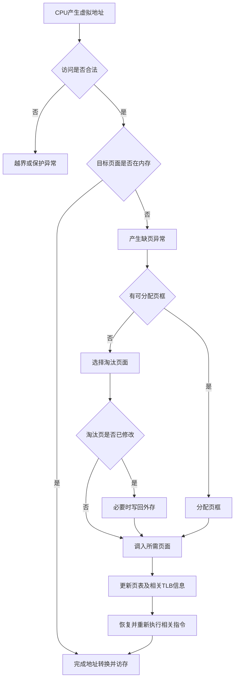

本章归纳30道历年真题与29道模拟题，共59道选择题。题号采用原分类题库的章节内编号。

## 一、本章的核心知识框架

内存管理看起来知识点很多，实际上绝大多数题目都围绕四个问题展开：

**如何分配内存？如何转换地址？内存中没有所需页面怎么办？如何减少访问内存的代价？**

| 核心考点       | 重要程度  | 必须掌握的能力            |
| ---------- | ----- | ------------------ |
| 分页、分段与地址转换 | ★★★★★ | 地址拆分、页框映射、越界判断     |
| 页面置换算法     | ★★★★★ | LRU、FIFO、OPT、CLOCK |
| 多级页表       | ★★★★★ | 页表容量、级数、地址结构       |
| 缺页处理机制     | ★★★★★ | 判断哪些操作必然发生         |
| TLB与有效访存时间 | ★★★★★ | 分情况计算、概率加权         |
| 工作集、驻留集与抖动 | ★★★★☆ | 理解缺页率的本质           |
| 动态分区与内存碎片  | ★★★★☆ | 分配、回收、合并           |
| 内存共享与保护    | ★★★★☆ | 区分逻辑地址和物理地址        |
| 链接、装入与重定位  | ★★★☆☆ | 区分不同阶段的功能          |

这个重要程度是综合题库覆盖情况、知识点之间的联系以及题目变形能力给出的复习建议，并非官方考频统计。

贯穿全章的一条主线是：

**程序使用虚拟地址 → MMU转换地址 → 判断页面是否在内存 → 必要时进行缺页处理 → 得到物理地址 → 访问目标数据。**

## 二、分页与分段：掌握内存分配的本质

### 1. 内部碎片与外部碎片

碎片的分类取决于空间是否已被分配，以及是否要求连续。

- **内部碎片：** 已经分配出去，但是没有被使用的空间。
- **外部碎片：** 尚未分配出去，但是由于空间过于零散，难以满足连续分配的要求。

| 内存管理方式 | 内部碎片 | 外部碎片    | 整个进程是否需要连续存放 |
| ------ | ---- | ------- | ------------ |
| 固定分区   | 有    | 无（教材模型） | 是            |
| 动态分区   | 无    | 有       | 是            |
| 分页     | 有    | 无       | 否            |
| 分段     | 无    | 有       | 否            |
| 段页式    | 有    | 无       | 否            |

例如，假设页面大小为4KB，一个程序需要10KB空间，那么系统需要分配3个页框，共12KB，其中浪费的2KB就是内部碎片。

而假设动态分区系统中存在三个大小为4KB的、不相邻的空闲分区，此时一个需要10KB连续空间的进程依然无法装入。这就是外部碎片造成的问题。

<Callout type="idea" title="碎片的本质">

**本质规律：固定大小的分配单位容易产生内部碎片；可变大小的连续分配容易产生外部碎片。**

</Callout>

#### 代表题：王道卷四，模拟题第1题

下列说法中正确的是：

A. 不同进程对应的页表中可能包含内容相同的页表项。

B. 虚拟地址空间总是大于物理地址空间。

C. 分页管理中页面越小，越有利于消除外部碎片。

D. 分段大小可以不同，因此可以消除外部碎片。

<Accordions>

<Accordion title="答案与考点">

**答案：A。**

本题同时考查共享、虚拟地址与碎片。

</Accordion>

</Accordions>

C选项是典型陷阱。分页已经解决了教材意义上的外部碎片问题，缩小页面主要是为了减少内部碎片。

但是页面也不是越小越好。

| 页面变小      | 页面变大      |
| --------- | --------- |
| 内部碎片通常减少  | 内部碎片通常增加  |
| 页表项数量增加   | 页表项数量减少   |
| 页表空间开销增加  | 页表空间开销减少  |
| 一次调入的数据较少 | 一次调入的数据较多 |

至于缺页率、总体运行效率，则不能简单断言一定增大或者减小，还要考虑程序的访问局部性等因素。

关联练习：模拟题第3、6、9题。

### 2. 动态分区分配：管理的是空闲区，而不是剩余总容量

四种分配算法的区别，仅仅在于如何选择空闲分区。

| 算法      | 选择规则             | 主要特点         |
| ------- | ---------------- | ------------ |
| 首次适应 FF | 按地址顺序选择第一个足够大的分区 | 通常优先使用低地址空间  |
| 邻近适应 NF | 从上次查找结束位置继续循环查找  | 空闲区使用相对均匀    |
| 最佳适应 BF | 选择能够满足请求的最小分区    | 容易留下难以利用的小碎片 |
| 最坏适应 WF | 选择最大的空闲分区        | 容易消耗大块连续空间   |

2019年408真题第5题考查：哪种算法最容易产生内存碎片？

答案是最佳适应算法。这是教材模型下的典型结论，并不意味着它对于任何申请序列都表现最差。

#### 代表题：2017年408真题，章节第4题

当前空闲分区如下：

| 起始地址  | 大小    |
| ----- | ----- |
| 20K   | 40KB  |
| 500K  | 80KB  |
| 1000K | 100KB |
| 200K  | 200KB |

采用最佳适应算法。现在回收起始地址为60K、大小为140KB的分区，求回收后的空闲区数量及空闲链表第一项。

<Steps>

<Step>

### 表示地址区间

```text
回收之前：

[20,60)   [60,200)   [200,400)
  空闲       占用        空闲
  40KB      140KB       200KB

回收之后：

[20,400)
   空闲
   380KB
```

三个相邻区域可以合并。

</Step>

<Step>

### 计算空闲分区数量

原来有4个空闲分区，现在其中2个合并成1个，因此：

$$
4-2+1=3
$$

</Step>

<Step>

### 按最佳适应规则排序

| 起始地址  | 空闲分区大小 |
| ----- | ------ |
| 500K  | 80KB   |
| 1000K | 100KB  |
| 20K   | 380KB  |

所以答案为B：3、500K、80KB。

</Step>

</Steps>

#### 通用解题方法

动态分区题必须分清楚三个不同的操作：选择空闲区、切割空闲区、回收时合并空闲区。

尤其是模拟题第7题，首次适应按照低地址到高地址寻找空闲区，但是从选中空闲区的**高地址端**进行分配。这两条规则并不矛盾。

回收时还可以直接使用以下规律：

| 回收区域两侧的情况 | 空闲分区数量变化 |
| --------- | -------- |
| 两侧都不空闲    | +1       |
| 仅一侧空闲     | 0        |
| 两侧都空闲     | −1       |

注意，合并空闲区与紧凑技术不是同一回事。合并不需要移动进程；紧凑需要搬移已经装入内存的进程，因此要求支持动态重定位。

**补充重要考点：伙伴算法。**

2024年408真题第15题与竞成模拟第3题都涉及伙伴算法。两个空闲块能够合并，必须同时满足大小相同、互为伙伴、均为空闲三个条件。仅仅相邻且大小相同是不够的。

## 三、地址转换：本章最重要的计算能力

### 1. 分页地址转换的统一公式

分页地址转换看起来有十进制、十六进制、二进制等多种题型，但实际上只有一个模型。

设页面大小为 $P$，虚拟地址为 $A$。

虚拟页号：

$$
p=\left\lfloor\frac{A}{P}\right\rfloor
$$

页内偏移：

$$
d=A\bmod P
$$

查页表，得到虚拟页号 $p$ 对应的物理页框号 $f$。

物理地址：

$$
\boxed{PA=fP+d}
$$

整个过程可以表示为：

```text
虚拟地址：[ 虚拟页号 p ][ 页内偏移 d ]
                 ↓             │
               查页表           │
                 ↓             │
物理地址：[ 物理页框 f ][ 页内偏移 d ]
```

<Callout type="idea" title="分页映射">

**分页地址转换的本质：替换页号，保持页内偏移不变。**

</Callout>

#### 代表题：竞成模拟七，模拟题第29题

逻辑地址16位，物理地址18位，页面大小2KB。虚拟页2对应物理页框8，求逻辑地址 `0x1234` 对应的物理地址。

首先：

$$
2\text{KB}=2^{11}\text{B}=\mathrm{800H}
$$

所以页内偏移占11位，虚拟页号占5位。

分解地址：

$$
\mathrm{1234H} =2\times\mathrm{800H}+\mathrm{234H}
$$

得到虚拟页号为2，页内偏移为 `0x234`。

查询页表得到页框号8，因此：

$$
\begin{aligned} PA&=8\times\mathrm{800H}+\mathrm{234H}\\ &=\mathrm{4000H}+\mathrm{234H}\\ &=\boxed{\mathrm{4234H}} \end{aligned}
$$

题库中的勘误选项E是正确的，原来的四个选项均不正确。

**只有页内偏移位数恰好是4的整数倍时，才能直接按照十六进制数字进行截取。**

| 页面大小 | 页内偏移位数 | 是否可以直接截取十六进制数字 |
| ---- | ------ | -------------- |
| 1KB  | 10     | 否              |
| 2KB  | 11     | 否              |
| 4KB  | 12     | 可以截取末尾3位       |
| 8KB  | 13     | 否              |
| 64KB | 16     | 可以截取末尾4位       |

关联练习：模拟题第14题。

### 2. 分段地址转换：先检查合法性，再计算地址

分段不能直接套用分页公式，因为每个段的长度可以不同。

设段号为 $s$，段内偏移为 $d$，对应段长为 $L_s$，段基址为 $B_s$。

合法访问必须满足：

$$
0\leq d<L_s
$$

在地址合法且权限允许、段已在内存的情况下：

$$
\boxed{PA=B_s+d}
$$

#### 代表题：2016年408真题，章节第9题

2号段的段长为300，内存起始地址为4000，权限为读写，当前在内存中。

现在访问段号2、段内地址400。

若未检查边界而直接计算：

$$
4000+400=4400
$$

但是：

$$
400\geq300
$$

因此访问已经越界，根本不能进行后面的物理地址转换。

**正确答案：D，越界异常。**

特别注意，段长为300时，合法的段内地址范围是0～299，偏移300同样越界。

### 3. 分页与分段的本质区别

| 比较项目  | 分页          | 分段            |
| ----- | ----------- | ------------- |
| 划分目的  | 便于物理内存管理    | 符合程序的逻辑结构     |
| 划分单位  | 固定大小的页      | 可变大小的段        |
| 地址空间  | 一维          | 教材意义上的二维      |
| 地址转换  | 页框号乘页大小再加偏移 | 段基址加段内偏移      |
| 共享与保护 | 可以实现        | 更符合逻辑模块的共享与保护 |
| 外部碎片  | 无           | 有             |

分页对程序员通常是透明的；分段按照代码、数据、堆栈等逻辑单位组织程序。

段页式管理则是先分段，再对每一段进行分页，兼顾两种管理方式的优点。

## 四、多级页表：彻底掌握容量、级数与地址拆分

多级页表既可考查选择题，也可与计组存储系统结合考查大题。

### 1. 先理解单级页表为什么不够用

假设32位虚拟地址，按字节编址，页面大小4KB，页表项4B。

虚拟页数为：

$$
\frac{2^{32}}{2^{12}}=2^{20}
$$

如果使用单级页表，完整页表需要：

$$
2^{20}\times4\text{B}=4\text{MB}
$$

每个进程的完整单级页表就可能需要4MB连续内存。

多级页表的思想是把大页表拆成许多小页表，使这些小页表可以离散存放，同时可以不为未使用的虚拟地址区域建立下级页表。

所以2014年408真题第8题的正确结论是：

**多级页表能够减少页表所需的连续内存空间，但不是为了加快地址转换。**

没有TLB时，页表级数越多，通常需要的地址转换访存次数越多。

### 2. 必须掌握的四个公式

设有效虚拟地址长度为 $v$ 位，物理地址长度为 $m$ 位，页面大小为 $2^b$ B，页表项大小为 $E$ B，按字节编址。

| 求解目标     | 计算公式                    |
| -------- | ----------------------- |
| 页内偏移位数   | $b$                 |
| 虚拟页号位数   | $v-b$               |
| 物理页框号位数  | $m-b$               |
| 完整单级页表大小 | $2^{v-b}E\text{ B}$ |

注意：

<Callout type="warn" title="页表项数量与位宽">

**页表项的数量由虚拟地址空间决定，页表项中页框号的位数由物理地址空间决定。**

</Callout>

页表项除了页框号，还可能包含存在位、访问位、修改位、权限位等信息。

### 3. 代表题：2010年408真题，章节第7题

已知采用二级页表，页面大小为 $2^{10}$ B，页表项大小2B，逻辑地址空间共有 $2^{16}$ 个页面。

求页目录至少包含多少个表项。

<Steps>

<Step>

### 计算每张二级页表容量

$$
N=\frac{2^{10}}{2}=2^9
$$

每张二级页表可以管理512个虚拟页面。

</Step>

<Step>

### 计算二级页表数量

$$
\frac{2^{16}}{2^9}=2^7=128
$$

</Step>

<Step>

### 确定一级页表项数

所以页目录至少需要128个表项。

答案为B。

地址结构也可以直接求出：

| 一级页号 | 二级页号 | 页内偏移 |
| ---- | ---- | ---- |
| 7位   | 9位   | 10位  |

虚拟地址共26位。

</Step>

</Steps>

#### 推广：多级页表的最少级数

王道卷八模拟题第27题给出：

有效虚拟地址48位，页面大小8KB，页表项大小8B。

页内偏移：

$$
b=13
$$

虚拟页号：

$$
48-13=35\text{位}
$$

一张页表能容纳：

$$
\frac{2^{13}}{2^3}=2^{10}
$$

即每级页表最多处理10位虚拟页号。因此至少需要：

$$
L=\left\lceil\frac{35}{10}\right\rceil=4
$$

通式为：

$$
\boxed{L=\left\lceil\frac{v-b}{b-e}\right\rceil}
$$

其中页表项大小为 $2^e$ B，假设每张页表占用一个页面，且每级按上述容量组织。

本题最容易错在计算机是64位，但是实际使用的虚拟地址只有48位，所以必须采用48位进行计算。

### 4. 二级页表的实际访问过程

2019年、2021年408真题以及竞成模拟题第16、28题，都考查了这个机制。

```text
页表基址寄存器
       │
       ↓
一级页表的物理基地址
       │  用一级页号索引
       ↓
二级页表所在的物理页框
       │  用二级页号索引
       ↓
目标数据所在的物理页框
       │  加上页内偏移
       ↓
目标数据的物理地址
```

假设一级、二级页号分别为 $p_1,p_2$，页表项大小为 $E$，一级页表基址为 $B_1$。

一级页表项地址为：

$$
B_1+p_1E
$$

若读取该项得到二级页表所在页框号 $f_2$，则二级页表项地址为：

$$
f_2P+p_2E
$$

再从二级页表项得到目标页框号，计算最终物理地址。

关键结构的区别：

| 对象      | 存放的内容              |
| ------- | ------------------ |
| 页表基址寄存器 | 最外层页表的物理基址         |
| 一级页表项   | 下一级页表的物理定位信息       |
| 最后一级页表项 | 目标数据页的页框号及状态等信息    |
| TLB     | 缓存虚拟页到物理页框的映射及相关属性 |

**页表基址寄存器不能只保存一个需要通过当前页表才能转换的虚拟地址，否则查表本身就会陷入循环依赖。**

## 五、虚拟内存与缺页处理：掌握一条完整流程

### 1. 虚拟内存的本质不是无限扩大内存

虚拟内存利用程序的局部性原理，让程序不必全部装入内存即可执行。

其三个经典特征是多次性、对换性和虚拟性。

需要区别三个不同的容量概念。

| 概念           | 决定因素              |
| ------------ | ----------------- |
| 虚拟地址空间的理论上限  | 有效虚拟地址位数          |
| 物理地址空间的理论上限  | 物理地址位数            |
| 实际可支持的虚拟存储容量 | 地址空间限制、内存与可用后备存储等 |

教材模型下，可以将虚拟存储容量上限理解为：

$$
C_{\text{virtual}}\leq \min(2^v,C_{\text{memory}}+C_{\text{backing}})
$$

这里假定按字节编址，不考虑现代操作系统的文件映射、内存超量承诺等复杂实现。

2023年408真题第30题考查的就是这种区别：虚拟地址空间大小并不是由硬盘和内存大小直接决定的。

### 2. 缺页异常的完整处理过程

这是2011、2013、2022年408真题反复考查的内容。



#### 代表题：2022年408真题，章节第13题

进程访问的页不在内存中，产生缺页异常。下列哪项操作不一定发生？

A. 淘汰内存中的页。

B. 建立页号与页框号之间的对应关系。

C. 将缺失页面从外存读入内存。

D. 修改页表项的存在位。

<Accordions>

<Accordion title="缺页处理解析">

答案为A。

只要还有可用页框，就可以直接将页面调入内存，不需要淘汰任何页面。

按照408传统请求分页模型，可以总结为：

| 操作          | 是否必然发生 |
| ----------- | ------ |
| 缺页异常处理      | 是      |
| 为缺失页面确定物理页框 | 是      |
| 更新相应页表项     | 是      |
| 从外存调入缺失页面   | 本题模型下是 |
| 页面置换        | 不一定    |
| 将旧页面写回磁盘    | 不一定    |
| 进程切换        | 不一定    |

现代操作系统还可能通过零填充、写时复制、页面缓存等机制处理缺页，并非所有实际缺页都必须读取磁盘。但做408题时应优先遵循具体题设。

</Accordion>

</Accordions>

### 3. TLB未命中、缺页和越界是三回事

| 情况     | 本质           | 处理方法    |
| ------ | ------------ | ------- |
| TLB未命中 | 快表中没有地址映射    | 继续查询页表  |
| 缺页     | 合法页面当前未驻留    | 由操作系统处理 |
| 越界     | 地址本身不合法      | 产生地址异常  |
| 越权     | 地址合法但访问方式不允许 | 产生保护异常  |

<Callout type="warn" title="三种情况不能混淆">

**TLB中没有，不代表内存中没有；内存中没有，也不代表地址不合法。**

</Callout>

缺页异常属于同步异常，可以在一条指令执行过程中发生，一条指令也可能引起多次缺页异常。

## 六、页面置换算法与淘汰依据

### 1. 五类置换算法的比较

| 算法       | 淘汰依据     | 命中时的处理           |
| -------- | -------- | ---------------- |
| OPT      | 未来最久不再使用 | 后续按未来访问序列判断      |
| FIFO     | 最早进入内存   | 不改变装入顺序          |
| LRU      | 过去最久没有访问 | 更新最近访问顺序         |
| CLOCK    | 访问位与循环指针 | 将访问位置1           |
| 改进型CLOCK | 访问位、修改位  | 更新访问位，写操作还会影响修改位 |

最核心的区别是：

FIFO关注的是**什么时候进入内存**。

LRU关注的是**什么时候最后一次被使用**。

OPT关注的是**下一次什么时候被使用**。

### 2. 代表题：王道卷四，模拟题第24题

系统分配3个页框，页面访问序列为：

$$
5,4,3,2,4,3,1,4,3,2,1,5
$$

求LRU和FIFO的缺页次数。

下面统一用从左到右表示淘汰优先顺序，即最左侧页面是下一次最优先淘汰的页面。

| 访问页    | LRU队列 | LRU缺页 | FIFO队列 | FIFO缺页 |
| ------ | ----- | ----- | ------ | ------ |
| 5      | 5     | √     | 5      | √      |
| 4      | 5,4   | √     | 5,4    | √      |
| 3      | 5,4,3 | √     | 5,4,3  | √      |
| 2      | 4,3,2 | √     | 4,3,2  | √      |
| 4      | 3,2,4 | —     | 4,3,2  | —      |
| 3      | 2,4,3 | —     | 4,3,2  | —      |
| 1      | 4,3,1 | √     | 3,2,1  | √      |
| 4      | 3,1,4 | —     | 2,1,4  | √      |
| 3      | 1,4,3 | —     | 1,4,3  | √      |
| 2      | 4,3,2 | √     | 4,3,2  | √      |
| 1      | 3,2,1 | √     | 3,2,1  | √      |
| 5      | 2,1,5 | √     | 2,1,5  | √      |
| **合计** |       | **8** |        | **10** |

答案为D。

这里最值得研究的是第5、6次访问。

访问4和3时，虽然两种算法都没有发生缺页，但是LRU更新了页面顺序，FIFO没有更新。

因此第7次访问1时，两种算法选择了不同的淘汰对象，并进一步影响后续缺页次数。

<Callout type="idea" title="页面置换的命中处理">

**FIFO命中不动，LRU命中移到队尾。**

</Callout>

### 3. LRU选择题的两种快速解法

#### 技巧一：倒序去重法

2015年408真题第23题：

分配4个页框，已经访问的页面序列为：

$$
2,0,2,9,3,4,2,8,2,4,8,4,5
$$

现在访问7，应淘汰哪一页？

无需从头模拟。

从访问序列末尾向前寻找4个不同的页号：

$$
5\rightarrow4\rightarrow8\rightarrow2
$$

因此当前内存中最近使用的4个页面是5、4、8、2，其中2最久没有使用。

答案为A，即淘汰2号页。

在常规LRU固定页框模型下，这个技巧可以非常快地解决“下一页应该淘汰谁”的题目。

#### 技巧二：重用距离法

假设有 $k$ 个页框。

某页上一次访问之后，如果已经访问了至少 $k$ 个其他不同页面，那么再次访问该页时就会缺页。

例如有3个页框：

```text
A B C B D A
```

两次访问A之间出现了B、C、D三个不同的其他页面，因此第二次访问A必然缺页。

这个方法实际上揭示了LRU的数学本质：LRU始终保留最近访问过的若干个不同页面。

### 4. 缺页次数不等于页面置换次数

2019年408真题第26题专门考查这个区别。

开始时有4个空页框，访问过程中共发生9次缺页，其中前4次只是填充空页框，并没有淘汰页面。

因此置换次数为：

$$
9-4=5
$$

缺页率为：

$$
p=\frac{\text{缺页次数}}{\text{页面访问总次数}}
$$

在初始页框为空、固定分配且无其他页面回收的模型下：

$$
\text{置换次数} =\max(0,\text{缺页次数}-\text{页框数})
$$

如果题目给出了初始驻留页面，则需要根据剩余空页框数量重新判断。

### 5. Belady异常：为什么FIFO会出现？

2014年408真题第21题与竞成模拟题第3题都考查了Belady异常。

Belady异常指的是：增加分配给进程的页框数，缺页次数反而增加。

| 算法   | 是否可能发生Belady异常 |
| ---- | -------------- |
| FIFO | 可能             |
| LRU  | 不会             |
| OPT  | 不会             |

LRU和OPT具有经典的栈性质，而FIFO不具备这种性质。

例如对于LRU，3个页框中保留最近访问的3个不同页面，4个页框中保留最近访问的4个不同页面。因此前者的驻留页面一定是后者的子集：

$$
R_3(t)\subseteq R_4(t)
$$

增加页框后，原来能命中的访问不会因此变成缺页。

这就是LRU不会发生Belady异常的根本原因。

## 七、CLOCK算法：理解访问位与修改位的作用

### 1. 普通CLOCK算法

普通CLOCK是对LRU思想的一种低成本近似。

每个页面有一个访问位 $A$。

CPU访问该页面时，将其访问位置为1。

需要置换时，沿循环指针扫描。如果访问位为0，便淘汰该页；如果访问位为1，将其清零，继续扫描下一个页面。

这相当于给近期访问过的页面一次继续留在内存中的机会。

### 2. 改进型CLOCK算法

除了访问位 $A$，再考虑修改位 $M$。

| 访问位 | 修改位 | 页面情况    | 淘汰优先级 |
| --- | --- | ------- | ----- |
| 0   | 0   | 未访问、未修改 | 1     |
| 0   | 1   | 未访问、已修改 | 2     |
| 1   | 0   | 已访问、未修改 | 3     |
| 1   | 1   | 已访问、已修改 | 4     |

2016年408真题第24题直接考查了这个顺序。

记忆方法：

**优先考虑近期是否访问过，在访问情况相同时，优先淘汰未修改的页面。**

因为淘汰脏页可能需要额外的磁盘写入操作。

如果题目要求逐步模拟，应按照给定的指针位置和清零规则扫描，而不能简单地把页面按初始访问位、修改位进行一次静态排序。

### 3. 代表综合题：2021年408真题，章节第28题

这道题是整个章节非常值得反复复习的一道题，它将分页地址转换、缺页处理和改进型CLOCK结合起来。

页面大小4KB，进程固定分配2个页框。

| 页号 | 页框号 | 存在位 | 访问位 | 修改位 |
| -- | --- | --- | --- | --- |
| 2  | 20H | 0   | 0   | 0   |
| 3  | 60H | 1   | 1   | 0   |
| 4  | 80H | 1   | 1   | 1   |

现在访问虚拟地址 `02A01H`，求转换后的物理地址。

**第一步：拆分地址。**

4KB页面的页内偏移是12位。

因此：

$$
p=\mathrm{02H},\qquad d=\mathrm{A01H}
$$

**第二步：判断是否缺页。**

2号页存在位为0，说明该页面不在内存中。

特别注意，虽然页表项中显示了20H，但是这个页框号不能作为当前有效物理映射使用。

**第三步：选择淘汰页面。**

两个驻留页面分别为：

$$
3:(1,0),\qquad4:(1,1)
$$

按照标准改进型CLOCK规则，淘汰3号页。

因此2号页被调入3号页原来所在的物理页框60H。

**第四步：重新计算物理地址。**

$$
\begin{aligned} PA&=\mathrm{60H}\times 2^{12}+\mathrm{A01H}\\ &=\boxed{\mathrm{60A01H}} \end{aligned}
$$

正确答案为C。

本题的核心是：**页表中的映射不是永远有效的，页面置换之后，虚拟页与物理页框之间的关系会发生变化。**

## 八、TLB和有效访存时间：统一使用概率加权模型

这是非常容易因为错误套用公式而丢分的考点。

### 1. 首先数清楚访存次数

设主存访问时间为 $m$，TLB查询时间为 $t$。

在不发生缺页、不考虑其他缓存的情况下：

| 情况                 | 主存访问次数    |
| ------------------ | --------- |
| TLB命中              | 1         |
| 一级页表、TLB未命中        | 2         |
| 二级页表、TLB未命中        | 3         |
| 三级页表、TLB未命中        | 4         |
| $n$ 级页表、TLB未命中 | $n+1$ |

最后一次访存才是真正读取目标数据，前面的访存都是为了获取地址映射。

<Tabs items={['串行查找', '并行查找']}>

<Tab value="串行查找">

设TLB命中率为 $h$。

对于一级页表：

$$
T_{\text{hit}}=t+m
$$

$$
T_{\text{miss}}=t+2m
$$

平均访存时间为：

$$
\begin{aligned} EAT&=h(t+m)+(1-h)(t+2m)\\ &=t+(2-h)m \end{aligned}
$$

</Tab>

<Tab value="并行查找">

按照题目允许TLB查询与页表查询并行的模型，当 $t\leq m$ 时：

$$
T_{\text{hit}}=t+m
$$

$$
T_{\text{miss}}=2m
$$

两种模型不能混用。

</Tab>

</Tabs>

### 2. 代表题：竞成模拟三，模拟题第15题

TLB查询时间为1ns，主存访问时间为100ns，TLB与内存同时查找。要求平均访存时间不超过110ns，求最低命中率。

命中时：

$$
T_{\text{hit}}=1+100=101\text{ns}
$$

未命中时：

$$
T_{\text{miss}}=100+100=200\text{ns}
$$

于是：

$$
101h+200(1-h)\leq110
$$

解得：

$$
h\geq\frac{90}{99} =\frac{10}{11} \approx90.9\%
$$

答案为D。

统一计算公式：

$$
\boxed{EAT=\sum_i p_iT_i}
$$

先确定不同情况下的完整耗时，再乘以对应概率，最后求和。

### 3. 缺页率与有效访存时间

竞成模拟六第22题是这类题非常典型的代表。

已知主存访问时间为 $1\,\mu s$，处理普通缺页需要1ms，替换脏页时需要10ms。60%的替换页为脏页，要求有效存取时间不超过 $3\,\mu s$。

按照原题解析采用的模型，普通访存需要查询一次页表，再访问一次数据，因此：

$$
T_0=2\,\mu s
$$

假设缺页按题目给出的两类处理开销进行加权：

$$
\begin{aligned} T_f&=0.4\times1+0.6\times10\\ &=6.4\text{ms}\\ &=6400\,\mu s \end{aligned}
$$

因为缺页处理完毕后CPU已经得到目标页框号，所以不用再次查询页表。

设缺页率为 $p$：

$$
(1-p)\times2+p\times6402\leq3
$$

解得：

$$
\boxed{p\leq\frac{1}{6400}}
$$

答案为D。

这里有三个容易出错的地方：正常访问需要两次主存访问；毫秒和微秒相差1000倍；缺页处理完毕后不一定需要重新查页表。题目还默认采用给定的脏页比例计算缺页平均开销；若空闲页框的使用比例另有规定，则应进一步区分概率。

2020年408真题第27题也表明，影响有效访存时间的因素不仅包括缺页率，还包括磁盘读写时间、内存访问时间、缺页处理程序的CPU执行时间。

## 九、局部性原理、工作集和抖动：理解虚拟内存的性能本质

### 1. 局部性原理

时间局部性：最近访问过的内容，近期可能再次访问。

空间局部性：访问某个地址之后，近期可能访问与它相邻的地址。

缓存、TLB、请求分页以及LRU算法，本质上都在不同层次利用局部性。

#### 代表题：王道卷二，模拟题第23题

数组 $A$ 的大小为 $128\times128$，按行优先存储，每页存放128个数组元素。进程有2个页框，其中程序代码占1个页框，数据可使用1个页框。

<Tabs items={['按列遍历', '按行遍历']}>

<Tab value="按列遍历">

```c
for (j = 1; j <= 128; j++)
    for (i = 1; i <= 128; i++)
        A[i][j] = 0;
```

</Tab>

<Tab value="按行遍历">

```c
for (i = 1; i <= 128; i++)
    for (j = 1; j <= 128; j++)
        A[i][j] = 0;
```

</Tab>

</Tabs>

每一行恰好占一个页面。

```text
       第1列 第2列 第3列 …… 第128列

页1      □    □    □   ……    □
页2      □    □    □   ……    □
页3      □    □    □   ……    □
……
页128    □    □    □   ……    □

按列访问：纵向移动，每次跨页。
按行访问：横向移动，连续利用同一页。
```

程序一按列遍历，几乎每一次数组元素访问都需要调入新页面：

$$
F_1=128\times128=16384
$$

程序二按行遍历，每行只有第一次访问发生缺页：

$$
F_2=128
$$

两段代码的时间复杂度都是 $O(n^2)$，缺页次数却相差128倍。

**这就是为什么算法复杂度相同的程序，在真实计算机中的运行效率可能有巨大差异。**

通用方法是先确定数组的存储顺序，再看内层循环变化的是哪个下标，然后把访问元素转换成访问页面的序列，最后根据页框数量和置换算法判断缺页次数。

### 2. 工作集与驻留集

| 概念    | 含义                |
| ----- | ----------------- |
| 工作集   | 最近一段时间内实际访问过的页面集合 |
| 驻留集   | 当前实际驻留在物理内存中的页面集合 |
| 工作集窗口 | 用于统计近期访问行为的范围     |

工作集体现进程近期的内存需求，驻留集体现系统实际提供的内存资源。

#### 2016年408真题，章节第25题

时刻 $t$ 之前最近6次访问为：

$$
6,0,3,2,3,2
$$

工作集窗口大小为6，则工作集为：

$$
W(t,6)=\{6,0,3,2\}
$$

所以工作集大小为4，而不是6。

<Callout type="warn" title="工作集计算">

**先按照窗口长度截取访问记录，再去重。** 不能先去重，再数6个页面。

</Callout>

### 3. 抖动的根本原因

抖动指系统频繁发生缺页，大量时间用于页面换入和换出，真正执行程序的时间却很少。

根本问题是进程获得的物理页框无法满足当前的页面访问需求。

当多个进程的工作集总需求超过能够提供的物理页框数量时：

$$
\sum_i|W_i|>F
$$

其中 $F$ 为可供这些进程使用的物理页框总数，系统就容易出现抖动。

2011年408真题第17题考查了如何缓解抖动。

| 措施           | 是否能够针对根本问题         |
| ------------ | ------------------ |
| 撤销或挂起部分进程    | 能                  |
| 增加可用物理内存     | 能                  |
| 为频繁缺页的进程增加页框 | 在资源允许时能            |
| 单纯增加磁盘交换区容量  | 不能直接解决             |
| 单纯提高进程优先级    | 不能直接解决             |
| 提高磁盘读写速度     | 可减少I/O耗时，但不一定降低缺页率 |

<Callout type="warn" title="抖动与I/O成本">

**缺页率和缺页处理代价必须分开理解。**

</Callout>

2022年408真题第29题和王道模拟第20题涉及页面缓冲机制。在这些题的教材语境中，页面缓冲主要降低换入换出的实际I/O开销，而不是直接改变置换算法意义上的缺页率。

## 十、分配策略与置换策略：区分两个维度

2015年408真题第22题是非常经典的概念题。

首先理解：

固定分配、可变分配回答的是：**进程拥有的页框数量能不能改变？**

局部置换、全局置换回答的是：**发生缺页时，可以淘汰谁的页面？**

| 组合        | 是否可行 |
| --------- | ---- |
| 固定分配＋局部置换 | 可以   |
| 固定分配＋全局置换 | 不可以  |
| 可变分配＋局部置换 | 可以   |
| 可变分配＋全局置换 | 可以   |

固定分配与全局置换不相容，因为全局置换允许从其他进程获取物理页框，这可能改变各进程拥有的页框数量，与固定分配矛盾。

需要注意，可变分配与局部置换并不矛盾。操作系统可以根据缺页情况调整进程的页框数量，但需要置换时仍只选择该进程自身的页面。

## 十一、内存共享、保护与重定位

### 1. 内存共享：逻辑地址私有，物理页面可以共享

2023年408真题第14题与2019年408真题第10题考查的本质完全相同。

```text
进程R的虚拟地址空间       物理内存       进程S的虚拟地址空间

    虚拟页3 ─────────→ 物理页框8 ←───────── 虚拟页5
```

两个进程拥有各自独立的虚拟地址空间，但是可以通过各自的页表映射到同一个物理页框。

因此对于同一个共享页面：

$$
p_1\text{ 与 }p_2\text{ 不一定相等}
$$

$$
f_1=f_2
$$

同理，共享段在不同进程中的段号也不要求相同。

共享并不意味着取消保护。不同进程仍然可以拥有不同的访问权限。

共享段通常只有在所有相关进程不再使用它时，才能回收其占用的物理空间。

### 2. 链接、装入与重定位

2011年408真题第3题、竞成模拟题第4、5、10题都考查了这部分内容。

| 阶段  | 核心任务               |
| --- | ------------------ |
| 编译  | 生成目标模块及模块内地址信息     |
| 链接  | 将多个模块组合，形成统一逻辑地址布局 |
| 装入  | 将程序装入或映射到内存        |
| 重定位 | 将逻辑地址转换为物理地址       |

按照408教材采用的模型：

静态重定位在装入时完成，动态重定位在程序执行时完成。

动态重定位允许程序在不改变其逻辑地址的情况下改变物理存放位置，因此支持更灵活的内存管理，也是传统紧凑技术的重要条件。

内存保护则需要硬件检查地址范围及访问权限。若某分区的基址为 $B$，长度为 $L$，那么合法的物理地址区间为：

$$
B\leq PA<B+L
$$

千万不要把末端地址 $B+L$ 也当成合法地址。

## 十二、本章容易被混淆的知识点汇总

| 容易混淆的概念         | 正确理解                |
| --------------- | ------------------- |
| 分页消除了所有碎片       | 只消除教材意义上的外部碎片       |
| 分段必须连续存放        | 单个段内部连续，不同段可以离散     |
| 页越小越好           | 内部碎片少，但页表开销大        |
| 多级页表加快访存        | 多级页表主要解决页表存储问题      |
| 虚拟地址一定比物理地址长    | 不一定                 |
| 页表项数量由物理内存决定    | 由所管理的虚拟页面数量决定       |
| TLB未命中就是缺页      | 两者不同                |
| 缺页必然引起页面置换      | 有可分配页框时不需要置换        |
| 置换页面必然写回磁盘      | 未修改且有有效后备副本的页面可直接淘汰 |
| 缺页次数等于置换次数      | 初始空页框装入不属于置换        |
| FIFO命中时更新队列     | 不更新                 |
| LRU命中时不用修改顺序    | 必须更新                |
| LRU可能发生Belady异常 | 不会                  |
| 工作集大小等于窗口大小     | 工作集需要去重             |
| 工作集等于驻留集        | 一个体现需求，一个体现实际驻留情况   |
| 增大交换区可以消除抖动     | 不能解决页框不足的问题         |
| 不同进程不能共享页框      | 可以通过页表进行共享          |
| 共享页面的虚拟页号必须相同   | 不一定                 |
| 伙伴算法合并任意相邻等大块   | 必须互为伙伴              |
| 分段只需要基址加偏移      | 必须先判断地址合法性和权限       |

## 十三、最值得反复练习的12道题

以下12道代表题按知识迁移价值选取。

| 来源         | 章节题号 | 核心训练目标        |
| ---------- | ---- | ------------- |
| 2017年408真题 | 4    | 动态分区回收与排序     |
| 2010年408真题 | 7    | 二级页表容量计算      |
| 2016年408真题 | 9    | 分段越界判断        |
| 2021年408真题 | 12   | 多级页表地址转换机制    |
| 2022年408真题 | 13   | 缺页处理流程        |
| 2015年408真题 | 23   | LRU倒序去重法      |
| 2016年408真题 | 25   | 工作集与局部性       |
| 2021年408真题 | 28   | CLOCK与地址转换综合  |
| 王道卷二模拟     | 23   | 数组访问顺序与缺页率    |
| 王道卷四模拟     | 24   | FIFO和LRU的本质区别 |
| 王道卷八模拟     | 27   | 多级页表最少级数      |
| 竞成模拟三      | 15   | TLB有效访存时间     |

资料校勘说明：原题库模拟题第14、19、26、29题存在原始选项与计算结果不符的情况，资料已经增加了勘误选项；2011年真题第3题的解析开头写了“故选D”，但答案栏及后续解释均支持C，应按C理解。另外，模拟题第12、13题虽然被归入本章，实际分别主要考查磁盘记录交叉存放和文件混合索引，因此没有将它们列为本章核心内容。以上总结以原题库实际收录内容为依据，非全部历年试题的覆盖统计。

## 十四、五种解题模型

本章可归纳为五种解题模型。

<Cards>

<Card title="模型一：空间分配模型">

判断分配单位是否固定、是否要求连续，由此推导碎片、分配与回收机制。

</Card>

<Card title="模型二：地址映射模型">

永远区分虚拟页号、物理页框号和页内偏移。理解页表就是映射关系，多级页表就是对映射关系进行分层管理。

</Card>

<Card title="模型三：页面驻留模型">

判断目标页是否在内存、有没有空闲页框、需要淘汰哪一页、旧页面是否需要写回。

</Card>

<Card title="模型四：访问时间模型">

区分TLB命中、TLB未命中、缺页等情况，分别计算时间，再进行概率加权。

</Card>

<Card title="模型五：供需关系模型">

工作集代表需求，物理页框代表供给，局部性和页面置换策略影响资源的利用效率。当供给严重不足时，就容易发生抖动。

</Card>

</Cards>
