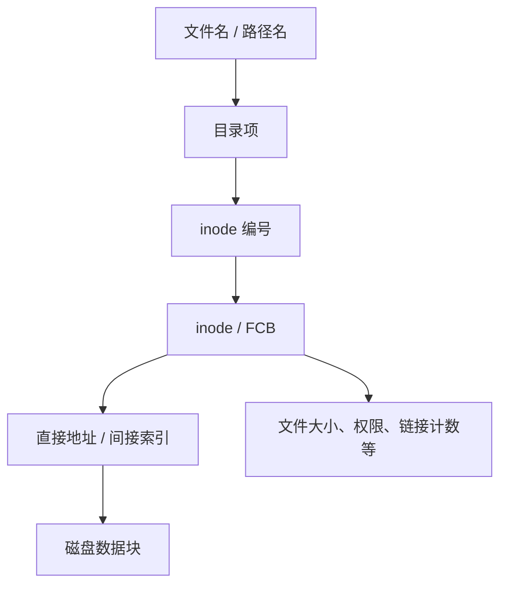
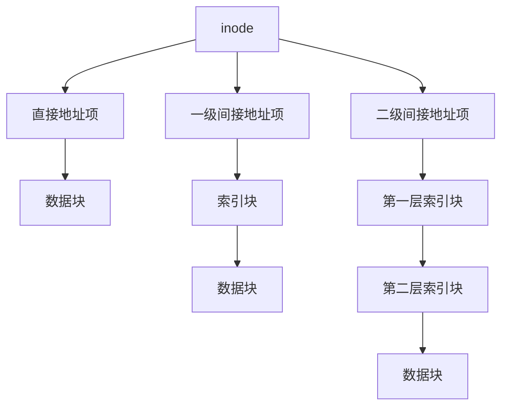
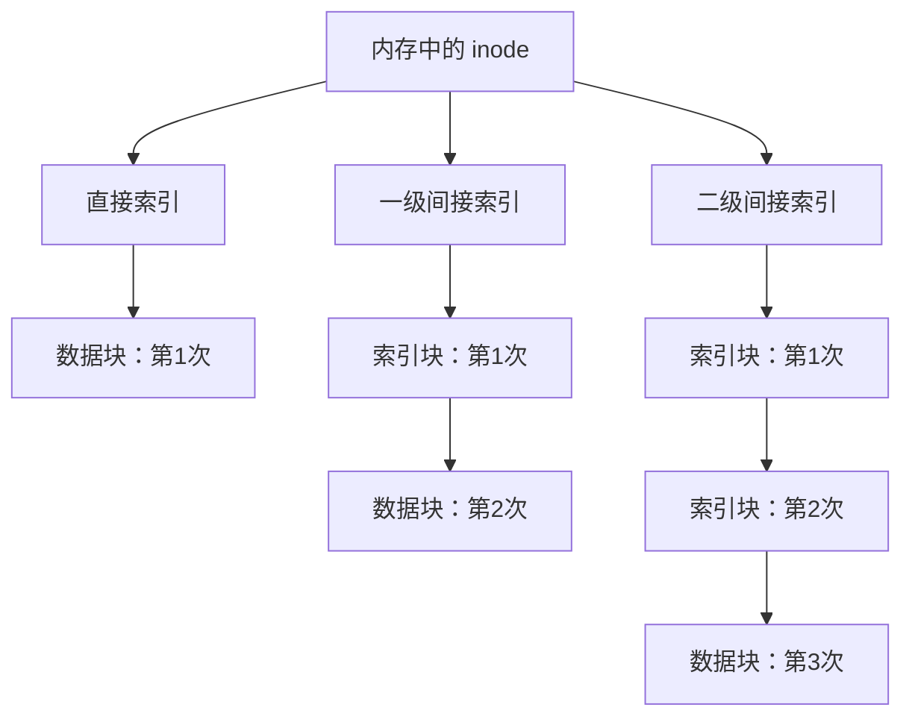
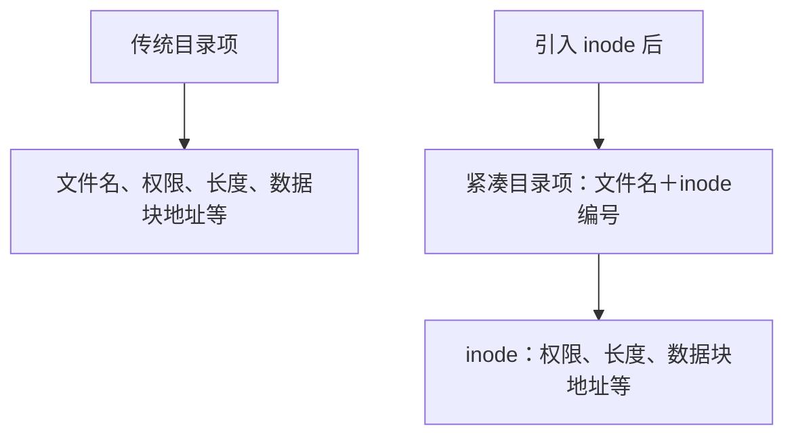
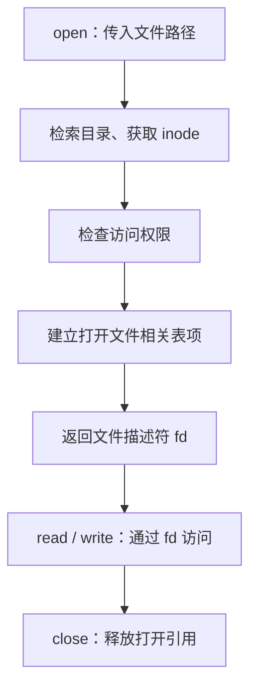
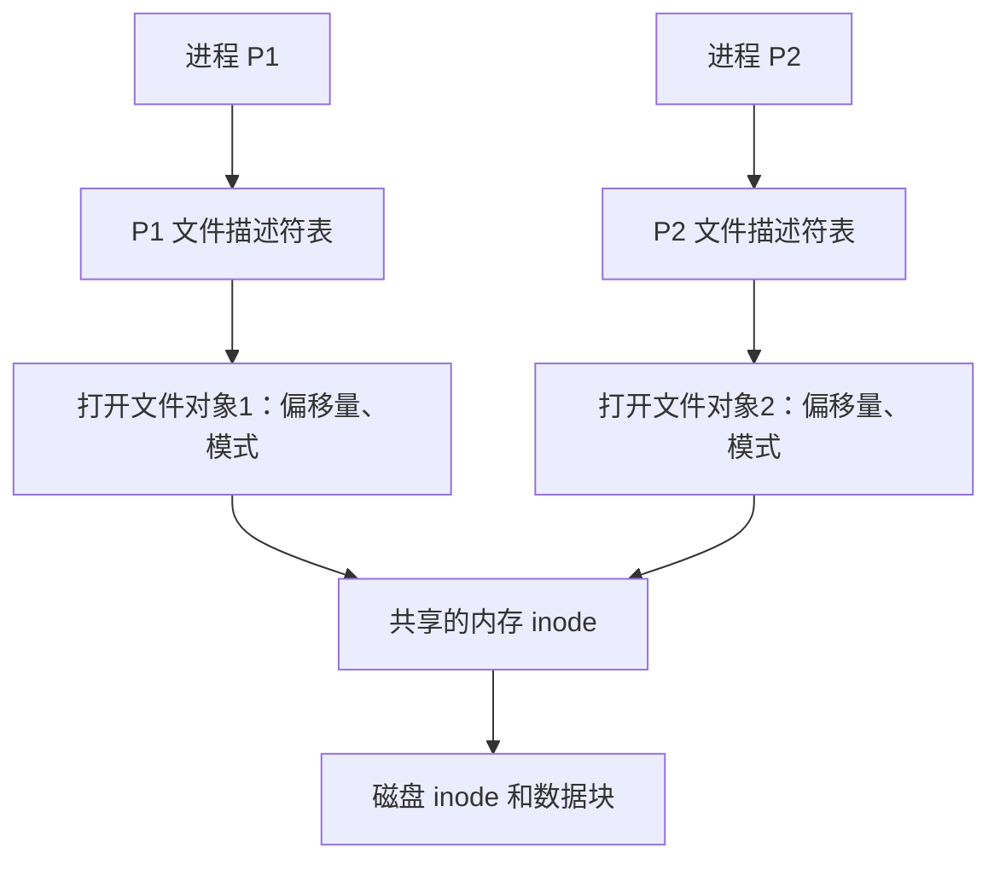
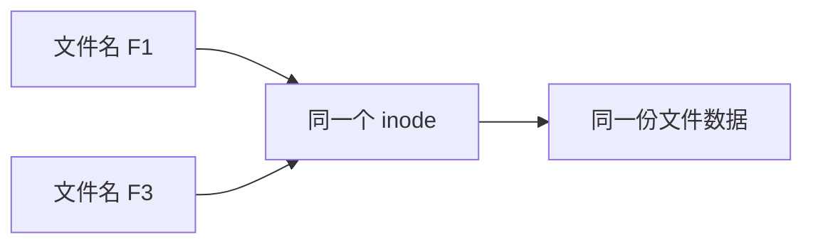
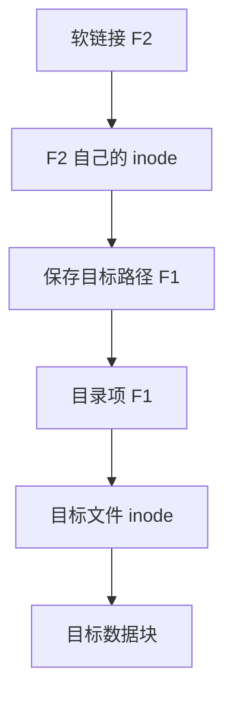
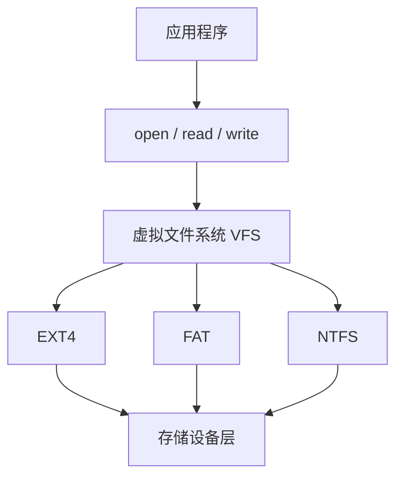

本章归纳26道历年真题与25道模拟题，共51道选择题。题号采用原分类题库的章节内编号。

## 一、全章考点与复习优先级

| 核心考点            | 重要程度  | 必须掌握的能力       |
| --------------- | ----- | ------------- |
| 多级索引与混合索引       | ★★★★★ | 计算最大文件长度、访盘次数 |
| inode、FCB、打开文件表 | ★★★★★ | 区分各数据结构的职责    |
| 文件打开、关闭、删除      | ★★★★★ | 判断哪些数据结构发生变化  |
| 硬链接与软链接         | ★★★★★ | 判断文件共享、计数器变化  |
| 位图与FAT          | ★★★★★ | 容量计算、位置计算     |
| 文件物理分配方式        | ★★★★☆ | 随机访问、扩展、碎片    |
| 目录项与平均访盘次数      | ★★★★☆ | 计算目录查找开销      |
| 文件系统容量限制        | ★★★★☆ | 区分文件数量与文件大小   |
| 文件保护与性能优化       | ★★★☆☆ | 理解权限和缓存的本质    |
| VFS、挂载、格式化      | ★★★☆☆ | 区分文件系统的不同层次   |
| 文件逻辑结构          | ★★★☆☆ | 区分逻辑记录与物理盘块   |

以上优先级是根据题库的重复考查情况、知识迁移能力和题目难度综合划分的，并非对未来考试的命中率预测。

## 二、建立文件系统的核心模型

文件系统主要解决四个问题：

1. 怎样通过文件名找到文件？
2. 怎样知道文件的属性和权限？
3. 怎样找到文件实际存放的数据？
4. 怎样管理磁盘中尚未使用的空间？

对应的完整查找过程如下：



各结构的职责如下。

| 数据结构        | 核心职责            |
| ----------- | --------------- |
| 目录项         | 文件名到inode编号的映射  |
| FCB（文件控制块）  | 管理文件的属性信息       |
| inode（索引节点） | 保存文件元数据和数据块定位信息 |
| 索引块         | 保存其他磁盘块的地址      |
| 数据块         | 保存真正的文件内容       |
| FAT         | 记录簇的分配状态及链接关系   |
| 位图          | 记录每个盘块是否空闲      |
| 打开文件表       | 管理文件被打开后的运行时状态  |

### 必须理解的三个区别

**目录项不是文件本身。** 多个目录项可以指向同一个inode。

**inode不是文件内容。** inode负责描述和定位文件，真正的数据通常存放在数据块中。

**打开文件表不是磁盘目录。** 它是文件被打开之后建立的内存管理结构。

题库中2009年真题第1题、2014年真题第8题、2024年真题第16题，以及王道卷六模拟题，都可以通过这个模型解决。

## 三、核心考点一：多级索引与混合索引

### 3.1 多级索引的本质

索引块本身不保存普通文件数据，而是保存磁盘块地址。



假设磁盘块大小为 $B$，每个地址项占 $a$ 字节，那么一个索引块可以存放的地址项数量为：

$$
k=\left\lfloor\frac{B}{a}\right\rfloor
$$

这个 $k$ 就是每一级索引能够扩展的分支数量。

| inode中的一个地址项   | 能定位的数据块数  |
| -------------- | --------- |
| 直接地址项          | $1$   |
| 一级间接地址项        | $k$   |
| 二级间接地址项        | $k^2$ |
| 三级间接地址项        | $k^3$ |
| $n$ 级间接地址项 | $k^n$ |

假设inode分别包含 $d_0,d_1,d_2,d_3$ 个直接、一级、二级和三级地址项，则其寻址结构支持的最大文件长度为：

$$
\boxed{ L_{\max}=B(d_0+d_1k+d_2k^2+d_3k^3) }
$$

**每增加一级间接索引，就多乘一次分支数**$k$**。**

### 3.2 代表题：2010年408真题（题库第3题）

某文件的inode有7个地址项：

- 4个直接地址项；
- 2个一级间接地址项；
- 1个二级间接地址项；
- 每个地址项占4B；
- 索引块和数据块均为256B。

求单个文件的最大长度。

第一步，计算每个索引块能够存放多少地址：

$$
k=\frac{256}{4}=64
$$

第二步，分别计算各级索引覆盖的容量：

| 地址类型   | 数据块数量           | 数据容量   |
| ------ | --------------- | ------ |
| 直接索引   | $4$         | 1KB    |
| 一级间接索引 | $2\times64$ | 32KB   |
| 二级间接索引 | $64^2$      | 1024KB |
| 合计     | 4228            | 1057KB |

$$
L_{\max}=(4+2\times64+64^2)\times256
$$

$$
\boxed{L_{\max}=1057\text{KB}}
$$

答案：C。

#### 从这道题迁移到其他题目

题库中竞成模拟三第12题、王道卷八第21题，本质上都在考查这个公式。

尤其要注意：

- 10个直接地址项，能够指向10个数据块。
- 10个一级间接地址项，能够指向 $10k$ 个数据块。
- 10个二级间接地址项，能够指向 $10k^2$ 个数据块。

<Callout type="warn" title="索引类型辨析">

**纯三级索引和混合索引不是一回事。**

</Callout>

纯三级索引只有一个三级入口时：

$$
L_{\max}=k^3B
$$

而一个直接入口加上各一级间接入口的混合索引才是：

$$
L_{\max}=(1+k+k^2+k^3)B
$$

### 3.3 代表题：2015年408真题（题库第9题）

本题考查逻辑块号与访盘次数。

某文件inode包含10个直接索引指针、1个一级索引指针、1个二级索引指针。

磁盘块大小1KB，每个指针占4B，inode已经在内存中。

读取文件偏移量1234和307400处所在的数据块，分别需要访问磁盘多少次？

<Steps>

<Step>

### 将偏移量转换为逻辑块号

$$
k=\frac{1024}{4}=256
$$

各级索引的逻辑块范围：

| 索引类型   | 覆盖块数  | 逻辑块号范围    |
| ------ | ----- | --------- |
| 直接索引   | 10    | 0～9       |
| 一级间接索引 | 256   | 10～265    |
| 二级间接索引 | 65536 | 266～65801 |

对于偏移量1234：

$$
\left\lfloor\frac{1234}{1024}\right\rfloor=1
$$

属于直接索引。

对于偏移量307400：

$$
\left\lfloor\frac{307400}{1024}\right\rfloor=300
$$

属于二级间接索引。

</Step>

<Step>

### 沿索引路径计算访盘次数



因此答案是：

$$
\boxed{1\text{次},3\text{次}}
$$

选B。

</Step>

</Steps>

#### 真正需要掌握的规律

在inode已经位于内存、其他相关块均未缓存的条件下：

| 寻址方式 | 访问索引块次数 | 访问数据块次数 | 总访盘次数 |
| ---- | ------- | ------- | ----- |
| 直接索引 | 0       | 1       | 1     |
| 一级间接 | 1       | 1       | 2     |
| 二级间接 | 2       | 1       | 3     |
| 三级间接 | 3       | 1       | 4     |

$$
\boxed{\text{访盘次数}=\text{间接索引级数}+1}
$$

若inode也需要从磁盘读取，则再增加相应的访问开销。

如果题目问的是获得数据块地址，而不是读取数据块，则不计最后一次读取数据的开销。

<Callout type="idea" title="访盘次数的前提">

**最重要的解题习惯：每次看见访盘次数题，都先检查哪些信息已经在内存中，以及题目最终要求访问什么。**

</Callout>

### 3.4 模拟题的重要变式：平均访问次数

来源：竞成模拟一，题库第10题。

10个直接地址项、1个一级间接地址项、1个二级间接地址项，磁盘块2KB，每个地址项4B。

访问三个区域的概率分别是40%、20%、40%。

题目特别规定：间接索引表采用顺序查找。

首先：

$$
k=\frac{2048}{4}=512
$$

最大文件长度：

$$
(10+512+512^2)\times2\text{KB}
$$

$$
=\boxed{20\text{KB}+513\text{MB}}
$$

顺序查找512个等概率表项，平均需要检查：

$$
E_1=\frac{1+512}{2}=256.5
$$

根据题目对间接索引表项的计数口径：

$$
E=0.4\times0+0.2\times256.5 +0.4\times513
$$

$$
\boxed{E=256.5}
$$

答案：B。

区分三种计算目标：

| 题目所问    | 解题方法          |
| ------- | ------------- |
| 最大文件长度  | 计算索引树能覆盖多少数据块 |
| 磁盘访问次数  | 数访问了多少磁盘块     |
| 平均检查表项数 | 根据查找方式计算数学期望  |

正常索引块通常按下标直接访问，不需要顺序扫描。这道模拟题的平均比较公式只适用于它特意给出的条件。

## 四、核心考点二：文件物理结构

### 4.1 不要死记优缺点，要理解寻址方式

| 特征      | 连续分配  | 隐式链接分配 | 显式链接分配（FAT）  | 索引分配      |
| ------- | ----- | ------ | ------------ | --------- |
| 数据块必须连续 | 是     | 否      | 否            | 否         |
| 随机访问    | 支持    | 不支持    | 可在内存FAT中沿链定位 | 支持        |
| 文件扩展    | 困难    | 容易     | 容易           | 容易        |
| 外部碎片    | 有     | 无      | 无            | 无         |
| 额外开销    | 较小    | 链接指针   | FAT表         | 索引块       |
| 主要优势    | 访问速度快 | 组织简单   | 减少沿链访盘       | 兼顾扩展与随机访问 |

<Tabs items={['连续分配', '链接分配', '索引分配']}>

<Tab value="连续分配">

已知起始物理块号 $s$，要访问第 $i$ 个逻辑块：

$$
\text{物理块号}=s+i
$$

不需要额外查表，所以定位非常快。

但文件扩大时，后面的空间可能已经被其他文件占用。

</Tab>

<Tab value="链接分配">

```text
第0块 → 第1块 → 第2块 → 第3块
```

不知道第3块的位置，就必须沿链找到它。

隐式链接的指针存在磁盘块中，沿链查找会引入磁盘访问。

FAT属于显式链接，链接关系集中存放在表中。当FAT驻留内存时，可在内存中沿链查找目标块，而不必逐块读盘，但它并不是索引分配那样直接按逻辑块号定位。

</Tab>

<Tab value="索引分配">

```text
索引表[0] → 第0个数据块
索引表[1] → 第1个数据块
索引表[2] → 第2个数据块
```

索引表允许通过逻辑块号定位目标地址，而且数据块不要求连续。

</Tab>

</Tabs>

### 4.2 三道真题，其实只考一个原理

| 来源          | 题目核心要求         | 正确答案 |
| ----------- | -------------- | ---- |
| 2009年真题第2题  | 适合随机访问且容易扩展    | 索引结构 |
| 2013年真题第6题  | CD-ROM视频快速随机播放 | 连续结构 |
| 2020年真题第13题 | 长度可变且支持随机访问    | 索引分配 |

为什么视频播放选连续结构，而不是索引结构？

因为只读光盘上的视频不需要扩展文件，连续分配最主要的缺点不再重要，此时它直接定位、连续读取的优势更加明显。

**选择物理结构，不是问哪种方式绝对最好，而是问哪种方式最符合当前场景的需求。**

## 五、核心考点三：FCB、inode与目录查找

### 5.1 为什么要引入inode？

传统目录项直接保存完整FCB，其中包含文件名、权限、大小、磁盘位置等大量信息。

但查找文件时，其实首先只需要比较文件名。

如果每个目录项都保存完整FCB，那么一个磁盘块能够存放的文件名就很少，检索目录需要读取更多磁盘块。

引入inode后：

$$
\text{目录项}=\text{文件名}+\text{inode编号}
$$

其余元数据集中存放到inode中。



本质是**将查找时不需要的信息与文件名分离，从而提高目录项的存储密度。**

### 5.2 代表题：王道卷七（模拟题库第4题）

磁盘块512B，FCB占64B，其中文件名占6B，inode编号占2B，目录中有256个目录项。

求引入inode前后，查找到一个文件的FCB平均减少多少次磁盘访问。

<Tabs items={['传统目录项', '引入inode']}>

<Tab value="传统目录项">

每个磁盘块可以存放：

$$
\frac{512}{64}=8\text{项}
$$

整个目录占：

$$
\frac{256}{8}=32\text{块}
$$

等概率顺序查找，平均访问：

$$
E_{\text{旧}}=\frac{1+32}{2}=16.5
$$

</Tab>

<Tab value="引入inode">

每个目录项的大小：

$$
6+2=8\text{B}
$$

每块可以存放：

$$
\frac{512}{8}=64\text{项}
$$

整个目录占4块。

平均读取目录块：

$$
E_{\text{目录}}=\frac{1+4}{2}=2.5
$$

但找到inode编号之后，还要读取对应inode：

$$
E_{\text{新}}=2.5+1=3.5
$$

所以减少：

$$
\boxed{16.5-3.5=13\text{次}}
$$

答案：C。

</Tab>

</Tabs>

#### 通用解题公式

设目录项大小为 $e$，磁盘块大小为 $B$，目录项数量为 $N$。

每块容纳的完整目录项数：

$$
q=\left\lfloor\frac{B}{e}\right\rfloor
$$

所需目录块数：

$$
m=\left\lceil\frac{N}{q}\right\rceil
$$

若所有目录块均存满，目录项等概率被查询，顺序查找的平均访问次数为：

$$
E=\frac{m+1}{2}
$$

如果最后一块未存满，严格来说应按各块中目录项数量进行加权平均。

找到目标目录项后，若还要读取未缓存的inode，则再加一次访盘。

竞成模拟三第6题、竞成模拟四第7题与这道题几乎是同一种计算模型。

## 六、核心考点四：打开文件与关闭文件

### 6.1 为什么需要open系统调用？

假设一个进程需要连续读取某文件1000次。

如果每次读取都根据完整路径逐级查找目录，就会产生大量重复开销。

因此，操作系统通过open提前找到目标文件，建立内存中的管理信息，并返回文件描述符fd。

此后就可以通过fd直接访问已打开的文件。



常见系统调用的区别：

| 系统调用       | 主要参数       | 作用           |
| ---------- | ---------- | ------------ |
| `open()`   | 路径名、打开方式   | 查找并打开文件      |
| `read()`   | fd、缓冲区、字节数 | 读取数据         |
| `write()`  | fd、缓冲区、字节数 | 写入数据         |
| `close()`  | fd         | 关闭文件         |
| `unlink()` | 路径名        | 删除一个文件名对应的链接 |

#### 考试中常见的错误说法

| 说法              | 判断 |
| --------------- | -- |
| open需要按名查找      | 正确 |
| read必须传入文件名     | 错误 |
| open需要将整个文件读入内存 | 错误 |
| 首次打开文件需要获得FCB信息 | 正确 |
| 打开文件会自动修改文件权限   | 错误 |
| read系统调用会进入内核态  | 正确 |
| open一定能够成功      | 错误 |

2012年、2014年、2024年相关真题均可通过上述过程判断。

另外，2012年真题的题库解析把普通read的缓存未命中与缺页中断直接联系起来，这并不严谨。普通阻塞式read可以因为等待磁盘I/O而阻塞，但不一定发生缺页异常。

### 6.2 文件共享时，哪些信息共享，哪些不共享？

独立打开同一文件的引用关系如下。



两个进程分别打开同一个文件时：

| 信息             | 是否共享 |
| -------------- | ---- |
| 文件实际内容         | 共享   |
| 文件大小           | 共享   |
| 文件权限属性         | 共享   |
| inode          | 共享   |
| 进程文件描述符表       | 不共享  |
| 独立open产生的文件偏移量 | 不必相同 |
| 打开方式           | 不必相同 |

例如，P1读取文件的前100字节，并不意味着P2的读写指针也移动100字节。

不过，通过`dup()`或`fork()`共享同一个打开文件对象时，可以共享文件偏移量。关键是看两个fd是否引用同一个打开文件对象，而不是只看是否指向同一个文件。

### 6.3 代表题：2017年408真题（题库第19题）

文件f2是f1的硬链接，两个进程分别打开f1和f2，获得fd1和fd2。

判断：

I. f1和f2的读写指针位置保持相同。

II. f1和f2共享同一个内存inode。

III. fd1和fd2分别指向各自用户打开文件表中的一项。

分析：

I错误。分别打开产生独立的打开状态，不要求偏移量相同。

II正确。硬链接指向同一个文件实体。

III正确。文件描述符属于各自进程。

**答案：B，仅II、III。**

#### 关于2020年真题的一个重要细节

题库2020年真题第12题认为，同一个文件在系统打开文件表中只有一个表项包含其属性。

这采用的是408教材中的两级打开文件表抽象模型。

而现代Unix/Linux通常还区分独立的打开文件对象与共享的inode。一个inode可以对应多个打开文件对象。

因此不能认为“打开文件表永远只有一个表项”。

<Callout type="warn" title="共享与打开状态">

**文件自身的属性可以共享，而每次独立打开产生的运行状态可以不同。**

</Callout>

## 七、核心考点五：硬链接、软链接与两种计数器

### 7.1 硬链接的本质：多个名字，一个文件



硬链接并不是复制文件，也不是通过原文件名找到文件。

两个文件名地位相同，都直接指向同一个inode。

因此，删除其中一个名字，不一定删除真正的文件。

### 7.2 软链接的本质：通过一个路径寻找另一个文件



软链接是一个独立的文件对象，保存目标路径。

| 对比项          | 硬链接       | 软链接      |
| ------------ | --------- | -------- |
| 指向对象         | 同一个inode  | 目标路径     |
| 是否有独立inode   | 否         | 是        |
| 是否增加目标文件链接计数 | 是         | 否        |
| 删除原文件名       | 仍可访问      | 可能失效     |
| 跨文件系统        | 通常不支持     | 支持       |
| 链接目录         | 通常不允许     | 可以       |
| 访问开销         | 直接定位inode | 需要解析目标路径 |

### 7.3 代表题：2009年408真题（题库第17题）

初始文件F1的引用计数为1，依次执行：

建立F1的软链接F2；建立F1的硬链接F3；删除F1。

求F2和F3的引用计数。

| 操作      | 原文件inode链接计数 | F2自身inode链接计数 |
| ------- | ------------ | ------------- |
| 初始状态    | 1            | 不存在           |
| 创建软链接F2 | 1            | 1             |
| 创建硬链接F3 | 2            | 1             |
| 删除F1    | 1            | 1             |

最终结果：

$$
\boxed{F2=1,\quad F3=1}
$$

答案：B。

注意：虽然F2的链接计数仍为1，但它已经可能无法访问原文件了。

因为它保存的是F1路径，而这个名字已被删除。F3却可以正常访问，因为它直接指向原inode。

<Callout type="warn" title="软链接有效性">

**软链接是否有效，与软链接自身的链接计数是否为0，是两个不同的问题。**

</Callout>

### 7.4 最重要的区别：磁盘链接计数和内存打开引用计数

| 计数器    | 统计对象           | 增加时机    | 减少时机    |
| ------ | -------------- | ------- | ------- |
| 链接计数   | 指向inode的硬链接数量  | 创建硬链接   | 删除硬链接   |
| 打开引用计数 | 文件在内存中被使用的相关引用 | 打开或增加引用 | 关闭或释放引用 |

假设：

$$
n=\text{硬链接数量}
$$

$$
r=\text{存活的打开引用数量}
$$

在简化的Unix文件生命周期模型中：

| 状态              | 文件是否可以回收   |
| --------------- | ---------- |
| $n>0,\ r>0$ | 不可以        |
| $n>0,\ r=0$ | 不可以，文件仍存在  |
| $n=0,\ r>0$ | 不可以，仍有进程使用 |
| $n=0,\ r=0$ | 可以回收       |

因此：

$$
\boxed{\text{文件最终回收条件：无硬链接且无存活打开引用}}
$$

### 7.5 代表题：2023年408真题（题库第15题）

文件F仅被进程P打开并访问，当P关闭F时，系统需要执行什么操作？

A. 删除目录项。

B. 释放F的索引节点所占内存空间。

C. 释放F的索引节点所占外存空间。

D. 将磁盘索引节点的链接计数减1。

**答案：B。**

因为关闭文件只是结束当前对文件的使用，并不删除文件。

所以不应删除目录项，不应减少硬链接计数，也不应释放磁盘中的文件实体。

在教材模型中，最后一个使用者关闭文件后释放相应内存inode。实际操作系统也可能暂时保留无活动引用的inode缓存。

#### 本部分最核心的理解

`close`处理的是文件的使用关系。

`unlink`处理的是文件的命名关系。

真正的数据回收取决于文件是否已经不再被命名和使用。

## 八、核心考点六：位图、FAT与磁盘空间管理

### 8.1 位图的本质：一个二进制位对应一个分配单位

位图不是用一个字节管理一个磁盘块，而是用一个bit管理一个磁盘块。

假设磁盘容量为 $S$，分配单位大小为 $B$。

则磁盘块数量为：

$$
N=\frac{S}{B}
$$

位图所占空间为：

$$
\boxed{ L_{\text{bitmap}}= \left\lceil\frac{N}{8}\right\rceil\text{B} }
$$

如果要求位图本身需要占用多少个磁盘块：

$$
\boxed{ M=\left\lceil\frac{L_{\text{bitmap}}}{B}\right\rceil }
$$

这里有两次不同的转换：第一次计算管理对象数量，第二次计算存放管理信息所需的空间。

#### 代表题：2014年408真题（题库第21题）

磁盘分区10GB，簇大小4KB，采用位图法管理空闲空间。

求存放位图需要多少个簇。

总簇数：

$$
N=\frac{10\times2^{30}}{2^{12}} =10\times2^{18}
$$

位图大小：

$$
L_{\text{bitmap}} =\frac{10\times2^{18}}{8} =320\text{KB}
$$

位图占用的簇数：

$$
\frac{320\text{KB}}{4\text{KB}} =\boxed{80}
$$

答案：A。

2023年真题第25题将磁盘簇改成内存页框，原理完全相同。

**只要是用位图管理资源，无论是磁盘块还是内存页框，都是先求资源数量，再按照每个资源占1bit计算。**

### 8.2 位图位置计算

#### 代表题：2015年408真题（题库第22题）

位图存放在磁盘的32～127号块，每块1024B。

要释放409612号盘块，求需要修改的位所在的磁盘块号和块内字节序号。

所有编号从0开始。

第一步，每个存放位图的磁盘块可管理：

$$
1024\times8=8192
$$

个磁盘块。

第二步，计算409612对应位的位置：

$$
409612=50\times8192+12
$$

所以，它位于位图的第50块。

实际磁盘块号：

$$
32+50=\boxed{82}
$$

第三步，块内第12位所在的字节编号：

$$
\left\lfloor\frac{12}{8}\right\rfloor =\boxed{1}
$$

答案：C，即82号盘块、1号字节。

#### 这类题的本质是二维地址转换

设目标磁盘块号为 $x$，位图从磁盘块 $s$ 开始存放，每块 $B$ 字节。

则：

$$
\boxed{ \text{所在磁盘块号} =s+\left\lfloor\frac{x}{8B}\right\rfloor }
$$

$$
\boxed{ \text{块内字节号} =\left\lfloor\frac{x\bmod(8B)}{8}\right\rfloor }
$$

$$
\boxed{\text{字节内位号}=x\bmod8}
$$

这组公式以0开始编号为前提。如果题目从1开始编号，先转换成0基计算。

竞成模拟六第23题的位图行列计算，同样是整除与取余，只是把磁盘块换成了32位一行。

### 8.3 FAT与位图的统一理解

两者都需要为磁盘中的分配单位建立管理信息，但每个表项的大小不同。

| 数据结构 | 每个分配单位对应的信息         |
| ---- | ------------------- |
| 位图   | 1bit                |
| FAT  | 一个FAT表项，通常包含链接或状态信息 |

假设分区容量为 $S$，簇大小为 $C$，FAT表项大小为 $e$ 字节：

$$
\boxed{L_{\text{FAT}}=\frac{S}{C}\times e}
$$

竞成模拟七第14题中，FAT表项共32位，其中2位作为状态位，剩余30位用来表示块号，块大小4KB。

理论最大分区容量：

$$
2^{30}\times2^{12}=2^{42}\text{B}
$$

$$
\boxed{S_{\max}=4\text{TB}}
$$

4GB分区的FAT长度：

$$
\frac{4\text{GB}}{4\text{KB}}\times4\text{B} =\boxed{4\text{MB}}
$$

实际文件系统还可能保留特殊编号和管理区域，考试通常按题目给出的理论模型计算。

### 8.4 空闲空间管理方法的区别

| 方法    | 核心思想           |
| ----- | -------------- |
| 空闲表法  | 记录空闲区域的起始位置和长度 |
| 空闲链表法 | 将空闲块链接起来       |
| 成组链接法 | 对空闲块分组管理       |
| 位图法   | 每个块对应一个二进制位    |
| FAT   | 可通过特殊表项值标记空闲块  |

2019年真题第24题问哪些数据结构可管理空闲磁盘块，答案是位图、空闲磁盘块链、FAT。

inode不是管理全局空闲块的数据结构，它管理的是一个具体文件。

2024年真题第26题问哪种方法的空间开销与当前空闲块数量无关。

答案是位图。

因为无论磁盘是全部空闲还是全部占满，磁盘块总数不变，位图大小也不变。

## 九、核心考点七：区分文件数量、文件大小与分区容量

| 所求对象     | 主要决定因素            |
| -------- | ----------------- |
| 文件数量上限   | inode数量、inode编号位宽 |
| 单个文件最大长度 | 索引结构、块大小、文件长度字段   |
| 磁盘分区容量上限 | 盘块编号位宽、块大小        |
| FAT表大小   | 磁盘块数量、FAT表项大小     |
| 位图大小     | 磁盘块数量             |

### 代表题：2020年408真题（题库第14题）

每个目录项64B，其中4B存放inode编号，60B存放由小写英文字母组成的文件名。

求文件系统可以创建的文件数量上限。

看到60B文件名，很容易想到计算文件名的组合数。

但是这道题问的是**文件实体的数量上限**，而不是文件名的组合数量。

inode编号为：

$$
4\times8=32\text{位}
$$

因此理论编号上限为：

$$
\boxed{2^{32}}
$$

答案：B。

竞成模拟二第11题增加了混合索引的各种参数，但问的仍然是文件数量上限。8B的inode编号直接得到理论上界 $2^{64}$，其余参数都是干扰信息。

真实可创建的文件数量还会受实际inode数量、存储容量等条件约束。

<Callout type="idea" title="先判断计算目标">

**遇到题目给出很多数字时，不要急着代公式。先明确自己正在计算哪一种对象的数量。**

</Callout>

## 十、其他重要考点：理解即可，不必大量刷题

### 10.1 簇、扇区与内部碎片

扇区属于磁盘底层组织单位，簇是文件系统的分配单位。

2017年真题第23题：

文件大小1026B，簇大小1KB，扇区大小512B。

实际分配空间：

$$
\left\lceil\frac{1026}{1024}\right\rceil \times1024 =\boxed{2048\text{B}}
$$

内部碎片：

$$
2048-1026=1022\text{B}
$$

通用公式：

$$
\boxed{ \text{实际分配空间} =\left\lceil\frac{L}{C}\right\rceil C }
$$

簇越大，FAT表通常越小，管理开销也可能更小，但文件尾部的内部碎片可能更大。

这也是王道卷一第22题的核心。

### 10.2 文件权限为什么不是取对数？

2017年真题第10题给出4类用户，每类用户有5种访问权限。

需要多少位表示？

答案：

$$
\boxed{4\times5=20\text{bit}}
$$

而不是：

$$
\left\lceil\log_2(4\times5)\right\rceil
$$

因为每类用户的每一种权限都可以独立地允许或禁止。

| 用户类别  | 读 | 写 | 执行 | 修改 | 完全控制 |
| ----- | - | - | -- | -- | ---- |
| 用户类别1 | 1 | 1 | 1  | 1  | 1    |
| 用户类别2 | 1 | 0 | 1  | 0  | 0    |
| 用户类别3 | 1 | 1 | 0  | 0  | 0    |
| 用户类别4 | 1 | 0 | 0  | 0  | 0    |

总共20个独立的二进制状态。

核心区别是：

$$
\boxed{ N\text{种互斥状态} \longrightarrow \lceil\log_2N\rceil\text{位} }
$$

$$
\boxed{ N\text{个独立的是非状态} \longrightarrow N\text{位} }
$$

这条规律在计算机组成原理和操作系统其他章节也经常用到。

### 10.3 文件系统性能优化

2018年真题第11题考查四种优化措施，全部正确。

| 技术     | 提高性能的本质             |
| ------ | ------------------- |
| 提前读    | 利用空间局部性，提前读取可能访问的数据 |
| 连续分配   | 减少机械磁盘的寻道等开销        |
| 延迟写    | 合并多次写操作，减少实际I/O     |
| 磁盘高速缓存 | 利用局部性，避免重复访盘        |

模拟题中出现的LRU缓存实现，可以通过数据结构知识理解：

哈希表负责快速找到缓存项，双向链表负责维护访问顺序。

良好哈希及负载控制条件下，查询和更新通常可以实现平均 $O(1)$，但最坏情况下哈希查找仍可能达到 $O(n)$。

目录项数量增加，并不意味着哈希查找一定退化为 $O(n)$。

### 10.4 文件系统格式化、VFS与挂载

模拟题中王道卷四第19题、王道卷三第24题、竞成模拟七第25题主要考查这些概念。

| 操作    | 本质                 |
| ----- | ------------------ |
| 物理格式化 | 建立底层存储介质组织         |
| 磁盘分区  | 将磁盘划分为逻辑区域         |
| 逻辑格式化 | 创建文件系统，写入超级块等元数据   |
| 挂载    | 将已有文件系统接入目录树       |
| VFS   | 为不同类型的文件系统提供统一抽象接口 |



VFS并不是替代具体文件系统，而是让上层程序无需关心底层采用哪种文件系统。

#### 挂载的本质

假设某光盘中的文件路径为：

`/usr/bin/vim`

将光盘挂载到：

`/media/disk`

那么该文件在统一目录树中的路径为：

`/media/disk/usr/bin/vim`

如果将另一个文件系统挂载到已有文件的目录上，原目录内容通常会暂时被遮蔽，而不是被删除。

卸载后，原目录内容通常重新可见。

软链接也可能因此改变其路径解析结果。这正是竞成模拟一第18题的考查重点。

### 10.5 文件的逻辑结构

一定要区分用户眼中的文件组织方式与磁盘中的物理存储方式。

| 逻辑结构   | 关注内容       |
| ------ | ---------- |
| 无结构文件  | 字节流        |
| 顺序文件   | 逻辑记录按顺序组织  |
| 索引文件   | 利用索引快速定位记录 |
| 索引顺序文件 | 对记录分组并建立索引 |

竞成模拟二第2题考查索引顺序文件：

**组间有序，组内可以无序。**

这与数据结构第7章的分块查找完全相通。

先根据索引定位目标记录所在组，再在组内顺序查找。

不要把逻辑上的顺序文件等同于磁盘上的连续分配。逻辑记录可以按顺序组织，但它们对应的磁盘数据块仍然可以分散存储。

## 十一、全章最值得记忆的公式

以下公式覆盖题库中的主要计算类型。

| 计算对象                      | 公式                            |
| ------------------------- | ----------------------------- |
| 每个索引块的地址项数                | $k=\lfloor B/a\rfloor$    |
| 混合索引最大容量                  | $B\sum_{i=0}^{n}d_i k^i$ |
| 字节偏移量对应逻辑块号               | $\lfloor x/B\rfloor$      |
| 块内偏移量                     | $x\bmod B$                |
| inode已在内存时的访盘次数（其他相关块未缓存） | 间接索引级数 $+1$               |
| inode编号理论数量               | $2^w$                     |
| FAT表大小                    | $(S/C)e$                  |
| 位图大小（字节）                  | $\lceil N/8\rceil$        |
| 实际分配给文件的空间                | $\lceil L/C\rceil C$      |
| 等量填满的目录块平均顺序查找次数          | $(m+1)/2$                 |
| 独立用户权限位数                  | 用户类别数 × 权限种类数                 |

其中 $B$ 为块大小，$a$ 为地址项大小，$d_i$ 为第 $i$ 级地址项数量，$w$ 为编号位数，$S$ 为分区容量，$C$ 为簇大小，$e$ 为FAT表项字节数，$N$ 为资源数量，$L$ 为文件长度，$m$ 为目录块数。

## 十二、最值得反复做的代表题

优先复习以下代表题。

| 来源       | 题库题号 | 核心价值           |
| -------- | ---- | -------------- |
| 2010年408 | 3    | 混合索引最大文件长度     |
| 2015年408 | 9    | 混合索引与访盘次数      |
| 2017年408 | 19   | 文件共享与读写指针      |
| 2009年408 | 17   | 软链接、硬链接及计数     |
| 2023年408 | 15   | 文件关闭与删除的区别     |
| 2014年408 | 21   | 位图空间计算         |
| 2015年408 | 22   | 位图位置计算         |
| 王道卷七     | 模拟4  | inode与平均目录访问次数 |
| 竞成模拟一    | 模拟10 | 混合索引与数学期望      |
| 竞成模拟七    | 模拟14 | FAT容量计算        |

这10道代表题涵盖了本章主要的计算模型和最重要的概念辨析。

## 十三、考前自测

建议不看前面的内容，独立回答下面的问题。

### 自测1

一个文件的inode有8个直接地址项、1个一级间接地址项、1个二级间接地址项。磁盘块4KB，地址项4B。

它的理论最大文件长度是多少？

如果inode已经在内存中，读取偏移量5MB处的数据需要访盘多少次？

<Accordions>

<Accordion title="参考答案">

$$
k=\frac{4096}{4}=1024
$$

$$
L_{\max}=(8+1024+1024^2)\times4\text{KB}
$$

$$
=\boxed{32\text{KB}+4\text{MB}+4\text{GB}}
$$

5MB对应逻辑块号1280，超过直接索引和一级间接索引合计覆盖的1032块，因此属于二级间接索引。

其他相关块未缓存时，需要访盘3次。

</Accordion>

</Accordions>

### 自测2

文件A有一个硬链接B和一个软链接C。进程P打开A后，依次删除A和B。

此时P能否继续读取文件？C能否正常访问？磁盘空间是否立即释放？

<Accordions>

<Accordion title="参考答案">

P仍可继续读取文件，因为打开引用尚未释放。C不能正常访问已经被删除的A路径。文件数据块不会立即回收，等待最后的打开引用释放后才能回收。

</Accordion>

</Accordions>

### 自测3

一个32GB的磁盘分区采用4KB的簇，使用位图管理空闲簇。

位图有多少字节？占多少个簇？

<Accordions>

<Accordion title="参考答案">

$$
N=\frac{32\text{GB}}{4\text{KB}}=2^{23}
$$

$$
L_{\text{bitmap}}=\frac{2^{23}}8 =2^{20}\text{B}=1\text{MB}
$$

$$
M=\frac{1\text{MB}}{4\text{KB}}=\boxed{256}
$$

</Accordion>

</Accordions>

### 自测4

两个进程分别以只读方式和读写方式打开同一文件。

它们是否共享inode？是否必须使用相同文件描述符？读写指针是否必须相同？

#

<Accordions>

<Accordion title="参考答案">

共享inode；文件描述符不要求相同；分别独立打开时，读写指针也不要求相同。

</Accordion>

</Accordions>

## 十四、文件管理的六条核心规律

**第一，文件名是文件的访问入口，而inode代表文件实体，二者不是同一个东西。**

**第二，文件属性和文件被打开后的运行状态属于不同层次，不能混淆。**

**第三，多级索引每增加一级，就扩大一次寻址范围，同时可能增加一次索引块访问。**

**第四，硬链接指向文件实体，软链接指向文件路径；关闭文件与删除文件是不同的操作。**

**第五，计算空间管理开销时，先求被管理对象的数量，再乘每个对象的管理开销。**

**第六，所有文件系统计算题，都要区分文件数量、数据块数量、字节容量、表项数量和磁盘访问次数。**

分析陌生文件系统时，沿着**文件名、目录项、inode、索引块、数据块**这条链路推导寻址过程、空间开销、共享关系和文件生命周期。
