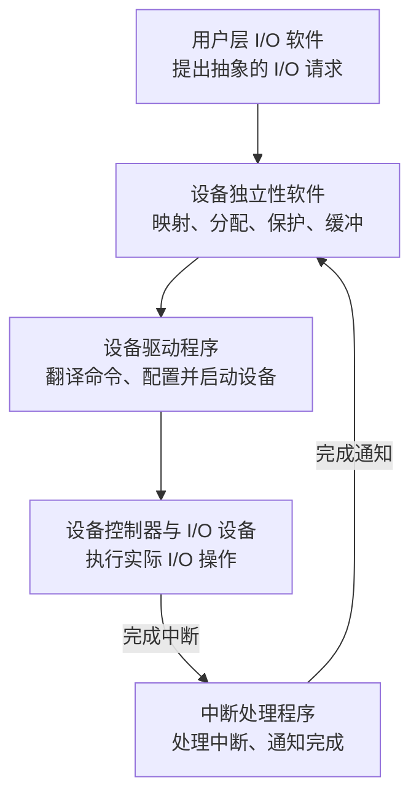
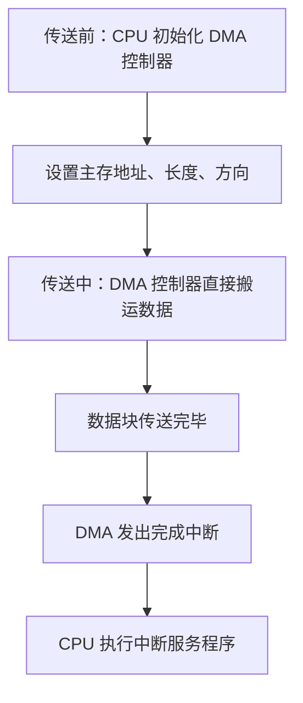
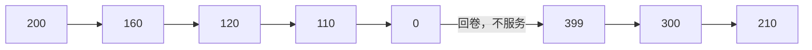
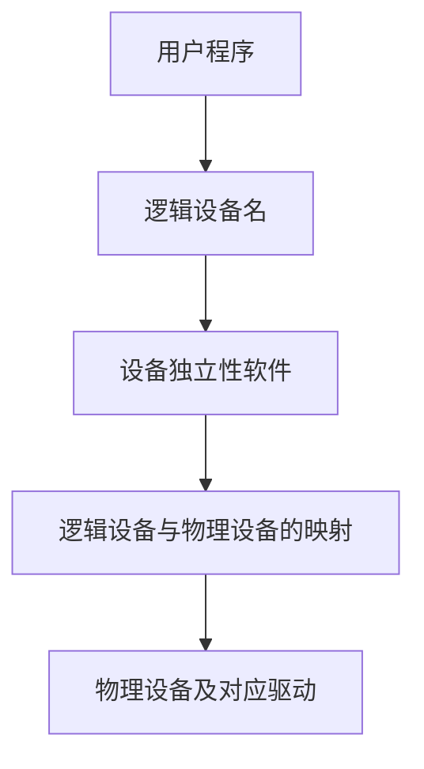
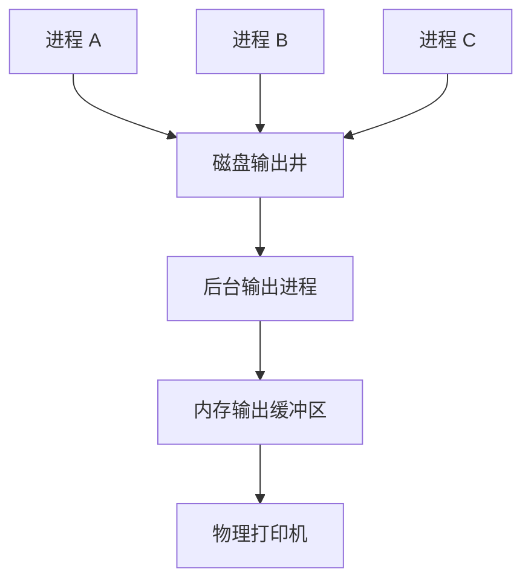
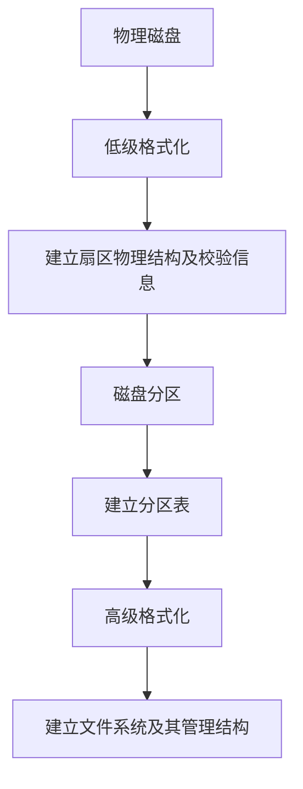
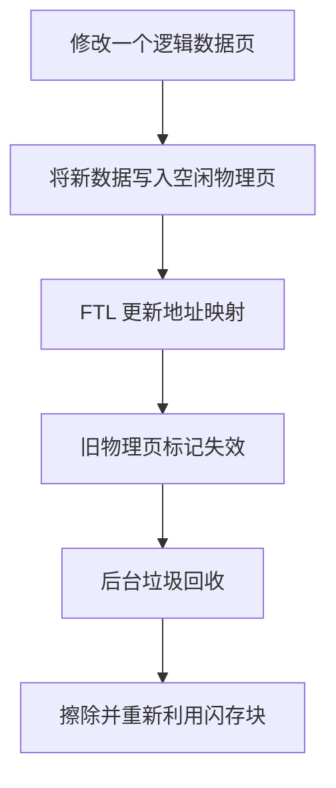

本章归纳22道历年真题与25道模拟题，共47道选择题。重点掌握硬件、CPU、操作系统与用户进程之间的分工，以及并行、缓冲和调度机制。

## 一、本章核心考点与复习优先级

下面是结合这 47 道题划分的复习重点，优先级综合考虑真题重复考查情况、模拟题覆盖情况以及知识迁移价值，并非对未来考试概率的预测。

| 核心考点        | 重要程度  | 必须掌握的能力          |
| ----------- | ----- | ---------------- |
| I/O 软件层次结构  | ★★★★★ | 判断具体操作由哪一层负责     |
| 磁盘调度算法      | ★★★★★ | 判断访问顺序、计算移动距离    |
| 单缓冲与双缓冲     | ★★★★★ | 理解并行关系、计算总时间     |
| I/O 控制方式与中断 | ★★★★★ | 区分硬件、CPU、操作系统的职责 |
| 设备独立性与设备分配  | ★★★★  | 理解逻辑设备与物理设备的映射   |
| SPOOLing 技术 | ★★★★  | 理解独占设备如何实现逻辑共享   |
| 磁盘高速缓存与性能优化 | ★★★★  | 判断优化措施究竟减少了什么开销  |
| 磁盘格式化与物理结构  | ★★★★  | 区分三个初始化阶段、计算物理地址 |
| 固态硬盘 SSD    | ★★★   | 理解页、块、地址转换与磨损均衡  |
| 设备接口、缓冲池    | ★★★   | 掌握基本分类及职责        |

尤其注意：**2011、2012、2013 年真题连续考查了 I/O 软件层次结构；磁盘调度又在 2009、2015、2018、2021、2024 年真题中反复出现。**

## 二、I/O 软件层次结构：判断一项工作究竟由谁完成

### 1. 四层结构的本质

按照教材的 I/O 软件层次，从上到下为用户层软件、设备独立性软件、设备驱动程序、中断处理程序。上图额外画出了硬件及实际请求、完成通知的方向。

| 软件层次       | 核心职责           | 判断关键词             |
| ---------- | -------------- | ----------------- |
| 用户层 I/O 软件 | 提供用户使用的 I/O 接口 | 库函数、提出请求          |
| 设备独立性软件    | 屏蔽设备之间的差异      | 设备分配、逻辑设备名、缓冲、保护  |
| 设备驱动程序     | 将抽象请求转换成具体硬件操作 | 寄存器、初始化、启动设备、物理地址 |
| 中断处理程序     | 响应硬件中断         | 保存现场、处理中断、唤醒进程    |

**最重要的规律：越靠近用户，操作越抽象；越靠近硬件，操作越具体。**

### 2. 代表题：2013 年 408 真题（题库第 4 题）

用户程序发出磁盘 I/O 请求后，计算数据所在磁盘的柱面号、磁头号、扇区号的程序是：

A. 用户程序

B. 系统调用处理程序

C. 设备驱动程序

D. 中断处理程序

**答案：C。**

假设用户希望读取文件中的某段数据。

用户程序只需要知道自己要读取哪个文件，不需要知道磁盘有多少个柱面、磁头和扇区。

操作系统按照文件系统的组织方式找到相应的逻辑磁盘块，再由教材模型中的设备驱动程序将请求转换为具体的设备操作。

因此，只要题目涉及具体硬件的地址、工作参数和控制命令，优先考虑设备驱动程序。

### 3. 从这一道题迁移到其他题目

| 题库中的题目     | 考查内容                 | 判断结果         |
| ---------- | -------------------- | ------------ |
| 2010 年真题   | 最先获得键盘输入信息的程序        | 中断处理程序       |
| 2011 年真题   | 磁盘 I/O 请求的处理顺序       | 系统调用、驱动、中断处理 |
| 2012 年真题   | I/O 软件的四层结构          | 从抽象到具体排列     |
| 2022 年真题   | 驱动是否与 I/O 控制方式无关     | 有关           |
| 王道卷五模拟题 17 | 将数据帧送入网卡并发送          | 需要设备驱动程序     |
| 王道卷八模拟题 18 | 驱动是否具有与控制方式无关的统一处理方式 | 错误           |

**设备驱动程序负责让设备开始工作，中断处理程序负责处理设备发来的通知，设备独立性软件负责提供统一的管理机制。**

注意中断处理程序不只是处理完成通知，也可以响应键盘输入等外部事件。

## 三、I/O 控制方式：抓住谁等待、谁搬运、谁控制

I/O 控制方式是操作系统与计算机组成原理的交叉考点，很容易通过改变描述方式出题。

### 1. 四种 I/O 控制方式的本质区别

| 控制方式       | CPU 是否需要忙等 | 数据搬运主体     | CPU 干预程度 |
| ---------- | ---------- | ---------- | -------- |
| 程序直接控制（轮询） | 是          | CPU        | 很高       |
| 中断驱动       | 无需持续忙等     | CPU        | 较高       |
| DMA        | 无需持续忙等     | DMA 控制器    | 较低       |
| 通道控制       | 无需持续忙等     | I/O 通道控制传输 | 更低       |

这四种方式的发展过程，本质上就是**不断将 I/O 工作从 CPU 转移给专门的硬件**。

轮询变成中断，主要解决 CPU 不断查询设备状态的问题。

中断变成 DMA，主要解决 CPU 亲自搬运数据的问题。

DMA 进一步发展为通道控制，能够由通道执行通道程序，组织更加复杂的 I/O 操作。

### 2. DMA 最重要的是理解三个阶段

2017 年 408 真题第 5 题，就是直接考查这个过程的正确顺序。

从这个流程可以判断竞成模拟六第 3 题中的各种表述：

| 表述                   | 判断        |
| -------------------- | --------- |
| DMA 需要专门的硬件支持        | 正确        |
| DMA 不需要 CPU 搬运每个数据单元 | 正确        |
| DMA 完全不需要 CPU 参与     | 错误        |
| DMA 完全不需要操作系统        | 错误        |
| DMA 整个过程都不需要中断       | 按常规教材模型错误 |
| DMA 可以减少 CPU 干预次数    | 正确        |
| DMA 与 CPU 可能争用总线     | 正确        |

<Callout type="warn" title="DMA 的 CPU 参与">

不要把“不需要 CPU 搬运数据”理解成“不需要 CPU”。

</Callout>

### 3. 中断过程中，哪些工作由硬件完成？

2020 年 408 真题第 6 题考查了这个非常重要的知识点。

| 操作         | 主要完成者（408 教材模型） |
| ---------- | --------------- |
| 响应中断请求     | 硬件              |
| 中断响应时关中断   | 硬件              |
| 保存程序断点     | 硬件              |
| 根据中断类型找到入口 | 硬件              |
| 保存通用寄存器现场  | 操作系统            |
| 保存中断屏蔽字    | 操作系统            |
| 初始化中断向量表   | 操作系统            |
| 提供中断服务     | 操作系统            |

<Callout type="warn" title="中断现场与断点">

**特别注意：保存断点和保存现场不是一回事。**

</Callout>

断点主要指程序将来从哪里继续执行，通常涉及 PC；现场则包括程序执行过程中需要保护的寄存器等状态。

硬件完成进入中断服务程序所必需的基本操作，操作系统负责进一步保护现场和处理具体事件。

### 4. 代表题：竞成模拟三第 2 题——计算中断开销

某计算机主频为 500 MHz，CPI 为 3，鼠标每秒产生 200 次中断，要求 CPU 用于鼠标 I/O 的时间低于总时间的 0.1%，求每次中断最多可以执行多少条指令。

CPU 执行时间的基本公式：

$$
t=\frac{\text{指令数}\times CPI}{f}
$$

设每次中断执行 $N$ 条指令，每秒中断 $r$ 次，那么 CPU 时间占比为：

$$
\boxed{\eta=\frac{r\times N\times CPI}{f}}
$$

代入题目：

$$
\frac{200\times N\times3}{500\times10^6}
<0.001
$$

解得：

$$
N<833.33\cdots
$$

所以：

$$
\boxed{N_{\max}=833}
$$

答案为 C。

**迁移方法：** 已知设备传输速率、每次中断传输的数据量和中断开销时，先求每秒中断次数，再计算 CPU 时间占比。

$$
\text{每秒中断次数}
=\frac{\text{每秒传输的数据量}}
{\text{每次中断传输的数据量}}
$$

## 四、单缓冲与双缓冲：理解资源冲突和流水线

这是本章最重要的计算题型之一。真题第 9、10 题，模拟题第 8、9、11 题，都属于同一个模型。

应根据缓冲区数量和各阶段资源冲突推导公式。

### 1. 建立统一模型

每个数据块都需要经历三个阶段：

设：

| 符号  | 含义                |
| --- | ----------------- |
| $T$ | 外设将数据读入系统缓冲区的时间   |
| $M$ | 系统缓冲区将数据复制到用户区的时间 |
| $C$ | CPU 分析处理数据的时间     |
| $n$ | 数据块数量             |

不论单缓冲还是双缓冲，第一块数据都需要完整经历三个阶段。

$$
t_{\text{首块}}=T+M+C
$$

区别在于后续数据块之间如何并行。

### 2. 单缓冲：只有一个系统缓冲区

因为系统缓冲区只有一个，所以设备正在向缓冲区写入数据时，不能同时把同一个缓冲区的数据复制到用户区。

但是，当数据已经复制到用户区后，CPU 处理用户区中的数据时，系统缓冲区已经空闲。

因此，下一块的读入 $T$ 可以和上一块的处理 $C$ 并行。

稳定处理周期：

$$
\boxed{\Delta_{\text{单}}=\max(T,C)+M}
$$

处理完 $n$ 块数据的总时间：

$$
\boxed{
t_{\text{单}}=T+M+C+
(n-1)[\max(T,C)+M]
}
$$

### 3. 双缓冲：系统中有两个缓冲区

当缓冲区 A 的数据正在复制到用户区时，设备可以同时向缓冲区 B 读入下一块数据。

因此，下一块的输入过程 $T$，可以与上一块的复制、处理过程 $M+C$ 并行。

稳定处理周期：

$$
\boxed{\Delta_{\text{双}}=\max(T,M+C)}
$$

处理完 $n$ 块数据的总时间：

$$
\boxed{
t_{\text{双}}=T+M+C+
(n-1)\max(T,M+C)
}
$$

以上公式采用题库中的标准教材模型，即一个用户工作区，复制和 CPU 分析串行进行。

### 4. 代表题：2011 年 408 真题（题库第 9 题）

一个文件占 10 个磁盘块。读入缓冲区时间为 100 微秒，复制到用户区时间为 50 微秒，CPU 分析时间为 50 微秒。

分别求单缓冲和双缓冲结构下的总时间。

已知：

$$
T=100,\quad M=50,\quad C=50,\quad n=10
$$

第一块完整处理时间：

$$
100+50+50=200
$$

下面是前几个数据块的执行时序。数字为时间，单位为微秒。

<Tabs items={['单缓冲', '双缓冲']}>

<Tab value="单缓冲">

| 数据块   | 读入缓冲区   | 复制到用户区  | CPU 分析  |
| ----- | ------- | ------- | ------- |
| 第 1 块 | 0～100   | 100～150 | 150～200 |
| 第 2 块 | 150～250 | 250～300 | 300～350 |
| 第 3 块 | 300～400 | 400～450 | 450～500 |

稳定周期为：

$$
\max(100,50)+50=150
$$

所以：

$$
t_{\text{单}}=200+9\times150
=\boxed{1550\,\mu\text{s}}
$$

</Tab>

<Tab value="双缓冲">

| 数据块   | 读入缓冲区   | 复制到用户区  | CPU 分析  |
| ----- | ------- | ------- | ------- |
| 第 1 块 | 0～100   | 100～150 | 150～200 |
| 第 2 块 | 100～200 | 200～250 | 250～300 |
| 第 3 块 | 200～300 | 300～350 | 350～400 |

稳定周期为：

$$
\max(100,50+50)=100
$$

所以：

$$
t_{\text{双}}=200+9\times100
=\boxed{1100\,\mu\text{s}}
$$

</Tab>

</Tabs>

答案为 B。

### 5. 一定要区分总时间和平均时间

王道卷六模拟题 9 给出的条件为：

$$
T=80,\quad M=40,\quad C=30
$$

如果问处理第一块数据的时间：

$$
80+40+30=150
$$

如果问连续处理大量数据块时，单缓冲的平均时间：

$$
\max(80,30)+40=\boxed{120}
$$

两个问题的答案完全不同。

| 题目问法             | 应使用的量            |
| ---------------- | ---------------- |
| 处理第一块            | $T+M+C$          |
| 连续处理大量数据的平均时间    | 稳定周期             |
| 处理完 $n$ 块的总时间    | 首块时间加上 $n-1$ 个周期 |
| 处理完 $n$ 块的精确平均时间 | 总时间除以 $n$        |

当复制时间 $M=0$ 时，两种缓冲方式在上述模型下的稳定周期均为 $\max(T,C)$。

<Callout type="warn" title="吞吐率上限">

**缓冲区越多，并不意味着速度可以无限提高。最终吞吐率仍然受最慢环节限制。**

</Callout>

## 五、磁盘调度算法：不要背访问序列，要理解选择规则

磁盘调度的根本目标，是减少机械硬盘磁头的移动开销，同时兼顾公平性。

### 1. 为什么磁盘需要调度？

机械硬盘的一次访问时间主要由三部分组成：

$$
\boxed{
t_{\text{访问}}
=t_{\text{寻道}}+t_{\text{旋转延迟}}
+t_{\text{传输}}
}
$$

| 时间   | 含义            |
| ---- | ------------- |
| 寻道时间 | 磁头移动到目标磁道所需时间 |
| 旋转延迟 | 等待目标扇区转到磁头下方  |
| 传输时间 | 实际读取或写入数据的时间  |

磁盘调度算法主要优化的是**寻道时间**，而不是改变磁盘转速。

如果转速为 $r$ rpm，则平均旋转延迟为半圈时间：

$$
\boxed{t_{\text{平均旋转}}=\frac{30000}{r}\text{ ms}}
$$

例如，7200 rpm 的硬盘平均旋转延迟约为 4.17 ms。

### 2. 六种常见磁盘调度算法

| 算法     | 选择规则             | 关键特点        |
| ------ | ---------------- | ----------- |
| FCFS   | 按请求到达顺序服务        | 公平，寻道开销可能很大 |
| SSTF   | 每次选择距当前位置最近的请求   | 局部最优，可能饥饿   |
| SCAN   | 保持方向，到物理端点后折返服务  | 电梯算法        |
| LOOK   | 保持方向，到该方向最远请求后折返 | 避免无效端点移动    |
| C-SCAN | 只在一个方向服务，到端点后回卷  | 等待时间相对均匀    |
| C-LOOK | 单向服务，在实际请求的两端回卷  | 减少无效移动      |

这里最容易混淆的是 SSTF 和 SCAN。

SSTF 每次都重新寻找最近请求，可以随时改变方向。

SCAN 即使反方向有更近的请求，也不会立即掉头。

### 3. 代表题：竞成模拟三第 23 题

磁盘共有 200 个磁道，编号 0～199。

请求序列：

$$
142,\ 82,\ 197,\ 90,\ 108
$$

当前磁头位于 100，正在向磁道号增大的方向移动。

求 SSTF 和改进的 SCAN（LOOK）分别移动多少磁道。

先排序：

$$
82,\ 90,\ 108,\ 142,\ 197
$$

<Tabs items={['SSTF', 'LOOK']}>

<Tab value="SSTF">

每次从当前磁头位置重新找最近请求。

| 当前位置 | 下一请求 | 移动距离 |
| ---- | ---- | ---- |
| 100  | 108  | 8    |
| 108  | 90   | 18   |
| 90   | 82   | 8    |
| 82   | 142  | 60   |
| 142  | 197  | 55   |

因此：

$$
D_{\text{SSTF}}=8+18+8+60+55
=\boxed{149}
$$

注意走到 108 后，应当向左走到 90，而不是继续向右走到 142。

</Tab>

<Tab value="LOOK">

保持初始移动方向，先向右服务，再向左服务。

由于 197 是当前方向的最远实际请求，所以在 197 直接掉头。

$$
\begin{aligned}
D_{\text{LOOK}}
&=(197-100)+(197-82)\\
&=97+115\\
&=\boxed{212}
\end{aligned}
$$

</Tab>

</Tabs>

正确答案为 A。

如果采用标准 SCAN，需要先到达物理端点 199，那么：

$$
D_{\text{SCAN}}
=(199-100)+(199-82)
=\boxed{216}
$$

这正是模拟题中设置的重要干扰项。

### 4. 代表题：2024 年 408 真题（题库第 22 题）

磁盘有 400 个磁道，编号 0～399，磁头当前位于 200，向磁道号减小的方向移动。

待处理请求为：

$$
300,\ 120,\ 110,\ 0,\ 160,\ 210,\ 399
$$

采用 C-SCAN 算法，求磁头移动的距离。

<Callout type="idea" title="C-SCAN 回卷距离">

**解题关键：回卷时不服务请求，但回卷距离仍要计算。**

</Callout>

将全部移动过程分为三段：

$$
200\rightarrow0
$$

$$
0\rightarrow399
$$

$$
399\rightarrow210
$$

所以：

$$
\begin{aligned}
D&=(200-0)+(399-0)+(399-210)\\
&=200+399+189\\
&=\boxed{788}
\end{aligned}
$$

答案为 C。

### 5. 磁盘调度题的通用解题步骤

无论题目给出哪种算法，都按照以下思路处理：先排序并标出当前磁头位置，再确定服务方向，写出完整路径，最后将相邻位置的距离相加。

$$
\boxed{
D=\sum_{i=1}^{n}|p_i-p_{i-1}|
}
$$

对于沿一个方向连续移动的路径，不需要逐个请求计算，直接用起点和终点相减即可。

必须防止以下错误：

| 易错点                 | 正确处理           |
| ------------------- | -------------- |
| SSTF 按初始距离一次性排序     | 每次移动后重新找最近请求   |
| SCAN 遇到反方向的近请求就掉头   | 必须遵守移动方向       |
| LOOK 必须到物理端点        | 只到最远实际请求       |
| C-SCAN 回卷不服务，所以不算距离 | 回卷也有物理移动       |
| 当前磁道正好有请求           | 可以立即服务，移动距离为 0 |

另外，2018 年真题第 19 题考查磁臂黏着，题库答案为 FCFS。应掌握 FCFS 的公平性，以及 SSTF 在动态请求下可能造成饥饿的原因。标准 SCAN、C-SCAN 在每次经过磁道只进行有限服务的模型下可以避免通常意义上的饥饿，不要把等待时间较长直接等同于无限期饥饿。

## 六、设备独立性与设备分配：理解抽象和映射

### 1. 设备独立性究竟是谁独立于谁？

这是 2009 年、2020 年真题，以及王道卷七模拟题 5 共同考查的知识。

**设备独立性是指用户程序独立于具体使用的物理设备。**

例如，一个程序需要使用打印机，只需要提出打印请求，不需要直接控制某个型号打印机的寄存器。

逻辑设备名与物理设备之间通过逻辑设备表（LUT）等机制建立映射。

因此，更换兼容的物理设备后，可以修改映射关系、替换设备驱动程序，而无需修改应用程序。

| 常见说法             | 判断 |
| ---------------- | -- |
| 用户程序通过逻辑设备名访问设备  | 正确 |
| 更换物理设备必须修改应用程序   | 错误 |
| 设备驱动程序独立于具体硬件    | 错误 |
| 设备独立性有利于设备分配的灵活性 | 正确 |
| 设备独立性等于设备能独立工作   | 错误 |

### 2. 设备分配的四张表

竞成模拟二第 12 题考查设备分配过程中访问数据结构的先后顺序。

| 数据结构        | 作用        |
| ----------- | --------- |
| SDT：系统设备表   | 管理整个系统的设备 |
| DCT：设备控制表   | 管理具体设备的状态 |
| COCT：控制器控制表 | 管理设备控制器   |
| CHCT：通道控制表  | 管理 I/O 通道 |

访问顺序为：

$$
\boxed{
SDT\rightarrow DCT\rightarrow COCT\rightarrow CHCT
}
$$

为什么是这个顺序？

因为必须先从系统的全部设备中找到所需设备，再检查具体设备及其连接的控制器、通道是否可用。

2023 年真题第 7 题进一步考查设备分配所需要考虑的因素：设备类型、访问权限、占用状态、逻辑与物理设备的映射关系，四项都需要考虑。

## 七、SPOOLing 技术：为什么一台打印机可以被多个进程共享？

### 1. 从真实问题理解假脱机技术

假设系统只有一台打印机，而三个进程同时需要打印。

如果没有 SPOOLing，进程 A 使用打印机时，B 和 C 就不能直接使用这台打印机。

由于打印机工作速度很慢，其他进程可能需要长时间等待。

SPOOLing 的解决方法是：让进程先把需要打印的数据保存在磁盘上，而不是直接占用打印机。

这样，多个进程都可以提交打印任务，后台输出进程依次完成实际打印。

从用户的角度看，好像每个进程都有自己的打印设备。

实际上只有一台打印机，物理打印操作仍然是依次进行的。

<Callout type="info" title="假脱机的核心">

**SPOOLing 的本质：利用外存空间和后台进程，将物理独占设备虚拟为逻辑共享设备。**

</Callout>

### 2. 代表题：2016 年 408 真题（题库第 12 题）

下列关于 SPOOLing 技术的叙述，错误的是：

A. 需要外存的支持

B. 需要多道程序设计技术的支持

C. 可以让多个作业共享一台独占设备

D. 由用户作业控制设备与输入/输出井之间的数据传送

答案为 D。

根据上面的数据流可以直接判断：用户作业只负责提出请求，具体设备与输入井、输出井之间的数据传送由 SPOOLing 系统负责。

### 3. SPOOLing 必须掌握的组成

| 组成    | 所处位置或作用 |
| ----- | ------- |
| 输入井   | 磁盘      |
| 输出井   | 磁盘      |
| 输入缓冲区 | 内存      |
| 输出缓冲区 | 内存      |
| 输入进程  | 控制输入过程  |
| 输出进程  | 控制输出过程  |

王道卷三模拟题 13 的干扰项是认为磁盘输出井与打印机之间存在直接连接的传输通道。

这显然不符合教材模型，数据仍然需要经过相应的缓冲区和设备驱动。

### 4. 区分几个容易混淆的概念

| 概念       | 本质                |
| -------- | ----------------- |
| 设备独立性    | 用户程序不依赖具体物理设备     |
| 虚拟设备     | 一个物理设备表现为多个逻辑设备   |
| SPOOLing | 实现独占设备逻辑共享的一种技术   |
| DMA      | 由硬件承担设备与主存之间的数据搬运 |
| 缓冲技术     | 缓和数据生产和消费之间的速度差异  |

它们解决的并不是同一种问题。

## 八、磁盘高速缓存与性能优化：判断到底减少了什么开销

2012 年、2015 年真题，以及王道卷二、卷三的模拟题都涉及这个知识模块。

### 1. 高速缓存与缓冲区的区别

| 对比   | 高速缓存 Cache   | 缓冲区 Buffer     |
| ---- | ------------ | -------------- |
| 主要目的 | 减少对慢速设备的重复访问 | 缓和生产者与消费者速度不匹配 |
| 主要机制 | 利用数据局部性      | 暂存数据、允许并行      |
| 关注问题 | 命中率、替换、写回    | 容量、传输、同步       |

同一块内存区域可以同时发挥缓存和缓冲的作用，因此这两个概念并非完全互斥。

磁盘高速缓存设置在主存中，保存的是磁盘数据块的副本。

王道卷二模拟题 6 故意将这句话反过来，说在磁盘中设置缓冲区保存内存块的副本，因此错误。

### 2. 提高磁盘 I/O 性能的各种方法

| 技术        | 主要减少的开销             |
| --------- | ------------------- |
| 磁盘高速缓存    | 实际磁盘访问次数            |
| 提前读       | 后续读请求的等待和磁盘启动开销     |
| 延迟写       | 写入等待、重复写入和实际 I/O 次数 |
| 磁盘调度      | 磁头移动距离              |
| 优化文件物理块分布 | 寻道开销                |
| 多磁盘条带化    | 通过并行提高吞吐率           |
| 单纯进行磁盘分区  | 不必然改善 I/O 性能        |

2012 年 408 真题第 16 题问哪项不能改善磁盘 I/O 性能，答案是设置多个磁盘分区。

因为划分逻辑分区并没有增加物理磁盘数量，不能因此获得多个磁盘的并行能力。

### 3. 提前读和延迟写的本质

提前读是预测未来可能需要哪些数据，提前将其装入内存，因此特别依赖访问的规律性。

延迟写是先修改内存中的数据，之后再选择合适的时机写回磁盘，并不要求写入地址连续。

所以王道卷三模拟题 7 中，“随机写入不存在延迟写”是错误的。

掌握两句话即可：

**提前读依靠预测，延迟写依靠暂存和合并。**

延迟写也带来了风险：尚未写回磁盘的数据，可能在突然断电时丢失。

## 九、磁盘管理：低级格式化、分区、高级格式化

这三个概念经常被放在一起设置干扰项。

| 阶段    | 负责的工作                   |
| ----- | ----------------------- |
| 低级格式化 | 扇区划分、物理记录结构、校验码         |
| 磁盘分区  | 划分逻辑区域、建立分区表            |
| 高级格式化 | 建立根目录、空闲空间管理结构、inode 表等 |

2017 年真题第 18 题问逻辑格式化完成什么工作，答案是建立文件系统根目录、初始化空闲磁盘块管理结构。

2022 年真题第 21 题进一步把操作系统初始化混入选项。

| 数据结构      | 建立或初始化时机   |
| --------- | ---------- |
| 中断向量表     | 操作系统初始化    |
| 文件系统根目录   | 逻辑格式化      |
| 磁盘分区表     | 磁盘分区       |
| 文件系统索引结点表 | 对应文件系统的初始化 |

判断各表属于 CPU 中断管理、磁盘管理还是文件系统管理。

### 磁盘物理地址计算

王道卷四模拟题 19 给出每柱面 12 条磁道、每磁道 16 个扇区，求从 0 开始编号的第 5687 号记录的位置。

其本质就是多维地址与线性地址之间的转换，和数据结构中的多维数组寻址非常相似。

设每柱面有 $H$ 条磁道，每磁道有 $S$ 个扇区，则从零开始编号的第 $k$ 个扇区满足：

$$
\boxed{
k=cHS+hS+s
}
$$

其中 $c$ 为柱面号，$h$ 为磁头号，$s$ 为扇区号。

先计算每柱面扇区数：

$$
12\times16=192
$$

再依次整除、取余：

$$
5687=29\times192+119
$$

$$
119=7\times16+7
$$

所以地址为：

$$
\boxed{(29,7,7)}
$$

做这种题一定要先检查各级编号是从 0 开始还是从 1 开始。

## 十、固态硬盘 SSD：从闪存的物理限制理解所有知识点

题库中王道卷七第 24 题和竞成模拟七第 25 题专门考查 SSD。

SSD 不必像机械硬盘一样移动磁头，而是使用闪存芯片保存数据。

最重要的物理特性是：

$$
\boxed{\text{按页读写，按块擦除}}
$$

这里的块指闪存擦除块，不要直接等同于文件系统的磁盘块。

### 1. 为什么 SSD 不能像内存一样直接覆盖数据？

假设一个闪存块包含多个页，现在只需要修改其中某一个已经写过的页。

NAND Flash 通常不能直接原地覆盖该页中的旧数据。如果每次修改一页都直接擦除整个块，其他有效页也会受到影响，代价很大。

因此，SSD 通常将新数据写入空闲物理页，将旧页标记为失效，再更新逻辑地址与物理地址的映射。

### 2. SSD 的核心概念

| 概念        | 作用                |
| --------- | ----------------- |
| FTL 闪存翻译层 | 将逻辑地址映射到闪存物理地址    |
| 垃圾回收      | 回收失效页所占的空间        |
| 磨损均衡      | 避免少数闪存块被过度擦写      |
| 写放大       | 实际闪存写入量大于主机请求的写入量 |

磨损均衡的目的不是优先使用已经磨损严重的块，而是让各个块承担相对均衡的擦写次数。

### 3. SSD 与机械硬盘的比较

| 特性            | HDD   | SSD           |
| ------------- | ----- | ------------- |
| 存储介质          | 磁性介质  | NAND Flash 为主 |
| 机械寻道          | 存在    | 不存在           |
| 旋转延迟          | 存在    | 不存在           |
| 随机访问性能        | 较低    | 通常较高          |
| 擦写寿命管理        | 非主要机制 | 需要磨损均衡        |
| 抗震能力          | 相对较弱  | 相对较强          |
| SCAN 等寻道调度的价值 | 较大    | 显著降低          |

<Callout type="warn" title="SSD 的调度目标">

**不要认为 SSD 完全不需要 I/O 调度。** SSD 仍然可能需要对请求进行合并、排队、并行控制和公平性管理，只是不再需要为了减少机械寻道距离而调度。

</Callout>

## 十一、其他知识点：理解即可，不需要投入过多时间

下面这些知识点在模拟题中有所覆盖，但没有必要分别进行大量刷题。

| 知识点     | 必须记住的结论                  |
| ------- | ------------------------ |
| 字符设备    | 通常以字符流形式顺序访问             |
| 块设备     | 按块访问，支持随机访问              |
| HDD、SSD | 都属于块设备                   |
| 缓冲池     | 空缓冲队列、输入队列、输出队列          |
| 循环缓冲    | 一种独立的缓冲组织方式              |
| 设备驱动程序  | 与设备硬件特性和控制方式密切相关         |
| 驱动程序可重入 | 可以被多个执行流安全调用，不等于不能修改任何数据 |
| 位示图     | 每个磁盘块用一个二进制位表示           |
| 成组链接法   | 以组为单位管理空闲磁盘块             |

例如，4096 个磁盘块需要的位示图大小为：

$$
\frac{4096}{8}=\boxed{512\text{ B}}
$$

位示图的大小取决于磁盘块的数量，而不是每个磁盘块的大小。

## 十二、题库勘误与适用条件

下列表述存在教材版本差异或适用条件限制。

| 题目             | 需要注意的问题                                          |
| -------------- | ------------------------------------------------ |
| 2018 年真题第 19 题 | 磁臂黏着与普通等待时间较长不能完全等同                              |
| 竞成模拟五第 15 题    | 题库将 SPOOLing 归为设备独立性软件，不同教材也可能将假脱机服务归为用户层 I/O 软件 |
| 王道卷一第 16 题     | 驱动程序并非必须使用汇编语言编写，也并非都固化于 ROM                     |
| 王道卷三第 13 题     | 实际系统中的打印后台服务不一定运行在内核态                            |
| 王道卷三第 7 题      | 随机读取并非绝对不能预读                                     |
| 竞成模拟七第 25 题    | SSD 更抗震，不等于完全不受物理冲击影响                            |

应结合原题的考试语境理解，不宜将争议表述视为普遍结论。

## 十三、最值得反复做的代表性题目

优先复习以下8道代表题。

| 来源         | 文件内题号  | 核心训练目标             |
| ---------- | ------ | ------------------ |
| 2013 年 408 | 真题 4   | I/O 软件分层与驱动职责      |
| 2020 年 408 | 真题 6   | 硬件与操作系统的中断分工       |
| 2011 年 408 | 真题 9   | 单缓冲与双缓冲的完整计算       |
| 2016 年 408 | 真题 12  | SPOOLing 的工作机制     |
| 2017 年 408 | 真题 18  | 磁盘初始化的三个阶段         |
| 2024 年 408 | 真题 22  | C-SCAN 及回卷距离       |
| 竞成模拟三      | 模拟题 2  | CPU 中断开销计算         |
| 竞成模拟三      | 模拟题 23 | SSTF、SCAN、LOOK 的区别 |

这 8 道题覆盖了本章最具有迁移价值的解题模型。

## 十四、考前自测

尝试不看上面的内容，独立回答下面的问题。

<Accordions>

<Accordion title="为什么中断驱动仍然需要 CPU 搬运数据？">

中断主要解决忙等问题

</Accordion>

<Accordion title="为什么 DMA 仍然需要 CPU？">

初始化和完成处理

</Accordion>

<Accordion title="为什么单缓冲的复制时间不能直接并行？">

唯一系统缓冲区存在占用冲突

</Accordion>

<Accordion title="为什么双缓冲不能无限提升速度？">

受最慢环节限制

</Accordion>

<Accordion title="为什么 SSTF 可能产生饥饿？">

局部最优不保证全局公平

</Accordion>

<Accordion title="为什么 C-SCAN 回卷必须计算距离？">

磁头发生了实际物理移动

</Accordion>

<Accordion title="为什么更换设备不必修改用户程序？">

逻辑设备与物理设备之间存在映射

</Accordion>

<Accordion title="为什么 SPOOLing 需要外存？">

保存等待处理的输入和输出任务

</Accordion>

<Accordion title="为什么磁盘分区不能必然提升性能？">

没有增加物理并行能力

</Accordion>

<Accordion title="为什么 SSD 需要 FTL？">

闪存不能像 RAM 一样直接覆盖数据

</Accordion>

</Accordions>

## 最终总结

本章最核心的知识可以归结为五种思想：

<Cards>

<Card title="分层思想">

将用户的抽象请求转换为具体的硬件操作。

</Card>

<Card title="硬件卸载思想">

通过中断、DMA、通道减少 CPU 对 I/O 的干预。

</Card>

<Card title="流水线思想">

通过缓冲让输入、复制和处理尽可能并行。

</Card>

<Card title="虚拟化思想">

通过逻辑设备映射和 SPOOLing 屏蔽物理设备的限制。

</Card>

<Card title="调度与优化思想">

通过调整访问顺序、缓存数据、合并读写来减少实际开销。

</Card>

</Cards>

分析 I/O 选择题时，判断涉及的机制、资源限制和操作责任主体。
