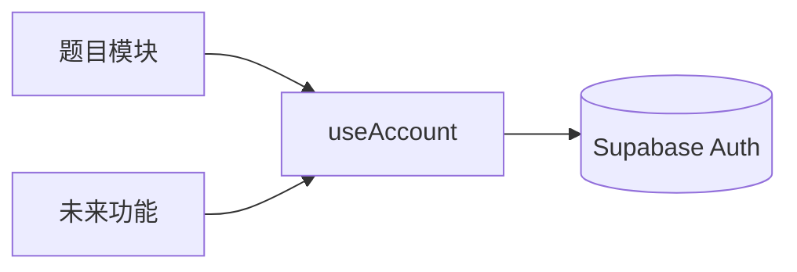

# 账号模块

右上角、GitHub 图标左侧的账号按钮，点开是账号菜单。模块独立于 Fumadocs 与题目功能：只用 shadcn 组件，通过 Fumadocs 公开的布局选项挂载，不修改其内部代码。

## 目录

```text
lib/supabase-client.ts            共享的浏览器 Supabase 客户端（只读公开配置）
lib/account/types.ts              账号领域类型：AccountState、AccountPhase、AccountIdentity
components/account/
  account-provider.tsx            唯一管理“谁已登录”的 Provider；useAccount()
  account-menu.tsx                头部按钮 + 下拉菜单（shadcn DropdownMenu/Avatar）
  sign-in-dialog.tsx              邮箱登录/注册弹窗（shadcn Dialog/Field）
  menu-section.ts                 菜单分区的扩展接口
  sections/                       内置分区：identity、session；index.ts 是注册表
  index.ts                        对外入口
components/app-providers.tsx      站点级 Provider（Account + Search），供根布局与静态构建根布局共用
```

## 依赖方向



功能模块只通过 `useAccount()` 读取登录状态，账号模块不引用任何功能模块。题目的 `QuestionDatabaseProvider` 已按此方式改为读取账号，自己不再处理登录。

## 状态

`useAccount()` 返回 `phase`（`disabled` 未配置云端、`loading`、`guest`、`signed-in`）、`user`、`cachedUser`（浏览器记住的上次账号，仅用于定位本机数据分区，不授权任何请求）以及 `sendEmailLink`、`verifyEmailCode`、`signOut`。未配置 `NEXT_PUBLIC_SUPABASE_*` 时菜单仍可打开，登录项禁用，页面不发出任何账号请求。

## 挂载位置（与 Fumadocs 的边界）

| 页面 | 挂载方式 |
| --- | --- |
| 首页/博客（`HomeLayout`） | `lib/layout.shared.tsx` 的 `linkItems` 中一个 `type: 'custom', secondary: true` 项；Fumadocs 把 GitHub 图标追加在后面，所以账号在其左侧 |
| 文档（`spacious` `DocsLayout`） | `components/study-docs-layout.tsx` 通过官方 `slots.actions` 渲染 `<AccountMenu />` + 原样的 `HeaderActions` |

文档页手机宽度下，默认桌面工具栏会隐藏，因此通过公开的 `slots.header` 挂载移动导航，保留标题、搜索和侧边栏按钮，并加入账号入口。首页的手机菜单中也有账号入口。升级 Fumadocs 时检查这些布局挂载点即可，无需修改其内部代码。

## 新增菜单功能

1. 在 `components/account/sections/` 新建文件，导出 `AccountMenuSection`（`id`、`order`、`audience`、`render`）。`render` 返回 `DropdownMenuGroup` 内的菜单项，分隔线由菜单绘制。
2. 在 `sections/index.ts` 的数组里加一行。内置分区 `order` 为 0（identity）与 1000（session），新功能取中间值。
3. 需要弹窗时，在自己的分区组件里管理状态，不要改动 `account-menu.tsx`。

新增登录方式（如 OAuth、密码）时，在 `AccountState` 增加对应动作，在 `sign-in-dialog.tsx` 中增加入口；其他代码不受影响。
