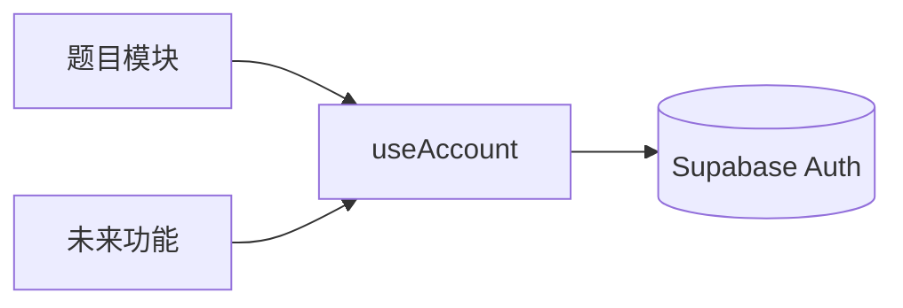

# 账号模块

右上角、GitHub 图标左侧的账号按钮，点开是账号菜单。模块独立于 Fumadocs 与题目功能：只用 shadcn 组件，通过 Fumadocs 公开的布局选项挂载，不修改其内部代码。

## 目录

```text
lib/supabase-client.ts            共享的浏览器 Supabase 客户端（只读公开配置）
lib/account/types.ts              账号领域类型：AccountState、AccountPhase、AccountIdentity
components/account/
  account-provider.tsx            唯一管理“谁已登录”的 Provider；useAccount()
  account-menu.tsx                头部按钮 + 下拉菜单（shadcn DropdownMenu/Avatar）
  sign-in-dialog.tsx              邮箱登录/注册弹窗（shadcn Dialog/Field）
  menu-section.ts                 菜单分区的扩展接口
  sections/                       内置分区：identity、session；index.ts 是注册表
  index.ts                        对外入口
components/app-providers.tsx      站点级 Provider（Account + Search），供根布局与静态构建根布局共用
```

## 依赖方向



功能模块只通过 `useAccount()` 读取登录状态，账号模块不引用任何功能模块。题目的 `QuestionDatabaseProvider` 已按此方式改为读取账号，自己不再处理登录。

## 状态

`useAccount()` 返回 `phase`（`disabled` 未配置云端、`loading`、`guest`、`signed-in`）、`user`、`cachedUser`（浏览器记住的上次账号，仅用于定位本机数据分区，不授权任何请求）以及 `sendEmailLink`、`verifyEmailCode`、`signOut`。未配置 `NEXT_PUBLIC_SUPABASE_*` 时菜单仍可打开，登录项禁用，页面不发出任何账号请求。

## 挂载位置（与 Fumadocs 的边界）

| 页面 | 挂载方式 |
| --- | --- |
| 首页/博客（`HomeLayout`） | `lib/layout.shared.tsx` 的 `linkItems` 中一个 `type: 'custom', secondary: true` 项；Fumadocs 把 GitHub 图标追加在后面，所以账号在其左侧 |
| 文档（`spacious` `DocsLayout`） | `components/study-docs-layout.tsx` 通过官方 `slots.actions` 渲染 `<AccountMenu />` + 原样的 `HeaderActions` |

文档页手机宽度下，默认桌面工具栏会隐藏，因此通过公开的 `slots.header` 挂载移动导航，保留标题、搜索和侧边栏按钮，并加入账号入口。首页的手机菜单中也有账号入口。升级 Fumadocs 时检查这些布局挂载点即可，无需修改其内部代码。

## 新增菜单功能

1. 在 `components/account/sections/` 新建文件，导出 `AccountMenuSection`（`id`、`order`、`audience`、`render`）。`render` 返回 `DropdownMenuGroup` 内的菜单项，分隔线由菜单绘制。
2. 在 `sections/index.ts` 的数组里加一行。内置分区 `order` 为 0（identity）与 1000（session），新功能取中间值。
3. 需要弹窗时，在自己的分区组件里管理状态，不要改动 `account-menu.tsx`。

新增登录方式（如 OAuth、密码）时，在 `AccountState` 增加对应动作，在 `sign-in-dialog.tsx` 中增加入口；其他代码不受影响。

## 连接失败与数据库检查

Cloudflare 构建设置 `NEXT_PUBLIC_SUPABASE_PROXY_PATH=/api/supabase`，浏览器的邮箱登录、验证码、会话刷新、退出及答题 RPC 都经过同域 Worker。Supabase 原始 URL 仍用于创建客户端，原有会话 storage key 和账号缓存不会因转发而改变。本地 `next dev` 不包含 Worker，保持该变量为空，直接访问 Supabase。

部署命令把 GitHub 变量 `NEXT_PUBLIC_SUPABASE_URL` 同时传给 Worker 的 `SUPABASE_URL`，避免前后端指向不同项目。Worker 只接受固定的 Auth 路径和 `exam_sync_question_state` RPC，转发用户公钥与 JWT，不注入 service key，不转发站点 Cookie，也不缓存响应。所有文档依旧通过 Static Assets 分发。修改转发路径需要云端重新构建。

`Failed to fetch` 表示请求未取得可读的 HTTP 响应，可能涉及网络、DNS、TLS、浏览器拦截或 CORS。不能据此判断数据库不存在。当前数据库的 5 张答题表位于 `exam_private`，不是 `public`；在 Supabase Table Editor 中切换 schema，或在 SQL Editor 查询：

```sql
select tablename from pg_tables where schemaname = 'exam_private';
```

账号在 Authentication → Users 中查看，不需要另外创建公开用户表。`public.exam_sync_question_state` 是经过登录鉴权的同步入口，内部表不向浏览器直接开放。

## Resend 邮件配置

1. 在 [Resend Domains](https://resend.com/domains) 添加发信子域名（例如 `mail.any1.tech`），将它要求的 DNS 记录逐条添加到域名管理平台，等域名显示 Verified。记录名称、类型和值以 Resend 当前页面为准。
2. 在 Resend API Keys 创建用于发信的 Key，权限限制为 Sending access，并选择刚验证的域名。
3. 打开 [exam-docs SMTP Settings](https://supabase.com/dashboard/project/hqtpzhefihdwllbqjeot/auth/smtp)，启用自定义 SMTP，填写下表并保存。

| 配置项 | 值 |
| --- | --- |
| Sender email | `noreply@mail.any1.tech`，必须使用已验证域名 |
| Sender name | `Exam Docs` |
| Host | `smtp.resend.com` |
| Port | `465` |
| Username | `resend` |
| Password | Resend API Key，仅填写在 Supabase 后台 |

4. 在 Authentication → URL Configuration 将 Site URL 设置为 `https://exam.any1.tech`，Redirect URLs 包含 `https://exam.any1.tech/**`；只添加实际需要的其他站点地址。
5. 建议在 Email Templates 的 **Confirm signup** 和 **Magic Link** 两份模板中都提供验证码。首次登录可能使用注册确认模板，后续登录使用 Magic Link 模板。主题可填 `Exam Docs 登录验证码`，正文可直接使用：

```html
<h2>登录 Exam Docs</h2>
<p>请回到刚才的登录窗口，输入以下验证码：</p>
<p><strong>{{ .Token }}</strong></p>
<p>如果不是你本人发起的请求，请忽略此邮件。</p>
```

使用验证码可以让整个登录验证请求经过同域接口，不必点击邮件中原本指向 `supabase.co` 的登录链接。不要为此关闭邮箱验证。Resend 的链接追踪也无需开启。

6. 保存后使用自己的邮箱请求一次登录邮件，在 Resend Logs 中检查投递结果，回站输入最新验证码，确认登录后答题可同步；退出后访客记录应独立。初次接入自定义 SMTP 的 Supabase 项目默认仍有限流，后续按实际需求在 Auth Rate Limits 调整。

SMTP 与邮件模板属于 Supabase 云端设置，保存后即时生效，不依赖静态站重新构建。Resend API Key 不应写入 GitHub 公开变量或任何 `NEXT_PUBLIC_*` 配置。

参考：[Resend 的 Supabase SMTP 配置](https://resend.com/docs/send-with-supabase-smtp)、[Supabase SMTP 限制与设置](https://supabase.com/docs/guides/auth/auth-smtp)、[邮件模板变量](https://supabase.com/docs/guides/auth/auth-email-templates)。
