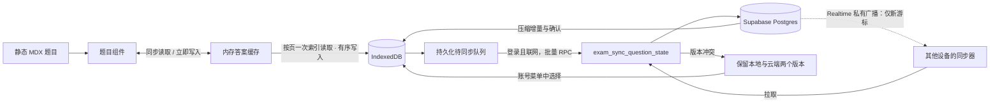

# 题目数据库与本地优先同步

题目正文、选项、标准答案和解析继续由 MDX 和 Git 管理。浏览器数据库保存读者的答题状态；Supabase 为登录用户提供跨设备同步。打开题目、选择答案和填写空格都先使用本地状态，网络不处于答题交互的关键路径。

Cloudflare 生产部署现在通过同域 `/api/supabase` 转发登录与答题 RPC，以减少浏览器直连 Supabase 域名的网络限制。数据库表仍位于 `exam_private` schema；默认 `public` 下没有答题表是正常的。SMTP 与验证码模板配置见 [账号模块的 Resend 配置](account.md#resend-邮件配置)。

本地持久化使用 IndexedDB；未配置 Supabase 或未登录时也能保存、刷新恢复。这里的离线能力指已加载页面中的答题记录持久化，没有额外实现 Service Worker，也不保证断网后首次打开文档或加载未缓存的页面。

## 数据边界

| 内容 | 保存位置 | 原因 |
| --- | --- | --- |
| 题干、选项、标准答案、解析、题型 | `content/docs/` 的 MDX | 随文档审查、版本管理和静态部署 |
| 当前选择、填空草稿、是否提交、重做后的空状态 | 浏览器 IndexedDB；登录后同步至 Supabase | 刷新恢复和跨设备继续 |
| 每次已提交答案 | 本地提交记录；登录后追加至云端 | 与当前草稿分离，避免新草稿覆盖历史提交 |
| 尚未确认的本地写入、冲突、同步游标 | 浏览器 IndexedDB | 断网重试和冲突恢复 |
| 身份与登录会话 | Supabase Auth | 云端按用户授权 |

题目身份由文档路径、稳定的 `Question id` 和编译生成的 `revision` 组成。修改题目内容、选项顺序或答案会改变 revision，新版题目获得独立状态。旧版记录保留，不把旧选项字母套用到新版题目。作者需保持 id 稳定，组件写法见 [question-components.md](question-components.md)。

## 读写与同步流程



**缓存读取。** 全站只有一个 `QuestionDatabaseProvider`（挂在 `AppProviders`），为当前账号分区维护一个内存缓存 `QuestionAnswerCache`。页面上的题目挂载时只触发一次按文档的 IndexedDB 索引读取（`records.document`），之后每次渲染都通过 `useSyncExternalStore` 同步读取内存，不再每道题各开一个事务。同步或其他标签页带来的变化只按变化事件里的题目 key 刷新对应条目。

**实时写入。** 输入先写入内存并立即重渲染，再按顺序写入 IndexedDB。同一道题连续的草稿只保留最新一份待写入值，提交永不合并（每次提交都是一条不可变历史）。某道题的写入排队或失败时，内存值优先，较慢的外部刷新不会回滚正在输入的答案。

读题时从本地恢复；输入时先更新内存缓存，再保存到 IndexedDB。云端不可用不会撤销已保存的本地输入。同步队列与待上传内容持久化，刷新后能继续重试。界面会显示本地保存、待同步、同步失败或冲突状态，避免把内存中的答案误报为已经持久保存。

本地数据库名为 `exam-docs-questions`，schema 版本为 2（v2 新增 `records.document` 与 `conflicts.question` 索引；从 v1 原地升级时保留全部答案、历史和待同步队列，只把同步游标清零，下一次拉取按 v2 压缩增量从头开始），包含 `records`、`operations`、`attempts`、`conflicts`、`metadata`。一次答题写入会在同一个 IndexedDB 事务中保存当前状态、同步操作和已产生的提交记录。普通未发送草稿可合并；已经发出的操作和历史提交保留稳定 UUID，不因重试换身份。

同步器在用户登录后运行：草稿编辑停止 0.8 秒后上传；提交、冲突选择和导入在 150 ms 批处理后立即上传，持续输入不会推迟它们；页面隐藏或关闭前有待上传记录也会立即发送。每批最多 50 个操作、请求目标上限 240 KiB，每页最多拉取 200 条；同一道题依次发送，保留版本先后关系。一个 RPC 同时提交变更和拉取增量，登录后立即检查，联网恢复和手动同步会再检查；页面重新获得焦点或变为可见时，距上次成功同步超过 60 秒或有待上传记录也会检查。失败后按 1 至 60 秒上限退避并加随机抖动，重试信息持久保存。

**实时同步。** 每次 RPC 提交了变化，数据库在同一事务内通过 `realtime.send` 向私有频道 `exam-sync:<用户 id>` 发送事件 `changed`，载荷只有新游标，不含答案。其他设备的同步器收到后，若本机游标落后就立即拉取；频道（重新）连上时也补拉一次断线期间的变化。广播只是提示：真正的数据仍通过游标协议拉取，广播丢失只会推迟更新，不会丢数据。`realtime.messages` 的 RLS 只允许频道所属用户订阅，没有插入策略，浏览器无法伪造通知。Cloudflare 部署中 WebSocket 同样经过 `/api/supabase/realtime/v1/websocket` 同域转发。

长时间空闲没有定时轮询；题目组件也不分别创建 Supabase 连接。标签页之间通过 BroadcastChannel 失效通知和同步互斥减少重复请求。互斥优先使用浏览器 Web Locks：持有锁的标签页关闭、崩溃或被系统回收时由浏览器立即释放，不会让其他标签页的「立即同步」失效；不支持 Web Locks 的浏览器退回 IndexedDB 租约（45 秒过期，每次交换前续期），此时手动同步不等租约，靠操作 ID 幂等保证重叠交换不会重复写入。每次网络交换最长 20 秒（RPC）/30 秒（整轮），卡住的移动网络请求会失败并按退避重试，不会让同步永久停在「正在同步」。

Realtime 频道只在页面可见时加入：页面隐藏或切到后台即离开频道，最后一个频道离开后 WebSocket 由客户端库关闭；回到前台重新加入并补拉一次。服务端拒绝加入（例如授权策略缺失）时不交给库的快速重连循环，5 分钟后或下次回到前台再试。

### 身份隔离

访客与每个登录账号拥有独立本地分区。退出登录后回到访客分区；切换账号不会展示或上传前一个账号的答案。清除登录会话不会自动删除本地历史，个人设备上再次登录同一账号可以继续同步。

登录不会悄悄归属访客记录。访客记录需要显式导入才会复制到账号分区；当前界面中已移除导入入口（原同步面板随答题记录入口一并删除），数据层 `QuestionDatabase.importGuest` 仍保留。账号本地已有同一题的记录时保留账号答案，只补缺失的当前答案；访客历史提交可追加且重复导入不重复复制。若云端存在尚未拉取的记录，仍由 CAS 检查并报告冲突。共享电脑上使用完应退出账号；浏览器本地数据库没有额外加密。

### 冲突策略

当前答案通过服务器分配的版本号执行比较并交换（CAS）。每次上传都携带该记录的已知云端版本。只有版本一致，服务器才接收更新并分配下一个版本；版本不一致会返回云端当前记录，本地草稿保留。设备时间只用于展示，不决定哪个答案覆盖另一个。

| 场景 | 结果 |
| --- | --- |
| 不同设备修改不同题 | 分别接收，增量合并 |
| 两台设备从相同版本修改同一题 | 第一份被接收，另一份进入冲突等待选择 |
| 请求成功但响应丢失后重试 | 复用同一操作 UUID，服务器返回原收据，不重复创建记录 |
| 有待上传草稿时拉到云端新版本 | 保存两份，不用拉取结果覆盖尚未确认的本地修改 |
| 选择本地版本 | 以最新已知云端版本再次提交；若期间再变化，仍会再次报告冲突 |
| 选择云端版本 | 用云端答案更新本地当前状态，并清除对应待确认修改 |
| 重做或清空答案 | 保存空状态作为版本更新，不物理删除导致其他设备重新复活旧答案 |
| 同一道题并发提交 | 当前答案仍检查版本；有效提交记录可独立追加保存 |

填空答案和选项集合不做逐字段自动合并。一台设备改第一个空、另一台改第二个空时，也会按同一道题产生冲突，避免拼接出用户从未提交过的答案。

## Supabase 结构与权限

数据库通过迁移管理，浏览器使用公开函数 `public.exam_sync_question_state`。内部数据位于 `exam_private` schema：

| 对象 | 职责 |
| --- | --- |
| `question_progress` | 每位用户、文档、题目、revision 的当前答案、云端版本，以及最近一次写入的 `seq` |
| `question_attempts` | 按提交 UUID 追加的历史提交及其 `seq` |
| `question_operations` | 精简幂等收据：操作 UUID、请求哈希、结果状态；30 天后由该用户下一次同步清理 |
| `question_sync_heads` | 每位用户单调递增的游标（最近分配的 `seq`） |

v2（迁移 `20261021120000_question_sync_v2.sql`）取消了追加式 `question_events` 事件表，改为**压缩增量**：每次写入把该行的 `seq` 更新为该用户的下一个游标，拉取即读取 `seq > cursor` 的行（`(user_id, seq)` 唯一索引）。因此一道题被改了 100 次，另一台设备也只拉到最新一份，历史快照不再无限增长。被重写的行会移到游标末尾，正在分页的读者稍后仍会读到它。

RPC 参数为 `p_operations`、`p_cursor`、`p_limit`（1–500，默认 200）。服务端在单个事务中检查身份、处理上传并返回后续一页；`hasMore` 通过多读一行判定。每位用户的同步事务以咨询锁串行分配 `seq`，避免事务提交顺序形成游标空洞。客户端游标超过账号游标（数据库恢复、协议升级）时，服务端从 0 重新返回并标记 `reset: true`，不再报错。

重试已确认的操作 UUID 时，服务端核对请求哈希并返回该题**当前**的云端行：客户端要么确认自己的写入，要么得知更新的版本。收据过期后重试的旧 UUID 会被当作新写入；若云端行已经等于所发送的答案，客户端把这个 CAS 失败视为确认，不产生冲突。

表按用户启用 RLS，浏览器角色没有内部表直接写入权限。公开入口只给 `authenticated` 执行；私有执行函数从 `auth.uid()` 取用户身份，使用固定 search path。客户端无法通过请求体指定别人的 owner。publishable key 只是公开项目标识，数据权限依赖登录会话与数据库授权。

数据模型不需要为每道 MDX 题目写入数据库，也不存储文档解析的副本。因此普通文档更新不要求批量导入题库，不会为加载页面制造题库查询。

## 本地开发与云端启用

浏览器关闭 IndexedDB 连接后，下一次读写会重新连接并在安全范围内重试一次，
不会清空本机数据库。保存失败时保留当前页面中的答案，区分空间不足、权限拒绝
和连接中断，并提供「重试保存」；失败答案未保存前刷新或关闭页面会触发浏览器
离开确认。刷新前仍应先重试或复制答案，刷新无法恢复从未写入本机的结果。

无需完整构建即可验证连接恢复、写入回滚、原答案重试及刷新恢复：

```bash
QUESTION_BROWSER_MODULES=/包含Playwright的目录 \
node scripts/verify-question-storage-recovery-browser.mjs
```

浏览器回归脚本可复用现有 Playwright 安装，检查真实 IndexedDB、刷新恢复、重做历史、多标签页、断网作答、手机弹窗和备份下载：

```bash
QUESTION_BROWSER_MODULES=/包含Playwright的目录 \
DEPLOYMENT_URL=http://127.0.0.1:3000 \
node scripts/verify-question-database-browser.mjs
```

`QUESTION_BROWSER_MODULES` 指向可解析 `playwright` 包的目录；应用需先启动。验证使用独立浏览器上下文，不会发送登录邮件。结果和截图默认写入 `.deploy-tmp/question-database-browser/`。

### 1. 先验证纯本地模式

```bash
npm ci
npm run dev
```

保持下面两个环境变量为空。打开一个包含选择题或填空题的文档，填写或提交后刷新，检查状态恢复；重做后刷新应保持清空。IndexedDB 被浏览器禁止或配额不足时，应看到保存错误提示。导出 JSON 备份适合主动保存记录，浏览器清理站点数据、隐私模式结束或更换域名都可能失去原来的本地数据。

账号菜单的「答题记录」分区汇总本机作答数、提交数与提交历史，并提供立即同步、选择冲突答案（打开对比弹窗）、导入未登录时的记录、导出本机备份。头像上的圆点在同步中、待上传、冲突或失败时出现；账号名下方一行显示「实时同步中」「n 条修改待上传」「离线 · 答案已保存在本机」等状态。

本地数据库按浏览器 origin 隔离。`localhost:3000`、生产自定义域名、`workers.dev` 和预览域名各有独立数据；登录同一 Supabase 账号后可通过云端同步交换记录，访客数据不会自动跨域迁移。

### 2. 配置浏览器连接

复制 `.env.example` 为 `.env.local`，从 Supabase Dashboard 的 Connect / API Keys 获取公开项目配置：

```dotenv
NEXT_PUBLIC_SUPABASE_URL=https://hqtpzhefihdwllbqjeot.supabase.co
NEXT_PUBLIC_SUPABASE_PUBLISHABLE_KEY=sb_publishable_替换为该项目的公开密钥
```

两项都设置后才启用云端入口。开发服务器需重启。`npm run build:static-docs` 会读取仓库根目录的 `.env.local` 并将公共配置传给隔离的 Next 构建；不把环境文件复制到静态输出。缺少配置时保留纯本地模式。

只填写 publishable key，绝不能填写 `sb_secret_`、`service_role`、数据库密码或个人访问令牌。`NEXT_PUBLIC_*` 会被编译进公开 JavaScript。此项目使用浏览器直接访问 Supabase，不需要把数据库密码传给 Cloudflare、EdgeOne 或前端构建。[官方 API Key 说明](https://supabase.com/docs/guides/api/api-keys)

### 3. 应用数据库迁移

项目迁移位于 `supabase/migrations/`，首次迁移为 `20261020005127_question_local_first_sync.sql`，版本号与目标云端实际迁移历史一致。新建手写迁移使用明确版本的 CLI：

```bash
npx --yes supabase@2.121.0 --help
npx --yes supabase@2.121.0 migration new 描述性名称
```

在测试项目或本地 Supabase 中验证 SQL、权限和同步协议，再合并到生产。初次连接已有数据库时先检查迁移历史；不要为了匹配 Git 重置生产数据库。已应用的迁移保持不变，修复用新迁移。浏览器收到函数不存在的错误时先核查目标项目和迁移状态。

### 4. 配置邮件登录

当前界面使用邮箱 Magic Link，并提供邮件中确实包含数字验证码时的验证入口。Supabase 的 `signInWithOtp` 默认发送登录链接；要发送验证码，需要邮件模板包含 `{{ .Token }}`。不能因为方法名带 OTP，就假定默认邮件里已经有验证码。[官方邮件登录说明](https://supabase.com/docs/guides/auth/auth-email-passwordless)

在目标项目的 Auth 中启用 Email provider，设置 Site URL，并允许实际使用的生产域名、预览域名和本地开发地址。当前页面在浏览器中处理登录回调，不需要服务端认证路由。回调允许地址应使用实际访问路径，避免把生产邮件送回 `localhost`。

生产邮件发送需配置合适的 SMTP。新 Free 项目在使用默认 SMTP 时受到收件人与额度限制，且从 2026 年 6 月起不能自定义邮件模板；若要在这类项目使用数字验证码，先接入自定义 SMTP 再改模板。可先用默认 Magic Link 测试登录，不要把发送成功响应当成邮件一定投递成功。[默认 SMTP 限制](https://supabase.com/docs/guides/auth/auth-smtp)、[模板规则变更](https://supabase.com/changelog/46599-changes-to-email-template-customisation-on-free-tier)

这里没有自动修改远端 Email provider、SMTP、邮件模板或 Auth 的公开注册策略。开放站点前，在 Dashboard 明确选择是否允许用户注册，以及允许哪些回调域名。

## 仓库与部署

当前静态站由 `.github/workflows/deploy-cloudflare-worker-assets.yml` 发布到 Cloudflare。静态包中仍生成 EdgeOne 兼容的路由元数据，换静态托管不会改变浏览器访问 Supabase 的模型。

Supabase 已连接仓库时，在该项目 **Settings → Integrations → GitHub** 检查：

1. 仓库选择 `ActiveInsighter/exam-docs`，Working directory 为 `.`，因为 `supabase/` 位于根目录。
2. 生产分支选择实际生产分支 `main`，开启 **Deploy to production**。
3. 检查迁移功能未在 `supabase/config.toml` 的 `[db.migrations]` 中禁用。
4. 若使用 Supabase preview branches，检查分支状态并将集成检查设为合并必需条件；预览数据库不含生产用户答题数据。

GitHub 集成会在对应分支 push 后应用尚未执行的迁移。本仓库没有另加自动 `supabase db push` 的 Actions，避免两套部署器同时管理同一项目。仅仅绑定仓库还不足以保证生产迁移自动发布，需要上述生产部署设置。API、Auth 和 seed 配置默认不会随生产迁移应用；配置远端映射会改变此行为，添加前应独立审查。[官方 GitHub 集成说明](https://supabase.com/docs/guides/deployment/branching/github-integration)

GitHub 仓库 **Settings → Secrets and variables → Actions → Variables** 配置：

```text
NEXT_PUBLIC_SUPABASE_URL
NEXT_PUBLIC_SUPABASE_PUBLISHABLE_KEY
```

现有部署 workflow 会传给所有静态构建分片。换 URL 或公钥后必须重新构建，静态包不读取托管平台运行时变量；共享构建 ID 也会随这两项公共配置改变。空变量构建出本地模式，之后只改 Dashboard 变量不会让已经发布的 JavaScript 自动启用云端。

仓库级变量同样供现有预览分支构建使用。预览站域名与生产站的 IndexedDB 分离，但若使用相同 Supabase URL，登录同一账号就会同步到同一个云端数据库。需要数据库隔离的预览环境应使用独立 Supabase branch/project，并通过 GitHub environment 或独立构建变量切换目标后再构建。

静态站发布和 Supabase 迁移是独立执行的部署，不是原子发布。建议采用兼容升级顺序：

1. 先部署新增表和向后兼容 RPC，确认 Supabase 集成成功。
2. 通过数据库协议、权限和幂等测试，确认旧客户端仍可使用。
3. 再配置公共环境变量，构建并发布带同步入口的静态站。
4. 用两个浏览器或设备登录同一账号，验证上传、拉取、断网恢复和冲突。
5. 后续协议升级保留旧入口，待已缓存的老客户端退出使用后再移除。

首次同时合并前端和迁移时，两套部署可能先后完成。前端遇到迁移未就绪会保留本地待同步状态，稍后重试；正式启用仍应先确认数据库就绪。回退静态站不会回滚数据库，也不会清除本地答题数据。发生云端问题时，可用不含公共 Supabase 变量的构建恢复本地模式，并保留待上传记录。

## 验收与后续演进

```bash
npm test -- --exclude '.worktrees/**' tests/question-store.test.ts tests/question-cache.test.ts tests/question-store-integration.test.ts supabase/tests/question-sync.test.ts
npm run typecheck
```

完整构建按项目约定放到 GitHub Actions，本机保留类型检查、针对性测试和浏览器交互验证。将已获授权的工作分支推送后，可在 Actions 页面选择 `Deploy exam-docs to Cloudflare`，设置 `deploy=false`、`shards=8`；也可使用：

```bash
gh workflow run deploy-cloudflare-worker-assets.yml --ref "$(git branch --show-current)" -f deploy=false -f shards=8
```

这会执行云端验证、静态构建与部署配置 dry run。正式发布使用独立授权，不能从构建请求推断为允许发布生产站点。

本地存储测试使用 fake-indexeddb 验证持久化、队列与冲突。数据库测试使用 PGlite 执行真实 SQL、PL/pgSQL 和角色权限，测试中仅模拟 Supabase 平台的 `auth.users` 与 `auth.uid()`。组合测试将两台模拟设备的 IndexedDB 与实际迁移后的 SQL RPC 连接，覆盖分页、响应丢失重试、冲突选择与提交历史保留。排除 `.worktrees/**` 可避免同时运行本机其他 checkout 中的旧测试。这些测试不需要真实邮箱，但不替代目标 Supabase 项目上的登录回调和跨设备验收。

### 2026-10-20 实施与验证状态

目标项目为 `hqtpzhefihdwllbqjeot`，当前状态：

| 项目 | 验证结果 |
| --- | --- |
| 云端数据库迁移 | 已通过连接器应用；仓库迁移文件版本已对齐云端实际历史 |
| 真实 Supabase SQL 冒烟检查 | `supabase/tests/cloud-smoke.sql` 已执行通过；测试事务回滚，并确认测试用户已清理（`fixture_removed: true`） |
| Supabase advisors | 安全与性能检查均未返回 lint（`[]`） |
| 本机连接配置 | `.env.local` 已设置实际项目 URL 和 publishable key，文件由 Git 忽略 |
| 浏览器本地持久化 | 5 项真实浏览器验证通过：刷新恢复、重做历史、多标签页、断网作答恢复、手机弹窗与备份下载；无运行时或 hydration 错误 |
| 类型与回归检查 | 云端完整回归 29 个测试文件、182 项测试全部通过，包括两项完整题库渲染套件；应用类型检查通过 |
| 完整构建 | [GitHub Actions #39351920241](https://github.com/ActiveInsighter/exam-docs/actions/runs/39351920241) 全部成功，8 个静态分片、搜索与合并包校验通过；总耗时约 3 分 11 秒。本机全量构建已停止，后续按约定使用云端构建 |
| 邮件与账号完整链路 | 尚未发送登录测试邮件；邮件投递、允许回调域名与真实多设备登录仍需按前文配置后验收 |
| 仓库与静态站发布 | 功能代码与工作流配置已推送至 `codex/question-local-first-supabase`，通过验证的代码提交为 `0a8c125`；本次 `deploy=false`，Wrangler dry run 成功，实际站点部署步骤已跳过 |

该次云端合并包包含 694 个文档 HTML 路由和 693 份 Markdown，181 个共享静态文件在全部分片中内容一致。生产启用云同步前，仍需按上文设置 GitHub 两项公共构建变量、Supabase 登录回调域名，并核查 GitHub 集成的生产自动迁移设置。

本地账号分区选择与 Supabase 会话恢复分离：即使过期会话正在尝试联网刷新，仍可恢复上次所选账号的本机答案。缓存的账号选择只用于路由本地数据；上传仍须真实登录会话，不能把本机选择当作云端授权。

至少验证以下流程：刷新恢复选择题与填空草稿；重做后不恢复旧答案；题目 revision 改变后使用独立状态；退出与切换账号隔离；显式导入访客；断网输入后恢复同步；请求响应丢失后的幂等重试；两台设备同时修改同一道题并选择本地或云端；非本人数据不可访问；导出 JSON 可以检查内容。

当前设计优先保证答案不被静默覆盖。后续可独立增加错题本、历史提交浏览与设备管理。v2 已压缩增量并为收据设置 30 天保留期；过期游标通过 `reset` 全量重拉恢复，过期收据通过“云端行等于所发答案即确认”避免误报冲突。
