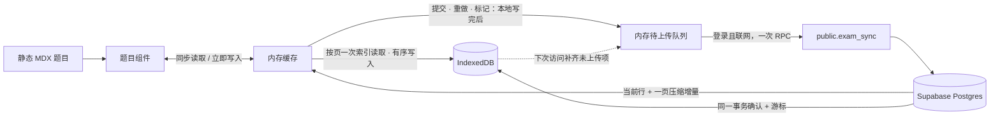

# 题目数据库与本地优先同步

题目正文、选项、标准答案和解析继续由 MDX 和 Git 管理。浏览器数据库保存读者的答题状态；Supabase 为登录用户提供跨设备同步。打开题目、选择答案和填写空格都先使用本地状态，网络不处于答题交互的关键路径。

Cloudflare 生产部署通过同域 `/api/supabase` 转发登录与同步 RPC，以减少浏览器直连 Supabase 域名的网络限制。数据库表位于 `exam_private` schema；默认 `public` 下没有答题表是正常的。SMTP 与验证码模板配置见 [账号模块的 Resend 配置](account.md#resend-邮件配置)。

本地持久化使用 IndexedDB；未配置 Supabase 或未登录时也能保存、刷新恢复。这里的离线能力指已加载页面中的答题记录持久化，没有额外实现 Service Worker，也不保证断网后首次打开文档或加载未缓存的页面。

## 一句话模型

**读走缓存，写先本地、再云端；草稿只留本机。**

| 操作 | 本机 IndexedDB | 云端 |
| --- | --- | --- |
| 选了选项但未判题、填空输入中（草稿） | 输入停顿 0.4 秒后写入 | 不上传 |
| 判题提交（单选即判、多选/填空点「提交」） | 立即写入当前答案 + 一条提交记录 | 本地写完立即上传（约 0.3 秒批处理） |
| 重做 | 立即写入空答案 | 同上：其他设备随之清空 |
| 收藏、标签、注释 | 立即写入 | 同上 |
| 打开页面、切回标签页、恢复联网 | 从内存缓存读；整页一次索引读取 | 距上次同步超过 60 秒时拉取一次增量 |

## 数据边界

| 内容 | 保存位置 | 原因 |
| --- | --- | --- |
| 题干、选项、标准答案、解析、题型 | `content/docs/` 的 MDX | 随文档审查、版本管理和静态部署 |
| 当前答案（草稿或已提交）、重做后的空状态 | 浏览器 IndexedDB；已提交与重做登录后同步至 Supabase | 刷新恢复和跨设备继续 |
| 每次已提交答案 | 本地提交记录；登录后追加至云端 | 与当前答案分离，换设备覆盖也不丢失判过的答案 |
| 待上传的提交 / 重做 / 标记 | 内存队列 + IndexedDB 中的稀疏 outbox 索引 | 本机存储写入失败仍能上传；关闭页面后下次继续 |
| 身份与登录会话 | Supabase Auth | 云端按用户授权 |
| 读者自定义标签、收藏、注释 | 浏览器 IndexedDB（`tags`、`marks`）；登录后同步至 Supabase | 属于读者，不属于题目内容；见下文「标签、收藏与注释」 |
| 题目内置标签（来源、分类） | MDX 的 `tags` 属性 | 随题目内容审查，见 [question-components.md](question-components.md#内置标签) |

题目身份由文档路径、稳定的 `Question id` 和编译生成的 `revision` 组成。修改题目内容、选项顺序或答案会改变 revision，新版题目获得独立状态。旧版记录保留，不把旧选项字母套用到新版题目。作者需保持 id 稳定，组件写法见 [question-components.md](question-components.md)。

## 代码结构

`lib/question-store/` 按职责分层，上层只依赖下层的接口：

| 文件 | 职责 |
| --- | --- |
| `types.ts` | 领域类型、校验、时间戳工具（无 IO） |
| `schema.ts` | IndexedDB 结构与 v1–v3 → v4 的原地升级 |
| `database.ts` | 连接、断线重连、事务、跨标签页变更通知；把一次同步交换原子地写入本机 |
| `answers.ts` / `annotations.ts` | 纯持久化：答案与提交记录 / 标签与标记；以及同步交换用的事务级函数 |
| `cache.ts` / `annotation-cache.ts` | 内存缓存：同步读、乐观写、草稿防抖、失败保留与重试 |
| `outbox.ts` | 待上传队列（内存），每题 / 每标签 / 每标记只留最新一份 |
| `sync.ts` | 同步引擎：拉取时机、批量上传、退避、跨标签页互斥 |
| `protocol.ts` | 云端响应的完整校验 |
| `session.ts` | 把一个身份（访客或账号）的缓存与同步引擎组装在一起 |

`lib/question-supabase.ts` 是唯一的网络传输实现（`public.exam_sync`）。React 只经由 `components/question/database-provider.tsx` 创建 `QuestionSession`，题目组件只读写缓存。

## 读写与同步流程



**缓存读取。** 全站只有一个 `QuestionDatabaseProvider`（挂在 `AppProviders`），为当前身份创建一个 `QuestionSession`。页面上的题目挂载时只触发一次按文档的 IndexedDB 索引读取，之后每次渲染都通过 `useSyncExternalStore` 同步读取内存。读取页面时若距上次同步超过 60 秒，会顺带触发一次增量拉取；拉回的行先直接更新内存，再写入 IndexedDB。其他标签页的变化只按事件里的 key 刷新对应条目。

已保存答案及标记在最后一个订阅者离开后回收，返回页面时从 IndexedDB 恢复，避免浏览章节越多内存越大。待写入、正在写入或写入失败的答案保留，成功落库后才可回收。

**写入。** 输入先写入内存并立即重渲染，再按顺序写入 IndexedDB。每次写入带一个严格递增的时间戳。草稿在输入停顿 0.4 秒后才落库，连续输入只写最新一份，页面隐藏、关闭或切换账号时立即写入。提交与重做是「已确认」写入：立即落库；落库完成（无论成功或失败）后交给内存待上传队列，约 0.3 秒批处理后上传。先写本地再上传，云端确认就不可能早于本地 outbox 行出现；若本地写入卡住超过 2 秒也照常上传。

**本机存储已满时。** 鸿蒙等移动浏览器在设备剩余空间不足时会对 IndexedDB 写入报 `QuotaExceededError`。旧实现的上传队列本身存放在 IndexedDB 中，因此本地写失败时答案也无法上传。现在：

- 答案始终保留在页面内存中，题目照常显示与判分；
- 已登录用户的提交与重做仍进入内存队列并上传，提示「答案未能存到本机，正在同步到云端」；云端确认后离开页面不再拦截；
- 访客或草稿写入失败时提示释放空间，提供「重试保存」，未保存前刷新或关闭会触发离开确认；
- 同步拉回的数据即使无法写入本机也会显示在页面上，同步游标暂存在内存里；
- 打开数据库时向浏览器申请持久存储（`navigator.storage.persist()`，尽力而为），降低在存储压力下被回收的概率。

**跨设备更新。** 浏览器不保持任何长连接，没有空闲轮询。其他设备的修改在打开页面、本页重新获得焦点或变为可见、恢复联网（均受 60 秒间隔限制，有待上传项时不受限）、本机上传后或手动「立即同步」时，通过游标协议拉取。Realtime 订阅早已移除（见 [鸿蒙排查报告](../reports/performance-harmony-2026-10-23.md)）。

同一账号在多个标签页时，同步优先使用浏览器 Web Locks 互斥（标签页关闭、崩溃时由浏览器释放）；不支持时各标签页可以重叠交换，最后写入者胜出使重叠无害。每次网络交换最长 20 秒（RPC）/30 秒（整轮），失败后按 1–60 秒退避并加随机抖动；手动同步跳过退避。

未登录读者不加载 Supabase SDK：浏览器中没有已保存的会话（`sb-<项目>-auth-token`）且地址中没有登录回跳参数时，账号模块直接按访客处理；点击登录或其他标签页登录（`storage` 事件）时才加载。

### 身份隔离

访客与每个登录账号拥有独立本地分区（`namespace`）。退出登录后回到访客分区；切换账号不会展示或上传前一个账号的答案。登录会话过期但仍记得上次账号时，继续使用该账号分区，提交排队等待重新登录后上传。清除登录会话不会自动删除本地历史。

登录不会悄悄归属访客记录。账号菜单「导入未登录时的记录」显式把访客数据复制到账号分区：账号已有同一题的答案时保留账号答案，只补缺失的题目；访客提交记录可重复导入而不重复复制；同名标签合并，收藏取并集，注释不同则拼接。共享电脑上使用完应退出账号；浏览器本地数据库没有额外加密。

### 一致性规则：最后写入者胜出

答案、标签和标记都按写入时间「最后写入者胜出」，服务端把设备时间钳制到「当前时间 + 5 分钟」，避免时钟超前的设备永远胜出。提交记录（attempt）是不可变事实，按 UUID 幂等追加，两台设备各自的提交都保留。

| 场景 | 结果 |
| --- | --- |
| 不同设备修改不同题 | 分别接收，增量合并 |
| 两台设备离线后各自提交同一题 | 较晚的提交成为当前答案；两次提交都在提交历史中 |
| 请求成功但响应丢失后重试 | 同一行同一时间戳重发是空操作；提交按 UUID 不重复 |
| 本机有更新的草稿时拉到较早的云端答案 | 保留本机草稿 |
| 拉到比本机更新的云端答案 | 采用云端答案（本机未提交的旧草稿被替换） |
| 重做 | 保存空状态作为一次已确认写入，其他设备随之清空，不会复活旧答案 |
| 上传途中又改了同一题 | 只确认已发送的那一版，新版本留在队列中继续上传 |

v3 之前的设计用版本号 CAS 检测冲突，并让读者在两个答案间选择。草稿不再上传之后，并发修改同一题只可能来自两次真实的提交，而两次提交本身都会保存在历史中，因此去掉了冲突弹窗、操作收据和租约表，逻辑与数据量都显著减少。

## 标签、收藏与注释

每道题右上角有三个按钮：收藏（星标）、标签、注释。读者可以新建自己的标签（如「难题」「二刷」），改名、换色、删除；标签以带色点的胶囊显示在题目内置标签之后。注释在题目卡片下方显示，点击即可编辑（⌘/Ctrl + Enter 保存，Esc 取消）。账号菜单的「收藏与标签」汇总所有被收藏、打标签或写了注释的题目，可按收藏、注释或标签筛选，并跳转到原题。

**身份。** 标记属于「文档路径 + 题目 id」，不含 revision：题目改了错别字或答案，读者的注释和标签仍然保留。

**本地。** `tags`（键 `[namespace, tagId]`）和 `marks`（键 `[namespace, key]`，`document` 索引按页读取）与答案共用连接和账号分区。名称、数量与长度检查在显示前完成；访客写入本机失败会回滚并提示，账号的修改保留并继续上传。

**同步。** 与答案走同一次 `exam_sync` 交换。其他设备离线创建同名标签时，服务器把新标签合并到已有标签（`merged` 字段），客户端随之替换题目上的标签 id。删除标签保留墓碑，服务器同时从所有题目移除该标签并重新发布受影响的题目。

**限制。** 每个账号最多 200 个有效标签，标签名 1–24 字（同一账号内不区分大小写唯一）；每题最多 20 个标签；注释最多 4000 字；摘要 160 字。

## 浏览器数据库结构

数据库名 `exam-docs-questions`，schema 版本 4：

| 对象仓库 | 键 | 索引 | 内容 |
| --- | --- | --- | --- |
| `answers` | `[namespace, key]` | `document`、稀疏 `outbox` | 每题当前显示的答案；`outbox` 字段存待上传的已确认答案 |
| `attempts` | `[namespace, attemptId]` | `namespace`、稀疏 `outbox`（`pending: 1`） | 每次提交 |
| `tags` | `[namespace, tagId]` | `namespace`、稀疏 `outbox`（`dirty: 1`） | 读者标签及删除墓碑 |
| `marks` | `[namespace, key]` | `namespace`、`document`、稀疏 `outbox` | 收藏、注释、标签 |
| `meta` | `[namespace, key]` | — | 同步游标与上次同步时间 |

「稀疏」索引只包含等待上传的行，查找待上传内容不读其余数据；旧版每次保存都要全表读取标签与标记来统计待上传数，现在待上传数直接取内存队列长度。

从 v1–v3 原地升级时保留全部答案、提交记录、标签和标记；未上传的已确认答案与提交转为 outbox 项，未上传的草稿不再上传；冲突记录、操作队列和租约随旧仓库删除；同步游标清零，下一次从头拉取（服务端 v3 重新编号了增量）。

## Supabase 结构与权限

数据库通过迁移管理，浏览器只能调用公开函数 `public.exam_sync(p_changes, p_cursor, p_limit)`。内部数据位于 `exam_private` schema：

| 表 | 主键 / 约束 | 职责 |
| --- | --- | --- |
| `question_progress` | `(user_id, identity_hash)` | 每位用户、文档、题目、revision 的当前答案，`updated_at` 为最后写入时间，`seq` 为增量位置 |
| `question_attempts` | `(user_id, attempt_id)` | 不可变的提交记录 |
| `question_tags` | `(user_id, tag_id)`；`(user_id, lower(name)) where not deleted` 唯一 | 读者标签与删除墓碑 |
| `question_marks` | `(user_id, identity_hash)` | 收藏、注释、摘要 |
| `question_mark_tags` | `(user_id, identity_hash, tag_id)`；两个复合外键级联删除 | 题目与标签的关联，保证不能引用他人标签 |
| `question_sync_heads` | `user_id` | 每个账号唯一的增量游标 |

`p_changes = {answers, attempts, tags, marks}`，每类最多 200 项、合计 1 MiB；客户端每次最多发 100 条答案、100 条提交、200 个标签、100 条标记（512 KiB）。服务端在单个事务中鉴权、按每个账号的咨询锁串行分配 `seq`、按最后写入者胜出写入，并返回所发送每一行的云端当前值和一页压缩增量（四张表共用一个 `seq`，每张表各走 `(user_id, seq)` 唯一索引）。一道题改 100 次，另一台设备也只拉到最新一份。客户端游标超过账号游标（数据库恢复、协议升级）时，服务端从 0 重新返回并标记 `reset: true`。

所有表启用 RLS，只有本人可读；浏览器角色没有表权限。公开入口只授予 `authenticated`，是 security invoker 包装；`exam_private.sync` 是 security definer，从 `auth.uid()` 取用户身份，固定空 `search_path`，客户端无法指定别人的 owner。账号删除时数据随 `auth.users` 级联删除。publishable key 只是公开项目标识，数据权限依赖登录会话与数据库授权。

迁移 `20261026120000_question_sync_v3.sql` 删除了 `question_operations`（操作收据）、`question_annotation_heads`、两套 v2 RPC、无人订阅的 Realtime 策略和从未被使用的收藏索引，`question_progress` 去掉版本号列；标签与标记的 `seq` 平移到答案之后，合并为一个游标。契约测试：`supabase/tests/question-sync.test.ts`（真实 PostgreSQL，含 v2 → v3 数据迁移），端到端测试：`tests/question-store-integration.test.ts`（两台浏览器经由真实 SQL RPC 同步）。

数据模型不需要为每道 MDX 题目写入数据库，也不存储文档解析的副本。因此普通文档更新不要求批量导入题库，不会为加载页面制造题库查询。

## 本地开发与云端启用

浏览器关闭 IndexedDB 连接后，下一次读写会重新连接并在安全范围内重试一次，
不会清空本机数据库。保存失败时保留当前页面中的答案，区分空间不足、权限拒绝
和连接中断，并提供「重试保存」；失败答案未保存前刷新或关闭页面会触发浏览器
离开确认。刷新前仍应先重试或复制答案，刷新无法恢复从未写入本机的结果。

无需完整构建即可验证连接恢复、写入回滚、原答案重试及刷新恢复：

```bash
QUESTION_BROWSER_MODULES=/包含Playwright的目录 \
node scripts/verify-question-storage-recovery-browser.mjs
```

浏览器回归脚本可复用现有 Playwright 安装，检查真实 IndexedDB、刷新恢复、重做历史、多标签页、断网作答、手机弹窗和备份下载：

```bash
QUESTION_BROWSER_MODULES=/包含Playwright的目录 \
DEPLOYMENT_URL=http://127.0.0.1:3000 \
node scripts/verify-question-database-browser.mjs
```

`QUESTION_BROWSER_MODULES` 指向可解析 `playwright` 包的目录；应用需先启动。验证使用独立浏览器上下文，不会发送登录邮件。结果和截图默认写入 `.deploy-tmp/question-database-browser/`。

### 1. 先验证纯本地模式

```bash
npm ci
npm run dev
```

保持下面两个环境变量为空。打开一个包含选择题或填空题的文档，填写或提交后刷新，检查状态恢复；重做后刷新应保持清空。IndexedDB 被浏览器禁止或配额不足时，应看到保存错误提示。导出 JSON 备份适合主动保存记录，浏览器清理站点数据、隐私模式结束或更换域名都可能失去原来的本地数据。

账号菜单的「答题记录」分区汇总本机作答数、提交数与提交历史，并提供立即同步、导入未登录时的记录、导出本机备份。头像上的圆点在同步中、待上传或失败时出现；账号名下方一行显示「已同步 · 刚刚」「n 条修改待上传」「离线 · 答案已保存在本机」等状态。

本地数据库按浏览器 origin 隔离。`localhost:3000`、生产自定义域名、`workers.dev` 和预览域名各有独立数据；登录同一 Supabase 账号后可通过云端同步交换记录，访客数据不会自动跨域迁移。

### 2. 配置浏览器连接

复制 `.env.example` 为 `.env.local`，从 Supabase Dashboard 的 Connect / API Keys 获取公开项目配置：

```dotenv
NEXT_PUBLIC_SUPABASE_URL=https://hqtpzhefihdwllbqjeot.supabase.co
NEXT_PUBLIC_SUPABASE_PUBLISHABLE_KEY=sb_publishable_替换为该项目的公开密钥
```

两项都设置后才启用云端入口。开发服务器需重启。`npm run build:static-docs` 会读取仓库根目录的 `.env.local` 并将公共配置传给隔离的 Next 构建；不把环境文件复制到静态输出。缺少配置时保留纯本地模式。

只填写 publishable key，绝不能填写 `sb_secret_`、`service_role`、数据库密码或个人访问令牌。`NEXT_PUBLIC_*` 会被编译进公开 JavaScript。此项目使用浏览器直接访问 Supabase，不需要把数据库密码传给 Cloudflare、EdgeOne 或前端构建。[官方 API Key 说明](https://supabase.com/docs/guides/api/api-keys)

### 3. 应用数据库迁移

项目迁移位于 `supabase/migrations/`，首次迁移为 `20261020005127_question_local_first_sync.sql`，版本号与目标云端实际迁移历史一致。新建手写迁移使用明确版本的 CLI：

```bash
npx --yes supabase@2.121.0 --help
npx --yes supabase@2.121.0 migration new 描述性名称
```

在测试项目或本地 Supabase 中验证 SQL、权限和同步协议，再合并到生产。初次连接已有数据库时先检查迁移历史；不要为了匹配 Git 重置生产数据库。已应用的迁移保持不变，修复用新迁移。浏览器收到函数不存在的错误时先核查目标项目和迁移状态。

### 4. 配置邮件登录

当前界面使用邮箱 Magic Link，并提供邮件中确实包含数字验证码时的验证入口。Supabase 的 `signInWithOtp` 默认发送登录链接；要发送验证码，需要邮件模板包含 `{{ .Token }}`。不能因为方法名带 OTP，就假定默认邮件里已经有验证码。[官方邮件登录说明](https://supabase.com/docs/guides/auth/auth-email-passwordless)

在目标项目的 Auth 中启用 Email provider，设置 Site URL，并允许实际使用的生产域名、预览域名和本地开发地址。当前页面在浏览器中处理登录回调，不需要服务端认证路由。回调允许地址应使用实际访问路径，避免把生产邮件送回 `localhost`。

生产邮件发送需配置合适的 SMTP。新 Free 项目在使用默认 SMTP 时受到收件人与额度限制，且从 2026 年 6 月起不能自定义邮件模板；若要在这类项目使用数字验证码，先接入自定义 SMTP 再改模板。可先用默认 Magic Link 测试登录，不要把发送成功响应当成邮件一定投递成功。[默认 SMTP 限制](https://supabase.com/docs/guides/auth/auth-smtp)、[模板规则变更](https://supabase.com/changelog/46599-changes-to-email-template-customisation-on-free-tier)

这里没有自动修改远端 Email provider、SMTP、邮件模板或 Auth 的公开注册策略。开放站点前，在 Dashboard 明确选择是否允许用户注册，以及允许哪些回调域名。

## 仓库与部署

当前静态站由 `.github/workflows/deploy-cloudflare-worker-assets.yml` 发布到 Cloudflare。静态包中仍生成 EdgeOne 兼容的路由元数据，换静态托管不会改变浏览器访问 Supabase 的模型。

Supabase 已连接仓库时，在该项目 **Settings → Integrations → GitHub** 检查：

1. 仓库选择 `ActiveInsighter/exam-docs`，Working directory 为 `.`，因为 `supabase/` 位于根目录。
2. 生产分支选择实际生产分支 `main`，开启 **Deploy to production**。
3. 检查迁移功能未在 `supabase/config.toml` 的 `[db.migrations]` 中禁用。
4. 若使用 Supabase preview branches，检查分支状态并将集成检查设为合并必需条件；预览数据库不含生产用户答题数据。

GitHub 集成会在对应分支 push 后应用尚未执行的迁移。本仓库没有另加自动 `supabase db push` 的 Actions，避免两套部署器同时管理同一项目。仅仅绑定仓库还不足以保证生产迁移自动发布，需要上述生产部署设置。API、Auth 和 seed 配置默认不会随生产迁移应用；配置远端映射会改变此行为，添加前应独立审查。[官方 GitHub 集成说明](https://supabase.com/docs/guides/deployment/branching/github-integration)

GitHub 仓库 **Settings → Secrets and variables → Actions → Variables** 配置：

```text
NEXT_PUBLIC_SUPABASE_URL
NEXT_PUBLIC_SUPABASE_PUBLISHABLE_KEY
```

现有部署 workflow 会传给所有静态构建分片。换 URL 或公钥后必须重新构建，静态包不读取托管平台运行时变量；共享构建 ID 也会随这两项公共配置改变。空变量构建出本地模式，之后只改 Dashboard 变量不会让已经发布的 JavaScript 自动启用云端。

仓库级变量同样供现有预览分支构建使用。预览站域名与生产站的 IndexedDB 分离，但若使用相同 Supabase URL，登录同一账号就会同步到同一个云端数据库。需要数据库隔离的预览环境应使用独立 Supabase branch/project，并通过 GitHub environment 或独立构建变量切换目标后再构建。

静态站发布和 Supabase 迁移是独立执行的部署，不是原子发布。建议采用兼容升级顺序：

1. 先部署新增表和向后兼容 RPC，确认 Supabase 集成成功。
2. 通过数据库协议、权限和幂等测试，确认旧客户端仍可使用。
3. 再配置公共环境变量，构建并发布带同步入口的静态站。
4. 用两个浏览器或设备登录同一账号，验证上传、拉取、断网恢复和两端先后提交。
5. 后续协议升级保留旧入口，待已缓存的老客户端退出使用后再移除。

v3（`exam_sync`）是不兼容升级：迁移删除了 v2 的两个 RPC，Worker 也只放行 `exam_sync`。合并后迁移与静态站各自部署，期间仍打开着的旧页面同步会失败并退避重试，答案保留在本机；刷新到新版本后，旧本机数据库原地升级为 v4，未上传的提交随之上传。当前只有站点所有者一个账号，因此没有为旧客户端保留兼容入口。

首次同时合并前端和迁移时，两套部署可能先后完成。前端遇到迁移未就绪会保留本地待同步状态，稍后重试；正式启用仍应先确认数据库就绪。回退静态站不会回滚数据库，也不会清除本地答题数据。发生云端问题时，可用不含公共 Supabase 变量的构建恢复本地模式，并保留待上传记录。

## 验收与后续演进

```bash
npm test -- --exclude '.worktrees/**' tests/question-store.test.ts tests/question-cache.test.ts tests/question-cache-lifecycle.test.ts tests/question-annotations.test.ts tests/question-store-integration.test.ts supabase/tests/question-sync.test.ts
node scripts/verify-question-storage-recovery-browser.mjs
npm run typecheck
```

完整构建按项目约定放到 GitHub Actions，本机保留类型检查、针对性测试和浏览器交互验证。将已获授权的工作分支推送后，可在 Actions 页面选择 `Deploy exam-docs to Cloudflare`，设置 `deploy=false`、`shards=8`；也可使用：

```bash
gh workflow run deploy-cloudflare-worker-assets.yml --ref "$(git branch --show-current)" -f deploy=false -f shards=8
```

这会执行云端验证、静态构建与部署配置 dry run。正式发布使用独立授权，不能从构建请求推断为允许发布生产站点。

本地存储测试使用 fake-indexeddb 验证持久化、v3 → v4 升级、outbox、最后写入者胜出与存储已满时的上传。数据库测试使用 PGlite 执行真实 SQL、PL/pgSQL 和角色权限，测试中仅模拟 Supabase 平台的 `auth.users` 与 `auth.uid()`。组合测试将两台模拟设备的 IndexedDB 与实际迁移后的 SQL RPC 连接，覆盖草稿不上传、离线先后提交、重做同步、存储已满、分页、同名标签合并与删除传播。排除 `.worktrees/**` 可避免同时运行本机其他 checkout 中的旧测试。这些测试不需要真实邮箱，但不替代目标 Supabase 项目上的登录回调和跨设备验收。

### 2026-10-20 首次启用时的验证状态（历史记录）

目标项目为 `hqtpzhefihdwllbqjeot`，当前状态：

| 项目 | 验证结果 |
| --- | --- |
| 云端数据库迁移 | 已通过连接器应用；仓库迁移文件版本已对齐云端实际历史 |
| 真实 Supabase SQL 冒烟检查 | `supabase/tests/cloud-smoke.sql` 已执行通过；测试事务回滚，并确认测试用户已清理（`fixture_removed: true`） |
| Supabase advisors | 安全与性能检查均未返回 lint（`[]`） |
| 本机连接配置 | `.env.local` 已设置实际项目 URL 和 publishable key，文件由 Git 忽略 |
| 浏览器本地持久化 | 5 项真实浏览器验证通过：刷新恢复、重做历史、多标签页、断网作答恢复、手机弹窗与备份下载；无运行时或 hydration 错误 |
| 类型与回归检查 | 云端完整回归 29 个测试文件、182 项测试全部通过，包括两项完整题库渲染套件；应用类型检查通过 |
| 完整构建 | [GitHub Actions #39351920241](https://github.com/ActiveInsighter/exam-docs/actions/runs/39351920241) 全部成功，8 个静态分片、搜索与合并包校验通过；总耗时约 3 分 11 秒。本机全量构建已停止，后续按约定使用云端构建 |
| 邮件与账号完整链路 | 尚未发送登录测试邮件；邮件投递、允许回调域名与真实多设备登录仍需按前文配置后验收 |
| 仓库与静态站发布 | 功能代码与工作流配置已推送至 `codex/question-local-first-supabase`，通过验证的代码提交为 `0a8c125`；本次 `deploy=false`，Wrangler dry run 成功，实际站点部署步骤已跳过 |

该次云端合并包包含 694 个文档 HTML 路由和 693 份 Markdown，181 个共享静态文件在全部分片中内容一致。生产启用云同步前，仍需按上文设置 GitHub 两项公共构建变量、Supabase 登录回调域名，并核查 GitHub 集成的生产自动迁移设置。

本地账号分区选择与 Supabase 会话恢复分离：即使过期会话正在尝试联网刷新，仍可恢复上次所选账号的本机答案。缓存的账号选择只用于路由本地数据；上传仍须真实登录会话，不能把本机选择当作云端授权。

至少验证以下流程：刷新恢复选择题与填空草稿；草稿不出现在另一台设备；提交与重做出现在另一台设备；题目 revision 改变后使用独立状态；退出与切换账号隔离；显式导入访客；断网提交后恢复同步；存储已满时提交仍到达云端；非本人数据不可访问；导出 JSON 可以检查内容。

当前设计保证判过的答案不丢：每次提交都是不可变记录，当前答案按最后写入者胜出。后续可在此基础上独立增加错题本、历史提交浏览与设备管理，只需新增读取 `question_attempts` 的接口。
